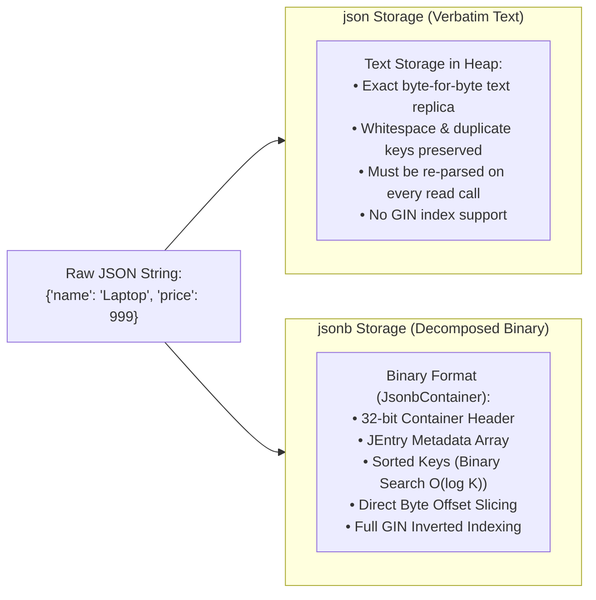
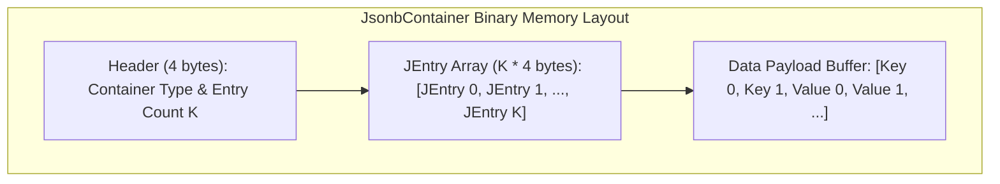
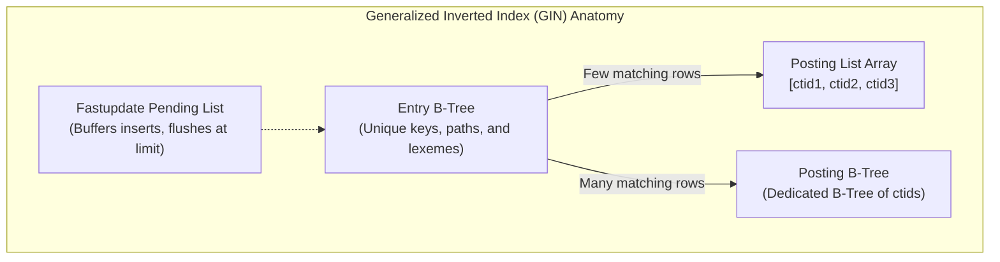
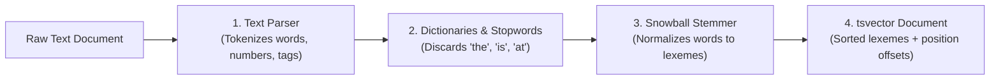
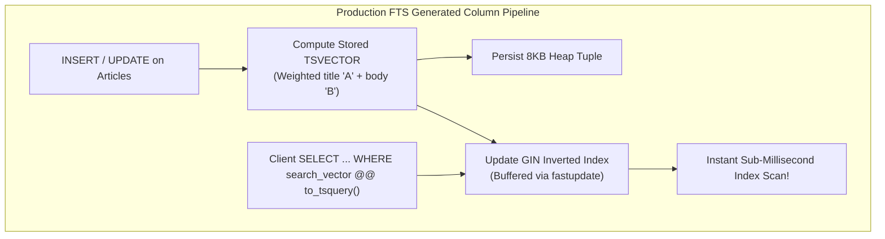

# Module 05 — Semi-Structured Data: JSON/JSONB & Full-Text Search

Welcome to **Module 05** of the PostgreSQL 18 Curriculum. This module provides a comprehensive, academically grounded, and production-tested analysis of semi-structured document storage and information retrieval in PostgreSQL. We dissect the binary internal representation of `jsonb` at the byte level, examine SQL/JSON path language algebra, contrast Generalized Inverted Index (GIN) operator classes (`jsonb_ops` vs. `jsonb_path_ops`), explore Information Retrieval (IR) theory (TF-IDF and cover density ranking), and evaluate GIN index structures including posting trees, fastupdate buffers, and GiST lossy signature trade-offs.

---

## 1. Core Terminology & Concept Definitions

To establish conceptual precision across this curriculum, the following semi-structured and search terms are formally defined:

- **JSONB (`Binary JSON`)**: A decomposed, parsed binary representation of JSON data stored in PostgreSQL. JSONB normalizes whitespace and key ordering while enabling $O(\log K)$ binary key searches, nested attribute slicing, and inverted index acceleration.
- **`JEntry` (JSON Entry Header)**: A 32-bit internal metadata header associated with each element within a JSONB container that encodes data type flags, offset lengths, and nesting indicators.
- **Containment Operator (`@>`)**: A binary Boolean operator evaluating whether the left-hand JSONB document structurally contains and matches all key-value pairs or array elements specified in the right-hand JSONB document:
  $$A \supseteq B \iff A \text{ @> } B$$
- **SQL/JSON Path Expressions**: An ISO/IEC standard declarative expression language integrated into PostgreSQL that allows developers to navigate, filter, and project elements from deeply nested JSON documents.
- **Text Search Vector (`tsvector`)**: A sorted collection of normalized, distinct lexemes representing an input text document, with stop words removed and integer positional offsets recorded.
- **Text Search Query (`tsquery`)**: A structured Boolean tree of normalized search lexemes connected by relational search operators (`&` for AND, `|` for OR, `!` for NOT, `<N>` for word distance/phrase matching).
- **Lexeme**: The canonical, morphological base form of a word produced by a language-specific dictionary stemmer (e.g., "analyzing", "analyzed", and "analysis" normalize to the canonical lexeme `'analys'`).
- **Generalized Inverted Index (GIN)**: An index access method that maps individual decomposed tokens (such as JSONB keys, array elements, and text lexemes) to ordered collections of physical heap tuple pointers (`ItemPointer` / `ctid`).
- **Posting List**: An array of sorted heap row identifiers (`ctid`s) stored within a GIN index leaf page corresponding to a single indexed key.
- **Posting Tree**: A secondary B-Tree of `ctid`s created dynamically by GIN when a single key's posting list overflows an 8KB index block.

---

## 2. Low-Level Storage Architectures: `json` vs. `jsonb`

PostgreSQL provides two native types for handling JSON documents, representing fundamentally different engineering trade-offs:



### The Binary Anatomy of `jsonb`
Internally, a `jsonb` datum is stored as a `JsonbContainer` C-struct:
1. **Container Header (32 bits)**: Encodes whether the container is an Object, an Array, or a Scalar, along with the total number of entries ($K$).
2. **`JEntry` Array**: A contiguous array of 32-bit headers, one for each key and value in the container:
   - **Bits 0..27 (28 bits)**: Offset into the raw data buffer.
   - **Bits 28..31 (4 bits)**: Type flag (`0x00` = String, `0x01` = Numeric, `0x02` = Boolean False, `0x03` = Boolean True, `0x04` = Null, `0x05` = Container Object/Array).
3. **Data Payload Buffer**: Contiguous byte buffer containing raw string bytes and binary-encoded numerics.
4. **Key Sorting**: Keys are sorted in storage by **byte length first**, and **lexicographically second**. This enables binary search lookups ($O(\log K)$) across keys without scanning the entire document.



> [!TIP]
> In production systems, standardize on **`jsonb`** in 99% of workloads. Reserve plain `json` strictly for audit log tables where exact character-for-character replication (including original formatting, whitespace, and duplicate keys) is legally required.

---

## 3. High-Performance JSONB Operators & Expressions

```sql
CREATE TABLE product_catalogs (
    id UUID PRIMARY KEY DEFAULT uuidv7(),
    title VARCHAR(120) NOT NULL,
    metadata JSONB NOT NULL DEFAULT '{}'::jsonb
);

INSERT INTO product_catalogs (title, metadata) VALUES
(
    'Pro Studio Display',
    '{
        "brand": "TechCorp",
        "specs": {
            "resolution": "5K",
            "refresh_rate": 120,
            "ports": ["Thunderbolt 4", "HDMI 2.1", "USB-C"]
        },
        "inventory": {
            "in_stock": true,
            "quantity": 35
        },
        "tags": ["audio", "video", "creator"]
    }'::jsonb
);
```

### Operator Navigation Matrix

| Operator | Left Operand | Right Operand | Result Type | Semantic Meaning |
| :--- | :--- | :--- | :--- | :--- |
| `->` | `jsonb` | `text` or `int` | `jsonb` | Extract element by key or array index (preserves JSON quotes). |
| `->>` | `jsonb` | `text` or `int` | `text` | Extract element as unquoted text. |
| `#>` | `jsonb` | `text[]` | `jsonb` | Extract nested object along a path array (e.g. `'{specs, resolution}'`). |
| `#>>` | `jsonb` | `text[]` | `text` | Extract nested object along a path array as unquoted text. |
| `@>` | `jsonb` | `jsonb` | `boolean` | Structural containment: Does left document contain right pattern? |
| `<@` | `jsonb` | `jsonb` | `boolean` | Structural contained-in: Is left document enclosed within right? |
| `?` | `jsonb` | `text` | `boolean` | Does top-level key exist? |
| `?\|` | `jsonb` | `text[]` | `boolean` | Do *any* of the specified keys exist? |
| `?&` | `jsonb` | `text[]` | `boolean` | Do *all* of the specified keys exist? |

```sql
SELECT 
    title,
    metadata->'specs' AS specs_jsonb,
    metadata->>'brand' AS brand_name,
    metadata->'specs'->'ports'->>0 AS primary_port,
    metadata#>'{specs, resolution}' AS resolution_jsonb,
    (metadata#>>'{inventory, quantity}')::integer AS stock_quantity
FROM product_catalogs
WHERE metadata @> '{"inventory": {"in_stock": true}}'
  AND metadata ?& ARRAY['brand', 'specs'];
```

---

## 4. Immutable JSONB Manipulation

Because PostgreSQL tuples are immutable under MVCC, modifying JSONB attributes creates a modified binary representation rather than altering disk bytes in place:

```sql
-- 1. Targeted Path Update with jsonb_set
UPDATE product_catalogs
SET metadata = jsonb_set(
    metadata, 
    '{specs, refresh_rate}', 
    '144'::jsonb, 
    create_if_missing => false
)
WHERE title = 'Pro Studio Display';

-- 2. Concatenation & Shallow Object Merge (||)
UPDATE product_catalogs
SET metadata = metadata || '{"warranty_period_months": 36, "compliance_certified": true}'::jsonb
WHERE title = 'Pro Studio Display';

-- 3. Key Deletion using Minus (-) Operator
UPDATE product_catalogs
SET metadata = metadata - 'compliance_certified'
WHERE title = 'Pro Studio Display';

-- 4. Deep Path Deletion using Hash-Minus (#-) Operator
UPDATE product_catalogs
SET metadata = metadata #- '{specs, ports, 1}' -- Removes index 1 ('HDMI 2.1')
WHERE title = 'Pro Studio Display';
```

---

## 5. Standard ISO SQL/JSON Path Language (`jsonpath`)

The SQL/JSON path language (SQL:2016 standard) provides standardized navigation and structural predicate filtering:

```sql
-- 1. Predicate Existence Testing (jsonb_path_exists)
SELECT title FROM product_catalogs
WHERE jsonb_path_exists(metadata, '$.specs.ports[*] ? (@ == "Thunderbolt 4")');

-- 2. Value Projection with Filtering (jsonb_path_query)
SELECT 
    title,
    jsonb_path_query(metadata, '$.specs.refresh_rate') AS refresh_rate,
    jsonb_path_query_array(metadata, '$.specs.ports[*]') AS all_ports
FROM product_catalogs;

-- 3. Complex Arithmetic & Predicate Filtering (jsonb_path_match)
SELECT title
FROM product_catalogs
WHERE jsonb_path_match(
    metadata, 
    '$.inventory.quantity >= 20 && $.specs.refresh_rate >= 120'
);
```

---

## 6. Generalized Inverted Index (GIN) Architecture & Operator Classes

### The GIN Index Internal Structure
A GIN index consists of:
1. **Entry Tree**: A balanced B-Tree containing unique extracted keys/lexemes.
2. **Posting List**: A compact array of `ctid` pointers stored on leaf pages.
3. **Posting Tree**: When a single key occurs in thousands of rows (e.g. `{"in_stock": true}`), the posting list expands into a full independent B-Tree of `ctid`s.
4. **`fastupdate` Pending List**: To avoid synchronous B-Tree leaf rebalancing during high-volume `INSERT`s, new entries are buffered into a flat unsorted pending list. When the pending list exceeds `gin_pending_list_limit` (default: 4MB), or during `VACUUM`, the entries are batched and inserted into the main GIN tree.



### `jsonb_ops` vs. `jsonb_path_ops` Trade-Off Analysis

| Dimension | `jsonb_ops` (Default) | `jsonb_path_ops` |
| :--- | :--- | :--- |
| **Indexed Unit** | Every key, path, and scalar value separately. | 32-bit hash of each complete path + leaf value. |
| **Supported Operators** | `@>`, `?`, `?\|`, `?&` | Strict `@>` (Containment) only. |
| **Index Size on Disk** | Large (indexes all individual keys and values). | **Up to 60% smaller** (stores only compact 32-bit hashes). |
| **Lookup Speed** | Moderate. | **Significantly faster** for deep containment queries. |

```sql
-- Comprehensive GIN index supporting containment (@>) and key existence (?):
CREATE INDEX idx_catalogs_meta_ops ON product_catalogs USING GIN (metadata);

-- Highly optimized GIN index for deep structural containment (@>) queries:
CREATE INDEX idx_catalogs_meta_path_ops ON product_catalogs USING GIN (metadata jsonb_path_ops);
```

---

## 7. Full-Text Search (FTS) Fundamentals & Information Retrieval

Relational string searches using `LIKE '%term%'` require exhaustive sequential heap scans and cannot process linguistic morphology ("developer" vs. "developing"). PostgreSQL's native FTS subsystem implements formal Information Retrieval pipelines:



### 1. Linguistic Parsing & The `tsvector` Type
The `to_tsvector()` function normalizes input text into sorted lexemes and positional offsets:

```sql
SELECT to_tsvector('english', 'The engineers are engineering PostgreSQL 18 databases');
-- Result: '18':6 'databas':7 'engin':2,4 'postgresql':5
```
Notice that:
- Stop words (`The`, `are`) are discarded.
- `engineers` and `engineering` both normalize to the single root lexeme `'engin'`.
- Word positions (`2, 4`) are preserved for proximity matching.

### 2. Search Expressions & The `tsquery` Type
The `to_tsquery()` function compiles search terms into a Boolean expression tree:
- **`&` (AND)**: `to_tsquery('english', 'database & postgresql')`
- **`|` (OR)**: `to_tsquery('english', 'postgres | mysql')`
- **`!` (NOT)**: `to_tsquery('english', '!oracle')`
- **`<N>` (Phrase / Distance)**: Words must appear within $N$ positions of each other:
  ```sql
  -- Matches 'postgresql' immediately followed by '18' (distance = 1)
  SELECT to_tsquery('english', 'postgresql <-> 18');
  -- Matches 'distributed' within 3 words of 'database'
  SELECT to_tsquery('english', 'distributed <3> database');
  ```

### 3. Executing Search via the Match Operator (`@@`)
```sql
SELECT title
FROM product_catalogs
WHERE to_tsvector('english', title) @@ to_tsquery('english', 'studio & display');
```

---

## 8. Document Weighting, Cover Density Ranking & Highlighting

### Document Weighting (`setweight`)
Lexemes can be assigned one of four priority weights (`A`, `B`, `C`, `D`):
- `A` = 1.0 (Title / Primary header)
- `B` = 0.4 (Subtitle / Abstract)
- `C` = 0.2 (Body text)
- `D` = 0.1 (Metadata / Footnotes)

### Ranking Algorithms: `ts_rank` vs. `ts_rank_cd`
- **`ts_rank`**: Computes standard term frequency ($TF$) ranking based on how often matching lexemes appear.
- **`ts_rank_cd` (Cover Density)**: Calculates ranking based on the proximity of matching lexemes to one another. Documents where search terms cluster closely together in a sentence receive significantly higher scores.

```sql
SELECT 
    title,
    ts_rank_cd(
        setweight(to_tsvector('english', title), 'A') || 
        setweight(to_tsvector('english', metadata->>'brand'), 'B'),
        to_tsquery('english', 'techcorp & display')
    ) AS relevance_score
FROM product_catalogs
ORDER BY relevance_score DESC;
```

### Result Snippet Highlighting (`ts_headline`)
```sql
SELECT 
    title,
    ts_headline(
        'english', 
        'The Pro Studio Display features an incredible 5K panel with Thunderbolt 4 connectivity.',
        to_tsquery('english', '5k & thunderbolt'),
        'StartSel=<b>, StopSel=</b>, MaxWords=25, MinWords=10'
    ) AS highlighted_snippet;
-- Result: "The Pro Studio Display features an incredible <b>5K</b> panel with <b>Thunderbolt</b> 4 connectivity."
```

---

## 9. Production-Grade FTS Indexing & Physical Storage Architecture

Computing `to_tsvector()` on the fly during queries forces full table sequential scans. In production systems:
1. Materialize the vector into a **Stored Generated Column**.
2. Build an inverted **GIN index** on the pre-computed column.



```sql
CREATE TABLE technical_articles (
    article_id UUID PRIMARY KEY DEFAULT uuidv7(),
    title VARCHAR(255) NOT NULL,
    abstract TEXT,
    content TEXT NOT NULL,
    
    -- Stored Generated Column: pre-computed and stored in heap
    search_vector TSVECTOR GENERATED ALWAYS AS (
        setweight(to_tsvector('english', coalesce(title, '')), 'A') ||
        setweight(to_tsvector('english', coalesce(abstract, '')), 'B') ||
        setweight(to_tsvector('english', coalesce(content, '')), 'C')
    ) STORED
);

-- Inverted GIN Index
CREATE INDEX idx_articles_search_vector ON technical_articles USING GIN (search_vector);

-- Sub-millisecond Execution
SELECT article_id, title, ts_rank_cd(search_vector, q) AS rank
FROM technical_articles, to_tsquery('english', 'postgresql & mvcc') AS q
WHERE search_vector @@ q
ORDER BY rank DESC
LIMIT 10;
```

---

## 10. Summary & Module Progression

In this module, we examined:
- The binary decomposition of `jsonb` (`JsonbContainer`, `JEntry` headers, and key sorting).
- JSON path navigation, containment (`@>`), and standard ISO SQL/JSON path queries.
- GIN index internal mechanics: Entry Trees, Posting Lists, Posting Trees, and `fastupdate` buffers.
- The performance trade-offs of `jsonb_ops` versus `jsonb_path_ops`.
- Natural language text processing: tokenization, stop word elimination, Snowball stemming, and `tsvector` generation.
- Phrase matching (`<N>`), document weighting (`setweight`), cover density ranking (`ts_rank_cd`), and snippet generation (`ts_headline`).
- Pre-computing search vectors via Stored Generated Columns with GIN index acceleration.

Proceed to **[Module 06 — Concurrency, Transactions & MVCC Internals](./06-concurrency-transactions-and-mvcc.md)** to explore PostgreSQL's transaction isolation levels, heap tuple version headers, Serializable Snapshot Isolation (SSI) anti-dependency cycles, and lock conflict matrices.
