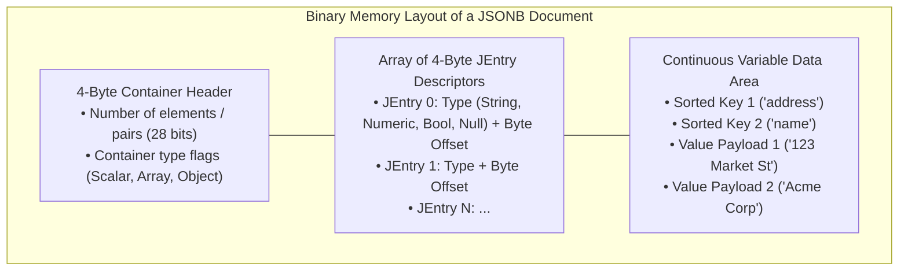
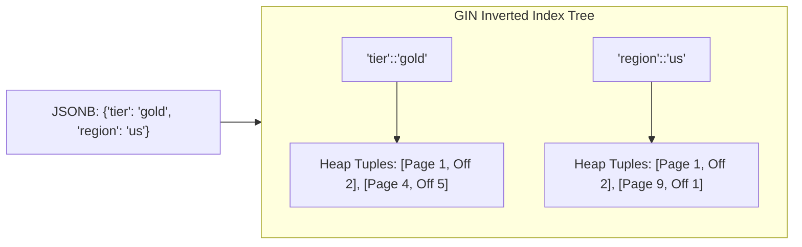
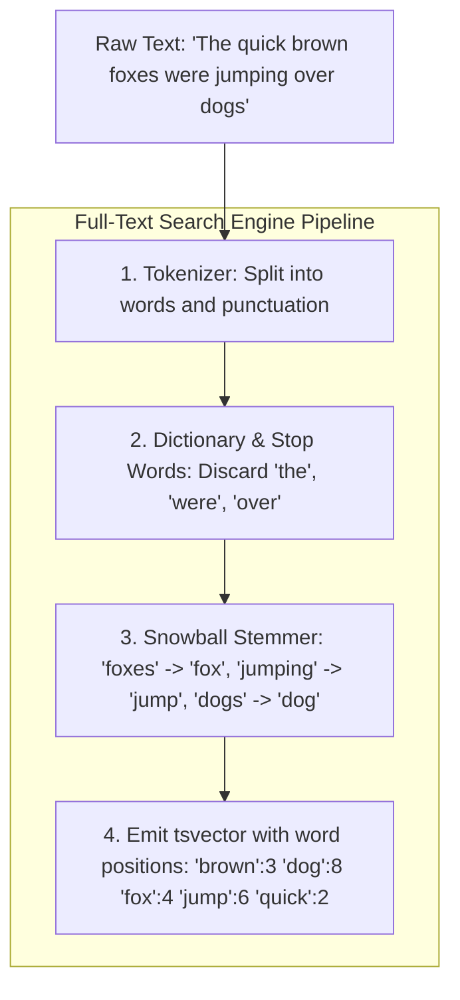
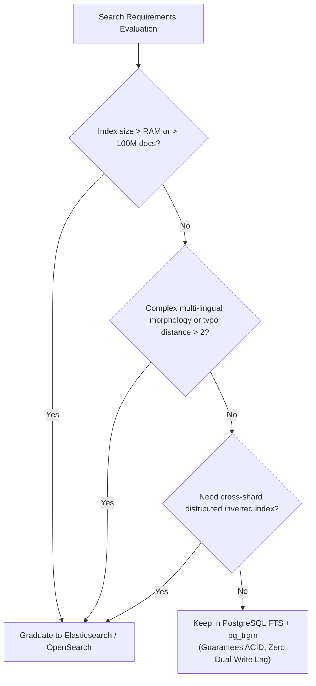

# Module 05 — Semi-Structured Data, JSONB & Full-Text Search

Welcome to **Module 05** of the PostgreSQL curriculum. This module provides an in-depth, production-tested examination of semi-structured document storage, SQL/JSON standard operations, Generalized Inverted Index (GIN) mechanics, and full-text document retrieval in PostgreSQL 18. We dissect the binary layout of `jsonb`, evaluate JSONPath query engines, transform documents with SQL/JSON `JSON_TABLE`, benchmark `jsonb_ops` versus `jsonb_path_ops`, construct linguistic search pipelines using `tsvector` and `tsquery`, execute fuzzy similarity matching with `pg_trgm`, and define the architectural boundary for when to graduate to Elasticsearch.

---

## 1. Core Terminology & Concept Definitions

- **`json` vs `jsonb`**: `json` stores exact textual strings (preserving whitespace and duplicate keys), requiring on-the-fly parsing on every query. `jsonb` parses JSON into a decomposed binary format at write time, deduplicating keys, sorting them, and storing index offsets for $O(\log K)$ key lookups.
- **JSONPath**: An expression language standardized in SQL:2016 for navigating and filtering complex JSON hierarchies using path projections (`$.user.orders[*].total`).
- **`JSON_TABLE`**: A SQL/JSON standard table function introduced in modern PostgreSQL that transforms nested JSON document arrays into relational columns with explicit SQL data types.
- **Generalized Inverted Index (GIN)**: An index structure designed for composite and multi-valued data types (JSONB, arrays, text search vectors) where index entries map individual components (lexemes or key-value pairs) to an internal posting list of matching heap tuple IDs (`ItemPointer`).
- **`tsvector`**: A sorted array of distinct normalized lexemes (words stripped of suffixes and punctuation) accompanied by integer arrays indicating their physical word positions within the original document.
- **`tsquery`**: A structured full-text search query consisting of lexemes combined with boolean operators (`&` AND, `|` OR, `!` NOT, `<->` phrase distance).
- **Trigram (`pg_trgm`)**: A contiguous sequence of three characters extracted from a string, utilized to compute string similarity scores and accelerate arbitrary substring searches (`ILIKE '%pattern%'`).

---

## 2. JSON vs. JSONB: Binary Internal Mechanics

PostgreSQL's `jsonb` is not a simple string. It is a hierarchical binary format:



### Why `jsonb` Dominates Modern Development
1. **Deduplication**: If an input payload contains `{"status": "open", "status": "closed"}`, `jsonb` retains only the last value (`"closed"`).
2. **Key Ordering**: Keys are physically sorted in binary lexical order, allowing binary search lookups ($O(\log K)$) across keys rather than full string scans.
3. **No Whitespace**: Extraneous spaces, tabs, and indentation are discarded, optimizing cache footprint.

### Primary Query Operators
```sql
CREATE TABLE client_payloads (
    id SERIAL PRIMARY KEY,
    attributes JSONB NOT NULL
);

INSERT INTO client_payloads (attributes) VALUES (
    '{"org": "FinTech", "tier": "gold", "tags": ["pci", "soc2"], "metrics": {"rps": 5000}}'
);

-- Extract as JSONB (->):
SELECT attributes -> 'metrics' FROM client_payloads;
-- Output: {"rps": 5000} (jsonb)

-- Extract as TEXT (->>):
SELECT attributes ->> 'tier' FROM client_payloads;
-- Output: gold (text)

-- Subscripting Syntax:
SELECT attributes['metrics']['rps'] FROM client_payloads;
-- Output: 5000

-- Containment Operator (@>):
SELECT * FROM client_payloads WHERE attributes @> '{"tier": "gold"}';

-- Key Existence Operators (?, ?|, ?&):
SELECT * FROM client_payloads WHERE attributes ? 'org'; -- Has key 'org'
SELECT * FROM client_payloads WHERE attributes -> 'tags' ?| ARRAY['pci', 'hipaa']; -- Has ANY
SELECT * FROM client_payloads WHERE attributes -> 'tags' ?& ARRAY['pci', 'soc2'];  -- Has ALL
```

---

## 3. SQL/JSON Standard Functions & JSONPath

PostgreSQL 18 fully implements the SQL:2016 standard for SQL/JSON querying.

### JSONPath Expressions
JSONPath provides structured filtering within queries:

```sql
-- Find items with unit price > 100:
SELECT jsonb_path_query(
    '{"items": [{"name": "A", "price": 45}, {"name": "B", "price": 150}]}',
    '$.items[*] ? (@.price > 100)'
);
-- Returns: {"name": "B", "price": 150}
```

### Relational Projection via `JSON_TABLE`
`JSON_TABLE` unpacks hierarchical JSON arrays into a normalized relational table without needing legacy `jsonb_to_recordset` hacks:

```sql
SELECT j.*
FROM client_payloads p,
JSON_TABLE(
    p.attributes,
    '$' COLUMNS (
        org_name TEXT PATH '$.org',
        tier_level TEXT PATH '$.tier',
        peak_rps INT PATH '$.metrics.rps'
    )
) AS j;
```

---

## 4. GIN Indexing for JSONB: `jsonb_ops` vs. `jsonb_path_ops`

A standard B-tree index cannot index the internal components of a JSONB document. PostgreSQL requires a **Generalized Inverted Index (GIN)**:



### Operator Class Comparison

```sql
-- 1. Default GIN (jsonb_ops):
CREATE INDEX idx_payload_default ON client_payloads USING gin (attributes);

-- 2. Path-Optimized GIN (jsonb_path_ops):
CREATE INDEX idx_payload_path ON client_payloads USING gin (attributes jsonb_path_ops);
```

| Dimension | Default `jsonb_ops` | Path-Optimized `jsonb_path_ops` |
| :--- | :--- | :--- |
| **Indexed Entries** | Indexes every key, every value, and every path independently | Indexes a 32-bit hash of the complete `path = value` pair |
| **Supported Operators** | `@>`, `?`, `?|`, `?&` | **Only `@>`** (Containment) |
| **Index Size** | Large (indexes individual keys multiple times) | **30% to 50% smaller** footprint |
| **Query Speed** | Fast for containment and key existence | **Significantly faster** for deep containment queries |

> [!TIP]
> If your application queries exclusively using containment (`attributes @> '{"key": "value"}'`), always use `jsonb_path_ops` to save memory and boost query performance.

---

## 5. Full-Text Search: `tsvector`, `tsquery` & Relevance Ranking

PostgreSQL contains a built-in search engine capable of morphological linguistic analysis across multiple languages.



### Document Vectorization and Querying
```sql
CREATE TABLE knowledge_base (
    id SERIAL PRIMARY KEY,
    title TEXT NOT NULL,
    body TEXT NOT NULL,
    search_vector TSVECTOR GENERATED ALWAYS AS (
        setweight(to_tsvector('english', title), 'A') ||
        setweight(to_tsvector('english', body), 'B')
    ) STORED
);

CREATE INDEX idx_kb_search ON knowledge_base USING gin (search_vector);

-- Search using tsquery:
SELECT 
    title,
    ts_rank(search_vector, query) AS rank_score
FROM knowledge_base,
to_tsquery('english', 'fox & jumping') query
WHERE search_vector @@ query
ORDER BY rank_score DESC;
```

### Phrase Searching (`<->`)
The `<->` operator enforces word distance:
```sql
-- Search for 'database' followed immediately by 'systems':
SELECT to_tsvector('english', 'Relational database systems') @@ 
       to_tsquery('english', 'database <-> systems');
-- Evaluates to TRUE
```

---

## 6. Fuzzy Substring Matching with `pg_trgm`

Standard B-tree indexes cannot satisfy arbitrary wildcard queries (`WHERE name ILIKE '%substring%'`) because the prefix is unknown. The `pg_trgm` extension solves this by decomposing strings into 3-character slices:

```sql
CREATE EXTENSION IF NOT EXISTS pg_trgm;

-- The string 'cat' generates trigrams: '  c', ' ca', 'cat', 'at '
SELECT show_trgm('cat');

CREATE TABLE products (id SERIAL PRIMARY KEY, name TEXT NOT NULL);
INSERT INTO products (name) VALUES ('Apple MacBook Pro 16'), ('Sony Bravia OLED TV');

-- Create a Trigram GIN index:
CREATE INDEX idx_products_name_trgm ON products USING gin (name gin_trgm_ops);

-- Accelerates leading-wildcard queries:
EXPLAIN ANALYZE
SELECT * FROM products WHERE name ILIKE '%macbook%';
```

---

## 7. Architectural Seam: PostgreSQL FTS vs. Elasticsearch

PostgreSQL FTS and trigrams satisfy 90% of web application search requirements without managing a secondary data store. However, specialized search engines become necessary at specific scale thresholds.



> [!NOTE]
> For distributed Lucene architectures, BM25 scoring engines, cross-cluster replication, and high-volume tokenization pipelines, consult the dedicated track [technologies/elasticsearch](../../technologies/elasticsearch/README.md).

---

## 8. Then vs. Now: Semi-Structured Data & Search

| Capability | PostgreSQL $\le$ 14 | PostgreSQL 15–17 | PostgreSQL 18 & 19 (Current) |
| :--- | :--- | :--- | :--- |
| **SQL/JSON Functions** | Partial JSONPath functions | Added `JSON_TABLE`, `JSON_QUERY` | Full SQL:2016 SQL/JSON compliance with performance optimizations |
| **JSON Subscripting** | Only operators (`->`, `->>`) | Added basic subscripting | Native multidimensional subscripting (`data['a']['b']`) across all query types |
| **GIN Concurrency** | Periodic lock contention during fastinsert cleanups | Improved page vacuuming in GIN | Parallel GIN build optimizations and reduced locking overhead |

---

## 9. Interview Drill

<details>
<summary>1. Explain the architectural and performance differences between `json` and `jsonb` data types in PostgreSQL.</summary>

**Answer**: `json` stores an exact copy of the input text, preserving formatting, whitespace, and duplicate keys. Every query inspecting a `json` column must parse the text from scratch, resulting in $O(N)$ CPU parsing overhead per read. In contrast, `jsonb` parses the document at write time into an internal decomposed binary format. Keys are sorted, whitespace is discarded, and duplicate keys are removed. `jsonb` supports binary search key lookup ($O(\log K)$) and GIN indexing, making it vastly superior for querying, filtering, and indexing.
- Ref: [PostgreSQL Documentation: JSON Types](https://www.postgresql.org/docs/18/datatype-json.html)
</details>

<details>
<summary>2. When should you use `jsonb_path_ops` instead of the default `jsonb_ops` in a GIN index?</summary>

**Answer**: `jsonb_ops` (the default) creates independent index entries for every key, value, and sub-path in the document. It supports containment (`@>`) as well as key-existence operators (`?`, `?|`, `?&`). However, this produces large index files. `jsonb_path_ops` computes a single 32-bit hash for each leaf path-value combination (e.g., hash of `$.address.zip = 94107`). It only supports the containment operator (`@>`), but generates indexes that are 30% to 50% smaller on disk and significantly faster to scan. Use `jsonb_path_ops` when queries only filter via `@>`.
- Ref: [PostgreSQL Documentation: GIN Internals: jsonb_ops](https://www.postgresql.org/docs/18/datatype-json.html#JSON-INDEXING)
</details>

<details>
<summary>3. Why can't a standard B-tree index accelerate `WHERE description ILIKE '%engine%'`, and how does `pg_trgm` solve this?</summary>

**Answer**: A B-tree index sorts keys lexicographically from left to right. When a search query specifies a leading wildcard (`%engine%`), the prefix is unknown, preventing the B-tree from seeking to a specific starting position in the leaf pages; the engine must fall back to a full sequential table scan. The `pg_trgm` extension breaks strings into 3-character slices (trigrams). A GIN index on trigrams (`USING gin (description gin_trgm_ops)`) maps individual trigrams to the rows containing them. During a wildcard query, PostgreSQL extracts trigrams from the search pattern and performs an index lookup on the matching trigrams, identifying candidate rows in $O(\log N)$ time.
- Ref: [PostgreSQL Documentation: pg_trgm](https://www.postgresql.org/docs/18/pgtrgm.html)
</details>

<details>
<summary>4. What is the function of the SQL/JSON standard `JSON_TABLE` function?</summary>

**Answer**: `JSON_TABLE` is a SQL:2016 standard function that maps complex, nested JSON data into a virtual relational table directly within a SQL query. It takes a JSON document and a path expression identifying array rows, and allows you to declare explicit SQL column names and types for each extracted attribute using `COLUMNS (...) PATH '...'`. This eliminates the need for procedural unpacking or complex JSON array unnesting.
- Ref: [PostgreSQL Documentation: JSON Functions: JSON_TABLE](https://www.postgresql.org/docs/18/functions-json.html#FUNCTIONS-SQLJSON-TABLE)
</details>

<details>
<summary>5. At what architectural threshold should an engineering team graduate from PostgreSQL Full-Text Search to a dedicated engine like Elasticsearch?</summary>

**Answer**: Graduate to Elasticsearch/OpenSearch when:
1. Search volume or index size exceeds PostgreSQL's RAM, causing search queries to starve the transactional OLTP buffer pool.
2. The system requires advanced multi-lingual NLP (lemmatization, compound word splitting, phonetic matching like Double Metaphone) not supported by PostgreSQL's Snowball stemmer.
3. You require complex BM25 scoring with term frequency/inverse document frequency (TF/IDF) tuned across distributed shards.
4. You require multi-cluster distributed sharding and horizontal scaling for billions of log records or documents.
Keep search in PostgreSQL when ACID transactional consistency and zero dual-write lag between the primary data and the search index are paramount.
- Ref: [PostgreSQL Documentation: Full Text Search](https://www.postgresql.org/docs/18/textsearch.html)
</details>
