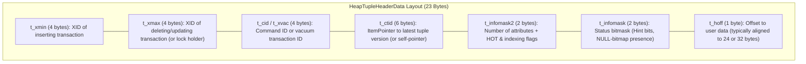
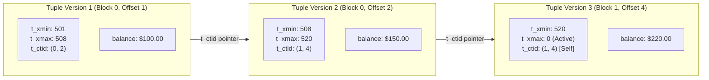
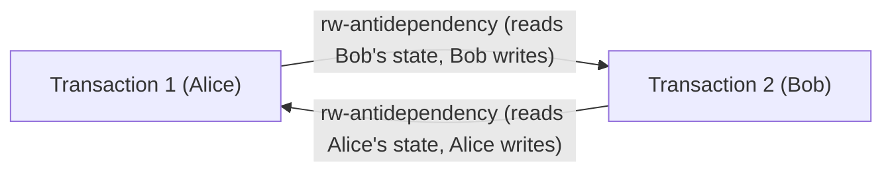
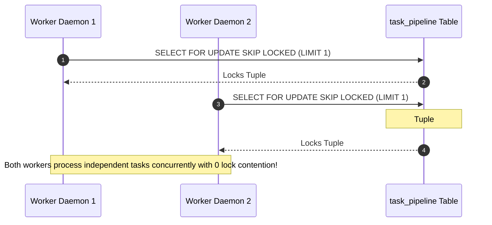
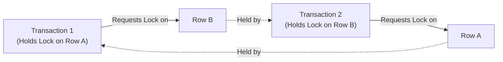

# Module 06 — Concurrency, Transactions & MVCC Internals

Welcome to **Module 06** of the PostgreSQL 18 Curriculum. This module provides a rigorous, academically grounded, and production-tested exploration of database concurrency control. We examine the formal mathematics of Multi-Version Concurrency Control (MVCC) and Serializability theory, dissect the physical 23-byte `HeapTupleHeaderData` and the subtle mechanics of Hint Bits, trace the Cahill-Rohm-Fekete theorem for Serializable Snapshot Isolation (SSI) anti-dependency cycles, evaluate the exhaustive 8x8 table lock conflict matrix, and implement non-blocking work queues using `FOR UPDATE SKIP LOCKED`.

---

## 1. Core Terminology & Concept Definitions

To establish absolute precision across this curriculum, the following concurrency terms are formally defined:

- **Multi-Version Concurrency Control (MVCC)**: A concurrency control architecture where updates and deletions generate new physical versions of tuples rather than mutating data in place. This guarantees that read operations never block write operations, and write operations never block read operations.
- **Transaction ID (`xid`)**: A monotonic 32-bit integer assigned to every transaction that performs data modifications or explicitly requests an ID. In memory and WAL, this is extended by a 32-bit epoch counter to form an internal 64-bit transaction identifier (`FullTransactionId`).
- **Tuple Header (`HeapTupleHeaderData`)**: A 23-byte binary metadata structure prefixing every physical row stored in an 8KB disk block, containing transaction visibility bounds (`t_xmin`, `t_xmax`), version chain pointers (`t_ctid`), and status bitmasks (`t_infomask`).
- **Commit Log (`pg_xact`)**: A compact cluster-wide shared memory ring buffer and disk array storing 2-bit commit state statuses (`IN_PROGRESS`, `COMMITTED`, `ABORTED`, `SUB_COMMITTED`) for every transaction ID.
- **Hint Bits**: Status flags within `t_infomask` (`HEAP_XMIN_COMMITTED`, `HEAP_XMAX_INVALID`, etc.) written onto the tuple by the first reader that confirms transaction status in `pg_xact`, eliminating future CLOG lookups for subsequent queries.
- **Serializable Snapshot Isolation (SSI)**: The highest ANSI isolation level, mathematically proven to enforce true conflict serializability by tracking read-write anti-dependencies (`SIREAD` locks) without blocking concurrent reads or writes.
- **$rw$-Antidependency (Serialization Anomaly Edge)**: A directional relationship ($T_1 \xrightarrow{rw} T_2$) where transaction $T_1$ reads a version of an item $X$, and concurrent transaction $T_2$ writes a newer version of $X$ that $T_1$ did not observe.
- **Pivot Transaction**: A transaction in an active SSI serialization graph that possesses both an incoming $rw$-antidependency edge and an outgoing $rw$-antidependency edge ($T_{in} \xrightarrow{rw} T_{pivot} \xrightarrow{rw} T_{out}$).
- **MultiXactId**: A composite transaction identifier used when multiple concurrent transactions acquire shared row-level locks (`FOR SHARE` or `FOR KEY SHARE`) on the exact same tuple.

---

## 2. Low-Level Tuple Anatomy & Hint Bit Dynamics

### Binary Layout of `HeapTupleHeaderData`
Every physical tuple stored on an 8KB page begins with a 23-byte header:



### The MVCC Version Chain
In PostgreSQL:
- An **`INSERT`** allocates a line pointer and writes a tuple with `t_xmin = current_xid` and `t_xmax = 0`.
- A **`DELETE`** does not erase bytes; it sets `t_xmax = current_xid` on the target tuple.
- An **`UPDATE`** executes an atomic delete of the old version and insert of the new version:
  1. Old tuple: `t_xmax` is set to `current_xid`.
  2. Old tuple: `t_ctid` is updated from pointing to itself to point to the `(block, offset)` of the new tuple.
  3. New tuple: `t_xmin` is set to `current_xid`, `t_xmax = 0`, and `t_ctid` points to itself.



### The Hint Bits Phenomenon: Why `SELECT` Writes Dirty Pages
Checking whether transaction `t_xmin` committed requires accessing the Commit Log (`pg_xact`). Because accessing `pg_xact` involves shared memory lookups and potential disk I/O:
1. The first backend process that inspects a tuple queries `pg_xact` to determine if `t_xmin` committed.
2. Upon confirming commit, the backend sets the hint bit `HEAP_XMIN_COMMITTED` directly in the tuple's `t_infomask`.
3. Subsequent queries reading that tuple immediately observe the hint bit and bypass `pg_xact` entirely.
4. **Architectural Consequence**: Setting hint bits modifies bytes on the 8KB page. Therefore, **a purely read-only `SELECT` query can mark pages as dirty in `shared_buffers`**, requiring the background writer or checkpointer to write them back to disk!

---

## 3. Snapshot Isolation & ANSI Isolation Levels

A PostgreSQL transaction snapshot determines which tuple versions are visible to active queries:
$$\text{Snapshot} = (XMIN, XMAX, \{xid_1, xid_2, \dots, xid_k\})$$
- **$XMIN$**: Lowest transaction ID that was still active when the snapshot was taken. All tuples with $t\_xmin < XMIN$ are visible (committed).
- **$XMAX$**: First unassigned transaction ID when the snapshot was taken. All tuples with $t\_xmin \ge XMAX$ are invisible.
- **$\{xid_1, \dots, xid_k\}$**: The array of active, uncommitted transaction IDs between $XMIN$ and $XMAX$ at the snapshot moment.

### The Four ANSI Isolation Levels Evaluated

| Isolation Level | Dirty Read | Non-Repeatable Read | Phantom Read | Serialization Anomaly (Write Skew) |
| :--- | :--- | :--- | :--- | :--- |
| **Read Uncommitted** | Not Possible (Treated as Read Committed) | Allowed | Allowed | Allowed |
| **Read Committed** (Default) | Not Possible | Allowed | Allowed | Allowed |
| **Repeatable Read** | Not Possible | Not Possible | Not Possible | Allowed |
| **Serializable** (SSI) | Not Possible | Not Possible | Not Possible | **Prevented** |

```mermaid
sequenceDiagram
    autonumber
    participant T1 as Transaction 1 (Read Committed)
    participant T2 as Transaction 2 (Concurrent Session)
    participant DB as Heap Storage

    T1->>DB: BEGIN;
    T1->>DB: SELECT balance FROM accounts WHERE id = 1; (Reads $100)
    Note over T1: Snapshot 1 Established
    T2->>DB: UPDATE accounts SET balance = 300 WHERE id = 1; COMMIT;
    T1->>DB: SELECT balance FROM accounts WHERE id = 1; (Reads $300!)
    Note over T1: Fresh Snapshot Established on Statement 2!
    T1->>DB: COMMIT;
```

---

## 4. Formal Theory of Serializable Snapshot Isolation (SSI)

### The Write Skew Anomaly
Repeatable Read isolation prevents phantom rows and non-repeatable reads within a single row or predicate, but it cannot prevent **Write Skew**: concurrent transactions evaluating overlapping state, verifying constraints independently, and executing disjoint writes that collectively break a global invariant.

#### The Classic Medical On-Call Constraint
*Invariant: At least one doctor must remain actively on call at all times.*

```sql
-- Initial State: Dr. Alice and Dr. Bob are both on call (count = 2)

-- Transaction 1 (Dr. Alice requests leave)
BEGIN TRANSACTION ISOLATION LEVEL REPEATABLE READ;
SELECT count(*) FROM on_call_doctors WHERE is_on_call = TRUE; -- Returns 2
UPDATE on_call_doctors SET is_on_call = FALSE WHERE doctor_name = 'Alice';
COMMIT;

-- Transaction 2 (Dr. Bob requests leave concurrently)
BEGIN TRANSACTION ISOLATION LEVEL REPEATABLE READ;
SELECT count(*) FROM on_call_doctors WHERE is_on_call = TRUE; -- Returns 2
UPDATE on_call_doctors SET is_on_call = FALSE WHERE doctor_name = 'Bob';
COMMIT;

-- Both transactions commit under Repeatable Read!
-- Active on-call doctors: 0 (Global Invariant Destroyed!)
```

### The Cahill-Rohm-Fekete Theorem & SSI Mechanics
In 2008, Michael Cahill, Uwe Röhm, and Alan Fekete proved that under snapshot isolation, an execution schedule is non-serializable if and only if its directed serialization graph contains a cycle with **two consecutive $rw$-antidependency edges**:

$$T_{in} \xrightarrow{rw} T_{pivot} \xrightarrow{rw} T_{out}$$



PostgreSQL implements this proof natively via **Serializable Snapshot Isolation (SSI)**:
1. Backends acquire in-memory non-blocking **`SIREAD` locks** on tuples, pages, and relations during reads.
2. The SSI lock manager continuously monitors the dependency graph in shared memory.
3. If an active transaction is identified as a **pivot** ($T_{pivot}$) completing a potential serialization cycle, PostgreSQL immediately aborts it with an explicit serialization error:
   ```
   ERROR: could not serialize access due to read/write dependencies among transactions
   DETAIL: Reason code = Canceled on identification as a pivot, during commit attempt.
   HINT: The transaction might succeed if retried.
   ```

---

## 5. Explicit Locking: The Complete 8x8 Table Lock Conflict Matrix

PostgreSQL manages relation-level concurrency through 8 distinct table lock modes. The conflict matrix dictates which locks can be held simultaneously on the same table:

| Requested Lock Mode | Access Share | Row Share | Row Exclusive | Share Update Exclusive | Share | Share Row Exclusive | Exclusive | Access Exclusive |
| :--- | :---: | :---: | :---: | :---: | :---: | :---: | :---: | :---: |
| **`AccessShare`** (`SELECT`) | . | . | . | . | . | . | . | **X** |
| **`RowShare`** (`SELECT FOR UPDATE`) | . | . | . | . | . | . | **X** | **X** |
| **`RowExclusive`** (`INSERT/UPDATE/DELETE`) | . | . | . | . | **X** | **X** | **X** | **X** |
| **`ShareUpdateExclusive`** (`VACUUM`, `ANALYZE`, `CIC`) | . | . | . | **X** | **X** | **X** | **X** | **X** |
| **`Share`** (`CREATE INDEX`) | . | . | **X** | **X** | . | **X** | **X** | **X** |
| **`ShareRowExclusive`** | . | . | **X** | **X** | **X** | **X** | **X** | **X** |
| **`Exclusive`** | . | **X** | **X** | **X** | **X** | **X** | **X** | **X** |
| **`AccessExclusive`** (`DROP`, `TRUNCATE`, `ALTER`) | **X** | **X** | **X** | **X** | **X** | **X** | **X** | **X** |

*(Where **X** indicates a blocking conflict; `.` indicates compatible concurrent execution).*

> [!NOTE]
> Observe that `AccessShare` (standard queries) conflicts **only** with `AccessExclusive`. This mathematical proof explains why ordinary reads and writes never block each other in PostgreSQL!

---

## 6. Row-Level Lock Hierarchy & MultiXactIds

When transactions lock individual tuples, PostgreSQL applies one of four row-level lock strengths:

1. **`FOR UPDATE`**: Strongest lock. Acquired by `DELETE` and `UPDATE` on primary/unique key columns. Conflicts with all other row lock modes.
2. **`FOR NO KEY UPDATE`**: Weaker exclusive lock. Acquired by `UPDATE` statements that do not modify unique key columns. Allows concurrent transactions to acquire `FOR KEY SHARE`.
3. **`FOR SHARE`**: Shared read lock. Prevents concurrent updates, but allows concurrent readers.
4. **`FOR KEY SHARE`**: Weakest lock. Acquired automatically by foreign key integrity checks. Permits concurrent `FOR NO KEY UPDATE` operations.

### MultiXactIds for Shared Row Locks
Because a tuple header contains only one `t_xmax` field (4 bytes), if multiple concurrent transactions acquire `FOR SHARE` on the same tuple, PostgreSQL cannot store multiple XIDs directly in `t_xmax`. Instead:
1. The engine generates a synthetic **`MultiXactId`** representing the set of active reader XIDs.
2. It sets the flag `HEAP_XMAX_IS_MULTI` in `t_infomask`.
3. The individual transaction IDs are stored in the shared memory MultiXact subsystem (`$PGDATA/pg_multixact/`).

---

## 7. High-Throughput Non-Blocking Queues with `FOR UPDATE SKIP LOCKED`

Traditional database queue patterns executing `SELECT ... FOR UPDATE LIMIT 1` suffer severe lock serialization bottlenecks: concurrent worker processes wait in line on the same locked row pointer.

`SKIP LOCKED` instructs the engine to check row lock state and immediately bypass any currently locked tuple without waiting:

```sql
CREATE TABLE task_pipeline (
    task_id UUID PRIMARY KEY DEFAULT uuidv7(),
    task_type VARCHAR(64) NOT NULL,
    payload JSONB NOT NULL,
    task_status VARCHAR(32) NOT NULL DEFAULT 'PENDING',
    retry_count INT NOT NULL DEFAULT 0,
    created_at TIMESTAMPTZ NOT NULL DEFAULT clock_timestamp()
);

-- Highly Scalable Parallel Worker Consumption Query:
BEGIN;
WITH claimed_task AS (
    SELECT task_id
    FROM task_pipeline
    WHERE task_status = 'PENDING'
    ORDER BY created_at ASC
    FOR UPDATE SKIP LOCKED
    LIMIT 1
)
UPDATE task_pipeline
SET 
    task_status = 'PROCESSING',
    retry_count = retry_count + 1
FROM claimed_task
WHERE task_pipeline.task_id = claimed_task.task_id
RETURNING task_pipeline.task_id, task_pipeline.task_type, task_pipeline.payload;

-- Execute processing logic in background application worker...
COMMIT;
```



---

## 8. Deadlock Detection Mechanics & Advisory Locks

### Deadlock Detection Wait-For Graphs
A deadlock occurs when two or more transactions create a circular lock dependency:



- When a transaction blocks waiting for a lock, it starts a timer.
- If it remains blocked after `deadlock_timeout` (default: 1000ms / 1 second), PostgreSQL's Lock Manager executes a cycle detection search across the global **Wait-For Graph**.
- If a directed cycle is identified, PostgreSQL selects one transaction as the victim, aborts it (`ERROR: deadlock detected`, SQLSTATE `40P01`), and rolls back its changes, allowing the survivor to proceed.

### Application-Level Advisory Locks
Advisory locks provide high-speed application mutexes allocated directly within the shared memory Lock Manager without touching disk blocks or tuple headers:

```sql
-- 1. Session-Scoped Advisory Lock (Persists across transactions until unlocked or connection closes)
SELECT pg_advisory_lock(99001);
-- Critical Section: Singleton tasks (e.g. schema migration runner)
SELECT pg_advisory_unlock(99001);

-- 2. Non-Blocking Try Lock (Returns boolean immediately without stalling)
SELECT pg_try_advisory_lock(99001);

-- 3. Transaction-Scoped Advisory Lock (Automatically released upon COMMIT or ROLLBACK)
BEGIN;
SELECT pg_advisory_xact_lock(99001);
-- Protected transactional logic...
COMMIT; -- Lock released automatically!
```

---

## 9. Summary & Module Progression

In this module, we examined:
- Binary tuple layout (`HeapTupleHeaderData`, `t_xmin`, `t_xmax`, `t_ctid`) and the MVCC version chain.
- The Hint Bits mechanism and why read-only `SELECT` queries can dirty pages in `shared_buffers`.
- Snapshot isolation equations and ANSI isolation levels.
- The Cahill-Rohm-Fekete theorem, $rw$-antidependency cycles, and SSI pivot transaction aborts.
- The complete 8x8 table lock conflict matrix and row lock strengths (`FOR UPDATE`, `FOR NO KEY UPDATE`, `FOR SHARE`, `FOR KEY SHARE`).
- MultiXactIds for shared row lock representation.
- Non-blocking worker queues using `FOR UPDATE SKIP LOCKED`.
- Wait-For Graph deadlock detection and application-level advisory locks (`pg_advisory_xact_lock`).

Proceed to **[Module 07 — Query Planning, Indexing Strategies & Tuning](./07-query-planning-indexing-and-tuning.md)** to master the Cost-Based Optimizer, Selinger cost formulas, Lehman-Yao B-Tree mechanics, PostgreSQL 18 B-Tree Skip Scans, and `EXPLAIN (ANALYZE, BUFFERS)` execution plans.
