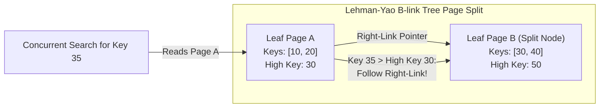
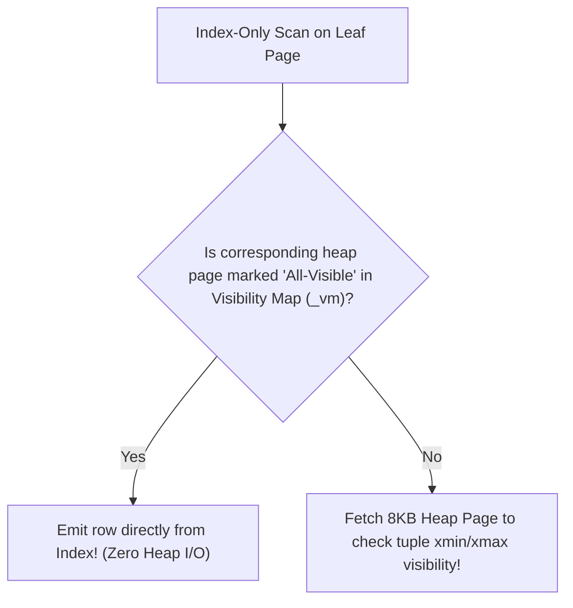

# Module 06 — Indexing Strategies, Access Methods & Physical Storage

Welcome to **Module 06** of the PostgreSQL curriculum. This module provides an advanced, academically grounded analysis of database indexing and physical access methods in PostgreSQL 18. We examine the Lehman-Yao B-link tree concurrency algorithm, investigate PostgreSQL 18 **B-Tree Skip Scans**, analyze specialized access methods (GiST, SP-GiST, BRIN, Hash, Bloom), evaluate Index-Only Scans and their dependency on the Visibility Map, dissect the operational failure modes of `CREATE INDEX CONCURRENTLY`, and perform index integrity verification using `amcheck`.

> [!NOTE]
> For abstract B-tree, B+ tree, and LSM storage engine mathematics and data structure theory, consult the foundational track [architecture/data-systems](../../architecture/data-systems/modules/02-storage-engines-and-indexes.md). This module covers PostgreSQL's concrete physical implementation, concurrency mechanics, and production operations.

---

## 1. Core Terminology & Concept Definitions

- **Lehman-Yao B-link Tree**: The high-concurrency B-tree variant implemented by PostgreSQL, where internal and leaf pages contain a "high key" and a "right-link" pointer to their right sibling, allowing concurrent searches to navigate page splits without holding locks on parent nodes.
- **B-Tree Skip Scan**: An index scan optimization introduced in PostgreSQL 18 enabling composite multi-column B-tree indexes to efficiently satisfy queries that omit the leading prefix column by hopping across distinct prefix values.
- **Block Range Index (BRIN)**: A lightweight index that stores summary metadata (minimum and maximum values) for contiguous physical ranges of disk pages (default: 128 pages / 1MB), achieving near-zero disk footprint for physically sorted data.
- **Generalized Search Tree (GiST)**: An extensible balanced-tree framework for arbitrary data types that models hierarchical bounding properties (used for ranges, spatial geometries, and nearest-neighbor searches).
- **Space-Partitioned GiST (SP-GiST)**: An index framework supporting non-balanced space-partitioning data structures such as quadtrees, k-d trees, and prefix tries for skewed or non-uniform data.
- **Covering Index (`INCLUDE`)**: A B-tree index that stores additional non-search payload attributes directly in the leaf pages, enabling Index-Only Scans without adding those attributes to the sorting B-tree key hierarchy.
- **Index-Only Scan**: A query execution path where all requested columns are satisfied directly from index leaf pages without fetching the underlying heap table pages, provided the corresponding heap pages are flagged as all-visible in the Visibility Map.
- **`INVALID` Index**: An index left in an inconsistent state when a `CREATE INDEX CONCURRENTLY` command is interrupted by an error, deadlock, or cancellation. It is not used for queries, but still incurs write overhead on every `INSERT`, `UPDATE`, and `DELETE`.

---

## 2. B-Tree Internals: The Lehman-Yao Concurrency Architecture

PostgreSQL's B-tree implementation is based on the seminal 1981 paper by Philip L. Lehman and S. Bing Yao: *"Efficient Locking for Concurrent Operations on B-Trees"*.



### Why Standard B-Trees Suffer Concurrency Bottlenecks
In a classic B-tree, when a leaf page overflows during an insertion:
1. The inserter must acquire an exclusive write lock on the leaf page and its parent.
2. If the parent also splits, locks propagate up to the root, blocking all concurrent readers.

### The Lehman-Yao Solution
Lehman-Yao introduces two invariants on every page:
1. **High Key**: The upper boundary of values stored on the page.
2. **Right-Link**: A physical pointer to the immediate right sibling page at the same tree level.

When Page A splits into Page A and Page B:
1. Page B is allocated, and the upper half of Page A's keys are moved to Page B.
2. Page A's right-link is pointed to Page B, and its High Key is set to the lowest key in Page B.
3. If a concurrent search lands on Page A looking for key `35`, it observes that `35 > High Key (30)` and simply follows the right-link to Page B **without needing a lock on the parent node**.

---

## 3. PostgreSQL 18 B-Tree Skip Scans

Historically, composite indexes (e.g., on `status, created_at`) required queries to supply the leading column (`status`) to utilize the index. A query filtering only on `created_at` resulted in a full table scan.

```sql
CREATE TABLE task_queue (
    task_id BIGSERIAL PRIMARY KEY,
    status VARCHAR(16) NOT NULL, -- Low cardinality: 'pending', 'running', 'done'
    created_at TIMESTAMPTZ NOT NULL,
    payload TEXT
);

CREATE INDEX idx_tasks_status_created ON task_queue (status, created_at);
```

### How Skip Scan Works in PostgreSQL 18
When executing `SELECT * FROM task_queue WHERE created_at > '2026-10-01'`, PostgreSQL 18 recognizes that the leading column `status` has low distinct cardinality. Instead of scanning the whole table:
1. It seeks to the first distinct value of `status` (e.g., `'done'`).
2. It executes a binary search probe for `created_at > '2026-10-01'` within that prefix.
3. It "skips" to the next distinct value of `status` (e.g., `'pending'`) and repeats the probe.
4. It hops across distinct prefixes, transforming an $O(N)$ table scan into a series of $O(\log N)$ seeks.

---

## 4. Specialized Access Methods: GiST, SP-GiST, BRIN & Bloom

| Access Method | Core Mechanical Structure | Best Use Cases | Supported Operators | Footprint |
| :--- | :--- | :--- | :--- | :--- |
| **B-Tree** | Lehman-Yao balanced tree; sorted keys | Unique keys, equality, ranges, order by | `<`, `<=`, `=`, `>=`, `>`, `BETWEEN` | Medium |
| **BRIN** | Summary ranges per block cluster (128 pages) | Monotonically increasing time-series, append-only logs | `<`, `<=`, `=`, `>=`, `BETWEEN` | **Tiny (< 1% of table)** |
| **GiST** | Hierarchical balanced tree with lossy bounding | Geometric shapes, ranges (`tsrange`), nearest neighbor | `&&` (overlaps), `@>`, `<@`, `<->` (distance) | Medium/Large |
| **SP-GiST** | Space-partitioning tries & quadtrees | Skewed data, phone numbers, IP subnets (`inet`), geometric points | `<<`, `>>`, `&&`, `@>` | Medium |
| **Hash** | Bucket array with overflow pages (WAL-logged) | Exact equality lookups on long strings | `=` only | Medium |
| **Bloom** | Bloom filter signatures per 8KB page | Multi-column equality queries across wide tables | `=` across arbitrary column combos | Small |

### Block Range Index (BRIN) in Practice
On large event logging tables physically ordered by insertion time, B-tree indexes consume gigabytes of RAM. A BRIN index stores only two values (min and max) for every 128 pages (1MB) of storage:

```sql
CREATE TABLE server_audit_logs (
    id BIGSERIAL PRIMARY KEY,
    event_timestamp TIMESTAMPTZ NOT NULL,
    log_message TEXT
);

-- BRIN index on timestamp:
CREATE INDEX idx_audit_brin ON server_audit_logs USING brin (event_timestamp);
```
On a 100GB table, a B-tree index might occupy 25GB; a BRIN index occupies approximately **15MB**, fitting entirely in CPU L3 cache.

---

## 5. Strategic Index Features: Partial, Expression & Covering (`INCLUDE`)

### 1. Partial Indexes: Footprint Reduction & Hot-Row Scoping
Index only rows that actively matter to queries:

```sql
-- Indexes only unread notifications (typically < 1% of the table):
CREATE INDEX idx_unread_notifications 
ON user_notifications (user_id, created_at) 
WHERE is_read = FALSE;
```

### 2. Expression Indexes: Function Caching & The `IMMUTABLE` Rule
```sql
CREATE INDEX idx_users_lower_email ON users (lower(email));
```

> [!CAUTION]
> Functions used in expression indexes **must be marked strictly `IMMUTABLE`** (guaranteed to return identical outputs for identical inputs, independent of configuration or time). Using a `STABLE` or `VOLATILE` function in an index corrupts query results and index lookup integrity!

### 3. Covering Indexes (`INCLUDE`) & The Visibility Map
To achieve an Index-Only Scan, an index must contain all columns requested by the query. Adding payload columns to the B-tree key increases tree depth and causes unnecessary re-sorting. The `INCLUDE` clause adds payload columns to the leaf pages only:

```sql
CREATE INDEX idx_orders_covering 
ON orders (customer_id) 
INCLUDE (total_amount, order_status);

-- Satisfied completely by an Index-Only Scan:
SELECT total_amount, order_status 
FROM orders 
WHERE customer_id = 9482;
```



> [!IMPORTANT]
> If a table suffers from un-vacuumed dead tuples or high write churn, the Visibility Map will not have all-visible bits set, forcing "Index-Only Scans" to perform random heap page reads to verify MVCC visibility!

---

## 6. Operational Index Management: Concurrency Failures & `amcheck`

### The `CREATE INDEX CONCURRENTLY` Failure Trap
Building an index with `CREATE INDEX` acquires a `SHARE` lock on the table, blocking all concurrent `INSERT`, `UPDATE`, and `DELETE` queries.

`CREATE INDEX CONCURRENTLY` avoids this by running across three phases without exclusive locks:
1. **Phase 1**: Registers index in catalog; waits for existing write transactions to complete.
2. **Phase 2**: Scans table and populates index; waits for write transactions to finish.
3. **Phase 3**: Second scan to catch up with changes; marks index valid.

#### The Failure State
If Phase 2 or Phase 3 is interrupted by a deadlock, statement timeout, or unique constraint violation:
- The command terminates with an error.
- The index remains in the catalog marked `INVALID` (`indisvalid = false` in `pg_index`).
- **Hazard**: An `INVALID` index is never used by the query planner, but **it continues to be updated on every INSERT/UPDATE/DELETE**, silently consuming I/O and disk space!

```sql
-- Detect INVALID indexes:
SELECT schemaname, relname, indexrelname 
FROM pg_stat_user_indexes 
JOIN pg_index ON pg_index.indexrelid = pg_stat_user_indexes.indexrelid
WHERE indisvalid = FALSE;

-- Remediation:
DROP INDEX CONCURRENTLY broken_index_name;
```

### Verifying Index Physical Integrity with `amcheck`
PostgreSQL provides `amcheck` to detect B-tree index corruption (torn pages, hardware memory faults, or bugs):

```sql
CREATE EXTENSION IF NOT EXISTS amcheck;

-- Verify logical and physical B-tree structure:
SELECT bt_index_check(c.oid, true)
FROM pg_index i
JOIN pg_class c ON c.oid = i.indexrelid
JOIN pg_namespace n ON n.oid = c.relnamespace
WHERE c.relam = 403 -- B-tree access method OID
  AND n.nspname = 'public';
```

---

## 7. Then vs. Now: Indexing

| Feature | PostgreSQL $\le$ 12 | PostgreSQL 13–17 | PostgreSQL 18 & 19 (Current) |
| :--- | :--- | :--- | :--- |
| **B-Tree Deduplication** | None (duplicate keys created full index tuples) | Automatic B-tree deduplication for duplicate keys | Enhanced deduplication and posting-list compression |
| **Prefix-Omitted Scans** | Full table scan required | Full table scan required | Native **B-Tree Skip Scans** (hops low-cardinality prefixes) |
| **Covering Indexes** | Workaround composite keys | Standard `INCLUDE` clause | Optimized leaf page payload compression |
| **Reindexing** | `REINDEX` locked tables exclusively | `REINDEX CONCURRENTLY` supported | Parallelized builds in `REINDEX CONCURRENTLY` |

---

## 8. Interview Drill

<details>
<summary>1. Explain the Lehman-Yao B-link tree algorithm and why it improves concurrency over standard B-trees.</summary>

**Answer**: In standard B-trees, splitting an overflowing page requires holding write locks on the page, its parent, and potentially ancestral nodes up to the root, which blocks concurrent readers. The Lehman-Yao B-link tree adds a "high key" and a "right-link" pointer to every page. When a page splits, the right-link connects the old page to the newly created sibling page, and the high key indicates the maximum value remaining on the old page. A concurrent reader looking for a key higher than the high key simply follows the right-link to the new sibling page without needing to lock or re-traverse parent nodes, eliminating top-down tree locking bottlenecks.
- Ref: [PostgreSQL Source: src/backend/access/nbtree/README](https://git.postgresql.org/gitweb/?p=postgresql.git;a=blob;f=src/backend/access/nbtree/README)
</details>

<details>
<summary>2. Why might an "Index-Only Scan" still generate substantial random disk reads to the table heap?</summary>

**Answer**: An Index-Only Scan retrieves all requested column values directly from the index. However, because PostgreSQL indexes do not store transaction visibility metadata (`xmin` or `xmax`), the engine must verify whether the indexed tuple version is visible to the active snapshot. It consults the **Visibility Map (`_vm`)**. If the corresponding 8KB heap page has its "all-visible" bit set, the tuple is guaranteed to be visible, and the heap is not accessed. If the bit is not set (because of un-vacuumed dead tuples or recent writes), the engine must perform a heap fetch to read the tuple header on disk, degrading performance.
- Ref: [PostgreSQL Documentation: Index-Only Scans](https://www.postgresql.org/docs/18/indexes-index-only-scans.html)
</details>

<details>
<summary>3. What happens if a `CREATE INDEX CONCURRENTLY` command fails halfway through execution, and how do you remediate it?</summary>

**Answer**: If `CREATE INDEX CONCURRENTLY` encounters a failure (e.g. deadlock, unique constraint violation, client cancellation), the transaction aborts, but the partially built index remains in the database catalog marked `INVALID` (`pg_index.indisvalid = false`). The query planner will never choose an invalid index for queries. However, the storage engine **must still update the invalid index on every subsequent `INSERT`, `UPDATE`, and `DELETE`**, causing write amplification and bloat. Remediation requires dropping the failed index (`DROP INDEX CONCURRENTLY <index_name>;`) and re-issuing the creation command.
- Ref: [PostgreSQL Documentation: CREATE INDEX: Building Indexes Concurrently](https://www.postgresql.org/docs/18/sql-createindex.html#SQL-CREATEINDEX-CONCURRENTLY)
</details>

<details>
<summary>4. When is a BRIN index dramatically superior to a B-tree index, and when does it fail?</summary>

**Answer**: A Block Range Index (BRIN) is superior for very large tables where data is physically clustered on disk in the same order as the indexed column (e.g., auto-incrementing IDs or append-only time-series data). Instead of indexing every row, BRIN stores the minimum and maximum values for clusters of 128 physical pages (1MB). On a 100GB table, a BRIN index can be just a few megabytes (fitting in RAM/L3 cache) versus 20GB+ for a B-tree. However, BRIN fails completely on randomly updated or un-correlated data: if every 128-page block contains a wide range of values (min 0, max 1,000,000), the optimizer must scan every block anyway, rendering the index useless.
- Ref: [PostgreSQL Documentation: BRIN Indexes](https://www.postgresql.org/docs/18/brin-intro.html)
</details>

<details>
<summary>5. How does PostgreSQL 18's B-Tree Skip Scan optimize queries that omit leading columns in composite indexes?</summary>

**Answer**: With a composite index on `(A, B)`, previous PostgreSQL versions could only use the index if the query supplied a filter condition on the leading column `A`. In PostgreSQL 18, if `A` has low cardinality (e.g., a status enum or boolean), the planner utilizes B-tree Skip Scan. It seeks to the first distinct value of `A`, executes a binary search for the filter condition on `B`, and then hops directly to the next distinct value of `A` using the index. This avoids scanning un-matched leaf pages and eliminates the historical requirement of creating redundant single-column indexes on `B`.
- Ref: [PostgreSQL 18 Release Notes](https://www.postgresql.org/docs/18/release-18.html)
</details>
