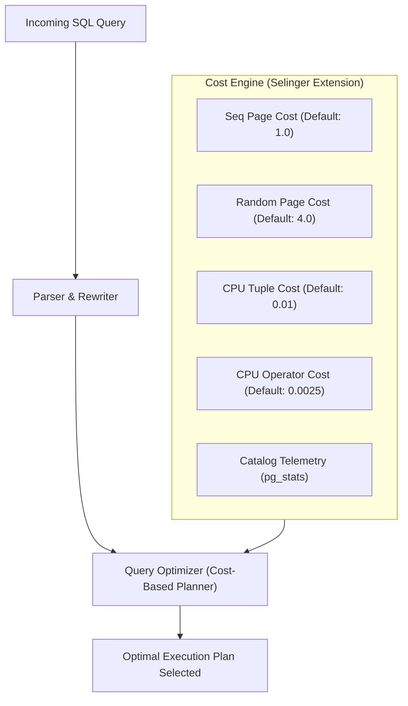
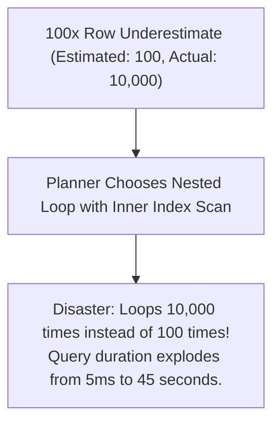
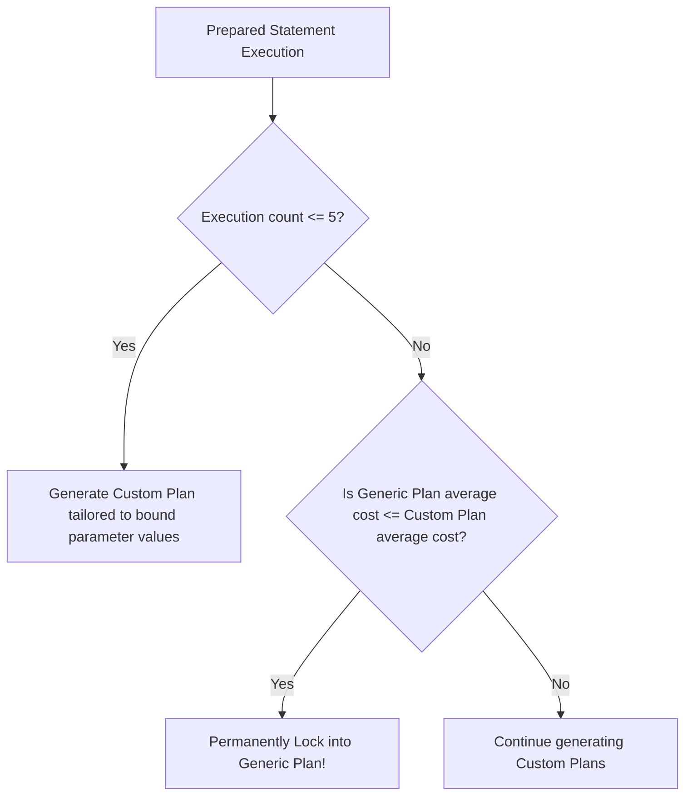

# Module 07 — Query Optimization, Cost Model, EXPLAIN & Tuning

Welcome to **Module 07** of the PostgreSQL curriculum. This module provides an academically rigorous and production-tested analysis of query optimization, planner cost modeling, and runtime performance tuning in PostgreSQL 18. We dissect the mathematical foundations of the Selinger Cost Model, evaluate column distribution statistics (`pg_stats`) and multivariate extended statistics, interpret execution plans with `EXPLAIN (ANALYZE, BUFFERS)`, diagnose prepared statement plan flips and parameter sniffing, calibrate JIT compilation thresholds, and examine PostgreSQL 19 plan stability mechanisms.

---

## 1. Core Terminology & Concept Definitions

- **Cost-Based Optimizer (CBO)**: The core planning engine that generates alternative relational execution trees, calculates estimated disk I/O and CPU computational costs using catalog statistics, and selects the plan with the lowest total cost.
- **Selinger Cost Model**: The dynamic programming cost-estimation model developed by Patricia Selinger (IBM System R, 1979) that evaluates access paths, join algorithms, and join orders based on page fetches and CPU cycle weights.
- **Selectivity ($S$)**: The estimated proportion of tuples in a relation that satisfy a filter condition, expressed as a real number between $0.0$ and $1.0$:
  $$S(\phi) = \frac{|\sigma_\phi(R)|}{|R|}$$
- **Most Common Values (MCV)**: Catalog arrays in `pg_stats` tracking the highest-frequency attribute values and their empirical occurrence frequencies to optimize selectivity estimates for skewed data.
- **Equi-Depth Histogram**: A statistical partition where non-MCV values are divided into buckets containing an equal number of rows, enabling accurate selectivity calculations for range queries ($A \le x \le B$).
- **Correlation Coefficient ($r$)**: A metric between $-1.0$ and $+1.0$ recording the physical ordering of heap tuples on disk relative to their logical sort order. High correlation ($|r| \approx 1.0$) optimizes index scans into sequential disk reads.
- **Extended Statistics (`CREATE STATISTICS`)**: User-defined multivariate statistics capturing functional dependencies, distinct counts, or MCVs across multiple columns, preventing catastrophic planner under-estimates on correlated attributes.
- **Generic Plan Flip**: The mechanism where a prepared statement switches from parameter-specific custom plans to a single generic plan after five executions, potentially triggering severe latency cliffs on skewed data.

---

## 2. Mathematical Foundations: The PostgreSQL Cost Model

The PostgreSQL query optimizer converts every execution tree node into an estimated cost measured in arbitrary cost units (where $1.0$ unit is traditionally defined as the cost of reading one 8KB page sequentially from disk).



### Fundamental Cost Formulas
For a Sequential Scan of relation $R$:
$$\text{Cost}_{\text{SeqScan}} = (N_{\text{pages}} \times \text{seq\_page\_cost}) + (N_{\text{tuples}} \times \text{cpu\_tuple\_cost}) + (N_{\text{tuples}} \times \text{cpu\_operator\_cost})$$

For an Index Scan using a B-Tree:
$$\text{Cost}_{\text{IndexScan}} = \text{Cost}_{\text{BTreeTraverse}} + (N_{\text{index\_pages}} \times \text{random\_page\_cost}) + (N_{\text{matched\_tuples}} \times \text{Cost}_{\text{HeapFetch}})$$

Where heap fetch cost incorporates correlation ($r$) and buffer cache hit ratio:
$$\text{Cost}_{\text{HeapFetch}} = \text{random\_page\_cost} \times (1 - \text{HitRatio}) \times (1 - |r|) + \text{seq\_page\_cost} \times |r| + \text{cpu\_tuple\_cost}$$

### Calibrating for Modern NVMe SSDs
- **The Historical Problem**: PostgreSQL's default `random_page_cost = 4.0` was calibrated in the 1990s for spinning mechanical hard drives where head seek latency made random reads four times more expensive than sequential reads.
- **The NVMe Reality**: On modern NVMe SSDs and cloud block storage, random read latency is nearly identical to sequential read latency. Leaving `random_page_cost = 4.0` tricks the planner into believing index scans are prohibitively expensive, causing it to select full sequential table scans inappropriately.
- **Production Standard**: Set `random_page_cost = 1.1` on all modern SSD-backed servers.

---

## 3. Catalog Statistics & Selectivity Estimation

The query optimizer relies on statistics gathered by `ANALYZE` and stored in `pg_statistic` (viewed via `pg_stats`):

```sql
SELECT 
    attname, null_frac, avg_width, n_distinct,
    correlation, most_common_vals, most_common_freqs
FROM pg_stats
WHERE tablename = 'customer_orders' AND attname = 'order_status';
```

### Statistical Primitives:
1. **`n_distinct`**:
   - Positive integer ($> 0$): Exact estimated count of distinct values.
   - Negative real number ($< 0$): Ratio of distinct values relative to total table rows (e.g., `-1.0` represents a unique column).
2. **`most_common_vals` (MCV) & `most_common_freqs` (MCF)**:
   - Tracks the highest-frequency values and their percentage of the table.
   - For an equality query on an MCV (`WHERE status = 'completed'`), the optimizer calculates selectivity directly from `most_common_freqs` ($S = \text{freq}$), completely bypassing uniform distribution assumptions.
3. **`histogram_bounds`**:
   - Equi-depth buckets for non-MCV values, used for range queries (`WHERE age BETWEEN 20 AND 30`).

---

## 4. The Correlated Column Trap & Extended Statistics

A fundamental assumption of basic database cost estimation is **attribute value independence**:
$$P(A \land B) = P(A) \times P(B)$$

### The Production Failure Mode
Consider an automobile inventory table with columns `make` and `model`:
- Table size: 1,000,000 rows.
- Selectivity of `make = 'Audi'`: $1\% = 0.01$.
- Selectivity of `model = 'A4'`: $1\% = 0.01$.

```sql
SELECT * FROM cars WHERE make = 'Audi' AND model = 'A4';
```

Without extended statistics, the optimizer multiplies probabilities:
$$S = 0.01 \times 0.01 = 0.0001 \implies \text{Estimated Rows} = 100$$

However, in reality, almost all Audi A4s have make `Audi`! The real row count is **10,000**, meaning the planner underestimated the result set by a factor of **100x**!



### The Solution: Multivariate Extended Statistics (`CREATE STATISTICS`)
```sql
-- Create multivariate statistics capturing dependencies and combinations:
CREATE STATISTICS stats_cars_make_model (dependencies, mcv) 
ON make, model FROM cars;

ANALYZE cars;
```
Now, `pg_statistic_ext` tracks the joint distribution of `(make, model)`, enabling the optimizer to estimate row counts accurately and select a Hash Join or Merge Join.

---

## 5. Reading `EXPLAIN (ANALYZE, BUFFERS)` Execution Plans

`EXPLAIN` displays the chosen execution plan; `EXPLAIN (ANALYZE, BUFFERS)` executes the query, recording actual timing and memory/disk buffer telemetry:

```sql
EXPLAIN (ANALYZE, BUFFERS, SETTINGS)
SELECT c.name, COUNT(o.id)
FROM customers c
JOIN orders o ON o.customer_id = c.id
WHERE c.country = 'CZ'
GROUP BY c.name;
```

> [!NOTE]
> In **PostgreSQL 18**, `EXPLAIN (ANALYZE)` includes `BUFFERS` output by default!

### Deconstructing Buffer Output
```text
->  Index Scan using idx_orders_cust on orders o  (cost=0.43..8.45 rows=12 width=8) 
                                                  (actual time=0.015..0.022 rows=14 loops=100)
      Buffers: shared hit=284 read=16 dirtied=2
```

- **`shared hit`**: Pages found directly in PostgreSQL's `shared_buffers` (memory access: ~100 nanoseconds).
- **`read`**: Pages not in `shared_buffers`, requiring an operating system kernel read (cached in OS page cache or fetched from NVMe SSD).
- **`dirtied`**: Pages modified in `shared_buffers` during query execution (e.g., setting hint bits or temporary sorts).
- **`written`**: Pages flushed to disk by this backend.
- **`loops`**: The number of times this node was executed (critical: multiply `actual time` and `rows` by `loops` to determine total node impact!).

---

## 6. Prepared Statements: Generic vs. Custom Plan Flips

When applications execute prepared statements via client connection pools or server-side statements (`PREPARE stmt AS ...`):



### The Parameter Sniffing Latency Cliff
Suppose an application queries `WHERE status = $1`:
- 99% of rows have `status = 'archived'`.
- 1% of rows have `status = 'pending'`.

If the first 5 executions pass `$1 = 'archived'`, the generic plan assumes a sequential scan is best. On execution 6, a user passes `$1 = 'pending'`. The engine uses the **generic sequential scan plan** instead of an index lookup, causing query latency to spike from 1ms to 20 seconds!

### Mitigation
Force custom plans for queries with highly skewed parameter distributions:
```sql
SET plan_cache_mode = 'force_custom_plan';
```

---

## 7. Just-In-Time (JIT) Compilation: Benefits & OLTP Hazard

PostgreSQL includes an LLVM-based JIT compiler that dynamically compiles expression evaluation and tuple deforming into native machine code.

### When JIT Helps
For long-running analytical queries (OLAP) processing millions of rows:
- Replaces interpretation overhead with native CPU instructions.
- Accelerates complex calculations, aggregates, and filtering expressions.

### The OLTP Production Hazard
JIT compilation takes **10ms to 50ms of CPU time** before query execution begins:
- If a query takes 2 minutes, 20ms of JIT compilation saves 15 seconds.
- If a high-throughput OLTP query takes 2ms, JIT compilation inflates total response time by **1000%**!

### Modern Configuration
```ini
# Recommended for OLTP workloads:
jit = off

# Or raise cost thresholds so only massive analytical queries trigger JIT:
jit_above_cost = 500000
jit_optimize_above_cost = 1000000
```

> [!IMPORTANT]
> **PostgreSQL 19 Evolution**: In PostgreSQL 19, the server default for `jit` has been changed from `on` to **`off`**, recognizing that default JIT harmed typical transactional web workloads.

---

## 8. PostgreSQL 19 Forward-Look: `pg_plan_advice` (Plan Pinning)

Query plan instability caused by minor statistics fluctuations has long been a pain point in PostgreSQL. PostgreSQL 19 introduces **`pg_plan_advice`** and **`pg_stash_advice`**, providing native plan stability:
- Enables administrators to capture a known-good execution plan.
- Pins specific join orders and access methods for target query signatures without modifying application code or relying on fragile third-party extensions like `pg_hint_plan`.

---

## 9. Then vs. Now: Query Optimization & Tuning

| Feature | PostgreSQL $\le$ 16 | PostgreSQL 17 | PostgreSQL 18 & 19 (Current) |
| :--- | :--- | :--- | :--- |
| **`EXPLAIN ANALYZE` Buffers** | Required explicit `BUFFERS` flag | Required explicit `BUFFERS` flag | **`BUFFERS` enabled by default** in `EXPLAIN (ANALYZE)` (PG18) |
| **JIT Default** | Enabled (`jit = on`) | Enabled (`jit = on`) | `jit = on` (PG18) $\rightarrow$ **`jit = off` default in PG19** |
| **Plan Stability** | Third-party extensions (`pg_hint_plan`) | Third-party extensions | PG19 native **`pg_plan_advice`** plan pinning |
| **Default `random_page_cost`** | 4.0 | 4.0 | 4.0 (Recommended manual calibration: 1.1) |

---

## 10. Interview Drill

<details>
<summary>1. Why should `random_page_cost` be changed from 4.0 to 1.1 on modern production database servers?</summary>

**Answer**: `random_page_cost` measures the estimated cost of reading an arbitrary 8KB disk page relative to a sequential page read (`seq_page_cost = 1.0`). The default value of 4.0 was established for spinning platter hard disk drives, where physical actuator arm seek latency made random reads significantly more expensive than sequential streaming reads. On modern NVMe SSDs and cloud block storage, random read access latency is almost identical to sequential read access latency. Leaving `random_page_cost = 4.0` severely biases the cost optimizer against index scans, causing it to choose inefficient sequential table scans. Setting it to 1.1 aligns planner estimates with physical hardware reality.
- Ref: [PostgreSQL Documentation: Planner Cost Constants](https://www.postgresql.org/docs/18/runtime-config-query.html#GUC-RANDOM-PAGE-COST)
</details>

<details>
<summary>2. Explain how correlated columns lead to catastrophic query execution plans, and how `CREATE STATISTICS` fixes the issue.</summary>

**Answer**: By default, the PostgreSQL optimizer assumes attribute value independence: $P(A \land B) = P(A) \times P(B)$. For correlated columns (such as `city = 'San Francisco'` and `state = 'California'`), this formula multiplies probabilities together, resulting in an extreme underestimate of matching rows (e.g. estimating 10 rows when there are actually 100,000). Believing the result set is tiny, the planner selects a Nested Loop join. At execution time, the engine loops 100,000 times instead of 10, causing query time to explode. `CREATE STATISTICS ... (dependencies, mcv) ON colA, colB FROM table` gathers multivariate joint distribution telemetry, allowing the optimizer to accurately estimate row counts and select Hash or Merge joins.
- Ref: [PostgreSQL Documentation: Multivariate Statistics](https://www.postgresql.org/docs/18/planner-stats.html#PLANNER-STATS-EXTENDED)
</details>

<details>
<summary>3. Describe the prepared statement generic plan flip mechanism and why it can trigger sudden query latency cliffs.</summary>

**Answer**: When a query is prepared, PostgreSQL generates parameter-specific custom plans for the first five executions. On the sixth execution, it compares the average cost of custom plans with the estimated cost of a generic plan (which plans without knowing parameter values). If the generic plan is on average cheaper, the server freezes the generic plan for all subsequent executions. If data is heavily skewed (e.g. 99% inactive, 1% active), a generic plan that assumes the common status may be chosen. When an execution subsequently queries for the rare status, the generic plan executes an inappropriate sequential scan instead of an index lookup, causing latency to spike dramatically.
- Ref: [PostgreSQL Documentation: PREPARE: Plan Caching](https://www.postgresql.org/docs/18/sql-prepare.html)
</details>

<details>
<summary>4. What are the key metrics to evaluate in `EXPLAIN (ANALYZE, BUFFERS)` output to identify I/O bottlenecks?</summary>

**Answer**:
1. `shared hit` vs `shared read`: `shared hit` indicates pages retrieved directly from memory (`shared_buffers`), while `read` indicates pages that were not in PostgreSQL memory and required kernel filesystem reads. A high `read` count relative to `hit` indicates cache misses and disk I/O.
2. `rows` (estimated) vs `actual rows`: A divergence of more than an order of magnitude indicates outdated or inaccurate statistics, suggesting `ANALYZE` or `CREATE STATISTICS` is needed.
3. `loops`: Execution counters on nested loop nodes. The actual time and row count of an inner node must be multiplied by `loops` to determine its true cost.
4. `dirtied` / `written`: Indicates the volume of memory pages altered or flushed to disk by the query.
- Ref: [PostgreSQL Documentation: Using EXPLAIN](https://www.postgresql.org/docs/18/using-explain.html)
</details>

<details>
<summary>5. Why did PostgreSQL 19 change the default setting of `jit` to `off`?</summary>

**Answer**: JIT (Just-In-Time) compilation uses LLVM to compile expressions and tuple deforming into native machine code. While beneficial for long-running analytical queries (OLAP) processing millions of rows, JIT introduces a compilation latency overhead of 10ms to 50ms per query. For typical OLTP web workloads where queries are expected to execute in under 5ms, JIT compilation frequently took 10x longer than the actual execution of the query, degrading system throughput and exhausting CPU capacity. By defaulting `jit = off` in PostgreSQL 19, transactional performance is protected out of the box.
- Ref: [PostgreSQL 19 Release Notes](https://www.postgresql.org/docs/19/release-19.html)
</details>
