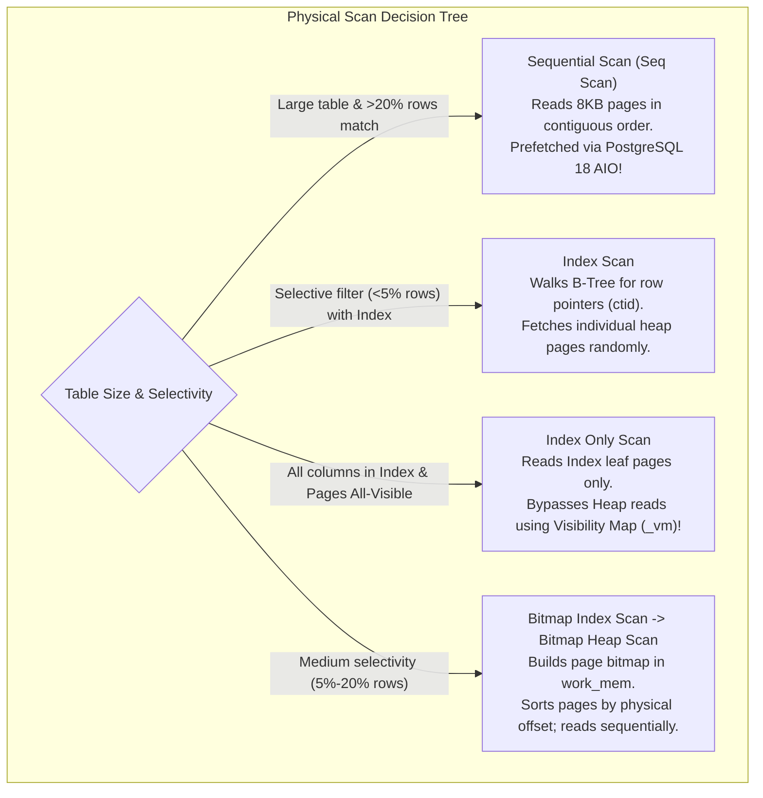
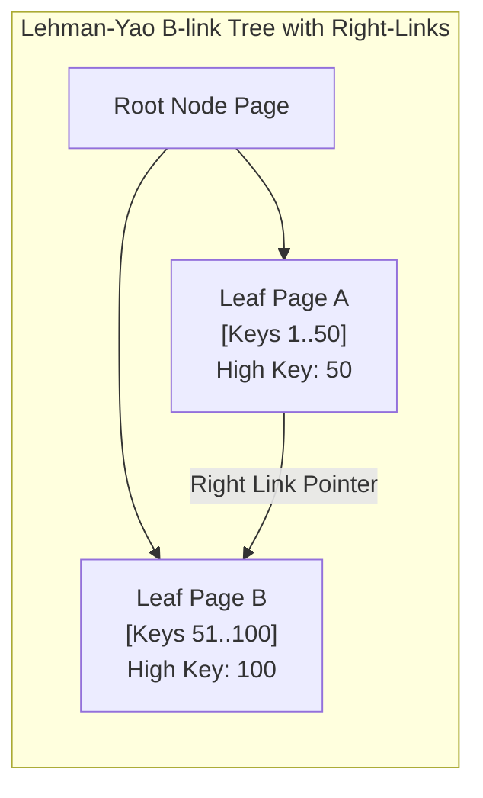
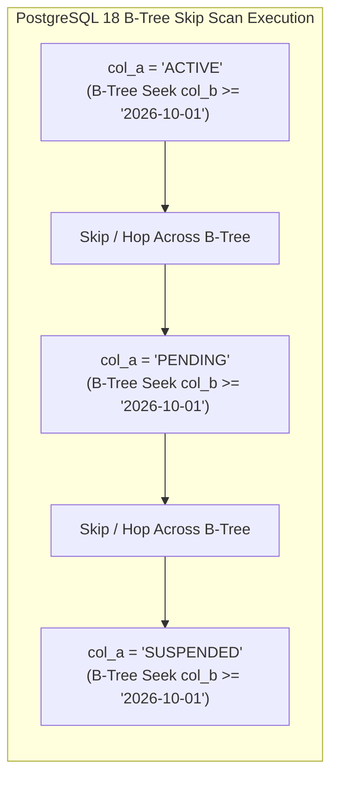

# Module 07 — Query Planning, Indexing Strategies & Tuning

Welcome to **Module 07** of the PostgreSQL 18 Curriculum. This module provides a comprehensive, academically grounded, and production-tested analysis of query optimization and physical database access methods. We examine the mathematical foundations of the Selinger Cost Model, dissect the PostgreSQL statistics engine (`pg_stats`, MCVs, equi-depth histograms, correlation coefficients), evaluate multivariate extended statistics, trace the Lehman-Yao B-link tree concurrency algorithm, investigate PostgreSQL 18 **B-Tree Skip Scans**, analyze `EXPLAIN (ANALYZE, BUFFERS)` execution plans, and tune server parameters for modern hardware.

---

## 1. Core Terminology & Concept Definitions

To establish technical precision across this curriculum, the following query optimization terms are formally defined:

- **Cost-Based Optimizer (CBO)**: The core query planning subsystem that evaluates alternative relational expression trees, calculates disk I/O and CPU computational costs using catalog statistics, and selects the plan with the lowest estimated total cost.
- **Selinger Cost Model**: The classic dynamic programming cost-estimation framework developed by Patricia Selinger (1979) that evaluates access paths, join orders, and join methods based on estimated page fetches and CPU cycle weights.
- **Selectivity ($S$)**: The estimated proportion of tuples in a relation that satisfy a given filter predicate, expressed as a real number between $0.0$ and $1.0$:
  $$S(\phi) = \frac{|\sigma_\phi(R)|}{|R|}$$
- **Most Common Values (MCV)**: An array of the highest-frequency attribute values and their empirical occurrence frequencies stored in `pg_stats` to improve selectivity calculations for skewed distributions.
- **Equi-Depth Histogram**: A histogram where the total population of non-MCV values is partitioned into buckets containing an equal number of data points, allowing accurate range query selectivity estimation ($A \le x \le B$).
- **Correlation Coefficient ($r$)**: A statistical measure between $-1.0$ and $+1.0$ recording the physical ordering of heap tuples on disk relative to their logical sort order. High correlation ($|r| \approx 1.0$) optimizes index scans into sequential disk reads.
- **Lehman-Yao B-link Tree**: The high-concurrency B-tree variant implemented by PostgreSQL, where all internal and leaf nodes contain right-sibling pointers ("right links") and high keys, allowing concurrent searches without holding locks during page splits.
- **B-Tree Skip Scan**: An indexing capability introduced in PostgreSQL 18 that enables composite multi-column B-tree indexes to satisfy queries that omit the leading prefix column by hopping across distinct prefix values.
- **Block Range Index (BRIN)**: A lightweight index structure that records only summary metadata (minimum and maximum values) for contiguous physical ranges of disk pages (default: 128 pages / 1MB), achieving near-zero disk footprint for physically sorted data.

---

## 2. Mathematical Foundations: The PostgreSQL Cost Model

The PostgreSQL query optimizer converts every execution tree node into an estimated numerical cost measured in arbitrary cost units (where $1.0$ unit is traditionally defined as the cost of reading one 8KB page sequentially from disk).

### Fundamental Cost Formula (Selinger Model Extension)
For a Sequential Scan of relation $R$:
$$\text{Cost}_{\text{SeqScan}} = (N_{\text{pages}} \times \text{seq\_page\_cost}) + (N_{\text{tuples}} \times \text{cpu\_tuple\_cost}) + (N_{\text{tuples}} \times \text{cpu\_operator\_cost})$$

For an Index Scan using a B-Tree:
$$\text{Cost}_{\text{IndexScan}} = \text{Cost}_{\text{BTreeTraverse}} + (N_{\text{index\_pages}} \times \text{random\_page\_cost}) + (N_{\text{matched\_tuples}} \times \text{Cost}_{\text{HeapFetch}})$$
Where heap fetch cost incorporates the correlation coefficient and buffer cache hit ratio:
$$\text{Cost}_{\text{HeapFetch}} = \text{random\_page\_cost} \times (1 - \text{HitRatio}) \times (1 - |r|) + \text{seq\_page\_cost} \times |r| + \text{cpu\_tuple\_cost}$$

### Default Planner Cost Parameters:
- `seq_page_cost = 1.0`: Baseline cost for reading an 8KB page sequentially from storage.
- `random_page_cost = 4.0`: Cost of a non-sequential random 8KB page read (historically calibrated for spinning HDD seek latency; should be set to `1.1` on modern NVMe SSDs).
- `cpu_tuple_cost = 0.01`: CPU cost to process one tuple in the executor.
- `cpu_index_tuple_cost = 0.005`: CPU cost to process one index entry during an index scan.
- `cpu_operator_cost = 0.0025`: CPU cost to evaluate a `WHERE` operator or expression per row.

---

## 3. The PostgreSQL Statistics Engine & Selectivity Estimation

The query optimizer's cost calculations are entirely dependent on column distribution telemetry maintained in `pg_statistic` and exposed through `pg_stats`:

```sql
SELECT 
    schemaname, tablename, attname, null_frac, avg_width, n_distinct,
    correlation, most_common_vals, most_common_freqs
FROM pg_stats
WHERE tablename = 'customer_orders' AND attname = 'order_status';
```

### Statistical Primitives:
1. **`n_distinct`**:
   - If positive (e.g. `50`): Exact estimated count of distinct values.
   - If negative (e.g. `-0.2`): The number of distinct values is proportional to table size ($20\%$ of total row count).
2. **Most Common Values (`most_common_vals` & `most_common_freqs`)**:
   Tracks frequent values and their exact percentages. For an equality query `WHERE status = 'PENDING'`, the optimizer directly reads the frequency from the MCV array, bypassing mathematical heuristics.
3. **Equi-Depth Histograms (`histogram_bounds`)**:
   For values outside the MCV list, the optimizer uses equi-depth histogram buckets. For range queries (`WHERE total_amount BETWEEN 50 AND 150`), selectivity is calculated by interpolating the fraction of histogram buckets spanning the range:
   $$S = \frac{\text{Buckets Spanned}}{\text{Total Histogram Buckets}}$$
4. **Physical Correlation (`correlation`)**:
   A value near `+1.0` or `-1.0` indicates that physical row locations on 8KB pages correspond directly to the column's sorted order. High correlation heavily biases the planner toward **Index Scans**, because fetching consecutive rows hits the exact same 8KB disk page repeatedly.

### The Attribute Independence Hazard & Multivariate Extended Statistics
By default, the optimizer assumes that distinct column predicates are completely independent:
$$P(A \land B) = P(A) \times P(B)$$

In real-world data, attributes are often strongly correlated (e.g. `make = 'Audi'` and `model = 'A6'`). Multiplying independent probabilities underestimates matched rows by orders of magnitude, causing the planner to select catastrophic Nested Loop joins instead of Hash Joins.

```sql
-- Solution: PostgreSQL Extended Statistics (CREATE STATISTICS)
CREATE STATISTICS stats_vehicle_make_model (dependencies, mcv, ndistinct)
ON make, model FROM vehicles;

ANALYZE vehicles;
```
This instructs `ANALYZE` to build joint multi-column MCV lists and calculate functional dependencies, restoring exact cardinality estimates.

---

## 4. Dissecting `EXPLAIN (ANALYZE, BUFFERS)`

The `EXPLAIN` command reveals the candidate execution tree chosen by the optimizer. Adding `ANALYZE` forces the engine to actually execute the query and output real runtime telemetry:

```sql
EXPLAIN (ANALYZE, BUFFERS, SETTINGS, COSTS, TIMING, SUMMARY)
SELECT 
    u.id, 
    u.email, 
    COUNT(o.order_id) AS total_orders, 
    SUM(o.total_amount) AS revenue
FROM users u
LEFT JOIN customer_orders o ON u.id = o.customer_id
WHERE u.created_at >= '2026-01-01'
GROUP BY u.id, u.email
ORDER BY revenue DESC NULLS LAST
LIMIT 10;
```

```
Limit  (cost=1250.45..1250.48 rows=10 width=56) (actual time=14.215..14.218 rows=10 loops=1)
  Buffers: shared hit=421 read=15 dirtied=0
  ->  Sort  (cost=1250.45..1262.10 rows=4660 width=56) (actual time=14.214..14.216 rows=10 loops=1)
        Sort Key: (sum(o.total_amount)) DESC NULLS LAST
        Sort Method: top-N heapsort  Memory: 26kB
        Buffers: shared hit=421 read=15
        ->  HashAggregate  (cost=1080.12..1138.37 rows=4660 width=56) (actual time=10.112..12.450 rows=4520 loops=1)
              Group Key: u.id
              Batches: 1  Memory Usage: 641kB
              Buffers: shared hit=421 read=15
              ->  Hash Right Join  (cost=142.50..1021.87 rows=4660 width=48) (actual time=1.820..8.410 rows=4520 loops=1)
                    Hash Cond: (o.customer_id = u.id)
                    Buffers: shared hit=421 read=15
                    ->  Seq Scan on customer_orders o  (cost=0.00..812.00 rows=35000 width=24) (actual time=0.015..3.920 rows=35000 loops=1)
                          Buffers: shared hit=380 read=12
                    ->  Hash  (cost=84.25..84.25 rows=4660 width=40) (actual time=1.780..1.780 rows=4660 loops=1)
                          Buckets: 8192  Batches: 1  Memory Usage: 345kB
                          Buffers: shared hit=41 read=3
                          ->  Bitmap Heap Scan on users u  (cost=12.45..84.25 rows=4660 width=40) (actual time=0.215..1.120 rows=4660 loops=1)
                                Recheck Cond: (created_at >= '2026-01-01'::timestamptz)
                                Buffers: shared hit=41 read=3
                                ->  Bitmap Index Scan on idx_users_created_at  (cost=0.00..11.28 rows=4660 width=0) (actual time=0.190..0.190 rows=4660 loops=1)
                                      Index Cond: (created_at >= '2026-01-01'::timestamptz)
                                      Buffers: shared hit=3
Planning Time: 0.385 ms
Execution Time: 14.340 ms
```

### Critical Telemetry Fields Explained:
1. **`cost=1250.45..1250.48`**:
   - `1250.45`: Startup cost (time spent before emitting the first row).
   - `1250.48`: Total cost (time to consume and return all matching rows).
2. **`rows=4660` vs `actual rows=4520`**:
   Cardinality estimation accuracy. If actual rows deviate by $>10\times$ from estimated rows, statistics are stale or multivariate correlations are missing.
3. **`Buffers: shared hit=421 read=15`**:
   - `hit=421`: 421 pages (3.36 MB) retrieved directly from RAM (`shared_buffers`).
   - `read=15`: 15 pages retrieved from OS page cache or storage disk blocks.
4. **`loops=1`**:
   In nested loop joins, inner nodes execute multiple times. Always multiply actual time and rows by `loops` to obtain true total cost!

---

## 5. Physical Scan Operators Compared



---

## 6. High-Concurrency B-Tree Internals: The Lehman-Yao B-link Tree

PostgreSQL indexes rely on the **Lehman-Yao B-link tree** algorithm:



### Key Concurrency Invariants:
1. **Right-Link Pointers**: Every node at the same height maintains an atomic pointer to its right-hand sibling.
2. **Concurrent Page Splits Without Root Locks**: When a page splits, the right-link is established first. If a concurrent search process arrives at the left page before the parent pointer is updated, it observes that the target key exceeds the page's "High Key", follows the right-link to the sibling page, and finds the key without error.
3. **Reader Non-Blocking**: Read operations never acquire exclusive buffer locks, enabling massive parallel read concurrency.

---

## 7. PostgreSQL 18 B-Tree Skip Scan

Historically, composite indexes `(col_a, col_b)` could only be used if the query specified the leading prefix column (`col_a`). Searching solely on `col_b` forced an exhaustive sequential scan.

PostgreSQL 18 introduces native **B-Tree Skip Scan**:
When `col_a` has low-to-medium cardinality (e.g. 50 distinct status codes across 10,000,000 records), the engine uses the index to find the first distinct value of `col_a`, executes a targeted binary search for `col_b`, skips across the B-tree to the next distinct value of `col_a`, and repeats:



```sql
-- Composite index
CREATE INDEX idx_tenant_event_time ON system_events (tenant_id, recorded_at);

-- In PostgreSQL 18, this query automatically uses B-Tree Skip Scan without specifying tenant_id!
EXPLAIN (ANALYZE, COSTS)
SELECT * FROM system_events
WHERE recorded_at >= '2026-10-25 00:00:00'
ORDER BY recorded_at DESC
LIMIT 50;
```

---

## 8. Hardware-Aligned Server Resource & Memory Tuning

```ini
# postgresql.conf (Production Configuration for 32GB RAM Host on NVMe Storage)

# 1. Memory Subsystem
shared_buffers = 8GB                  # 25% of total system RAM
work_mem = 32MB                       # Allocated per sort/hash operation
maintenance_work_mem = 1GB            # Reserved for VACUUM, CREATE INDEX, REINDEX
effective_cache_size = 24GB           # Estimate of shared_buffers + OS page cache (75% of RAM)

# 2. Modern Storage Tuning (NVMe SSD Architecture)
random_page_cost = 1.1                # Match NVMe random read speed (Default 4.0 assumes spinning HDD)
seq_page_cost = 1.0
effective_io_concurrency = 200        # Concurrent asynchronous requests issued to storage driver

# 3. PostgreSQL 18 Asynchronous I/O (AIO) Configuration
io_method = io_uring                  # Linux native io_uring ring-buffer engine
io_combine_limit = 128kB              # Maximum chunk size for batched vector AIO requests
```

---

## 9. Summary & Module Progression

In this module, we examined:
- The mathematical foundations of the Selinger Cost Model.
- The PostgreSQL statistics engine: `pg_stats`, MCVs, equi-depth histograms, and correlation coefficients.
- Multivariate extended statistics to correct attribute independence failures.
- Reading `EXPLAIN (ANALYZE, BUFFERS)` execution plans.
- Scan operators: Sequential, Index, Index-Only, and Bitmap Scans.
- The Lehman-Yao B-link tree concurrency algorithm and right-link pointers.
- PostgreSQL 18 B-Tree Skip Scans across composite indexes.
- Hardware-aligned server resource tuning.

Proceed to **[Module 08 — Administration, Maintenance & Upgrades](./08-administration-maintenance-and-upgrades.md)** to explore Autovacuum internals, Transaction ID (XID) wraparound failure prevention, HOT updates, and zero-downtime upgrades via `pg_upgrade`.
