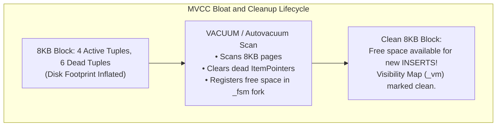
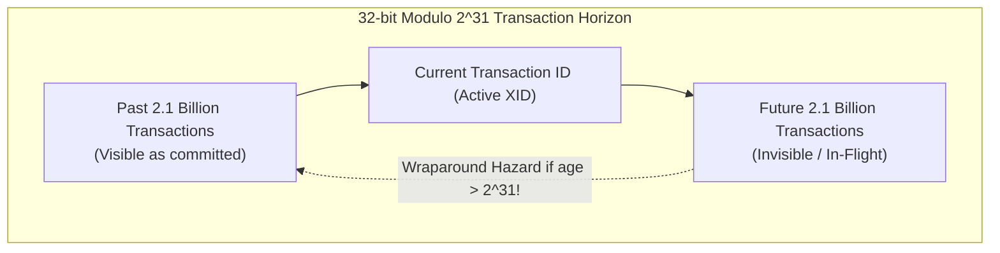
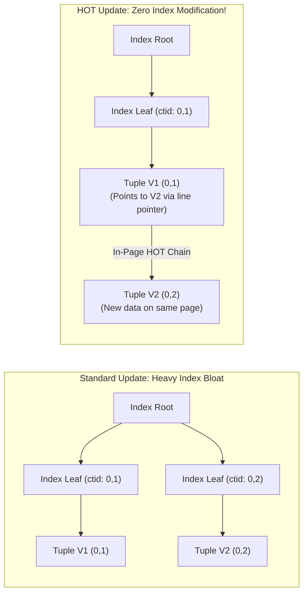
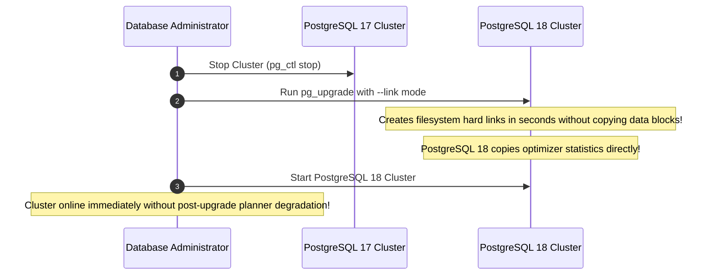

# Module 08 — Administration, Maintenance & Upgrades

Welcome to **Module 08** of the PostgreSQL 18 Curriculum. This module provides complete, academically grounded, and staff-level operational knowledge for managing production PostgreSQL deployments. We dissect the internal mechanics of MVCC bloat reclamation, examine the mathematical hazard of 32-bit Transaction ID (XID) wraparound and emergency freezing protocols, analyze the Heap-Only Tuple (HOT) optimization, tune Linux kernel parameters (HugePages, VM overcommit, OOM killer protection), establish enterprise connection pooling with PgBouncer, and execute zero-downtime upgrades via `pg_upgrade` with PostgreSQL 18's **retained optimizer statistics**.

---

## 1. Core Terminology & Concept Definitions

To establish operational precision across this curriculum, the following administrative terms are formally defined:

- **Autovacuum Daemon**: A multi-worker background automation subsystem that periodically inspects relations, reclaims physical storage occupied by dead tuple versions, updates the Visibility Map, freezes transaction IDs to prevent wraparound, and runs `ANALYZE` to refresh optimizer statistics.
- **Table & Index Bloat**: Unused physical disk space inside 8KB pages resulting from deleted or updated tuples that have not yet been reclaimed or made available for reuse by new inserts, degrading query cache hit ratios.
- **Transaction ID (XID) Wraparound**: The mathematical boundary where the 32-bit transaction counter exhausts its $2^{31}$ comparison horizon, threatening total data invisibility and forcing the cluster into emergency read-only shutdown unless past tuples are frozen.
- **Frozen Transaction ID (`FrozenTransactionId = 2`)**: A special sentinel transaction ID that is defined as mathematically preceding (older than) every ordinary transaction ID, permanently establishing a tuple as visible to all current and future transactions.
- **Heap-Only Tuples (HOT)**: An optimization that allows an `UPDATE` to place a new tuple version on the same 8KB disk page without creating new index entries across secondary indexes, linking tuple line pointers into an intra-page chain.
- **Fillfactor**: A table storage parameter (default: 100 for tables, 90 for B-Tree indexes) specifying the percentage of an 8KB page packed during `INSERT`, reserving the remaining space for future in-page HOT updates.
- **HugePages**: A Linux kernel memory management feature that allocates memory in 2MB (or 1GB) pages rather than default 4KB pages, reducing Translation Lookaside Buffer (TLB) cache misses for large `shared_buffers`.
- **In-Place Upgrade (`pg_upgrade`)**: An administrative utility that migrates data files from an older PostgreSQL major version to a new major release in seconds using filesystem hard links (`--link`), enhanced in PostgreSQL 18 to seamlessly carry forward optimizer statistics.

---

## 2. The MVCC Maintenance Cycle & Autovacuum Tuning

In PostgreSQL, updating or deleting a row leaves the old tuple physically present on disk marked with `t_xmax`. If these dead tuples are not reclaimed, relations suffer severe **bloat**:



### The Autovacuum Activation Formula
Autovacuum launches a worker on a table when the count of dead tuples exceeds:
$$\text{Threshold} = \text{autovacuum\_vacuum\_threshold} + (\text{autovacuum\_vacuum\_scale\_factor} \times \text{reltuples})$$

For example, with defaults (`threshold = 50`, `scale_factor = 0.2`):
- A table with 10,000 rows triggers vacuuming after $50 + (0.2 \times 10,000) = 2,050$ dead tuples.
- A large table with 100,000,000 rows triggers vacuuming only after **20,000,050** dead tuples!

### Tuning Autovacuum for High-Write Workloads
Never allow massive tables to run on default scale factors. Tune autovacuum aggressively at the table level:

```sql
-- Aggressive autovacuum for a high-churn transactional table
ALTER TABLE orders SET (
    autovacuum_vacuum_scale_factor = 0.02,   -- Trigger after 2% churn
    autovacuum_vacuum_threshold = 1000,
    autovacuum_vacuum_cost_limit = 2000,     -- Increase I/O budget for this worker
    autovacuum_vacuum_cost_delay = 2         -- Reduce throttle delay (ms)
);
```

### Server-Wide Autovacuum Configuration (`postgresql.conf`)
```ini
autovacuum = on
autovacuum_max_workers = 5              # Default 3; increase for multi-core servers
autovacuum_vacuum_cost_limit = 1000     # Default 200; higher budget prevents backlog
autovacuum_vacuum_cost_delay = 2ms      # Delay sleep when budget exhausted
autovacuum_naptime = 15s                # Sleep interval between database checks
```

---

## 3. Transaction ID (XID) Wraparound & Freezing Theory

PostgreSQL identifies transactions using a 32-bit integer counter ($2^{32} \approx 4.29 \text{ billion}$ possible IDs). Concurrency comparisons use modulo $2^{31}$ arithmetic: any given transaction can observe up to $2.1$ billion past transactions, and up to $2.1$ billion future transactions.



### The Wraparound Catastrophe
If a database runs for $2^{31}$ transactions without freezing older rows, arithmetic wraps around: ancient committed tuples suddenly appear to be in the "future" and become completely invisible, causing catastrophic silent data loss.

### Freezing Mechanics & Invariant
To prevent this, `VACUUM` replaces old transaction IDs with the immutable sentinel `FrozenTransactionId` ($2$):
$$\forall xid \in \text{NormalXIDs}, \quad \text{FrozenTransactionId} < xid$$

PostgreSQL sets the `HEAP_XMIN_FROZEN` bit in `t_infomask`, indicating the tuple was committed before all active transactions.

### The Autovacuum Freeze Schedule
1. **`vacuum_freeze_min_age`** (default: 50 million XIDs): Tuples older than this threshold are frozen during standard vacuum cycles.
2. **`autovacuum_freeze_max_age`** (default: 200 million XIDs): When a table's oldest unfrozen XID reaches this age, PostgreSQL launches an unkillable **Anti-Wraparound Autovacuum Worker** (`autovacuum: VACUUM (to prevent wraparound)`).
3. **Emergency Cluster Protection**: If the oldest unfrozen XID reaches $2^{31} - 10,000,000$, PostgreSQL halts write operations, logs `FATAL: database is not accepting commands to avoid wraparound data loss`, and permits only single-user emergency maintenance mode:
   ```bash
   # Emergency DBA single-user recovery mode:
   postgres --single -D /var/lib/postgresql/data template1
   backend> VACUUM FREEZE;
   ```

---

## 4. Heap-Only Tuples (HOT) Optimization

In standard PostgreSQL, an `UPDATE` creates a new tuple and must insert a new pointer into **every index** on the table, even if the updated column is unindexed. This creates massive index write amplification and bloat.

### HOT Invariants:
1. The `UPDATE` does not alter any column that belongs to an index.
2. The 8KB disk page containing the old tuple has enough free space to accommodate the new tuple version.



### Reserving In-Page Space with `fillfactor`
To ensure that update-heavy tables have space for HOT updates on the same page, reduce `fillfactor`:
```sql
-- Reserve 20% of every 8KB block for intra-page HOT updates:
ALTER TABLE active_sessions SET (fillfactor = 80);
VACUUM FULL active_sessions;
```

---

## 5. Linux Kernel & OS Memory Tuning for PostgreSQL

PostgreSQL's performance relies heavily on proper operating system kernel parameterization:

### 1. Disabling Memory Overcommit
By default, Linux permits memory overcommit (`vm.overcommit_memory = 0`). If concurrent backends allocate peak memory simultaneously, the OS kernel's Out-Of-Memory (OOM) killer arbitrarily terminates the Postmaster daemon.
```bash
# /etc/sysctl.d/99-postgresql.conf
vm.overcommit_memory = 2
vm.overcommit_ratio = 80
vm.swappiness = 1
```

### 2. Linux HugePages Configuration
Standard Linux pages are 4KB. Managing a 64GB `shared_buffers` pool requires tracking $16,777,216$ pages, overloading CPU Translation Lookaside Buffers (TLB). 
Enabling 2MB HugePages reduces the page count to $32,768$, dramatically increasing CPU efficiency:

```bash
# Calculate required hugepages: (shared_buffers in KB) / 2048
vm.nr_hugepages = 4200
```
In `postgresql.conf`:
```ini
huge_pages = on   # Fails startup if HugePages cannot be allocated
```

---

## 6. PostgreSQL 18 Cascading Maintenance for Partitioned Tables

In versions prior to PostgreSQL 18, executing `VACUUM` or `ANALYZE` on a partitioned parent relation did not automatically cascade across its leaf partitions, requiring complex administrative maintenance scripts.

PostgreSQL 18 changes this behavior:
Executing `VACUUM` or `ANALYZE` on a partitioned parent table automatically and efficiently cascades across all leaf children in a single unified command:

```sql
-- Cascades down to all 2024, 2025, 2026 sub-partitions automatically!
VACUUM (VERBOSE, ANALYZE) customer_events;
```

---

## 7. Extended Multi-Column Statistics (`CREATE STATISTICS`)

By default, the query planner assumes columns are completely independent. When columns correlate (e.g., `car_make` and `car_model`), single-column statistics produce wildly inaccurate cost estimates:

```sql
CREATE TABLE vehicles (
    id SERIAL PRIMARY KEY,
    make TEXT,
    model TEXT
);

-- Planner assumes P(Audi AND A4) = P(Audi) * P(A4), severely underestimating row count!
EXPLAIN SELECT * FROM vehicles WHERE make = 'Audi' AND model = 'A4';

-- Solution: Create an Extended Statistics object
CREATE STATISTICS stats_vehicle_make_model (dependencies, mcv, ndistinct)
ON make, model FROM vehicles;

-- Refresh catalog statistics
ANALYZE vehicles;
```
- **`dependencies`**: Captures functional dependencies between attributes.
- **`mcv` (Most Common Values)**: Stores joint frequency lists for multi-column pairs.
- **`ndistinct`**: Calculates joint distinct counts for multi-attribute grouping.

---

## 8. Production Observability: `pg_stat_activity` & `pg_stat_statements`

### 1. Active Session Monitoring (`pg_stat_activity`)
```sql
SELECT 
    pid,
    usename,
    client_addr,
    state,
    wait_event_type,
    wait_event,
    clock_timestamp() - query_start AS query_duration,
    query
FROM pg_stat_activity
WHERE state != 'idle' 
  AND pid != pg_backend_pid()
ORDER BY query_duration DESC;
```

### 2. Query Telemetry (`pg_stat_statements`)
```sql
CREATE EXTENSION IF NOT EXISTS pg_stat_statements;

SELECT 
    query,
    calls,
    ROUND(total_exec_time::numeric, 2) AS total_ms,
    ROUND(mean_exec_time::numeric, 2) AS avg_ms,
    ROUND((shared_blks_hit * 100.0 / NULLIF(shared_blks_hit + shared_blks_read, 0))::numeric, 2) AS cache_hit_pct
FROM pg_stat_statements
ORDER BY total_exec_time DESC
LIMIT 10;
```

---

## 9. Major Upgrades with `pg_upgrade` & PostgreSQL 18 Retained Statistics

Traditional dump and restore (`pg_dumpall | psql`) can take days for multi-terabyte databases. `pg_upgrade` completes major version migrations in under two minutes by utilizing filesystem hard links:



### Running `pg_upgrade` Link Mode
```bash
pg_upgrade \
  --old-datadir=/var/lib/postgresql/17/data \
  --new-datadir=/var/lib/postgresql/18/data \
  --old-bindir=/usr/lib/postgresql/17/bin \
  --new-bindir=/usr/lib/postgresql/18/bin \
  --link \
  --check
```

> [!IMPORTANT]
> **PostgreSQL 18 Statistics Retention**: Prior to PostgreSQL 18, `pg_upgrade` wiped all catalog statistics, forcing administrators to execute hours-long `vacuumdb --all --analyze-only` before the optimizer could run queries efficiently. In PostgreSQL 18, `pg_upgrade` preserves optimizer statistics across major upgrades, eliminating post-migration cold-cache planner drops!

---

## 10. Summary & Module Progression

In this module, we examined:
- The MVCC table bloat lifecycle and tuning autovacuum thresholds.
- Transaction ID (XID) wraparound mechanics, the $2^{31}$ modulo horizon, and freezing protocols.
- The Heap-Only Tuple (HOT) optimization and `fillfactor` tuning.
- Linux kernel parameterization: HugePages, VM overcommit protection, and swappiness.
- PostgreSQL 18's automatic cascading maintenance for partitioned table hierarchies.
- Extended multivariate statistics (`CREATE STATISTICS`) for correlated columns.
- Production observability with `pg_stat_activity` and `pg_stat_statements`.
- Connection pooling with PgBouncer.
- Ultra-fast major upgrades using `pg_upgrade --link` with PostgreSQL 18's retained statistics.

Proceed to **[Module 09 — Backup, Point-In-Time Recovery & Migration](./09-backup-pitr-and-migration.md)** to master physical base backups, WAL segment archiving, continuous Point-In-Time Recovery (PITR), and Oracle-to-PostgreSQL migration strategies.
