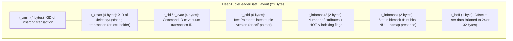
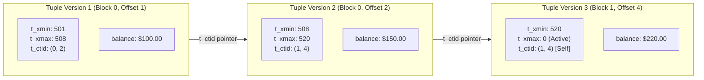
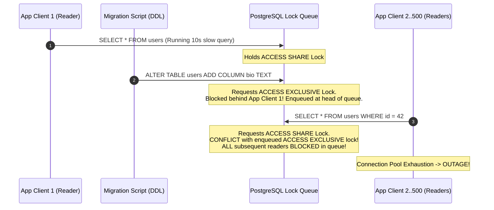

# Module 08 — Concurrency Control, MVCC Internals, Isolation & Locking

Welcome to **Module 08** of the PostgreSQL curriculum. This module provides a rigorous, academically grounded, and production-tested exploration of database concurrency control and transactional isolation in PostgreSQL 18. We examine the physical 23-byte `HeapTupleHeaderData` and Hint Bit dynamics, trace version chains with `pageinspect`, evaluate transaction snapshots across the ANSI isolation spectrum, dissect the mathematics of Serializable Snapshot Isolation (SSI), evaluate the exhaustive 8x8 table lock conflict matrix, diagnose catastrophic DDL lock-queue pileups, and implement non-blocking worker queues using `FOR UPDATE SKIP LOCKED`.

> [!NOTE]
> For abstract isolation anomaly taxonomies (Berenson et al., 1995), dependency graphs, and mathematical serializability theory (Adya, 1999), consult the foundational track [architecture/data-systems](../../architecture/data-systems/modules/05-transactions-acid-and-isolation-levels.md). This module focuses on PostgreSQL's concrete physical implementation, tuple versioning, and locking mechanics.

---

## 1. Core Terminology & Concept Definitions

- **Multi-Version Concurrency Control (MVCC)**: A concurrency control architecture where updates and deletions generate new physical versions of tuples rather than mutating data in place. Read operations never block write operations, and write operations never block read operations.
- **Transaction ID (`xid`)**: A monotonic 32-bit integer assigned to every transaction that modifies data. In memory and WAL, this is extended by a 32-bit epoch counter to form an internal 64-bit transaction identifier (`FullTransactionId`).
- **Tuple Header (`HeapTupleHeaderData`)**: A 23-byte binary metadata structure prefixing every physical row on an 8KB disk block, containing transaction visibility boundaries (`t_xmin`, `t_xmax`), version chain pointers (`t_ctid`), and status bitmasks (`t_infomask`).
- **Hint Bits**: Status flags inside `t_infomask` (`HEAP_XMIN_COMMITTED`, `HEAP_XMAX_INVALID`) written onto the tuple by the first reader that confirms transaction commit status in `pg_xact`, eliminating CLOG lookups for subsequent queries.
- **Commit Log (`pg_xact`)**: A compact cluster-wide shared memory ring buffer and disk array storing 2-bit commit status records (`IN_PROGRESS`, `COMMITTED`, `ABORTED`, `SUB_COMMITTED`) for every transaction ID.
- **Serializable Snapshot Isolation (SSI)**: The highest ANSI isolation level, mathematically proven to enforce true conflict serializability by tracking read-write anti-dependencies (`SIREAD` locks) without blocking concurrent reads or writes.
- **MultiXactId**: A composite transaction identifier used when multiple concurrent transactions acquire shared row-level locks (`FOR SHARE` or `FOR KEY SHARE`) on the exact same tuple.
- **Lock Queue Starvation**: A production failure mode where a transaction requesting an exclusive lock (`ACCESS EXCLUSIVE`) waits for a long-running reader, while the lock queue blocks all subsequent incoming read queries behind it.

---

## 2. Low-Level Tuple Anatomy & Hint Bit Dynamics

### Binary Layout of `HeapTupleHeaderData` (23 Bytes)
Every physical row stored on an 8KB page begins with a 23-byte header:



### The MVCC Version Chain
In PostgreSQL:
- An **`INSERT`** allocates a line pointer and writes a tuple with `t_xmin = current_xid` and `t_xmax = 0`.
- A **`DELETE`** does not erase bytes; it sets `t_xmax = current_xid` on the target tuple.
- An **`UPDATE`** executes an atomic delete of the old version and insert of the new version:
  1. Old tuple: `t_xmax` is set to `current_xid`.
  2. Old tuple: `t_ctid` is updated from pointing to itself to point to the `(block, offset)` of the new tuple.
  3. New tuple: `t_xmin = current_xid`, `t_xmax = 0`, and `t_ctid` points to itself.



### Why a Read-Only `SELECT` Writes Dirty Pages (Hint Bits)
Checking whether transaction `t_xmin` committed requires accessing the Commit Log (`pg_xact`). Because accessing `pg_xact` involves shared memory lookups and potential disk I/O:
1. The first backend process that inspects a tuple queries `pg_xact` to determine if `t_xmin` committed.
2. Upon confirming commit, the backend sets the hint bit `HEAP_XMIN_COMMITTED` directly in the tuple's `t_infomask`.
3. Subsequent queries reading that tuple immediately observe the hint bit and bypass `pg_xact` entirely.
4. **Architectural Consequence**: Setting hint bits modifies bytes on the 8KB page. Therefore, **a purely read-only `SELECT` query can mark pages as dirty in `shared_buffers`**, requiring the background writer or checkpointer to write them back to disk!

---

## 3. Snapshot Isolation & ANSI Isolation Levels

A PostgreSQL transaction snapshot determines which tuple versions are visible to active queries:
$$\text{Snapshot} = (XMIN, XMAX, \{xid_1, xid_2, \dots, xid_k\})$$

- **$XMIN$**: Lowest transaction ID that was still active when the snapshot was taken. All tuples with $t\_xmin < XMIN$ are visible (committed).
- **$XMAX$**: First unassigned transaction ID when the snapshot was taken. All tuples with $t\_xmin \ge XMAX$ are invisible.
- **$\{xid_1, \dots, xid_k\}$**: The array of active, uncommitted transaction IDs between $XMIN$ and $XMAX$ at the snapshot moment.

### The Isolation Spectrum in PostgreSQL

| Isolation Level | Dirty Read | Non-Repeatable Read | Phantom Read | Serialization Anomaly (Write Skew) |
| :--- | :--- | :--- | :--- | :--- |
| **Read Uncommitted** | Prevented (Treated as Read Committed) | Allowed | Allowed | Allowed |
| **Read Committed** (Default) | Prevented | Allowed | Allowed | Allowed |
| **Repeatable Read** | Prevented | Prevented | Prevented | Allowed |
| **Serializable** (SSI) | Prevented | Prevented | Prevented | **Prevented** |

### Mechanical Distinctions:
1. **Read Committed**: Each statement takes a fresh snapshot at statement start. If another transaction commits an update halfway through a multi-statement transaction, subsequent statements see the updated rows.
2. **Repeatable Read**: Takes a single snapshot at the beginning of the transaction. All subsequent queries see the identical frozen point in time. If a concurrent transaction commits an update to a row that this transaction attempts to update, the transaction immediately aborts with:
   `ERROR: could not serialize access due to concurrent update (SQLSTATE 40001)`.
3. **Serializable (SSI)**: Tracks read-write anti-dependencies ($rw$-edges) in shared memory using non-blocking `SIREAD` locks. If the engine detects a cycle ($T_1 \xrightarrow{rw} T_2 \xrightarrow{rw} T_1$), it aborts one of the transactions with a `40001` serialization failure, preventing write skew.

---

## 4. The 8-Level Table Lock Conflict Matrix

PostgreSQL manages concurrent DDL and DML operations using an 8-level table lock hierarchy:

| | Lock Mode | Common SQL Trigger Statements |
| :-: | :--- | :--- |
| **1** | `ACCESS SHARE` | `SELECT` |
| **2** | `ROW SHARE` | `SELECT FOR UPDATE`, `SELECT FOR SHARE` |
| **3** | `ROW EXCLUSIVE` | `INSERT`, `UPDATE`, `DELETE` |
| **4** | `SHARE UPDATE EXCLUSIVE` | `VACUUM` (standard), `ANALYZE`, `CREATE INDEX CONCURRENTLY` |
| **5** | `SHARE` | `CREATE INDEX` (standard) |
| **6** | `SHARE ROW EXCLUSIVE` | `CREATE TRIGGER` |
| **7** | `EXCLUSIVE` | `REFRESH MATERIALIZED VIEW CONCURRENTLY` |
| **8** | `ACCESS EXCLUSIVE` | `ALTER TABLE`, `DROP TABLE`, `TRUNCATE`, `VACUUM FULL` |

### The 8x8 Lock Conflict Matrix
A checkmark ($\times$) indicates that the two lock modes **conflict** and cannot be held simultaneously on the same table by different sessions:

| Requested Lock $\downarrow$ \ Existing $\rightarrow$ | Access Share (1) | Row Share (2) | Row Exclusive (3) | Share Update Excl (4) | Share (5) | Share Row Excl (6) | Exclusive (7) | Access Exclusive (8) |
| :--- | :-: | :-: | :-: | :-: | :-: | :-: | :-: | :-: |
| **Access Share (1)** | | | | | | | | $\times$ |
| **Row Share (2)** | | | | | | | $\times$ | $\times$ |
| **Row Exclusive (3)** | | | | | $\times$ | $\times$ | $\times$ | $\times$ |
| **Share Update Excl (4)** | | | | $\times$ | $\times$ | $\times$ | $\times$ | $\times$ |
| **Share (5)** | | | $\times$ | $\times$ | | $\times$ | $\times$ | $\times$ |
| **Share Row Excl (6)** | | | $\times$ | $\times$ | $\times$ | $\times$ | $\times$ | $\times$ |
| **Exclusive (7)** | | $\times$ | $\times$ | $\times$ | $\times$ | $\times$ | $\times$ | $\times$ |
| **Access Exclusive (8)** | $\times$ | $\times$ | $\times$ | $\times$ | $\times$ | $\times$ | $\times$ | $\times$ |

---

## 5. The Lock Queue Hazard & Production DDL Pileups

The most prevalent production database outage pattern stems from the interaction between the lock conflict matrix and PostgreSQL's FIFO lock queue:



### The Mandatory Production Defense
Never execute migrations or DDL without configuring `lock_timeout`:

```sql
-- Production Migration Script Standard:
BEGIN;
  -- If lock cannot be acquired within 2 seconds, ABORT immediately!
  SET LOCAL lock_timeout = '2s';
  SET LOCAL statement_timeout = '10s';
  
  ALTER TABLE users ADD COLUMN bio TEXT;
COMMIT;
```
If a long query blocks the `ALTER TABLE`, the script times out after 2 seconds, releases its position in the lock queue, and allows application traffic to proceed without interruption.

---

## 6. Row-Level Locking & Non-Blocking Work Queues

### Row Lock Strength Hierarchy
1. **`FOR KEY SHARE`**: Weakest lock. Acquired automatically by foreign key checks. Does not block `UPDATE`s on non-key columns.
2. **`FOR SHARE`**: Shared read lock. Blocks `FOR UPDATE` and `FOR NO KEY UPDATE`.
3. **`FOR NO KEY UPDATE`**: Acquired by `UPDATE`s that do not alter unique index columns. Allows concurrent foreign key checks.
4. **`FOR UPDATE`**: Strongest lock. Acquired by `DELETE` and `UPDATE` on primary/unique keys. Blocks all other row lockers.

### Non-Blocking Work Queues with `FOR UPDATE SKIP LOCKED`
Implementing job queues in databases historically suffered from locking contention when multiple workers attempted to lock the next available job.

```sql
-- High-throughput, non-blocking worker queue query:
WITH next_job AS (
    SELECT id 
    FROM job_queue
    WHERE status = 'pending'
    ORDER BY priority DESC, id ASC
    LIMIT 1
    FOR UPDATE SKIP LOCKED -- Skips any row currently locked by another worker!
)
UPDATE job_queue
SET status = 'processing', started_at = NOW(), worker_id = 'worker_42'
FROM next_job
WHERE job_queue.id = next_job.id
RETURNING job_queue.*;
```
With `SKIP LOCKED`, concurrent worker processes never block each other: they instantly skip locked rows and claim the next available job in parallel.

---

## 7. Advisory Locks

PostgreSQL provides application-level distributed mutexes independent of table data:

```sql
-- Transaction-level advisory lock (released automatically on COMMIT/ROLLBACK):
SELECT pg_advisory_xact_lock(42);

-- Try to acquire without blocking:
SELECT pg_try_advisory_xact_lock(42); -- Returns true if acquired, false if held by another session

-- Session-level advisory lock (must be explicitly unlocked):
SELECT pg_advisory_lock(1001);
-- ... critical section ...
SELECT pg_advisory_unlock(1001);
```

---

## 8. Then vs. Now: Concurrency & Locking

| Capability | PostgreSQL $\le$ 11 | PostgreSQL 12–17 | PostgreSQL 18 & 19 (Current) |
| :--- | :--- | :--- | :--- |
| **Work Queues** | Table locking or spinlock loops | Standardized `SKIP LOCKED` | Optimized line-pointer skipping in executor |
| **Lock Telemetry** | Polling `pg_locks` | `pg_blocking_pids()` helper | Enhanced wait-event classification and lock logging |
| **Deadlock Tracing** | Logged after `deadlock_timeout` | Logged with full statement diffs | Detailed statement history and lock wait hierarchy in logs |
| **Default Lock Logging** | `log_lock_waits = off` | `log_lock_waits = off` | **`log_lock_waits = on` default in PG19** |

---

## 9. Interview Drill

<details>
<summary>1. Explain the "Lock Queue Pileup" phenomenon and why a simple `ALTER TABLE` can bring down a production web application.</summary>

**Answer**: PostgreSQL uses a FIFO queue for lock acquisition. When a statement requests a lock that conflicts with an active lock (e.g. an `ALTER TABLE` requesting `ACCESS EXCLUSIVE` while a slow `SELECT` holds `ACCESS SHARE`), the requesting transaction is enqueued. Critically, **any subsequent incoming transaction requesting a lock that conflicts with the enqueued transaction must also wait behind it in the queue**. Because `ACCESS EXCLUSIVE` conflicts with `ACCESS SHARE`, every subsequent `SELECT` query is blocked. Within seconds, all application connection pool slots fill up waiting on the lock queue, causing a complete application outage. The fix is setting a strict `lock_timeout` (e.g. `2s`) before running DDL.
- Ref: [PostgreSQL Documentation: Explicit Locking](https://www.postgresql.org/docs/18/explicit-locking.html)
</details>

<details>
<summary>2. Why does a purely read-only `SELECT` statement sometimes mark 8KB pages as dirty and cause disk I/O?</summary>

**Answer**: PostgreSQL uses "Hint Bits" inside each tuple's header (`HeapTupleHeaderData.t_infomask`). When a tuple is first inserted or modified, its commit status is unknown on the page itself; determining whether the tuple committed requires querying the Commit Log (`pg_xact`). The first reader transaction that inspects the tuple checks `pg_xact` and immediately writes hint bits (e.g., `HEAP_XMIN_COMMITTED`) directly onto the tuple header on the 8KB page so future queries avoid the `pg_xact` lookup. Modifying these bits modifies the page bytes in `shared_buffers`, marking the page as dirty and requiring the checkpointer or background writer to flush it to disk.
- Ref: [PostgreSQL Internals: Hint Bits](https://www.interdb.jp/pg/tutorial.html)
</details>

<details>
<summary>3. What is the Cahill-Rohm-Fekete theorem, and how does PostgreSQL implement Serializable Snapshot Isolation (SSI)?</summary>

**Answer**: The Cahill-Rohm-Fekete theorem (2008) mathematically proves that any non-serializable execution under Snapshot Isolation must contain a cycle in the Serialization Graph containing two consecutive read-write anti-dependency edges ($T_1 \xrightarrow{rw} T_2 \xrightarrow{rw} T_3$). Transaction $T_2$ is termed a "pivot". PostgreSQL implements SSI by tracking read access in shared memory using non-blocking `SIREAD` locks (stored in a lock-free lock table). When a transaction modifies a tuple previously read by a concurrent transaction, an $rw$-edge is recorded. If a transaction becomes a pivot with both incoming and outgoing $rw$-edges, the engine terminates one of the transactions with a `40001` serialization failure, guaranteeing conflict serializability without read locks.
- Ref: [Michael Cahill et al., "Serializable Isolation for Snapshot Databases", ACM SIGMOD 2008](https://dl.acm.org/doi/10.1145/1376616.1376690)
</details>

<details>
<summary>4. How does `SELECT ... FOR UPDATE SKIP LOCKED` prevent worker contention in message processing architectures?</summary>

**Answer**: In standard `SELECT ... FOR UPDATE`, if Worker 1 locks Row 1, a concurrent Worker 2 attempting to lock Row 1 will block and wait until Worker 1 commits or aborts. With `SKIP LOCKED`, Worker 2 checks whether candidate rows are currently locked by other sessions; if a row is locked, Worker 2 immediately ignores it and moves to the next eligible row in the index or table. This completely eliminates lock wait times, lock contention, and deadlock hazards between concurrent workers, enabling horizontal scaling of queue consumers directly in PostgreSQL.
- Ref: [PostgreSQL Documentation: Locking Clauses](https://www.postgresql.org/docs/18/sql-select.html#SQL-FOR-UPDATE-SHARE)
</details>

<details>
<summary>5. What is the difference between `FOR UPDATE` and `FOR NO KEY UPDATE`?</summary>

**Answer**: `FOR UPDATE` acquires the strongest row-level lock on the tuple, conflicting with all other row-level locks (`FOR UPDATE`, `FOR NO KEY UPDATE`, `FOR SHARE`, `FOR KEY SHARE`). It is acquired automatically by `DELETE` and `UPDATE` operations that modify columns with unique or primary key constraints. `FOR NO KEY UPDATE` is a weaker lock acquired by `UPDATE` operations that do not modify any unique index columns. Crucially, `FOR NO KEY UPDATE` does not conflict with `FOR KEY SHARE` (which is acquired by foreign key integrity checks on child tables), allowing concurrent inserts into child tables without blocking updates to non-key attributes on parent rows.
- Ref: [PostgreSQL Documentation: Row-Level Locks](https://www.postgresql.org/docs/18/explicit-locking.html#LOCKING-ROWS)
</details>
