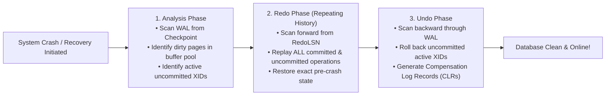
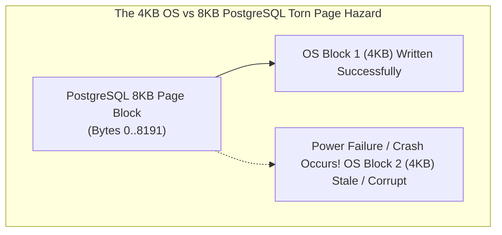
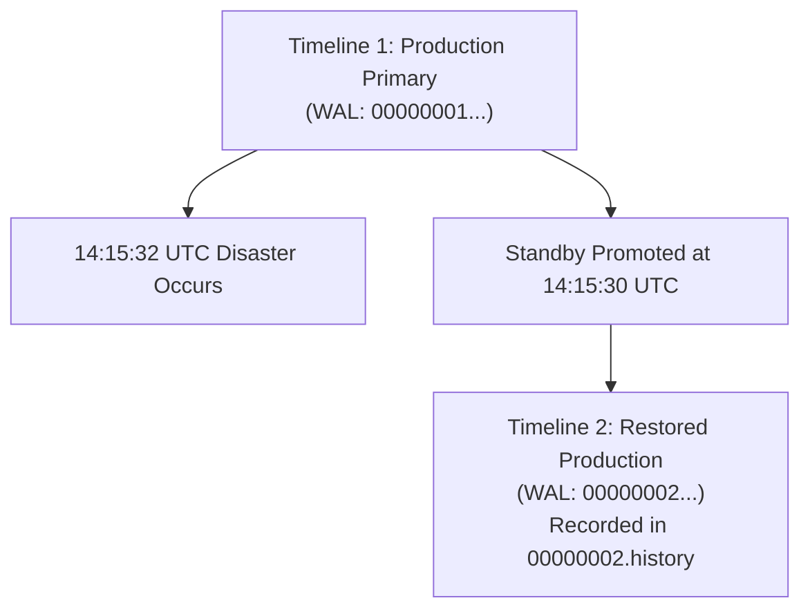
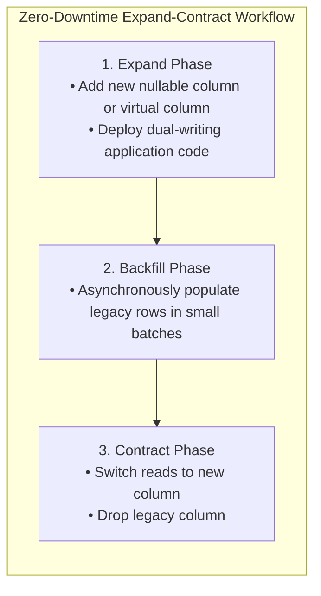
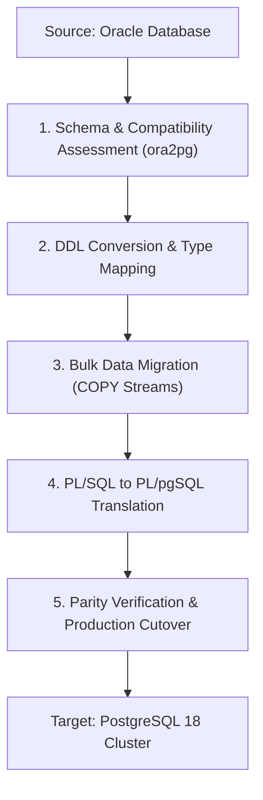

# Module 09 — Backup, Point-In-Time Recovery & Migration

Welcome to **Module 09** of the PostgreSQL 18 Curriculum. This module delivers comprehensive, academically grounded, and production-tested disaster recovery and database migration strategies. We examine the formal ARIES recovery framework, dissect Write-Ahead Log (WAL) records and the Full-Page Write (`full_page_writes`) torn-page protection mechanism, analyze timeline branching and history files, execute precision Point-In-Time Recovery (PITR), evaluate zero-downtime schema migration patterns, and orchestrate enterprise heterogeneous migrations from proprietary engines like Oracle to PostgreSQL.

---

## 1. Core Terminology & Concept Definitions

To establish technical and operational clarity across this curriculum, the following disaster recovery and migration terms are formally defined:

- **ARIES (Algorithms for Recovery and Isolation Exploiting Semantics)**: The foundational database recovery algorithm formulated by C. Mohan (IBM, 1992) consisting of Analysis, Redo (repeating history), and Undo phases to guarantee ACID atomicity and durability.
- **Log Sequence Number (LSN)**: A monotonically increasing 64-bit unsigned integer representing the byte offset of a record within the cluster's Write-Ahead Log stream (e.g. `0/16B3740`).
- **Full Page Image (FPI / `full_page_writes`)**: A complete 8KB image of a database block written into the WAL stream upon its first modification following a checkpoint, preventing data loss caused by partial/torn page writes by the operating system.
- **Torn Page**: A hardware corruption event where an 8KB database block is only partially written to disk (e.g. 4KB written before power loss), leaving the page in an inconsistent, corrupted binary state.
- **Base Backup (`pg_basebackup`)**: A physical binary snapshot of the `$PGDATA` cluster directory captured while the primary database continues serving live transactions.
- **Point-In-Time Recovery (PITR)**: The disaster recovery procedure of restoring a base backup and rolling forward archived WAL records to reconstruct database state at an exact target timestamp, LSN, or named restore point.
- **Timeline (`TLI`)**: An integer identifier (e.g. `1`, `2`) prefixed to WAL segment filenames that tracks branches of WAL history, preventing divergent transaction logs from overwriting each other after recovery promotion.
- **Timeline History File (`.history`)**: A text file (e.g. `00000002.history`) recording the exact LSN and point in time where a newly promoted cluster branched from its parent timeline.
- **Expand-Contract Pattern**: A zero-downtime continuous schema deployment methodology where database modifications are phased across backward-compatible expansion, code migration, and subsequent contraction stages.

---

## 2. Theoretical Foundations: The ARIES Recovery Framework

PostgreSQL's crash recovery and Point-In-Time Recovery systems implement the classical **ARIES** recovery protocol:



### The Three Phases of ARIES Explained:
1. **Analysis Phase**: The engine reads the `pg_control` file to locate the latest valid Checkpoint record, then scans forward through the WAL to determine:
   - The lowest LSN of a page that was dirty in `shared_buffers` at the time of the checkpoint (`RedoLSN`).
   - The list of active, uncommitted transactions at the moment of the crash.
2. **Redo Phase (Repeating History)**: Scans forward starting from `RedoLSN`, reapplying changes for **all** transactions (both committed and uncommitted). This restores internal storage state to the exact microsecond before the crash.
3. **Undo Phase**: Scans backwards from the end of the log, undoing every operation performed by transactions that never committed before the failure, leaving the database in a consistent ACID state.

---

## 3. Write-Ahead Log (WAL) Anatomy & Torn Page Protection

### Binary Anatomy of a WAL Record
Every state transition produces a WAL record with a standard binary header:
- **`Record LSN`** (8 bytes): Global log sequence number.
- **`rmid`** (1 byte): Resource Manager ID (`RM_HEAP_ID`, `RM_BTREE_ID`, `RM_XACT_ID`).
- **`xl_info`** (1 byte): Flag indicating operation type (e.g. `XLOG_HEAP_INSERT`, `XLOG_BTREE_SPLIT`).
- **`xl_xid`** (4 bytes): Transaction ID executing the modification.
- **`xl_prev`** (8 bytes): Pointer to the preceding WAL record.
- **Data Payload**: Delta diffs or Full Page Images.



### How `full_page_writes` Solves Torn Pages
The operating system file system writes in 4KB chunks. If power fails mid-write:
- 4KB of an 8KB PostgreSQL block may be persisted, while the second 4KB contains old data.
- Standard incremental WAL deltas cannot be applied to a torn block because the checksum and tuple offsets are corrupt.
- **Solution (`full_page_writes = on`)**: The **first time** an 8KB block is modified after a checkpoint, PostgreSQL writes a complete binary snapshot of the entire 8KB page into the WAL stream. During crash recovery, the full page image completely overwrites the torn disk block before subsequent delta records are replayed!

---

## 4. Timelines, Timeline Branching & History Files

In traditional transaction logs, if a standby is promoted to primary, its WAL stream would continue numbering linearly. However, if an administrator later restores an older backup and rolls forward along a different recovery path, linear numbering would overwrite historical WAL files.

PostgreSQL solves this via **Timelines**:
- WAL filenames embed the Timeline ID in their first 8 hexadecimal digits:
  $$\text{Filename} = \underbrace{\text{00000001}}_{\text{Timeline ID}} \underbrace{\text{00000000}}_{\text{Logical Segment}} \underbrace{\text{00000001}}_{\text{Physical Segment}}$$
- When a standby is promoted or PITR finishes, the cluster branches into a new Timeline (e.g. Timeline `2`):
  `000000020000000000000002`
- The cluster writes a **Timeline History File** (`00000002.history`) recording the exact branch point:
  ```
  1    0/16B3740    no recovery target specified
  ```
  *(Meaning: Timeline 2 branched from Timeline 1 at LSN `0/16B3740`).*



---

## 5. Point-In-Time Recovery (PITR) End-to-End Walkthrough

### The Disaster Scenario
On October 28, 2026 at **14:15:32 UTC**, an unconstrained `DELETE` statement destroyed all customer orders:

```sql
-- Committed at 14:15:32 UTC on production
DELETE FROM customer_orders;
```

### The Recovery Target Equation
We must roll forward the physical base backup taken earlier in the morning and stop replay at **14:15:30 UTC** (2 seconds before the disaster committed):


### Execution Procedure:
1. **Halt PostgreSQL**:
   ```bash
   pg_ctl -D /var/lib/postgresql/data stop -m immediate
   ```
2. **Preserve Current WAL**:
   Copy unarchived WAL segments from `pg_wal/` to safe offline storage.
3. **Restore Physical Base Backup**:
   ```bash
   rm -rf /var/lib/postgresql/data/*
   tar -xzf /backups/base_backup.tar.gz -C /var/lib/postgresql/data/
   ```
4. **Signal Recovery Mode**:
   ```bash
   touch /var/lib/postgresql/data/recovery.signal
   ```
5. **Configure Recovery Targets (`postgresql.conf`)**:
   ```ini
   # Archive retrieval command
   restore_command = 'cp /mnt/wal_archive/%f %p'

   # Exact recovery target stop condition
   recovery_target_time = '2026-10-28 14:15:30 UTC'
   recovery_target_action = 'promote'
   ```
6. **Start PostgreSQL**:
   ```bash
   pg_ctl -D /var/lib/postgresql/data start
   ```
   PostgreSQL rolls forward all transactions up to `14:15:30 UTC`, establishes Timeline 2, and opens for production traffic with zero lost valid transactions!

---

## 6. Zero-Downtime Schema Migrations (Expand-Contract Pattern)

Modifying production schemas under high concurrency requires avoiding long-lived table locks:



### Concurrency Safety Rules for DDL:
1. **Never run DDL without lock timeouts**:
   ```sql
   SET lock_timeout = '2s';
   SET statement_timeout = '5s';
   ALTER TABLE orders ADD COLUMN fulfillment_status VARCHAR(32);
   ```
2. **`CREATE INDEX CONCURRENTLY` Mechanics**:
   Standard `CREATE INDEX` acquires a `SHARE` lock, blocking all concurrent `INSERT`, `UPDATE`, and `DELETE` operations.
   `CREATE INDEX CONCURRENTLY` uses a 3-transaction state machine that builds the index without blocking writes:
   - **Transaction 1**: Declares the index in catalog (`indisvalid = false`, `indisready = false`).
   - **Transaction 2**: Performs a table scan to build leaf entries (`indisready = true`).
   - **Transaction 3**: Waits for older snapshot transactions to finish and marks the index valid (`indisvalid = true`).

---

## 7. Heterogeneous Migration: Oracle to PostgreSQL

Migrating from proprietary databases like Oracle to PostgreSQL requires resolving core semantic and data type discrepancies:



### Core Type Translation Matrix

| Oracle Data Type | PostgreSQL Equivalent | Architectural Notes |
| :--- | :--- | :--- |
| `VARCHAR2(n)` | `TEXT` or `VARCHAR(n)` | PostgreSQL `TEXT` has zero performance penalty; prefer `TEXT`. |
| `NUMBER(p, s)` | `NUMERIC(p, s)` | Exact precision decimal; identical semantics. |
| `NUMBER(10, 0)` | `INTEGER` or `BIGINT` | Binary CPU integers are vastly faster than `NUMERIC`. |
| `DATE` | `TIMESTAMPTZ` | **Critical Trap**: Oracle `DATE` stores time components (hours, min, sec)! Never map to PG `DATE`! |
| `CLOB` | `TEXT` | Unlimited string storage. |
| `BLOB` | `BYTEA` | Binary byte array. |
| `RAW(16)` | `UUID` | Map directly to native PostgreSQL `UUID` using `uuidv7()`. |

### Behavioral Discrepancies:
1. **Empty Strings vs. NULL**:
   - In Oracle: `''` is treated as `NULL`.
   - In PostgreSQL: `''` is a valid 0-length string distinct from `NULL`. Ensure check constraints and queries account for this.
2. **Autonomous Transactions**:
   - Oracle supports `PRAGMA AUTONOMOUS_TRANSACTION`.
   - In PostgreSQL, use decoupled `dblink` connections or background workers.

---

## 8. Summary & Module Progression

In this module, we examined:
- The formal ARIES recovery protocol (Analysis, Redo, Undo).
- WAL record binary anatomy and the `full_page_writes` torn-page protection mechanism.
- Timelines, branching mechanics, and `.history` files.
- End-to-end Point-In-Time Recovery (PITR) procedures.
- Zero-downtime schema migrations, the Expand-Contract pattern, and `CREATE INDEX CONCURRENTLY` state machines.
- Heterogeneous database migration from Oracle to PostgreSQL.

Proceed to **[Module 10 — High Availability, Replication & Modern Extensions](./10-high-availability-replication-and-extensions.md)** to master streaming replication, Patroni consensus clustering, Row-Level Security (RLS), and AI vector search using `pgvector`.
