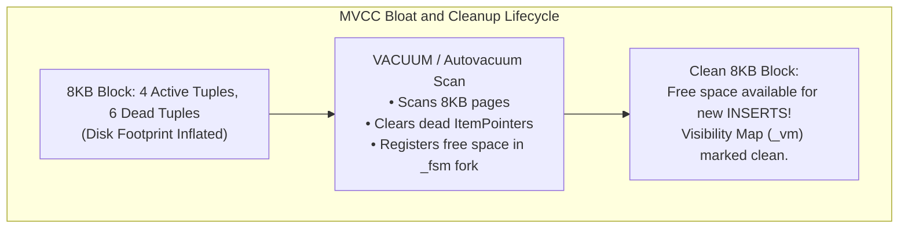
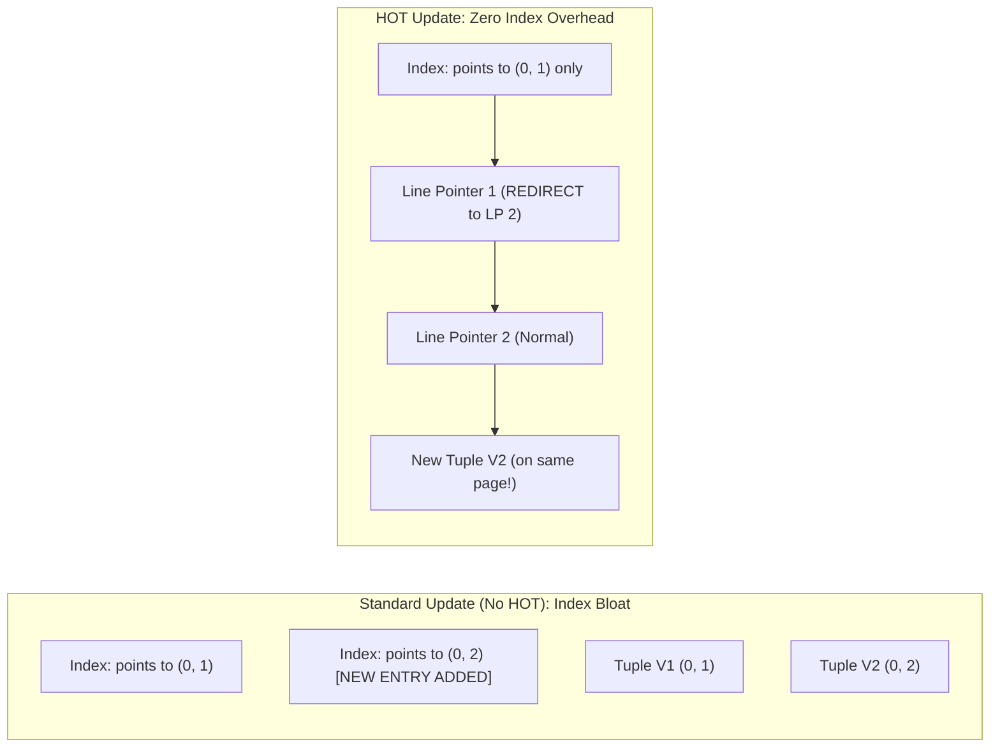
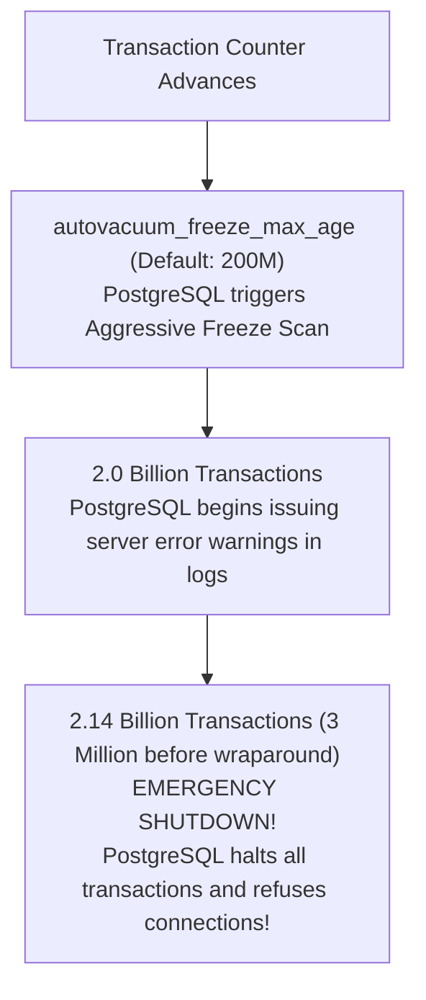
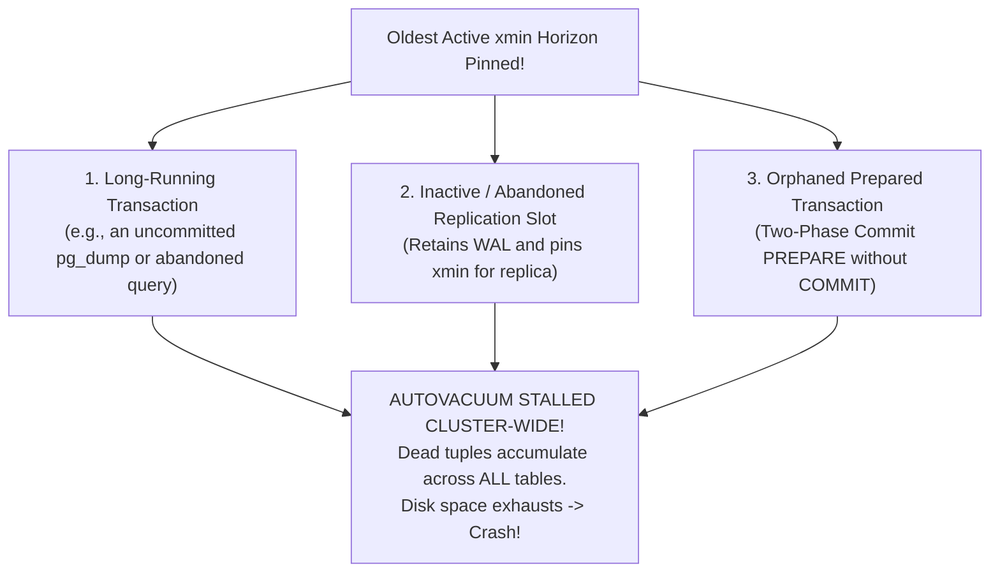

# Module 09 — Vacuum Internals, Freezing, Bloat Mitigation & Storage Reclamation

Welcome to **Module 09** of the PostgreSQL curriculum. This module provides complete, academically grounded, and staff-level operational knowledge for managing MVCC storage reclamation and transaction horizon health in PostgreSQL 18. We dissect the internal mechanics of MVCC table and index bloat, evaluate Heap-Only Tuple (HOT) optimizations, formulate autovacuum tuning algorithms, analyze the mathematical hazard of 32-bit Transaction ID (XID) wraparound, unmask the three critical vacuum horizon blockers, clarify PostgreSQL 18's partitioned maintenance semantics, and examine PostgreSQL 19's native `REPACK` revolution.

---

## 1. Core Terminology & Concept Definitions

- **Table & Index Bloat**: Physical disk space allocated inside 8KB pages containing dead tuple versions or unused line pointers that have not been reclaimed or reused, inflating cache footprint and degrading I/O throughput.
- **Autovacuum Daemon**: A multi-process background automation subsystem that periodically scans relations to remove dead tuple versions, update the Visibility Map (`_vm`) and Free Space Map (`_fsm`), freeze transaction IDs to prevent wraparound, and update optimizer statistics via `ANALYZE`.
- **Heap-Only Tuples (HOT)**: An engine optimization where an `UPDATE` places a new tuple version onto the exact same 8KB disk page without creating new index entries across secondary indexes, chaining line pointers internally.
- **Fillfactor**: A table storage parameter (default: 100 for tables, 90 for B-Tree indexes) specifying the percentage of an 8KB page packed during `INSERT`, reserving the remaining space for future in-page HOT updates.
- **Transaction ID (XID) Wraparound**: The mathematical threshold where the 32-bit transaction counter exhausts its $2^{31}$ comparison horizon, threatening total data invisibility and forcing the cluster into emergency read-only shutdown unless past tuples are frozen.
- **`FrozenTransactionId` (`= 2`)**: A special sentinel transaction identifier defined as mathematically older than every valid transaction ID, permanently establishing a tuple as visible to all current and future transactions.
- **Oldest Active `xmin` Horizon**: The lowest transaction ID of any active transaction, prepared transaction, or inactive replication slot in the cluster. Autovacuum cannot reclaim any dead tuple version deleted by a transaction newer than this horizon.
- **PostgreSQL 19 `REPACK`**: A native engine command introduced in PostgreSQL 19 that rebuilds bloated tables and indexes online without acquiring an exclusive table lock, replacing `VACUUM FULL` and third-party tools like `pg_repack`.

---

## 2. MVCC Storage Lifecycle & Bloat Dynamics

Because PostgreSQL updates and deletes do not overwrite data in place, every modification creates dead tuple versions:



### The Three Costs of Bloat:
1. **Buffer Cache Degradation**: An 8KB block containing 1 active tuple and 99 dead tuples consumes 8KB of `shared_buffers` to cache a single active row.
2. **I/O Inflation**: Sequential scans and index scans must read bloated pages from storage, driving up random I/O and latency.
3. **Index Bloat**: Unlike tables, index pages cannot reclaim space without page rebalancing or deduplication, leading to sparse index trees.

---

## 3. Heap-Only Tuples (HOT) & Fillfactor Optimization

Heap-Only Tuples (HOT) is PostgreSQL's primary defense against write amplification on tables with secondary indexes.



### The Two Mandatory Prerequisites for HOT:
1. The new tuple version must physically fit onto the **exact same 8KB page** as the previous version.
2. The `UPDATE` statement **must not modify any column referenced by any index** on the table.

### Tuning `fillfactor` for HOT
By default, `fillfactor = 100`, meaning `INSERT` fills pages completely, leaving zero room for HOT updates. On high-churn transactional tables:

```sql
-- Reserve 15% of each page for in-page HOT updates:
ALTER TABLE user_sessions SET (fillfactor = 85);
VACUUM FULL user_sessions; -- Or REINDEX / pg_repack to apply
```
Now, subsequent `UPDATE`s place new versions on the same page, chaining line pointers without adding entries to secondary indexes.

---

## 4. Autovacuum Daemon Mechanics & Mathematical Tuning

Autovacuum launches a worker process on a table when the count of dead tuples exceeds:
$$\text{Threshold} = \text{autovacuum\_vacuum\_threshold} + (\text{autovacuum\_vacuum\_scale\_factor} \times \text{reltuples})$$

### The Default Scale Factor Failure
Default parameters (`threshold = 50`, `scale_factor = 0.2`):
- A table with 1,000 rows triggers vacuum after: $50 + (0.2 \times 1,000) = 250$ dead tuples.
- A table with 100,000,000 rows triggers vacuum only after **20,000,050 dead tuples**!

On large relations, 20 million dead rows represent tens of gigabytes of accumulated bloat before autovacuum even awakens.

### Production Per-Table Tuning
Configure aggressive thresholds on large transactional tables:

```sql
ALTER TABLE transactions SET (
    autovacuum_vacuum_scale_factor = 0.02,   -- Trigger after 2% churn
    autovacuum_vacuum_threshold = 5000,
    autovacuum_vacuum_cost_limit = 2000,     -- Allocate larger I/O budget
    autovacuum_vacuum_cost_delay = 2         -- Minimal throttling delay
);
```

### Global Configuration (`postgresql.conf`)
```ini
autovacuum = on
autovacuum_max_workers = 6               # Scale with CPU core count
autovacuum_vacuum_cost_limit = 2000      # Increase global I/O credit pool (default: 200)
autovacuum_vacuum_cost_delay = 2         # Delay in ms when cost limit reached
```

---

## 5. Transaction ID (XID) Wraparound & Emergency Freezing

PostgreSQL transaction IDs are 32-bit unsigned integers, providing $2^{32} \approx 4.29 \text{ billion}$ distinct values. Because XIDs use modulo-$2^{31}$ arithmetic to compare transaction age:
- An XID can only be compared to transactions up to $2^{31}$ (2.1 billion) transactions in the past.
- If past transactions are not frozen, the counter "wraps around," causing past committed transactions to appear to be in the future, rendering data **permanently invisible**!



### The Freezing Mechanism
During an aggressive freeze vacuum:
1. Autovacuum inspects tuples where `t_xmin < vacuum_freeze_min_age`.
2. It sets the `HEAP_XMIN_FROZEN` hint bit in `t_infomask` (or replaces `t_xmin` with `FrozenTransactionId = 2`).
3. Once frozen, the tuple is mathematically defined as older than all possible current and future transactions, immunizing it against wraparound.

---

## 6. The Three Critical Vacuum Horizon Blockers

Autovacuum cannot reclaim dead tuples deleted after the **Oldest Active `xmin` Horizon**. Three common production conditions pin this horizon, causing unbounded cluster-wide bloat:



### Diagnostic Query for Horizon Blockers:
```sql
-- 1. Identify long-running transactions:
SELECT pid, usename, now() - xact_start AS duration, query, backend_xmin
FROM pg_stat_activity
WHERE backend_xmin IS NOT NULL
ORDER BY duration DESC;

-- 2. Identify inactive replication slots:
SELECT slot_name, plugin, active, xmin, catalog_xmin
FROM pg_replication_slots
WHERE active = FALSE;

-- 3. Identify orphaned prepared transactions:
SELECT gid, prepared, owner, database
FROM pg_prepared_xacts;
```

---

## 7. PostgreSQL 18 & 19 Maintenance Evolution

### PostgreSQL 18 Partitioned Table Maintenance
In earlier versions, running `VACUUM` on a partitioned parent table always cascaded down to all child partitions.
- **Clarification**: In PostgreSQL 18, running `VACUUM (ONLY) partitioned_table` or `ANALYZE (ONLY) partitioned_table` vacuums and analyzes **only the parent partitioned table catalog entry** without recursing down through child partitions. This enables rapid statistics updates on partitioned parents without incurring child I/O overhead.

### PostgreSQL 19: The Native `REPACK` Revolution
Reclaiming physical disk space from bloated tables historically required:
- `VACUUM FULL`: Reclaims space by rewriting the table, but acquires an **`ACCESS EXCLUSIVE`** lock, taking the table offline.
- `pg_repack`: A third-party C extension that builds a new table online via triggers, but carries installation and operational overhead.

PostgreSQL 19 introduces native **`REPACK`** and **`REPACK CONCURRENTLY`**:
```sql
-- PostgreSQL 19 Online Table & Index Rebuild (Zero Application Downtime):
REPACK CONCURRENTLY orders;
```
It rebuilds the relation and its indexes in the background using logical decoding diffs, switching pointers seamlessly without exclusive locking.

---

## 8. Then vs. Now: Vacuum & Maintenance

| Dimension | PostgreSQL $\le$ 14 | PostgreSQL 15–17 | PostgreSQL 18 & 19 (Current) |
| :--- | :--- | :--- | :--- |
| **Online Bloat Rebuild** | Third-party `pg_repack` required | Third-party `pg_repack` required | Native **`REPACK CONCURRENTLY`** (PG19) |
| **Partition Maintenance** | Parent vacuum always cascaded | Parent vacuum always cascaded | **`VACUUM (ONLY)`** maintenance on parent without child recursion (PG18) |
| **Autovacuum Prioritization** | Round-robin / random order | Basic FIFO scheduling | **Autovacuum priority scoring** (`pg_stat_autovacuum_scores` in PG19) |
| **Index Vacuuming** | Single-threaded per index | Multi-index parallel vacuuming in manual VACUUM | Parallel index vacuuming in **autovacuum** (PG19) |

---

## 9. Interview Drill

<details>
<summary>1. Explain the Heap-Only Tuple (HOT) optimization. What are its two requirements, and how do you configure a table to maximize HOT?</summary>

**Answer**: HOT eliminates write amplification caused by `UPDATE`s on tables with secondary indexes. Normally, every update creates a new tuple and adds a new entry pointing to it across every index on the table. With HOT:
1. The new tuple version is placed on the **exact same 8KB page** as the previous version.
2. The line pointer (`ItemIdData`) of the old version is converted into an intra-page redirect pointer pointing to the new version.
3. Secondary indexes do not need updates; they continue pointing to the original line pointer.
Requirements: (1) The new tuple must fit on the same page, and (2) No column referenced by any index on the table can be modified.
Configuration: Reduce table `fillfactor` (e.g. `ALTER TABLE t SET (fillfactor = 80);`), leaving 20% of every page free for future in-page updates.
- Ref: [PostgreSQL Documentation: Storage: HOT](https://www.postgresql.org/docs/18/storage-hot.html)
</details>

<details>
<summary>2. Why does default autovacuum configuration fail on tables with tens of millions of rows?</summary>

**Answer**: The autovacuum activation threshold is: `threshold + (scale_factor * reltuples)`. With defaults (`threshold = 50, scale_factor = 0.2`), autovacuum triggers only after 20% of the table's rows have been deleted or updated. On a 100-million-row table, autovacuum will not wake up until **20 million rows** have died. This allows gigabytes of dead tuples to accumulate, causing severe cache dilution and table bloat. The fix is setting aggressive per-table thresholds: `ALTER TABLE t SET (autovacuum_vacuum_scale_factor = 0.01, autovacuum_vacuum_threshold = 5000);`.
- Ref: [PostgreSQL Documentation: Routine Vacuuming](https://www.postgresql.org/docs/18/routine-vacuuming.html#AUTOVACUUM)
</details>

<details>
<summary>3. What is Transaction ID (XID) wraparound, and what happens if a database cluster reaches the critical wraparound threshold?</summary>

**Answer**: PostgreSQL uses 32-bit unsigned transaction IDs compared modulo-$2^{31}$. A transaction ID can only be safely compared against past transactions up to 2.1 billion transactions ago. If older transactions are not "frozen" (marked with `FrozenTransactionId = 2`), the transaction counter wraps around, making ancient committed tuples appear to be in the future, rendering data completely invisible. If the system approaches 3 million transactions before wraparound without completing freezing, PostgreSQL initiates an **emergency shutdown**: it refuses all write and read transactions, halts the postmaster, and can only be recovered by launching single-user standalone mode (`postgres --single`) and executing a manual vacuum.
- Ref: [PostgreSQL Documentation: Routine Vacuuming: Wraparound](https://www.postgresql.org/docs/18/routine-vacuuming.html#VACUUM-FOR-WRAPAROUND)
</details>

<details>
<summary>4. Name three things that can block autovacuum from freeing dead tuples across an entire PostgreSQL database.</summary>

**Answer**:
1. **Long-running transactions**: Any open transaction (including an idle read-only transaction or an uncommitted `pg_dump`) pins the `backend_xmin` horizon. Autovacuum cannot reclaim any tuple version deleted after that transaction started.
2. **Abandoned or inactive replication slots**: If a logical or physical replication slot is disconnected, PostgreSQL retains all WAL and pins the database `xmin` horizon to prevent the replica from losing required data.
3. **Orphaned prepared transactions**: A two-phase commit transaction (`PREPARE TRANSACTION`) that was never followed by `COMMIT PREPARED` or `ROLLBACK PREPARED` remains active indefinitely across server restarts, holding the `xmin` horizon open.
- Ref: [PostgreSQL Documentation: System Activity Monitoring](https://www.postgresql.org/docs/18/monitoring-stats.html)
</details>

<details>
<summary>5. How does PostgreSQL 19's `REPACK` change table maintenance compared to `VACUUM FULL`?</summary>

**Answer**: `VACUUM FULL` rewrites a table to eliminate bloat and return space to the operating system filesystem, but it acquires an **`ACCESS EXCLUSIVE`** lock on the table. This lock blocks all concurrent `SELECT`, `INSERT`, `UPDATE`, and `DELETE` operations, taking the table offline for the duration of the rebuild. PostgreSQL 19's native `REPACK` / `REPACK CONCURRENTLY` rebuilds the table and indexes online in the background using logical change tracking, acquiring only brief locks at the start and completion of the rebuild, allowing production application queries to proceed uninterrupted.
- Ref: [PostgreSQL 19 Release Notes](https://www.postgresql.org/docs/19/release-19.html)
</details>
