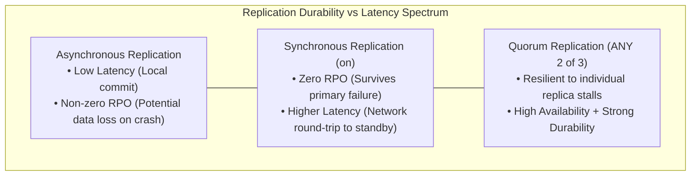
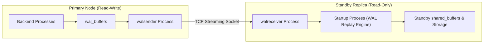
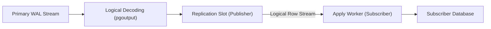
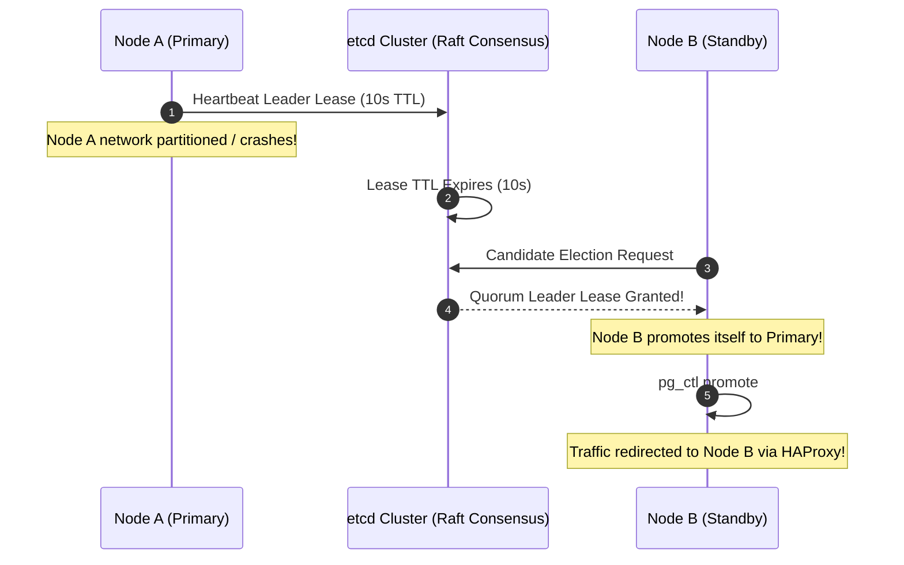
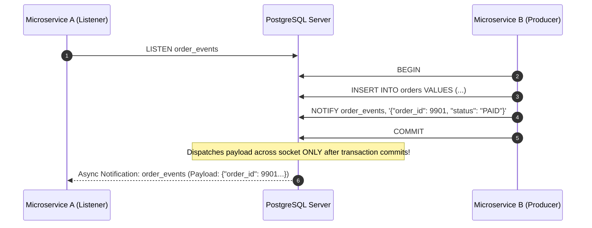
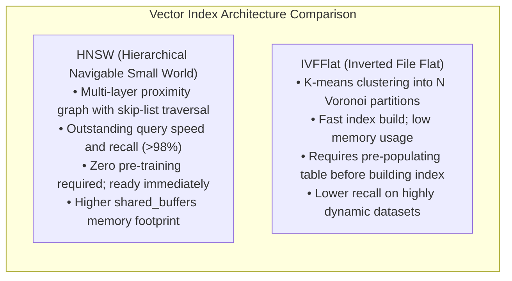
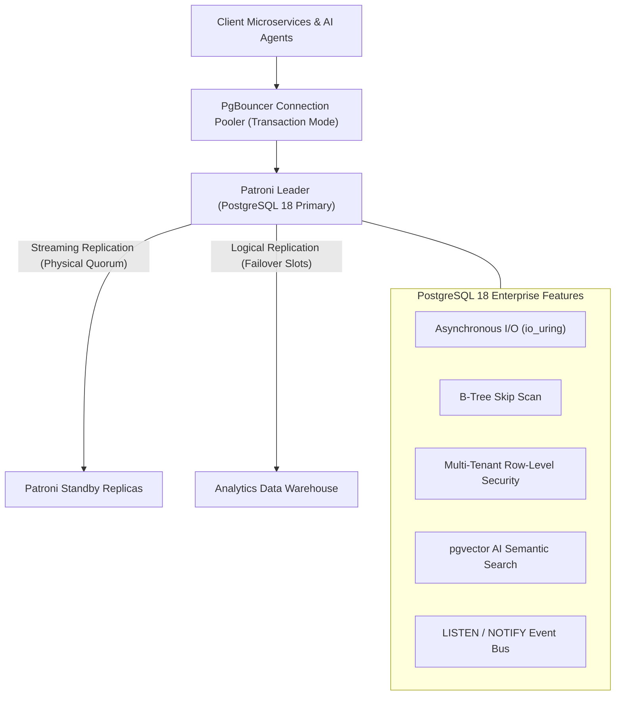

# Module 10 — High Availability, Replication & Modern Extensions

Welcome to **Module 10** of the PostgreSQL 18 Curriculum. This capstone module covers enterprise-scale distributed systems and advanced capabilities in PostgreSQL: physical streaming replication, quorum-based synchronous commitments, Change Data Capture (CDC) via logical replication with PostgreSQL 18 failover slots, automated high availability and split-brain mitigation using Patroni and Raft consensus (`etcd`), security-barrier Row-Level Security (RLS), asynchronous event brokers (`LISTEN`/`NOTIFY`), and high-dimensional AI vector similarity search using **`pgvector`** (HNSW vs. IVFFlat).

---

## 1. Core Terminology & Concept Definitions

To establish technical and architectural precision across this curriculum, the following enterprise terms are formally defined:

- **Recovery Point Objective (RPO)**: The maximum acceptable data loss measured in time (e.g. zero seconds of lost transactions) in the event of an unplanned primary server failure.
- **Recovery Time Objective (RTO)**: The maximum acceptable duration of service downtime before a standby node assumes primary leadership and resumes client application traffic.
- **Physical Streaming Replication**: The protocol where the primary server continuously streams binary Write-Ahead Log (WAL) records over a network socket to standby instances, which replay them into local storage.
- **Quorum Replication**: A synchronous replication topology where a transaction commits only after a defined quorum ($K$ of $N$) of standby replicas confirm receipt and flushing of WAL records.
- **Replication Slot**: A cluster state anchor that guarantees the primary server will not discard WAL segments or purge dead tuples needed by a standby or logical subscriber until that consumer confirms receipt.
- **Logical Replication**: A publish-subscribe architecture transmitting row-level data modifications based on decoded logical changes (`pgoutput`) rather than raw 8KB disk page alterations, permitting selective table replication and cross-version migrations.
- **Patroni**: An enterprise high-availability daemon that utilizes a Distributed Consensus Store (DCS, such as `etcd` or Consul) implementing Raft consensus to guarantee automated, split-brain-free leader election and failover.
- **Fencing (STONITH)**: "Shoot The Other Node In The Head" — the isolation mechanism that forcibly cuts power or network access to an unresponsive primary node to prevent split-brain dual-primary corruption.
- **Row-Level Security (RLS)**: Fine-grained relational access control policies (`CREATE POLICY`) evaluated dynamically by the query rewriter to restrict which tuples a given database role can view or modify.
- **Vector Similarity Search (`pgvector`)**: An extension providing dense high-dimensional vector embeddings and Approximate Nearest Neighbor (ANN) indexing (HNSW and IVFFlat) to execute semantic similarity searches for generative AI applications.

---

## 2. Distributed Consensus & High Availability Theory

In distributed systems theory, database replication operates under the constraints of the **CAP Theorem** (Brewer, 2000) and **PACELC Theorem** (Abadi, 2012):
- During network partitions ($P$), a cluster must choose between Availability ($A$) or Consistency ($C$).
- Else ($E$), when functioning normally, the system trades off Latency ($L$) versus Consistency ($C$).



### Physical Streaming Replication Architecture



### Synchronous Commit Modes
Replication durability is controlled by the `synchronous_commit` parameter on the primary:

| `synchronous_commit` Setting | Guarantee | RPO | Write Latency Impact |
| :--- | :--- | :--- | :--- |
| **`off`** | Client receives commit before WAL is flushed to local disk. | Data loss on crash | Lowest latency |
| **`local`** | Flushed to primary local storage before commit. | Primary safe; replica lags | Low |
| **`remote_write`** | Standby has received WAL and written to OS kernel cache. | Survives primary power failure | Medium |
| **`on`** | Standby has flushed WAL to physical disk storage. | **Zero data loss (RPO = 0)** | High (network roundtrip) |
| **`remote_apply`** | Standby has replayed changes into memory/storage. | Zero read lag for standby queries | Highest |

### Quorum Synchronous Standby Specification
To avoid a single slow replica stalling all primary transactions, configure quorum replication:
```ini
# Commit succeeds when ANY 2 replicas out of s1, s2, s3 flush to disk:
synchronous_standby_names = 'ANY 2 (standby_1, standby_2, standby_3)'
```

---

## 3. Logical Replication & PostgreSQL 18 Failover Slots

Logical replication operates on a **Publisher-Subscriber** model via logical decoding:
1. The **`walsender`** reads WAL records and passes them through an output plugin (`pgoutput`).
2. The plugin reconstructs logical row mutations (`INSERT`, `UPDATE`, `DELETE`) with typed column values.
3. The subscriber's **`apply` worker** consumes the change stream and executes corresponding operations against local relations.



### The `REPLICA IDENTITY` Hazard
When an `UPDATE` or `DELETE` is replicated logically, the subscriber must identify the target row:
- **`DEFAULT`**: Uses the primary key of the table.
- **`FULL`**: Every column value is compared.
> [!WARNING]
> Setting `REPLICA IDENTITY FULL` on a high-churn table without a primary key forces the subscriber to execute a **full sequential scan** for every replicated update or delete, exhausting subscriber CPU and causing massive replication lag! Always ensure replicated tables possess an explicit primary key.

### PostgreSQL 18 Synchronized Logical Replication Failover Slots
Prior to PostgreSQL 18, if a physical primary failed over to a standby replica, all logical replication subscribers broke because logical decoding slots were tied strictly to the failed primary node.

PostgreSQL 18 introduces **synchronized logical replication failover slots**:
Standby nodes maintain synchronized logical decoding states. When a physical failover occurs, subscribers seamlessly reconnect to the promoted standby without data corruption or re-syncing:

```sql
-- On Publisher: Create publication with failover support
CREATE PUBLICATION app_pub FOR ALL TABLES WITH (failover = true);

-- Standby postgresql.conf:
sync_replication_slots = true
```

---

## 4. Enterprise High Availability with Patroni & etcd

Patroni prevents the catastrophic **split-brain** failure mode where network partitions cause two nodes to simultaneously believe they are the primary, corrupting data:



### Architectural Pillars of Patroni:
1. **Distributed Consensus Store (DCS)**: A 3-node or 5-node `etcd` cluster maintaining leader state via the Raft consensus algorithm.
2. **Leader Lease TTL**: The active primary continuously renews a short-lived key (typically 10 seconds). If the primary fails to renew, the lease expires.
3. **Fencing (STONITH)**: Ensures that the old primary is completely shut down before a new primary is promoted.
4. **Dynamic Health Endpoints**: Patroni exposes REST endpoints (`:8008/primary`, `:8008/replica`) consumed by load balancers (HAProxy, Envoy) to route read-write versus read-only queries automatically.

---

## 5. Multi-Tenant Isolation with Row-Level Security (RLS)

Row-Level Security enforces tenant separation directly inside the database engine, guaranteeing that application query bugs cannot leak records across tenant boundaries:

```sql
CREATE TABLE tenant_documents (
    document_id UUID PRIMARY KEY DEFAULT uuidv7(),
    tenant_id UUID NOT NULL,
    title TEXT NOT NULL,
    payload JSONB NOT NULL
);

-- 1. Enable RLS
ALTER TABLE tenant_documents ENABLE ROW LEVEL SECURITY;

-- 2. Force RLS (Ensures policies apply even to table owners!)
ALTER TABLE tenant_documents FORCE ROW LEVEL SECURITY;

-- 3. Define Security Isolation Policy
CREATE POLICY tenant_isolation_policy ON tenant_documents
FOR ALL
USING (tenant_id = current_setting('app.current_tenant_id', true)::uuid)
WITH CHECK (tenant_id = current_setting('app.current_tenant_id', true)::uuid);
```

### Application Execution Pipeline
```sql
BEGIN;
-- Set session-scoped tenant context
SET LOCAL app.current_tenant_id = '0192d3b4-7000-7000-8000-000000000001';

-- Automatically filters to tenant 0192d3b4-7000-7000-8000-000000000001 only:
SELECT * FROM tenant_documents;
COMMIT;
```

> [!NOTE]
> By default in PostgreSQL, **superusers bypass Row-Level Security**! In multi-tenant environments, application connection pools must connect using a dedicated non-superuser role (e.g. `app_user`).

---

## 6. Real-Time Event Messaging: `LISTEN` and `NOTIFY`

PostgreSQL provides a native publish-subscribe event broker without requiring external message queues (e.g. Redis):



```sql
-- Subscriber process:
LISTEN order_pipeline;

-- Publisher process:
SELECT pg_notify(
    'order_pipeline', 
    json_build_object('order_id', 9901, 'amount', 250.00)::text
);
```

---

## 7. AI Vector Search with `pgvector`: Mathematical Foundations & Indexing

`pgvector` transforms PostgreSQL into a high-performance vector database, supporting dense embeddings generated by Large Language Models (LLMs).

```sql
CREATE EXTENSION IF NOT EXISTS vector;

CREATE TABLE document_embeddings (
    id UUID PRIMARY KEY DEFAULT uuidv7(),
    title TEXT NOT NULL,
    embedding VECTOR(1536) -- 1536-dimensional OpenAI / Gemini embedding
);
```

### Vector Distance Metrics
- **Euclidean / $L_2$ Distance (`<->`)**:
  $$d_{L_2}(u, v) = \sqrt{\sum_{i=1}^n (u_i - v_i)^2}$$
- **Cosine Distance (`<=>`)**:
  $$d_{\text{cos}}(u, v) = 1 - \frac{u \cdot v}{\|u\| \|v\|}$$
- **Negative Inner Product (`<#>`)**:
  $$d_{\text{IP}}(u, v) = -(u \cdot v)$$

---

### Indexing Algorithms: HNSW vs. IVFFlat



### 1. Hierarchical Navigable Small World (HNSW)
HNSW constructs a multi-layer graph where upper layers contain long-distance links for rapid geometric traversal (similar to a skip-list), and lower layers contain dense clusters for fine-grained local descent:
- **`m`** (default: 16): Maximum number of bidirectional connections per node.
- **`ef_construction`** (default: 64): Size of the dynamic candidate list evaluated during index construction (higher values increase build time and recall).

```sql
-- High-recall HNSW index using Cosine distance:
CREATE INDEX idx_embeddings_hnsw ON document_embeddings 
USING hnsw (embedding vector_cosine_ops)
WITH (m = 16, ef_construction = 64);

-- Sub-millisecond ANN Similarity Query:
SELECT 
    id, 
    title, 
    1 - (embedding <=> :query_vector) AS cosine_similarity
FROM document_embeddings
ORDER BY embedding <=> :query_vector
LIMIT 5;
```

---

## 8. Complete Enterprise Curriculum Capstone Architecture



---

## 9. Summary & Course Completion

Congratulations on completing the entire **PostgreSQL 18 Complete Curriculum**! Across these 10 comprehensive modules, we mastered:
- Process, memory, disk page anatomy, and the PostgreSQL 18 AIO subsystem (Module 01).
- Relational modeling, normalization theory, `uuidv7()`, virtual columns, and temporal constraints (Module 02).
- Formal relational algebra, Three-Valued Logic truth tables, physical join engines, and dual `RETURNING OLD/NEW` (Module 03).
- Relational least fixpoints, chained writable CTEs, graph cycle detection, and window framing physics (Module 04).
- Binary `jsonb` decomposition, SQL/JSON path queries, and GIN full-text search indexing (Module 05).
- MVCC tuple headers, hint bits, SSI serialization graph analysis, and `SKIP LOCKED` queues (Module 06).
- The Selinger Cost Model, statistics engine, Lehman-Yao B-Trees, and B-Tree Skip Scans (Module 07).
- Autovacuum bloat reclamation, XID wraparound freezing, HOT updates, and `pg_upgrade` statistics retention (Module 08).
- The ARIES recovery protocol, WAL torn-page protection, PITR, and zero-downtime migrations (Module 09).
- Physical/Logical replication, Patroni consensus clustering, Row-Level Security, and `pgvector` AI semantic search (Module 10).

Review the fast-lookup reference in **[CHEATSHEET.md](../CHEATSHEET.md)** and the bilingual terminology dictionary in **[GLOSSARY.md](../GLOSSARY.md)**.
