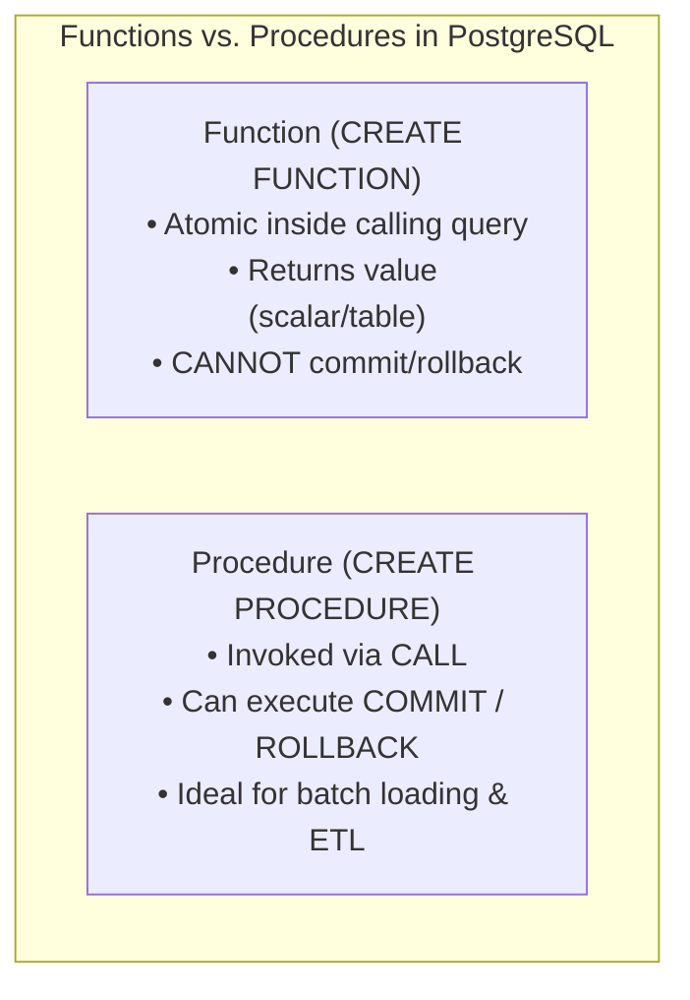
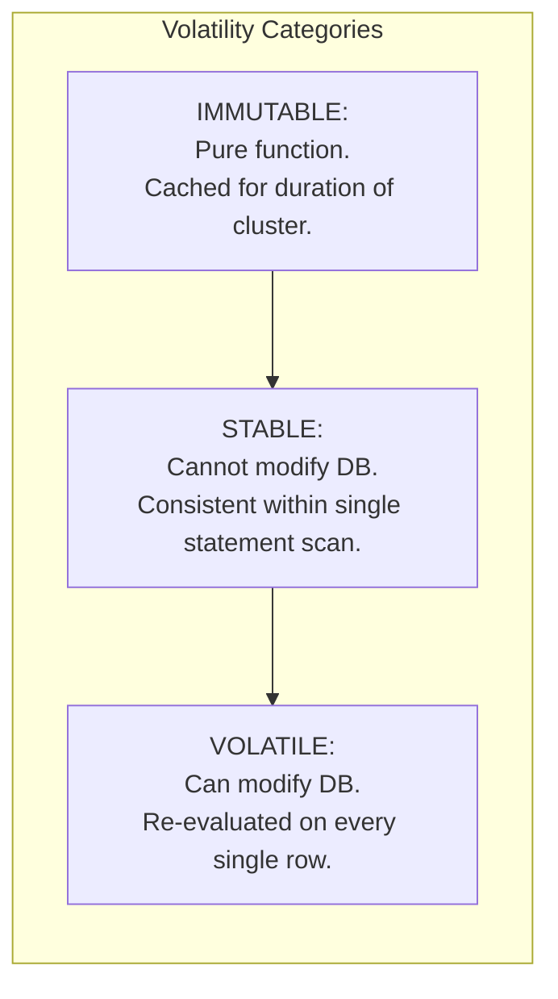
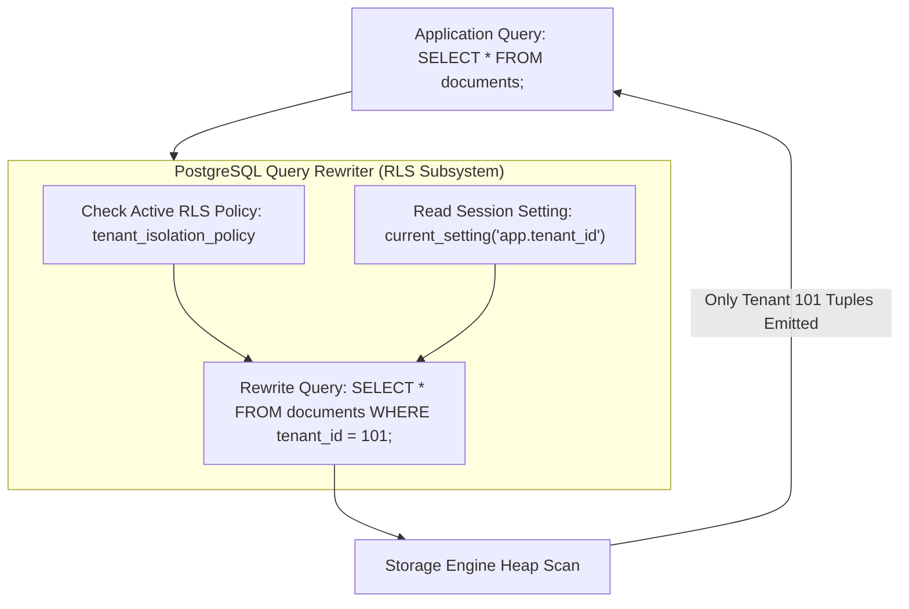

# Module 10 — Server Programming, Functions, Procedures & Security Architecture

Welcome to **Module 10** of the PostgreSQL curriculum. This module provides complete, academically grounded, and staff-level security and server programming expertise for PostgreSQL 18. We examine the procedural execution engine (PL/pgSQL), dissect functions versus procedures, evaluate volatility categories (`IMMUTABLE`, `STABLE`, `VOLATILE`), construct high-throughput triggers with transition tables, configure role-based access control (RBAC) and default privileges, neutralize `SECURITY DEFINER` search-path hijacking vulnerabilities, enforce defense-in-depth multi-tenant Row-Level Security (RLS), and implement PostgreSQL 18 authentication standards including OAuth 2.0.

> [!NOTE]
> For abstract cryptographic primitives, OAuth 2.1/OIDC protocol flows, PKI certificate authority lifecycles, and STRIDE threat modeling, consult the foundational track [architecture/security-identity](../../architecture/security-identity/README.md). This module covers PostgreSQL's concrete physical implementation, in-database authorization models, and SQL injection defenses.

---

## 1. Core Terminology & Concept Definitions

- **PL/pgSQL**: The loadable procedural language engine for PostgreSQL, providing block-structured procedural programming, local variables, conditional branching, cursor manipulation, and structured exception handling.
- **Function (`CREATE FUNCTION`)**: A procedural routine that executes atomically inside the caller's transaction and returns a result value (scalar, composite, or set-of); cannot execute transaction control statements (`COMMIT`/`ROLLBACK`).
- **Procedure (`CREATE PROCEDURE`)**: A procedural routine invoked via `CALL` that can manage its own transaction boundaries, committing and rolling back intermediary transactions during execution.
- **Function Volatility**: A declarative optimizer contract (`IMMUTABLE`, `STABLE`, `VOLATILE`) communicating whether a function produces side-effects or varies its output for identical inputs across statement or transaction scopes.
- **Transition Tables (`REFERENCING NEW TABLE`)**: SQL-standard statement-level trigger tables providing set-oriented access to all modified rows in a single batch, eliminating row-by-row trigger execution overhead.
- **`SECURITY DEFINER`**: An execution privilege mode where a routine executes with the administrative permissions of the user that created it, rather than the permissions of the client calling it.
- **Row-Level Security (RLS)**: An internal query rewriter subsystem that dynamically injects declarative access control predicates (`CREATE POLICY`) into query parse trees, filtering rows on a per-role or per-session basis.
- **OAuth 2.0 Authentication**: A modern enterprise authentication mechanism introduced natively in PostgreSQL 18, allowing backend connections to authenticate using OpenID Connect (OIDC) JWT bearer tokens.

---

## 2. Server Programming: Functions vs. Procedures



### The Transaction Management Advantage of Procedures
Prior to PostgreSQL 11, long-running ETL data migrations could not commit batches incrementally without terminating the entire script. Procedures execute outside a forced transaction block:

```sql
CREATE OR REPLACE PROCEDURE purge_old_audit_logs(batch_size INT)
LANGUAGE plpgsql
AS $$
DECLARE
    rows_deleted INT;
BEGIN
    LOOP
        DELETE FROM audit_logs
        WHERE id IN (
            SELECT id FROM audit_logs
            WHERE created_at < NOW() - INTERVAL '90 days'
            LIMIT batch_size
        );
        GET DIAGNOSTICS rows_deleted = ROW_COUNT;
        
        -- Commit intermediary transaction to free locks and allow vacuuming!
        COMMIT;
        
        EXIT WHEN rows_deleted = 0;
    END LOOP;
END;
$$;

-- Invocation:
CALL purge_old_audit_logs(10000);
```

---

## 3. Function Volatility Categories: The Integrity Contract

The optimizer relies on the volatility category to determine whether it can pre-evaluate expressions or fold functions into index lookups:



### The Three Volatility Contracts:
1. **`IMMUTABLE`**:
   - The function cannot modify database state and is guaranteed to return identical results given identical arguments forever.
   - **Mandatory for Expression Indexes**: Only `IMMUTABLE` functions can be used in `CREATE INDEX ON tbl ((fn(col)))`.
   - **Production Hazard**: Marking a function `IMMUTABLE` when it references `current_timestamp`, session settings, or table data causes silent, unrecoverable B-tree index corruption!
2. **`STABLE`**:
   - The function cannot modify database state and returns identical results for identical arguments within a single table scan or statement (e.g., `current_date`, or looking up a configuration key in a table).
   - Allows the planner to optimize multiple calls in a single query into a single evaluation.
3. **`VOLATILE` (Default)**:
   - The function can modify database state or return different values on successive calls with identical arguments (e.g., `random()`, `clock_timestamp()`).
   - The executor must re-evaluate the function on every candidate row.

---

## 4. High-Performance Triggers & Transition Tables

Row-level triggers (`FOR EACH ROW`) execute PL/pgSQL context switches for every modified tuple. On an update touching 50,000 rows, this invokes the trigger function 50,000 times.

### Transition Tables (Set-Based Triggers)
PostgreSQL supports SQL-standard transition tables for statement-level triggers:

```sql
CREATE TABLE inventory_audit (
    sku TEXT NOT NULL,
    old_qty INT,
    new_qty INT,
    modified_at TIMESTAMPTZ DEFAULT NOW()
);

CREATE OR REPLACE FUNCTION audit_inventory_update()
RETURNS TRIGGER
LANGUAGE plpgsql
AS $$
BEGIN
    -- Set-oriented batch insert from transition tables in a single operation!
    INSERT INTO inventory_audit (sku, old_qty, new_qty)
    SELECT n.sku, o.quantity, n.quantity
    FROM new_rows n
    JOIN old_rows o ON o.sku = n.sku
    WHERE n.quantity <> o.quantity;
    
    RETURN NULL;
END;
$$;

CREATE TRIGGER trg_audit_inventory
AFTER UPDATE ON inventory
REFERENCING OLD TABLE AS old_rows NEW TABLE AS new_rows
FOR EACH STATEMENT
EXECUTE FUNCTION audit_inventory_update();
```

---

## 5. Security & Privilege Architecture: RBAC & Default Privileges

### The Principle of Least Privilege
Never connect applications as `superuser` or the database owner:

```sql
-- 1. Create unprivileged application runtime role:
CREATE ROLE app_runtime WITH LOGIN PASSWORD 'strong_scram_secret';

-- 2. Grant connection rights:
GRANT CONNECT ON DATABASE production_db TO app_runtime;

-- 3. Grant schema usage (since PG15, public schema CREATE is revoked from PUBLIC):
GRANT USAGE ON SCHEMA public TO app_runtime;
GRANT SELECT, INSERT, UPDATE, DELETE ON ALL TABLES IN SCHEMA public TO app_runtime;

-- 4. CRITICAL: Configure Default Privileges for future tables created by migrations:
ALTER DEFAULT PRIVILEGES IN SCHEMA public 
GRANT SELECT, INSERT, UPDATE, DELETE ON TABLES TO app_runtime;

ALTER DEFAULT PRIVILEGES IN SCHEMA public 
GRANT USAGE, SELECT ON SEQUENCES TO app_runtime;
```

---

## 6. Neutralizing `SECURITY DEFINER` Search-Path Hijacking

`SECURITY DEFINER` functions run with the privileges of the function's owner (often a superuser or DBA).

### The Attack Vector (Trojan Horse Hijack)
If a `SECURITY DEFINER` function does not explicitly set its `search_path`:
1. A malicious user creates a table or custom operator named `public.user_account` or `public.trim`.
2. When an administrator calls the `SECURITY DEFINER` function, PostgreSQL resolves unqualified table/function references using the current session's `search_path`.
3. The function inadvertently accesses the attacker's object with elevated DBA privileges, resulting in arbitrary code execution!

### The Immutable Defense
Always fix `search_path` to `pg_catalog, pg_temp` on every `SECURITY DEFINER` routine:

```sql
-- SECURE SECURITY DEFINER PATTERN:
CREATE OR REPLACE FUNCTION elevate_user_tier(target_user_id INT)
RETURNS VOID
LANGUAGE plpgsql
SECURITY DEFINER
-- Mandatory security barrier:
SET search_path = pg_catalog, pg_temp
AS $$
BEGIN
    UPDATE public.users SET tier = 'admin' WHERE id = target_user_id;
END;
$$;
```

---

## 7. Row-Level Security (RLS) & Multi-Tenant Defense

Row-Level Security (RLS) guarantees that queries automatically filter rows without requiring developers to manually append `WHERE tenant_id = ?` to every query in application code.



### Implementing Multi-Tenant RLS
```sql
CREATE TABLE client_documents (
    id SERIAL PRIMARY KEY,
    tenant_id INT NOT NULL,
    filename TEXT NOT NULL,
    content TEXT
);

-- Step 1: Enable RLS on the table
ALTER TABLE client_documents ENABLE ROW LEVEL SECURITY;

-- Step 2: Force RLS even for table owners (prevents bypass)
ALTER TABLE client_documents FORCE ROW LEVEL SECURITY;

-- Step 3: Define access policy bound to session setting
CREATE POLICY tenant_isolation_policy ON client_documents
    FOR ALL
    TO app_runtime
    USING (tenant_id = NULLIF(current_setting('app.current_tenant', true), '')::int)
    WITH CHECK (tenant_id = NULLIF(current_setting('app.current_tenant', true), '')::int);
```

### Application Connection Initialization
Before executing queries, the application connection sets the session context:

```sql
SET app.current_tenant = '42';
SELECT * FROM client_documents; -- Returns strictly rows where tenant_id = 42
```

> [!CAUTION]
> Superusers **always** bypass RLS! Never test or run multi-tenant application workloads using a superuser database role.

---

## 8. Authentication & Connection Security (PostgreSQL 18 OAuth)

### `pg_hba.conf` Rules
PostgreSQL controls access via the Host-Based Authentication configuration file:

```text
# TYPE  DATABASE        USER            ADDRESS                 METHOD
local   all             all                                     peer
host    production_db   app_runtime     10.0.0.0/16             scram-sha-256
hostssl production_db   oauth_user      0.0.0.0/0               oauth
```

### Authentication Evolutions in PostgreSQL 18:
1. **MD5 Deprecation**: MD5 password authentication is officially deprecated in PostgreSQL 18 and issues explicit server warnings. `scram-sha-256` is the required standard.
2. **Native OAuth 2.0 / OIDC Bearer Tokens**: PostgreSQL 18 natively validates OpenID Connect (OIDC) JWT bearer tokens passed by client drivers, allowing centralized identity providers (Okta, Azure Entra ID, Keycloak) to authenticate database connections without long-lived database passwords.

---

## 9. Then vs. Now: Server Programming & Security

| Security Dimension | PostgreSQL $\le$ 14 | PostgreSQL 15–17 | PostgreSQL 18 & 19 (Current) |
| :--- | :--- | :--- | :--- |
| **Public Schema Permissions** | `PUBLIC` possessed `CREATE` in `public` schema | `CREATE` on `public` revoked by default | Hardened schema boundaries enforced |
| **Password Hashing** | MD5 allowed by default | SCRAM-SHA-256 recommended | **MD5 deprecated with server warnings**; SCRAM-SHA-256 mandated |
| **Federated Authentication** | Kerberos / GSSAPI only | Third-party OAuth proxies | Native **OAuth 2.0 / OIDC JWT** authentication |
| **Transaction Procedures** | Basic `COMMIT`/`ROLLBACK` | Added transaction loop helpers | Atomic procedure execution with enhanced savepoint handling |

---

## 10. Interview Drill

<details>
<summary>1. Explain the "search_path hijacking" vulnerability in `SECURITY DEFINER` functions and how to mitigate it.</summary>

**Answer**: A `SECURITY DEFINER` function executes with the privileges of the user that owns the function (often a superuser or DBA). If the function references database objects without schema qualifications (e.g. `SELECT * FROM users`), PostgreSQL resolves the object using the active session's `search_path`. A malicious unprivileged user can create a malicious table, function, or operator in a schema earlier in the search path (such as `public`). When a privileged user invokes the `SECURITY DEFINER` function, the engine inadvertently executes the attacker's object with elevated administrative privileges. The mitigation is setting `search_path` explicitly on the function definition: `ALTER FUNCTION fn() SET search_path = pg_catalog, pg_temp;`.
- Ref: [PostgreSQL Documentation: Writing SECURITY DEFINER Functions Safely](https://www.postgresql.org/docs/18/sql-createfunction.html#SQL-CREATEFUNCTION-SECURITY)
</details>

<details>
<summary>2. Why is marking a function `IMMUTABLE` when it actually queries table data a critical operational error?</summary>

**Answer**: An `IMMUTABLE` function contract guarantees that the function will always return identical outputs for identical arguments and has zero side-effects. The query planner relies on this contract to pre-evaluate function calls into constants and to build expression indexes (`CREATE INDEX ON tbl ((fn(col)))`). If the function queries table data or depends on configuration settings, changes in the underlying table data will **not** trigger re-indexing or cache invalidation. As a result, the index becomes corrupt, queries using the index return stale or missing rows, and query planner cost models become invalid.
- Ref: [PostgreSQL Documentation: Function Volatility Categories](https://www.postgresql.org/docs/18/xfunc-volatility.html)
</details>

<details>
<summary>3. What is the difference between `USING` and `WITH CHECK` clauses in Row-Level Security (RLS) policies?</summary>

**Answer**:
- `USING` defines the predicate for **reading** existing rows from the table (`SELECT`, and the qualification phase of `UPDATE` and `DELETE`). Rows that evaluate to false or unknown are silently filtered out as if they do not exist.
- `WITH CHECK` defines the predicate for **writing or modifying** rows (`INSERT`, and the new row state resulting from an `UPDATE`). If an application attempts to insert or update a row such that the new values evaluate to false or unknown against `WITH CHECK`, the statement immediately fails with a security policy violation error.
- Ref: [PostgreSQL Documentation: CREATE POLICY](https://www.postgresql.org/docs/18/sql-createpolicy.html)
</details>

<details>
<summary>4. Why should table-modifying triggers use transition tables (`REFERENCING NEW TABLE`) rather than `FOR EACH ROW` triggers for batch mutations?</summary>

**Answer**: A `FOR EACH ROW` trigger executes the trigger function once per modified row, incurring repeated PL/pgSQL function call context-switching overhead and executing single-row SQL queries in a loop. For a batch operation touching 100,000 rows, this invokes the trigger 100,000 times ($O(N)$ operations). A statement-level trigger with transition tables (`REFERENCING OLD TABLE AS old_rows NEW TABLE AS new_rows FOR EACH STATEMENT`) executes the trigger function **exactly once**. The entire batch of modified rows is exposed as virtual relations, allowing the trigger logic to execute a single set-oriented SQL statement, dramatically reducing execution time and transaction log volume.
- Ref: [PostgreSQL Documentation: Overview of Trigger Behavior](https://www.postgresql.org/docs/18/trigger-definition.html)
</details>

<details>
<summary>5. What happens if a superuser executes queries on a table with Row-Level Security (RLS) enabled?</summary>

**Answer**: Superusers **always bypass Row-Level Security policies by default**. Even if an RLS policy is configured with `FOR ALL TO public USING (tenant_id = 42)`, queries executed by a superuser will observe and modify all rows across all tenants without filtering. To enforce RLS during administrative tasks, a table must be altered with `ALTER TABLE tbl FORCE ROW LEVEL SECURITY;`. However, standard superusers still retain bypass capabilities; production multi-tenant applications must strictly connect using non-superuser roles.
- Ref: [PostgreSQL Documentation: Row Security Policies](https://www.postgresql.org/docs/18/ddl-rowsecurity.html)
</details>
