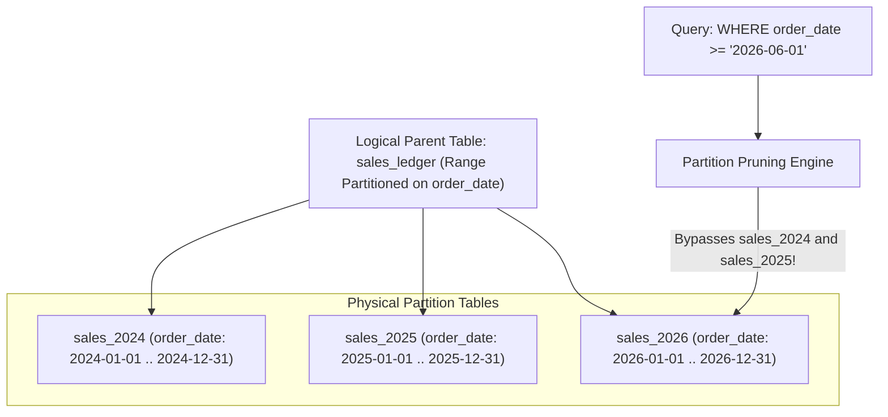
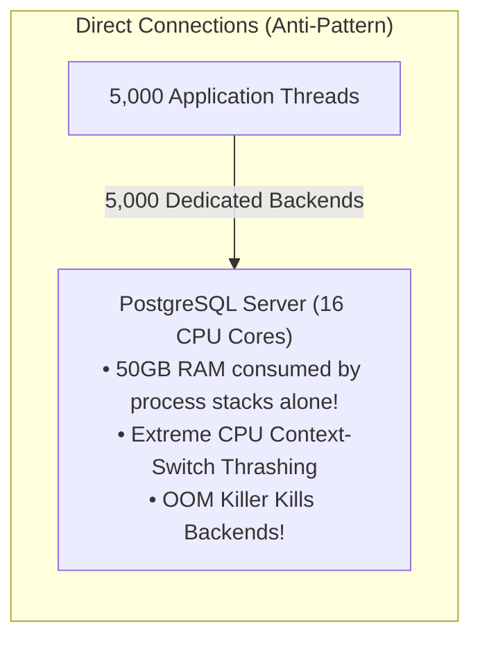
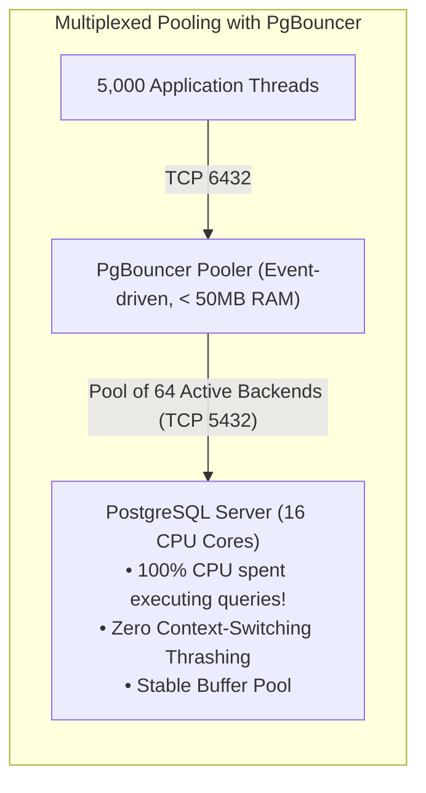
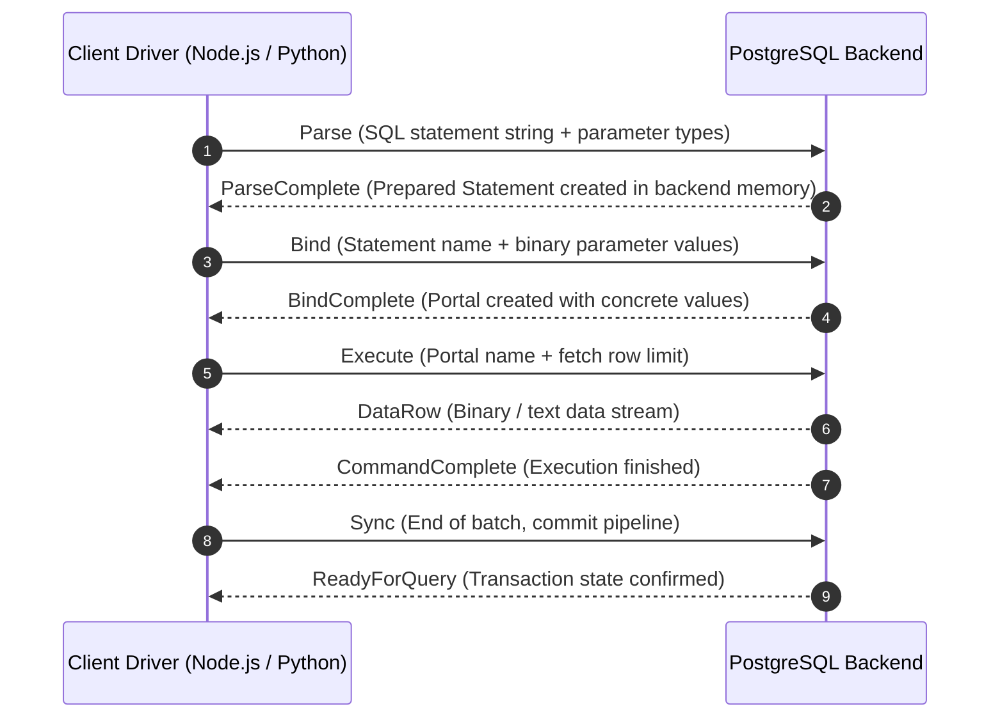
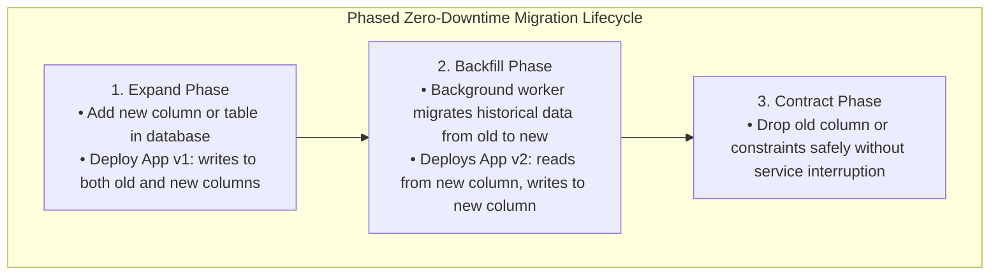

# Module 11 — Partitioning, Connection Architecture, Drivers & Zero-Downtime Migrations

Welcome to **Module 11** of the PostgreSQL curriculum. This module provides a production-hardened examination of database scaling, connection pooling, client driver integration, and zero-downtime schema evolution in PostgreSQL 18. We dissect declarative partitioning strategies (Range, List, Hash) and dynamic partition pruning, analyze the memory cost of the process-per-connection model, configure enterprise connection pooling with PgBouncer, evaluate transaction-pooling caveats, navigate client driver protocols (Node.js and Python), and implement the Expand-Contract schema migration pattern.

---

## 1. Core Terminology & Concept Definitions

- **Declarative Partitioning**: A native table partitioning framework where a logical parent relation divides rows into physical child tables based on boundary rules (Range, List, or Hash) defined on partition keys.
- **Partition Pruning**: An optimizer and executor optimization that inspects query predicates and eliminates non-matching child partition tables from the query execution tree.
  - **Plan-Time Pruning**: Pruning executed by the planner when query predicates contain static constants.
  - **Run-Time Pruning**: Pruning executed dynamically by the executor when predicates involve parameterized prepared statements or join inputs.
- **Process-per-Connection Model**: PostgreSQL's concurrency architecture where every client TCP connection is handled by a distinct operating system process, consuming 5MB to 10MB of baseline private memory plus dynamic query memory (`work_mem`).
- **PgBouncer**: A lightweight, multi-threaded connection pooler that terminates thousands of client connections and multiplexes them onto a small pool of active PostgreSQL backend server connections.
- **Transaction Pooling**: A PgBouncer pooling mode where a PostgreSQL server connection is assigned to a client only for the duration of a single transaction (`BEGIN` ... `COMMIT`), returning the connection to the pool immediately upon commit.
- **`idle_in_transaction_session_timeout`**: A critical server parameter that automatically terminates any client session that remains idle inside an open transaction block for longer than a specified duration, protecting the cluster-wide `xmin` horizon.
- **Expand-Contract Pattern**: A phased continuous delivery pattern for zero-downtime database migrations that decouples schema changes from application deployments using backward-compatible transition phases.

---

## 2. Declarative Partitioning & Dynamic Pruning

Partitioning splits large relational tables into smaller physical tables while maintaining a single unified logical interface for queries:



### Implementing Range Partitioning
```sql
CREATE TABLE sales_ledger (
    id BIGINT GENERATED ALWAYS AS IDENTITY,
    order_date DATE NOT NULL,
    customer_id INT NOT NULL,
    amount NUMERIC(10,2) NOT NULL,
    PRIMARY KEY (order_date, id) -- Partition key MUST be included in the primary key!
) PARTITION BY RANGE (order_date);

-- Create individual partitions:
CREATE TABLE sales_2025 PARTITION OF sales_ledger
    FOR VALUES FROM ('2025-01-01') TO ('2026-01-01');

CREATE TABLE sales_2026 PARTITION OF sales_ledger
    FOR VALUES FROM ('2026-01-01') TO ('2027-01-01');
```

### Advanced Operations: Zero-Downtime Detach
Detaching a partition to archive or drop it historically required an `ACCESS EXCLUSIVE` lock on the entire partitioned table. In modern PostgreSQL:

```sql
-- Detach partition concurrently without locking parent table:
ALTER TABLE sales_ledger DETACH PARTITION sales_2025 CONCURRENTLY;

-- Now sales_2025 is an independent standalone table that can be dropped or archived:
DROP TABLE sales_2025; -- O(1) instantaneous metadata drop!
```

### The Three Critical Partitioning Constraints:
1. **Global Uniqueness Impossibility**: PostgreSQL cannot enforce unique or primary key constraints across partitions unless the partition key is included in the unique index definition.
2. **Default Partition Hazard**: If a `DEFAULT` partition exists, attaching a new partition whose range overlaps data currently residing in the default partition will fail until the default partition is scanned and cleaned.
3. **Time-Series Drop vs. `DELETE`**: Purging 100 million expired rows via `DELETE FROM sales WHERE date < '2025-01-01'` creates 100 million dead tuples, generates gigabytes of WAL, and induces severe bloat. Dropping the partition (`DROP TABLE sales_2024;`) is an instantaneous $O(1)$ filesystem unlink operation generating zero bloat.

---

## 3. Connection Architecture & Scaling: The PgBouncer Tier

PostgreSQL allocates a dedicated OS backend process per connection. Setting `max_connections = 5000` is an operational anti-pattern:





### Sizing PostgreSQL Backend Connections
Optimal database throughput occurs when the active connection count approximates:
$$\text{Optimal Connections} \approx (\text{CPU Cores} \times 2) + \text{Effective Spindle Count}$$
On a 16-core cloud instance, a pool of **32 to 64 active backend connections** sustains maximum throughput, even when handling tens of thousands of client connections at the PgBouncer tier.

### PgBouncer Pooling Modes & Hazards

| Pooling Mode | Connection Lifetime | Session State Allowed? | Prepared Statements | Best Use Case |
| :--- | :--- | :--- | :--- | :--- |
| **Session** | Assigned on connect; held until client disconnects | Yes (`SET`, temp tables, advisory locks) | Yes | Drop-in proxy; modest connection savings |
| **Transaction** | Assigned on `BEGIN`; returned to pool on `COMMIT`/`ROLLBACK` | **No** (Session state discarded between transactions) | Supported in PgBouncer $\ge$ 1.21 via prepared statement tracking | **Standard High-Concurrency Production Architecture** |
| **Statement** | Assigned per SQL statement | **No multi-statement transactions allowed** | No | Read-only analytics; logging pipelines |

> [!CAUTION]
> In **Transaction Pooling**, any session-level configuration (`SET search_path`, `LISTEN/NOTIFY`, temporary tables, or session-level `pg_advisory_lock()`) will either break or leak across unrelated client transactions! Use `SET LOCAL` within transaction blocks, transaction-scoped advisory locks (`pg_advisory_xact_lock()`), and dedicated session-pooled connections for `LISTEN`.

---

## 4. Connection Protection Timeouts

Prevent rogue clients and network partitions from holding transactions open:

```ini
# postgresql.conf

# 1. Kill any query running longer than 30 seconds:
statement_timeout = 30000

# 2. Kill any transaction blocked waiting for a lock after 2 seconds:
lock_timeout = 2000

# 3. Kill any session left idle inside a transaction for > 60 seconds (PROTECTS XMIN HORIZON!):
idle_in_transaction_session_timeout = 60000

# 4. Terminate TCP connections when client silently disconnects:
tcp_keepalives_idle = 60
tcp_keepalives_interval = 10
tcp_keepalives_count = 3
```

---

## 5. Application Integration & Driver Mechanics

PostgreSQL client drivers communicate using the **Extended Query Protocol**, divided into three discrete phases:



### Node.js Integration Gotchas:
1. **Duplicate Column Name Collapse**:
   ```typescript
   // DANGEROUS: JavaScript objects overwrite identical keys:
   const res = await client.query('UPDATE accounts SET balance = 200 RETURNING old.balance, new.balance');
   // Output object: { balance: 200 } -> old.balance was silently lost!
   
   // SAFE: Explicit aliases:
   const res = await client.query('UPDATE accounts SET balance = 200 RETURNING old.balance AS old_balance, new.balance AS new_balance');
   // Output object: { old_balance: 100, new_balance: 200 }
   ```

2. **The $N+1$ Query Problem in ORMs (Prisma, Drizzle, TypeORM)**:
   - An application fetches 100 users, then executes 100 individual queries in a loop to fetch each user's orders ($1 + 100 = 101$ network round-trips).
   - **Remediation**: Use SQL joins, subquery array aggregation (`json_agg()`), or application-level dataloaders that batch lookups into `WHERE id IN (...)`.

---

## 6. Zero-Downtime Schema Evolution: The Expand-Contract Pattern

Modifying columns or constraints on live production databases with terabytes of data must never break older versions of application microservices during rolling deployments.



### Safe vs. Unsafe DDL Practices

| Operation | Unsafe / Naive Approach | Safe Production Approach |
| :--- | :--- | :--- |
| **Add Column with Default** | Pre-PG11: full table rewrite | Modern PG: `ALTER TABLE tbl ADD COLUMN col INT DEFAULT 0;` (Instant catalog metadata update) |
| **Add `NOT NULL` Constraint** | `ALTER TABLE tbl ALTER COLUMN col SET NOT NULL;` (Scans table with `ACCESS EXCLUSIVE` lock) | Add `CHECK (col IS NOT NULL) NOT VALID;` then `VALIDATE CONSTRAINT` (Online validation) |
| **Create Index** | `CREATE INDEX idx ON tbl (col);` (Locks table against writes) | `CREATE INDEX CONCURRENTLY idx ON tbl (col);` (Builds index online without write blocking) |
| **Column Renaming** | `ALTER TABLE tbl RENAME COLUMN old TO new;` (Breaks old running application containers) | Expand-Contract: Add new column, dual-write, backfill, cut over reads, drop old |

---

## 7. Then vs. Now: Partitioning & Application Integration

| Feature | PostgreSQL $\le$ 11 | PostgreSQL 12–17 | PostgreSQL 18 & 19 (Current) |
| :--- | :--- | :--- | :--- |
| **Partition Detach** | Exclusive table lock on parent | `DETACH PARTITION CONCURRENTLY` (PG14+) | Concurrently detaches with zero lock queue impact |
| **Partition Pruning** | Static plan-time pruning only | Run-time pruning for joins & prepared statements | Parallel worker partition pruning optimizations |
| **PgBouncer Prepared Stmts** | Broken in Transaction Mode | Broken unless session mode used | Native support via prepared statement tracking (PgBouncer $\ge$ 1.21) |
| **Adding Columns with Default** | Full table rewrite | Instant catalog update (PG11+) | Instant catalog update for constant and volatile defaults |

---

## 8. Interview Drill

<details>
<summary>1. Why can PostgreSQL not enforce a global unique constraint across child partitions in declarative partitioning?</summary>

**Answer**: In PostgreSQL declarative partitioning, child partitions are distinct physical relations (`pg_class` entries) with their own independent B-tree index files. A B-tree index is physically local to its partition. Because there are no cross-table "global" index structures in PostgreSQL, verifying uniqueness for a newly inserted tuple would require probing the B-tree indexes of every existing partition, converting single-row $O(\log N)$ inserts into expensive cross-table distributed checks. Therefore, PostgreSQL mandates that any unique or primary key constraint on a partitioned table must include all columns of the partition key, guaranteeing that uniqueness can be validated strictly within a single partition's local index.
- Ref: [PostgreSQL Documentation: Table Partitioning: Limitations](https://www.postgresql.org/docs/18/ddl-partitioning.html#DDL-PARTITIONING-DECLARATIVE-LIMITATIONS)
</details>

<details>
<summary>2. Why does setting `max_connections = 5000` severely degrade PostgreSQL server throughput compared to using a connection pooler like PgBouncer?</summary>

**Answer**: PostgreSQL uses a process-per-connection architecture. 5,000 direct connections create 5,000 distinct operating system processes. Each process consumes 5MB to 10MB of baseline RAM (totalling 25GB to 50GB before query execution) and allocates per-operation `work_mem`. When thousands of processes actively compete for CPU cores, the operating system kernel spends the vast majority of CPU cycles performing process context-switching, TLB cache invalidation, and shared memory lock arbitration (`LWLock`) rather than executing SQL. PgBouncer terminates client TCP sockets in an event-driven loop and multiplexes queries into a pool of 32 to 64 backend processes, matching CPU core capacity and maximizing execution throughput.
- Ref: [PostgreSQL Documentation: Number of Database Connections](https://wiki.postgresql.org/wiki/Number_Of_Database_Connections)
</details>

<details>
<summary>3. What hazards occur when using PgBouncer in Transaction Pooling mode, and how do you prevent them?</summary>

**Answer**: In Transaction Pooling mode, a PostgreSQL backend connection is released back to the pool immediately upon `COMMIT` or `ROLLBACK`. Any session-level state modified during the transaction is either lost for subsequent queries or leaks to another client that acquires the same backend. Specific hazards:
1. `SET search_path` or `SET TimeZone` are discarded or leak across sessions (fix: use `SET LOCAL` inside transaction blocks).
2. Temporary tables (`CREATE TEMP TABLE`) are tied to backend process lifetime and become inaccessible or leak.
3. `LISTEN/NOTIFY` fails because notification channels require a persistent connection (fix: dedicate a small session-pooled connection group for listeners).
4. Session-level advisory locks (`pg_advisory_lock`) remain held on the backend after the client disconnects (fix: strictly use `pg_advisory_xact_lock()`).
- Ref: [PgBouncer Documentation: Pooling Modes](https://www.pgbouncer.org/features.html)
</details>

<details>
<summary>4. Why is `idle_in_transaction_session_timeout` considered one of the most critical availability parameters in PostgreSQL?</summary>

**Answer**: When an application opens a transaction (`BEGIN`), performs a query or write, and then leaves the connection idle without issuing `COMMIT` or `ROLLBACK` (often due to application crashes, network timeouts, or slow external API calls), that session holds open an active transaction ID (`backend_xmin`). This pins the cluster-wide oldest active `xmin` horizon. Autovacuum cannot reclaim any dead tuple versions deleted after that transaction started across **any table in the entire database**. Within hours, tables and indexes bloat catastrophically, and the cluster risks Transaction ID wraparound. Setting `idle_in_transaction_session_timeout = '60s'` forcibly terminates orphaned sessions, protecting cluster health.
- Ref: [PostgreSQL Documentation: Client Connection Defaults](https://www.postgresql.org/docs/18/runtime-config-client.html#GUC-IDLE-IN-TRANSACTION-SESSION-TIMEOUT)
</details>

<details>
<summary>5. Describe the Expand-Contract pattern for safely migrating a column from `VARCHAR(16)` to `UUID` on a live production table without downtime.</summary>

**Answer**:
1. **Expand**: Add a new column with the target type: `ALTER TABLE t ADD COLUMN id_v2 UUID;`.
2. **Dual-Write**: Deploy application code (v1) that writes new records to both `id` and `id_v2`, while continuing to read from `id`.
3. **Backfill**: Execute an asynchronous background script that updates historical rows in small batches (`UPDATE t SET id_v2 = id::uuid WHERE id_v2 IS NULL LIMIT 1000; COMMIT;`), committing incrementally to avoid bloat and locking.
4. **Cutover**: Deploy application code (v2) that reads and writes exclusively from `id_v2`.
5. **Contract**: Once v1 is completely decommissioned, drop the old column: `ALTER TABLE t DROP COLUMN id;`.
- Ref: [Evolutionary Database Design (Fowler & Sadalage)](https://martinfowler.com/articles/evodb.html)
</details>
