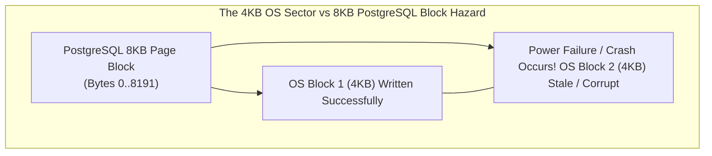
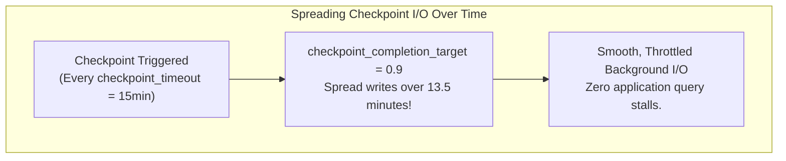
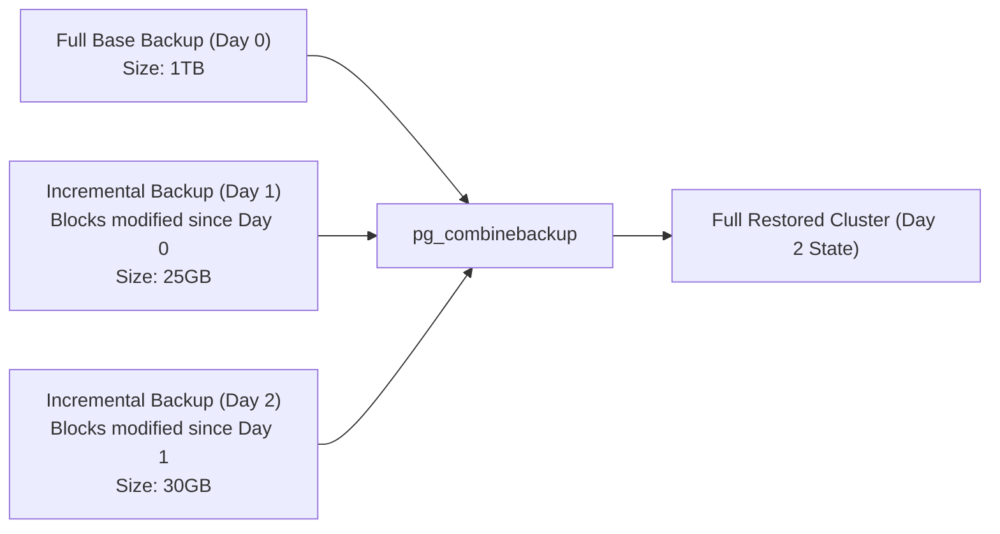
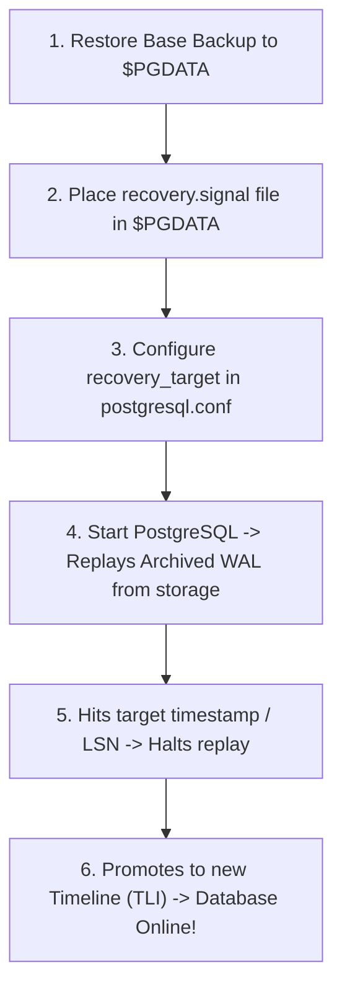
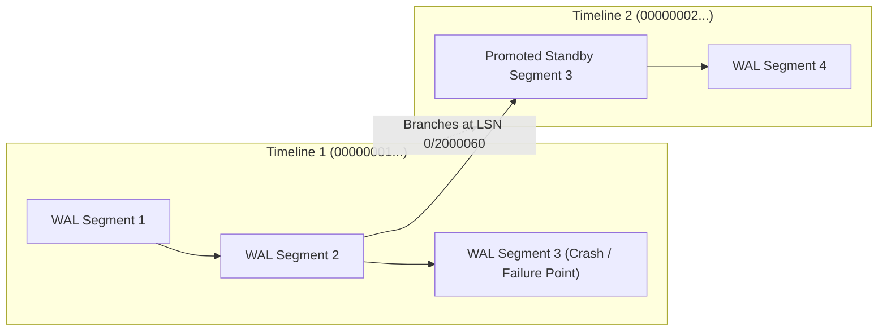

# Module 12 — Durability, Write-Ahead Logging, Backup & Point-In-Time Recovery

Welcome to **Module 12** of the PostgreSQL curriculum. This module delivers comprehensive, academically grounded, and production-tested disaster recovery and database durability knowledge for PostgreSQL 18. We examine the Write-Ahead Log (WAL) architecture, dissect the Full-Page Write (`full_page_writes`) torn-page protection mechanism, calibrate checkpoint algorithms to eliminate I/O spikes, evaluate native incremental backups (`pg_basebackup` / `pg_combinebackup`), execute precision Point-In-Time Recovery (PITR) drills, navigate timeline branching ($TLI$), and leverage PostgreSQL 18's **retained optimizer statistics** during `pg_upgrade`.

> [!NOTE]
> For abstract ARIES recovery algorithms (Mohan et al., IBM 1992), Write-Ahead Logging theoretical proofs, and distributed state machine persistence models, consult the foundational track [architecture/data-systems](../../architecture/data-systems/modules/06-durability-wal-and-crash-recovery.md). This module covers PostgreSQL's concrete physical implementation, recovery configuration, and operational disaster recovery drills.

---

## 1. Core Terminology & Concept Definitions

- **Write-Ahead Logging (WAL)**: The durability protocol where all changes to data tuples and indexes must be written and flushed to non-volatile disk storage in an append-only log stream before the corresponding modified 8KB pages in `shared_buffers` can be written to disk.
- **Log Sequence Number (LSN)**: A 64-bit monotonically increasing integer representing the exact byte offset of a record within the cluster's WAL stream (e.g. `0/16B3740`).
- **Checkpoint**: A periodic synchronization barrier where the checkpointer process writes all dirty shared memory buffer pages to disk, flushes kernel storage caches with `fsync`, writes a checkpoint record to WAL, and updates `pg_control`.
- **Full Page Image (FPI / `full_page_writes`)**: A complete 8KB image of an entire database block written into the WAL stream on its first modification following a checkpoint, guaranteeing torn-page recovery from operating system partial-write failures.
- **Torn Page**: A hardware or OS failure where an 8KB database block is only partially written to disk (e.g., 4KB written before a power failure), leaving the page in an inconsistent, corrupted binary state.
- **Point-In-Time Recovery (PITR)**: The disaster recovery process of restoring a physical base backup and rolling forward archived WAL segments up to an exact target timestamp, LSN, or named restore point.
- **Timeline ID ($TLI$)**: An integer identifier prefixed to WAL segment filenames (e.g., `000000020000000000000005`) that tracks history branches, preventing divergent transaction logs from colliding after standby promotion.
- **Native Incremental Backup**: A physical backup capability introduced in PostgreSQL 17 enabling `pg_basebackup` to back up only 8KB blocks modified since a previous backup manifest, subsequently merged using `pg_combinebackup`.

---

## 2. Write-Ahead Log (WAL) Architecture & Torn Page Protection

### Binary Anatomy of a WAL Record
Every transaction modification creates a binary WAL record consisting of a 24-byte header (`XLogRecord`) followed by resource manager data and block payloads:
- **`xl_tot_len`** (4 bytes, uint32): Total record length in bytes, including header and data payload.
- **`xl_xid`** (4 bytes, TransactionId): Transaction ID executing the modification.
- **`xl_prev`** (8 bytes, XLogRecPtr): Pointer to preceding WAL record in the chain.
- **`xl_info`** (1 byte, uint8): Flag indicating operation type (e.g. `XLOG_HEAP_INSERT`, `XLOG_BTREE_SPLIT`).
- **`xl_rmid`** (1 byte, RmgrId): Resource Manager ID (`RM_HEAP_ID`, `RM_BTREE_ID`, `RM_XACT_ID`).
- *Alignment padding* (2 bytes).
- **`xl_crc`** (4 bytes, pg_crc32c): CRC-32C checksum of the entire record.
- **Data Payload**: Registered buffer headers, delta modifications, or complete 8KB Full Page Images (FPI).

*(Note: The record's LSN is its physical byte position address in the WAL stream; it is derived from the WAL segment and page header rather than stored as an explicit field inside `XLogRecord`.)*



### The Torn Page Hazard & `full_page_writes`
Most filesystems and hardware disk controllers write data in 4KB sectors, whereas PostgreSQL manages data in 8KB blocks. If a server suffers power loss or an OS crash while writing an 8KB block:
- The first 4KB may be written to disk, while the second 4KB contains stale or corrupted data.
- Standard WAL delta records (e.g., "insert tuple at offset 120") cannot be replayed onto a corrupted or partially written page because page header pointers are invalid.

#### The `full_page_writes` Defense:
1. When a page in `shared_buffers` is modified for the first time after a checkpoint, PostgreSQL writes the **entire 8192-byte page image** into the WAL stream.
2. Subsequent modifications to that page write only tiny delta diffs (typically 50–100 bytes).
3. During crash recovery, the engine re-writes the complete 8KB image from WAL, overwriting any torn page on disk, and then replays subsequent deltas.

> [!CAUTION]
> Never set `full_page_writes = off` on production systems (even for performance testing) unless the filesystem provides native atomic 8KB block writes (such as ZFS or specialized enterprise flash arrays). Disabling it guarantees unrecoverable disk corruption on unexpected crashes.

---

## 3. Checkpoint Tuning: Eliminating I/O Spikes

A checkpoint flushes all dirty pages from `shared_buffers` to disk. If tuned improperly, checkpoints saturate disk I/O controllers, causing application query latency to spike.



### Key Parameters (`postgresql.conf`):
```ini
# Maximum time between automatic checkpoints:
checkpoint_timeout = 15min              # Default 5min is too aggressive; 15-30min recommended

# Maximum WAL generated before forcing an immediate checkpoint:
max_wal_size = 32GB                     # Scale with write volume (default 1GB causes frequent checkpoints)
min_wal_size = 4GB

# Fraction of checkpoint_timeout to spread I/O over:
checkpoint_completion_target = 0.9      # Smooths writes over 90% of the window (eliminates I/O storms)
```

---

## 4. Physical Base Backups & Incremental Backups (PG17+)

### Physical Base Backup (`pg_basebackup`)
`pg_basebackup` streams an online physical copy of the `$PGDATA` directory over the streaming replication protocol:

```bash
# Capture full non-blocking physical base backup:
pg_basebackup -h localhost -U replicator -D /backups/base_20261030 -Fp -Xs -P -v
```
- `-Fp`: Plain format (directory layout).
- `-Xs`: Streams WAL concurrently in a second connection to guarantee self-contained recoverability.

### Native Incremental Backups (PostgreSQL 17+)
PostgreSQL 17 introduced native physical incremental backups:



#### Execution Commands:
```bash
# Day 0: Full base backup with manifest
pg_basebackup -h localhost -U replicator -D /backups/full -Fp -Xs

# Day 1: Incremental backup referencing Day 0 manifest
pg_basebackup -h localhost -U replicator -D /backups/inc1 \
    --incremental=/backups/full/backup_manifest -Fp -Xs

# Day 2: Incremental backup referencing Day 1 manifest
pg_basebackup -h localhost -U replicator -D /backups/inc2 \
    --incremental=/backups/inc1/backup_manifest -Fp -Xs

# Restoration: Synthesize a full restorable cluster from incremental chain
pg_combinebackup /backups/full /backups/inc1 /backups/inc2 -o /var/lib/postgresql/data_restored
```

---

## 5. Point-In-Time Recovery (PITR) Drill

Point-In-Time Recovery restores a database cluster to a precise microsecond in the past, allowing administrators to recover from catastrophic human errors (e.g., an accidental `DROP TABLE` or unintended `DELETE`).



### Complete Step-by-Step Production PITR Procedure

#### Step 1: Continuous WAL Archiving Configuration
Before an incident occurs, the primary cluster must archive completed WAL segments:
```ini
# postgresql.conf
wal_level = replica
archive_mode = on
archive_command = 'cp %p /mnt/wal_archive/%f'
```

#### Step 2: Stop Service and Clear Corrupted Data
```bash
pg_ctl stop -D /var/lib/postgresql/data -m immediate
mv /var/lib/postgresql/data /var/lib/postgresql/data_corrupted
```

#### Step 3: Restore Base Backup
```bash
cp -a /backups/base_20261030 /var/lib/postgresql/data
rm -rf /var/lib/postgresql/data/pg_wal/*
```

#### Step 4: Configure Recovery Target
```bash
# Create recovery signal file:
touch /var/lib/postgresql/data/recovery.signal

# Append target directives to postgresql.conf:
cat <<EOF >> /var/lib/postgresql/data/postgresql.conf
restore_command = 'cp /mnt/wal_archive/%f %p'
recovery_target_time = '2026-10-30 14:15:00+02'
recovery_target_action = 'promote'
EOF
```

#### Step 5: Start Server and Verify Recovery
```bash
pg_ctl start -D /var/lib/postgresql/data
```
PostgreSQL replays WAL from `/mnt/wal_archive/` until reaching `2026-10-30 14:15:00+02`, creates a new timeline history file (e.g. `00000002.history`), promotes itself to a read-write primary on Timeline 2, and deletes `recovery.signal`.

---

## 6. Timelines ($TLI$) & Branching Mechanics

When a standby is promoted or PITR recovery completes, the cluster branches into a **new Timeline**:



### Why Timelines Prevent Data Loss
If a promoted standby continued writing WAL segments under Timeline 1, its new WAL files would have identical filenames to the old primary's WAL files (`000000010000000000000004`). If an archive script mixed them together, the archive would be corrupted. Timelines prefix every WAL segment filename with an 8-character hex timeline counter:
- Timeline 1: `000000010000000000000004`
- Timeline 2: `000000020000000000000004`
The `.history` file records the exact LSN where the branch occurred, allowing standbys to follow timeline switches seamlessly.

---

## 7. Major Upgrades with `pg_upgrade`: The PostgreSQL 18 Advantage

Upgrading between major PostgreSQL versions (e.g., from PG16 to PG18) using `pg_dump`/`pg_restore` requires hours or days of downtime on terabyte-scale clusters.

### Instant Upgrades via Hard Links (`--link`)
`pg_upgrade --link` migrates tables in seconds by creating filesystem hard links between the old and new clusters' 8KB storage files without copying bytes:

```bash
pg_upgrade \
  --old-datadir=/var/lib/postgresql/16/data \
  --new-datadir=/var/lib/postgresql/18/data \
  --old-bindir=/usr/lib/postgresql/16/bin \
  --new-bindir=/usr/lib/postgresql/18/bin \
  --link \
  --check
```

### The PostgreSQL 18 Retained Statistics Revolution
- **The Historical Problem**: Historically, after `pg_upgrade` completed, the new cluster had an empty `pg_statistic` catalog. Administrators had to run `vacuumdb --all --analyze-in-stages`, during which the database suffered from terrible query plans and CPU spikes because the optimizer had zero statistics.
- **The PostgreSQL 18 Solution**: In PostgreSQL 18, **`pg_upgrade` automatically transfers optimizer statistics (`pg_statistic`) to the new cluster**! The upgraded database is immediately ready to execute production queries with optimized plans from second one.

---

## 8. Then vs. Now: Durability & Backup

| Dimension | PostgreSQL $\le$ 16 | PostgreSQL 17 | PostgreSQL 18 & 19 (Current) |
| :--- | :--- | :--- | :--- |
| **Physical Incremental Backup** | Third-party only (`pgBackRest`, `Barman`) | Native **`pg_basebackup --incremental`** | Native incremental backup with manifest chaining |
| **Post-Upgrade Statistics** | Zero statistics; required full cluster `ANALYZE` | Zero statistics | **Statistics retained during `pg_upgrade`** (PG18) |
| **Recovery Configuration** | `recovery.conf` file (deprecated in PG12) | `recovery.signal` + `postgresql.conf` | `recovery.signal` with enhanced timeline validation |
| **Data Block Checksums** | Disabled by default | Disabled by default | **Enabled by default in `initdb`** (PG18) |

---

## 9. Interview Drill

<details>
<summary>1. Explain the "Torn Page" phenomenon. Why does setting `full_page_writes = off` represent a critical risk to ACID durability?</summary>

**Answer**: PostgreSQL reads and writes data in 8KB blocks, while operating system filesystems and hardware storage controllers write data in smaller 4KB (or 512-byte) sectors. If a physical server loses power or the operating system crashes while PostgreSQL is writing an 8KB block to disk, the OS may successfully write the first 4KB sector while leaving the second 4KB sector unwritten. This leaves an 8KB block in a corrupted, half-written state known as a "torn page". Normal WAL records only store delta diffs (e.g. "update byte at offset 20"). Replaying a delta diff onto a torn page fails because internal page headers are invalid. `full_page_writes = on` forces PostgreSQL to write the entire 8KB page image to WAL on the first modification following each checkpoint. During crash recovery, the 8KB image overwrites the torn page, restoring block integrity. Disabling it risks unrecoverable data corruption.
- Ref: [PostgreSQL Documentation: Reliability and the Write-Ahead Log](https://www.postgresql.org/docs/18/wal-reliability.html)
</details>

<details>
<summary>2. How do you tune checkpoints to eliminate severe periodic I/O latency spikes on write-heavy database clusters?</summary>

**Answer**: Checkpoints flush all dirty `shared_buffers` pages to disk. To prevent I/O saturation:
1. Increase `checkpoint_timeout` to 15 or 30 minutes (reducing checkpoint frequency).
2. Increase `max_wal_size` (e.g. 32GB to 64GB) so checkpoints are driven by time rather than premature WAL volume exhaustion.
3. Configure `checkpoint_completion_target = 0.9`. This instructs the checkpointer to throttle and spread its disk write operations across 90% of the `checkpoint_timeout` interval (e.g., across 27 minutes of a 30-minute window). This smooths out write throughput, leaving disk bandwidth available for client queries.
- Ref: [PostgreSQL Documentation: Checkpoints](https://www.postgresql.org/docs/18/wal-configuration.html)
</details>

<details>
<summary>3. What is the role of the Timeline ID ($TLI$) and history files in Point-In-Time Recovery?</summary>

**Answer**: When a database is promoted from recovery or standby mode to a read-write primary, it branches its WAL history into a new Timeline (incrementing the integer Timeline ID, $TLI$). This prevents the new primary from generating WAL segments with names identical to those created by the old primary, which would collide in the WAL archive. The timeline history file (`.history`) records the exact LSN where the branch occurred. When other standbys or recovery procedures replay WAL, they consult the history file to know exactly when to switch from reading parent timeline WAL files to replaying the child timeline files.
- Ref: [PostgreSQL Documentation: Continuous Archiving: Timelines](https://www.postgresql.org/docs/18/continuous-archiving.html#BACKUP-TIMELINES)
</details>

<details>
<summary>4. How does `pg_upgrade --link` achieve near-instantaneous major version upgrades, and what major performance improvement was introduced in PostgreSQL 18?</summary>

**Answer**: `pg_upgrade --link` avoids copying data files between versions. Instead, it creates filesystem hard links pointing the new cluster's data files to the exact same physical disk blocks as the old cluster's data files. The upgrade finishes in seconds, even on multi-terabyte databases. Historically, the major drawback was that the new cluster had an empty statistics catalog, forcing administrators to run full-cluster `ANALYZE` commands while queries suffered from terrible generic plans. In **PostgreSQL 18**, `pg_upgrade` automatically transfers optimizer statistics (`pg_statistic`), allowing the upgraded cluster to immediately execute queries with accurate, high-performance plans.
- Ref: [PostgreSQL 18 Release Notes: pg_upgrade](https://www.postgresql.org/docs/18/release-18.html)
</details>

<details>
<summary>5. How does native incremental backup in PostgreSQL 17+ differ from traditional physical backups?</summary>

**Answer**: Traditional physical backups (`pg_basebackup`) copy the entire `$PGDATA` directory (full backup) every time. In PostgreSQL 17+, `pg_basebackup --incremental=<manifest>` reads the backup manifest of the previous backup and only backs up the 8KB disk blocks that have been modified since that manifest was created. This reduces backup duration and storage consumption by over 90% for typical workloads. The incremental backups can then be merged with the base backup using `pg_combinebackup` to synthesize a complete, standalone restorable cluster.
- Ref: [PostgreSQL Documentation: pg_basebackup](https://www.postgresql.org/docs/18/app-pgbasebackup.html)
</details>
