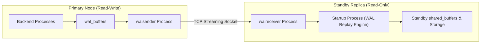
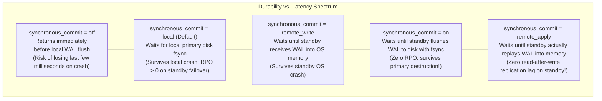
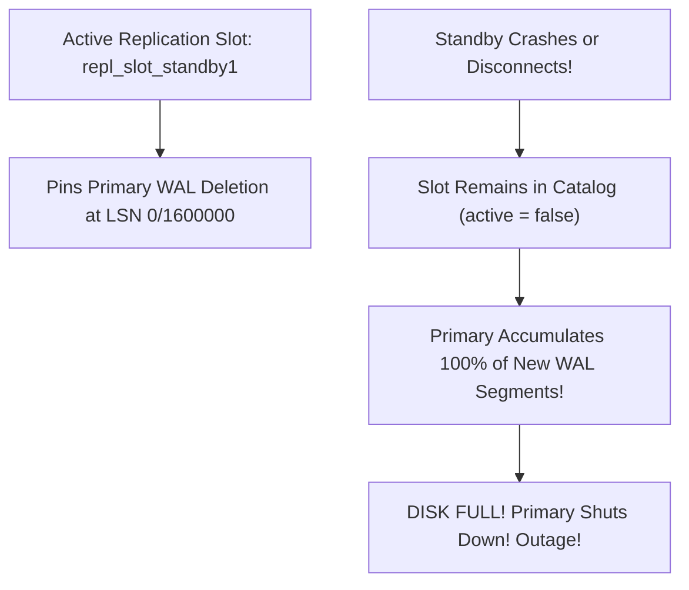
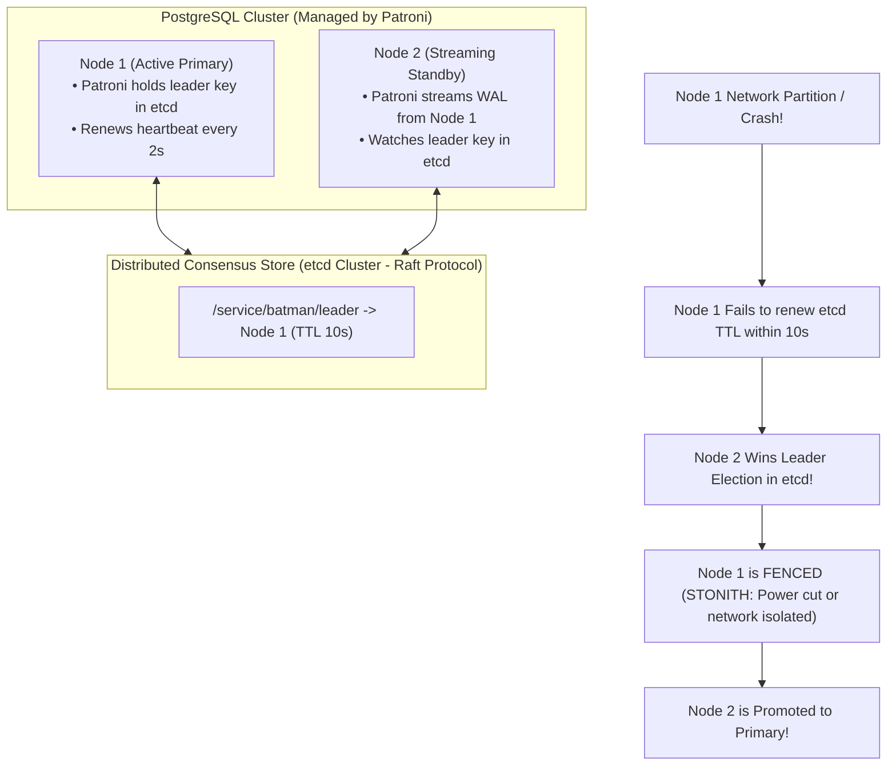
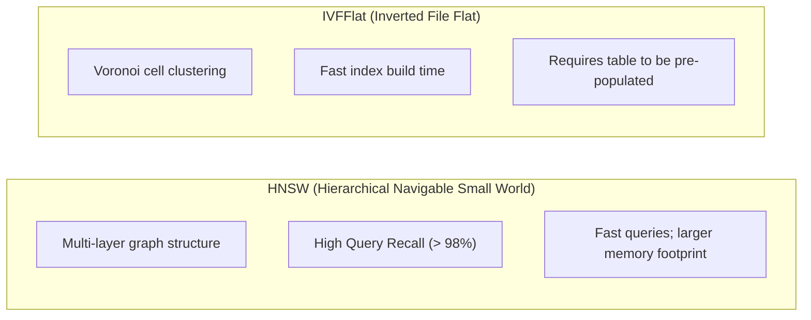

# Module 13 — High Availability, Replication, CDC, Extensions & Observability

Welcome to **Module 13** of the PostgreSQL curriculum. This capstone module delivers complete, academically grounded, and staff-level expertise for distributed high availability, replication architectures, modern extension ecosystems, and production telemetry in PostgreSQL 18. We analyze physical streaming replication and quorum durability, dissect logical Change Data Capture (CDC) with PostgreSQL 17/18 synchronized failover slots, construct split-brain-free automated failover clusters with Patroni and Raft (`etcd`), evaluate AI vector similarity search using **`pgvector`** (HNSW vs IVFFlat), and navigate observability telemetry with `pg_stat_statements`, `pg_stat_io`, and wait events.

---

## 1. Core Terminology & Concept Definitions

- **Physical Streaming Replication**: A replication protocol where the primary server continuously transmits raw binary Write-Ahead Log (WAL) records over a network socket to standby instances, which replay them directly into their local storage.
- **Recovery Point Objective (RPO)**: The maximum acceptable data loss measured in time (e.g., zero seconds of lost transactions) in the event of an unplanned primary server failure.
- **Recovery Time Objective (RTO)**: The maximum acceptable duration of service downtime before a standby assumes primary leadership and resumes client application traffic.
- **Quorum Replication**: A synchronous replication topology where a transaction commits only after a defined quorum ($K$ of $N$) of standby replicas confirm receipt and flushing of WAL records.
- **Replication Slot**: A cluster state anchor that guarantees the primary server will not discard WAL segments or purge dead tuples needed by a standby or logical subscriber until that consumer confirms receipt.
- **Synchronized Failover Slots**: An enterprise replication capability introduced in **PostgreSQL 17** (and enhanced in PostgreSQL 18) that synchronizes logical replication slots to physical standbys (`sync_replication_slots`), allowing CDC consumers (such as Debezium) to seamlessly fail over to a newly promoted primary without missing or duplicating events.
- **Patroni**: An enterprise high-availability daemon that utilizes a Distributed Consensus Store (DCS, such as `etcd` or Consul) implementing Raft consensus to guarantee automated, split-brain-free leader election and failover.
- **Fencing (STONITH)**: "Shoot The Other Node In The Head" — the isolation mechanism that forcibly cuts power or network access to an unresponsive primary node to prevent split-brain dual-primary corruption.
- **Vector Similarity Search (`pgvector`)**: An extension providing dense high-dimensional vector embeddings and Approximate Nearest Neighbor (ANN) indexing (HNSW and IVFFlat) to execute semantic similarity searches for generative AI applications.

---

## 2. Physical Streaming Replication & Synchronous Commit Levels

Physical streaming replication replicates the exact binary state of the database cluster:



### Synchronous Commit Modes (`synchronous_commit`)
Replication durability is controlled on the primary server per transaction or cluster-wide:



### Quorum Replication Syntax
To prevent a single slow or stalled standby from blocking all commits on the primary:
```ini
# Commit succeeds when ANY 2 out of 3 standbys flush WAL to disk:
synchronous_standby_names = 'ANY 2 (standby_us_east, standby_us_west, standby_eu_central)'
```

---

## 3. Replication Slots & The Inactive Slot Disk-Exhaustion Hazard

A replication slot ensures that the primary never deletes WAL files required by a downstream replica or CDC subscriber:



### The Mandatory Production Defense: `max_slot_wal_keep_size`
Never create a replication slot without configuring WAL retention limits:

```ini
# postgresql.conf
# Maximum volume of WAL that can be retained by inactive replication slots:
max_slot_wal_keep_size = 64GB
```
If an inactive slot exceeds 64GB of accumulated WAL, PostgreSQL invalidates the slot and resumes normal WAL cleanup, preserving primary database availability at the expense of forcing the replica to rebuild.

---

## 4. Logical Replication, CDC & PostgreSQL 17+ Synchronized Failover Slots

Logical replication uses PostgreSQL's logical decoding engine (`pgoutput`) to stream decoded row modifications:

```sql
-- On Primary:
CREATE PUBLICATION customer_events FOR TABLE customers, orders;

-- On Subscriber:
CREATE SUBSCRIPTION customer_subscriber
    CONNECTION 'host=primary_host port=5432 user=replicator dbname=prod_db'
    PUBLICATION customer_events;
```

### The Failover Problem Solved in PostgreSQL 17/18
Historically, logical replication slots existed **only on the primary**. If the primary crashed and a physical standby was promoted, the logical replication slots were missing on the new primary, breaking Change Data Capture (Debezium/Kafka) pipelines and requiring full re-snapshots.

**The Solution**: PostgreSQL 17 introduced **synchronized failover slots**:
- Physical standbys continuously synchronize logical replication slot positions from the primary via `sync_replication_slots = true`.
- When the standby promotes to primary, all logical replication slots are already up to date at the exact LSN boundary.
- Subscriptions configured with `failover = true` seamlessly reconnect to the promoted standby without dropping or duplicating a single CDC message.

### PostgreSQL 19 Forward-Look:
1. **Logical Replication of Sequences**: PostgreSQL 19 natively replicates sequence states (`nextval`), eliminating sequence desynchronization between publisher and subscriber.
2. **`effective_wal_level`**: Allows enabling logical replication without requiring a full cluster restart.

---

## 5. Automated High Availability with Patroni & Raft Consensus

True zero-downtime high availability requires a distributed consensus store (DCS) to prevent **Split-Brain** (where two servers believe they are the primary, accepting conflicting writes and corrupting data).



### Application Connection Configuration for HA
Clients connect using comma-separated host connection strings with `target_session_attrs`:

```text
postgresql://node1:5432,node2:5432/production_db?target_session_attrs=read-write&connect_timeout=3
```
If Node 1 fails and Node 2 is promoted, client connection pools automatically cycle through the host list and discover the new read-write primary within seconds.

### PostgreSQL 19 Forward-Look: Standby `WAIT FOR LSN`
PostgreSQL 19 adds the native `WAIT FOR LSN` command:
```sql
-- Client writes to primary, obtains commit LSN: 0/20349A0
-- Client routes subsequent read query to standby replica:
WAIT pg_lsn '0/20349A0';
SELECT * FROM user_orders WHERE id = 42;
```
This guarantees **Read-Your-Writes consistency** on asynchronous read replicas without application sleep delays.

---

## 6. Generative AI Vector Search: `pgvector` Architecture

The `pgvector` extension provides native storage and indexing for dense vector embeddings:

```sql
CREATE EXTENSION IF NOT EXISTS vector;

CREATE TABLE item_embeddings (
    id SERIAL PRIMARY KEY,
    title TEXT NOT NULL,
    embedding VECTOR(1536) -- 1536-dimensional OpenAI / Gemini embeddings
);
```

### Vector Distance Metrics:
- **L2 Distance (`<->`)**: Euclidean distance ($\sqrt{\sum (u_i - v_i)^2}$).
- **Inner Product (`<#>`)**: Negative dot product ($-\sum u_i v_i$).
- **Cosine Distance (`<=>`)**: $1 - \frac{u \cdot v}{\|u\| \|v\|}$ (standard for normalized text embeddings).

```sql
-- Find top 5 most semantically similar items:
SELECT id, title, (embedding <=> $query_vector) AS cosine_distance
FROM item_embeddings
ORDER BY embedding <=> $query_vector
LIMIT 5;
```

### Approximate Nearest Neighbor (ANN) Indexing: HNSW vs. IVFFlat



| Dimension | HNSW (`vector_hnsw_ops`) | IVFFlat (`vector_ivfflat_ops`) |
| :--- | :--- | :--- |
| **Index Structure** | Multi-layer proximity graph | Inverted list of Voronoi centroid clusters |
| **Build Time** | High CPU & memory during build | Fast, lightweight build |
| **Query Speed** | **Extremely Fast** ($O(\log N)$) | Moderate (depends on `probes`) |
| **Recall Accuracy** | **Superior (> 98% recall)** | Moderate (90% - 95%) |
| **Build Pre-requisite** | Can be built on empty table | **Must be built after data is loaded** for clustering |
| **Tuning Parameters** | `m`, `ef_construction`, `hnsw.ef_search` | `lists`, `ivfflat.probes` |

---

## 7. Production Observability: `pg_stat_statements`, `pg_stat_io` & Wait Events

### 1. Query Performance Profiling (`pg_stat_statements`)
Tracks normalized execution statistics across all SQL queries:

```sql
CREATE EXTENSION IF NOT EXISTS pg_stat_statements;

-- Top 5 queries consuming the most total execution time:
SELECT 
    queryid,
    substr(query, 1, 60) AS short_query,
    calls,
    round(total_exec_time::numeric, 2) AS total_ms,
    round(mean_exec_time::numeric, 2) AS mean_ms,
    round((100.0 * shared_blks_hit / nullif(shared_blks_hit + shared_blks_read, 0))::numeric, 2) AS cache_hit_pct
FROM pg_stat_statements
ORDER BY total_exec_time DESC
LIMIT 5;
```

### 2. Disk I/O Breakdown (`pg_stat_io`)
Introduced in PostgreSQL 16, `pg_stat_io` provides granular I/O telemetry partitioned by backend type, context, and target:

```sql
SELECT backend_type, context, object, reads, writes, writebacks, extend
FROM pg_stat_io
WHERE reads > 0 OR writes > 0;
```

### 3. Diagnosing Lock Bottlenecks in Real Time
Identify blocking and blocked sessions:

```sql
SELECT
    blocked_locks.pid     AS blocked_pid,
    blocked_activity.usename  AS blocked_user,
    blocking_locks.pid    AS blocking_pid,
    blocking_activity.usename AS blocking_user,
    blocked_activity.query    AS blocked_statement,
    blocking_activity.query   AS blocking_statement
FROM  pg_catalog.pg_locks         blocked_locks
JOIN pg_catalog.pg_stat_activity blocked_activity ON blocked_activity.pid = blocked_locks.pid
JOIN pg_catalog.pg_locks         blocking_locks 
    ON blocking_locks.locktype = blocked_locks.locktype
    AND blocking_locks.database IS NOT DISTINCT FROM blocked_locks.database
    AND blocking_locks.relation IS NOT DISTINCT FROM blocked_locks.relation
    AND blocking_locks.page IS NOT DISTINCT FROM blocked_locks.page
    AND blocking_locks.tuple IS NOT DISTINCT FROM blocked_locks.tuple
    AND blocking_locks.virtualxid IS NOT DISTINCT FROM blocked_locks.virtualxid
    AND blocking_locks.transactionid IS NOT DISTINCT FROM blocked_locks.transactionid
    AND blocking_locks.classid IS NOT DISTINCT FROM blocked_locks.classid
    AND blocking_locks.objid IS NOT DISTINCT FROM blocked_locks.objid
    AND blocking_locks.objsubid IS NOT DISTINCT FROM blocked_locks.objsubid
    AND blocking_locks.pid != blocked_locks.pid
JOIN pg_catalog.pg_stat_activity blocking_activity ON blocking_activity.pid = blocking_locks.pid
WHERE NOT blocked_locks.granted;
```

---

## 8. Then vs. Now: Replication & Extensions

| Capability | PostgreSQL $\le$ 16 | PostgreSQL 17 | PostgreSQL 18 & 19 (Current) |
| :--- | :--- | :--- | :--- |
| **Failover Logical Slots** | None (CDC broke on standby failover) | **Introduced `sync_replication_slots`** | Enhanced monitoring views & slot sync tuning |
| **Sequence Replication** | Manual synchronization | Manual synchronization | Native logical replication of sequences (PG19) |
| **Read-Your-Writes** | Sleep / application heuristics | Sleep / application heuristics | PG19 native **`WAIT FOR LSN`** on standbys |
| **AI Vector Search** | IVFFlat only | HNSW mature support | Native vector quantization and parallel graph builds |

---

## 9. Interview Drill

<details>
<summary>1. How do Synchronized Failover Slots in PostgreSQL 17+ solve the historical problem of running Change Data Capture (CDC) across high-availability failovers?</summary>

**Answer**: Historically, logical replication slots resided strictly in memory and catalogs on the primary server. If the primary failed and a physical standby was promoted to primary, the logical replication slots did not exist on the promoted node. Downstream CDC pipelines (such as Debezium or Kafka Connect) could not resume streaming and were forced to perform full, expensive re-snapshots of the entire database. PostgreSQL 17 introduced `sync_replication_slots = true` and failover slots (`ALTER SUBSCRIPTION ... SET (failover = true)`). The standby continuously synchronizes the LSN commit positions of logical replication slots from the primary. When the standby is promoted, the logical slots are immediately ready, allowing CDC consumers to reconnect seamlessly without missing or duplicating events.
- Ref: [PostgreSQL Documentation: Synchronized Replication Slots](https://www.postgresql.org/docs/18/logical-replication-failover.html)
</details>

<details>
<summary>2. Why can an abandoned or disconnected replication slot cause a total database cluster outage, and how do you prevent it?</summary>

**Answer**: A replication slot guarantees that the primary server will not remove any WAL segment that has not yet been acknowledged by the replica or subscriber. If a replica crashes, is decommissioned, or loses network connectivity while its replication slot remains registered in the primary's catalog, the primary stops deleting WAL files. WAL segments accumulate in `pg_wal` until the physical storage volume is 100% full. At that point, PostgreSQL cannot write new WAL records and initiates an emergency shutdown, causing a cluster-wide outage. The mandatory prevention is configuring `max_slot_wal_keep_size` (e.g. `64GB`) in `postgresql.conf`. If an inactive slot accumulates more than this threshold, PostgreSQL invalidates the slot and resumes WAL deletion, preserving primary availability.
- Ref: [PostgreSQL Documentation: Replication Slots](https://www.postgresql.org/docs/18/warm-standby.html#STREAMING-REPLICATION-SLOTS)
</details>

<details>
<summary>3. Explain the difference between `synchronous_commit = on`, `remote_write`, and `remote_apply` in streaming replication.</summary>

**Answer**:
- `remote_write`: The primary transaction commit waits until the standby has received the WAL bytes over the network socket and written them into the standby's operating system page cache. The transaction is durable against a primary crash and standby application crash, but not against a standby power loss.
- `on`: The primary commit waits until the standby has written the WAL records to non-volatile disk storage using an `fsync` system call. Guarantees zero data loss (RPO = 0) even if the primary is destroyed.
- `remote_apply`: The primary commit waits until the standby has not only flushed the WAL to disk, but the standby's startup process has physically replayed the WAL into the standby's `shared_buffers` and storage. This guarantees **read-your-writes consistency**: a query sent immediately to the standby is guaranteed to observe the modifications made by the primary transaction.
- Ref: [PostgreSQL Documentation: Asynchronous Commit](https://www.postgresql.org/docs/18/wal-async-commit.html)
</details>

<details>
<summary>4. Compare HNSW and IVFFlat index architectures in `pgvector`.</summary>

**Answer**:
- **IVFFlat** partitions vector space into Voronoi cells using k-means clustering. At query time, only vectors in the centroids closest to the query vector are probed (`ivfflat.probes`). It builds quickly and consumes modest memory, but has lower recall accuracy (90%–95%) and **must be built only after data is loaded** into the table, because training clusters on an empty table produces skewed, ineffective centroids.
- **HNSW** builds a multi-layer hierarchical proximity graph where higher layers have long-range skips and lower layers have dense local connections. It achieves superior query throughput and recall (> 98%), and can be built on an empty table with incremental inserts. However, it requires significantly more memory to hold graph pointers and takes substantially longer to build.
- Ref: [pgvector Official Documentation](https://github.com/pgvector/pgvector)
</details>

<details>
<summary>5. How does Patroni prevent "Split-Brain" scenarios during an automated failover event?</summary>

**Answer**: Patroni uses a Distributed Consensus Store (DCS, e.g. `etcd` or Consul) backed by the Raft consensus algorithm. The primary Patroni node acquires a leader key in the DCS with a time-to-live (TTL, e.g. 10s) and must continually renew its heartbeat lease every 2 seconds. If network partition separates the primary:
1. The primary fails to renew its lease; Patroni immediately demotes the primary to read-only or shuts it down.
2. The remaining nodes elect a new leader only if they represent a consensus quorum in the DCS.
3. The standby with the highest WAL LSN is promoted.
4. Fencing (STONITH) or software watchdog devices forcibly isolate the old primary, guaranteeing that two nodes can never concurrently accept write traffic on the same database cluster.
- Ref: [Patroni Documentation: Architecture & High Availability](https://patroni.readthedocs.io/)
</details>
