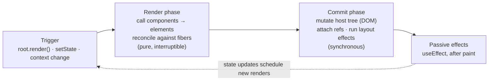

# 01 · Elements, JSX & the Render Model

> **Track:** `technologies/react` · **React:** 19.3.1 · **Proofs:** [`examples/01-elements/elements.test.tsx`](../examples/01-elements/elements.test.tsx)
>
> **Typing JSX** (the `JSX` namespace, `jsxImportSource`, `ReactNode` vs `ReactElement`, `ComponentProps<'button'>`) is owned by the TypeScript track: see [TypeScript module 12](../../../languages/typescript/modules/12-react-19-and-modern-react-typescript.md). This module covers what JSX *does at runtime*.

React's whole programming model rests on one idea: **a component is a function from inputs to a description of UI, and React — not your code — decides when to call it and what to do with the description.** This module makes that idea precise. We start with the data structure your JSX produces (the *element*), follow it through the compiler and the runtime, define the contracts React expects from your components (purity, immutability, identity), and finish with the render → commit pipeline that the rest of the track takes apart piece by piece.

---

## 1. Formal model

### 1.1 Definitions

Let **Props** be the set of finite maps from string keys to JavaScript values, and **Type** be the union of host types (strings such as `"div"`), component types (functions or classes), and React's built-in special types (`Fragment`, `Suspense`, `Activity`, `ViewTransition`, context objects, `lazy` and `memo` wrappers).

> **Definition 1.1 (Element).** A React element is an immutable record
> $e = (\tau, k, p)$ with $\tau \in \text{Type}$, $k \in \text{String} \cup \{\bot\}$, $p \in \text{Props}$,
> tagged with the brand `$$typeof = Symbol.for('react.transitional.element')`.

> **Definition 1.2 (Component).** A function component is a function
> $C : \text{Props} \times \Sigma \times \Gamma \to \text{Node}$ where $\Sigma$ is the component's own state (hooks) and $\Gamma$ is the context visible at its position. **Node** is the recursive type
> $\text{Node} ::= \text{Element} \mid \text{string} \mid \text{number} \mid \text{bigint} \mid \text{boolean} \mid \text{null} \mid \text{undefined} \mid \text{Iterable}\langle\text{Node}\rangle \mid \text{Promise}\langle\text{Node}\rangle$.

> **Definition 1.3 (Purity / idempotence).** React requires that for fixed $(p, \sigma, \gamma)$, evaluating $C(p, \sigma, \gamma)$ any number of times returns structurally equal output and performs no observable side effect outside the component's own fresh locals. React's documentation calls these the [Rules of React](https://react.dev/reference/rules): *components and hooks must be pure*, *React calls components and hooks*, *rules of hooks*.

> **Definition 1.4 (Identity of a component instance).** A component instance (its state, its DOM, its effects) lives at a *position* in the tree. Two renders refer to the same instance iff, along the path from the root, every step matches on **(parent position, element type, key — or index when no key)**. Changing any of the three destroys the old instance and creates a new one.

Everything React does is a consequence of these four definitions:

- Because elements are **values**, they can be created, stored, passed as props and discarded at no cost. Creating `<Expensive />` does not run `Expensive`.
- Because components are **pure functions of their inputs**, React may call them zero, one or many times, in any order between commits, and may throw away the result (concurrent rendering, Module 05; Strict Mode double rendering, §5).
- Because identity is **positional + type + key**, "where" and "what" you render — not variable names or object identity — decide whether state survives (Module 02).

### 1.2 The render model in one picture



The rest of the track zooms into each box: render/reconcile (Modules 02–03), commit and effects (Module 04), scheduling (Module 05), suspending renders (Module 06), rendering on the server (Modules 06–07).

---

## 2. JSX is syntax for element construction

### 2.1 What JSX is

JSX is not part of ECMAScript. It is a syntax extension, specified informally by the [JSX draft spec](https://facebook.github.io/jsx/), that a compiler (TypeScript, Babel, SWC, oxc, esbuild) lowers to ordinary function calls *before* the code runs. The browser never sees JSX.

There are two lowering strategies:

| Strategy | Configuration | Output | Status |
|---|---|---|---|
| **Classic** | `"jsx": "react"` (TS), `runtime: "classic"` (Babel) | `React.createElement(type, props, ...children)` | Legacy; requires `React` in scope |
| **Automatic** | `"jsx": "react-jsx"` (TS), `runtime: "automatic"` | `jsx(type, props, key)` / `jsxs(...)` from `react/jsx-runtime`; `jsxDEV` from `react/jsx-dev-runtime` in development | Default since React 17 (2020) |

### 2.2 The automatic transform, precisely

```tsx
// Source
const list = (
  <ul key="k" id="x">
    <li />
    {items}
  </ul>
);
const p = <p>one</p>;
```

```js
// Lowered (production, automatic runtime) — verified by the test "JSX compiles to jsx/jsxs calls…"
import { jsx, jsxs } from "react/jsx-runtime";

const list = jsxs("ul", { id: "x", children: [jsx("li", {}), items] }, "k");
const p = jsx("p", { children: "one" });
```

Four rules fall out of the transform, and each has consequences:

1. **`children` becomes a prop.** A single child is stored as the value itself; several children become an array. That is why `props.children` is sometimes an array and sometimes not, and why [`Children`](https://react.dev/reference/react/Children) utilities exist.
2. **`key` is pulled out of props** and passed positionally. Components can never read `props.key` (DEV installs a warning getter that returns `undefined`). If you need the ID inside the component, pass it twice: `<Row key={id} id={id} />`.
3. **`jsxs` vs `jsx`** encodes whether the children array is *static* (written literally in the JSX). For a static array the compiler already knows each child's position is fixed, so React does not demand keys and does not warn. For `{items}` — a dynamic array — React checks for keys at runtime.
4. **A `key` after a spread** (`<p {...rest} key="z" />`) falls back to `createElement`, because the compiler cannot know whether `rest` also contains a `key`. The test "a key after a spread falls back to createElement" proves this. Put `key` *before* spreads.

In development the transform emits `jsxDEV(type, props, key, isStaticChildren, source, self)` from `react/jsx-dev-runtime`. React 19's `jsxDEV` reads only the first four arguments: instead of the compiler-supplied `__source`/`__self`, it captures a stack when the element is created and uses it for [owner stacks](https://react.dev/reference/react/captureOwnerStack) in warnings and error overlays.

### 2.3 Then vs now: the JSX runtime

| | Then (React ≤16, classic runtime) | Now (React 17+ automatic runtime; React 19 deprecates the classic path's quirks) |
|---|---|---|
| Call | `React.createElement("div", props, a, b)` | `jsxs("div", { ...props, children: [a, b] }, key)` |
| Imports | `import React from "react"` in every JSX file | Compiler inserts `react/jsx-runtime` import |
| `key` | Read from the props object at runtime | Extracted at compile time |
| Children | Variadic arguments | Single `children` prop |
| Why it changed | Every file needed `React` in scope; `createElement` had to copy props to separate `key`/`ref`; variadic children blocked static optimisation. | |

**Migration:** set `"jsx": "react-jsx"` in `tsconfig.json` (or the bundler equivalent), run the [`update-react-imports` codemod](https://github.com/reactjs/react-codemod) to delete unused `React` imports. **Pitfall when mixing:** files compiled with the classic runtime still work, but any code that relies on `React` being a global (e.g. old MDX setups) breaks once the import is removed.

---

## 3. The element data structure

### 3.1 Shape

```ts
// Runtime shape in react@19.3 (development build adds _owner, _store, _debugInfo, _debugStack, _debugTask)
{
  $$typeof: Symbol.for("react.transitional.element"),
  type,         // "div" | Component | Fragment | Suspense | …
  key,          // string | null  — numbers are coerced: key={7} → "7"
  props,        // includes children and (since 19) ref
  // DEV only: _owner (the component that created it), _store.validated (key-warning bookkeeping)
}
```

The test "an element is a plain description" asserts this shape; "keys are coerced to strings" proves `key={7}` becomes `"7"`. Because element keys are compared as strings, `key={1}` and `key="1"` are the *same* key.

### 3.2 Why `$$typeof` exists: the JSON injection defence

Before 2015, React decided "is this an element?" by duck typing. A server that stored user-controlled JSON and rendered it as a child (`<div>{message.text}</div>` where an attacker made `text` an object) could be tricked into rendering an attacker-chosen element, including `dangerouslySetInnerHTML`.

The fix: every element carries a **Symbol** brand. `Symbol.for(...)` values are not representable in JSON, so `JSON.parse` can never produce one. React checks the brand in `isValidElement` and in the reconciler:

$$\text{isValidElement}(x) \iff x \neq \text{null} \land \texttt{typeof}\ x = \texttt{"object"} \land x.\texttt{\$\$typeof} = \texttt{Symbol.for("react.transitional.element")}$$

An object that fails the check and is not a string, number, array/iterable or promise is rejected with *"Objects are not valid as a React child"* — the test "rendering a forged element throws instead of creating DOM" proves this. (In engines without `Symbol`, React historically fell back to the number `0xeac7`; every supported engine now has `Symbol`.)

**What `$$typeof` does not protect against:** `dangerouslySetInnerHTML` with untrusted HTML, URL attributes (React 19 replaces a `javascript:` URL in `href`, `src`, `action` or `formAction` with a stub that throws *"React has blocked a javascript: URL as a security precaution"* — test "javascript: URLs are replaced" — but `data:` URLs and other sinks are your responsibility), and spreading untrusted objects into props (`<div {...userJson} />` lets the attacker set `dangerouslySetInnerHTML`). Text children *are* always escaped (test "text children are escaped").

### 3.3 Then vs now: the element brand and `ref`

| | Then (React ≤18) | Now (React 19+) |
|---|---|---|
| Brand | `Symbol.for("react.element")` | `Symbol.for("react.transitional.element")` |
| `ref` | Special: stripped from props into `element.ref`; function components needed `forwardRef` to receive it | A normal prop: `props.ref`. `element.ref` is a DEV-warning getter. `forwardRef` still works but is no longer needed and will be deprecated |
| String refs (`ref="input"`) | Deprecated since 16.3 | **Removed** |
| Why | `ref` special-casing complicated every wrapper and generic component typing | |

React 19 renamed the brand precisely so that elements produced by an older React (e.g. a library bundling its own React 18 copy) are detected: rendering one throws *"A React Element from an older version of React was rendered"* (test "the legacy `Symbol.for('react.element')` is rejected"). If you see this error, you have two copies of React in the bundle — fix the dependency graph (`npm ls react`), do not patch the element.

**Migration from `forwardRef`:**

```tsx
// Then (≤18)
const Input = forwardRef<HTMLInputElement, Props>(function Input(props, ref) {
  return <input ref={ref} {...props} />;
});

// Now (19)
function Input({ ref, ...props }: Props & { ref?: React.Ref<HTMLInputElement> }) {
  return <input ref={ref} {...props} />;
}
```

The [`remove-forward-ref` codemod](https://github.com/reactjs/react-codemod) automates this. Pitfall: a component that spreads `{...props}` onto a DOM node now also spreads `ref` — usually what you want, but check wrappers that previously relied on `ref` being filtered out. Typing `ref` as a prop is covered in [TypeScript M12](../../../languages/typescript/modules/12-react-19-and-modern-react-typescript.md).

### 3.4 Immutability

In development React calls `Object.freeze` on every element and its `props` object (tests "element and props are frozen in DEV"). In production the freeze is skipped for speed, so mutation silently "works" — and silently breaks:

- `memo`, `useMemo` dependencies and React Compiler cache checks compare by reference (`Object.is`). Mutating `props.items.push(x)` keeps the reference, so memoised children never see the change.
- Concurrent rendering may render the same element twice; a mutation in the first pass leaks into the second.

To change an element, create a new one (`cloneElement` or, better, new JSX with different props). `cloneElement` is a legacy pattern ([react.dev lists it under "Legacy React APIs"](https://react.dev/reference/react/cloneElement)) because it makes data flow implicit; prefer render props or context.

---

## 4. Creating vs rendering

Creating an element is an $O(\text{number of props})$ object allocation. **It does not call the component.** The component runs only when React reconciles that element at some position (test "the component function runs only when React renders the element").

```tsx
const el = <Chart data={data} />; // Chart has NOT run
return cond ? el : null;           // if cond is false, Chart never runs at all
```

Consequences:

- **Elements as props are cheap.** `<Layout sidebar={<Sidebar />} />` passes a description; `Layout` decides whether and where to render it.
- **Calling a component directly is not rendering it.** `Counter()` executes `Counter`'s body in the *caller's* hook context (or with no context at all, which throws — test "calling a component as a function is not rendering it"). Its hooks become the caller's hooks, it gets no position, no key, no own state. Never call components; render them.
- **"Children as a slot" is the cheapest optimisation in React.** If `<Parent>` re-renders but its `children` prop is the same element object created by *its* parent, React bails out of re-rendering those children (Module 02 §5, Module 12).

### 4.1 What a component may return

The `Node` grammar in Definition 1.2 maps directly to rendering rules (test "booleans, null and undefined render nothing; 0 renders '0'"):

| Value | Renders as | Pitfall |
|---|---|---|
| `null`, `undefined`, `true`, `false` | nothing | `{count && <Badge />}` renders `0` when `count === 0`. Use `count > 0 &&`. |
| string, number, bigint | text node (escaped) | `NaN` renders `"NaN"` |
| element | the element | — |
| array / iterable | each item (keyed!) | Generators can be consumed only once; React warns |
| Promise (since 19) | suspends until resolved (Module 06) | Uncached promises created during render never settle |
| plain object, function, symbol | **error** / warning | Objects are not valid children; functions are probably a missing call |

---

## 5. Purity, idempotence and Strict Mode

### 5.1 Why purity is a hard requirement

React's scheduler assumes it can:

1. call a component and **discard** the result (an interrupted transition, a suspended render, an error that is retried);
2. call a component **more than once** for the same commit (Strict Mode, retries after suspending, concurrent restarts);
3. call components **out of order** relative to effects (render of a subtree may happen before the parent's previous effects have run).

Any side effect in render — mutating a module variable, writing to a ref that is read during render, sending analytics, subscribing to a store — is executed once per *render attempt*, not once per *commit*. The number of attempts is unspecified.

| Allowed during render | Not allowed during render |
|---|---|
| Reading props, state, context | Mutating props, state, context values |
| Creating new objects/arrays/JSX | Mutating objects that existed before this render |
| Local mutation of values created in this render | `ref.current` reads or writes (except lazy init) |
| Calling pure helpers | Network requests, timers, subscriptions, `Math.random()`/`Date.now()` that affect output on the server vs client |

### 5.2 Strict Mode as a purity probe

[`<StrictMode>`](https://react.dev/reference/react/StrictMode) is a development-only harness. Inside it, React:

1. **double-invokes** component bodies, `useState`/`useMemo`/`useReducer` initialisers and updaters — the test "StrictMode double-invokes component bodies" counts exactly 2 calls;
2. **runs every effect setup → cleanup → setup** once on mount (Module 04), and since **19.3 also during hydration** ([react#35961](https://github.com/react/react/pull/35961)), matching client-rendered roots;
3. **runs ref callbacks setup → cleanup → setup** on mount;
4. warns about deprecated APIs.

The "NEGATIVE: mutating a module-level array during render duplicates output" test shows the classic bug: a render that pushes into shared state produces two rows under Strict Mode. In production it would produce one row per *render attempt*, which is worse: it is non-deterministic.

> **Then vs now (Strict Mode logging).** React 17 silenced `console.log` during the second invocation, which confused people into thinking the double call did not happen. React 18 stopped silencing; React 19 dims the second log in DevTools instead. Do not try to "detect" the second render; make render pure.

---

## 6. Keys and identity

Keys are the user-visible half of Definition 1.4; the reconciler half is in Module 02. The rules:

1. **Siblings in a dynamic list need keys that are stable, unique among siblings and derived from the data** (a database ID, a slug). Keys need not be globally unique.
2. **Index keys are correct only for lists that never reorder, insert or delete except at the end.** Otherwise state (input text, focus, scroll, animation, `useState`) moves to the wrong item (Module 02 has the negative test).
3. **Random keys (`key={Math.random()}`) are a bug:** every render creates a new identity, destroying and recreating every row and its DOM.
4. **A key on a single element is a reset switch.** `<Profile key={userId} />` gives each user a fresh instance; this is the idiomatic way to reset all state when an identity changes, instead of syncing state in an effect.
5. **Fragments can be keyed** (`<Fragment key={id}>`), the shorthand `<>` cannot.

`Children.toArray` shows how React builds the *effective* key of nested arrays: `.$a` for explicit key `a`, `.1:$b` for key `b` inside the array at index 1 (test "Children.toArray assigns keys and flattens"). These path-prefixed keys are why moving an element between two different arrays always remounts it.

---

## 7. Roots: entering the render model

```tsx
import { createRoot, hydrateRoot } from "react-dom/client";

const root = createRoot(document.getElementById("app")!, {
  onCaughtError, onUncaughtError, onRecoverableError, // Module 10
  identifierPrefix: "app1-",                            // namespaces useId (Module 06)
});
root.render(<App />);
// later
root.unmount();
```

- `createRoot` creates a **FiberRoot** (Module 02) attached to a container. All rendering is concurrent-capable; updates are batched automatically (Module 03).
- `hydrateRoot(container, <App />)` attaches to server-rendered HTML instead of creating DOM (Module 06).
- `root.render` is itself an update: it schedules work and returns immediately. In tests you wrap it in [`act`](https://react.dev/reference/react/act) to flush synchronously (all examples do this; Module 12 explains `act`).

### 7.1 Then vs now: root APIs

| Then (≤17, deprecated in 18, **removed in 19**) | Now |
|---|---|
| `ReactDOM.render(<App />, el)` | `createRoot(el).render(<App />)` |
| `ReactDOM.hydrate(<App />, el)` | `hydrateRoot(el, <App />)` |
| `ReactDOM.unmountComponentAtNode(el)` | `root.unmount()` |
| `ReactDOM.findDOMNode(c)` | refs |
| Legacy root: synchronous, no automatic batching outside events, no concurrent features | Concurrent root |

Migration: replace the entry point, run tests under `StrictMode`, fix effects that are not idempotent (Module 04), and see Module 12 for the full 18 → 19 removed-API list.

---

## 7.2 Renderers: one reconciler, many hosts

`react` (the package) contains only the element factory, hooks dispatch and shared types. The algorithm that turns elements into a host tree is `react-reconciler`, and each **renderer** plugs into it with a *host config* — a table of primitive operations:

| Renderer | Host instance | Example host-config operations |
|---|---|---|
| `react-dom` | DOM `Element`/`Text` | `createInstance` → `document.createElement`, `appendChild`, `commitUpdate` → set attributes/listeners |
| `react-dom/server` (Fizz) | HTML byte stream | writes chunks; no reconciler — a separate, streaming renderer (Module 06) |
| `react-server` (Flight) | Flight rows | serialises the tree for the client (Module 07) |
| `react-native` | native views via Fabric | `createInstance` → C++ shadow node |
| custom (`react-three-fiber`, `ink`) | Three.js objects, terminal cells | whatever the host needs |

This is why the element/component model is identical across platforms, and why hooks, Suspense and transitions behave the same on every host: they live in the reconciler, not in the renderer. The two server renderers are the exception — they are separate implementations, which is why some client-only APIs (`useLayoutEffect`, refs) do nothing or warn on the server.

### 7.3 The `react` / `react-dom` version lock

`react` and `react-dom` must be **the exact same version**. `react-dom` checks this at load time and throws *"Incompatible React versions"* when they differ, because the two packages share internal data structures (`ReactSharedInternals`) whose layout changes even between minors. The same applies to `react-server-dom-*` (Module 07). Pin them together (this track pins `19.3.1` for all three) and upgrade them in one commit.

---

## 8. Production failure modes

| Symptom | Root cause | Fix |
|---|---|---|
| `0` appears in the UI | `{n && <X/>}` with `n === 0` | `{n > 0 && <X/>}` |
| "Objects are not valid as a React child" | Rendering a plain object / Date / API payload | Render a field, or format it |
| "A React Element from an older version of React was rendered" | Two React copies (library bundles React 18) | Dedupe `react`; library should declare a peer dependency |
| State resets on every keystroke | Component defined inside another component (new type every render) or random key | Hoist the component; use stable keys |
| Analytics fired twice in dev, N times in prod | Side effect in render | Move to an event handler or effect |
| `props.key` is `undefined` | Keys are not props | Pass the ID as a separate prop |
| Memoised child does not update after `items.push()` | Mutation keeps reference identity | Create a new array |
| XSS through `<div {...json}>` | Spreading untrusted data into props | Whitelist props explicitly |

---

## 9. Executable proofs

[`examples/01-elements/elements.test.tsx`](../examples/01-elements/elements.test.tsx) (Vitest + jsdom, real React 19.3):

| Claim | Test |
|---|---|
| JSX lowers to `jsx`/`jsxs` with key positional | `JSX compiles to jsx/jsxs calls…` (uses Vite's oxc transform) |
| Key after spread → `createElement` | `a key after a spread falls back to createElement` |
| Elements are branded and frozen | `an element is a plain description…`, `element and props are frozen in DEV` |
| JSON cannot forge elements | `NEGATIVE: an element forged from JSON…`, `NEGATIVE: rendering a forged element throws…` |
| React 19 rejects the old brand | `NEGATIVE: the legacy Symbol.for('react.element')…` |
| Creating ≠ rendering; components are not functions you call | `the component function runs only when…`, `calling a component as a function…` |
| Strict Mode double render exposes impurity | `StrictMode double-invokes…`, `NEGATIVE: mutating a module-level array…` |
| `ref` is a prop | `ref is readable from props…`, `a function component receives ref…` |

Run: `npm test -- examples/01-elements`.

---

## 10. Interview Drill

<details><summary><strong>1. What is the difference between a React element, a component and a component instance?</strong></summary>

An **element** is an immutable plain object `{ $$typeof, type, key, props }` describing what to render. A **component** is the function (or class) referenced by `element.type`. An **instance** is the stateful thing React creates when an element of that type is rendered at a position: it owns hook state, effects and DOM, and is represented internally by a fiber (Module 02). Many elements over time can refer to the same instance if position, type and key match.
</details>

<details><summary><strong>2. What does <code>&lt;Foo a={1} key="x"&gt;hi&lt;/Foo&gt;</code> compile to with the automatic runtime, and why is <code>key</code> separate?</strong></summary>

`jsx(Foo, { a: 1, children: "hi" }, "x")` imported from `react/jsx-runtime`. `key` is identity metadata for the parent's reconciliation, not data for `Foo`; extracting it at compile time avoids copying props at runtime and is why `props.key` is `undefined`. With a spread before `key` the compiler cannot prove `key` is not in the spread and falls back to `createElement`.
</details>

<details><summary><strong>3. Why does React put <code>$$typeof: Symbol(...)</code> on elements?</strong></summary>

To stop JSON-injection XSS. If a server renders a user-controlled object as a child, duck typing would accept a forged `{type, props:{dangerouslySetInnerHTML}}`. Symbols cannot be serialised to JSON, so a parsed object can never carry the brand, and React rejects it with "Objects are not valid as a React child".
</details>

<details><summary><strong>4. Why must components be pure? Give two concrete React features that break if they are not.</strong></summary>

React may call a component several times per commit or discard its output. Concurrent rendering (an interrupted transition is restarted), Suspense (a suspended render is retried), Strict Mode (double render), and the React Compiler (which caches JSX based on inputs and assumes the same inputs give the same output) all rely on it. A side effect in render runs an unspecified number of times, and a compiler-memoised component that reads a mutable global will show stale output.
</details>

<details><summary><strong>5. You see a component's <code>console.log</code> twice in development. Bug?</strong></summary>

Probably Strict Mode's intentional double render (React 19 dims the second log). It is a bug only if the double call has a visible effect — which means render is impure. Fix the impurity; never try to detect the second call.
</details>

<details><summary><strong>6. How do you reset all state of a <code>&lt;ProfileForm&gt;</code> when the selected user changes?</strong></summary>

Give it a key: `<ProfileForm key={userId} />`. A key change is an identity change, so React unmounts the old instance and mounts a fresh one. Syncing state in a `useEffect` on `userId` renders once with stale state and then again — slower and glitchy.
</details>

<details><summary><strong>7. What changed about <code>ref</code> in React 19, and what is the migration risk?</strong></summary>

`ref` is a regular prop for function components; `forwardRef` is unnecessary. `element.ref` is removed (warning getter), string refs are removed, and ref callbacks may return a cleanup function (Module 04). Risk: components that spread `{...props}` now forward `ref` too; and code that read `element.ref` must read `element.props.ref`.
</details>

<details><summary><strong>8. Why is <code>{items.length && &lt;List/&gt;}</code> a bug and how does it relate to the Node grammar?</strong></summary>

`&&` returns its left operand when falsy. `0` is a number, and numbers are valid nodes that render as text, so React prints `0`. `false`, `null` and `undefined` render nothing. Use a boolean condition.
</details>

<details><summary><strong>9. What happens if a library bundles its own React 18 and you render its elements in a React 19 app?</strong></summary>

Its elements carry `Symbol.for('react.element')`; React 19 throws "A React Element from an older version of React was rendered". Even before 19, two React copies break hooks (each copy has its own dispatcher: "Invalid hook call"). The fix is a single React copy via peer dependencies and deduplication.
</details>
