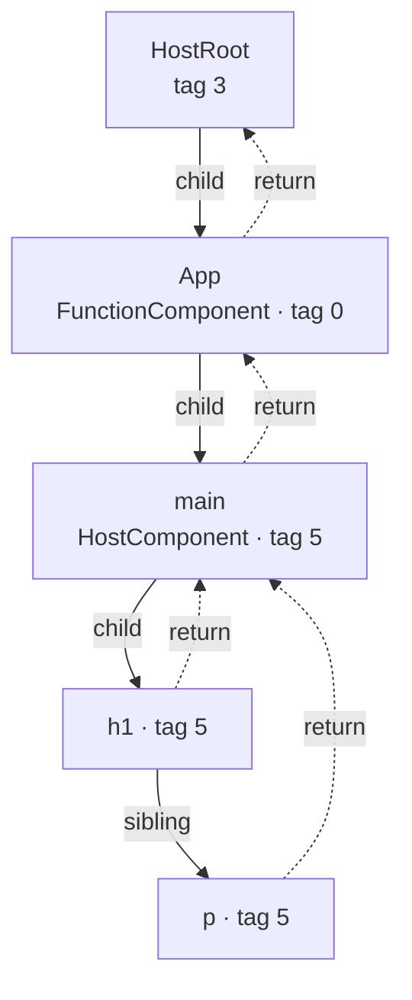
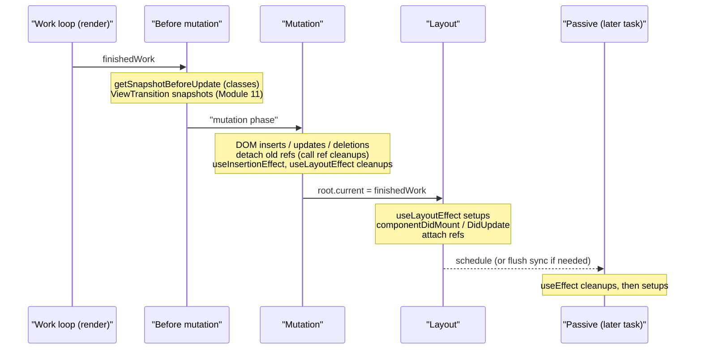
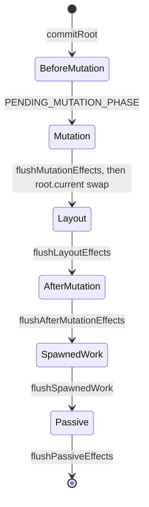

# 02 · The Fiber Reconciler & the Commit Phase

> **Track:** `technologies/react` · **React:** 19.3.1 · **Proofs:** [`examples/02-fiber/fiber.test.tsx`](../examples/02-fiber/fiber.test.tsx), [`examples/02-fiber/keyed-diff.ts`](../examples/02-fiber/keyed-diff.ts)
>
> **Prerequisites:** Module 01 (elements, identity). **Source of truth:** `packages/react-reconciler/src` in [github.com/react/react](https://github.com/react/react) — `ReactFiber.js`, `ReactFiberWorkLoop.js`, `ReactFiberBeginWork.js`, `ReactFiberCompleteWork.js`, `ReactChildFiber.js`, `ReactFiberCommitWork.js`.

Module 01 defined *what* identity is (position + type + key). This module shows *how* React maintains identity over time: the **fiber tree**, the **work loop** that walks it, the **reconciliation algorithm** that matches new elements to old fibers, and the **commit phase** that applies the result to the host. Internal field names below are from the 19.3.1 build and are not public API; the tests that read them use a small, clearly-labelled helper ([`_shared/internals.ts`](../examples/_shared/internals.ts)) and pin the version.

---

## 1. Why Fiber exists

### 1.1 The problem with recursion

React 15's *stack reconciler* walked the element tree with ordinary recursion: `mountComponent` called `mountComponent` on each child. A recursive walk has two properties that conflict with a responsive UI:

1. **It cannot pause.** The JavaScript call stack is the only record of "where we are"; returning from the walk loses it. A 50 ms render blocks input for 50 ms.
2. **It has no priorities.** Every update takes the same path, so a keystroke waits behind a data-grid re-render.

React 16 (2017) replaced it with **Fiber**: the call stack is reified as a heap-allocated linked structure. Each frame becomes a *fiber* object; walking the tree becomes a loop over that structure. A loop can stop after any fiber, yield to the browser, and resume — or throw away its progress and restart with more urgent work (Module 05).

### 1.2 Fiber, formally

> **Definition 2.1 (Fiber).** A fiber is a mutable record representing one *instance* (Module 01, Def. 1.4) together with the pending and completed work for it. The fibers of a root form an ordered rooted tree encoded as a **left-child/right-sibling binary tree** with parent back-pointers:
> - `child`: the first child, or `null`;
> - `sibling`: the next sibling, or `null`;
> - `return`: the parent (named after the frame we *return* to when this unit of work completes).

Left-child/right-sibling encoding ([Knuth, *TAOCP* Vol. 1, §2.3.2](https://www-cs-faculty.stanford.edu/~knuth/taocp.html)) turns an n-ary tree into a binary one, so a depth-first traversal needs only three pointers and no auxiliary stack.



The test "pointers and work tags of a real fiber" walks exactly this structure on a real DOM tree.

### 1.3 The fields that matter

| Field | Meaning | Used in |
|---|---|---|
| `tag` | Kind of fiber: `FunctionComponent` 0, `ClassComponent` 1, `HostRoot` 3, `HostPortal` 4, `HostComponent` 5, `HostText` 6, `Fragment` 7, `ForwardRef` 11, `SuspenseComponent` 13, `MemoComponent` 14, `SimpleMemoComponent` 15, `OffscreenComponent` 22 (backs Suspense offscreen content), `ActivityComponent` 31 (backs `<Activity>` in 19.3+) … | dispatch in `beginWork`/`completeWork` |
| `type`, `elementType`, `key` | Copied from the element; the identity triple | reconciliation |
| `stateNode` | Host instance (DOM node) for host fibers; class instance for class components; `FiberRoot` for the HostRoot; `null` for function components | commit |
| `pendingProps` / `memoizedProps` | Props for this render / props used last time it completed | bailout check |
| `memoizedState` | Function components: head of the **hook linked list** (Module 03). Class components: `this.state`. Suspense: dehydrated/suspended state | hooks |
| `updateQueue` | Class/HostRoot: queued updates. Function components: effect list (Module 04). Host components: changed attributes | render & commit |
| `lanes` / `childLanes` | Pending work on this fiber / anywhere in its subtree, as lane bitmasks (Module 05) | scheduling, subtree bailout |
| `flags` / `subtreeFlags` | Side effects to apply in commit (`Placement`, `Update`, `ChildDeletion`, `Ref`, `Passive`, …) for this fiber / its subtree | commit traversal |
| `deletions` | Child fibers to delete in commit | commit |
| `alternate` | The other version of this fiber (double buffering, §2) | everywhere |
| `index` | Position among siblings | reconciliation |
| `actualDuration`, `selfBaseDuration`, `treeBaseDuration` | Profiler timings (dev/profiling builds) | Module 12 |

---

## 2. Double buffering

### 2.1 Two trees, one shared structure

At any time a root has up to two versions of each fiber:

- the **current** tree — what is on screen; `FiberRoot.current` points at its HostRoot fiber;
- the **work-in-progress** (WIP) tree — the next screen being computed.

Each fiber's `alternate` points to its counterpart. `createWorkInProgress(current, pendingProps)` reuses `current.alternate` if it exists (resetting flags and copying fields) and allocates only if not. When the commit finishes, a single pointer write makes the WIP tree current:

```js
root.current = finishedWork; // ReactFiberWorkLoop: commitRoot
```

> **Invariant 2.1.** For every fiber `f`, `f.alternate` is `null` or `f.alternate.alternate === f`. After every commit, `FiberRoot.current.alternate` is the previous current HostRoot.

The test "double buffering: FiberRoot.current alternates between exactly two HostRoot fibers" re-renders four times and observes only two distinct HostRoot objects swapping roles — the pointer swap, not an allocation, per commit.

### 2.2 Why double buffering

1. **Interruptibility without tearing.** The current tree is never mutated during render, so if a render is abandoned, the screen and the current fibers are consistent. The WIP tree is a private scratchpad.
2. **Allocation reuse.** In steady state, updates recycle the alternate fibers instead of allocating a fresh tree per update.
3. **Atomic visible change.** The DOM mutations for one commit happen in one synchronous pass and the tree swap is one assignment, so users never see half of an update.

(The name is borrowed from graphics, where a frame is drawn into a back buffer and swapped with the front buffer on vsync.)

---

## 3. The work loop

### 3.1 Pseudocode

```text
PERFORM-UNIT-OF-WORK(unit)
  current ← unit.alternate
  next ← BEGIN-WORK(current, unit, renderLanes)       ▷ render this fiber, reconcile its children
  unit.memoizedProps ← unit.pendingProps
  if next ≠ NIL then return next                       ▷ descend
  return COMPLETE-UNIT-OF-WORK(unit)

COMPLETE-UNIT-OF-WORK(unit)
  completed ← unit
  repeat
    COMPLETE-WORK(completed.alternate, completed)      ▷ create/diff host instances, bubble flags
    if completed.sibling ≠ NIL then return completed.sibling   ▷ go right
    completed ← completed.return                       ▷ go up
  until completed = NIL
  return NIL                                           ▷ whole tree done

WORK-LOOP-SYNC()
  while workInProgress ≠ NIL do
    workInProgress ← PERFORM-UNIT-OF-WORK(workInProgress)

WORK-LOOP-CONCURRENT()
  while workInProgress ≠ NIL and not SHOULD-YIELD() do
    workInProgress ← PERFORM-UNIT-OF-WORK(workInProgress)
```

**Loop invariant (work loop).** At the top of each iteration, every fiber that precedes `workInProgress` in DFS pre-order has *begun*, and every fiber whose entire subtree precedes it has *completed*; `workInProgress` and the `return` chain above it are the only fibers with work partially done. Because that state is fully captured by the single pointer `workInProgress`, the loop can stop at any iteration (yield) and resume later from the same pointer.

`SHOULD-YIELD` is the scheduler's deadline check — by default 5 ms per slice (`frameInterval = 5` in `scheduler@0.28.0`). Module 05 covers how lanes decide *which* work loop runs and when a yielded render is resumed versus restarted.

### 3.2 `beginWork`: going down

`beginWork(current, wip, renderLanes)` switches on `wip.tag`:

- **Function component:** call the component through `renderWithHooks`, which installs the hooks dispatcher (Module 03) and returns the child elements.
- **Class component:** process the update queue, call `render()`.
- **Host component:** nothing to call; the children are `props.children`.
- **Suspense / Activity / Context / Memo:** special logic (Modules 03, 05, 06).

then calls `reconcileChildren(current, wip, nextChildren)` (§4) and returns `wip.child`.

**Bailout fast path.** Before any of that, `beginWork` checks:

$$\text{oldProps} = \text{newProps} \;\land\; \neg\text{legacyContextChanged} \;\land\; \neg(\text{wip.lanes} \cap \text{renderLanes}) \;\land\; \neg\text{didReceiveUpdate}$$

(where $=$ is **reference** equality). If it holds, React calls `bailoutOnAlreadyFinishedWork`: and if additionally $\text{wip.childLanes} \cap \text{renderLanes} = \emptyset$, the **entire subtree is skipped** — `beginWork` returns `null`, and the work loop never visits those fibers. Otherwise React clones the child fibers and keeps descending to find the fibers that do have work. This is why an update deep in the tree is cheap: `childLanes` marks the path to it, and everything off the path is skipped.

### 3.3 `completeWork`: going up

For host fibers, `completeWork`:

- on mount: creates the host instance (`document.createElement`), appends all already-created host children (the subtree is built bottom-up off-screen), sets initial properties;
- on update: computes whether attributes changed and marks `Update`;
- for every fiber: **bubbles** `subtreeFlags |= child.flags | child.subtreeFlags` and `childLanes`, so the commit phase can skip subtrees with no effects.

> **Then vs now: the effect list.** Until React 17, `completeWork` threaded every fiber with effects onto a singly linked *effect list* (`firstEffect`/`nextEffect`), and the commit phase walked only that list. React 18 replaced it with `subtreeFlags` bubbling and a tree traversal in commit. The effect list could not express "this subtree has effects but must be skipped" (needed for Suspense and Offscreen/Activity hiding), and keeping it consistent under interruption was error-prone. Nothing in user code depends on this, but older articles (and interview questions) still describe the effect list — know that it is gone.

### 3.4 Source walkthrough (v19.3.1)

Links point at the `v19.3.1` tag of [github.com/react/react](https://github.com/react/react/tree/v19.3.1) (the repository moved from `facebook/react`; the `repository` field of the 19.3.1 packages says so). The same function names appear in the shipped development build of `react-dom`, which is what the tests execute.

| Step | Source | What it does |
|---|---|---|
| Entry per root | [`ReactFiberWorkLoop.js` → `performWorkOnRoot`](https://github.com/react/react/blob/v19.3.1/packages/react-reconciler/src/ReactFiberWorkLoop.js#L1137) | Chooses `renderRootSync` or `renderRootConcurrent` from the lanes (blocking and expired lanes render synchronously), then commits |
| Fresh start | [`prepareFreshStack`](https://github.com/react/react/blob/v19.3.1/packages/react-reconciler/src/ReactFiberWorkLoop.js#L2023) | Discards any in-progress tree, calls `createWorkInProgress(root.current, null)`, resets the module-level `workInProgress*` variables — a *restart* (Module 05) |
| Sync loop | [`workLoopSync`](https://github.com/react/react/blob/v19.3.1/packages/react-reconciler/src/ReactFiberWorkLoop.js#L2772) | `while (workInProgress !== null) performUnitOfWork(workInProgress)` |
| Concurrent loop (ships) | [`workLoopConcurrentByScheduler`](https://github.com/react/react/blob/v19.3.1/packages/react-reconciler/src/ReactFiberWorkLoop.js#L3073) | `while (workInProgress !== null && !shouldYield())` |
| Concurrent loop (flagged off) | [`workLoopConcurrent`](https://github.com/react/react/blob/v19.3.1/packages/react-reconciler/src/ReactFiberWorkLoop.js#L3056) | Time-boxed 25 ms for non-idle and 5 ms for idle work, "to reduce the framerate of animations to 30 frames per second"; behind `enableThrottledScheduling = false` in `shared/ReactFeatureFlags.js`. The shipped build calls `workLoopConcurrentByScheduler` |
| One unit | [`performUnitOfWork`](https://github.com/react/react/blob/v19.3.1/packages/react-reconciler/src/ReactFiberWorkLoop.js#L3081) | `next = beginWork(current, unitOfWork, entangledRenderLanes)`; `memoizedProps = pendingProps`; `next === null` → `completeUnitOfWork` |
| Going up | [`completeUnitOfWork`](https://github.com/react/react/blob/v19.3.1/packages/react-reconciler/src/ReactFiberWorkLoop.js#L3368) | `completeWork`, then `sibling`, else `return` — COMPLETE-UNIT-OF-WORK of §3.1 |
| Recycling | [`ReactFiber.js` → `createWorkInProgress`](https://github.com/react/react/blob/v19.3.1/packages/react-reconciler/src/ReactFiber.js#L323) | Reuses `current.alternate` ("we'll only ever need at most two versions of a tree"), resets `flags`/`subtreeFlags`/`deletions`, copies `lanes`, `child`, `memoizedState`, `updateQueue` |

The bailout test at the top of [`beginWork`](https://github.com/react/react/blob/v19.3.1/packages/react-reconciler/src/ReactFiberBeginWork.js#L4226), condensed but structurally verbatim:

```js
if (current !== null) {
  if (oldProps !== newProps || hasLegacyContextChanged()) {
    didReceiveUpdate = true;                          // new props object: must render
  } else {
    const hasScheduledUpdateOrContext = checkScheduledUpdateOrContext(current, renderLanes);
    if (!hasScheduledUpdateOrContext && (workInProgress.flags & DidCapture) === NoFlags) {
      didReceiveUpdate = false;
      return attemptEarlyBailoutIfNoScheduledUpdate(current, workInProgress, renderLanes);
    }
    didReceiveUpdate = false;                         // an update exists; the component may still
  }                                                   // bail out if its state turns out equal
}
workInProgress.lanes = NoLanes;                       // cleared before the component runs
```

[`bailoutOnAlreadyFinishedWork`](https://github.com/react/react/blob/v19.3.1/packages/react-reconciler/src/ReactFiberBeginWork.js#L3826) then chooses between *skip the subtree* and *clone children and keep walking*:

```js
if (!includesSomeLane(renderLanes, workInProgress.childLanes)) {
  if (current !== null) {
    lazilyPropagateParentContextChanges(current, workInProgress, renderLanes);
    if (!includesSomeLane(renderLanes, workInProgress.childLanes)) return null; // subtree skipped
  } else return null;
}
cloneChildFibers(current, workInProgress);
return workInProgress.child;
```

Two consequences. The props check is **reference** equality on the props *object*, so any parent render that re-creates the element defeats it; `memo` ([`updateMemoComponent`](https://github.com/react/react/blob/v19.3.1/packages/react-reconciler/src/ReactFiberBeginWork.js#L479), [`updateSimpleMemoComponent`](https://github.com/react/react/blob/v19.3.1/packages/react-reconciler/src/ReactFiberBeginWork.js#L547)) adds `shallowEqual` on top. And context changes are propagated **lazily** while descending (`lazilyPropagateParentContextChanges`): a provider marks nothing up front; consumers are discovered during the walk.

In `completeWork`, [`bubbleProperties`](https://github.com/react/react/blob/v19.3.1/packages/react-reconciler/src/ReactFiberCompleteWork.js#L793) recomputes `subtreeFlags` and `childLanes` bottom-up (and sums profiler durations), and [`appendAllChildren`](https://github.com/react/react/blob/v19.3.1/packages/react-reconciler/src/ReactFiberCompleteWork.js#L245) attaches already-created child DOM nodes to a newly created parent, so a fresh subtree is assembled off-screen and inserted with **one** DOM operation at its top.

---

## 4. Reconciliation: matching elements to fibers

### 4.1 Why heuristics

The general problem — the minimum-cost edit script transforming one ordered labelled tree into another — is the **tree edit distance** problem; the best general algorithms are $O(n^3)$ (Demaine et al., *An Optimal Decomposition Algorithm for Tree Edit Distance*, ACM TALG 2009; survey: Bille, *A survey on tree edit distance and related problems*, TCS 2005). For a 1,000-node UI that is $10^9$ operations per update. React instead runs an $O(n)$ algorithm built on two assumptions documented since 2013:

1. **Elements of different types produce different trees.** If the type at a position changes (`div` → `section`, `ComponentA` → `ComponentB`), React does not diff the subtrees; it destroys the old subtree and builds the new one.
2. **Keys identify children across renders.** Among siblings, an element with key *k* corresponds to the old fiber with key *k*, wherever it moved.

Both are tested: "changing the element type at a position destroys state" and "stable keys: prepending keeps each input's text on its own row and reuses DOM nodes".

### 4.2 Single child

`reconcileSingleElement` scans the old children for a fiber with the same key. If found and the type matches, it reuses the fiber (`useFiber` → `createWorkInProgress`) and deletes all other old siblings; if the key matches but the type differs, it deletes everything and creates a new fiber. Text children reuse an existing `HostText` fiber if the first old child is one.

### 4.3 Arrays: the two-pass algorithm

`reconcileChildrenArray` cannot walk backwards (fibers have no back-sibling pointer), so it uses a forward-only algorithm with one heuristic for moves. The keyed version (key-only model in [`keyed-diff.ts`](../examples/02-fiber/keyed-diff.ts)):

```text
RECONCILE-KEYED(old[0..m), new[0..n))
  lastPlacedIndex ← 0; i ← 0
  ▷ Pass 1 — common prefix. Invariant: old[0..i) = new[0..i), all reused in place.
  while i < m and i < n and old[i].key = new[i].key do
    REUSE(old[i]); lastPlacedIndex ← i; i ← i + 1
  if i = n then DELETE old[i..m); return                     ▷ only removals at the end
  if i = m then INSERT new[i..n); return                     ▷ only appends
  ▷ Pass 2 — index the rest of the old list by key
  map ← { old[k].key ↦ k : i ≤ k < m }
  for j ← i to n − 1 do
    ▷ Invariant: old indices of children reused-in-place so far are strictly increasing,
    ▷            and lastPlacedIndex is the greatest of them.
    if new[j].key ∈ map then
      oldIndex ← map[new[j].key]; remove it from map
      if oldIndex < lastPlacedIndex then MARK-MOVE(new[j])  ▷ would be out of order
      else lastPlacedIndex ← oldIndex                         ▷ stays in place
    else MARK-INSERT(new[j])
  DELETE every fiber left in map
```

The real [`placeChild`](https://github.com/react/react/blob/v19.3.1/packages/react-reconciler/src/ReactChildFiber.js#L511) lives in [`createChildReconciler`](https://github.com/react/react/blob/v19.3.1/packages/react-reconciler/src/ReactChildFiber.js#L431), which is instantiated twice: `reconcileChildFibers` (tracks side effects, for updates) and `mountChildFibers` (no placement flags, for first mounts — the parent appends the whole subtree at once):

```js
function placeChild(newFiber, lastPlacedIndex, newIndex) {
  newFiber.index = newIndex;
  if (!shouldTrackSideEffects) {
    newFiber.flags |= Forked;              // remembered for useId during hydration
    return lastPlacedIndex;
  }
  const current = newFiber.alternate;
  if (current !== null) {
    const oldIndex = current.index;
    if (oldIndex < lastPlacedIndex) {
      newFiber.flags |= Placement;         // a MOVE — deliberately not PlacementDEV
      return lastPlacedIndex;
    } else {
      return oldIndex;                     // stays in place
    }
  } else {
    newFiber.flags |= Placement | PlacementDEV; // an INSERTION
    return lastPlacedIndex;
  }
}
```

The `Placement`/`PlacementDEV` split is observable: under Strict Mode a newly **inserted** row gets setup → cleanup → setup, a **moved** row does not (test "StrictMode re-runs effects for INSERTED children… but not for MOVED ones"). [`reconcileChildrenArray`](https://github.com/react/react/blob/v19.3.1/packages/react-reconciler/src/ReactChildFiber.js#L1177) drives it with [`updateSlot`](https://github.com/react/react/blob/v19.3.1/packages/react-reconciler/src/ReactChildFiber.js#L842) (pass 1; returns `null` on a key mismatch, which ends the pass), [`mapRemainingChildren`](https://github.com/react/react/blob/v19.3.1/packages/react-reconciler/src/ReactChildFiber.js#L467) (a `Map` keyed by `key`, or by `index` for unkeyed children) and [`updateFromMap`](https://github.com/react/react/blob/v19.3.1/packages/react-reconciler/src/ReactChildFiber.js#L985) (pass 2). Fibers left in the map go to `deleteChild`, which appends them to `returnFiber.deletions` and sets `ChildDeletion` on the parent.
**Correctness.** The children that stay in place have strictly increasing old indices (the invariant), so their relative order in the old DOM already matches the new order. Every other child is inserted or moved with `insertBefore(node, nextStayingSibling)` in commit, which positions it relative to the stable skeleton. The property test "unmoved keys keep their relative order" checks the invariant over random inputs.

**Complexity.** One pass over each list plus a hash map: $O(m + n)$ time and $O(m)$ extra space.

**Optimality — it is not optimal.** The set of children left in place is a *greedy* increasing subsequence, not the *longest* one. The minimum number of moves is $|C| - \text{LIS}(C)$ where $C$ is the sequence of old indices of the common keys in new order. The greedy choice is optimal for appends, removals and moving an item *later*, but moving the **last** item to the **front** makes `lastPlacedIndex` jump to the end immediately, so every other item "moves":

| Change | React's DOM placements | Minimum |
|---|---|---|
| `[a b c d e] → [e a b c d]` | 4 (`a`, `b`, `c`, `d` are re-appended) | 1 |
| `[e a b c d] → [a b c d e]` | 1 (`e`) | 1 |

The test "moving the LAST item to the front costs n−1 moves…" counts real `insertBefore`/`appendChild` calls in jsdom and gets exactly these numbers; "property: model's moves + inserts equal the real number of DOM placements" checks the model against the real reconciler on 150 random list pairs; "property: React's heuristic never beats the LIS lower bound" confirms it is ≥ the minimum. (Vue 3 and Inferno run an LIS step to get the minimum; React has not adopted it because moves are rarely the bottleneck compared with rendering the components themselves.)

**Practical consequence.** Prepending to a long keyed list is fine (no moves, one insert). Rotating a long list "last to first" — e.g. a "move to top" feature on a 1,000-row list — causes 999 DOM moves. A DOM move is a remove-then-insert, which reloads moved `<iframe>`s, pauses moved media elements and restarts CSS animations on them. If that matters, render the list in a different order (e.g. by reversing data and using `flex-direction: column-reverse`), or virtualise it (Module 12).

### 4.4 Index keys and missing keys

Without keys React uses the index as the implicit key. The index is *position*, not *identity*: after a prepend, slot 0 now holds a different data item but the same fiber — and the fiber is where `useState`, uncontrolled DOM state (`<input>` text, focus, scroll) and effects live. The test "NEGATIVE: index keys: prepending moves state onto the wrong row" shows the typed text jumping to the new row. React warns about missing keys in dynamic arrays and about duplicate keys (both tested); with duplicates, behaviour is undefined (children may be duplicated or dropped).

---

## 5. Bailouts you can rely on

| Mechanism | Condition | Notes |
|---|---|---|
| **Same element reference** | `oldProps === newProps` (the element object was not re-created) | The "children as props" pattern: elements created by the *grandparent* survive the parent's re-render untouched (test "same element reference… is not re-rendered") |
| **`memo(Component, areEqual?)`** | Shallow `Object.is` per prop, or your comparator | Defeated by fresh objects/functions/JSX in props (test "memo bails out… and is defeated by a fresh object prop"). The React Compiler (Module 09) makes props stable automatically |
| **State bailout** | `setState(sameValue)` by `Object.is` | React may still render the component once to confirm, then discard (Module 03) |
| **Context** | Only consumers of a changed context re-render, *through* `memo` boundaries | Context value identity matters (Module 12) |
| **Subtree skip** | `childLanes ∩ renderLanes = ∅` | Automatic; why sibling subtrees of an update are not visited |

What is **not** a bailout: wrapping a component in `useCallback` without `memo` on the child; `React.PureComponent` comparing a prop that is re-created each render; `key` (a key *forces* a new identity, it never skips work).

---

## 6. The commit phase

When the work loop finishes, `finishedWork` (the WIP HostRoot) holds a tree annotated with flags. `commitRoot` applies it **synchronously and without yielding** — a half-applied DOM would be visible.



Key facts (each one is tested in Module 04):

1. **Mutation before layout.** By the time a layout effect or ref callback runs, the DOM is fully updated for the whole tree, and `root.current` already points at the new tree.
2. **Children before parents** within each sub-phase: a child's layout effect runs before its parent's (the commit traverses depth-first, firing on the way up).
3. **Layout effects block paint.** They run in the same task as the DOM mutations, before the browser gets a chance to render a frame. Passive effects run after paint (usually), in a separate task — unless a later synchronous update forces them to flush first.
4. **Deletions** unmount the whole removed subtree: refs detached, layout and passive cleanups run, host nodes removed once at the top-most host node of the deleted subtree (not node-by-node).

The browser's own rendering steps (style → layout → paint → composite) that happen *after* the commit belong to the CSS track ([languages/css](../../../languages/css/README.md)); the event-loop position of the commit task belongs to [languages/javascript](../../../languages/javascript/README.md).

### 6.1 Fragment refs (19.3)

Because a `Fragment` has no host node, refs on fragments used to be impossible. React 19.3 makes `<Fragment ref={r}>` stable: `r.current` is a **`FragmentInstance`**, an object whose methods (`addEventListener`, `focus`, `getClientRects`, `observeUsing`, …) operate on the fragment's first-level host children. It is attached in the layout sub-phase like any ref. Module 11 covers its API and the browser integration.

---

### 6.2 The commit pipeline in source (19.3)

19.3 splits `commitRoot` into resumable steps so that a commit can be handed to the browser's View Transitions API (Module 11). A module-level `pendingEffectsStatus` records progress ([`ReactFiberWorkLoop.js` L724–731](https://github.com/react/react/blob/v19.3.1/packages/react-reconciler/src/ReactFiberWorkLoop.js#L724)):



Without a view transition, [`commitRoot`](https://github.com/react/react/blob/v19.3.1/packages/react-reconciler/src/ReactFiberWorkLoop.js#L3725) calls `flushMutationEffects(); flushLayoutEffects(); flushSpawnedWork();` back to back in one task. With one, the same functions are passed as callbacks to `startViewTransition` so the browser can snapshot the old DOM before `flushMutationEffects` runs. The source comment on `root.current = finishedWork` states the invariant: it happens "after the mutation phase, so that the previous tree is still current during componentWillUnmount, but before the layout phase, so that the finished work is current during componentDidMount/Update."

| Phase | Source |
|---|---|
| Before mutation | [`commitBeforeMutationEffects`](https://github.com/react/react/blob/v19.3.1/packages/react-reconciler/src/ReactFiberCommitWork.js#L352): snapshots, view-transition names |
| Mutation | [`commitMutationEffects`](https://github.com/react/react/blob/v19.3.1/packages/react-reconciler/src/ReactFiberCommitWork.js#L2027), [`commitDeletionEffects`](https://github.com/react/react/blob/v19.3.1/packages/react-reconciler/src/ReactFiberCommitWork.js#L1386): DOM writes, ref detach, insertion/layout cleanups |
| Layout | [`commitLayoutEffects`](https://github.com/react/react/blob/v19.3.1/packages/react-reconciler/src/ReactFiberCommitWork.js#L3063): layout setups, class lifecycles, ref attach |
| Passive | [`flushPassiveEffects`](https://github.com/react/react/blob/v19.3.1/packages/react-reconciler/src/ReactFiberWorkLoop.js#L4691) → [`commitPassiveUnmountEffects`](https://github.com/react/react/blob/v19.3.1/packages/react-reconciler/src/ReactFiberCommitWork.js#L4853) for the **whole tree**, then [`commitPassiveMountEffects`](https://github.com/react/react/blob/v19.3.1/packages/react-reconciler/src/ReactFiberCommitWork.js#L3764) |

The test "commit is atomic: a layout effect sees every sibling's DOM already updated" makes the split observable: a component *earlier* in the tree reads a *later* sibling's DOM from its layout effect and already sees the new text.

---
## 7. Then vs now

| Topic | Then | Now | Why it changed |
|---|---|---|---|
| Reconciler | Stack reconciler, recursive (≤15) | Fiber, iterative work loop (16+) | Interruptibility, priorities |
| Effects bookkeeping | Effect list `firstEffect/nextEffect` (16–17) | `flags`/`subtreeFlags` bubbling (18+) | Offscreen/Suspense hiding, simpler interruption |
| Priorities | `expirationTime` numbers (16) | Lanes bitmask (17+) | Batching several priorities, entanglement (Module 05) |
| Roots | Legacy root (`ReactDOM.render`), synchronous | Concurrent root (`createRoot`), legacy **removed in 19** | Concurrent features on by default |
| Fragment refs | Impossible; wrapper `<div>` or `findDOMNode` | `<Fragment ref>` → `FragmentInstance` (19.3) | Group-level DOM APIs without wrapper elements |
| `findDOMNode` | Walk from class instance to DOM | **Removed in 19** | Broke abstraction; incompatible with Fragments |

**Pitfall when mixing:** libraries that still call `ReactDOM.findDOMNode` or `ReactDOM.render` crash on React 19 (`findDOMNode is not a function`). Upgrade the library or replace it; there is no compatibility shim.

---

## 8. Production failure modes

| Symptom | Mechanism | Fix |
|---|---|---|
| Input text/focus jumps to another row after sorting | Index keys (§4.4) | Stable data keys |
| A child's state resets on every parent render | Component type defined inside render (new function identity → type change) — test "NEGATIVE: a component defined inside render…" | Define components at module scope; `react-hooks` v7 lints this (`static-components`) |
| `<iframe>` reloads, `<video>` pauses, CSS animation restarts when an item moves | DOM node *moved* (`insertBefore` = remove + insert) | Avoid last-to-first rotations of keyed lists; reorder visually with CSS |
| Whole page re-renders on every keystroke | State lifted too high; no bailout below | Colocate state; pass children as props; let the Compiler memoise |
| Duplicated or missing rows | Duplicate keys | Unique keys among siblings |
| Remount of a large subtree when toggling a wrapper (`cond ? <A><X/></A> : <X/>`) | The position of `X` changed (child of `A` vs direct child) | Keep the wrapper and toggle a prop, or accept the remount |
| Price shows the old currency | Custom `memo` comparator ignores a prop — test "NEGATIVE: a memo comparator that ignores a prop…" | Prefer the default shallow compare; unit-test custom comparators |
| `memo` child never updates after `items.push(x)` | In-place mutation keeps the reference — test "NEGATIVE: mutating an object prop in place…" | Immutable updates |

---

## 9. Executable proofs

| Claim | Test in `fiber.test.tsx` |
|---|---|
| Fibers form a child/sibling/return tree; tags; `stateNode` | `pointers and work tags of a real fiber` |
| Two HostRoot fibers swap on each commit | `double buffering: FiberRoot.current alternates…` |
| Type change and key change destroy state; same position keeps it | `identity = position + type + key` (5 tests) |
| Index keys move state (negative); stable keys reuse DOM | `keys in lists` (4 tests) |
| React's move heuristic, modelled and checked against real DOM placements | `the two-pass keyed diff…` (4 tests, 3 property-based with fast-check) |
| Element-reference bailout, memo and its defeat | `bailouts…` (4 tests) |
| `PlacementDEV` vs `Placement`; commit atomicity; broken comparators; mutation | `source-level behaviours…` (4 tests) |

Run: `npm test -- examples/02-fiber`.

---

## 10. Interview Drill

<details><summary><strong>1. What problem did Fiber solve that the stack reconciler could not?</strong></summary>

The stack reconciler kept traversal state on the JS call stack, so a render could not pause, yield to input, or be abandoned for higher-priority work. Fiber reifies each frame as a heap object linked by `child`/`sibling`/`return`, so the walk is a loop whose entire state is one pointer (`workInProgress`). That enables time slicing, priorities (lanes), Suspense retries, and concurrent rendering.
</details>

<details><summary><strong>2. Explain double buffering in React. What is <code>alternate</code>?</strong></summary>

Each fiber can have a counterpart in the other tree: the current tree (on screen, `root.current`) and the work-in-progress tree. `alternate` links them. Rendering mutates only WIP fibers, recycling `current.alternate` objects; commit swaps `root.current = finishedWork`. Benefits: abandoned renders leave the screen consistent, steady-state updates allocate little, and the visible switch is atomic.
</details>

<details><summary><strong>3. Why is React's diff O(n) instead of the O(n³) tree edit distance, and what does it give up?</strong></summary>

It assumes different element types produce different trees (no cross-type subtree diffing) and uses keys to match siblings. It gives up minimality: a type change discards a subtree that may have been reusable, and list moves are not minimal (greedy `lastPlacedIndex`, not LIS). In exchange each update is linear and predictable.
</details>

<details><summary><strong>4. Walk through what happens when a keyed list <code>[a,b,c,d,e]</code> becomes <code>[e,a,b,c,d]</code>.</strong></summary>

Pass 1: `a ≠ e`, so the prefix is empty. Pass 2: old indices mapped by key. `e` has old index 4 ≥ lastPlacedIndex 0 → stays, lastPlacedIndex = 4. `a` (0), `b` (1), `c` (2), `d` (3) are all < 4 → each is marked as a move. Commit performs 4 DOM placements although moving `e` alone would suffice. Moving the first item to the end costs only 1.
</details>

<details><summary><strong>5. When exactly does React skip rendering a component?</strong></summary>

In `beginWork`, if the props object is referentially the same, legacy context is unchanged, and the fiber has no pending update in the render lanes, it bails out; if `childLanes` also has no overlap, the whole subtree is skipped. `memo` adds a shallow props comparison; `setState` with an `Object.is`-equal value bails out (possibly after one confirming render); context changes force consumers to render even under `memo`.
</details>

<details><summary><strong>6. Why does the commit phase not yield, while the render phase can?</strong></summary>

Render is pure and private (WIP tree), so it can be paused or discarded. Commit mutates the host and runs effects that observe it; yielding mid-commit would show a partially updated UI and let user events observe inconsistent DOM. So commit is synchronous; only passive effects are deferred to a later task.
</details>

<details><summary><strong>7. In what order do layout effects run for a parent and its child, and why?</strong></summary>

Child first. The commit traverses depth-first and fires layout effects on completion, i.e. on the way up, so a parent's layout effect can rely on its children's DOM and refs being ready. Cleanups during updates run in the mutation phase before any new layout setup.
</details>

<details><summary><strong>8. What replaced the effect list in React 18 and why should you care?</strong></summary>

`subtreeFlags` bubbled during `completeWork`; commit walks the tree and skips subtrees whose `subtreeFlags` are empty. It made hiding/showing subtrees (Suspense fallbacks, Offscreen/Activity) expressible. You care mainly to recognise outdated explanations.
</details>

<details><summary><strong>9. A list row contains an embedded <code>&lt;iframe&gt;</code> player. After "move to top" it reloads. Why?</strong></summary>

The row was moved in the DOM (`insertBefore`), which is a removal followed by an insertion; browsers reload a re-inserted iframe (and pause a re-inserted media element). With React's heuristic, moving an item to the top of a keyed list can even move *every other* row. Avoid physical moves (render in stable order and position with CSS) or accept the reset.
</details>
