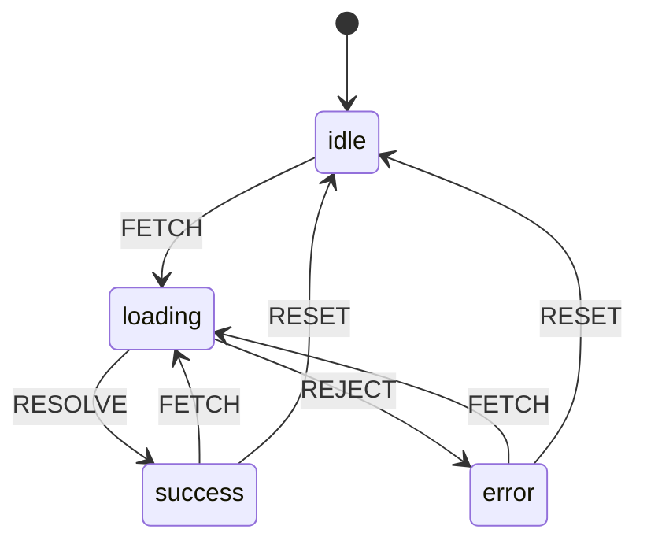

# 03 · State, Hooks & Closures

> **Track:** `technologies/react` · **React:** 19.3.1 · **Proofs:** [`examples/03-state/state.test.tsx`](../examples/03-state/state.test.tsx), [`examples/03-state/fetch-machine.ts`](../examples/03-state/fetch-machine.ts)
>
> **Cross-links.** Lexical scope and closures as a language mechanism are owned by [languages/javascript](../../../languages/javascript/README.md); this module covers only how React's render model *creates* closures. Hook signatures, `useState<T>` inference, `useRef` overloads and discriminated-union action types are typed in [TypeScript M12](../../../languages/typescript/modules/12-react-19-and-modern-react-typescript.md).

Hooks look like ordinary function calls, but they are a protocol between your component and the reconciler. This module opens the protocol: where hook state lives (a linked list on the fiber), how updates are queued and processed (circular queues with lanes), why every render sees a frozen **snapshot** (and therefore why closures go stale), how to design state with reducers and state machines, and how to read state that React does not own without **tearing**.

---

## 1. State as a snapshot

> **Definition 3.1 (Render snapshot).** For a render $r$ of instance $I$, let $\sigma_r$ be the tuple of hook states React supplies to the component. Every value the component reads during $r$ — and every closure created during $r$ (event handlers, effects, callbacks) — observes $\sigma_r$. Calling a setter does not change $\sigma_r$; it enqueues an update that will be applied when computing $\sigma_{r+1}$.

That is the entire explanation for three surprises (all tested):

- `setN(5); console.log(n)` logs the old value — "reading state right after setState still gives the old value".
- `setN(n + 1)` three times adds one, because all three read the same `n` from $\sigma_r$ — "three setN(n + 1) calls… increment by one".
- An `async` handler that awaits and then reads a prop sees the prop *of the render that created the handler*, even if the component has re-rendered since — "an async handler sees the props/state of the render that created it". This is usually what you want (the message goes to the chat you clicked "send" in), and occasionally a bug (Module 04, `useEffectEvent`).

React's docs call this "[state as a snapshot](https://react.dev/learn/state-as-a-snapshot)". Formally, a component is a function of $\sigma_r$, and a closure is a function of the environment it captured — in React that environment *is* a snapshot.

---

## 2. Where hook state lives

### 2.1 The hook list

A function component's fiber stores its hooks in `fiber.memoizedState` as a **singly linked list**, one node per hook call, in call order:

```ts
type Hook = {
  memoizedState: unknown;   // useState: the value · useRef: {current} · useMemo: [value, deps] · useEffect: effect object
  baseState: unknown;       // state before the first skipped update (§3.3)
  baseQueue: Update | null; // skipped updates still to be rebased
  queue: UpdateQueue | null;// pending updates (useState/useReducer)
  next: Hook | null;
};
```

The test "memoizedState is a chain with one node per hook call, in call order" walks a real fiber and reads `["first", {current: 42}, "third"]` for `useState("first")`, `useRef(42)`, `useState("third")`.

### 2.2 The dispatcher

`useState` does not contain the implementation. React exports a stub that forwards to `ReactSharedInternals.H` — the **current dispatcher** — which the reconciler swaps around each component call in `renderWithHooks`:

| Situation | Dispatcher | `useState` does |
|---|---|---|
| First render of this fiber | `HooksDispatcherOnMount` | allocate a hook node, append to the WIP list |
| Re-render | `HooksDispatcherOnUpdate` | advance a cursor along the *current* list in lockstep, clone the node |
| Re-render triggered during this render (`setState` in render) | `HooksDispatcherOnRerender` | as update, plus re-apply render-phase updates |
| Outside any component render | `ContextOnlyDispatcher` (throws) | *"Invalid hook call. Hooks can only be called inside of the body of a function component"* |

Two copies of React in a bundle means two `ReactSharedInternals` — the renderer sets the dispatcher on its copy, your component calls the other copy's stub, and you get "Invalid hook call". (Module 01 §7.3.)

### 2.3 Why the Rules of Hooks exist

```text
UPDATE-WORK-IN-PROGRESS-HOOK()                 ▷ called once per hook call during an update render
  if currentHook = NIL then nextCurrent ← currentlyRenderingFiber.alternate.memoizedState
  else nextCurrent ← currentHook.next
  if nextCurrent = NIL then
     error "Rendered more hooks than during the previous render."
  currentHook ← nextCurrent
  newHook ← CLONE(currentHook)                  ▷ same memoizedState, baseState, queue
  append newHook to the WIP list
  return newHook

after the component returns:
  if currentHook ≠ NIL and currentHook.next ≠ NIL then
     error "Rendered fewer hooks than expected. This may be caused by an accidental early return statement."
```

Hooks are matched to their state **purely by position in the list**. There is no name and no key. So:

1. **Call hooks unconditionally, at the top level, in the same order every render.** A hook inside `if`, a loop with a varying count, or after an early `return` changes the list. Tests: "a conditional hook changes the list length → React throws" (*Rendered more hooks…*), "hooks skipped by an early return" (*Rendered fewer hooks…*), "swapping hook kinds at the same index" (*React has detected a change in the order of Hooks*).
2. **Call hooks only from components or other hooks** — only there is a dispatcher installed and a fiber to attach to.
3. **`use` is the exception.** `use(promise)` and `use(context)` do not allocate a positional hook node for their *value*, so they may be called conditionally and in loops (test "use(Context) may be conditional"). In 19.3 React warns when `use` is called conditionally in a way it cannot support ([react#37104](https://github.com/react/react/pull/37104)); Module 06 has the details.

`eslint-plugin-react-hooks` `rules-of-hooks` enforces the rules statically; React 19 compiler-powered rules in v7 (Module 09) add many more.

> **Why not keys?** The hooks RFC considered named/keyed state and rejected it: names collide when two custom hooks use the same name, and keys must be threaded through every custom hook. Call order gives composition for free — a custom hook is just a function that calls hooks, and its hooks occupy consecutive positions in the caller's list ([Dan Abramov, "Why Do React Hooks Rely on Call Order?"](https://overreacted.io/why-do-hooks-rely-on-call-order/)).

---

## 3. Updates: queues, lanes and rebasing

### 3.1 What `setState` does

```text
DISPATCH-SET-STATE(fiber, queue, action)
  lane ← REQUEST-UPDATE-LANE(fiber)        ▷ Sync for discrete events, Default, Transition, … (Module 05)
  update ← { lane, action, hasEagerState: false, eagerState: NIL, next: NIL }
  if fiber has no pending work then        ▷ eager bailout path
     eager ← REDUCER(queue.lastRenderedState, action)
     update.hasEagerState ← true; update.eagerState ← eager
     if Object.is(eager, queue.lastRenderedState) then
        enqueue without scheduling; return  ▷ nothing to render
  enqueue update on queue.pending (circular list)
  mark lanes on fiber and childLanes on every ancestor
  SCHEDULE-UPDATE-ON-FIBER(root, fiber, lane)
```

- The **pending queue** is a circular singly linked list whose `pending` pointer is the *last* update, so append and "get first" are both $O(1)$.
- **Updater functions** (`setN(x => x + 1)`) are stored as the action and applied in order during the next render, each receiving the previous result — "functional updaters compose".
- **Eager state** lets React skip scheduling entirely when you set the same value (`Object.is`) and nothing else is pending. If the eager path cannot be used, React renders the component, notices the state is unchanged, and **bails out of its children** (test "Object.is bailout"). That is why you may see one extra render of the component itself but not of its subtree.
- **`Object.is` semantics:** `NaN` equals `NaN`; `+0` does not equal `-0`. Mutating an object and setting the same reference is ignored — "NEGATIVE: mutating a state object and setting the same reference is ignored".

### 3.2 Processing the queue during render

In `updateReducer`, React walks the queue and applies every update whose lane is included in the current render's lanes:

```text
PROCESS-QUEUE(hook, renderLanes)
  state ← hook.baseState; newBase ← NIL; newBaseQueue ← []
  for each update u in (hook.baseQueue ++ hook.queue.pending) do
    if u.lane ⊄ renderLanes then                         ▷ not part of this render
       if newBaseQueue = [] then newBase ← state          ▷ freeze base before first skip
       append u to newBaseQueue
    else
       if newBaseQueue ≠ [] then append CLONE(u) with lane NoLane to newBaseQueue  ▷ keep for rebase
       state ← u.hasEagerState ? u.eagerState : REDUCER(state, u.action)
  hook.memoizedState ← state
  hook.baseState ← (newBaseQueue = [] ? state : newBase)
  hook.baseQueue ← newBaseQueue
```

### 3.3 Rebasing: why updaters must be pure

Suppose `n = 0`, a transition enqueues `n => n + 10`, then a click (higher priority) enqueues `n => n * 2` before the transition renders.

| Render | Lanes | Applied | Result shown |
|---|---|---|---|
| 1 (urgent) | Sync | skip `+10` (kept in base queue), apply `*2` to 0 | `0` |
| 2 (transition) | Sync + Transition | replay from base: `+10` then `*2` → `(0+10)*2` | `20` |

The urgent render showed a state that is *not* a prefix of the final history, and the final state equals applying the updates **in enqueue order** — exactly like `git rebase`. Consequences:

1. **The same updater can run more than once** (once in the urgent render — if it was urgent — and again when replayed; and twice in Strict Mode). Updaters and reducers must be pure: no side effects, no mutation of the previous state. The test "dispatch is stable across renders and StrictMode double-invokes the reducer" counts the double call.
2. The final state is deterministic and independent of priorities: concurrency changes *when* you see intermediate states, never the *result*.

---

## 4. Batching

> **Definition 3.2 (Batch).** All updates enqueued in the same task (more precisely: before React's scheduled render callback runs) with compatible lanes are processed by a single render and a single commit.

### Then vs now

| | Then (React ≤17 legacy root) | Now (React 18+ `createRoot`) |
|---|---|---|
| Inside React event handlers | Batched | Batched |
| Inside `setTimeout`, promises, native listeners | **Each `setState` rendered synchronously** | Batched ("automatic batching") |
| Opt out | — | `flushSync(() => setX(v))` |
| Opt in outside events | `unstable_batchedUpdates` | Unnecessary (still exported for compatibility) |

The test "automatic batching outside act(): two updates in a timeout render once" leaves the `act()` harness (which batches everything on its own) and observes a single render for two updates scheduled from a timer. "flushSync opts out of batching" shows `flushSync` committing to the DOM before returning — necessary when imperative code needs the DOM immediately (e.g. scroll to a newly added item), costly otherwise because it forces a synchronous render.

**Migration pitfall:** code written for React 17 that read the DOM right after `setState` inside a `setTimeout` (relying on synchronous rendering) breaks silently under React 18+. Search for such patterns and use `flushSync` or move the DOM read into a layout effect.

---

## 5. Closures and stale values

A closure created during render $r$ captures $\sigma_r$. It becomes **stale** when it outlives render $r$ and is invoked after $\sigma$ has moved on. Stale closures are not a React bug; they are the snapshot model meeting a long-lived callback:

| Long-lived callback | Typical bug | Fix |
|---|---|---|
| `setInterval` in an effect with `[]` deps | Counter stuck at 1 (`setN(n + 1)` with `n` frozen at 0) — test "NEGATIVE: interval + [] deps…" | Functional updater `setN(x => x + 1)` — test "fix: the functional updater…" |
| Event subscription in an effect | Handler reads old props | Put the prop in deps (resubscribe) **or** read it via `useEffectEvent` (Module 04) |
| `useCallback(fn, [])` passed to a memoised child | Callback sees initial state | Correct deps; or functional updates; or let the Compiler infer deps |
| Async handler | Uses props of the click's render | Usually correct; if you need the latest value, read a ref |

**The decision procedure** (in order of preference):

1. Does the callback only need to *compute the next state from the previous state*? → functional updater or reducer `dispatch` (both are stable and need no deps).
2. Is the value *reactive* — should a change re-run the effect/subscription? → add it to the dependency array.
3. Is it read inside an effect but should *not* re-run it (e.g. log the current theme on connect)? → `useEffectEvent` (Module 04).
4. Is it an imperative, non-rendered value (a timer ID, the latest value for an unmount handler)? → `useRef`, written in an effect or handler, never during render.

---

## 6. Designing state

### 6.1 Principles

1. **Minimal state.** Store the smallest set of values from which everything else can be computed during render. `fullName` from `first` and `last` is derived, not state.
2. **No contradictions.** `isLoading`, `isError` and `data` as three booleans allow `isLoading && isError`. Use one discriminated value instead.
3. **No duplication.** Store the selected *ID*, not a copy of the selected *object* (the copy goes stale when the list updates).
4. **Colocation.** State lives in the lowest common ancestor of the components that read it. Lifting it higher than necessary makes more of the tree re-render (Module 12).
5. **Reset with keys**, not effects (Module 01 §6).

### 6.2 Reducers as state machines

`useReducer(reducer, initialArg, init?)` moves update logic out of event handlers into a pure function `(state, event) → state`. Modelled as a **finite-state machine** — a set of states $Q$, events $\Sigma$, and transition function $\delta: Q \times \Sigma \to Q$ — the reducer makes impossible states unrepresentable and illegal transitions explicit ([`fetch-machine.ts`](../examples/03-state/fetch-machine.ts)):



Two design choices in that reducer matter at runtime:

- **Illegal events return the *same* state object** (`return state`), so `useReducer` bails out and nothing re-renders — test "legal transitions advance; illegal events are ignored (same state reference)".
- The reducer is **total**: every `(state, event)` pair has a defined result, which makes the late-response race (a `RESOLVE` arriving after `RESET`) harmless instead of resurrecting stale data.

`dispatch` is **referentially stable** for the lifetime of the component (test "dispatch is stable across renders") — safe to pass down or omit from effect deps. Choose `useReducer` over several `useState`s when the next state depends on several current values, when transitions have rules, or when you want to unit-test logic without rendering. (The *typing* of the state and event unions is TS M12's topic; libraries such as XState add hierarchical/parallel states, which are out of scope here.)

### 6.3 Refs: escape hatch, not state

`useRef(initial)` returns the same mutable `{ current }` box for the instance's lifetime. Writing `ref.current` does not schedule a render (test "useRef changes do not re-render"). Rules (enforced by the `react-hooks/refs` lint in v7 and assumed by the React Compiler):

- Do not **read or write `ref.current` during render**, except lazy initialisation (`if (ref.current === null) ref.current = create()`). A render that reads a ref is not a pure function of props and state; the Compiler will not memoise it correctly.
- Use refs for DOM nodes, timer/subscription IDs, and "latest value" bridges written in effects.

### 6.4 Context

Context passes a value to every descendant without threading props. In React 19:

```tsx
const Theme = createContext("light");
<Theme value="dark">…</Theme>   // React 19: the context object IS the provider
const t = use(Theme);            // may be called conditionally (test "…use(Context) may be conditional")
const t2 = useContext(Theme);    // still supported; a positional hook
```

**Then vs now.** React ≤18 required `<Theme.Provider value>`; `.Provider` still works in 19 and is slated for deprecation. `use(Context)` is new in 19. Since **19.3**, Server Components can render a client context directly as a provider (`<UserContext value={user}>` in a Server Component), which previously required a client wrapper component (Module 07).

Mechanics: when a provider's `value` changes (by `Object.is`), React walks the subtree looking for fibers whose `dependencies` list includes that context and schedules them — **even under `memo`**. Every consumer re-renders when the value identity changes; passing `value={{ user, setUser }}` creates a new object each render and re-renders every consumer every time. Module 12 measures this and shows splitting and memoising contexts.

---

## 7. State React does not own: `useSyncExternalStore`

### 7.1 Tearing

> **Definition 3.3 (Tearing).** A committed UI *tears* if two components in the same commit display values of the same external source $S$ taken at different versions of $S$.

Under synchronous rendering, a render runs to completion in one task, so an external store cannot change between components — no tearing. Under **concurrent rendering** (transitions, Module 05) React yields to the browser between components; a store mutation during a yield means components rendered before and after the yield read different versions.

The tests reproduce this deterministically: three `Reader`s render inside a transition and the first one mutates the store mid-render (a stand-in for "the store changed while React yielded").

| Read strategy | Committed text | Test |
|---|---|---|
| `store.get()` directly in render | `011` — torn | "NEGATIVE: reading a mutable store directly tears" |
| `useSyncExternalStore(store.subscribe, store.get)` | `111` — consistent | "useSyncExternalStore detects the inconsistency and re-renders synchronously" |

### 7.2 How `useSyncExternalStore` prevents it

`useSyncExternalStore(subscribe, getSnapshot, getServerSnapshot?)`:

1. Reads `getSnapshot()` during render and records `(getSnapshot, value)` in a **store consistency check** list for this render.
2. Before committing a *concurrent* render, React calls each `getSnapshot` again; if any value differs by `Object.is` from what was rendered, the render is **discarded and redone synchronously** (sync renders cannot be interrupted, so cannot tear).
3. After commit, it subscribes; on a store change notification, it compares snapshots and schedules a **synchronous** update.

The price: an update coming from an external store is always synchronous — it cannot be a non-blocking transition. That is the trade-off for consistency; if a store wants transition semantics, the data must live in React state (or the store must be immutable and versioned so React can render old versions — which is what React's own state does).

### 7.3 The contract

- `getSnapshot` must return the **same value** (by `Object.is`) when the store has not changed. Returning a new object each call makes React believe the store changes on every check → re-render → check → … *"Maximum update depth exceeded"* (test "NEGATIVE: getSnapshot returning a fresh object…"; React also logs *"The result of getSnapshot should be cached"*). Return immutable snapshots, or memoise selections.
- `subscribe` should be stable (define it outside the component or memoise it); a new function each render causes re-subscription every render.
- **Server rendering requires `getServerSnapshot`**, and the value must equal what the client produces during hydration — test "getServerSnapshot is used for SSR and is required there" (*Missing getServerSnapshot…*).

### 7.4 Then vs now: subscribing to stores

| Then | Problem | Now |
|---|---|---|
| `useState` + `useEffect(() => store.subscribe(() => setV(store.get())))` | Misses changes between render and subscription; tears under concurrency | `useSyncExternalStore` (React 18+) |
| `use-subscription` package | Same issues under concurrency | Deprecated in favour of the built-in |
| React 17 support | — | `use-sync-external-store/shim` backports the API |

Redux (`react-redux` 8+), Zustand, Jotai, MobX-react and TanStack Store all moved onto `useSyncExternalStore`. If you write a store, use it too.

---

## 8. Choosing where state lives

| Kind of state | Where | Why |
|---|---|---|
| UI-local (open/closed, input text) | `useState` in the component | Colocation; fastest re-render scope |
| Shared by a subtree | Lift to the common ancestor; context if deep | Single source of truth |
| Complex transitions | `useReducer` (state machine) | Explicit, testable, total |
| Server data (cached, refetched, shared) | A server-cache library (TanStack Query, SWR, RSC data in Module 07) | Caching, dedupe, invalidation are not UI state |
| URL-addressable (filters, page, tab) | The URL (router search params) | Shareable, survives reload, back button |
| Cross-cutting client state | External store via `useSyncExternalStore` | Subscription granularity, no provider re-render cascade |
| Form submissions & pending UI | Actions + `useActionState`/`useOptimistic` (Module 08) | Built-in pending/ordering semantics |

The anti-pattern to avoid in interviews and code alike: **copying server data into `useState` and then syncing it with effects**. It duplicates the source of truth and creates the stale-data and race bugs that Module 04 dissects.

---

## 9. Production failure modes

| Symptom | Cause | Fix |
|---|---|---|
| "Rendered more/fewer hooks…", "change in the order of Hooks" | Conditional hook, early return before a hook | Hooks at top level; `use` for conditional reads |
| "Invalid hook call" | Hook outside a component; two React copies | Move the call; dedupe React |
| Counter increments by 1 instead of 3 | Non-functional updates from one snapshot | `setN(x => x + 1)` |
| Interval/subscription uses stale value | Long-lived closure | Updater, deps, `useEffectEvent` or ref |
| State "doesn't update" after `push` | Mutation + same reference | Immutable update (`[...items, x]`) |
| UI shows two versions of global data | Mutable store read without `useSyncExternalStore` | Use it |
| "Maximum update depth exceeded" with a store | `getSnapshot` returns a fresh object | Cache snapshot |
| Hydration mismatch with a store | `getServerSnapshot` differs from client's first read | Make them equal; update after hydration |
| Every consumer re-renders on each parent render | Context value is a new object each render | Memoise or split the context (Module 12) |
| Expensive initial state computed every render | `useState(compute())` | `useState(compute)` (lazy) — test "lazy initialiser runs once" |

---

## 10. Executable proofs

| Claim | Test (`state.test.tsx`) |
|---|---|
| Hook state is a positional linked list | `memoizedState is a chain…` |
| Conditional hooks / early returns break it | three `NEGATIVE` tests in "hooks are a linked list…" |
| Snapshot semantics; updater composition | `three setN(n + 1)…`, `functional updaters compose…`, `reading state right after setState…` |
| Automatic batching and `flushSync` | `automatic batching outside act()…`, `flushSync opts out…` |
| `Object.is` bailout; mutation ignored; lazy init; refs | four tests in "state updates are queued…" |
| Stale closure and fix | "stale closures" (3 tests, fake timers) |
| Reducer as a state machine; dispatch stability; reducer purity under Strict Mode | "useReducer as an explicit state machine" |
| Tearing vs `useSyncExternalStore`; snapshot caching; server snapshot | "external stores…" (4 tests) |
| `<Context value>`, conditional `use(Context)`, custom hooks share logic not state | "context" (3 tests) |

---

## 11. Interview Drill

<details><summary><strong>1. Why can't hooks be called conditionally? Explain with the data structure.</strong></summary>

Hook state is a singly linked list on the fiber, matched to hook calls only by call order. On update React walks the previous list in lockstep with the new calls; a skipped or extra call shifts every later hook onto the wrong node (or runs off the end: "Rendered more hooks…" / "fewer hooks…"). `use()` is exempt for promise/context reads because it does not rely on a positional node for its value.
</details>

<details><summary><strong>2. What does <code>setState</code> actually do?</strong></summary>

It requests a lane for the update (based on the event or `startTransition`), creates an update object, appends it to the hook's circular pending queue, marks `lanes`/`childLanes` up to the root, and schedules the root. If nothing else is pending it computes the next state eagerly and, if `Object.is`-equal to the current state, skips scheduling entirely. The state changes only when the next render processes the queue.
</details>

<details><summary><strong>3. A transition enqueues <code>n => n + 10</code>, then a click enqueues <code>n => n * 2</code>. Starting from 0, what renders?</strong></summary>

The urgent render skips the transition update and applies `*2` to the base 0 → shows 0. The transition render rebases: it replays both in enqueue order → `(0 + 10) * 2 = 20`. Updaters may run more than once, so they must be pure.
</details>

<details><summary><strong>4. What changed with batching in React 18, and what can break when upgrading?</strong></summary>

With `createRoot`, updates are batched everywhere (timeouts, promises, native events), not just in React event handlers. Code that read the DOM right after `setState` in a timeout, relying on a synchronous render, now sees the old DOM. Fix with `flushSync` for that specific case or move the DOM read to a layout effect.
</details>

<details><summary><strong>5. What is a stale closure in React and how do you fix one?</strong></summary>

A callback created in render N captures render N's state/props; if it runs later (interval, subscription, async continuation) it uses old values. Fixes by preference: functional updater/dispatch (no need to read state), include the value in dependencies, `useEffectEvent` for non-reactive reads inside effects, or a ref updated in an effect for imperative "latest value" needs.
</details>

<details><summary><strong>6. Define tearing. Why did it become possible in React 18 and how does <code>useSyncExternalStore</code> prevent it?</strong></summary>

Tearing: one commit shows the same external source at different versions. Concurrent rendering yields between components, so a mutable store can change mid-render. `useSyncExternalStore` records each snapshot it rendered, re-reads them before committing a concurrent render, and if any changed it discards the render and re-renders synchronously; store-change notifications always schedule a sync update.
</details>

<details><summary><strong>7. Why must <code>getSnapshot</code> return a cached value?</strong></summary>

React compares snapshots with `Object.is` to detect changes. A fresh object on every call looks like a change on every check, causing an endless re-render loop ("Maximum update depth exceeded"). Return an immutable snapshot that changes identity only when the data changes.
</details>

<details><summary><strong>8. When would you choose <code>useReducer</code> over <code>useState</code>?</strong></summary>

When the next state depends on multiple pieces of current state, when transitions have rules (state machine), when many handlers update the same state, or when you want to test logic without rendering. Benefits: a stable `dispatch`, centralised pure logic, illegal transitions can return the same state (no re-render).
</details>

<details><summary><strong>9. Why does every consumer of a context re-render even when wrapped in <code>memo</code>?</strong></summary>

Context propagation does not go through props; when the provider's value changes by `Object.is`, React marks every fiber that read that context, regardless of `memo`. If the value is an inline object, its identity changes every provider render. Memoise the value, split rarely- and frequently-changing data into separate contexts, or use an external store with selectors.
</details>

<details><summary><strong>10. Where should server data live in a React app and why not <code>useState</code> + <code>useEffect</code>?</strong></summary>

In a server-cache layer (TanStack Query/SWR, a framework loader, or Server Components). Copying it into component state duplicates the source of truth, creates fetch races and waterfalls, and re-implements caching, dedupe and invalidation badly. The cache layer exposes it via Suspense or `useSyncExternalStore`-backed hooks.
</details>
