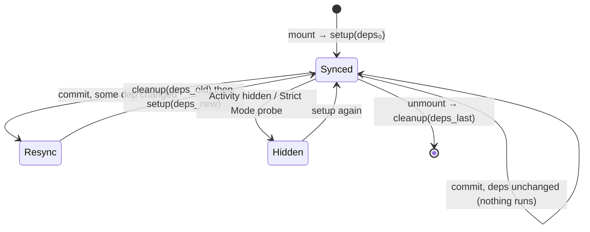

# 04 · Effects & Synchronization

> **Track:** `technologies/react` · **React:** 19.3.1 · **Proofs:** [`examples/04-effects/effects.test.tsx`](../examples/04-effects/effects.test.tsx)
>
> **Cross-links.** Where effects run relative to tasks, microtasks, `requestAnimationFrame` and paint is the HTML event loop, owned by [languages/javascript](../../../languages/javascript/README.md); the browser's style → layout → paint pipeline is owned by [languages/css](../../../languages/css/README.md). Typing effect callbacks, ref callbacks and `useEffectEvent` is in [TypeScript M12](../../../languages/typescript/modules/12-react-19-and-modern-react-typescript.md).

Rendering computes *what the UI should look like*. Effects are how a component **synchronises something outside React** — a subscription, a socket, a DOM measurement, a third-party widget, a timer — with what was rendered. This module gives a precise definition of an effect, the exact commit-time order of the three effect kinds and ref callbacks, the Strict Mode re-run (including the 19.3 hydration change), the React 19 ref-cleanup protocol, `useEffectEvent` (stable since 19.2), and the long list of cases where an effect is the wrong tool.

---

## 1. What an effect is

> **Definition 4.1 (Effect).** An effect is a pair $(\text{setup}, \text{deps})$ declared during render. After a commit in which the instance is mounted, or in which some $d_i \in \text{deps}$ changed by `Object.is`, React runs the previous setup's cleanup (if any) and then `setup()`. When the instance unmounts, React runs the last cleanup. With `deps` omitted, the effect re-synchronises after every commit; with `deps = []`, only on mount and unmount.

> **Definition 4.2 (Correct effect).** An effect is correct iff for every sequence of commits, the external system ends in the state that a *single* setup with the *current* deps would produce. Equivalently: **setup ∘ cleanup ∘ setup ≡ setup** (idempotence modulo cleanup).

Definition 4.2 is the whole design. Effects are not lifecycle hooks ("run on mount"), they are **synchronisation**: "keep the chat connection pointed at `roomId`". React may tear down and re-establish synchronisation whenever it likes — on dep change, in Strict Mode, when an `<Activity>` hides and shows a subtree (Module 05), on Fast Refresh — and a correct effect does not care.



Note the cleanup runs **with the values it closed over**, i.e. the old deps (test "on dependency change: old cleanup runs before the new setup, with the OLD values": `connect a → disconnect a → connect b`).

---

## 2. The three effect kinds and where they run

| Hook | Runs | Blocks paint | Use for |
|---|---|---|---|
| `useInsertionEffect` | Commit, **mutation** phase, before layout effects; refs not attached yet | Yes | CSS-in-JS libraries inserting `<style>` rules before anything measures layout. Not for app code; cannot schedule updates |
| `useLayoutEffect` | Commit, **layout** phase, after all DOM mutations and ref attachment, same task | Yes | Measuring layout (tooltips, popovers), synchronously correcting DOM before the user sees it |
| `useEffect` | **Passive** phase: usually a later task after paint; flushed synchronously before the next discrete update or when a layout effect/flushSync forces it | No | Everything else: subscriptions, network, timers, logging, non-React widgets |

### 2.1 Exact order — mount

The test "render (parent→child) · insertion · layout (child→parent) · passive (child→parent)" records a parent with one child:

```text
render parent → render child                      ▷ render phase, top-down
insertion child → insertion parent                ▷ mutation phase, completion order (bottom-up)
layout child → layout parent                      ▷ layout phase, bottom-up
passive child → passive parent                    ▷ passive phase, bottom-up
```

Bottom-up order is a guarantee: **when a parent's effect runs, all of its children's effects of the same kind have already run** — a parent can rely on its children's DOM, refs and subscriptions being in place.

### 2.2 Exact order — unmount

"unmount runs cleanups…" records:

```text
insertion-cleanup parent → layout-cleanup parent → insertion-cleanup child → layout-cleanup child   ▷ mutation phase, top-down per deleted subtree
passive-cleanup parent → passive-cleanup child                                                       ▷ passive phase
```

Deletion is processed top-down: React walks the deleted subtree from its root, running insertion and layout cleanups and detaching refs, removes the top host node once, and later runs passive cleanups in the same top-down order.

### 2.3 Layout effects and state updates

A `setState` inside `useLayoutEffect` triggers a **synchronous** re-render and commit before the browser paints, so the user never sees the intermediate frame (test "a layout effect sees committed DOM and its state update is applied before paint": the layout effect sees `measuring`, but only `w=9` is ever shown). That is the tooltip-positioning pattern. The cost: everything is synchronous and blocks the frame — a heavy layout effect directly hurts **Interaction to Next Paint (INP)**. Use `useEffect` unless you need to prevent a visible flicker.

On the server neither layout nor passive effects run. React 19 no longer prints the old "useLayoutEffect does nothing on the server" warning (test "no effect runs during SSR…"); the effect simply does not run, so content that depends on it must render a sensible fallback and correct itself on the client.

### 2.4 Passive effects and the next event

Passive effects are guaranteed to be flushed **before React processes the next discrete event's update** (test "passive effects are flushed before the next discrete update is processed": `effect 0` always precedes `click sees 0`). So an effect that subscribes cannot miss a click that the user made after seeing the frame. They are *not* guaranteed to run before the next paint, nor before an arbitrary `setTimeout`.

> **Then vs now (passive timing).** React 17 always deferred passive effects. React 18+ runs them **synchronously at the end of the commit** when the render was the result of a discrete input (click, keydown) — so results are visible in the same frame — and deferred otherwise. Code that relied on effects always being async (e.g. reading a value set by a `setTimeout(0)` scheduled in render) can behave differently.

---

## 3. Strict Mode: proving effects are idempotent

In development, `<StrictMode>` simulates an immediate unmount/remount on mount: **setup → cleanup → setup** for every effect (and every ref callback). This tests Definition 4.2 directly.

- Test "on client mount": `connect → disconnect → connect`.
- Test "on hydration too, since React 19.3": the same sequence for a tree attached with `hydrateRoot`. Before 19.3, hydrated roots skipped the double invoke, so effects that only ran correctly once could pass in an SSR app and fail in a client-rendered page ([react#35961](https://github.com/react/react/pull/35961)).
- Test "NEGATIVE: a non-idempotent effect (no cleanup) leaks a duplicate subscription": two listeners after mount. In production the same bug appears on every remount (route change, `<Activity>` toggle, key reset).

> **Then vs now (Strict Mode effects).** React ≤17 Strict Mode only double-rendered. React 18 added effect re-runs on client mount; 19.0 added ref callback re-runs; **19.3 extended it to hydration**. When upgrading to 19.3, SSR apps may see new duplicate-subscription bugs in development: they were always there.

**What to do when Strict Mode exposes a problem** — never "use a ref to run only once". Implement the cleanup:

| Effect | Cleanup |
|---|---|
| Subscribe/listen | Unsubscribe/remove listener |
| `setInterval`/`setTimeout` | `clearInterval`/`clearTimeout` |
| Fetch | Ignore the result (flag) and/or `AbortController.abort()` (§6) |
| Third-party widget `init()` | `destroy()` |
| Animation | Reset to initial state |
| Truly once-per-app (analytics init) | Do it outside React, at module level |

---

## 4. Refs and the React 19 cleanup protocol

A **ref callback** is called by React in the commit's layout phase with the DOM node (or class instance / `FragmentInstance`). React 19 adds a return value:

```tsx
<div ref={(node) => {
  const ro = new ResizeObserver(onResize);
  ro.observe(node);
  return () => ro.disconnect();      // React 19: cleanup instead of ref(null)
}} />
```

| | Then (≤18) | Now (19+) |
|---|---|---|
| Detach signal | `ref(null)` | The returned cleanup is called; `ref(null)` is **not** called if a cleanup was returned (tests "a ref callback may return a cleanup…" and "without a cleanup, the legacy protocol calls ref(null)") |
| Implicit returns | Ignored | TypeScript rejects `ref={el => (this.x = el)}` (the assignment returns a value) — React tells you to use braces |
| String refs | Deprecated | Removed |

**Identity matters.** React compares the ref prop like any other: an inline arrow is a new function every render, so React calls the old cleanup and the new callback on **every commit** (test "NEGATIVE: an inline ref callback is detached and re-attached on every render"). Usually harmless; expensive if the callback creates an observer. Memoise it with `useCallback` (test "a stable ref callback runs once") — or let the React Compiler do it (Module 09). Object refs (`useRef`) are assigned `ref.current = node` and `null`, no callbacks.

**Ref timing:** refs are detached in the mutation phase and attached in the layout phase, so layout effects already see `ref.current` set; event handlers always do.

---

## 5. Reactive vs non-reactive values: `useEffectEvent`

### 5.1 The problem

Every value read inside an effect that comes from render (props, state, derived values, functions defined in the component) is **reactive**: it can change between renders, so the linter (`react-hooks/exhaustive-deps`) requires it in the deps. Sometimes a value is read inside an effect but changing it should *not* re-synchronise:

```tsx
useEffect(() => {
  const c = connect(roomId);
  c.on("connected", () => showToast("Connected", theme)); // theme is read here…
  return () => c.disconnect();
}, [roomId, theme]); // …so changing the theme reconnects the chat. Wrong.
```

Omitting `theme` from deps gives a **stale closure** — the toast uses the theme from connect time (test "the stale-closure version it replaces").

### 5.2 The tool

[`useEffectEvent`](https://react.dev/reference/react/useEffectEvent) (stable since **React 19.2**; previously `experimental_useEffectEvent`) wraps a function so that:

1. it always calls the **latest** render's version of the function (reads current props/state);
2. its identity is irrelevant to deps — effect events are **not** dependencies, and current `eslint-plugin-react-hooks` (v6.1+, this track pins 7.1.1) knows that;
3. it may only be called from effects (or functions called by effects) — **calling it during render throws** *"A function wrapped in useEffectEvent can't be called during rendering"* (test "NEGATIVE: calling an effect event during render throws");
4. it must not be passed to other components or hooks (lint-enforced).

```tsx
const onConnected = useEffectEvent(() => showToast("Connected", theme));
useEffect(() => {
  const c = connect(roomId);
  c.on("connected", () => onConnected());
  return () => c.disconnect();
}, [roomId]); // ✅ complete
```

Test "reads the latest props without re-running the effect" changes `theme` after connecting; there is no reconnect and the event logs `dark`. In 19.3 a bug was fixed where effect events inside `memo`/`forwardRef` components could read stale values ([react#34831](https://github.com/react/react/pull/34831)).

### 5.3 When *not* to use it

`useEffectEvent` is **not a way to silence the dependency linter**. If a value change *should* re-synchronise (the room ID, the URL to fetch), it is reactive and must be a dependency. The 19.2 announcement is explicit: wrap only functions that are conceptually *events fired from an effect*. Wrapping `fetchData(url)` to drop `url` from deps reintroduces exactly the stale-data bug that deps prevent.

> **Then vs now.** Before 19.2 the options were: suppress the lint (bug-prone), store the latest callback in a ref updated in a layout effect (the "`useLatest`/`useEvent`" pattern, still seen in libraries), or accept the re-synchronisation. Migrate ref-based "latest callback" hooks to `useEffectEvent` where they are only called from effects; keep refs where the callback is passed to children or called in event handlers.

---

## 6. Data fetching in effects

Fetching in an effect is legitimate for client-only apps without a framework, but it has three structural problems:

1. **Races.** A response for an old request can arrive after the response for a newer one. Test "NEGATIVE: without a guard, a slow earlier response overwrites the newer one" ends showing `Alice` for `id=2`.
2. **Waterfalls.** A child's effect cannot start fetching until the parent has rendered and committed.
3. **No caching, dedupe, SSR or Suspense integration.**

The minimal correct pattern guards with the cleanup:

```tsx
useEffect(() => {
  let ignore = false;
  const ac = new AbortController();
  fetchUser(id, { signal: ac.signal }).then((u) => { if (!ignore) setUser(u); });
  return () => { ignore = true; ac.abort(); };
}, [id]);
```

Tests "the cleanup flag discards responses for a superseded request" and "AbortController in cleanup cancels the superseded request". The flag is what guarantees correctness; `abort()` additionally saves bandwidth and server work. (`AbortController` semantics belong to the JavaScript track.)

The better answers, in order: a framework loader or **Server Components** (Module 07), a server-cache library (TanStack Query, SWR), or `use(promise)` with a cached promise inside Suspense (Module 06). Each of them solves races, caching and waterfalls once.

---

## 7. You might not need an effect

An effect is for synchronising with an **external system**. If there is no external system, there should be no effect. The canonical list ([react.dev: You Might Not Need an Effect](https://react.dev/learn/you-might-not-need-an-effect)), with the reason each is wrong:

| Instead of an effect that… | Do | Why |
|---|---|---|
| derives state from props/state (`setFull(first + last)`) | Compute during render | Effect version commits twice and the first commit shows stale data (test "NEGATIVE: deriving state in an effect…": commits `""` then `"Ada Lovelace"`; the render version commits once) |
| caches an expensive derivation | `useMemo` (or let the Compiler) | No extra render |
| resets all state when a prop changes | `key` | Module 01 §6 |
| adjusts *some* state when a prop changes | Set state **during render**, guarded by a stored previous value | React restarts the component before rendering children and commits once (test "adjusting state when a prop changes…") — better still, derive it |
| reacts to a user event (submit, buy) | Do it in the event handler | You know *why* it happened there; an effect only knows *that* state changed (and runs again on remount) |
| notifies the parent of a change (`onChange(state)`) | Call `onChange` in the same handler that sets state, or lift state up | Avoids a render-commit-effect-render cascade |
| chains state updates (A changes → effect sets B → effect sets C) | Compute everything in the handler | Cascades multiply renders and can loop |
| initialises the app once | Module-level code or a guarded top-level call | Effects re-run in Strict Mode and on remount |
| subscribes to an external store | `useSyncExternalStore` (Module 03) | Tearing, missed updates |

The React Compiler-powered lint rules in `eslint-plugin-react-hooks@7` catch several of these statically: `set-state-in-effect` (synchronous `setState` in an effect body), `no-deriving-state-in-effects`, `set-state-in-render` (unconditional set-state loops). Module 09 runs them.

---

## 8. Effects and hidden UI (`<Activity>`)

When an [`<Activity mode="hidden">`](https://react.dev/reference/react/Activity) (19.2) hides a subtree, React **unmounts its effects** (runs cleanups, including layout effects and ref cleanups) but **keeps its state and DOM**; when it becomes visible again, effects re-run their setup. A correct effect (Def. 4.2) needs no change. An effect that assumed "setup runs once per component lifetime" breaks — which is exactly what Strict Mode's re-run was preparing code for. Module 05 covers `<Activity>` scheduling.

---

## 9. Production failure modes

| Symptom | Mechanism | Fix |
|---|---|---|
| Duplicate subscriptions / double network calls in dev | Strict Mode re-run exposes missing cleanup | Add cleanup; don't suppress Strict Mode |
| New duplicate-subscription warnings after upgrading to 19.3 in an SSR app | Strict Mode now double-invokes on hydration | Same: fix the cleanup |
| Wrong profile shown after fast navigation | Fetch race | Ignore flag + `AbortController`, or a data library |
| Chat reconnects on theme change | Non-reactive value listed as dep | `useEffectEvent` |
| Effect uses stale props | Deps omitted / lint suppressed | Add deps or use `useEffectEvent` |
| Flicker: element renders in wrong place then jumps | Measurement in `useEffect` | `useLayoutEffect` (accept the INP cost) |
| SSR output differs from first client paint for measured UI | Layout effects do not run on the server | Render a neutral fallback; measure on the client |
| Sluggish interactions (poor INP) | Heavy `useLayoutEffect` or `flushSync` work | Move to `useEffect`, split work, transitions (Module 05) |
| "Maximum update depth exceeded" | Effect sets state that changes its own deps every time (object/array dep re-created each render) | Compute in render; stabilise deps; Compiler |
| Observer created every render | Inline ref callback with cleanup | `useCallback` or the Compiler |
| Analytics "page view" fires twice in dev, once per remount in prod | Event logic in an effect | Fire from the navigation handler/router event |

---

## 10. Executable proofs

| Claim | Test (`effects.test.tsx`) |
|---|---|
| Phase order and bottom-up effect order; unmount order | "effect phases and ordering" (2 tests) |
| Cleanup-before-setup with old values | "on dependency change…" |
| Layout effect update before paint | "a layout effect sees committed DOM…" |
| Passive effects flushed before next discrete update | "passive effects are flushed…" |
| Strict Mode re-run on mount **and hydration (19.3)**; leak exposure | "Strict Mode re-runs…" (3 tests) |
| Ref cleanup protocol, inline vs stable callbacks | "ref callbacks and cleanup" (4 tests) |
| `useEffectEvent` semantics and render-time throw | "useEffectEvent" (3 tests) |
| Derived state in effects vs render; adjusting state during render | "you might not need an effect" (3 tests) |
| Fetch races, ignore flag, abort | "fetching in effects: races" (3 tests) |

---

## 11. Interview Drill

<details><summary><strong>1. <code>useEffect</code> vs <code>useLayoutEffect</code> vs an event handler: how do you choose?</strong></summary>

If the code runs because the user did something (submit, click), put it in the event handler. If it synchronises with an external system because of what was rendered, use `useEffect` (after paint, non-blocking). Use `useLayoutEffect` only when you must read layout and correct the DOM before the user sees the frame (positioning a tooltip); it blocks paint and hurts INP.
</details>

<details><summary><strong>2. In what order do effects of a parent and a child run on mount and on unmount?</strong></summary>

Mount: render parent→child; insertion, layout and passive effects each child→parent (completion order). Unmount: React walks the deleted subtree top-down, running insertion/layout cleanups (parent then child) in the mutation phase, then passive cleanups parent then child.
</details>

<details><summary><strong>3. Why does my effect run twice in development? Should I prevent it?</strong></summary>

Strict Mode mounts, unmounts and remounts to check that setup→cleanup→setup is equivalent to one setup. Don't prevent it with a ref flag; implement the cleanup so the effect is idempotent. Since 19.3 this also happens on hydration.
</details>

<details><summary><strong>4. What problem does <code>useEffectEvent</code> solve, and what is it not for?</strong></summary>

It lets an effect read the latest props/state inside a callback without making them dependencies — for logic that is an *event* fired from an effect (e.g. show a toast with the current theme when connected). It is not for removing genuinely reactive values (like the URL to fetch) from deps; that reintroduces stale data. It cannot be called during render or passed to other components.
</details>

<details><summary><strong>5. What changed about ref callbacks in React 19?</strong></summary>

They can return a cleanup function, which React calls on detach instead of calling the ref with `null`. Inline ref callbacks still detach/attach each render because their identity changes. String refs and `element.ref` were removed; function components receive `ref` as a prop.
</details>

<details><summary><strong>6. How do you prevent race conditions when fetching in an effect?</strong></summary>

Use a cleanup-scoped `ignore` flag so responses for superseded requests are dropped, and abort the request with `AbortController` in the cleanup. Better: move fetching to a framework loader, Server Components or a server-cache library that handles races, caching and dedupe.
</details>

<details><summary><strong>7. Name four situations where you should not use an effect.</strong></summary>

Deriving data from props/state (compute in render), resetting state on prop change (use a key), handling user events (use the handler), notifying a parent of a state change (do it in the handler/lift state), chaining state updates, and subscribing to external stores (use `useSyncExternalStore`).
</details>

<details><summary><strong>8. Why are passive effects flushed before the next click is processed?</strong></summary>

So that subscriptions and synchronisation set up for the frame the user saw are in place before the user's next interaction is handled; otherwise an event could see a world where the previous commit's effects never ran. React flushes pending passive effects before processing a new discrete update.
</details>

<details><summary><strong>9. What happens to effects inside <code>&lt;Activity mode="hidden"&gt;</code>?</strong></summary>

Their cleanups run when the subtree is hidden (state and DOM are preserved), and their setups run again when it becomes visible. Correct, idempotent effects need no changes.
</details>
