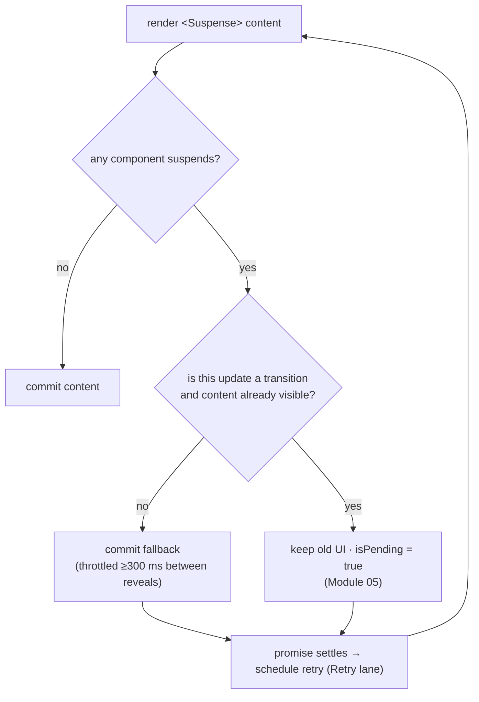

# 06 · Suspense, Streaming SSR & Hydration

> **Track:** `technologies/react` · **React:** 19.3.1 · **Proofs:** [`examples/06-suspense-ssr/suspense-ssr.test.tsx`](../examples/06-suspense-ssr/suspense-ssr.test.tsx), helper [`examples/_shared/ssr.ts`](../examples/_shared/ssr.ts)
>
> **Cross-links.** Promise and job-queue semantics are owned by [languages/javascript](../../../languages/javascript/README.md); Node streams and backpressure by [technologies/nodejs](../../nodejs/README.md); HTTP chunked transfer, HTTP/2 streams, compression and caching of streamed responses by [architecture/networking](../../../architecture/networking/README.md). Typing `use<T>(Usable<T>)` is in [TypeScript M12](../../../languages/typescript/modules/12-react-19-and-modern-react-typescript.md).

Suspense is React's answer to "what should the UI show while some of it is not ready?". It is one mechanism with three uses that this module treats together: **data and code loading on the client**, **streaming HTML from the server**, and **progressive hydration**. We define the suspension protocol (`use(promise)`), the reveal rules of boundaries, the HTML wire format of streaming SSR, hydration and its mismatch failure mode, partial pre-rendering (19.2) and the `browser()` opt-out (19.3).

---

## 1. The model

> **Definition 6.1 (Suspension).** During render, a component *suspends* when it needs a value that is not yet available. React abandons rendering of the subtree below the nearest enclosing `<Suspense>` boundary, renders that boundary's `fallback` instead, and **retries** the subtree when the awaited value becomes available.

> **Definition 6.2 (Boundary reveal).** A boundary reveals its content only when **every** component inside it (outside nested boundaries) can render. Nested boundaries reveal independently, outer before inner.

Both rules are tested: "siblings in one boundary reveal together (all-or-nothing per boundary)" and "nested boundaries reveal independently, outer first". Boundaries are therefore **the unit of loading UX**: place them where a placeholder makes visual sense, not around every component.



### 1.1 The "algebraic effects" analogy — and its limit

The original Suspense design was described as a poor man's **algebraic effect**: a component "performs" an effect (*I need this data*), the nearest handler (the boundary) intercepts it, and the computation is resumed later. The analogy explains the shape — a non-local exit to a handler — but React does **not** resume the suspended function from the point of suspension (JavaScript has no resumable continuations). It **re-runs the component from the top**. That is why render must be pure, and why the awaited promise must be the *same* promise on the retry.

Historically (React 16.6–18) the mechanism was "throw a promise". **Throwing promises from user code is not a supported API.** It still happens to work in some paths, but the documented API is `use(promise)` (React 19), Suspense-enabled libraries, `lazy`, and Server Components. Internally React now throws a private `SuspenseException` sentinel after recording the thenable, so code that catches "anything thrown" around `use` breaks (React warns when `use` is wrapped in `try/catch`).

---

## 2. `use(promise)`

### 2.1 The protocol

```text
USE(thenable)                                     ▷ simplified trackUsedThenable
  if thenable.status = "fulfilled" then return thenable.value
  if thenable.status = "rejected"  then throw thenable.reason
  if thenable.status is unset then
     thenable.status ← "pending"
     thenable.then(v ↦ (status ← "fulfilled", value ← v), e ↦ (status ← "rejected", reason ← e))
  record thenable at index i of this component's thenable list
  throw SuspenseException                         ▷ unwinds to the boundary; retry is scheduled on settle
```

React **annotates the promise object** with `status`/`value`/`reason`. On the retry, `use` finds `status = "fulfilled"` and returns synchronously. Libraries can pre-set those fields to skip suspending for cached data — test "an already-fulfilled promise with status metadata is read synchronously".

### 2.2 The promise must be cached

Because the component is re-run from the top, `use(fetch(url))` creates a **new** promise on every retry; each one starts pending and suspends again. Test "NEGATIVE: a promise created during render never settles the boundary" is stuck on the fallback forever. React logs *"A component was suspended by an uncached promise…"* when it can detect the swap during a synchronous replay.

Where cached promises come from:

| Source | Cache lifetime |
|---|---|
| Server Components: `await` directly in an async component, or `cache(fn)` (Module 07) | One server request |
| A promise created in a Server Component and passed as a prop to a Client Component | Serialized via Flight; stable on the client |
| A client data library (TanStack Query `useSuspenseQuery`, Relay, SWR) | Library cache, keyed |
| A module-level or context-held `Map<key, Promise>` you manage | Yours — remember eviction and errors |
| `lazy(() => import("./X"))` | Module registry |

### 2.3 `use` vs other hooks

- `use` can be called **conditionally and in loops** (it does not need a positional hook node for its value — Module 03 §2.3).
- It must still be called during render of a component or hook, not in an event handler.
- Do not wrap it in `try/catch`: a rejection is delivered to the nearest **error boundary** (Module 10). Test "a rejected promise throws to the nearest error boundary" shows the uncaught case.

### 2.4 19.3 warning: conditional `use` to "unblock"

A tempting anti-pattern reads data from a side cache when it is there and calls `use` only otherwise:

```tsx
const v = cache.get(key) ?? use(promise); // suspends once, then skips use() on the retry
```

It hides a race: the first render suspended on `promise` while the retry renders from a different source; nothing guarantees they agree. React 19.3 warns in DEV ([react#37104](https://github.com/react/react/pull/37104)): *"This library called use() to suspend in a previous render but did not call use() when it finished… https://react.dev/warnings/conditional-use-of-use"* — test "NEGATIVE (19.3 DEV warning)…". The check fires when React retries the same fiber (it cannot see every variant). Fix: always call `use` on the cached promise (a fulfilled promise returns synchronously anyway). The documented exception is `use(browser())` (§6), which is designed to be conditional.

### 2.5 Reveal throttling

To avoid "popcorn" UIs where content pops in every few milliseconds, React holds back a boundary's reveal so that consecutive reveals are at least `FALLBACK_THROTTLE_MS = 300 ms` apart (19.3.1 build). Since **19.2 the same batching applies to boundaries streamed from the server** (§3.4). Tests use `act()`, which flushes these timers.

---

## 3. Streaming server rendering

### 3.1 APIs

| API | Runtime | Waits for data? | Status in 19 |
|---|---|---|---|
| `renderToString` | any | **No** — suspended boundaries emit their fallback and are marked for client rendering | Legacy; no streaming |
| `renderToStaticMarkup` | any | No | For non-interactive HTML (emails) |
| `renderToPipeableStream` | Node streams | Streams | **Recommended on Node** |
| `renderToReadableStream` | Web streams (edge, Deno, Bun; Node since 19.2) | Streams | Recommended on edge runtimes |
| `prerender` / `prerenderToNodeStream` (`react-dom/static`) | Web / Node | **Yes**, waits for everything (or abort) | SSG and partial pre-rendering |
| `resume` / `resumeToPipeableStream` | Web / Node | Streams the postponed holes | 19.2 |
| `resumeAndPrerender` / `resumeAndPrerenderToNodeStream` | Web / Node | Completes postponed holes to static HTML | 19.2 |
| `renderToNodeStream` | Node | — | **Removed in 19** (deprecated since 18) |

Test "renderToString does not wait for data…" shows the legacy API emitting the fallback with a `<!--$!-->` client-render marker.

The 19.2 notes recommend **Node streams on Node**: they are faster there than Web streams, and Web streams do not compress by default, so a naïve `renderToReadableStream` → `Response` pipeline can lose compression.

### 3.2 The shell and the callbacks

The **shell** is everything outside any Suspense boundary plus the fallbacks of the outermost boundaries. `renderToPipeableStream(app, options)`:

| Callback | Fires when | Typical action |
|---|---|---|
| `onShellReady()` | Shell rendered | Set status 200 and headers, `pipe(res)` — streaming starts |
| `onShellError(err)` | An error outside every boundary | Send a static 500 page; nothing was streamed yet (test "NEGATIVE: an error outside any boundary fails the shell") |
| `onAllReady()` | Everything rendered, including all boundaries | For crawlers and SSG: wait for this instead of `onShellReady` |
| `onError(err, errorInfo)` | Any error, including inside boundaries | Log; **return a digest string** — it is embedded as `data-dgst` |
| `onBrowserBailout(err, info)` | A component requested browser rendering (19.3, §6) | Log |
| `abort(reason?)` | You call it (timeout) | Remaining boundaries are left to the client |

An error **inside** a boundary does not fail the shell: the boundary streams its fallback with a client-render marker and the client retries rendering it (test "an error in a boundary does not fail the shell…"). In development React includes the message and stacks (`data-msg`, `data-stck`, `data-cstck`); production builds emit only the digest you returned, so **never put secrets in error messages and do return a digest** to correlate client and server logs.

### 3.3 The wire format

What the streaming tests observe on the wire (19.3.1):

```html
<!-- Shell -->
<main><h1>title</h1>
  <!--$?--><template id="B:0"></template><i>loading</i><!--/$-->     ← pending boundary B:0 showing its fallback
</main>

<!-- Later chunk, when the data resolved -->
<div hidden id="S:0"><b>data</b></div>                               ← completed segment, hidden
<script>$RB=[];$RV=function(a){…};$RC=function(b,c){…};…("B:0","S:0")</script>   ← reveal runtime + instruction
```

| Marker | Meaning |
|---|---|
| `<!--$-->…<!--/$-->` | Completed boundary |
| `<!--$?-->` + `<template id="B:n">` | Pending boundary; the template is the anchor |
| `<!--$!-->` + `<template data-dgst …>` | Boundary errored or bailed out on the server → client renders it |
| `<div hidden id="S:n">` | Segment content waiting to be moved into its boundary |
| `$RC`, `$RV`, `$RB`, `$RT` | Inline runtime: complete boundary, reveal (batched), batch list, timestamp |

The inline script moves the segment's children into place and flips the comment to `$` — this happens **before React's JavaScript has loaded**, so users see content as soon as it streams, even if hydration is slow. These markers are internal and change between versions (the batched `$RV`/`$RB` functions are from 19.2); assert on behaviour, snapshot the format only with a pinned version.

### 3.4 Then vs now: SSR

| | Then | Now |
|---|---|---|
| ≤17 | `renderToString`/`renderToNodeStream`; `<Suspense>` **unsupported on the server** (threw) | — |
| 18 | `renderToPipeableStream`/`renderToReadableStream`: streaming with Suspense, selective hydration | — |
| 19.0 | `prerender` APIs; `renderToNodeStream` removed; resource hoisting (Module 11) | — |
| 19.2 | — | Partial pre-rendering (`resume*`); **batched reveals** of streamed boundaries (previously each streamed boundary replaced its fallback immediately); Web Streams on Node |
| 19.3 | — | `browser()` + `onBrowserBailout`; Strict Mode double-invokes effects during hydration (Module 04) |

Migration from `renderToString` + data prefetch to streaming: move data loading into the render tree (Server Components, Suspense-enabled loaders), wrap slow regions in boundaries, switch to `renderToPipeableStream` with `onShellReady`, and decide per route whether bots get `onAllReady`. Pitfall: middleware that buffers the whole response (compression proxies, some CDNs, `res.write` wrappers) silently turns streaming back into "wait for everything".

---

## 4. Hydration

### 4.1 What hydration is

> **Definition 6.3 (Hydration).** `hydrateRoot(container, element)` renders `element` on the client and, instead of creating DOM, **claims** the existing server-rendered nodes in document order, attaching fibers and event listeners to them. The client render must produce the same tree the server produced.

Test "matching server and client trees hydrate without re-creating DOM" checks that the `<button>` node after hydration is the *same object* the server HTML created, and that it is interactive.

### 4.2 Selective and progressive hydration

With streaming, hydration is per **boundary**:

- The shell hydrates first; each boundary hydrates when its HTML and code have arrived.
- If the user interacts with a not-yet-hydrated boundary, React raises that boundary's hydration to `SelectiveHydrationLane` (Module 05) and hydrates it **before** others; discrete events (clicks) that happened before hydration are **replayed** after it.
- A boundary waiting for a `lazy` component's code can stay dehydrated while the rest of the page is interactive.

### 4.3 Mismatches

If the client output differs from the server HTML, React cannot trust the DOM. Since 18 it **does not patch** individual differences: it throws away the server HTML of the nearest Suspense boundary (or the root) and **client-renders** it, reporting a recoverable error. Test "NEGATIVE: a text mismatch is reported to onRecoverableError and the tree is client-rendered" shows: `onRecoverableError` receives *"Hydration failed because the server rendered text didn't match the client"*, the `<p>` is a new node, and the client text wins. React 19 logs **one** error with a diff instead of many warnings.

Common causes and fixes:

| Cause | Fix |
|---|---|
| `Date.now()`, `new Date().toLocaleString()`, `Math.random()` in render | Pass the value from the server (prop/Flight); or render on the client after hydration; or `browser()` |
| `typeof window !== "undefined"` branches in render | Same render on both sides; branch in an effect or with `browser()` |
| Locale/time zone differences (`Intl` defaults differ) | Format with an explicit locale and time zone from the request |
| Generated IDs from a counter | `useId` |
| Invalid HTML nesting (`<p><div/></p>`, `<a>` in `<a>`) | The browser parser rewrites the server HTML, so the DOM no longer matches; fix the markup |
| Browser extensions injecting attributes | React 19 ignores many third-party additions in `<head>`/`<body>`; otherwise tolerate |
| A store whose server snapshot differs | `getServerSnapshot` must match the first client render (Module 03 §7.3) |

`suppressHydrationWarning` silences a mismatch in **one level** of text/attributes of one element, and React **keeps the server value** — test "suppressHydrationWarning silences a one-level text mismatch and keeps the server text" ends with `12:00`, not `12:01`. Use it for timestamps you will update after hydration anyway; it is not a fix for structural differences.

### 4.4 `useId`

`useId()` derives an ID from the component's **position in the tree** (the path of child indices), not from a counter, so the server and client compute the same value regardless of rendering order or which boundaries streamed first. Tests: "useId: stable across server and client" and "useId on a client-only root uses the _r_ prefix".

| Version | Format |
|---|---|
| 18.x – 19.0 | `:r0:` (server `:R…:`) |
| 19.1 | `«r0»` |
| **19.2+** | `_r_0_`; server-rendered IDs `_R_…_` |

Why it changed in 19.2: IDs must be valid in `view-transition-name` and XML 1.0 names (Module 11). **Pitfall:** snapshot tests and CSS/`querySelector` code that hard-coded `:r` IDs break on upgrade; never depend on the format, and use `identifierPrefix` (root option) to namespace multiple roots on one page.

---

## 5. Partial pre-rendering (PPR, 19.2)

PPR splits a page into a **static shell** generated at build time (served from a CDN) and **dynamic holes** filled per request:

```ts
// Build time / revalidation
const controller = new AbortController();
setTimeout(() => controller.abort(), budgetMs);                 // stop waiting for dynamic data
const { prelude, postponed } = await prerender(<App />, { signal: controller.signal });
await save(prelude, JSON.stringify(postponed));                  // postponed is serialisable state

// Request time
const stream = await resume(<App />, JSON.parse(postponedJson));  // or resumeToPipeableStream (Node)
// respond with: cached prelude bytes, then the resume stream
```

Test "the static shell is prerendered; the dynamic hole is filled by resume()": the prelude contains the static `<h1>` and the hole's fallback anchored at `B:0`; `postponed` survives a JSON round-trip; `resume` streams only the hole's segment (`S:0`) and reveal instructions, **not** the shell again.

Invariants you must uphold:

1. The tree passed to `resume` must render the **same shell** as the one prerendered (same structure up to the holes), or the instructions target the wrong anchors.
2. Whatever made a boundary dynamic at prerender time (aborting while it was pending) defines the holes; frameworks decide this per data source (e.g. Next.js "dynamic APIs").
3. Postponed state includes the ID prefix and form-ID counters (`resumableState`) so `useId` and form actions stay consistent across the two phases.

`resumeAndPrerender` turns postponed state into a complete static document — for incremental static regeneration.

---

## 6. `browser()`: opting out of SSR (19.3)

Some components cannot render on the server (they need `window`, layout, the user's time zone) or are not worth it. Before 19.3 the workarounds were `useEffect` + `useState(false)` "mounted" flags (an extra render and a layout shift after hydration, and a mismatch if done wrong) or framework-specific `dynamic(…, { ssr: false })`.

```tsx
import { use } from "react";
import { browser } from "react-dom";

function TimeZone() {
  use(browser("needs Intl in the user's browser"));  // reason: string | function, optional
  return <p>{Intl.DateTimeFormat().resolvedOptions().timeZone}</p>;
}
// <Suspense fallback={<i>tz…</i>}><TimeZone /></Suspense>
```

Semantics ([react.dev/reference/react-dom/browser](https://react.dev/reference/react-dom/browser)), all tested:

- On the **server**, `use(browser())` suspends permanently; the nearest boundary emits its fallback marked for client rendering. React reports it to **`onBrowserBailout(error, errorInfo)`**, not `onError`; `error.cause` is your reason; the reason is **not** serialised into the HTML.
- On the **client after hydration**, it does not suspend, and the boundary is client-rendered **without** a recoverable error (unlike a mismatch).
- It must be inside a `<Suspense>` boundary on the server, must be called from a Client Component, and may be called **conditionally** (`if (!initialData) use(browser())`).
- `abort(browser("timeout"))` (or `AbortController.abort(browser(...))`) aborts a server render so that all pending boundaries are client-rendered and reported to `onBrowserBailout` instead of `onError` — a clean way to cap server render time.

---

## 7. Production failure modes

| Symptom | Cause | Fix |
|---|---|---|
| Spinner forever | Promise created in render (uncached) | Cache the promise; use a library or RSC |
| Whole page flashes to a spinner on navigation | Update not in a transition; boundary too high | `startTransition`; more granular boundaries |
| "Popcorn" UI | Many tiny boundaries | Fewer, design-level boundaries; rely on reveal batching |
| Streaming "doesn't stream" | Buffering proxy/compression middleware; using `onAllReady` for users | Disable buffering; flush; `onShellReady` for browsers |
| 500 with a blank page | Error outside every boundary (`onShellError`) | Boundary around risky regions; static error page in `onShellError` |
| Server error messages visible in DEV HTML | DEV `data-msg` | Fine in dev; production shows only the digest — return one from `onError` |
| Hydration mismatch errors in production logs | Time, locale, random, `window` branches, invalid nesting | §4.3 table; `browser()` |
| Timestamp not updated after hydration | `suppressHydrationWarning` keeps the server value | Update in an effect, or render it client-only |
| IDs in tests/CSS broke after upgrade | `useId` format changed (19.1, 19.2) | Do not depend on it |
| Interaction ignored before page is interactive | Event before hydration in a boundary whose code is not loaded | Selective hydration replays discrete events; avoid huge single boundaries |
| New duplicate effects in dev after 19.3 | Strict Mode on hydration | Fix effect cleanup (Module 04) |

---

## 8. Executable proofs

| Claim | Test (`suspense-ssr.test.tsx`) |
|---|---|
| Cached promise suspends then reveals; status-tagged promises read synchronously | "use(promise)…" tests 1–2 |
| Uncached promise is stuck | "NEGATIVE: a promise created during render…" |
| Rejection goes to error handling | "a rejected promise throws…" |
| 19.3 conditional-`use` DEV warning | "NEGATIVE (19.3 DEV warning)…" |
| All-or-nothing per boundary; nested independent | "siblings…", "nested boundaries…" |
| Shell first, segment + reveal script later; boundary errors vs shell errors; renderToString | "streaming SSR…" (5 tests) |
| PPR prerender → JSON postponed → resume | "partial pre-rendering…" |
| Hydration adopts DOM; mismatch → recoverable error + client render; suppressHydrationWarning keeps server text; `useId` formats | "hydration" (5 tests) |
| `browser()` server bailout → `onBrowserBailout`, clean client render | "browser()…" (2 tests) |

---

## 9. Interview Drill

<details><summary><strong>1. How does Suspense work under the hood?</strong></summary>

A component calls `use(promise)`; if the promise is not fulfilled, React tags it with status fields, subscribes, and unwinds rendering to the nearest `<Suspense>` boundary by throwing an internal sentinel. The boundary commits its fallback (or, in a transition, React keeps the old UI). When the promise settles, React schedules a retry and re-renders the subtree from the top; `use` now returns the value synchronously. It resembles an algebraic effect but React re-executes rather than resumes.
</details>

<details><summary><strong>2. Why must the promise passed to <code>use</code> be cached?</strong></summary>

The component is re-run on retry; a promise created in render is a new pending promise every time, so the boundary never resolves. Promises must come from a cache that outlives renders: RSC (`await`/`cache`), a promise passed from a Server Component, a data library, or your own keyed cache.
</details>

<details><summary><strong>3. RSC vs SSR — what is the difference?</strong></summary>

SSR (`react-dom/server`) renders the whole tree — including Client Components — to HTML for a fast first paint, then the client hydrates everything. RSC renders Server Components on the server to a serialized tree (Flight) that the client reconciles; their code never ships. They compose: a framework renders RSC to Flight, then SSR renders that tree plus Client Components to HTML. Module 07.
</details>

<details><summary><strong>4. What are the shell, <code>onShellReady</code> and <code>onAllReady</code>?</strong></summary>

The shell is the HTML outside all Suspense boundaries plus outermost fallbacks. `onShellReady` fires when it is ready — start piping to browsers. `onAllReady` fires when every boundary has finished — use it for crawlers or static generation. Errors outside boundaries go to `onShellError`; errors inside boundaries go to `onError` and the boundary is client-rendered.
</details>

<details><summary><strong>5. What happens on a hydration mismatch in React 18/19?</strong></summary>

React discards the server HTML for the nearest Suspense boundary (or root), client-renders it, and reports a recoverable error (`onRecoverableError`), logging a single diff in 19. It does not patch individual nodes. `suppressHydrationWarning` silences one level and keeps the server value.
</details>

<details><summary><strong>6. Name five causes of hydration mismatches.</strong></summary>

Time (`Date.now`, `toLocaleString`), randomness, `typeof window` branches in render, locale/time-zone defaults, invalid HTML nesting rewritten by the parser, counter-based IDs instead of `useId`, external stores without a matching server snapshot, and browser extensions.
</details>

<details><summary><strong>7. What is selective hydration?</strong></summary>

With streaming, each Suspense boundary hydrates independently as its HTML and code arrive. If the user interacts with an unhydrated boundary, React hydrates it first at a higher priority and replays the discrete event afterwards.
</details>

<details><summary><strong>8. Explain partial pre-rendering in React 19.2.</strong></summary>

`prerender` with an abort signal produces a static `prelude` (cacheable at a CDN) plus serialisable `postponed` state describing unfinished holes. At request time, `resume`/`resumeToPipeableStream` renders only the holes and streams their segments and reveal instructions after the cached prelude. The resumed tree must match the prerendered shell.
</details>

<details><summary><strong>9. How do you render a component only in the browser in React 19.3 without a mismatch?</strong></summary>

Call `use(browser(reason))` inside it and wrap it in `<Suspense>`. The server emits the fallback and reports to `onBrowserBailout`; the client renders it after hydration without a recoverable error. Previously: a "mounted" state flag set in an effect, or framework `ssr: false`.
</details>

<details><summary><strong>10. Why did <code>useId</code> output change in 19.2, and what breaks?</strong></summary>

From `:r:`/`«r»` to `_r_`, so IDs are valid view-transition names and XML names. Anything that hard-coded the format — snapshots, CSS selectors, `querySelector` with escaped colons — breaks. Treat IDs as opaque.
</details>
