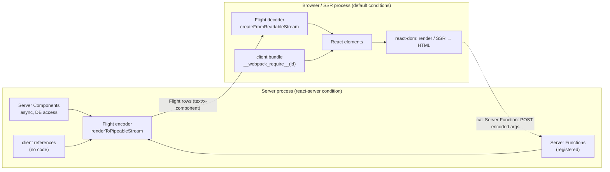

# 07 · Server Components & the Flight Protocol

> **Track:** `technologies/react` · **React:** 19.3.1 · **Proofs:** [`examples/07-rsc/rsc.test.tsx`](../examples/07-rsc/rsc.test.tsx) (client half), [`examples/07-rsc/server.ts`](../examples/07-rsc/server.ts) (server half, run with `--conditions react-server`), [`examples/07-rsc/flight.ts`](../examples/07-rsc/flight.ts)
>
> **Cross-links.** Export conditions and module resolution at runtime: [languages/javascript](../../../languages/javascript/README.md). `structuredClone`-style serialisation limits: languages/javascript. Authorization models, IDOR and OWASP classification: [architecture/security-identity](../../../architecture/security-identity/README.md). The type-level "serialisable props" constraint and typing `"use server"` arguments: [TypeScript M12](../../../languages/typescript/modules/12-react-19-and-modern-react-typescript.md). Framework specifics (Next.js App Router, React Router RSC mode, Waku, Parcel): cross-link only.

React Server Components (RSC) split one React tree across two environments. **Server Components** run only on the server (at build time or per request), can be `async`, read databases and files directly, and ship **no JavaScript** to the browser. **Client Components** are the components you know: they ship to the browser and use state and effects. The two halves communicate through **Flight**, a streaming serialisation of a React tree. This module builds RSC from its mechanics — two module graphs, references, the Flight rows — up to the security model, including the December 2025 remote-code-execution vulnerability (CVE-2025-55182) and the series of denial-of-service fixes that followed.

---

## 1. The model

> **Definition 7.1 (Two module graphs).** An RSC application is bundled twice. The **server graph** is resolved with the `react-server` export condition: in it, `react` resolves to a build without client hooks (`useState`, `useEffect` are absent) and `react-server-dom-*/server` provides the Flight encoder. The **client graph** is resolved normally. A module marked `"use client"` is a **boundary**: in the server graph its exports are replaced by **client references**; in the client graph they are the real components.

> **Definition 7.2 (Client reference).** An opaque value `{$$typeof: Symbol.for("react.client.reference"), $$id, …}` that stands for "export *name* of client module *id*". The server can pass it around and render it as an element type, but cannot call it.

> **Definition 7.3 (Server reference).** A function marked by `"use server"` and registered with an id. When serialised to the client it becomes a **reference**; calling it on the client sends an HTTP request with the encoded arguments to an endpoint that decodes them and calls the function. A Server Function is therefore an **RPC endpoint**.

The examples run exactly this without a bundler: [`server.ts`](../examples/07-rsc/server.ts) runs in a child process with `node --conditions react-server` (the server graph) and calls `registerClientReference`/`registerServerReference` by hand — what a bundler plugin generates for `"use client"`/`"use server"` modules — and the test file is the client graph, with a fake `__webpack_require__` serving the client "bundle".



### 1.1 Directives

| Directive | Placed | Means | Does **not** mean |
|---|---|---|---|
| `"use client"` | Top of a module | This module and everything it imports are client code; its exports become client references when imported from the server graph | "Render only on the client" — Client Components are still server-rendered to HTML by SSR |
| `"use server"` | Top of a module, or first statement of an async function | These async functions are Server Functions callable from the client | "This is a Server Component" — Server Components need no directive; they are the default in the server graph |
| `import "server-only"` | Any module | Build error if it ends up in the client graph | Runtime protection |

**Server Components are the default; `"use client"` marks the boundary.** Everything imported by a client module is client code, so the boundary should sit as low (as close to the interactive leaves) as possible.

### 1.2 RSC is not SSR

| | SSR (`react-dom/server`, Module 06) | RSC |
|---|---|---|
| Output | HTML | Flight (a serialised React tree) |
| Runs | All components, once per request, to produce the first paint | Only Server Components |
| Client then | Downloads JS for **all** components and hydrates | Downloads JS only for Client Components; Server Component output is data |
| Re-render | Not possible without reload | Server can re-render a subtree and stream new Flight (navigation, revalidation); client state is preserved by reconciliation |
| Can use state/effects | Client Components do (on the client) | Server Components cannot |

They compose: a framework renders RSC → Flight on the server, then feeds the Flight into SSR (`react-dom/server` running in the client graph) to produce HTML, and inlines the Flight payload into the HTML so the browser does not refetch it.

---

## 2. Server Components

```tsx
// No directive: a Server Component (server graph).
export default async function NotePage({ id }: { id: string }) {
  const note = await db.notes.find(id);                // direct data access, no API layer
  return (
    <article>
      <h1>{note.title}</h1>
      <Markdown source={note.body} />                   {/* heavy library: never shipped */}
      <LikeButton noteId={id} initialLikes={note.likes} /> {/* "use client" component */}
    </article>
  );
}
```

Rules:

1. **May be `async`** and `await` directly. Only Server Components can be async; an async Client Component is an error.
2. **No state, no effects, no event handlers, no browser APIs.** `useState`/`useEffect` do not exist in the server build of `react`.
3. **Can render Client Components** and pass them props — subject to serialisation (§4).
4. **Cannot be imported by Client Components.** A client module that imports a server module pulls it into the client graph (it becomes client code, or fails). Instead, pass server output **as props/children** to the client component:

```tsx
// Server Component
<ClientTabs>{/* rendered on the server, passed as children */}<ServerHeavyPanel /></ClientTabs>
```

The test "the client decodes rows into React elements…" shows the server-rendered `<b>server-rendered label</b>` passed as a `label` prop into the client `Counter` — the client receives a ready element, not code.

### 2.1 Then vs now: Context in Server Components (19.3)

Server Components can **read** no context (there is no client context on the server). Before 19.3 they also could not **provide** one, so a layout that loaded the current user needed a `"use client"` wrapper just to render `<UserContext.Provider>`. Since **19.3** a Server Component can render a context imported from a client module directly as a provider: `<UserContext value={user}>{children}</UserContext>`. Test "19.3: a Server Component renders a client Context as its provider" decodes the tree and renders `hello ada`. Server Components still cannot *create* contexts.

---

## 3. The Flight protocol

### 3.1 Rows

A Flight response is a stream of **rows**. Each row is `<id>:<tag?><payload>\n` where `id` is a hexadecimal chunk ID and the optional one-letter tag says how to interpret the payload. Rows can arrive out of order; later rows fill holes referenced by earlier ones. This is the production output of the `tree` scenario (`NODE_ENV=production`, 19.3.1):

```text
1:"client/counter.js"                 ← 19.3 outlines repeated strings into their own rows
2:I["$1",[],"Counter"]                ← I = import: client reference (module id, chunks, export name)
3:"$Sreact.suspense"                  ← a well-known Symbol
0:["$","main",null,{"children":[["$","h1",null,{"children":"RSC"}],
   ["$","$L2",null,{"start":3,"label":["$","b",null,{"children":"server-rendered label"}]}],
   ["$","$3",null,{"fallback":["$","i",null,{"children":"loading"}],"children":"$L4"}]]}]
4:["$","p",null,{"children":"loaded on the server"}]   ← the async component, streamed when it resolved
```

An element is encoded as the array `["$", type, key, props]`. String values starting with `$` are **references**:

| Encoding | Meaning |
|---|---|
| `"$1"` | Value of chunk 1 |
| `"$L2"` | **Lazy** reference to chunk 2 (a client component or a not-yet-resolved subtree) |
| `"$@5"` | A **Promise** resolved by chunk 5 |
| `"$S…"` | Symbol (`Symbol.for(…)`) |
| `"$D…"`, `"$n…"`, `"$Q…"`, `"$W…"` | Date, BigInt, Map, Set |
| `"$undefined"`, `"$NaN"`, `"$-0"`, `"$Infinity"`, `"$-Infinity"` | Values JSON cannot express |
| `"$h…"` | Server reference |
| `"$$…"` | A literal string that began with `$` (escaped) |
| `N:E{…}` | Error row (with `digest`) |
| `N:o3,<bytes>` | Binary row (typed array, length-prefixed) |
| `N:D…`, `N:J…` | DEV-only debug info (component names, timings, **source file paths**) |

> **Version-specific.** Row tags and encodings change between minors. 19.3 added string outlining/dedupe and other row types; DEV builds add `D`/`J` debug rows that include absolute source paths (another reason to never serve a DEV build). The tests assert on a few rows with a pinned version; do not parse Flight yourself in application code — use the decoder.

### 3.2 Streaming and Suspense across the wire

An async Server Component inside `<Suspense>` becomes a lazy hole (`"$L4"`) in the root row; its row (`4:…`) is written when it resolves. The client renders the fallback for the hole and suspends on the lazy reference until the row arrives — **Suspense works end to end**, and the HTML stream (Module 06) and the Flight stream share the same boundaries. Since 19.3 `<Activity>` is also supported in Flight.

### 3.3 What the client does

`createFromReadableStream`/`createFromFetch` (browser) or `createFromNodeStream` (SSR) parse rows into React elements. For each `I` row the client calls the bundler's runtime (`__webpack_require__(id)[name]`, loading `chunks` first) to get the real component. The result is a normal element tree (test: `isValidElement(tree)`) that the client renders and **reconciles** with what is on screen — which is how a server re-render (navigation, revalidation) can update the page without losing client state such as input text or open dropdowns.

---

## 4. Serialisation: what can cross

Props passed from Server to Client Components, and arguments/return values of Server Functions, must be serialisable by Flight (test "rich values survive the boundary…"):

| Supported | Not supported |
|---|---|
| Primitives incl. `undefined`, `NaN`, `-0`, `±Infinity`, `BigInt` | **Functions** (except Server Functions) — test "NEGATIVE: a plain function prop…" (*Event handlers cannot be passed to Client Component props*) |
| Plain objects, arrays, `Map`, `Set`, `Date` | **Class instances**, objects with null prototype — test "NEGATIVE: class instances…" (*Only plain objects, and a few built-ins…*) |
| Typed arrays, `ArrayBuffer`, `Blob`, `FormData` | Symbols not registered with `Symbol.for` |
| **Promises** (streamed; read with `use`) | Closures over server resources (DB connections, file handles) |
| React elements (JSX), client references, Server Functions | DOM nodes, Web streams in some directions (check the version) |
| Iterables/async iterables (version-dependent) | |

Observed details worth knowing: a property whose value is `undefined` arrives as `undefined` but the key is **absent** after decoding (19.3.1); repeated objects are deduplicated by reference; promises let you **start** data loading on the server and **finish** it on the client (`<Comments commentsPromise={getComments()} />` + `use(commentsPromise)` in a Client Component, without blocking the server render).

> **Security corollary.** Serialisation is also an *exposure* boundary: every prop you pass to a Client Component is sent to the browser, visible in the page source. Passing a whole `user` row from the database to a client avatar ships the password hash too. Select fields explicitly (a "DTO" per boundary). React's experimental `taintObjectReference`/`taintUniqueValue` APIs (canary/experimental channel only, not in 19.3 stable) aim to make such leaks throw.

---

## 5. Per-request caching: `cache` and `cacheSignal`

```tsx
import { cache, cacheSignal } from "react";

const getUser = cache(async (id: string) => {
  return db.users.find(id, { signal: cacheSignal() });   // abort when the render no longer needs it
});
```

- `cache(fn)` (Server Components only) memoises by arguments (by `Object.is` per argument) **for the duration of one server request**; two components calling `getUser("1")` share one call — test "cache dedupes within one request…" logs one `db hit`. It is not a cross-request cache; use your data layer or the framework cache for that.
- `cacheSignal()` (**19.2**) returns an `AbortSignal` for the current cache scope: aborted when the render **completes, is aborted, or fails**. Outside a render it returns `null` (tested: `outsideRenderIsNull: true`, `abortedAfterRender: true`). Pass it to `fetch`/DB drivers so abandoned work is cancelled.
- Call `cache` at **module level**: `cache()` inside a component creates a new cache per render (no sharing).

---

## 6. Server Functions (`"use server"`)

```tsx
// actions.ts
"use server";
export async function deleteNote(id: string) { … }

// A Client Component imports it (it becomes a reference) and calls it,
// or a Server Component passes it as a prop / form action.
<form action={deleteNote.bind(null, note.id)}>…</form>
```

On the wire the function is `{"id":"server/notes.js#deleteNote","bound":null}` referenced as `"$h…"` — an **ID, never code** (test "a Server Function crosses as a reference"). Calling it from the client POSTs the arguments encoded with `encodeReply`; the server's endpoint calls `decodeReply` (or `decodeAction` for progressive-enhancement form posts) and invokes the registered function. Module 08 covers the UI side (`useActionState`, `useOptimistic`, ordering).

### 6.1 The security model

> **A Server Function is a public, unauthenticated-by-default HTTP endpoint whose arguments are attacker-controlled.**

The UI deciding *when* the button is shown is irrelevant: anyone can POST any encoded arguments to the action ID (IDs are discoverable from the client bundle). The tests demonstrate this without any UI:

- "arguments are whatever the request body says": `encodeReply(["n2"])` → `decodeReply` → `["n2"]`.
- "NEGATIVE (IDOR): an action without an authorization check deletes another user's note": the session is Alice, the UI only lists Alice's notes, yet POSTing Bob's ID deletes it.
- "the action re-checks input and ownership on the server": validating the *type* (rejects `{ $ne: null }`) and the *ownership* stops both attacks.

Checklist for every Server Function:

1. **Authenticate** (read the session from cookies/headers on the server, never from arguments).
2. **Authorise** the specific object (ownership/permission check) — this is OWASP *Broken Access Control*.
3. **Validate** every argument's shape at runtime (a schema; typing it is [TS M11](../../../languages/typescript/README.md)). TypeScript types do not exist at runtime.
4. **Treat closed-over values as client-supplied** if they were bound on the client (`.bind(null, id)` arguments are serialised and sent back).
5. **Do not return secrets**; return values are serialised to the client like props.
6. **Rate-limit and size-limit** the endpoint (the 2026 DoS advisories below exploit decoding cost).
7. Frameworks add **CSRF** protections (e.g. Origin checks for POSTs); React itself does not authenticate requests.

---

## 7. CVE-2025-55182 and the 2025–2026 RSC advisories

### 7.1 What happened

On **2025-12-03** the React team disclosed **CVE-2025-55182**, CVSS **10.0**: *"an unauthenticated remote code execution vulnerability in React Server Components"*, caused by *"a flaw in how React decodes payloads sent to React Server Function endpoints"* ([react.dev advisory](https://react.dev/blog/2025/12/03/critical-security-vulnerability-in-react-server-components)). Key properties:

- **Affected:** `react-server-dom-webpack`, `react-server-dom-parcel`, `react-server-dom-turbopack` versions **19.0.0, 19.1.0, 19.1.1, 19.2.0**, and therefore every framework bundling them: Next.js (App Router), React Router RSC, Waku, `@parcel/rsc`, `@vitejs/plugin-rsc`, `rwsdk`.
- **No Server Functions required:** *"Even if your app does not implement any React Server Function endpoints it may still be vulnerable if your app supports React Server Components"* — the decoding endpoint exists whenever RSC is wired up.
- **Not affected:** apps without a React server, and apps without an RSC-capable framework/bundler (plain SPA, classic SSR without RSC).
- **Fixed in:** 19.0.1, 19.1.2, 19.2.1 (2025-12-03). Reported 2025-11-29 via Meta's bug bounty; fix rolled out with hosting providers before disclosure.

The root cause class is **unsafe deserialisation**: the reply decoder (the inverse of Flight, used for Server Function arguments) could be driven by a crafted payload into resolving references to objects and properties it should never reach, ultimately executing attacker-chosen code. That is the same class as Java deserialisation gadgets or Python `pickle`: a *rich* serialisation format with references is a powerful attack surface when it parses **untrusted input**.

### 7.2 The follow-up advisories

Hardening the decoder surfaced more issues. All are in the same three packages and are fixed per release line:

| CVE | Published | Type | CVSS | Fixed in (19.0 / 19.1 / 19.2) |
|---|---|---|---|---|
| CVE-2025-55182 | 2025-12-03 | **RCE** via Server Function payload decoding | 10.0 | 19.0.1 / 19.1.2 / 19.2.1 |
| CVE-2025-55184 | 2025-12-11 | DoS: infinite loop on deserialisation | 7.5 | 19.0.2 / 19.1.3 / 19.2.2 (incomplete) |
| CVE-2025-55183 | 2025-12-11 | Source code exposure: a Server Function's source returned via stringification | 5.3 | 19.0.2 / 19.1.3 / 19.2.2 |
| CVE-2025-67779 | 2025-12-11/12 | DoS: incomplete fix of 55184 | 7.5 | 19.0.3 / 19.1.4 / 19.2.3 |
| CVE-2026-23864 | 2026-01-26 | DoS: crashes, OOM, CPU | 7.5 | 19.0.4 / 19.1.5 / 19.2.4 |
| CVE-2026-23869 | 2026-04-08 | DoS: CPU for up to a minute | 7.5 | 19.0.5 / 19.1.6 / 19.2.5 (unverified, inferred from affected ranges) |
| CVE-2026-23870 | 2026-05 (unverified) | DoS: OOM / CPU | 7.5 | 19.0.6 / 19.1.7 / 19.2.6 (unverified) |
| CVE-2026-44907 | 2026-07 (unverified) | DoS: OOM / CPU | 7.5 | 19.0.8 / 19.1.9 / 19.2.8 (unverified) |

Sources: the [12-11 React follow-up post](https://react.dev/blog/2025/12/11/denial-of-service-and-source-code-exposure-in-react-server-components) (55183/55184/67779/23864), GitLab and OSV advisory databases for the 2026 IDs. 19.3.0 (2026-09-09) was released after all of them. The 2026-10-14 releases (19.3.1 and 19.0.9/19.1.10/19.2.9 on the same day) had no published advisory at the time of verification (2026-10-29) *(unverified whether they contain security fixes)* — take the latest patch of your line regardless.

The source-exposure CVE is instructive: *"Only secrets in source code may be exposed"*, i.e. hard-coded keys in Server Function bodies; runtime `process.env` values were not. Never hard-code secrets, even in server-only code.

### 7.3 Then vs now: running RSC in production

| | Then (pre-patch RSC setups, 19.0.0–19.2.0, until December 2025) | Now |
|---|---|---|
| Version policy | `react-server-dom-*` pinned implicitly by the framework; teams upgraded React by minors only | Patch-level hygiene: subscribe to React/framework advisories; take every patch of your release line; Dependabot/Renovate on `react-server-dom-*` and the framework |
| Threat model | "Server Functions are internal functions with nice ergonomics" | Server Functions and the RSC endpoint are **public deserialisation endpoints**: authN/authZ/validation in every function, request size limits and rate limits at the edge |
| Exposure | RSC endpoint reachable even if the app defines no Server Functions | Same — so *every* RSC app must patch, not only those using actions |
| Defence in depth | — | Hosting-provider WAF rules can reduce exposure (the advisory mentions coordinating with hosting providers), but **only patching fixes it** |
| Version check in CI | — | A gate test like "the installed react-server-dom-webpack is at or above the patched floor" |

**Migration steps** for an existing RSC app:

1. Identify which `react-server-dom-*` your framework uses (`npm ls react-server-dom-webpack react-server-dom-turbopack react-server-dom-parcel`; Next.js vendors its own copy, so upgrade `next` itself to the patched release for your line).
2. Upgrade `react`, `react-dom` and `react-server-dom-*` **together to the same exact version** (Module 01 §7.3); for Next.js upgrade to the patched `next` for your minor.
3. Redeploy; rotate secrets that were hard-coded in Server Function source (CVE-2025-55183).
4. Add the CI version gate and a dependency-update bot; review every Server Function against §6.1.

**Pitfall when mixing:** in monorepos with React Native or multiple apps, upgrade only the `react-server-dom-*` packages where `react`/`react-dom` must stay put — but then they must still match `react` exactly, or the decoder throws at runtime. The React advisory explicitly recommends updating only the impacted packages in React Native monorepos.

The version-gate tests ("the version gate itself…", "the installed react-server-dom-webpack is at or above the patched floor") encode the table above and also assert that `react`, `react-dom` and `react-server-dom-webpack` are the same version.

---

## 8. Production failure modes

| Symptom | Cause | Fix |
|---|---|---|
| "Event handlers cannot be passed to Client Component props" | Passing a function from a Server Component | Move the handler into a Client Component, or pass a Server Function |
| "Only plain objects… can be passed to Client Components" | Passing class instances (ORM entities, `Decimal`, `URL`) | Map to plain DTOs |
| `useState is not a function` / "… only works in Client Components" | Hook used in a server-graph module | Add `"use client"` to the interactive component |
| Client bundle suddenly huge | `"use client"` too high (a layout) pulls everything into the client graph | Push the boundary to leaves; pass server content as `children` |
| Secrets in page source | Whole DB rows passed as props; secrets in Server Function return values | Explicit field selection; `server-only` imports |
| Data deleted by an unauthorised user | Server Function trusts arguments (IDOR) | §6.1 checklist |
| Server CPU/memory spikes from small requests | Unpatched RSC decoder DoS | Patch to the floor in §7.2; size limits; rate limits |
| Duplicate DB queries per request | No `cache()` around data access, or `cache()` created inside components | Module-level `cache` |
| Work continues after the client navigated away | No cancellation | Pass `cacheSignal()` to fetch/DB |
| "Incompatible React versions" at runtime | `react-server-dom-*` and `react` differ | Same exact versions |

---

## 9. Executable proofs

| Claim | Test (`rsc.test.tsx`) |
|---|---|
| Flight rows: `I` client refs, symbols, lazy holes, late rows; server code not shipped | "a server tree streams as rows…" |
| Client decodes to elements and resolves client components from its own bundle | "the client decodes rows…" |
| Rich serialisation incl. Promise; undefined-key behaviour | "rich values survive the boundary…" |
| Functions and class instances rejected | two `NEGATIVE` tests |
| Server Functions are references | "a Server Function crosses as a reference…" |
| 19.3 Context provider from a Server Component | "19.3: a Server Component renders a client Context…" |
| `cache` dedupe and `cacheSignal` lifecycle | "cache dedupes within one request…" |
| Server Functions are public endpoints; IDOR; fix | "Server Functions are public endpoints" (3 tests) |
| Patched-version gate for CVE-2025-55182 and follow-ups; version lockstep | "security patch level…" (2 tests) |

---

## 10. Interview Drill

<details><summary><strong>1. What is a React Server Component and what can't it do?</strong></summary>

A component that runs only in the server module graph (build time or per request), can be async and access server resources directly, and ships no JavaScript; its output is serialised as Flight. It cannot use state, effects, event handlers, browser APIs or context consumption, and Client Components cannot import it (it must be passed as props/children).
</details>

<details><summary><strong>2. What does <code>"use client"</code> actually do?</strong></summary>

It marks a module boundary between the server and client graphs. When imported from the server graph, the module's exports become client references (id + export name); the bundler puts the module and everything it imports into the client bundle. Client Components are still server-rendered to HTML by SSR; the directive is about module graphs, not "client-only rendering".
</details>

<details><summary><strong>3. Explain RSC vs SSR.</strong></summary>

SSR renders the full tree to HTML for first paint and then hydrates all components on the client. RSC renders only Server Components to a serialised tree (Flight) whose code never ships; it can re-render on the server later and the client reconciles the new tree while preserving client state. Frameworks combine them: RSC → Flight → SSR → HTML plus inlined Flight.
</details>

<details><summary><strong>4. What is in a Flight row?</strong></summary>

`id:tag?payload` lines: element arrays `["$", type, key, props]`, `I` rows for client module references, string references like `$L` (lazy), `$@` (promise), `$S` (symbol), `$D`/`$n`/`$Q`/`$W` for Date/BigInt/Map/Set, `$h` for server references, `E` error rows with digests, binary rows, and DEV-only debug rows. Rows stream out of order and fill holes; the format is version-specific.
</details>

<details><summary><strong>5. What can you pass from a Server Component to a Client Component?</strong></summary>

Serialisable values: primitives (including undefined, NaN, BigInt), plain objects/arrays, Map, Set, Date, typed arrays, FormData, promises, JSX, client references and Server Functions. Not plain functions, class instances, or non-registered symbols. Everything passed is visible to the client.
</details>

<details><summary><strong>6. Why are Server Functions a security risk and what must every one do?</strong></summary>

They are public HTTP endpoints with attacker-controlled arguments; hiding a button prevents nothing. Each must authenticate from the server-side session, authorise the specific resource, validate arguments at runtime, avoid returning secrets, and be rate/size limited. Bound arguments travel through the client and are untrusted too.
</details>

<details><summary><strong>7. Describe CVE-2025-55182 and how you would respond.</strong></summary>

A CVSS 10 unauthenticated RCE in the RSC reply decoder (`react-server-dom-*` 19.0.0–19.2.0), reachable in any RSC app even without Server Functions; fixed in 19.0.1/19.1.2/19.2.1, with follow-up DoS and source-exposure fixes through 2026 (current floors 19.0.8/19.1.9/19.2.8, or any 19.3). Response: upgrade the framework/`react-server-dom-*` in lockstep with react, redeploy, rotate secrets hard-coded in server functions, add a CI version gate and update bot, and treat the endpoint as untrusted input.
</details>

<details><summary><strong>8. How do <code>cache</code> and <code>cacheSignal</code> work?</strong></summary>

`cache(fn)` memoises by arguments within one server request, deduplicating calls across components; it must be created at module level. `cacheSignal()` returns an AbortSignal that aborts when the render completes, is aborted or fails, so in-flight work can be cancelled; it is `null` outside a render. Both are Server Component APIs.
</details>

<details><summary><strong>9. Your Client Component needs data that is slow to load. How do you avoid blocking the Server Component?</strong></summary>

Start the fetch in the Server Component without awaiting it and pass the promise as a prop; Flight streams it (`$@`), and the Client Component reads it with `use(promise)` inside a Suspense boundary. The server render and the HTML shell are not blocked.
</details>
