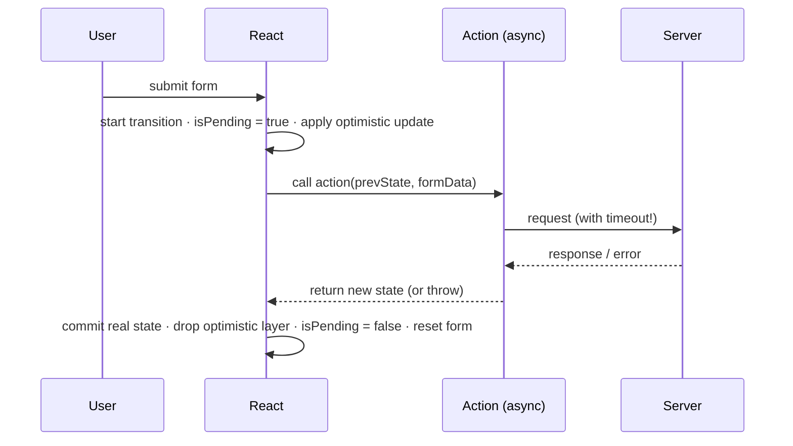

# 08 · Actions, Forms & Optimistic UI

> **Track:** `technologies/react` · **React:** 19.3.1 · **Proofs:** [`examples/08-actions/actions.test.tsx`](../examples/08-actions/actions.test.tsx), [`examples/08-actions/hung-action.test.tsx`](../examples/08-actions/hung-action.test.tsx)
>
> **Cross-links.** Server Functions and their security model: [Module 07 §6](07-server-components-and-flight.md). Typing `useActionState<State, Payload>`, `useOptimistic<State, Action>` and form events: [TypeScript M12](../../../languages/typescript/modules/12-react-19-and-modern-react-typescript.md). Runtime validation schemas (Standard Schema/Zod): [TypeScript M11](../../../languages/typescript/README.md). HTML form submission semantics (`FormData`, `submitter`): [languages/javascript](../../../languages/javascript/README.md).

React 19 turned "mutate something, show progress, handle the result" into a first-class concept: the **Action**. An Action is an async function run inside a transition; React tracks its pending state, orders its results, integrates it with `<form>`, and lets you show **optimistic** UI that is automatically reconciled when the Action settles. This module defines Actions precisely, then covers `<form action>`, `useFormStatus`, `useActionState`, `useOptimistic`, ordering and races, error handling, and progressive enhancement.

---

## 1. The model

> **Definition 8.1 (Action).** An Action is a function (sync or async) passed to `startTransition`/`useTransition`, to a `<form action>`/`<button formAction>`, or wrapped by `useActionState`. While its returned promise is pending, the transition is pending; state updates it schedules (synchronously, or re-wrapped after `await`) are committed as part of a transition.

> **Definition 8.2 (Action scope).** While at least one async Action is pending, React keeps an **entangled action lane**: transitions started during that time join the same lane and commit when the scope settles. (Module 05 §3.3.)

Consequences:

| Property | Where tested |
|---|---|
| `isPending` stays true across `await` | "useTransition with an async function keeps isPending true across the await" |
| Actions dispatched to the same `useActionState` run **sequentially**, each receiving the previous result | "[state, dispatch, isPending]; calls are queued…" |
| Optimistic state lives exactly as long as the Action | `useOptimistic` tests |
| A **never-settling** Action keeps its optimistic state **and** holds back every later transition | `hung-action.test.tsx` |

The last row is the production failure mode to remember. Observed on 19.3.1: after an async Action that never resolves, an unrelated `startTransition(() => setOther("new"))` does not commit; urgent updates still do. Untangled transitions (19.3, Module 05) do not help here, because the hold-back comes from the action scope, not from lane grouping. **Every network call inside an Action needs a timeout** (`AbortSignal.timeout(ms)`).



---

## 2. Forms

### 2.1 `<form action={fn}>`

In React 19 `<form action>` (and `<button formAction>`, `<input type="submit" formAction>`) accepts a **function**. On submit React prevents the browser navigation, builds `FormData` (including the submitter's name/value — 19.3 also passes `submitter` through on the `submit` event), and calls the function inside a transition.

After a **successful** action, React **resets** the form's uncontrolled fields to their default values — the test "the action receives FormData…" ends with the input back at `initial`. Since **19.3** the form's `onReset` handler fires for this automatic reset ([react#35176](https://github.com/react/react/pull/35176)). If you need to keep the values (e.g. on a validation error), return them in state and render them as `defaultValue`, or use controlled inputs. To reset imperatively (outside a form action) call `requestFormReset(form)` from `react-dom` inside a transition (test "requestFormReset…").

### 2.2 `useFormStatus`

```tsx
function SubmitButton() {
  const { pending, data, method, action } = useFormStatus();
  return <button disabled={pending}>{pending ? `Saving ${data?.get("title")}…` : "Save"}</button>;
}
```

It reads the status of the **parent `<form>`**, like a context provided by the form. It must be rendered **inside** the form, in a child component; called in the component that renders the form, or anywhere outside it, it always reports `pending: false` — test "NEGATIVE: useFormStatus outside the <form>…". (19.3 fixed form status being reset by unrelated component state updates.)

### 2.3 Progressive enhancement and SSR

Server-rendered HTML cannot contain a JavaScript function, so for a client function action `react-dom/server` emits a placeholder `action="javascript:throw new Error('React form unexpectedly submitted.')"` plus a tiny inline script that **queues submissions made before hydration** (`$$reactFormReplay`) and replays them once React has hydrated — test "SSR: function actions render a throwing javascript: placeholder plus a replay script".

With **Server Functions** (Module 07) the story is better: the framework renders a real `action` URL plus hidden fields identifying the Server Function, so the form **works without JavaScript**. On the server, `decodeAction`/`decodeFormState` reconstruct the call and the `useActionState` state, and the third argument of `useActionState(fn, initial, permalink)` gives the URL to navigate to when JavaScript has not loaded. This is real progressive enhancement: the same form works as a plain HTML POST, and as an Action once hydrated.

---

## 3. `useActionState`

```tsx
const [state, dispatch, isPending] = useActionState(
  async (previousState: State, payload: Payload) => nextState,
  initialState,
  permalink?,   // RSC/progressive enhancement only
);
```

Semantics, all tested:

1. **Reducer-like signature.** The action receives the previous state first, then the payload (`FormData` when used as a form action — test "as a form action: the first argument is the previous state…").
2. **Sequential queue.** Calls to `dispatch` are **queued**; the next starts only when the previous settles, and receives its result. Two dispatches `"a"`, `"b"` produce calls `prev="" item=a` then `prev="a" item=b` and final state `"ab"`. Ordering is therefore guaranteed for one `useActionState` — unlike independent async handlers (§5).
3. **Must run in a transition.** `dispatch` called outside `startTransition` and outside an `action`/`formAction` prop works but warns *"An async function with useActionState was called outside of a transition…"*, and `isPending` is wrong — test "NEGATIVE: dispatching outside a transition…".
4. **Errors.** If the action throws, the error is rethrown when the component renders, so the nearest **error boundary** handles it (test "an action that throws inside useActionState is rethrown during render, to the error boundary"); queued actions after it are cancelled. For *expected* failures (validation, 409 conflicts) **return** an error state instead of throwing.

> **Then vs now.** React 18 canaries called it `useFormState` (from `react-dom`). React 19 renamed it to `useActionState`, moved it to `react`, and added `isPending`. 19.3 changed the error messages to say "action state" instead of "form state". Migration: rename the import; the signature is unchanged apart from the third tuple element.

---

## 4. `useOptimistic`

```tsx
const [optimisticTodos, addOptimistic] = useOptimistic(
  todos,                                         // the real state ("passthrough")
  (current, newTodo) => [...current, { ...newTodo, pending: true }],  // pure reducer
);
```

> **Definition 8.3.** `useOptimistic(value, reducer)` returns `value` when no Action is pending. During an Action, calls to `addOptimistic(x)` push `x` onto an **optimistic layer** that is applied on top of the *current* `value` with the reducer at every render. When the Action (transition) that added an entry settles, the entry is **discarded**, and the UI shows whatever the real `value` is then.

So there is no explicit "rollback" API: rollback is the absence of a real update. Tests:

| Scenario | Result |
|---|---|
| Success: the Action updates the real state (in a transition) before settling | `ab (saving)` → `ab` |
| Failure: the Action catches the error and does not update real state | `ab (saving)` → `a` ("on failure the optimistic entry is rolled back automatically") |
| Hang: the request never settles | `ab (saving)` forever (`hung-action.test.tsx`) |
| `addOptimistic` outside a transition/Action | Warns *"An optimistic state update occurred outside a transition or action"* and is not shown |

Design rules:

- The reducer must be **pure**; it is re-applied on every render while the Action is pending, on top of the latest real value (so concurrent real updates are rebased under the optimistic layer — the same idea as Module 03 §3.3).
- Mark optimistic entries visibly (`pending: true`, dimmed) — users should know it is not saved.
- Every request in the Action needs a **timeout**; otherwise a stuck request is a permanent lie and blocks later transitions (§1).
- Reconcile with the server's answer, not with your guess: the server may have normalised or rejected the data.

---

## 5. Ordering and races

Async functions resolve in **completion order**, not call order. Without coordination, a slow early request overwrites a fast later one — test "NEGATIVE: independent async handlers resolve out of order and the stale response wins" ends with `results for re` after the user typed `react`.

| Technique | Guarantees | Test / where |
|---|---|---|
| `useActionState` | Calls are serialised; each sees the previous result | §3 |
| Sequence number (`if (mine === seq.current)`) | Only the latest request's result is applied | "a sequence number (or AbortController) discards superseded responses" |
| `AbortController` per request | Older requests are cancelled (saves work) — combine with the sequence check | Module 04 §6 |
| Server-side idempotency key | Retries/double submits do not duplicate effects | [architecture/distributed-systems](../../../architecture/distributed-systems/README.md) |
| Data library mutations (TanStack Query) | Cancellation, invalidation, retries | — |

Disable double submits with `useFormStatus().pending`, but do not rely on it alone: the server must be idempotent anyway (network retries, two tabs, attackers).

---

## 6. Then vs now: mutations in React

| | Then (≤18) | Now (19+) |
|---|---|---|
| Submit | `onSubmit={e => { e.preventDefault(); … }}` | `<form action={fn}>` |
| Pending | `const [loading, setLoading] = useState(false)` set before/after `await` | `isPending` from `useTransition`/`useActionState`, `useFormStatus().pending` |
| Ordering | Manual (often missing) | `useActionState` queue |
| Optimistic UI | Manual copy of state + manual rollback in `catch` | `useOptimistic` (automatic discard) |
| Form reset | Manual `form.reset()` / controlled state reset | Automatic after success; `requestFormReset`; `onReset` fires (19.3) |
| Server mutations | API route + `fetch` + client state sync | Server Function (RSC frameworks), with the same security obligations as an API route |
| Without JS | Only with a separate non-JS code path | Progressive enhancement through Server Function form actions |

**Migration steps:** replace `onSubmit` + loading flags with a form action and `useFormStatus`; move multi-step mutation state into `useActionState`; replace manual optimistic copies with `useOptimistic`; add timeouts to every request; keep server-side validation and authorisation (Module 07 §6.1). **Pitfalls when mixing:** controlled inputs are *not* reset automatically; state set after an `await` inside an Action must be wrapped in `startTransition` again.

---

## 7. Production failure modes

| Symptom | Cause | Fix |
|---|---|---|
| Spinner never stops; later navigations "do nothing" | Action awaiting a request with no timeout (action scope never settles) | `AbortSignal.timeout`, error state |
| Optimistic item stays forever | Same | Same |
| Results flicker back to older query | Out-of-order async responses | `useActionState`, sequence numbers, abort |
| `isPending` never true | `dispatch` called outside a transition | Pass it to `action`/`formAction`, or wrap in `startTransition` |
| Submit button never shows pending | `useFormStatus` called in the component that renders `<form>` | Move it into a child component inside the form |
| Inputs cleared after a validation error | Automatic reset after a *successful* action (you returned an error *as success*) | Return submitted values in state and render as `defaultValue`, or use controlled inputs |
| Double orders on double click | No idempotency | Disable while pending **and** server idempotency key |
| Error page instead of inline message | Expected errors thrown from `useActionState` action | Return error state; throw only unexpected errors |
| Data leak / IDOR through a form action | Server Function trusts form fields | Module 07 §6.1 |

---

## 8. Executable proofs

| Claim | Test |
|---|---|
| `FormData`, `useFormStatus`, automatic reset and 19.3 `onReset` | "the action receives FormData…" |
| `useFormStatus` scope | "NEGATIVE: useFormStatus outside the <form>…" |
| `requestFormReset` | "requestFormReset resets a form…" |
| SSR placeholder and pre-hydration replay | "SSR: function actions render…" |
| `useActionState` queue, warning, FormData signature, error → boundary | "useActionState" (3) and "errors in actions" |
| `useOptimistic` success, rollback, misuse | "useOptimistic" (3) |
| Hung action keeps optimistic state and blocks later transitions | `hung-action.test.tsx` |
| Out-of-order responses and the sequence fix; async `useTransition` | "ordering and races" (3) |

---

## 9. Interview Drill

<details><summary><strong>1. What is an Action in React 19?</strong></summary>

An (often async) function run inside a transition — via `startTransition`/`useTransition`, a form `action`/`formAction`, or `useActionState`. React tracks it as pending until its promise settles, commits its state updates as a transition, integrates with forms (FormData, pending status, reset), and coordinates optimistic state.
</details>

<details><summary><strong>2. Why might <code>useFormStatus</code> always return <code>pending: false</code>?</strong></summary>

It reads the status of the parent `<form>`; it must be called in a component rendered inside the form. Calling it in the component that renders the `<form>` (or outside) has no parent form, so it is never pending.
</details>

<details><summary><strong>3. How does <code>useActionState</code> handle two quick submissions?</strong></summary>

It queues them: the second call starts after the first settles and receives the first result as `previousState`. This prevents out-of-order overwrites for that piece of state.
</details>

<details><summary><strong>4. How does <code>useOptimistic</code> roll back on failure?</strong></summary>

It doesn't roll back explicitly: optimistic entries exist only while the Action that added them is pending. When it settles, the layer is dropped and the real state is shown. If the action failed and did not update real state, the UI returns to the previous value. If it never settles, the optimistic value stays.
</details>

<details><summary><strong>5. What happens if an async action's request hangs?</strong></summary>

The transition stays pending: `isPending` stays true, optimistic state stays visible, and (observed in 19.3.1) later transitions are entangled with the pending action scope and do not commit; urgent updates still work. Always add timeouts and turn them into error states.
</details>

<details><summary><strong>6. How do forms with Server Functions work without JavaScript?</strong></summary>

The server renders the form with a real action endpoint and hidden fields identifying the Server Function; a plain POST is decoded with `decodeAction`/`decodeFormState`, the function runs, and the response renders the new state. After hydration the same form submits as an Action without navigation. A client-function action, by contrast, renders a throwing `javascript:` placeholder and only replays submissions after hydration.
</details>

<details><summary><strong>7. Should validation errors be thrown or returned from an action?</strong></summary>

Returned as state: they are expected outcomes and the form should show them inline. Throwing sends the error to the nearest error boundary and cancels queued actions; reserve that for unexpected failures. Validation must still happen on the server.
</details>

<details><summary><strong>8. Why do state updates after <code>await</code> inside <code>startTransition</code> need wrapping?</strong></summary>

React can only associate updates with a transition while the synchronous scope is on the stack; after an `await` the continuation runs outside it (no AsyncContext in JS yet), so the update would get a normal priority unless wrapped in `startTransition` again.
</details>
