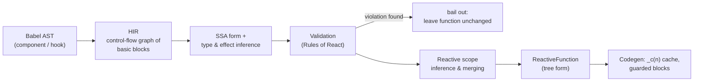

# 09 · React Compiler 1.0

> **Track:** `technologies/react` · **React:** 19.3.1 · **Compiler:** `babel-plugin-react-compiler@1.0.0` · **Lint:** `eslint-plugin-react-hooks@7.1.1` · **Proofs:** [`examples/09-compiler/compiler.test.tsx`](../examples/09-compiler/compiler.test.tsx), helpers [`examples/09-compiler/compile.ts`](../examples/09-compiler/compile.ts)
>
> **Cross-links.** How TypeScript's `readonly` and immutability types interact with the compiler's assumptions: [TypeScript M12](../../../languages/typescript/modules/12-react-19-and-modern-react-typescript.md). Compiler theory in general (SSA, data-flow analysis) is standard compiler material; this module covers only what React's compiler does with it.

The React Compiler is a build-time Babel plugin that **automatically memoises** components and hooks. It reached **1.0 on 2025-10-07** ([React blog](https://react.dev/blog/2025/10/07/react-compiler-1)). It replaces most hand-written `useMemo`, `useCallback` and `memo`, and — unlike hand-written memoisation — it can memoise *conditionally* and at a granularity finer than a hook. It relies on your code obeying the **Rules of React**; where it can prove a violation it skips the function, and where it cannot prove one it may compile code whose behaviour then depends on luck. This module explains the pipeline, the generated code, the preconditions, the lint rules that enforce them, configuration and adoption.

---

## 1. What problem it solves

Re-rendering is React's default: when a component renders, every child element it creates is a **new object**, so children re-render too (Module 02 §5). Avoiding that by hand requires:

- `memo(Child)` on the child,
- stable props: `useMemo` for objects/arrays, `useCallback` for functions,
- correct dependency arrays for all of them,

and it fails silently when one link breaks (an inline object prop defeats `memo` — tested in Module 02). The compiler does this mechanically and more precisely: it memoises **JSX elements** themselves (an unchanged element is the same object, which triggers React's same-element bailout without `memo`), and it computes dependencies from the code instead of trusting a hand-written array.

The runtime proof in the tests renders the same `Page` component uncompiled and compiled and clicks a counter three times:

| Build | `Expensive` renders | Why |
|---|---|---|
| Uncompiled | 4 (mount + 3 clicks) | `items.filter(…)` creates a new array each render → new props → re-render |
| Compiled | 1 | The filtered array and the `<Expensive>` element are cached on `items`; the click changes only `n` |

(tests "uncompiled: every click re-renders the expensive child" and "compiled: … child renders once").

---

## 2. The pipeline



1. **Lowering to HIR** (High-level Intermediate Representation): the function becomes a control-flow graph of basic blocks with explicit temporaries, while keeping high-level constructs (JSX, property loads, hook calls) as instructions.
2. **SSA conversion** gives every value one definition, which makes data-flow analysis straightforward.
3. **Type and effect inference.** For each instruction the compiler infers whether values are *read*, *captured*, *mutated* or *frozen*. Props, state and hook return values are treated as **frozen** (immutable) — the core Rules-of-React assumption. It also knows built-ins (`Array.prototype.map` returns a new array, `push` mutates its receiver) and React hooks.
4. **Validation.** Passes check hook call order, ref access during render, `setState` in render, mutation of frozen values the analysis can see, and more. A failure produces a `CompileError` event and, by default, the function is **left as written**.
5. **Reactive scopes.** Values that are created together and mutated together are grouped into a *scope*; each scope's **dependencies** are the reactive inputs (props, state, context, other scopes' outputs) it reads. Overlapping scopes are merged; scopes that cannot be memoised (they contain a hook call, for example) are pruned.
6. **Codegen** emits a cache array per function and wraps each scope in a guard.

### 2.1 The generated code

Test "the smallest case" compiles `function A({ x }) { return <div>{[x]}</div>; }` to:

```js
import { c as _c } from "react/compiler-runtime";
export function A(t0) {
  const $ = _c(2);                 // a per-instance cache with 2 slots
  const { x } = t0;
  let t1;
  if ($[0] !== x) {                // dependency changed?
    t1 = <div>{[x]}</div>;         //   recompute the scope
    $[0] = x;                      //   remember the dependency
    $[1] = t1;                     //   and the result
  } else {
    t1 = $[1];                     // reuse: same element object → React bails out of the subtree
  }
  return t1;
}
```

A richer case (test "a component gets a memo cache… and guarded blocks per reactive scope") shows **nested** and **sequential** scopes: the sorted list depends on `items` *and* `onPick`, the `map` callback inside it depends only on `onPick`, and the `<ul>` depends only on the mapped children:

```js
const $ = _c(7);
if ($[0] !== items || $[1] !== onPick) {   // scope 1: sorted + mapped children
  const sorted = [...items].sort();
  let t2;
  if ($[3] !== onPick) { t2 = i => <li key={i} onClick={() => onPick(i)}>{i}</li>; … }   // nested scope
  t1 = sorted.map(t2); …
}
if ($[5] !== t1) { t2 = <ul>{t1}</ul>; … }   // scope 2
```

`_c(n)` is `useMemoCache(n)` under the hood: a hook (it occupies one hook slot) that returns an array stored on the fiber, initialised with a sentinel. Dependencies are compared with `!==` (i.e. `Object.is` except for `NaN`/`±0` corner cases).

**Conditional memoisation.** Because scopes are blocks in the control-flow graph, memoisation can sit *after* an early return or inside a branch — impossible with `useMemo`, which is a hook and must be called unconditionally.

---

## 3. The Rules of React are preconditions

The compiler's correctness theorem is conditional: **if** components and hooks are pure, props/state/context are never mutated, refs are not read during render, and hooks follow the call-order rules, **then** the compiled function is observationally equivalent to the original but renders less. The validations catch many violations; they cannot catch all of them.

| Violation | What the compiler does | Test |
|---|---|---|
| Reading/writing `ref.current` during render | `CompileError` (category `Refs`), function left uncompiled | "reading a ref during render → CompileError" |
| Conditional hook | `CompileError` (category `Hooks`) | "a conditional hook → CompileError" |
| `setState` unconditionally in render, components defined in render, `Math.random()` in render | Detected by lint rules (§4) and/or validations | lint tests |
| Mutating props through a **method call** (`props.items.push(x)`) | **Not detected**: compiles successfully, and the lint preset reports nothing | "NEGATIVE: not every violation is detected…" |

The last row is the important negative result. The compiler cannot know which methods mutate values it does not own (it does not see the type of `props.items`), so it trusts the Rules of React: the cached JSX is keyed on the **array reference**, which `push` does not change — the UI can show stale data, and memoisation you "expected" may also silently disappear in other cases. This is why the compiler pairs with lint rules and good tests, and why the 1.0 announcement recommends pinning the compiler to an exact version (`--save-exact`) when test coverage is thin.

### 3.1 Silent bail-outs in production builds

With the default `panicThreshold: "none"`, a function the compiler cannot handle is **silently left as written**. Your app still works — but the memoisation you assumed is not there, and nothing tells you unless you:

- run the lint rules (§4), which surface the same diagnostics in the editor;
- configure a `logger` (as the tests do) and fail CI on `CompileError` events for files you care about;
- set `panicThreshold: "critical_errors"` or `"all_errors"` in CI to make the build fail;
- check React DevTools, which shows a "Memo ✨" badge on compiled components.

---

## 4. `eslint-plugin-react-hooks` 7: compiler-powered lint

Since v6 (with React 19.2) the plugin's `recommended` preset uses **flat config by default** and ships rules built on the compiler's analysis; the separate `eslint-plugin-react-compiler` is no longer needed. The 7.1.1 `recommended` preset enables (verified from the installed package): `rules-of-hooks`, `exhaustive-deps` (warn), `static-components`, `use-memo`, `preserve-manual-memoization`, `incompatible-library` (warn), `immutability`, `globals`, `refs`, `set-state-in-effect`, `error-boundaries`, `purity`, `set-state-in-render`, `unsupported-syntax` (warn), `config`, `gating`; `recommended-latest` adds `void-use-memo`.

```js
// eslint.config.js
import reactHooks from "eslint-plugin-react-hooks";
import { defineConfig } from "eslint/config";
export default defineConfig([reactHooks.configs.flat.recommended]);
// legacy .eslintrc users: "plugin:react-hooks/recommended-legacy"
```

The tests lint fixtures with the real plugin and assert the reported rule IDs: `refs` (ref read in render), `set-state-in-effect` (derived state in an effect — Module 04 §7), `static-components` (component defined in render — Module 02), `purity` (`Math.random()` in render — Module 01), `exhaustive-deps`, and a clean fixture with no reports.

Use the lint rules **even if you do not enable the compiler**: every rule describes a real bug class.

---

## 5. Configuration and directives

```js
// babel.config.js — options of babel-plugin-react-compiler 1.0.0
["babel-plugin-react-compiler", {
  target: "19",                    // "17" | "18" | "19"; 17/18 need the react-compiler-runtime package
  compilationMode: "infer",        // default; also "annotation" | "syntax" | "all"
  panicThreshold: "none",          // default; also "critical_errors" | "all_errors"
  logger: { logEvent(filename, event) { /* CompileSuccess | CompileError | CompileSkip | … */ } },
  gating: { source: "my-flags", importSpecifierName: "isCompilerEnabled" }, // runtime A/B switch
  sources: (filename) => filename.includes("src/"),                             // which files to compile
}]
```

| Mechanism | Effect | Test |
|---|---|---|
| `compilationMode: "infer"` (default) | Compiles functions that look like components/hooks (name + JSX or hook calls) | — |
| `compilationMode: "annotation"` | Compiles only functions with a `"use memo"` directive — useful for incremental adoption | "compilationMode annotation compiles only…" |
| `"use no memo"` | Opts one function out (escape hatch while you fix it; remove later) | '"use no memo" opts a component out' |
| `target: "18"` | Imports the cache runtime from `react-compiler-runtime` instead of `react/compiler-runtime` | 'target "18" imports the runtime from react-compiler-runtime' |
| `gating` | Emits both versions behind a runtime flag | — |

**Tooling support (1.0):** Babel plugin everywhere; built-in templates/presets in Vite (`@vitejs/plugin-react` with the Babel plugin), Next.js (recommended ≥ 15.3.1), Expo SDK 54+ (on by default), Rsbuild; SWC support was still experimental at 1.0, and oxc/rolldown integration was in progress.

---

## 6. Manual memoisation in the compiler era

| Situation | Recommendation (from the 1.0 announcement) |
|---|---|
| New code | Rely on the compiler; use `useMemo`/`useCallback` only for precise control, e.g. a value used as an **effect dependency** whose identity must not change |
| Existing `useMemo`/`useCallback`/`memo` | **Leave them**; removing them can change compilation output. Remove only with test coverage |
| Existing memo with wrong deps | `preserve-manual-memoization` reports when the compiler cannot preserve your manual memoisation (e.g. deps you wrote disagree with the inferred ones) |
| Third-party libraries that return mutable objects or rely on interior mutability (some form and table libraries) | `incompatible-library` warns; `"use no memo"` in the affected component if needed |

Test "existing useMemo is kept and its deps are checked against the inferred ones" compiles a component with a manual `useMemo` successfully: the compiler integrates it rather than fighting it.

> **Then vs now.**
>
> | | Then | Now |
> |---|---|---|
> | ≤ 2024 | Manual `memo`/`useMemo`/`useCallback`; correctness depended on hand-written deps; `exhaustive-deps` lint | — |
> | 2024–2025 | "React Forget" research → `babel-plugin-react-compiler` beta/RC (`19.0.0-beta…`, `19.1.0-rc.*`), separate `eslint-plugin-react-compiler` | — |
> | 2025-10-07 | — | **React Compiler 1.0**: stable, versioned independently of React (`1.0.0`), lint merged into `eslint-plugin-react-hooks` (v6/v7), works with React 17+ |
>
> "React Forget" is the obsolete codename; it survives only in internal names (the compiler source still mentions "Forget" and `"use forget"`). **Migration:** install `babel-plugin-react-compiler@1.0.0` pinned exactly, enable the `react-hooks` recommended preset, fix reported violations, start with `compilationMode: "annotation"` or `sources` on one directory, compare behaviour with tests and the Profiler (Module 12), then widen. **Pitfall when mixing:** code that is compiled in one bundle and uncompiled in another (e.g. a shared package built without the plugin) works, but memoisation expectations differ; libraries should ship compiled output with `target` set to their lowest supported React.

---

## 7. Production failure modes

| Symptom | Cause | Fix |
|---|---|---|
| Expected memoisation "doesn't happen" | Function bailed out silently (ref read, conditional hook, unsupported syntax) | Lint, logger, DevTools badge, `panicThreshold` in CI |
| Stale UI after enabling the compiler | Code mutates props/state/context in place (undetectable by the compiler) | Immutable updates; `immutability` lint where detectable; tests |
| Effect fires more/less often after enabling | Effect deps now stable (or newly memoised) values | Treat effects as synchronisation (Module 04); do not rely on identity churn |
| Library-driven component behaves oddly | Library relies on interior mutability | `incompatible-library` warning; `"use no memo"` |
| Different output after removing a `useMemo` | Compiler respects manual memo | Remove only with coverage |
| Build breaks after compiler update | Compiler is versioned separately and changes analysis | Pin exactly; update deliberately |

---

## 8. Executable proofs

| Claim | Test (`compiler.test.tsx`) |
|---|---|
| `_c(n)` cache, guarded scopes, nested scopes | "a component gets a memo cache…", "the smallest case…" |
| Manual `useMemo` integrates | "existing useMemo is kept…" |
| Directives and options | '"use no memo"…', 'compilationMode "annotation"…', 'target "18"…' |
| Bail-outs on detectable violations; an undetectable one | "bail-outs…" (3 tests) |
| Real runtime effect: child re-renders 4 → 1 | "runtime effect…" (2 tests) |
| Compiler-powered lint rules | "eslint-plugin-react-hooks 7…" (6 tests) |

---

## 9. Interview Drill

<details><summary><strong>1. What does the React Compiler actually do?</strong></summary>

At build time it analyses each component/hook (HIR, SSA, effect inference), groups values into reactive scopes with inferred dependencies, and emits code that caches each scope's results in a per-instance array (`_c(n)` / `useMemoCache`), recomputing only when a dependency changes by `!==`. Cached JSX elements let React skip re-rendering unchanged subtrees without `memo`.
</details>

<details><summary><strong>2. Does the compiler make <code>useMemo</code>/<code>useCallback</code>/<code>memo</code> obsolete?</strong></summary>

Mostly for new code: its memoisation is as precise or more (it can memoise conditionally and per scope). Keep manual memo where you need precise identity control (effect dependencies) and leave existing memo in place unless tests cover its removal, because removal can change output.
</details>

<details><summary><strong>3. What happens when code breaks the Rules of React?</strong></summary>

If the compiler detects it (ref read in render, conditional hooks, etc.), it skips that function and leaves it unoptimised — silently by default. If it cannot detect it (e.g. mutating props via a method), it may compile it and the cached output can be stale. Hence the lint rules, logging and tests.
</details>

<details><summary><strong>4. How would you adopt the compiler in a large existing codebase?</strong></summary>

Enable the `react-hooks` recommended lint preset and fix violations; install the compiler pinned exactly; start with `compilationMode: "annotation"` or `sources` limited to a directory, or use `gating` behind a feature flag; log `CompileError` events in CI; measure with the Profiler; widen gradually; keep existing manual memo.
</details>

<details><summary><strong>5. Can you use the compiler with React 18?</strong></summary>

Yes. Set `target: "18"` (or `"17"`) and add `react-compiler-runtime`, which provides the cache hook the generated code imports.
</details>

<details><summary><strong>6. Why can the compiler memoise after an early return but <code>useMemo</code> cannot?</strong></summary>

`useMemo` is a hook and must be called unconditionally in the same order. The compiler's cache is a single hook call at the top (`_c(n)`); individual scopes are just guarded blocks in the control-flow graph, so they can live inside branches or after early returns.
</details>

<details><summary><strong>7. What are <code>"use memo"</code> and <code>"use no memo"</code>?</strong></summary>

Function-level directives: `"use memo"` opts a function in when `compilationMode` is `"annotation"`; `"use no memo"` opts a function out in any mode, as a temporary escape hatch.
</details>

<details><summary><strong>8. Name four compiler-powered lint rules and the bug each catches.</strong></summary>

`refs` (reading refs during render), `set-state-in-effect` (synchronous setState in effects → cascading renders), `static-components` (components created during render → remounts), `purity` (impure calls like `Math.random()` in render), `immutability` (mutating props/state), `set-state-in-render`, `preserve-manual-memoization`, `incompatible-library`.
</details>
