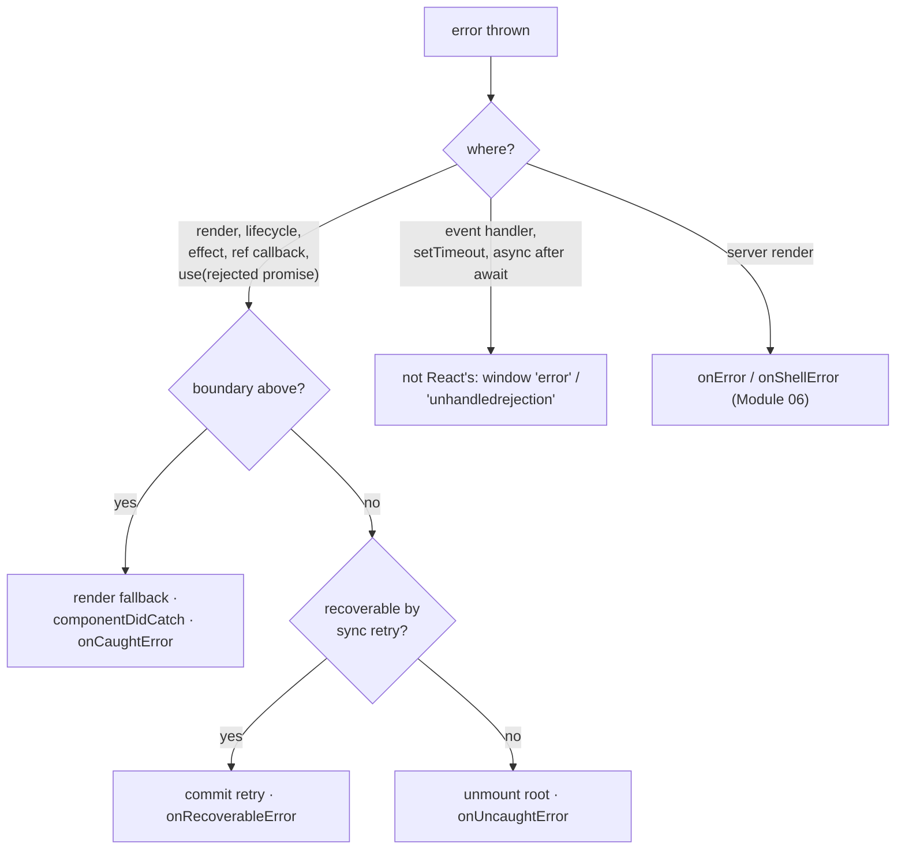

# 10 · Errors & Resilience

> **Track:** `technologies/react` · **React:** 19.3.1 · **Proofs:** [`examples/10-errors/errors.test.tsx`](../examples/10-errors/errors.test.tsx)
>
> **Cross-links.** Exceptions, `Error.cause`, `AggregateError`, unhandled rejections and the `error`/`unhandledrejection` events: [languages/javascript](../../../languages/javascript/README.md). Typing class components and HOCs: [TypeScript M12](../../../languages/typescript/modules/12-react-19-and-modern-react-typescript.md). Error reporting pipelines, sampling and alerting: [technologies/observability](../../observability/README.md). Server-side rendering errors (`onError`, `onShellError`, digests): [Module 06 §3.2](06-suspense-streaming-ssr-and-hydration.md).

A production UI fails in pieces: a widget's data is malformed, a third-party component throws, a chunk fails to load. React's contract is that an error during rendering **unmounts the part of the tree that failed** — never leaving a half-rendered, inconsistent UI — and lets you choose how much to unmount with **error boundaries**. React 19 added root-level reporting callbacks. This module defines what is and is not caught, how errors are reported, how to recover, and the version-specific behaviour around `<Activity>`.

---

## 1. The model

> **Definition 10.1 (Error boundary).** A class component that defines `static getDerivedStateFromError(error)` (and usually `componentDidCatch(error, info)`). When a descendant throws during **render**, in a **lifecycle method**, in an **effect** (layout or passive) or in a **ref callback**, React abandons the failed subtree, finds the nearest boundary *above* the throwing component, renders it again with the state returned by `getDerivedStateFromError`, and commits that fallback.

> **Definition 10.2 (Uncaught render error).** If no boundary exists, React **unmounts the entire root** (the container becomes empty) and reports the error to `onUncaughtError`.

The rationale for unmounting rather than leaving the last good UI on screen (React 16+): a UI that *looks* fine but is inconsistent with state is worse than an explicit error — the canonical example is a payment form showing the wrong amount.



### 1.1 The two lifecycle methods

| Method | Phase | Purpose | Rules |
|---|---|---|---|
| `static getDerivedStateFromError(error)` | Render | Return state for the fallback | Pure: no logging, no side effects |
| `componentDidCatch(error, info)` | Commit | Log/report; `info.componentStack` locates the failure | Side effects allowed |

There is **still no hook** for error boundaries in React 19.3; libraries such as `react-error-boundary` wrap the class. The test file's `Boundary` is the canonical implementation and also shows the `resetKey` pattern (§4).

---

## 2. What is caught and what is not

| Error source | Caught by boundaries? | Test |
|---|---|---|
| Render (function body, class `render`) | ✅ | "errors thrown during render…" |
| Nearest boundary wins; others keep rendering | ✅ | "the nearest boundary wins…" |
| `useEffect` / `useLayoutEffect` / lifecycle / ref callbacks | ✅ | "errors thrown in effects are caught too" |
| `use(promise)` with a rejected promise | ✅ (Module 06) | Module 06 "a rejected promise throws…" |
| `useActionState` action that throws | ✅, rethrown at render (Module 08) | Module 08 "errors in actions" |
| **Event handlers** | ❌ — they run outside rendering; the error reaches `window.onerror` | "NEGATIVE: errors in event handlers are NOT caught…" |
| **Async code** (after `await`, timers, promise callbacks) | ❌ | "NEGATIVE: errors in async code… are NOT caught" |
| The boundary's **own** render | ❌ — goes to the next boundary up | "NEGATIVE: a boundary cannot catch its own render error" |
| Server rendering | ❌ — handled by `onError`/`onShellError` and client retry (Module 06) | — |

**Forwarding an error into a boundary.** For event-handler or async failures that should show the boundary's fallback, throw inside a state updater: `setState(() => { throw error; })`. The updater runs during the next render, where boundaries apply — test "forwarding an async/event error into the boundary". `react-error-boundary`'s `showBoundary` does the same thing. For expected failures (validation, 404) prefer rendering an error state over throwing.

---

## 3. Root error callbacks (React 19)

```ts
const root = createRoot(container, {
  onCaughtError(error, { componentStack, errorBoundary }) { … }, // a boundary handled it
  onUncaughtError(error, { componentStack }) { … },             // no boundary: root unmounted
  onRecoverableError(error, { componentStack }) { … },          // React recovered automatically
});
// hydrateRoot accepts the same options (Module 06: hydration mismatches → onRecoverableError)
```

| Callback | Called when | Default (if omitted) | Test |
|---|---|---|---|
| `onCaughtError` | A boundary caught an error; `errorInfo.errorBoundary` is the boundary instance | `console.error` | "onCaughtError reports errors handled by a boundary…" |
| `onUncaughtError` | No boundary; root unmounted | `reportError` (→ `window` `error` event) | "onUncaughtError reports errors with no boundary; the root is unmounted" |
| `onRecoverableError` | React recovered: a hydration mismatch fell back to client rendering, or a failed concurrent render succeeded on a synchronous retry; `error.cause` may hold the original | `reportError` | "an error thrown once and recovered by a synchronous retry…"; Module 06 mismatch test |

The recoverable-retry case deserves attention: when a concurrent render throws, React retries **once, synchronously**, before treating the error as real. A transient error (e.g. reading a store mid-mutation) can therefore be invisible except for `onRecoverableError`. Monitor that callback in production; frequent recoverable errors are a smell.

> **Then vs now: error reporting.**
>
> | | Then (≤18) | Now (19+) |
> |---|---|---|
> | Caught errors | Re-thrown and logged **twice** in dev (once by React, once by the browser), plus a separate "The above error occurred…" log | Reported once via `onCaughtError` (default `console.error`) with the component stack |
> | Uncaught errors | Re-thrown from the render call; often logged twice | `onUncaughtError` (default `reportError`) |
> | Hydration/recoverable | `onRecoverableError` existed (18) | Same, plus `error.cause` and better hydration diffs |
> | Where to hook reporting | `componentDidCatch` in every boundary + `window.onerror` | Root callbacks centralise it; boundaries handle UI |
>
> **Migration:** move error-reporting SDK calls (Sentry, Datadog, OpenTelemetry) from scattered `componentDidCatch` methods into the three root callbacks; keep `componentDidCatch` for boundary-specific context. **Pitfall:** under `act()` in tests, uncaught errors are rethrown to the test rather than delivered to `onUncaughtError` (the root-callback test leaves `act` to observe production behaviour).

---

## 4. Recovery strategies

A boundary in the error state renders its fallback; its children are **unmounted**. Their state is gone, and setters captured from them no longer reach anything — test "NEGATIVE: once in the error state, re-rendering the same children does not recover".

| Strategy | How | Keeps boundary state | Test |
|---|---|---|---|
| **Key reset** | Change the boundary's `key` (e.g. `key={pathname}`) | No — remounts boundary and children | "reset by key…" |
| **resetKeys** | Compare a prop in `getDerivedStateFromProps` and clear `error` when it changes | Yes | "reset by resetKey prop…" |
| **Retry button** | `this.setState({ error: null })` from the fallback | Yes | — |
| **Remount after data fix** | Invalidate the cache that caused the error, then reset | — | — |

Retrying blindly re-throws if the cause persists (bad data). Couple reset with the action that fixes the cause: navigation, cache invalidation, re-fetch.

### 4.1 Granularity

Place boundaries by **blast radius**:

1. **Root/app shell** — last resort: a branded "something went wrong" page, plus reporting.
2. **Route/page** — a broken page should not kill navigation; reset on route change (`resetKey={pathname}`).
3. **Widget** — independent panels (a chart, a comments section, third-party embeds) fail alone.
4. **Next to Suspense boundaries** — a loading region and its failure region usually coincide: `<ErrorBoundary><Suspense>…</Suspense></ErrorBoundary>`.

Too few boundaries: one bad widget blanks the page. Too many: users see fragments of error UI everywhere and state is lost at fine granularity. Frameworks (Next.js `error.js`, React Router `errorElement`) place route-level boundaries for you.

---

## 5. Errors and `<Activity>` (19.3)

Before **19.3**, an error thrown while rendering content inside a **hidden** `<Activity>` could propagate to boundaries outside it, replacing visible UI with a fallback because of something the user could not even see. Since 19.3 ([react#35074](https://github.com/react/react/pull/35074)) errors no longer escape a hidden `<Activity>`. The test "an error in hidden content does not escape while hidden; it surfaces when shown" shows the observable 19.3.1 behaviour: while hidden, the outer boundary is untouched and the last good (hidden) DOM remains; when the Activity becomes visible, the error is thrown in a visible render and the outer boundary shows its fallback.

Practical consequences: put an error boundary **inside** pre-rendered `<Activity>` content if you want pre-render failures to be handled locally, and do not rely on hidden pre-rendering to "warm up" error reporting. Because this changed in a minor, pin the version in tests.

---

## 6. Other failure classes and their handling

| Failure | Handling |
|---|---|
| Chunk load failure (`lazy(() => import())` rejects after a deploy removed old chunks) | Error boundary around lazy routes; on `ChunkLoadError`-like errors, reload the page once (guard against loops) |
| Server render error inside a boundary | Client-renders that boundary (Module 06); digest in `onError` |
| Server Component error | Flight `E` row with a digest (production) → thrown on the client at that position → nearest client error boundary. 19.3 also transports `Error.cause` and `AggregateError.errors` |
| Hydration mismatch | `onRecoverableError`; fix the cause (Module 06 §4.3) |
| Infinite render loop ("Too many re-renders", "Maximum update depth exceeded") | Thrown as a render error → boundary; fix the unconditional `setState` in render/effect |
| Error in `componentDidCatch`/fallback | Propagates to the next boundary up; keep fallbacks trivial |
| Event handler / async errors | Local `try/catch` + error state, or forward via the state-updater trick; global `error`/`unhandledrejection` listeners for reporting |

---

## 7. Production failure modes

| Symptom | Cause | Fix |
|---|---|---|
| Blank page after one widget fails | No boundary below the root | Route and widget boundaries |
| Errors from clicks are never reported | Event-handler errors bypass boundaries and root callbacks | `window` `error`/`unhandledrejection` reporting, local handling |
| Retry button shows the error again immediately | Cause not fixed | Reset together with cache invalidation/navigation |
| Fallback stays after navigating | Boundary not reset on route change | `key={pathname}` or `resetKey` |
| Fallback appears for content the user cannot see (≤19.2) | Hidden `<Activity>` error escaped | Upgrade to 19.3, or boundary inside the Activity |
| Duplicate error reports | Logging in both `componentDidCatch` and `onCaughtError` | Pick one layer per concern |
| Silent transient failures | Recovered on sync retry | Monitor `onRecoverableError` |
| Error message leaks internals (stack, SQL) to users | Rendering `error.message` in production fallbacks | Generic message + digest/ID; details only in reporting |

---

## 8. Executable proofs

| Claim | Test (`errors.test.tsx`) |
|---|---|
| Render/effect errors caught; component stack; nearest boundary | "what an error boundary catches" (3 tests) |
| Event-handler, async and self errors are not caught | three `NEGATIVE` tests |
| Forwarding async errors with a throwing updater | "forwarding an async/event error…" |
| `onCaughtError`, `onUncaughtError` (root unmounted), `onRecoverableError` (sync retry) | "root error callbacks" (3 tests) |
| Recovery: stuck without reset; key reset; resetKey | "recovery" (3 tests) |
| 19.3 hidden `<Activity>` containment | "errors and <Activity> (19.3)" |

---

## 9. Interview Drill

<details><summary><strong>1. What do error boundaries catch, and what don't they catch?</strong></summary>

They catch errors thrown while rendering, in lifecycle methods, effects and ref callbacks of their descendants (including rejected promises read with `use`). They don't catch errors in event handlers, asynchronous code (timers, after `await`), server rendering, or in the boundary itself.
</details>

<details><summary><strong>2. Why does React unmount the tree on an uncaught render error instead of keeping the last UI?</strong></summary>

Because a stale or partially updated UI can be dangerously wrong (showing incorrect data that users act on). An explicit failure is safer; boundaries let you limit how much is unmounted.
</details>

<details><summary><strong>3. Why <code>getDerivedStateFromError</code> and <code>componentDidCatch</code> both?</strong></summary>

The first runs during render and must be pure — it only computes fallback state. The second runs in commit and is for side effects such as logging, and receives the component stack.
</details>

<details><summary><strong>4. What are <code>onCaughtError</code>, <code>onUncaughtError</code> and <code>onRecoverableError</code>?</strong></summary>

React 19 root options for centralised reporting: errors handled by a boundary, errors with no boundary (root unmounted), and errors React recovered from itself (hydration mismatch → client render, a concurrent render that succeeded on synchronous retry). Defaults are `console.error` and `reportError`.
</details>

<details><summary><strong>5. How do you show an error boundary for a failed fetch in an event handler?</strong></summary>

Catch it and either render an error state locally, or forward it into rendering with `setState(() => { throw error; })` (what `showBoundary` in react-error-boundary does), so the nearest boundary catches it.
</details>

<details><summary><strong>6. How do you reset an error boundary on navigation?</strong></summary>

Give it `key={pathname}` (remount) or implement `resetKeys` by comparing a prop in `getDerivedStateFromProps` and clearing the error. Combine with fixing the cause (cache invalidation) or the error will recur.
</details>

<details><summary><strong>7. What changed for errors inside <code>&lt;Activity mode="hidden"&gt;</code> in 19.3?</strong></summary>

Errors in hidden content no longer escape to outer boundaries while hidden; the error surfaces when the content becomes visible. Before, a hidden pre-rendered screen could trigger a visible fallback.
</details>

<details><summary><strong>8. Where would you place error boundaries in a dashboard app?</strong></summary>

At the app shell (last resort with reporting), per route (reset on navigation), and per independent widget/third-party embed, usually paired with each Suspense boundary so that loading and failure regions coincide.
</details>
