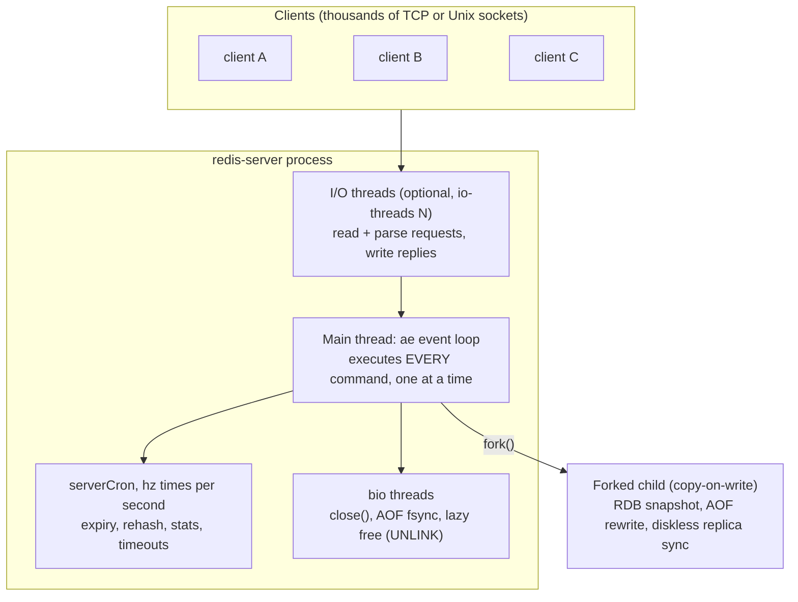
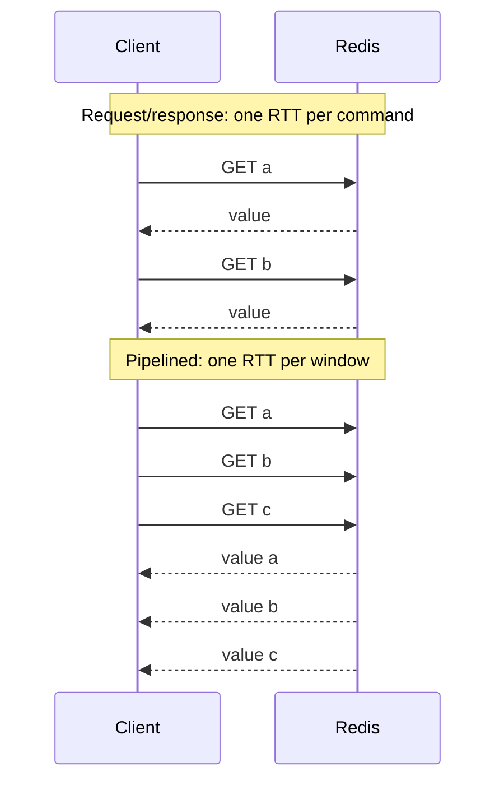
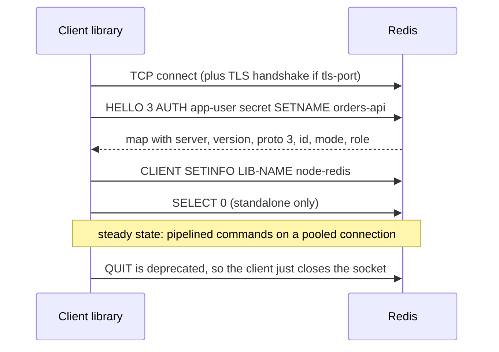
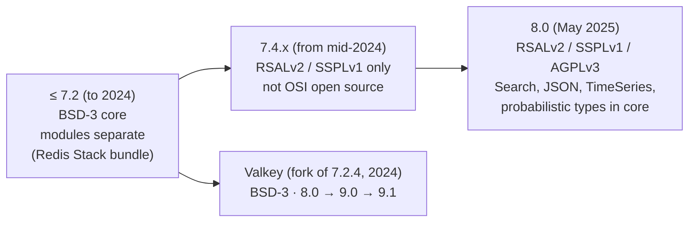

# Module 01 — Execution Model, Architecture, RESP and the Licensing Story

Redis is usually introduced as "an in-memory cache". That description is wrong in a way that costs money in production. Redis is a **data-structure server**: a single process that holds typed values (strings, lists, hashes, sorted sets, streams, JSON documents, vector sets …) in RAM and exposes a few hundred commands that operate on them _atomically_, one command at a time, over a simple text-framed protocol called RESP. Persistence, replication and clustering are layered on top of that core. This module builds the mental model every later module depends on: what runs on which thread, why one slow command hurts every client, what the wire protocol looks like byte by byte, and which "Redis" you are actually running in 2026.

> [!NOTE]
> Theory owned elsewhere is linked rather than repeated: linearizability ([distributed-systems M04](../../../architecture/distributed-systems/modules/04-consistency-models-and-linearizability.md#1-linearizability-formal-herlihy-wing-definition)), TCP behaviour such as Nagle and delayed ACKs ([networking M06](../../../architecture/networking/modules/06-tcp-internals.md#6-nagles-algorithm-vs-delayed-acks-the-40-ms-deadlock)), and hash tables in general ([dsa M03](../../../algorithms/dsa/modules/03-hashing-and-hash-tables.md#2-collision-resolution-chaining-vs-open-addressing)). This module covers how Redis realises them.

**Executable proofs:** [`examples/ts/01-model-and-protocol.test.ts`](../examples/ts/01-model-and-protocol.test.ts) (hermetic RESP2/RESP3 parser and encoder, property tests, latency model) and [`examples/ts/integration/01-protocol.test.ts`](../examples/ts/integration/01-protocol.test.ts) (the same parser talking to a real server).

---

## 1. Definitions

- **Keyspace.** A Redis _database_ is a map $K \to V$ from binary-safe keys (byte strings up to 512 MB) to typed values. A standalone server has 16 numbered databases by default (`databases 16`, selected with `SELECT`); Redis Cluster supports only database 0 (see [module 11](11-redis-cluster.md#1-the-slot-space)).
- **Command.** A named operation `C(k₁…kₙ, args) → reply` that reads and/or writes the values at a set of keys. Each command declares its keys (key specs), its ACL categories and flags such as `write`, `readonly`, `fast`, `noscript`. `COMMAND INFO GET` and `COMMAND DOCS GET` return this metadata.
- **Atomicity of a command.** The server executes a command from start to finish without interleaving any other client's command. Formally: let $H$ be the sequence of commands the main thread executes. $H$ is a total order, and each command's effects are applied in one step of $H$. This is the single most important property of Redis.
- **Single-node linearizability.** Because each command takes effect at one instant between the server reading it and writing its reply, the history observed by clients of _one_ Redis process is linearizable (Herlihy–Wing). Replicas break this: reading from a replica can return stale data, and asynchronous replication can lose acknowledged writes on failover ([module 10](10-replication-and-sentinel.md#2-replication-is-asynchronous-and-what-that-loses)).
- **RESP (REdis Serialization Protocol).** The wire format between clients and server. RESP2 has five types; RESP3 (opt-in with `HELLO 3`, Redis ≥ 6.0) adds ten more, including maps, sets, doubles, booleans, a real null, and _push_ messages for out-of-band data.
- **Pipelining.** Sending several commands without waiting for each reply. Replies arrive in the same order. Pipelining is a _client-side batching_ technique; it provides no atomicity.

---

## 2. Process architecture: one command thread, several helpers



### 2.1 The event loop (`ae`)

Redis ships its own small event library, `ae`, that wraps `epoll` on Linux and `kqueue` on BSD/macOS (with `select` as a fallback). One iteration of the reactor loop executes five distinct phases in order:

1. **`beforeSleep` lifecycle hooks**:
   - `handleClientsWithPendingWritesUsingThreads()`: flushes buffered client replies. When I/O threading is enabled (`io-threads > 1`), pending socket writes are distributed across worker threads; on single-threaded runs, replies are written directly.
   - `flushAppendOnlyFile()`: transfers commands from the server AOF buffer into kernel page cache via `write(2)`. If `appendfsync everysec` is configured, it notifies the `bio` background fsync thread if a second has elapsed.
   - Fast active expiry (`activeExpireCycle(ACTIVE_EXPIRE_CYCLE_FAST)`): spends a capped duration (typically 1 000 µs) sampling keys with TTLs to reclaim memory without waiting for `serverCron`.
   - `handleUnblockedClients()`: processes clients unblocked by earlier operations (such as keys pushed for `BLPOP`, `BLMOVE`, or `XREADGROUP ... BLOCK`).
   - Server-assisted client tracking: flushes invalidation push messages (`CLIENT TRACKING`) to invalidate client caches before new replies are sent.
   - Module hooks: fires `REDISMODULE_EVENT_BEFORE_SLEEP` for loaded extensions.
2. **`aeApiPoll` (I/O multiplexing)**: executes `epoll_wait(2)` or `kevent(2)` with a timeout equal to the duration until the earliest registered timer event.
3. **`afterSleep` lifecycle hooks**:
   - Executed immediately when polling wakes up, before file event callbacks run.
   - `handleClientsWithPendingReadsUsingThreads()`: assigns readable client sockets across worker threads to perform `read(2)` and parse raw input streams into client command vectors (`client->argv`).
   - Module hooks: fires `REDISMODULE_EVENT_AFTER_SLEEP`.
4. **Command execution**: for each client whose query buffer contains a complete command, the main thread runs `processCommand()` sequentially. Atomicity is guaranteed because only the main thread mutates the keyspace.
5. **Time events (`serverCron`)**: runs `hz` times per second (default `hz 10`, dynamically scaled with `dynamic-hz yes`). It drives slow active expiry (`ACTIVE_EXPIRE_CYCLE_SLOW`), incremental dictionary rehashing (`dictRehashMilliseconds(1)`), client timeout checks, replication reconnects and heartbeats, cluster bus gossip, and initiates scheduled background rewrites (`BGSAVE`, `BGREWRITEAOF`).

Because steps 4 and 5 run on one thread, a command that takes 200 ms delays every other client by up to 200 ms. There is no preemption of commands. (Scripts are the partial exception: after `busy-reply-threshold`, formerly `lua-time-limit`, default 5 s, the server starts answering other clients with `-BUSY` errors; see [module 05](05-transactions-scripting-and-functions.md#5-blocking-risk-busy-scripts-and-script-kill).)

### 2.2 What is _not_ on the main thread

| Work | Where | Why it matters |
| --- | --- | --- |
| Reading/parsing requests and writing replies | I/O threads when `io-threads` > 1 | Socket syscalls and memcpy dominate many workloads. Command _execution_ still stays on the main thread. |
| Freeing large values (`UNLINK`, `FLUSHALL ASYNC`, `lazyfree-lazy-*`) | `bio` lazy-free thread | Freeing a 10-million-element set walks every element; done inline it blocks ([module 03](03-keys-expiry-eviction-and-memory.md#6-deleting-big-keys-del-vs-unlink-and-lazy-free)). |
| `fsync` of the AOF with `appendfsync everysec` | `bio` AOF thread | The main thread `write()`s; the background thread `fsync()`s once a second ([module 09](09-persistence-rdb-aof-and-backup.md#3-aof-the-command-log)). |
| `close()` of an old file after rewrite | `bio` close thread | `close()` of a large unlinked file can block. |
| RDB snapshot, AOF rewrite, disk-backed replica sync | A **forked child** | The child sees a copy-on-write snapshot of memory at fork time. The fork itself and COW page copies are main-thread costs ([module 09](09-persistence-rdb-aof-and-backup.md#2-rdb-snapshots-fork-and-copy-on-write)). |
| Query Engine workers (`search-workers`) | Search thread pool | `FT.SEARCH`/`FT.AGGREGATE` can run off the main thread on Redis 8 when configured ([module 08](08-query-engine-json-vectors-and-probabilistic.md#3-the-redis-query-engine-ft)). |

> [!IMPORTANT]
> "Redis is single-threaded" is shorthand for "**command execution** is single-threaded". It has been multi-threaded for I/O since 6.0, Redis 8.0 shipped a new I/O-threading implementation, and Valkey 8.0 shipped its own redesign. Interviewers like this distinction.

In Redis 6 and 7, I/O threading operated under a rigid barrier model: the main thread dispatched socket lists to worker threads and blocked (`pthread_cond_wait`) until all threads finished their batch before resuming execution. Straggler sockets or uneven parsing workloads caused barrier stalls. Redis 8.0 overhauled I/O threading with asynchronous lock-free ring buffers and hardware prefetching, allowing I/O worker threads to continuously stage parsed command buffers for the main thread without synchronous stop-the-world barriers.

### 2.3 Why it is fast anyway

1. **Data lives in RAM** in structures designed for the access pattern (listpacks for small collections, skiplists for ordered data, radix trees for streams; [module 02](02-core-data-types-encodings-and-complexity.md#3-internal-encodings)).
2. **No locks on the hot path**: one thread owns the data, so there is no lock contention and no cache-line ping-pong between cores for the data structures.
3. **Readiness-based I/O multiplexing** lets one thread serve tens of thousands of sockets.
4. **Commands are small**: most are $O(1)$ or $O(\log N)$; the protocol is cheap to parse.

The flip side: a single core caps throughput per process. Scaling beyond one core for _execution_ means more processes: replicas for reads ([module 10](10-replication-and-sentinel.md#1-replication-mechanics)) or Cluster shards for reads and writes ([module 11](11-redis-cluster.md#1-the-slot-space)).

---

## 3. A latency mental model

Model one request as $T = \text{RTT} + W_q + S$:

- **RTT**: network round trip (≈ 0.05–0.2 ms inside a data centre, 1–80 ms across regions).
- **$S$**: service time on the main thread (≈ 1–5 µs for `GET`, unbounded for `KEYS *`).
- **$W_q$**: time spent queued behind other clients' commands. With utilisation $\rho = \lambda \cdot \bar S$ of the command thread, an M/M/1 approximation gives $W_q = \frac{\rho}{1-\rho}\bar S$; queueing explodes as $\rho \to 1$.

Two consequences:

1. **For small commands, RTT dominates.** 10 000 `GET`s one at a time over a 0.5 ms RTT take ≈ 5 s, of which ≈ 20 ms is Redis work. Pipelining in windows of 100 reduces the RTT term 100-fold. The executable model `pipelineWallTime(n, window, rtt, service)` encodes exactly $\lceil n / w \rceil \cdot \text{RTT} + n \cdot S$, and the test proves that once windows are large, server time dominates and bigger windows stop helping.
2. **Tail latency is shared.** One client's $O(N)$ command adds its whole service time to the $W_q$ of everyone queued behind it. This is head-of-line blocking at the server, and it is why `KEYS`, `HGETALL` on a huge hash, `LRANGE 0 -1`, `SMEMBERS`, `DEL` of a huge key, or a long Lua script appear in so many post-mortems ([module 12](12-operations-security-observability-and-valkey.md#4-diagnosing-latency)).



### 3.1 Pipelining vs `MULTI` vs scripts vs multi-key commands

| Technique | Fewer RTTs | Atomic | Can read-then-decide on the server | Notes |
| --- | --- | --- | --- | --- |
| Pipelining | yes | no | no | Other clients' commands may interleave between yours. |
| `MGET`/`MSET`/variadic commands | yes | yes | no | One command, one atomic step. In Cluster, all keys must share a slot. |
| `MULTI … EXEC` | yes (if pipelined) | yes (isolation; **no rollback**) | no | Commands are queued, then run back to back ([module 05](05-transactions-scripting-and-functions.md#1-multiexec-isolation-without-rollback)). |
| Lua `EVAL` / Functions | yes | yes | **yes** | Logic runs inside the server; blocks everything while it runs. |

### 3.2 Client-side traps

- **Unbounded pipelines.** A client that queues 10 million commands before reading replies holds all of them in its own memory, and the server holds the replies in the client's output buffer. Use windows (e.g. 1 000 commands) and await each.
- **Offline queues and reconnect replay.** `node-redis` queues commands while disconnected unless `disableOfflineQueue: true`; `ioredis` has `enableOfflineQueue` and retries in-flight commands on reconnect by default (`autoResendUnfulfilledCommands`). A non-idempotent `INCR` sent just before a connection reset may be executed twice: once before the reset (reply lost) and once after reconnect. Treat writes as at-least-once unless you make them idempotent ([module 07](07-coordination-rate-limits-locks-and-idempotency.md#5-idempotency-keys)).
- **Blocking commands on a shared connection.** `BLPOP` with a 30 s timeout on a multiplexed connection stalls every other command pipelined behind it on that connection. Use a dedicated connection (`client.duplicate()` in node-redis).
- **Nagle's algorithm.** Clients must set `TCP_NODELAY`; Redis sets it on its side. See [networking M06](../../../architecture/networking/modules/06-tcp-internals.md#the-solution-tcp_nodelay).

### 3.3 Bandwidth-Delay Product (BDP) and pipeline sizing

Pipelining maximizes throughput by keeping the network pipe saturated between client and server. The maximum volume of unacknowledged data the network link can hold in flight is governed by the Bandwidth-Delay Product:

$$\text{BDP} = B \times \text{RTT}$$

where $B$ is transmission bandwidth in bytes per second and $\text{RTT}$ is round-trip time in seconds. Let $S_{\text{req}}$ be the average request payload size (e.g. 64 bytes for `GET key`) and $S_{\text{reply}}$ be the average response payload size (e.g. 128 bytes). Total byte volume transmitted per command round-trip is $S_{\text{cmd}} = S_{\text{req}} + S_{\text{reply}}$. The minimum pipeline window $w^*$ required to fully saturate the link bandwidth without client idling is:

$$w^* \ge \frac{\text{BDP}}{S_{\text{cmd}}} = \frac{B \times \text{RTT}}{S_{\text{req}} + S_{\text{reply}}}$$

**Production calculation:** on a 10 Gbps network link ($B = 1.25 \times 10^9\text{ B/s}$) with inter-rack latency $\text{RTT} = 0.5\text{ ms} = 0.0005\text{ s}$:

$$\text{BDP} = 1.25 \times 10^9 \times 0.0005 = 625\,000\text{ bytes} \approx 625\text{ KB}$$

For 192-byte command cycles ($S_{\text{cmd}} = 192$), saturating the network interface requires:

$$w^* = \frac{625\,000}{192} \approx 3\,255\text{ commands}$$

If a client pipelines only 50 commands per batch, it achieves less than 2 % of achievable link capacity because the connection spends most of its time idling between windows. Conversely, exceeding $w^*$ by an order of magnitude (e.g. $w = 100\,000$) exhausts socket buffers (`SO_SNDBUF`, `SO_RCVBUF`), inflates server query buffers (`qbuf`), and risks exceeding `client-output-buffer-limit normal`, causing server-side client termination. Production pipelines size windows between 500 and 2 000 commands to maximize BDP saturation without buffer bloat.

---

## 4. RESP: the wire protocol

RESP is a length-prefixed, CRLF-terminated, prefix-typed format. A command is always sent as an **array of bulk strings**, whatever protocol version the connection uses:

```text
SET greeting "hello world"
⇣
*3\r\n$3\r\nSET\r\n$8\r\ngreeting\r\n$11\r\nhello world\r\n
```

The first byte of every reply element names its type:

| Byte | Type | Since | Example | Notes |
| --- | --- | --- | --- | --- |
| `+` | simple string | RESP2 | `+OK\r\n` | Cannot contain CR or LF. |
| `-` | simple error | RESP2 | `-ERR unknown command\r\n` | First word is the error code (`ERR`, `WRONGTYPE`, `MOVED`, `NOSCRIPT` …). |
| `:` | integer | RESP2 | `:42\r\n` | Signed 64-bit. |
| `$` | bulk string | RESP2 | `$5\r\nhello\r\n` | Binary safe; `$-1\r\n` is the RESP2 null. |
| `*` | array | RESP2 | `*2\r\n:1\r\n:2\r\n` | `*-1\r\n` is the RESP2 null array. |
| `_` | null | RESP3 | `_\r\n` | One null, instead of two. |
| `#` | boolean | RESP3 | `#t\r\n` |  |
| `,` | double | RESP3 | `,3.14\r\n`, `,inf\r\n`, `,nan\r\n` | `ZSCORE` returns a double in RESP3, a bulk string in RESP2. |
| `(` | big number | RESP3 | `(3492890328409238509324850943850943825024385\r\n` |  |
| `!` | bulk error | RESP3 | `!21\r\nSYNTAX invalid syntax\r\n` | Binary-safe error text. |
| `=` | verbatim string | RESP3 | `=15\r\ntxt:Some string\r\n` | 3-byte format (`txt`, `mkd`) then `:`. |
| `%` | map | RESP3 | `%1\r\n+key\r\n:1\r\n` | `HGETALL`, `CONFIG GET`, `HELLO` reply. |
| `~` | set | RESP3 | `~2\r\n+a\r\n+b\r\n` | `SMEMBERS`. |
| `\|` | attribute | RESP3 | `\|1\r\n+ttl\r\n:3600\r\n` followed by the real reply | Metadata decorating the next reply; clients may ignore it. |
| `>` | push | RESP3 | `>3\r\n+message\r\n+chan\r\n+hi\r\n` | Out-of-band: Pub/Sub messages and client-side-caching invalidations on a normal connection. |

### 4.1 Operational semantics of the parser

Our parser ([`src/resp.ts`](../examples/ts/src/resp.ts)) is a direct transcription of the grammar. In pseudocode:

```text
PARSE(buf, pos):                                 ▷ returns (value, nextPos) or INCOMPLETE
  if pos ≥ |buf| then return INCOMPLETE
  t ← buf[pos]; (line, p) ← READ-LINE(buf, pos+1) ▷ up to CRLF, INCOMPLETE if none
  case t of
    '+','-',':','_','#',',','(' → return (scalar(t, line), p)
    '$','!','=' → n ← INT(line)
                  if n = -1 and t = '$' then return (NULL-BULK, p)
                  if |buf| < p + n + 2 then return INCOMPLETE
                  require buf[p+n .. p+n+2] = CRLF        ▷ otherwise protocol error
                  return (blob(t, buf[p .. p+n]), p+n+2)
    '*','~','>' → n ← INT(line); items ← []
                  for i ← 1 to n do (v, p) ← PARSE(buf, p); items.append(v)
                  return (aggregate(t, items), p)
    '%','|'     → n ← INT(line); read 2n values as n (key, value) pairs
                  if t = '|' then (real, p) ← PARSE(buf, p); attach pairs to real
    otherwise → protocol error
```

**Loop invariant of the incremental driver.** Before each iteration, `buf[0..)` begins at a value boundary: every byte before it belongs to a value already returned. Each successful `PARSE` advances to the next boundary; `INCOMPLETE` leaves the buffer untouched and waits for more bytes. This is why the test that splits a pipelined reply at _every_ byte offset returns exactly the same values, and why the property test can chunk arbitrary encodings at random cut points.

### 4.2 RESP2 vs RESP3 in practice

- `HELLO 3` upgrades a connection (and can authenticate in the same command: `HELLO 3 AUTH user pass SETNAME app`). The reply is a map describing the server (`server`, `version`, `proto`, `id`, `mode`, `role`, `modules`). The integration test proves that the same `HGETALL` reply changes from a flat array to a map after `HELLO 3`.
- **The server downgrades RESP3-shaped replies for RESP2 connections**: maps become flat `[k1, v1, k2, v2]` arrays, booleans become integers 0/1, doubles become bulk strings, and the one null becomes `$-1` or `*-1` depending on the command (`downgradeToResp2` models this).
- **Push messages** are the reason client-side caching ([module 04](04-caching-patterns.md#5-server-assisted-client-side-caching)) works on a single connection in RESP3: invalidations arrive as `>` frames interleaved with normal replies. In RESP2 they need a second connection subscribed to `__redis__:invalidate`.
- **Client libraries:** `node-redis` 6.x (`redis` on npm) types its client with RESP3 as the default protocol version; `ioredis` 6.x speaks RESP2. In this track the integration tests pass `RESP: 2` or `RESP: 3` explicitly so the reply shapes are unambiguous.

| Data Type | RESP2 Wire Framing | RESP3 Wire Framing | Protocol Semantic Shift |
| --- | --- | --- | --- |
| Null value | `$-1\r\n` (bulk null) or `*-1\r\n` (null array) | `_\r\n` | Unambiguous null token replacing overloaded negative length sentinels. |
| Boolean True / False | `:1\r\n` / `:0\r\n` | `#t\r\n` / `#f\r\n` | First-class boolean types distinguished from integer 1 and 0. |
| Floating point (Double) | `$4\r\n3.14\r\n` (bulk string) | `,3.14\r\n` (also `,inf\r\n`, `,-inf\r\n`) | First-class double precision type avoiding string serialization round trips. |
| Associative Map / Hash | `*4\r\n$1\r\nk1\r\n$2\r\nv1\r\n$1\r\nk2\r\n$2\r\nv2\r\n` (flat array) | `%2\r\n$1\r\nk1\r\n$2\r\nv1\r\n$1\r\nk2\r\n$2\r\nv2\r\n` | Native key-value pairs preserved without client-side array pairing heuristics. |
| Set | `*2\r\n$1\r\na\r\n$1\r\nb\r\n` (array) | `~2\r\n$1\r\na\r\n$1\r\nb\r\n` | Unordered unique collection distinguished from ordered lists. |
| Big number | `$40\r\n<digits>\r\n` (bulk string) | `(<digits>\r\n` | Arbitrary-precision integer token for large counters. |
| Error | `-ERR syntax error\r\n` | `!21\r\nSYNTAX syntax error\r\n` | Bulk errors support binary payloads and multi-line error strings. |
| Push message | Not supported on request-reply connection | `>2\r\n+invalidate\r\n*1\r\n$3\r\nkey\r\n` | Asynchronous multiplexed server-to-client out-of-band notifications. |

Push frames (`>`) allow out-of-band notifications (Pub/Sub broadcasts and client-side tracking invalidations) to share a standard connection with request-reply commands without corrupting client parsing state. The frame begins with `>` followed by the element count, and client drivers dispatch it to background notification handlers:

```text
Client -> Server:  GET order:101\r\n
Server -> Client:  $15\r\n{"status":"ok"}\r\n
... (concurrent write from another client invalidates order:101) ...
Server -> Client:  >2\r\n$10\r\ninvalidate\r\n*1\r\n$9\r\norder:101\r\n
Client -> Server:  PING\r\n
Server -> Client:  +PONG\r\n
```

### 4.3 Limits that protect the server

| Setting | Default | Protects against |
| --- | --- | --- |
| `proto-max-bulk-len` | 512 MB | A client announcing `$9999999999` and the server buffering it. |
| `client-query-buffer-limit` | 1 GB | A client streaming an unbounded pipeline faster than it is executed. |
| `client-output-buffer-limit normal / replica / pubsub` | `0 0 0` / `256mb 64mb 60` / `32mb 8mb 60` | Slow readers making the server buffer replies without bound ([module 06](06-messaging-pubsub-streams-and-queues.md#14-slow-subscribers-and-output-buffer-limits)). |
| `maxclients` | 10 000 | File-descriptor exhaustion. |
| `timeout` | 0 (never) | Idle-connection leaks. Prefer `tcp-keepalive 300` (default) plus client pooling. |

The parser's negative tests mirror these defences: an announced bulk length above the limit is rejected _before_ the bytes are buffered, nesting depth is bounded, and a payload that does not end in CRLF at its declared length is a protocol error, never a silent mis-parse.

### 4.4 Inline commands

If the first byte of a request is not `*`, the server treats the line as an _inline command_: space-separated words with optional double quotes. This is what makes `telnet localhost 6379` usable, and it is the root of the classic **cross-protocol attack**: a browser tricked into POSTing to `http://localhost:6379` sends lines like `POST / HTTP/1.1` that Redis parses as commands. Since 3.2.7, Redis treats a `POST` or `Host:` line as a security attack and closes the connection; `protected-mode` and binding to localhost are the real defences ([module 12](12-operations-security-observability-and-valkey.md#1-network-exposure-and-protected-mode)).

---

## 5. Connections, commands and databases as first-class objects

### 5.1 Connection lifecycle



A server-side **client object** exists per connection. It carries the query buffer (bytes read but not yet executed), the reply buffer and reply list (bytes produced but not yet written), the selected database, the authenticated ACL user, the RESP version, the transaction state (`MULTI` queue, `WATCH`ed keys), subscriptions, and tracking state. `CLIENT LIST` and `CLIENT INFO` expose it. The fields worth knowing by heart:

| Field | Meaning | What an abnormal value tells you |
| --- | --- | --- |
| `age` / `idle` | Seconds since connect / since last command | Many idle connections: pool leak or a missing `timeout`. |
| `qbuf` / `qbuf-free` | Query buffer used / free | Large `qbuf`: client is sending faster than the server executes (big pipeline). |
| `omem` / `tot-mem` | Output-buffer memory / total memory of the client | Large `omem`: slow reader or huge reply (`HGETALL` of a big key, slow subscriber). |
| `cmd` | Last command | Finds the offender behind an `omem` spike. |
| `flags` | `N` normal, `M` master, `S` replica, `P` pubsub, `x` in MULTI, `b` blocked, `t` tracking … | A replica connection with growing `omem` is a replication backlog problem. |
| `resp` | 2 or 3 | Mixed fleets during a client-library upgrade. |
| `lib-name` / `lib-ver` | Set by `CLIENT SETINFO` (7.2+) | Which service and client version owns the connection. |

Operational client commands:

- `CLIENT KILL ID <id>` / `CLIENT KILL USER <name>` / `CLIENT KILL MAXAGE <s>` evict connections.
- `CLIENT PAUSE <ms> WRITE` stops processing write commands for all clients (reads continue); used for controlled failovers so no write lands on the old primary after the switch ([module 10](10-replication-and-sentinel.md#5-sentinel-quorum-failover-and-configuration-epochs)).
- `CLIENT NO-EVICT on` protects a client from being disconnected by `maxmemory-clients` eviction; `CLIENT NO-TOUCH on` makes a monitoring client's reads not update LRU/LFU access metadata.
- `CLIENT TRACKING` enables server-assisted client-side caching ([module 04](04-caching-patterns.md#5-server-assisted-client-side-caching)).

### 5.2 Command metadata and key specs

Every command carries machine-readable metadata (`COMMAND INFO`, `COMMAND DOCS`):

- **Arity**: positive means exact argument count including the command name; negative means "at least". `GET` has arity 2, `SET` −3.
- **Flags**: `write`, `readonly`, `denyoom` (refused when over `maxmemory` under `noeviction`), `admin`, `pubsub`, `noscript`, `blocking`, `loading`, `stale`, `fast` …
- **Key specs** (7.0+): where the keys are in the argument vector and whether each is read, written, inserted or deleted. Cluster clients use them to compute the hash slot of an arbitrary command without hard-coding its layout; the ACL engine uses them to enforce read-only (`%R~`) and write-only (`%W~`) key patterns ([module 12](12-operations-security-observability-and-valkey.md#2-acls)).
- **ACL categories**: `@string`, `@hash`, `@slow`, `@dangerous` … `ACL CAT <category>` lists the commands in a category.

This metadata is also how you answer "is this command safe in production?": `COMMAND DOCS KEYS` documents its complexity as $O(N)$ in the number of keys in the database, and the command carries the `@slow` and `@dangerous` categories.

### 5.3 Numbered databases

Standalone Redis has `databases 16` by default, selected per connection with `SELECT n`. They share one process, one memory budget, one eviction policy and one command thread; they are _not_ isolation. `FLUSHDB` clears one, `SWAPDB a b` atomically swaps two (a trick for publishing a freshly built dataset). Redis Cluster supports only database 0. Valkey 9.0 added numbered databases in cluster mode, which is one of the visible Valkey-only features ([module 11](11-redis-cluster.md#8-valkey-9-atomic-slot-migration-and-numbered-databases-in-cluster-mode)). Prefer key prefixes (`orders:…`) or separate instances to numbered databases for multi-tenancy.

---

## 6. Which Redis? Distributions, forks and licences

### 6.1 The landscape in 2026

| Product | What it is | Licence | Latest stable (verified 2026-11-04) |
| --- | --- | --- | --- |
| **Redis Open Source** (formerly Redis Community Edition) | The upstream server from Redis Ltd., with Query Engine, JSON, TimeSeries and probabilistic types built in since 8.0 | RSALv2 **or** SSPLv1 **or** AGPLv3 (your choice) | 8.10.3 (2026-10-26); maintained lines 8.8.4, 8.6.8, 8.4.8, 8.2.11, 7.4.12, 7.2.17 |
| **Valkey** | Linux Foundation fork of Redis 7.2.4 | BSD-3-Clause | 9.1.3 (2026-10-26); 9.0.7; 9.2.0 release candidates in progress |
| **Redis Software / Redis Cloud** | Redis Ltd.'s commercial self-managed and managed products | Commercial | Out of scope beyond feature-availability notes. |
| **Managed services** (AWS ElastiCache/MemoryDB, Google Memorystore, Azure Managed Redis …) | Vendor-operated Redis or Valkey | Vendor terms | Feature sets lag upstream and differ; always check which engine and version you are on. |
| **Dragonfly, KeyDB** | Independent RESP-compatible servers (multi-threaded designs) | BSL / BSD | Context only; behaviour differs in corner cases. |

### 6.2 Then vs now: the licence and module-bundling change



|  | **Then** (Redis ≤ 7.2) | **Then** (Redis 7.4.x) | **Now** (Redis ≥ 8.0) |
| --- | --- | --- | --- |
| Core licence | BSD-3-Clause | RSALv2 or SSPLv1 | RSALv2 or SSPLv1 or AGPLv3 |
| Search/JSON/TimeSeries/Bloom | Separate modules (RSALv2/SSPLv1), or the _Redis Stack_ distribution | Same | Part of Redis Open Source; versioned with the server; one licence choice for all |
| How you get JSON on Docker | `redis/redis-stack-server` image | Same | `redis:8.x` (the official image includes them) |
| Product name | Redis (later "Community Edition") | Redis Community Edition | Redis Open Source |

**Why it changed.** In March 2024 Redis Ltd. moved the core from BSD to a source-available dual licence (RSALv2/SSPLv1), aimed at cloud providers offering Redis as a service. Within weeks the Linux Foundation launched **Valkey** from the last BSD release (7.2.4), backed by several of those providers. With Redis 8.0 (GA May 2025) Redis Ltd. added **AGPLv3** as a third option, which is an OSI-approved open-source licence, and folded the former Stack modules into the server.

**The licensing evolution (2009 to 2026):**

1. **2009–2018 (Permissive BSD era)**: Salvatore Sanfilippo created Redis under the 3-Clause BSD licence. The open-source project flourished with hyperscaler contributions and broad commercial adoption.
2. **2018–2022 (Module licensing restrictions)**: Redis Labs (later Redis Ltd.) applied the Commons Clause, and subsequently the Redis Source Available License (RSALv1), to standalone add-on modules (RediSearch, RedisJSON, RedisGraph, RedisBloom). The core server remained BSD-3-Clause.
3. **March 2024 (Core source-available switch)**: Redis Ltd. relicensed the Redis core engine starting from 7.4 under a dual RSALv2 and SSPLv1 license. This prohibited cloud providers from offering hosted Redis services without commercial licensing arrangements.
4. **April 2024 (The Valkey fork)**: In response, the Linux Foundation, with backing from AWS, Google Cloud, Oracle, Ericsson, and Heroku, forked Redis from the last BSD-3-Clause release (7.2.4) under the project name **Valkey**. Valkey remains strictly 3-Clause BSD.
5. **May 2025 (Redis 8.0 AGPLv3 tri-license)**: With the GA release of Redis 8.0, Redis Ltd. introduced GNU AGPLv3 as a third licensing option alongside RSALv2 and SSPLv1, returning Redis to an OSI-approved open-source license while simultaneously integrating Search, JSON, TimeSeries, and probabilistic modules directly into core.

| Licence | OSI Approved | Commercial SaaS / Managed Service Clause | Network Copyleft Trigger (§ 13) | Explicit Patent Grant | Upstream Codebase |
| --- | --- | --- | --- | --- | --- |
| **BSD-3-Clause** | Yes | Permitted (can offer as hosted commercial service) | None | No explicit patent clause | Redis ≤ 7.2.4; Valkey 8.x / 9.x |
| **RSALv2** | No (source-available) | **Prohibited**: cannot provide Redis as a commercial managed service | None | Yes | Redis 7.4+ and Redis 8 |
| **SSPLv1** | No (source-available) | Conditional: requires releasing entire management and infrastructure source code | Full infrastructure stack disclosure | Yes | Redis 7.4+ and Redis 8 |
| **AGPLv3** | **Yes** (OSI approved) | Permitted (commercial cloud vendors can offer services under copyleft obligations) | Yes: modified versions served over network must publish complete source code | Yes | Redis 8.0+ |

**What the AGPLv3 option means for you.** Using unmodified Redis inside your product, even as a network service, imposes no source-disclosure obligation. If you _modify_ Redis and let users interact with it over a network, AGPLv3 §13 requires offering them your modified source. RSALv2 forbids offering Redis itself as a managed service. Many organisations' policies treat AGPL and source-available licences as "needs legal review"; that is the most common reason teams standardise on Valkey instead.

**Migration steps and pitfalls of mixing:**

1. From Redis 7.2 to Redis 8: data files are forward compatible (RDB written by 7.2 loads in 8.x); re-audit ACL rules, because in 8.0 the existing categories `@read`, `@write`, `@dangerous`, `@admin`, `@slow`, `@fast` now include the Query Engine/JSON/TimeSeries/probabilistic commands ([module 12](12-operations-security-observability-and-valkey.md#2-acls)).
2. From Redis Stack to Redis 8: replace `redis-stack-server` images with `redis:8.x`; module commands keep their names (`FT.*`, `JSON.*`, `TS.*`, `BF.*` …), but module versions now equal the server version.
3. From Redis 7.2 to Valkey: drop-in for core commands and RDB files. **Do not assume Valkey can load an RDB written by Redis ≥ 7.4**: 7.4 raised the RDB version and added opcodes (hash-field expiration), and Valkey users report `Can't handle foreign type or opcode … in RDB with version …` errors (valkey-io/valkey issue #645). Migrate with a logical export (`SCAN` + `DUMP`/`RESTORE` of keys that use only 7.2-era features, or a tool such as RIOT) ([module 12](12-operations-security-observability-and-valkey.md#7-valkey-9x-delta)).
4. Mixing clients: both `node-redis` and `ioredis` work against Valkey for core commands; Valkey also publishes its own clients (`iovalkey`, Valkey GLIDE).

---

## 7. Production failure modes rooted in the execution model

1. **One slow command stalls everyone.** Symptom: p99 latency spikes for all clients; `SLOWLOG GET` shows `KEYS`, `HGETALL`, `ZRANGE 0 -1`, `SMEMBERS`, `DEL` of a big key, or `EVAL`. Fix: `SCAN` family, `UNLINK`, paginate, cap collection sizes ([module 03](03-keys-expiry-eviction-and-memory.md#5-scan-vs-keys-and-the-reverse-binary-cursor)).
2. **Fork stalls.** On a 50 GB instance, `fork()` copies page tables (≈ 100 MB of them) and can take hundreds of milliseconds; transparent huge pages make COW copy 2 MB pages instead of 4 KB. Fix: disable THP, keep instances smaller, watch `latest_fork_usec` ([module 09](09-persistence-rdb-aof-and-backup.md#2-rdb-snapshots-fork-and-copy-on-write)).
3. **Connection storms.** A deploy restarts 2 000 pods that each open 50 connections with `AUTH` and `HELLO`: connection setup is main-thread work. Fix: connection pools with jittered back-off, `maxclients` headroom, TLS session reuse.
4. **Reply buffer blow-up.** `HGETALL` of a 1 GB hash or a slow Pub/Sub subscriber grows the client output buffer until `client-output-buffer-limit` disconnects the client or `maxmemory` is hit ([module 06](06-messaging-pubsub-streams-and-queues.md#14-slow-subscribers-and-output-buffer-limits)).
5. **Replayed writes after reconnect.** See § 3.2: offline queues plus non-idempotent commands give duplicates.
6. **Version drift.** The sandbox used to author this track ships `redis-server` 7.0.15 from its OS package manager; Redis 8 commands such as `HGETEX` or `INCREX` do not exist there. This is why the track pins `redis:8.10.3` for integration tests and why the harness skips version-gated tests with an explicit message instead of failing.

### 7.1 Then vs now: threading

| Version | Threading model | Practical consequence |
| --- | --- | --- |
| ≤ 3.x | Everything on one thread except `bio` background jobs (close, fsync) | `DEL` of a big key blocked; a slow client socket could not stall others but large replies were written inline. |
| 4.0 | `UNLINK`, `FLUSHALL ASYNC`, `lazyfree-lazy-*` move freeing to a background thread | Big-key deletion stops being a latency event if you use them. |
| 6.0 | Optional I/O threads (`io-threads`), writes threaded by default, reads threaded only with `io-threads-do-reads yes` | Network-bound workloads scale to several cores; execution remains serial. |
| 8.0 | New I/O-threading implementation (still `io-threads N`, default 1 = disabled), plus later lookahead prefetching (8.4) | Redis states over 30 % throughput gain for a 10 % `SET` / 90 % `GET` workload on 4 cores in 8.4; benchmark your own workload. |
| Valkey 8.0+ | Independent redesign: asynchronous I/O threads that also offload parts of command dispatch and memory prefetching | Comparable goals; numbers in vendor blogs are not comparable across hardware and pipelining depths. |

Migration pitfalls: enabling `io-threads` on a 2-vCPU VM usually makes things _slower_ (threads compete with the main thread); I/O threads do nothing for a CPU-bound Lua or `SORT` workload; and any benchmark that does not state pipelining depth, value size, client count and TLS on/off is not evidence.

---

## Proof map for this module

| Claim | Hermetic proof (`npm test`) | Real-server proof (`npm run test:integration`) |
| --- | --- | --- |
| Commands are arrays of bulk strings; bulk strings are binary safe | `commands are arrays of bulk strings …`, `bulk strings are binary safe …` | `pipelined commands written in one write() …` |
| Every RESP2/RESP3 type round-trips; chunking never changes the parse | property test `decode(encode(v)) == v …` | — |
| Pipelined replies return in order | `pipelined replies arriving in one TCP segment …` | `pipelined commands written in one write() come back in order` |
| `HELLO 3` changes reply shapes (array → map, `$-1` → `_`) | `downgrade: a RESP3 map reaches a RESP2 client …` (model) | `HELLO 3 switches the connection to RESP3 …` (**integration-only for the real server behaviour**) |
| Inline commands are accepted | `inline commands …` (parser) | `inline protocol: the server accepts telnet-style commands` |
| Errors do not poison the connection | — | `negative: a wrong-arity command is an error reply …` (**integration-only**) |
| Pipelining divides only the RTT term | `latency model …` | — (timing is not asserted against a server: non-deterministic) |

Integration tests in this module run unchanged on Redis 7.x, so they were executed while authoring against a local 7.0.15 binary; on the pinned `redis:8.10.3` image they are expected to behave identically.

---

## Interview Drill

<details><summary>1. "Redis is single-threaded, so why is it fast, and when is that a problem?"</summary>

Command execution runs on one thread, so there are no locks or cross-core contention on data structures; data is in RAM in compact encodings; `epoll`-based multiplexing serves many sockets per thread; and most commands are $O(1)$/$O(\log N)$. I/O (read/parse/write) can use I/O threads since 6.0, and Redis 8.0 replaced that implementation. The problem appears with $O(N)$ commands or long scripts, which block every other client (head-of-line blocking), and with throughput needs above one core, which require replicas or Cluster shards.
</details>

<details><summary>2. What is the difference between pipelining and MULTI/EXEC?</summary>

Pipelining is client-side batching: fewer round trips, no atomicity, and other clients' commands can interleave. `MULTI/EXEC` queues commands and runs them back to back without interleaving (isolation), but does not roll back if one fails at runtime. You often pipeline a `MULTI … EXEC` block to get both.
</details>

<details><summary>3. Walk me through the bytes of `SET k v` and its reply.</summary>

`*3\r\n$3\r\nSET\r\n$1\r\nk\r\n$1\r\nv\r\n`; reply `+OK\r\n`. Commands are always arrays of bulk strings; bulk strings are length-prefixed, so values are binary safe.
</details>

<details><summary>4. What does RESP3 give you that RESP2 does not?</summary>

Typed replies (maps, sets, doubles, booleans, big numbers, one null), attributes, verbatim strings and, most importantly, push messages. Push lets Pub/Sub messages and client-side-caching invalidations share a connection with normal replies. You enable it with `HELLO 3`; the server downgrades replies for RESP2 connections.
</details>

<details><summary>5. Is a single Redis instance linearizable? Is a Redis deployment?</summary>

A single process applies each command atomically at one point in a total order, so its history is linearizable. A deployment with asynchronous replicas is not: replica reads can be stale, and acknowledged writes can be lost when a replica is promoted. `WAIT` narrows the window but does not provide linearizability.
</details>

<details><summary>6. Your Node service saw duplicate increments after a network blip. Why?</summary>

The client library queued or retried commands across the reconnect. An `INCR` whose reply was lost was executed by the server and then resent. Fixes: disable the offline queue for non-idempotent writes, use idempotency keys or `SET … NX` guards, or make the operation naturally idempotent (`SET` absolute values, `HSET` instead of `HINCRBY`).
</details>

<details><summary>7. Explain the Redis vs Valkey licensing story in one minute, and how it affects a migration.</summary>

Redis was BSD through 7.2. 7.4 moved to RSALv2/SSPLv1; the Linux Foundation forked 7.2.4 as Valkey (BSD). Redis 8.0 added AGPLv3 as an option and bundled Search, JSON, TimeSeries and probabilistic types. Using unmodified Redis is unrestricted in practice; modifying it and serving it over a network triggers AGPL source-offer obligations, and RSAL forbids offering it as a managed service. Migration caveat: RDB files written by Redis ≥ 7.4 use a newer RDB version that Valkey cannot be assumed to load, and module commands differ.
</details>
