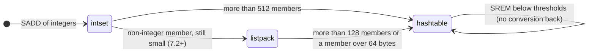

# Module 02 — Core Data Types, Internal Encodings and Complexity

Choosing the right Redis type is most of Redis data modelling. Each type is an abstract data type with a precise command set and documented complexity, and each is backed by one of several _encodings_ that Redis switches between as the value grows. This module defines the types formally, opens up the encodings (SDS, listpack, intset, quicklist, dict, skiplist, radix tree), shows how to reason about the cost of a command, and ends with a modelling guide for the questions interviewers actually ask ("leaderboard", "dedupe", "who is online").

> [!NOTE]
> Generic data-structure theory is owned by `algorithms/dsa`: hash tables and collision resolution ([dsa M03](../../../algorithms/dsa/modules/03-hashing-and-hash-tables.md#2-collision-resolution-chaining-vs-open-addressing)), skip lists ([dsa M13](../../../algorithms/dsa/modules/13-probabilistic-data-structures-and-randomized-algorithms.md#skip-lists)), and HyperLogLog math ([dsa M13](../../../algorithms/dsa/modules/13-probabilistic-data-structures-and-randomized-algorithms.md#3-hyperloglog-cardinality-estimation)). This module covers only Redis's realisation, limits and defaults.

**Executable proofs:** [`examples/ts/02-data-types-and-encodings.test.ts`](../examples/ts/02-data-types-and-encodings.test.ts) (span-augmented skiplist with property tests against a sorted-array model; an encoding-transition model) and [`examples/ts/integration/02-encodings.test.ts`](../examples/ts/integration/02-encodings.test.ts) (`OBJECT ENCODING` on a real server).

---

## 1. The type system

Every key maps to exactly one value of one type. `TYPE key` names it; `OBJECT ENCODING key` names its current internal representation.

| Type | Abstract model | Typical encodings | Introduced |
| --- | --- | --- | --- |
| String | Byte array ≤ 512 MB; also used as integer, float, bitmap, bitfield, HyperLogLog | `int`, `embstr`, `raw` | 1.0 |
| List | Sequence of strings with O(1) push/pop at both ends | `listpack` (small, 7.2+), `quicklist` | 1.0 |
| Set | Finite set of unique strings | `intset`, `listpack` (7.2+), `hashtable` | 1.0 |
| Sorted set (zset) | Set of unique members, each with a float64 score, totally ordered by (score, member bytes) | `listpack`, `skiplist` (skiplist + dict) | 1.2 |
| Hash | Map field → value (both strings), optional per-field TTL (7.4+) | `listpack`, `listpackex` (fields with TTL), `hashtable` | 2.0 |
| Stream | Append-only log of entries with monotonically increasing IDs and field/value bodies, plus consumer groups | `stream` (radix tree of listpacks) | 5.0 |
| Geo | A zset whose score is a 52-bit interleaved geohash | `listpack`/`skiplist` | 3.2 |
| HyperLogLog | A string holding 16 384 6-bit registers, sparse or dense | `raw` (string) | 2.8.9 |
| JSON, Time series, Bloom/Cuckoo/CMS/Top-K/t-digest | Former Redis Stack modules, now in Redis Open Source | module types | 8.0 in core ([module 08](08-query-engine-json-vectors-and-probabilistic.md#1-what-redis-8-bundled-and-why-it-matters)) |
| Vector set | Set of members with a vector each, HNSW-indexed for similarity search | `vectorset` | 8.0 |
| Array | Sparse, index-addressable sequence of strings | (new) | 8.8 |

**Key invariants that surprise people:**

1. **Aggregates never exist empty.** When the last element of a list, set, zset, hash or stream entry set… is removed, the key is deleted. (Streams are the exception: an empty stream can exist, because it carries consumer groups and a last ID.) `EXISTS` returns 0 afterwards; proven by the integration test `negative: an empty collection does not exist`.
2. **Writes to a non-existent key create it with the right type**, so `LPUSH`, `SADD`, `HSET` never need an "init" step.
3. **A command on the wrong type fails** with `-WRONGTYPE Operation against a key holding the wrong kind of value`, and arithmetic on a non-numeric string fails with `-ERR value is not an integer or out of range`.
4. **Scores are IEEE-754 doubles.** Integers are exact only up to $2^{53}$; `ZINCRBY` by 0.1 accumulates float error. Store money in integer minor units.

---

## 2. Complexity: what a command really costs

Redis documents the complexity of every command (`COMMAND DOCS <cmd>` → `complexity`). Read it as _main-thread time_, which every other client waits for.

| Family | Command | Complexity | Notes |
| --- | --- | --- | --- |
| String | `GET`, `SET`, `INCR`, `APPEND` | $O(1)$ | `APPEND` is amortised $O(1)$ (SDS preallocation). |
|  | `GETRANGE`, `SETRANGE` | $O(N)$ in bytes touched | `SETRANGE` beyond the end zero-pads, possibly allocating up to 512 MB. |
|  | `MGET`, `MSET` | $O(N)$ keys | One atomic step. |
| List | `LPUSH`/`RPUSH`/`LPOP`/`RPOP` | $O(1)$ per element |  |
|  | `LINDEX`, `LSET`, `LINSERT` | $O(N)$ | Walks from the nearer end. |
|  | `LRANGE start stop` | $O(S+N)$: $S$ = offset from the nearer end, $N$ = elements returned | `LRANGE 0 -1` on a 10 M list is a latency incident. |
|  | `LTRIM` | $O(N)$ removed |  |
|  | `BLMOVE` | $O(1)$ | Reliable-queue building block ([module 06](06-messaging-pubsub-streams-and-queues.md#3-lists-as-queues-and-the-reliable-queue-pattern)). |
| Hash | `HGET`, `HSET`, `HDEL`, `HINCRBY` | $O(1)$ per field | Listpack-encoded hashes do an $O(N)$ scan with small $N$. |
|  | `HGETALL`, `HKEYS`, `HVALS` | $O(N)$ | Prefer `HSCAN` or `HMGET` of known fields. |
| Set | `SADD`, `SREM`, `SISMEMBER`, `SCARD` | $O(1)$ |  |
|  | `SMEMBERS` | $O(N)$ |  |
|  | `SINTER` | $O(N \cdot M)$ worst: $N$ = smallest set, $M$ = number of sets | Redis iterates the smallest set and probes the others. |
|  | `SUNION`, `SDIFF` | $O(N)$ total elements | `SINTERCARD … LIMIT` (7.0) and `SUNIONCARD`/`SDIFFCARD` (8.10) count without materialising. |
| Sorted set | `ZADD`, `ZREM`, `ZINCRBY`, `ZRANK` | $O(\log N)$ | `ZRANK` uses skiplist spans (§ 3.5). |
|  | `ZSCORE` | $O(1)$ | Via the member → score dict. |
|  | `ZRANGE … BYSCORE`/`BYLEX`/by index | $O(\log N + M)$ | $M$ = elements returned. |
|  | `ZUNIONSTORE`/`ZINTERSTORE` | $O(N) + O(M \log M)$ | Can be very expensive; schedule off-peak or bound inputs. |
| Keyspace | `DEL` of an aggregate | $O(N)$ elements freed | Use `UNLINK` ([module 03](03-keys-expiry-eviction-and-memory.md#6-deleting-big-keys-del-vs-unlink-and-lazy-free)). |
|  | `KEYS pattern` | $O(N)$ keys in the database | Never in production; `SCAN`. |
|  | `SCAN` | $O(1)$ per call, $O(N)$ for a full iteration | ([module 03](03-keys-expiry-eviction-and-memory.md#5-scan-vs-keys-and-the-reverse-binary-cursor)) |

**Reasoning pattern for an interview.** State the complexity in terms of the variable that matters (elements returned vs collection size), then translate into time: at ~10–50 ns per element-touch on the main thread, an $O(N)$ command over 1 M elements costs tens of milliseconds, which is tens of milliseconds of added latency for every concurrent client. Then name the mitigation: paginate (`ZRANGE … LIMIT`, `*SCAN`), cap the collection (`LTRIM`, `XTRIM`), precompute, or split the key.

---

## 3. Internal encodings

### 3.1 Objects and SDS strings

Every value is wrapped in a `robj` header (16 bytes on 64-bit: type 4 bits, encoding 4 bits, 24 bits of LRU/LFU data, refcount, pointer). String payloads use **SDS** (Simple Dynamic Strings): a length-prefixed, binary-safe buffer with a NUL terminator for C interop and headers sized to the length (`sdshdr8/16/32/64`).

- **`int`**: if the string is the canonical decimal form of a signed 64-bit integer, the pointer field stores the integer itself. `"007"`, `"+1"`, `"1.0"` and `"-0"` are _not_ canonical and are stored as strings (`isCanonicalInt64` in the example mirrors `string2ll`).
- **`embstr`**: in classic Redis 7 and earlier, strings ≤ 44 bytes allocate the `robj` and the SDS in one 64-byte block: 16 (robj) + 3 (sdshdr8) + 44 + 1 (NUL) = 64 bytes, exactly one jemalloc size class and one cache line. In Redis 8, the `kvobj` dictionary entry optimization couples the key and value length inside dictionary slots: strings are embedded when $k_{\text{len}} + v_{\text{len}} \le 41$ bytes (e.g. at most 40 bytes of value for a 1-byte key; longer key names force `raw` even for short values). In Valkey 9, strings up to 128 bytes (two cache lines) can be embedded. `embstr` is read-only; any modification (`APPEND`, `SETRANGE`) converts it to `raw`, which the integration test proves.
- **`raw`**: separate allocation of object header and SDS string.

Byte length, not character count, decides: UTF-8 characters exceeding the embedding threshold become `raw` (tested).

### 3.2 Listpack (and why ziplist is gone)

A **listpack** is a single contiguous allocation:

```text
<total-bytes:u32> <num-elements:u16> <entry> <entry> … <end:0xFF>
entry = <encoding+data> <backlen>          ▷ backlen = length of this entry, for reverse iteration
```

Small integers and short strings are encoded in 1–5 header bytes. Lookups are linear scans, but a few hundred entries in contiguous memory scan faster than pointer-chasing a hash table, and memory overhead is a fraction of a dict's (no per-entry pointers, no `dictEntry` allocations).

**Then vs now: ziplist → listpack (Redis 7.0).** The older _ziplist_ stored in each entry the length of the _previous_ entry, in 1 or 5 bytes. Inserting an entry that grows one `prevlen` from 1 to 5 bytes can grow the next one too: a **cascading update**, $O(N^2)$ in the worst case. Listpack stores each entry's _own_ length at its end, so an insert changes only its neighbours' positions. Redis 7.0 replaced ziplist everywhere; the configuration keys were renamed `*-max-ziplist-*` → `*-max-listpack-*`, and the old names remain as aliases (`CONFIG GET hash-max-ziplist-entries` still answers). Migration step: rename the keys in `redis.conf`; old RDB files containing ziplists are converted on load.

#### Byte-level layout and a worked example

The format is public (`listpack.md` in `redis/redis`, constants in `src/listpack.c`). Each entry is `<encoding+data><backlen>`. The first byte selects the encoding:

| First byte | Meaning | Entry bytes (before backlen) | Range |
| --- | --- | --- | --- |
| `0xxxxxxx` | 7-bit unsigned integer | 1 | 0 to 127 |
| `10xxxxxx` | 6-bit string length, then data | 1 + len | len < 64 |
| `110xxxxx` + 1 byte | 13-bit signed integer | 2 | −4096 to 4095 |
| `1110xxxx` + 1 byte | 12-bit string length, then data | 2 + len | len < 4096 |
| `0xF0` + u32 | 32-bit string length, then data | 5 + len | larger strings |
| `0xF1` / `0xF2` / `0xF3` / `0xF4` | 16 / 24 / 32 / 64-bit signed little-endian integer | 3 / 4 / 5 / 9 | wider integers |
| `0xFF` | end marker | 1 | once, at the end |

Two rules decide which row applies. A string that is the canonical decimal form of a signed 64-bit integer is stored as an integer (the same `isCanonicalInt64` test as in § 3.1, so `"007"` stays a string and `"300"` becomes a 2-byte integer); everything else is a string. And the **back-length** is the byte length of `<encoding+data>`, written base-128 with the _most significant_ group first and the continuation bit set on every byte but the first (1 byte up to 127, 2 up to 16 382, 3 up to 2 097 150, 4 up to 268 435 454, else 5). Because only the leftmost byte of a multi-byte back-length lacks the continuation bit, a reader positioned just after an entry can walk backwards over bytes that have it, stop at the first byte that does not, and so recover the entry length without any `prevlen` field in the _next_ entry. That is the whole difference from ziplist.

Worked example, `["a", "5", "300"]` (what a hash `{a: ...}` would hold as its first three elements):

```text
0f 00 00 00        total-bytes = 15 (u32, little-endian)
03 00              num-elements = 3 (u16)
81 61 02           "a": 6-bit string header 0x80|1, data 0x61, backlen 2
05 01              "5":  7-bit integer 5, backlen 1
c1 2c 02           "300": 13-bit integer (0xC0 | 300>>8, 300 & 0xFF), backlen 2
ff                 end marker
```

The cascade-free property from the ziplist comparison is checkable: growing the first string from 100 to 300 bytes changes its own header and backlen, and the bytes of every later entry are identical (test `property: an entry whose back-length grows does not change any other entry`). The reverse decoder in [`src/listpack.ts`](../examples/ts/src/listpack.ts) walks only back-length fields and agrees with the forward decoder on random inputs, and the integration test `hash listpack: DUMP carries exactly the bytes encodeListpack produces` compares the model with the blob inside a real `DUMP` reply (RDB type 16 for a hash, 17 for a zset). `DUMP` is therefore also a practical way to look at an encoding without `DEBUG`: the payload is the RDB type byte, one length-prefixed (or LZF-compressed, when over 20 bytes and compressible) string, two bytes of RDB version and an 8-byte CRC64.

Consequences for cost: a listpack lookup is a linear scan over `n` entries that must decode each header to find the next one, with no random access. A hash is scanned in steps of two (field, value) and a zset in steps of two (member, score) from the head, which is why `hash-max-listpack-entries 512` means up to 1 024 listpack elements. An insert in the middle copies the tail (`memmove`), and a listpack that outgrows its allocation is reallocated whole, so a 512-field hash write can touch several kilobytes.

### 3.3 Thresholds and the one-way rule

| Type | Compact encoding | Converts when | Default thresholds (8.10.3) |
| --- | --- | --- | --- |
| Hash | `listpack` | more than `hash-max-listpack-entries` fields, or any field/value longer than `hash-max-listpack-value` bytes | 512 / 64 |
| Set | `intset` | a non-integer member is added, or more than `set-max-intset-entries` members | 512 |
| Set | `listpack` (7.2+) | more than `set-max-listpack-entries` members, or a member longer than `set-max-listpack-value` | 128 / 64 |
| Sorted set | `listpack` | more than `zset-max-listpack-entries` members, or a member longer than `zset-max-listpack-value` | 128 / 64 |
| List | `listpack` (7.2+) | the single node exceeds `list-max-listpack-size` | −2 (8 KB per node) |



**Conversions are one-way while the key lives.** Deleting fields from a `hashtable` hash never re-packs it; only an RDB reload (restart, `DEBUG RELOAD`, or a full resync on a replica) re-encodes. The hermetic `HashModel` and the integration test both assert this. Consequence: a hash that once briefly grew large keeps the memory-hungry encoding.

**Tuning trade-off.** Raising thresholds (e.g. `hash-max-listpack-entries 2048`) saves memory but makes every `HGET` an $O(N)$ scan of up to 2 048 entries and every `HSET` a potential `memmove` of the whole blob. Measure CPU before and after; the defaults are a good balance for most workloads.

### 3.4 Dict: incremental rehashing

The general hash table (`dict`) uses chaining with power-of-two table sizes and **two tables during a resize**. Instead of rehashing all entries at once (an $O(N)$ pause), Redis moves buckets from `ht[0]` to `ht[1]` incrementally: one bucket step on each dictionary operation, plus up to 1 ms of rehashing per `serverCron` tick when `activerehashing yes`. Lookups check both tables while a rehash is in progress. Two consequences:

- Memory briefly holds both tables: a 10 M-key database growing past a power of two allocates a 16 M-slot table (≈ 128 MB of pointers) at once. This shows up as a memory step in monitoring.
- Resizing is suspended while a fork child is running (to avoid touching pages and triggering copy-on-write), unless the load factor becomes extreme.

`SCAN`'s cursor design is driven by exactly this resizing; see [module 03](03-keys-expiry-eviction-and-memory.md#5-scan-vs-keys-and-the-reverse-binary-cursor).

### 3.5 Sorted sets: skiplist + dict, and spans

A large zset uses two structures that share the member strings:

- a **dict** member → score, for $O(1)$ `ZSCORE` and membership;
- a **skiplist** ordered by (score, member bytes), for range queries.

Redis's skiplist (after Pugh 1990) uses $p = 1/4$ and a maximum of 32 levels, keeps a **backward pointer** on level 0 for reverse iteration (`ZREVRANGE`), and stores on each forward link its **span**: the number of level-0 nodes the link jumps over. Summing spans along the search path gives the rank, so `ZRANK` and `ZRANGE` by index cost $O(\log N)$ expected instead of $O(N)$.

```text
SKIPLIST-RANK(zsl, score, member):
  rank ← 0; x ← zsl.header
  for i ← zsl.level − 1 downto 0:
     ▷ Invariant: rank = number of nodes ≤ x on level 0 (x itself included if not the header)
     while x.level[i].forward ≠ NIL and (forward.score, forward.member) ≤ (score, member):
        rank ← rank + x.level[i].span
        x ← x.level[i].forward
     if x.member = member: return rank − 1          ▷ 0-based, as ZRANK reports
  return NIL
```

**Insert maintains the span invariant**: for each level $i$ with predecessor $u_i$ and the new node at position $r_0+1$, the new node's span is $\text{span}(u_i) - (r_0 - r_i)$ and $u_i$'s becomes $r_0 - r_i + 1$; levels above the new node's height just increment their span. The example [`src/zset.ts`](../examples/ts/src/zset.ts) implements exactly this. The property test runs random add/remove sequences against a sorted-array model and checks rank, by-rank, range, reverse range and score ranges, plus a structural invariant check of every span. A second test inserts 100 000 members and measures that ranking the last one takes a few dozen forward hops, not 100 000.

Expected search cost is $\frac{1}{p}\log_{1/p} N$, about 33 comparisons for $N = 10^5$ and $p = 1/4$. The choice of $p = 1/4$ over $1/2$ trades slightly longer searches for fewer pointers per node (1.33 levels on average instead of 2).

#### Formal definition and invariants

A sorted set is a finite partial function $D : \text{Member} \rightarrow \text{Float64} \setminus \{\text{NaN}\}$ together with the strict total order on its graph

$$(m_1, s_1) \prec (m_2, s_2) \iff s_1 < s_2 \;\lor\; (s_1 = s_2 \land m_1 <_{\text{bytes}} m_2),$$

where $<_{\text{bytes}}$ is `memcmp` order with the shorter string first on a common prefix. Operational semantics of the main commands: `ZADD m s` sets $D(m) \leftarrow s$ (the old position, if any, disappears: a member exists once); `ZRANK m` is $|\{m' \in \text{dom } D : (m', D(m')) \prec (m, D(m))\}|$; `ZRANGE a b` returns the elements whose rank lies in $[a, b]$. The two backing structures must satisfy:

1. **Same domain.** The dict and the skiplist contain exactly the same members, and $D(m)$ read from the dict equals the score stored in $m$'s skiplist node. Every write updates both; a crash between the two is impossible because a command runs to completion on the main thread.
2. **Order.** Following level-0 forward pointers from the header visits nodes in strictly increasing $\prec$ order, and each backward pointer is the inverse of the level-0 forward pointer.
3. **Spans.** For a node $x$ with forward pointer $y$ at level $i$, $\text{span}_i(x) = \text{rank}(y) - \text{rank}(x)$ with $\text{rank}(\text{header}) = 0$; a link with no successor carries the number of nodes after $x$, which keeps insertion arithmetic uniform. `SortedSet.checkInvariants` verifies (3) at every level, and the property test `property: rank, byRank, range and rangeByScore agree with a sorted-array model` calls it after each random add and remove.

**Proof sketch that `ZRANK` is correct.** Let $x_j$ be the node reached after the $j$-th forward step of SKIPLIST-RANK and $r_j$ the accumulated sum of spans. By induction on $j$: $r_0 = 0 = \text{rank}(\text{header})$; a forward step from $x$ to $y$ adds $\text{span}_i(x) = \text{rank}(y) - \text{rank}(x)$, so $r_{j+1} = \text{rank}(x_{j+1})$. The search only moves forward to a node whose key is $\preceq$ the target, and descends a level otherwise; it terminates at level 0 on the largest node $\preceq$ target. If that node is the target member, its rank is $r$; otherwise the member is absent. **Expected cost** (Pugh 1990): the number of levels of a node is geometric with parameter $p$, so the expected number of nodes at level $\ge k$ is $n p^{k-1}$. Walking a search path backwards from the target, each step goes up with probability $p$ and left with probability $1-p$; the path climbs at most $L = \log_{1/p} n$ levels, giving an expected $L / p$ horizontal steps plus $L$ vertical ones plus a constant. For $p = 1/4$ and $n = 10^5$ that is $\approx 4 \cdot 8.3 = 33$, the order of magnitude that the test `ZRANK is O(log N): counting rank via spans visits far fewer nodes than N` measures.

**Why equal scores need the byte order.** Without the tie-break, $\prec$ would not be total, and `ZRANK` for two members with the same score would be ill-defined. The tie-break also makes `ZRANGE … BYLEX` meaningful when all scores are equal, which is the supported way to build a sorted _string_ index (autocomplete: add `ZADD idx 0 "alpha" 0 "alps"`, then `ZRANGE idx "[al" "[al\xff" BYLEX`).

### 3.6 Quicklist, streams and the rest

- **Quicklist**: a doubly-linked list of listpack nodes. `list-max-listpack-size -2` caps each node at 8 KB; `list-compress-depth N` LZF-compresses all but the `N` nodes at each end, which is ideal for queues where only the ends are touched.
- **Stream**: a radix tree (`rax`) keyed by entry ID whose leaves are listpacks of up to `stream-node-max-entries 100` entries / `stream-node-max-bytes 4096`. Entries in a node are delta-encoded against the node's master entry, so repeated field names cost almost nothing ([module 06](06-messaging-pubsub-streams-and-queues.md#2-streams)).
- **Intset**: a sorted array of 16-, 32- or 64-bit integers, upgraded in width when a larger integer arrives; `SISMEMBER` is a binary search.

### 3.7 Intset layout and the width upgrade

An intset is `<encoding:u32><length:u32><contents>` where `encoding` is 2, 4 or 8 (bytes per element) and `contents` is the sorted array of little-endian signed integers of that width. Membership is binary search ($\lceil \log_2 (n+1) \rceil$ probes at most); insertion is a binary search plus a `memmove` of the tail, so it is $O(n)$ with a tiny constant and a hard cap of 512 elements by default. Adding a member that does not fit the current width **upgrades the whole array** to the wider width in one pass: because the new value is outside the old range it is necessarily either smaller than every member or larger than every member, so it goes at one end and no search is needed. The invariant is: `encoding` is the smallest width that fits every member at the time of the last upgrade. Redis never downgrades, so removing the one large member leaves the wide encoding in place (the same one-way principle as § 3.3).

The hermetic test `intset: width is the smallest that fits every member` and the integration test `intset: width upgrades 2 -> 4 -> 8 bytes while OBJECT ENCODING stays intset` show that `SADD 40000` moves the array from 2 to 4 bytes per element and `SADD 1099511627776` from 4 to 8, with `OBJECT ENCODING` still reporting `intset` and the `DUMP` blob (RDB type 11) equal to the model's bytes. Memory arithmetic: 512 members of 32-bit width have a payload of $8 + 512 \cdot 4 = 2\,056$ bytes. Measured on 7.0.15, `MEMORY USAGE` reports 2 608 bytes for a 512-member `intset` and 24 712 bytes for a 513-member `hashtable` set of similar integers, about 9 times more for one extra member, which is why integer-only sets (user IDs, tag IDs) are worth keeping integer-only and below the cap.

### 3.8 What changed in Redis 8 for the encodings

Nothing in the encodings above changed in 8.0 to 8.10 except additions: `listpackex` (7.4) for hashes with field TTLs, compact hashes in 8.10 (§ 6.1). Treat any per-key byte count in this module as a measurement on a named version (§ 6.4 says 7.0.15) and re-measure with `MEMORY USAGE` on the version you run; the thresholds, not the byte counts, are the stable contract. The test suite pins only the thresholds and the bytes of the stable formats, never the allocator-dependent `MEMORY USAGE` values.

---

## 4. Strings beyond strings: counters, bitmaps, bitfields

- **Counters**: `INCR`/`INCRBY`/`DECRBY` on a canonical integer, `INCRBYFLOAT` on a decimal string (stored back as a string, so float precision artefacts appear in the value). 8.8 added `INCREX`, an increment with bounds and expiry in one command, aimed at window rate limiting ([module 07](07-coordination-rate-limits-locks-and-idempotency.md#1-rate-limiters)).
- **Bitmaps**: `SETBIT key offset 1`, `GETBIT`, `BITCOUNT` (with `BIT` or `BYTE` ranges), `BITPOS`, `BITOP AND|OR|XOR|NOT`. Redis 8.2 added `BITOP DIFF`, `DIFF1`, `ANDOR` and `ONE`. A bitmap for daily active users keyed by integer user ID costs `max_id / 8` bytes: 12.5 MB for 100 M IDs. The trap: `SETBIT key 4000000000 1` allocates 500 MB immediately.
- **Bitfields**: `BITFIELD key INCRBY u8 #3 1 OVERFLOW SAT` packs many small counters into one string with wrap, saturate or fail overflow semantics. Formally a field type is `i<b>` (1 to 64 bits) or `u<b>` (1 to 63 bits; `u64` is rejected because replies are signed 64-bit integers), with value range $[-2^{b-1}, 2^{b-1}-1]$ or $[0, 2^b-1]$. An `INCRBY` computes $v' = v + \delta$ in unbounded arithmetic and then applies the mode in force: `WRAP` returns $v' \bmod 2^b$ reinterpreted in the type's range, `SAT` clamps to the nearest bound, and `FAIL` replies nil and leaves the field unchanged. `OVERFLOW` affects only the `INCRBY` sub-commands that follow it, and `#n` addresses the $n$-th field of that width (offset $n \cdot b$). The model `bitfieldIncrBy` in [`src/listpack.ts`](../examples/ts/src/listpack.ts) is checked against the server for five type/value/delta combinations in all three modes, plus the two negative cases (`u64`, an unknown overflow mode). A common production use is a bank of per-minute counters in one key (`u16` fields addressed by `#minuteOfDay`), which costs 2 bytes per counter instead of one key (tens of bytes of overhead) each.
- **Compare-and-set on strings (8.4)**: `DIGEST key` returns an XXH3 hex digest; `DELEX key IFEQ v | IFNE v | IFDEQ d | IFDNE d` deletes conditionally; `SET` accepts `IFDEQ`/`IFDNE` digest conditions; `MSETEX` sets several keys and their expiry atomically. `DELEX … IFEQ` makes the classic "release lock only if I own it" script unnecessary on 8.4+ ([module 07](07-coordination-rate-limits-locks-and-idempotency.md#2-distributed-locks)).

## 5. HyperLogLog and Geo: Redis-specific realisation

**HyperLogLog** (`PFADD`, `PFCOUNT`, `PFMERGE`). Redis uses $m = 2^{14} = 16\,384$ registers of 6 bits each: 12 288 bytes of registers plus a 16-byte header, 12 KB per key regardless of cardinality, with a standard error of $1.04/\sqrt{m} \approx 0.81\%$. Small HLLs use a **sparse** run-length representation and are promoted to **dense** once they exceed `hll-sparse-max-bytes` (default 3000). The value is an ordinary string (`TYPE` says `string`), so you can `GET`/`SET` it to move it between instances. `PFCOUNT` of several keys merges on the fly; `PFCOUNT` caches its last result in the header, so the documentation calls it "technically a write command": it can modify the key as a side effect. The estimator math is owned by [dsa M13](../../../algorithms/dsa/modules/13-probabilistic-data-structures-and-randomized-algorithms.md#core-principle-harmonic-mean).

**Geo** (`GEOADD`, `GEOSEARCH`, `GEODIST`). Longitude/latitude are interleaved into a 52-bit geohash stored as the zset score; 52 bits fit exactly in a double's 53-bit mantissa. `GEOSEARCH … BYRADIUS | BYBOX` scans the 9 geohash cells that cover the area and filters by true distance (haversine on a sphere of radius 6 372 797.560856 m). Precision is about 0.6 mm, but the spherical model is off by up to ~0.5 % versus WGS-84. Coordinates beyond ±85.05112878° latitude are rejected (the Web-Mercator limit). Valkey 9.0 added geospatial search by polygon; Redis 8.10 has radius and box search only.

---

## 6. Hashes with per-field TTL

Redis 7.4 added **hash field expiration**: `HEXPIRE key seconds FIELDS n f1 …`, `HPEXPIRE`, `HEXPIREAT`, `HPEXPIREAT`, `HTTL`, `HPTTL`, `HEXPIRETIME`, `HPEXPIRETIME`, `HPERSIST`. Redis 8.0 added `HGETEX` (read and set/clear TTL), `HSETEX` (write with TTL, optionally only if all/none of the fields exist) and `HGETDEL` (read and delete). Valkey added the same family in 9.0.

|  | **Then** (≤ 7.2) | **Now** (7.4+, `HGETEX`/`HSETEX` 8.0+) |
| --- | --- | --- |
| Per-field expiry | Impossible; one key per expiring item (`session:{id}:{field}`), or a zset of expiry times plus a sweeper job | `HPEXPIRE user:42 1800000 FIELDS 1 cart` |
| Atomic read + refresh TTL | `MULTI` + `HGET` + `EXPIRE` on a separate key | `HGETEX user:42 EX 1800 FIELDS 1 cart` |
| Encoding | `listpack` / `hashtable` | adds `listpackex` (listpack with TTL metadata) |

Exact forms, from the command definitions in `src/commands/` of the 8.0 branch: `HEXPIRE key seconds [NX | XX | GT | LT] FIELDS numfields field [field …]` (7.4.0); `HGETEX key [EX seconds | PX ms | EXAT ts | PXAT ms-ts | PERSIST] FIELDS numfields field …` (8.0.0); `HSETEX key [FNX | FXX] [EX seconds | PX ms | EXAT ts | PXAT ms-ts | KEEPTTL] FIELDS numfields field value [field value …]` (8.0.0), where `FNX` applies the write only if _none_ of the fields exist and `FXX` only if _all_ of them do; `HGETDEL key FIELDS numfields field …` (8.0.0). The `numfields` count is mandatory and a mismatch with the actual argument count is a syntax error, which is the usual first mistake.

**Pitfalls:** the reply is an array with one status code per field (−2 no such field, 0 condition not met, 1 set, 2 field deleted because the time is in the past); field TTLs do not make the key expire; `HSET` on a field clears that field's TTL; and RDB files containing field TTLs need Redis ≥ 7.4 to load (one reason Redis 7.4+ RDB files are not portable to Valkey 8; [module 12](12-operations-security-observability-and-valkey.md#7-valkey-9x-delta)). The integration test `hash field expiration: HEXPIRE (7.4+) …` is **proven only against a 7.4+ server**.

### 6.1 Redis 8.10 compact hashes

8.10 introduced _compact hashes_: hashes that share the same set of field names can share one template, so the field names are stored once. They are controlled by `hash-min-template-entries`/`hash-max-template-entries` (0 = disabled by default in `redis.conf` 8.10.3) and load-time conversion knobs (`hash-rdb-load-min-template-entries`, `hash-rdb-load-max-template-entries`, `hash-rdb-load-template-disassembly-threshold`), with `HIMPORT` for bulk insertion and `hash_templates`/`used_memory_hash_templates` metrics. Treat it as an opt-in memory optimisation for millions of identically shaped hashes; it is new and has little production history.

---

## 6.2 Lists and sets: the operations people misuse

**Lists.**

- `LPOS key element [RANK r] [COUNT n] [MAXLEN m]` (6.0.6+) finds positions; `MAXLEN` bounds the scan so it cannot turn into an $O(N)$ walk of a huge list.
- `LMPOP numkeys k1 k2 … LEFT|RIGHT [COUNT n]` and `BLMPOP` (7.0+) pop from the first non-empty list among several, which replaces client-side polling loops over priority queues.
- `LMOVEM`/`BLMOVEM` (8.10) move several elements between lists in one command; check the command reference for the exact argument order before using them, as they are new.
- `BLPOP`/`BRPOP`/`BLMOVE` block the _connection_, not the server; the server parks the client and wakes it when a push arrives. A blocked client in Cluster is redirected if its slot moves.
- `RPOPLPUSH` is deprecated in favour of `LMOVE`/`BLMOVE` (6.2+), which take explicit `LEFT|RIGHT` directions.

**Sets.**

- `SPOP key [count]` removes random members; `SRANDMEMBER key count` returns them without removing (a negative count allows repeats). On a `hashtable`-encoded set the naive method (`dictGetRandomKey`: pick a random non-empty bucket, then a random element of its chain) favours members in short chains. Redis calls `dictGetFairRandomKey` instead (`setTypeRandomElement` in `t_set.c`), which collects up to 15 consecutive entries with `dictGetSomeKeys` and returns one of them uniformly, smoothing out chain-length differences. It is fairer, but it samples a _window_ of the table, so the result is still not an exactly uniform draw. Do not use it for fairness-critical sampling (lotteries, audited raffles); shuffle client-side or use a zset with random scores.
- `SMISMEMBER` (6.2+) checks several members in one round trip.
- `SINTERCARD numkeys k1 k2 … [LIMIT n]` (7.0+) stops counting at `n`, which bounds the work.

## 6.3 The Array type (8.8)

Redis 8.8 introduced an **Array** data type: a sparse, index-addressable sequence of strings. Where a list is optimised for its ends ($O(N)$ `LINDEX`), an array is designed for positional access by index, with holes allowed. The documentation groups its commands under the `array` command group; they are new, and this track does not teach their syntax beyond pointing at the command reference. Treat Array as "evaluate before adopting": client-library support (`node-redis` typed commands) lags new server types, and Valkey has no equivalent, so it locks you into Redis 8.8+.

## 6.4 Seeing encodings and memory for yourself

```text
127.0.0.1:6379> HSET user:1 name Ada plan pro
(integer) 2
127.0.0.1:6379> OBJECT ENCODING user:1
"listpack"
127.0.0.1:6379> MEMORY USAGE user:1
(integer) 80          ▷ measured on 7.0.15/jemalloc; varies by version and allocator
127.0.0.1:6379> CONFIG SET hash-max-listpack-entries 1
OK
127.0.0.1:6379> HSET user:2 name Ada plan pro
(integer) 2
127.0.0.1:6379> OBJECT ENCODING user:2
"hashtable"
127.0.0.1:6379> MEMORY USAGE user:2
(integer) 216         ▷ same data as a dict: about 2.7x the memory (measured on 7.0.15)
```

`MEMORY USAGE key [SAMPLES n]` estimates the bytes attributable to a key, sampling `n` elements of aggregates (default 5; `SAMPLES 0` means all, which is $O(N)$). `DEBUG OBJECT key` (when `enable-debug-command` allows it) shows `serializedlength`, the RDB size, which is often much smaller than the in-memory size. `OBJECT FREQ` (LFU policies only) and `OBJECT IDLETIME` (LRU policies) expose the eviction metadata stored in the `robj` header ([module 03](03-keys-expiry-eviction-and-memory.md#3-eviction-under-maxmemory)).

## 6.5 Then vs now: data-type commands since 6.2

| Version | Change | Replace this | With this |
| --- | --- | --- | --- |
| 6.2 | `GETEX`, `GETDEL`, `LMOVE`/`BLMOVE`, `ZRANGESTORE`, `SMISMEMBER`, unified `ZRANGE … BYSCORE \| BYLEX \| REV \| LIMIT` | `ZRANGEBYSCORE`, `ZREVRANGE`, `RPOPLPUSH`, `GET` + `EXPIRE` | `ZRANGE … BYSCORE`, `ZRANGE … REV`, `LMOVE`, `GETEX` |
| 7.0 | listpack everywhere, `LMPOP`/`BLMPOP`/`ZMPOP`, `SINTERCARD`, `BITCOUNT … BIT`, Functions | `*-ziplist-*` config | `*-listpack-*` config |
| 7.2 | listpack-encoded small sets and lists | — | — |
| 7.4 | Hash field expiration (`HEXPIRE` family) | key-per-field designs | field TTLs |
| 8.0 | `HGETEX`, `HSETEX`, `HGETDEL`; JSON, TimeSeries, probabilistic types and Vector sets in core | Redis Stack | Redis Open Source 8 |
| 8.2 | `BITOP DIFF/DIFF1/ANDOR/ONE`, `XDELEX`, `XACKDEL` | client-side bit arithmetic | server-side |
| 8.4 | `DELEX`, `DIGEST`, `SET` digest conditions, `MSETEX` | compare-and-delete Lua scripts | `DELEX key IFEQ value` |
| 8.8 | Array type, `INCREX`, `XNACK` | `INCR` + `EXPIRE` scripts | `INCREX … UBOUND … EX … ENX` |
| 8.10 | Compact hashes, `LMOVEM`/`BLMOVEM`, `SUNIONCARD`/`SDIFFCARD` | `SUNIONSTORE` + `SCARD` + `DEL` | `SUNIONCARD` |

The old commands (`ZRANGEBYSCORE`, `RPOPLPUSH` …) still work and are marked deprecated in `COMMAND DOCS`; mixing them in one codebase is harmless but makes reviews harder. When migrating to 8.4's `DELEX`, keep the Lua fallback for Valkey and older Redis, selected by a version check at start-up rather than per call.

---

## 7. Modelling guide

| Requirement | Structure | Why | Watch out for |
| --- | --- | --- | --- |
| Object with fields, partial updates | Hash (`HSET user:42 name … plan …`) | $O(1)$ per field, listpack-compact when small | Don't `HGETALL` huge hashes; `HINCRBY` for counters. |
| Leaderboard, top-N, rank lookup | Sorted set | $O(\log N)$ update and rank, `ZRANGE … REV LIMIT` | Ties order by member bytes; scores are doubles. |
| Time-ordered index / delayed jobs | Sorted set with timestamp scores | `ZRANGE … BYSCORE` for "due before now" | Pop atomically (`ZPOPMIN`, or a script) to avoid double processing. |
| Deduplication, membership | Set (exact) or Bloom filter (approximate, fixed memory) | $O(1)$ `SADD` returns whether the element was new | A 100 M-member set costs gigabytes; consider Bloom ([module 08](08-query-engine-json-vectors-and-probabilistic.md#6-probabilistic-structures-redis-realisation)). |
| Unique visitors per day | HyperLogLog | 12 KB per key, 0.81 % error, `PFMERGE` for weekly rollups | Cannot list members or remove one. |
| Daily active users by integer ID | Bitmap | 1 bit per ID; `BITOP AND` for retention cohorts | Sparse large IDs waste memory. |
| FIFO work queue | List with `BLMOVE` into a processing list, or a Stream with a consumer group | Blocking pop, at-least-once with acknowledgement | See [module 06](06-messaging-pubsub-streams-and-queues.md#5-choosing-pubsub-vs-streams-vs-lists-vs-kafka). |
| Event log with replay and fan-out | Stream | IDs, consumer groups, PEL | Trim it ([module 06](06-messaging-pubsub-streams-and-queues.md#24-trimming-and-memory)). |
| "Who is near me" | Geo | `GEOSEARCH … BYRADIUS … ASC COUNT 20` | Spherical approximation. |
| Rate limit | String counter with TTL, `INCREX`, or a script | Atomic | [Module 07](07-coordination-rate-limits-locks-and-idempotency.md#1-rate-limiters). |
| Document with nested fields and secondary queries | JSON + Query Engine index | `JSON.SET`, `FT.SEARCH` | [Module 08](08-query-engine-json-vectors-and-probabilistic.md#2-json). |

**Key naming.** Use `:`-separated, typed prefixes (`user:42`, `user:42:sessions`), keep keys short but readable, and in Cluster put keys that must be touched together in one hash slot with a hash tag (`cart:{42}`, `cart:{42}:items`; [module 11](11-redis-cluster.md#2-hash-tags-and-multi-key-operations)).

---

## 8. Production failure modes

1. **Big keys.** A single hash with 20 M fields or a 300 MB string: every full read is a latency spike, replication of a single write ships a lot of data, migration in Cluster blocks, and eviction of the key frees a lot at once. Detect with `redis-cli --bigkeys` / `--memkeys`, `MEMORY USAGE key SAMPLES 0`, and on 8.6+ the `key-memory-histograms` metrics ([module 12](12-operations-security-observability-and-valkey.md#5-hot-keys-and-big-keys)). Fix by sharding the key (`user:42:events:{yyyymmdd}`) and capping growth.
2. **Hot keys.** One key receiving most requests saturates one thread (and one Cluster shard). Detect with `HOTKEYS` (8.6+), `redis-cli --hotkeys` (LFU policy required), or client-side metrics. Mitigate with client-side caching or read replicas for hot reads, and by splitting counters across N keys and summing.
3. **Encoding cliff.** A workload that grows hashes from 500 to 600 fields moves them from listpack to hashtable and memory per key jumps several-fold. The one-way rule means it never comes back down.
4. **Float scores.** Using a zset score for a 64-bit ID loses precision above $2^{53}$; use a lexicographic zset (`ZRANGE … BYLEX` with all scores 0) or zero-padded string members.
5. **`WRONGTYPE` in production.** Two services writing different types under the same key prefix. Enforce naming conventions and ACL key patterns per service.

---

## Proof map for this module

| Claim | Hermetic proof | Integration proof (real server) |
| --- | --- | --- |
| Zset order is (score, member bytes); ZADD re-positions | `ties on score …`, `ZADD on an existing member …` | `zset: listpack -> skiplist …` (tie order) |
| Span-augmented skiplist gives correct, $O(\log N)$ rank | property test, `ZRANK is O(log N) …` | — |
| `int` / `embstr` (≤ 44 B) / `raw` | `string encodings …` | `string encodings match the model …` |
| Hash/set/zset thresholds and the one-way rule | `hash: …`, `set: …`, `zset: …` (model) | `hash: listpack -> hashtable at 513 fields …`; `set: intset -> listpack (7.2+) …` (**7.2+ only**) |
| Small lists are listpack | — | `list: small lists are listpack (7.2+) …` (**integration-only, 7.2+**) |
| `WRONGTYPE`, empty aggregates vanish | — | `negative: WRONGTYPE …`, `negative: an empty collection …` (**integration-only**) |
| Listpack byte layout, back-length, no cascade; intset width upgrade | `listpack: the worked example …`, `property: forward and reverse decoding agree …`, `intset: width is the smallest …` | `hash listpack: DUMP carries exactly the bytes …`, `zset listpack: members and scores alternate …`, `intset: width upgrades 2 -> 4 -> 8 …` (run on 7.0.15) |
| `BITFIELD` overflow modes and type limits | `BITFIELD: WRAP, SAT and FAIL differ …` | `BITFIELD OVERFLOW matches the model …`, `negative: BITFIELD rejects unsigned 64-bit fields …` (run on 7.0.15) |
| Hash field TTL, `HGETEX` | — | **integration-only, 7.4+ / 8.0+**: not executed while authoring (local server 7.0.15); run on the pinned 8.10.3 image |

---

## 9. Interview Drill

<details><summary>1. Design a real-time game leaderboard with "top 10" and "my rank".</summary>

Sorted set `lb:{season}` with `ZADD lb score player` (or `ZINCRBY`). Top 10: `ZRANGE lb 0 9 REV WITHSCORES`, $O(\log N + 10)$. My rank: `ZREVRANK lb player`, $O(\log N)$ thanks to skiplist spans. Ties break by member bytes, so if "earlier achiever wins", encode time into the score (e.g. `score * 1e6 + (MAX_TS - ts)` within $2^{53}$). For multiple seasons, one key per season, and expire old ones.
</details>

<details><summary>2. Why does `OBJECT ENCODING` report `listpack` for a small hash and `hashtable` for a big one? What is the trade-off?</summary>

Small collections are stored as one contiguous listpack: very low memory overhead and cache-friendly scans, but $O(N)$ lookups and $O(N)$ inserts (`memmove`). Past `hash-max-listpack-entries` (512) or `hash-max-listpack-value` (64 bytes) Redis converts to a dict with $O(1)$ operations and much higher per-entry overhead. The conversion is one-way while the key lives.
</details>

<details><summary>3. What is the complexity of `ZRANK`, and how is it achieved?</summary>

$O(\log N)$ expected. The skiplist stores on each forward pointer the number of level-0 nodes it skips (span). Searching for the member while summing spans yields its rank.
</details>

<details><summary>4. Why is a string ≤ 44 bytes encoded differently from a longer one?</summary>

`embstr` allocates the object header and the SDS string in one 64-byte allocation (16 + 3 + 44 + 1 NUL in Redis 7; coupled as $k_{\text{len}} + v_{\text{len}} \le 41$ bytes in Redis 8 kvobj), one jemalloc size class and one cache line, with one fewer allocation and pointer dereference. It is immutable; modifications convert it to `raw`.
</details>

<details><summary>5. You need unique daily visitors for 500 pages, kept for a year. Which structure, and what does it cost?</summary>

One HyperLogLog per page per day: 500 × 365 × 12 KB ≈ 2.2 GB if all were dense; most low-traffic pages stay sparse and much smaller. 0.81 % standard error; weekly or monthly uniques via `PFCOUNT` over several keys or `PFMERGE`. If exact counts are required, use a set per page per day, at far higher memory cost.
</details>

<details><summary>6. What happened to the ziplist, and does it affect your configuration?</summary>

Redis 7.0 replaced ziplist with listpack because inserting into a ziplist could trigger cascading updates of the `prevlen` fields ($O(N^2)$ worst case). Config keys were renamed to `*-listpack-*`; the old names are aliases. RDB files with ziplists convert on load.
</details>

<details><summary>7. Why is `SINTER` of a 10-element set and a 10-million-element set cheap, and `SUNION` of them not?</summary>

`SINTER` iterates the smallest set and probes the others in $O(1)$: about 10 probes. `SUNION` must touch every element of every set: $O(N)$ with $N$ = 10 M, and it materialises the result. For counts only, use `SINTERCARD`, or on 8.10+ `SUNIONCARD`.
</details>

<details><summary>8. How do you expire one field of a hash, and what changes for replication and migration?</summary>

On 7.4+ use `HPEXPIRE key ms FIELDS 1 field` (or `HSETEX`/`HGETEX` on 8.0+). Field expirations replicate like key expirations (the primary sends `HDEL` when a field expires). RDB files with field TTLs need Redis ≥ 7.4, so a dataset using them cannot be loaded by Redis 7.2 or be assumed loadable by Valkey 8; Valkey 9.0 implements the same commands but has its own RDB versioning.
</details>

<details><summary>9. A teammate says "Redis picks a random element with SRANDMEMBER, so it is a fair lottery". What do you answer?</summary>

For small `listpack` and `intset` sets the pick is uniform over positions. For a `hashtable` set Redis uses `dictGetFairRandomKey`, which draws from a window of up to 15 consecutive entries to compensate for uneven bucket chains. That is fairer than the older "random bucket, then random chain element" draw but is not an exactly uniform sample, and the sampling window depends on table layout. For anything audited, assign a random score to each entrant in a zset (or shuffle client-side with a seeded, logged PRNG) so the outcome is reproducible and checkable.
</details>

<details><summary>10. You must prove to a sceptic that a small hash is stored as a listpack and not as a dict. How?</summary>

`OBJECT ENCODING` gives the name. For evidence, `DUMP key` returns the RDB payload whose first byte is the RDB type (16 for a hash listpack, 25 for a hash listpack with field TTLs, 4 for a plain hash) and whose body is the listpack blob itself: a 4-byte total length, a 2-byte element count, entries with their own back-lengths, and an `0xFF` terminator. The track's `encodeListpack` reproduces those bytes exactly for strings and integers of every width, so you can compare byte for byte. The same payload shows why growing one entry never rewrites its neighbours, unlike ziplist.
</details>
