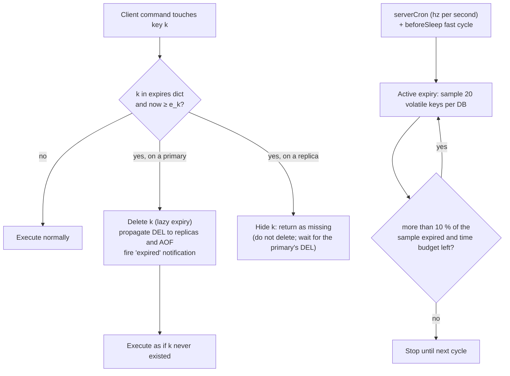

# Module 03 — Keys, Expiry, Eviction and Memory

Redis keeps everything in RAM, so the questions "when does this key go away?" and "what happens when memory is full?" decide whether it behaves as a cache, a database, or an outage. This module defines TTL semantics precisely, explains the two expiry mechanisms and why expired keys can still occupy memory, dissects the approximated LRU and LFU eviction algorithms (and Redis 8.6's LRM policies), shows how to read memory metrics, and proves why `SCAN` is safe where `KEYS` is not.

> [!NOTE]
> LRU and LFU _as data structures_ (O(1) exact implementations) are owned by [dsa M13](../../../algorithms/dsa/modules/13-probabilistic-data-structures-and-randomized-algorithms.md#4-cache-eviction-topologies-o1-lru-and-lfu-caches), and eviction policy theory (W-TinyLFU, hit-ratio math) by [data-systems M09](../../../architecture/data-systems/modules/09-caching-theory-and-consistency.md#5-cache-eviction-policies-lru-lfu-and-window-tinylfu). This module covers Redis's sampled approximations and their knobs.

**Executable proofs:** [`examples/ts/03-keys-expiry-eviction.test.ts`](../examples/ts/03-keys-expiry-eviction.test.ts) with the models in [`src/keyspace.ts`](../examples/ts/src/keyspace.ts), and [`examples/ts/integration/03-expiry-eviction.test.ts`](../examples/ts/integration/03-expiry-eviction.test.ts).

---

## 1. TTL semantics

### 1.1 Definitions

Each database holds two dictionaries: the **main dict** (key → value) and the **expires dict** (key → absolute expiry time in Unix milliseconds). A key is _volatile_ if it has an entry in the expires dict and _persistent_ otherwise.

- **Logical existence.** A volatile key $k$ with expiry $e_k$ _exists_ at time $t$ iff $t < e_k$. Every command observes logical existence: an expired key is never returned.
- **Physical presence.** The key's memory is reclaimed only when an expiry mechanism deletes it (§ 2). Between $e_k$ and that moment the key is logically gone but physically present: it counts in `DBSIZE` and `used_memory`.
- **TTL reply codes.** `TTL`/`PTTL` return the remaining time, `-1` for a persistent key, `-2` for a missing key. `EXPIRETIME`/`PEXPIRETIME` (7.0+) return the absolute time.

### 1.2 Which commands touch the TTL

| Operation | Effect on TTL | Reason |
| --- | --- | --- |
| `SET k v` (no `KEEPTTL`), `GETSET`, `SET … EX` | Replaces the value object, so the TTL is cleared (or set anew) | `SET` creates a new value. `KEEPTTL` (6.0+) keeps the old one. |
| `INCR`, `APPEND`, `LPUSH`, `HSET`, `SADD`, `ZADD` … | Keeps the TTL | They modify the existing value in place. |
| `RENAME src dst` | `dst` gets `src`'s TTL; any TTL of the old `dst` is discarded | The key object moves. |
| `PERSIST k` | Removes the TTL |  |
| `EXPIRE k s [NX\|XX\|GT\|LT]` (7.0+ flags) | `NX`: only if no TTL; `XX`: only if it has one; `GT`/`LT`: only if the new TTL is greater/less | Lets you implement "extend but never shorten" atomically. |
| `EXPIRE k 0` or a time in the past | Deletes the key immediately (propagated as `DEL`/`UNLINK`) |  |
| `GETEX k EX s` / `GETEX k PERSIST` (6.2+) | Reads and changes the TTL atomically | Sliding sessions without a script. |
| `HEXPIRE` family (7.4+) | Per-field TTLs inside a hash; the key's own TTL is separate | [Module 02](02-core-data-types-encodings-and-complexity.md#6-hashes-with-per-field-ttl). |

The integration test `TTL semantics …` proves the most common surprise: a plain `SET` on a key with a TTL makes it persistent, while `INCR` keeps the TTL.

### 1.3 Time inside scripts and transactions

Redis evaluates expiry against a cached "command time". Inside a Lua script or function, and inside `MULTI/EXEC`, time is frozen at the start: a key that expires half-way through a long script is still visible to the rest of the script. This keeps scripts deterministic for replication.

---

## 2. How keys actually expire



### 2.1 Lazy (passive) expiry

On every key lookup, `expireIfNeeded()` checks the expires dict. If the key is past its time, a primary deletes it and the command proceeds as if the key were missing. Cost: $O(1)$ per access. Weakness: a key that is never accessed again is never reclaimed by this path. The hermetic `LazyExpireStore` and the integration test with `DEBUG SET-ACTIVE-EXPIRE 0` show a key that is expired, invisible to `GET`, but still counted by `DBSIZE` until touched.

### 2.2 Active expiry

`activeExpireCycle` runs in two modes: a _slow_ cycle from `serverCron` (bounded to roughly 25 % of CPU time per `hz` tick) and a _fast_ cycle from `beforeSleep` (about 1 ms, at most every 2 ms). Each loop samples `ACTIVE_EXPIRE_CYCLE_KEYS_PER_LOOP = 20` volatile keys per database (scaled up by `active-expire-effort`, 1–10, default 1), deletes the expired ones, and **repeats while more than 10 % of the sample was expired** (the acceptable stale percentage, reduced as effort increases) and the time budget is not exhausted.

```text
ACTIVE-EXPIRE-CYCLE(db, effort):
  perLoop ← 20 + 5·(effort − 1); acceptable ← 10 − (effort − 1)      ▷ percent
  repeat
     sampled ← 0; expired ← 0
     for i ← 1 to perLoop: k ← RANDOM-VOLATILE-KEY(db); sampled++
                           if now ≥ e_k then DELETE(k); expired++
  until sampled = 0 or 100·expired/sampled ≤ acceptable or time budget spent
```

**What this guarantees, and what it does not.** It is a probabilistic bound on _stale memory_, not a deadline. The stopping rule looks at a 20-key sample, so a cycle can stop while the population is still well above 10 % stale. The hermetic test starts with 50 % of 100 000 keys expired and runs 200 cycles: the stale fraction is driven down to the 15–25 % region, never to zero, and a single cycle sometimes ends early by bad luck. Production consequence: with millions of short-TTL keys created faster than they are sampled, a measurable fraction of memory is logically dead. Mitigations: raise `active-expire-effort`, raise `hz` (more cycles), or prefer fewer, larger keys with field-level TTLs.

#### The constants, read from `expire.c`

The numbers above are the `effort = 1` baseline. `activeExpireCycle` rescales them from `active-expire-effort` (integer 1 to 10; `CONFIG SET` rejects 0 and 11) by `e = effort − 1`:

| Parameter                              | Formula           | effort 1 | effort 5 | effort 10 |
| -------------------------------------- | ----------------- | -------- | -------- | --------- |
| Keys sampled per loop per database     | $20 + 5e$         | 20       | 40       | 65        |
| Acceptable stale percentage            | $10 - e$          | 10       | 6        | 1         |
| Slow-cycle CPU share of each `hz` tick | $25 + 2e$ percent | 25       | 33       | 43        |
| Fast-cycle duration                    | $1000 + 250e$ µs  | 1 000    | 2 000    | 3 250     |

With `hz 10` the slow cycle may therefore use $25\,\% \cdot 100\,\text{ms} = 25$ ms of every 100 ms tick at the default effort, and 43 ms at effort 10: the price of reclaiming memory faster is added latency for every client queued behind the cycle. A **fast** cycle (run from `beforeSleep`) starts only if the previous cycle ended because it ran out of time, or if the running estimate of the stale percentage (`stat_expired_stale_perc`) is already above the acceptable value; it never runs twice within twice its own duration. Up to `CRON_DBS_PER_CALL = 16` databases are visited per call, resuming where the last call stopped. The formulas are implemented as `activeExpireParams` and `slowCycleBudgetMicros` in [`src/keyspace.ts`](../examples/ts/src/keyspace.ts) and pinned by the tests `active-expire-effort rescales every constant` and `slow cycle budget …`.

#### Hash fields expire on a different, deterministic path

Per-field TTLs (7.4+) are not reclaimed by the sampling loop. Each database keeps its expiring hashes in an `ebuckets` structure ordered by the earliest field expiry, and `activeExpireHashFieldCycle` removes expired fields in time order, at most `HFE_DB_BASE_ACTIVE_EXPIRE_FIELDS_PER_SEC / hz` = $10\,000 / \text{hz}$ fields per call (1 000 per tick at `hz 10`). If a database keeps hitting that cap, the budget is multiplied by $\min(32, \lfloor \text{sequence} / 10^6 \rfloor)$ once more than a million fields have been expired in a row. Two consequences: the "stale memory" caveat of this section does not apply to field TTLs (an expired field is removed within roughly one tick unless the backlog exceeds the field budget), and a mass expiry of millions of fields at the same instant is spread over seconds instead of freezing the thread. Lazy expiry still applies on access (an expired field is invisible to `HGET`).

#### Pausing and expiry

`CLIENT PAUSE ms WRITE` (the default mode) also pauses expiry: `activeExpireCycle` returns immediately while the `PAUSE_ACTION_EXPIRE` bit is set, so that a primary being failed over cannot delete keys that its successor will expire itself. Reads still see an expired key as missing but nothing is deleted. The integration test `CLIENT PAUSE WRITE pauses expiry` shows `GET` returning nil while `DBSIZE` stays at 1 for the duration of the pause, then dropping to 0 afterwards. During a long pause, memory used by logically dead keys grows; keep pauses short ([module 10](10-replication-and-sentinel.md) uses the same mechanism for coordinated failover).

### 2.3 Expiry and replication, persistence, notifications

- **Replicas do not expire keys on their own.** The primary propagates a `DEL` (or `UNLINK` with lazy-free) when it expires a key, so all replicas delete it at the same logical point in the replication stream. Since Redis 3.2, a replica _reports_ a logically expired key as missing to read commands, even before the `DEL` arrives. A writable replica with keys written directly to it is the one case where the replica must expire keys itself (it tracks those separately).
- **RDB/AOF**: an RDB load on a primary skips already-expired keys; a replica loading the primary's RDB keeps them and waits for `DEL`s. AOF stores `PEXPIREAT` with absolute times, so restarts do not extend TTLs.
- **Keyspace notification `expired`** (`notify-keyspace-events Ex`) fires when the key is _deleted_, not when its time passes. With lazy expiry of an untouched key, that can be much later. Never build a precise scheduler on expired-event notifications; use a sorted set of due times ([module 06](06-messaging-pubsub-streams-and-queues.md#4-keyspace-notifications)).
- **Clock jumps**: expiry uses the wall clock (Unix ms). Moving the primary's clock forward expires keys early; moving a replica's clock does not matter because replicas follow the primary's `DEL`s.

---

## 3. Eviction under `maxmemory`

### 3.1 When eviction runs

`maxmemory` (0 = unlimited on 64-bit) caps `used_memory` minus replication output buffers and the AOF buffer. Before executing any command flagged `denyoom` (writes that can grow memory), the server calls `performEvictions()`. If memory is above the limit it evicts keys according to `maxmemory-policy` until it is below, or until it runs out of candidates or of its time budget (`maxmemory-eviction-tenacity`, default 10, trades eviction effort against latency). If it cannot get below the limit, the command fails with:

```text
-OOM command not allowed when used memory > 'maxmemory'.
```

Reads and deletes still succeed. Replicas by default ignore `maxmemory` (`replica-ignore-maxmemory yes`) and evict nothing themselves: they apply the primary's evictions as `DEL`s, which is why a replica must have at least as much memory as its primary.

#### The eviction loop, its time budget and when it does not run

`performEvictions` (`evict.c`) is a loop: while the memory still to free (`mem_tofree`) exceeds what has been freed, pick one victim under the policy, delete it (asynchronously when `lazyfree-lazy-eviction` is on), and re-measure. Two details matter in production.

1. **Time budget.** Each call is limited by `maxmemory-eviction-tenacity` (0 to 100, default 10), converted by `evictionTimeLimitUs`: linear $50 \cdot \text{tenacity}$ µs up to 500 µs at the default 10, then a 15 % geometric progression $500 \cdot 1.15^{\text{tenacity}-10}$ µs (about two minutes at 99), and no limit at 100. When the budget runs out before enough memory is freed, the command that triggered it still proceeds if memory is now acceptable; otherwise Redis schedules a timer to keep evicting in the background, and meanwhile writes may fail with `OOM`. If the loop runs out of candidates while the lazy-free thread still has jobs queued, it waits up to the same budget in 1 ms sleeps for that memory to be released before giving up with `OOM`. Raising tenacity trades write latency (every client waits behind the evictions) for a lower chance of `OOM` under a fast write burst; a write-heavy cache that sees `OOM` errors with `allkeys-*` is the usual reason to raise it. `evictionTimeLimitMicros` in the example reproduces the table (tenacity 0 → 0, 10 → 500 µs, 11 → 575 µs, 99 → about 2 minutes) and the integration test checks that `CONFIG SET` accepts 100 and rejects 101.
2. **Ghost candidates.** The pool stores key _names_ and idle times. A pooled key can be deleted, expired or overwritten before it is chosen; `performEvictions` looks the name up again and, when it is gone (a "ghost"), moves on to the next pool entry. For the `volatile-*` policies the sample is drawn from the expires dict, so the number of candidates is the number of keys with a TTL, not the number of keys. For `volatile-ttl` the pool's "idle" value is the maximum value minus the expiry time, so a smaller remaining TTL ranks as more idle.

Eviction is **skipped** (the function returns "OK" without freeing anything) in four situations from `isSafeToPerformEvictions`: while a script has exceeded its time limit and the server is yielding, while data is loading, on a replica with `replica-ignore-maxmemory yes` (the default), and while the `evict` action is paused. `CLIENT PAUSE … WRITE` and `… ALL` both pause expiry, eviction and replica traffic together (`PAUSE_ACTIONS_CLIENT_WRITE_SET`), which is what allows a primary to be paused during failover without deleting anything its replacement will also manage. The consequence of the first rule is worth remembering: a runaway Lua script (module 05) not only blocks clients but also stops eviction, so memory can overshoot `maxmemory` until the script is killed.

### 3.2 Policies

| Policy | Candidates | Ranking | Typical use |
| --- | --- | --- | --- |
| `noeviction` (default) | none | — | Primary data store: fail loudly instead of losing data. |
| `allkeys-lru` | all keys | approx. least recently used | General-purpose cache. |
| `volatile-lru` | keys with a TTL | approx. LRU | Mixed cache + persistent data in one instance (discouraged). |
| `allkeys-lfu` / `volatile-lfu` (4.0+) | all / TTL keys | approx. least frequently used, with decay | Caches with stable hot sets and scan-like one-off reads. |
| `allkeys-lrm` / `volatile-lrm` (8.6+) | all / TTL keys | least recently **modified** | Caches where data that has not been _written_ for a long time is the least valuable, even if it is still read. |
| `allkeys-random` / `volatile-random` | all / TTL keys | uniform random | Uniform access patterns; cheapest. |
| `volatile-ttl` | keys with a TTL | shortest remaining TTL first | When the TTL encodes priority. |

**The volatile trap** (proven by the integration test): under a `volatile-*` policy with no keys that have a TTL, there are no candidates, so writes fail with OOM exactly as under `noeviction`. The hermetic `writeOutcome()` encodes the rule.

**Then vs now.** Before 4.0 only LRU, random and TTL policies existed. 4.0 added LFU. 8.6 added LRM. Policies are set at runtime with `CONFIG SET maxmemory-policy`, so you can switch an LRU cache to LFU without a restart; the per-key metadata is reinterpreted (`OBJECT FREQ` errors under non-LFU policies and `OBJECT IDLETIME` under LFU, as the integration test shows).

### 3.3 Approximated LRU: sampling plus a pool

Exact LRU needs a linked list ordered by access, costing two pointers per key and a list update on every read. Redis instead stores a 24-bit **LRU clock** (seconds resolution, wraps every ~194 days) in each object header and approximates:

```text
EVICT-ONE(policy, samples = maxmemory-samples (default 5)):
  for each db:
     for i ← 1 to samples:
        k ← random key from (main dict if allkeys-* else expires dict)
        idle ← now − k.lru
        insert (k, idle) into POOL, kept sorted by idle, capacity 16; drop the least idle if full
  victim ← most idle entry of POOL that still exists     ▷ pool entries persist across calls
  delete victim
```

The **eviction pool** (`EVPOOL_SIZE = 16`), introduced in 3.0, carries good candidates across calls, so each eviction effectively considers far more than 5 keys. The hermetic test evicts 200 keys out of 5 000 and measures the average age rank of the victims: 10 samples beat 5, 5 beat 1, and none matches true LRU. `maxmemory-samples 10` gets close to true LRU at more CPU per eviction.

### 3.4 LFU: an 8-bit logarithmic counter with decay

Under LFU policies the same 24 header bits hold a **16-bit last-decrement time (minutes)** and an **8-bit counter**. The counter is a Morris-style probabilistic counter:

```text
LFU-LOG-INCR(c):                                ▷ on every access
  if c = 255 then return 255
  base ← max(0, c − LFU_INIT_VAL)               ▷ LFU_INIT_VAL = 5
  p ← 1 / (base · lfu-log-factor + 1)
  if RANDOM() < p then c ← c + 1
  return c

LFU-DECAY(c, minutes since last decrement):     ▷ on access, before incrementing
  return max(0, c − ⌊minutes / lfu-decay-time⌋)
```

New keys start at 5, so they are not the first victims before they have had a chance to be read. With the default `lfu-log-factor 10`, `redis.conf` documents approximately: 100 hits → 10, 1 000 → 18, 100 000 → 142, 1 000 000 → 255. The hermetic test reproduces that table within ±20 % using a seeded PRNG; the integration test reads `OBJECT FREQ` after 1 000 `GET`s on a real server and finds a value in the same range. `lfu-decay-time 1` (minutes) makes a key lose one point per idle minute, so yesterday's hot keys do not occupy the cache forever.

**Closed form for the table.** The counter moves from $c$ to $c+1$ with probability $q_c = 1 / ((c - 5) f + 1)$ on each access, where $f$ is `lfu-log-factor`. The number of accesses spent at level $c$ is geometric with mean $1/q_c = (c-5)f + 1$, and the steps are independent, so the expected number of accesses to climb from the initial value 5 to level $c$ is

$$E[H_c] = \sum_{j=5}^{c-1} \big((j-5)f + 1\big) = f\,\frac{(c-5)(c-6)}{2} + (c-5).$$

For $f = 10$: $E[H_{10}] = 105$, $E[H_{18}] = 793$, $E[H_{142}] = 93\,297$ and $E[H_{255}] = 311\,500$, which is how the `redis.conf` table ("100 hits → 10, 1 000 → 18, 100 000 → 142, 1 000 000 → 255") should be read: the 255 row is a saturation point reached after roughly 311 000 hits, so a million-hit key and a 400 000-hit key are indistinguishable to the evictor. Inverting the formula tells you what a counter value means: a key at 50 has seen on the order of $10\,000$ accesses. Two practical readings follow. First, a **smaller factor** separates hot keys sooner but saturates earlier (factor 1 saturates near 31 000 hits); a larger factor keeps resolution for very hot sets. Second, with $f = 0$ the increment probability is 1 for every level, so the counter is exactly `5 + hits` until 255, which makes LFU testable without statistics: the integration test `LFU with lfu-log-factor 0 is deterministic` sets a key (counter 5), reads it 20 times and expects `OBJECT FREQ` to return 25, and also shows that `OBJECT FREQ` itself does not touch the counter. `OBJECT FREQ` under an LRU policy is the error `An LFU maxmemory policy is not selected, access frequency not tracked` (negative test).

**Decay is lazy.** `LFUDecrAndReturn` (`evict.c`) computes $\lfloor \text{minutes since last access} / \text{lfu-decay-time} \rfloor$ and subtracts it, flooring at 0, only when the counter is read for `OBJECT FREQ` or when the key is sampled as an eviction candidate; the stored counter and timestamp are rewritten only on a real access. A key that is never touched again therefore keeps its stale stored value until the evictor looks at it, and looks old only then. Setting `lfu-decay-time 0` disables decay entirely.

### 3.5 Choosing a policy

The policies sample differently, so their failure modes differ. LRU ranks by **recency of any access**, so a single full scan of the keyspace (a reporting job calling `GET` on everything) makes every key look recent and erases the signal; LFU is immune because one access adds at most one count. LFU's weakness is the reverse: a key that was extremely hot yesterday carries a high counter that decays only one point per `lfu-decay-time` minutes, and a new hot key must climb from 5 against logarithmic increments, so a sudden shift in the hot set is served worse under LFU than under LRU for the first minutes. LRM (8.6) ranks by the time of the last **write**, so a configuration key that is read on every request but rewritten once a day is evictable under LRM and protected under LRU and LFU: pick it for caches of derived data where "not recomputed lately" means "probably stale". `allkeys-random` has no metadata cost (no LRU clock to maintain) and is correct when the access distribution is flat. Whatever the policy, measure the result instead of assuming: `keyspace_hits / (keyspace_hits + keyspace_misses)` from `INFO stats` and `evicted_keys` before and after a policy change under the same traffic.

- A cache in front of a database: `allkeys-lfu` if the hot set is stable and there are occasional scans; `allkeys-lru` for recency-driven workloads. Give every cache key a TTL anyway (bounded staleness).
- A primary data store (sessions you cannot lose, queues, locks): `noeviction`, alerting on `used_memory / maxmemory` at 80 %.
- Never mix both in one instance under `volatile-*`: one forgotten TTL turns the cache into an OOM incident, and one accidental TTL on persistent data makes it evictable.

---

## 4. Memory accounting

### 4.1 Where the bytes go

For a small string key in a large database, the per-key overhead (64-bit, jemalloc) is roughly:

| Component                                                   | Bytes (approx.)                 |
| ----------------------------------------------------------- | ------------------------------- |
| `dictEntry` in the main dict (key ptr, value ptr, next ptr) | 24 → 32 with allocator rounding |
| Key SDS (`sdshdr8` + bytes + NUL), rounded to a size class  | 16–32 for short keys            |
| Value `robj` (+ embedded SDS for `embstr`)                  | 16–64                           |
| Bucket pointer share in the hash table (load factor ≤ 1)    | 8–16                            |
| Expires-dict entry if volatile                              | +24–32                          |

So 100 M tiny keys cost on the order of 6–10 GB before any payload. That is why "one hash with many fields" (listpack-encoded, no per-field `dictEntry`) can be several times smaller than "many string keys": the classic memory optimisation of bucketing `user:12345` into `HSET users:123 45 …`. **Measured total (integration test `a tiny string key … costs about 80 to 160 bytes`, Redis 7.0.15, jemalloc):** 20 000 keys with an 11-byte name and the 1-byte value `v` raised `used_memory` by **94.4 bytes per key**, the sum of the rows above for a short key and a short value with no TTL. A TTL adds an expires-dict entry on top (`MEMORY USAGE` does not include it; use the `INFO memory` delta). The same test asserts a wide band rather than the exact number, since the allocator, the version and the key length change it; it records the figure with `t.diagnostic`. At that rate 100 M tiny keys occupy about 9.4 GB before replication buffers and fragmentation. Verify on your own data with `MEMORY USAGE`; [module 02](02-core-data-types-encodings-and-complexity.md#64-seeing-encodings-and-memory-for-yourself) shows a measured 80-byte listpack vs 216-byte hashtable for the same two fields.

### 4.2 Reading `INFO memory`

| Field | Meaning | Alarm when |
| --- | --- | --- |
| `used_memory` | Bytes allocated by Redis through its allocator | Approaches `maxmemory`. |
| `used_memory_rss` | Resident set size reported by the OS | Much larger than `used_memory` (fragmentation) or smaller (swapping!). |
| `mem_fragmentation_ratio` | `used_memory_rss / used_memory` | > 1.5 sustained: fragmentation; < 1: pages swapped out, latency disaster. |
| `allocator_frag_ratio` | Fragmentation inside jemalloc | > 1.1 and growing: candidate for active defrag. |
| `used_memory_peak` / `used_memory_peak_time` (8.2+) | High-water mark and when | Planning headroom. |
| `mem_clients_normal`, `mem_clients_slaves` | Client buffers | Large: slow consumers or huge replies. |
| `mem_replication_backlog` | Replication backlog | Sized by `repl-backlog-size`. |

**Fragmentation** arises when many keys of mixed sizes are deleted: jemalloc cannot return partially used pages to the OS. `activedefrag yes` (jemalloc builds only) moves live allocations to compact pages incrementally, bounded by `active-defrag-cycle-min/max` CPU percentages. Restarting a replica and failing over is the blunt alternative.

**Tools**: `MEMORY USAGE key [SAMPLES n]`, `MEMORY STATS`, `MEMORY DOCTOR`, `redis-cli --bigkeys` (largest key per type by element count, uses `SCAN`), `redis-cli --memkeys` (by `MEMORY USAGE`), and on 8.6+ `key-memory-histograms` with `INFO keysizes`-style distributions (`db0_distrib_hashes_sizes` …).

### 4.3 Finding big keys without scanning: `INFO keysizes`

`redis-cli --bigkeys` and `--memkeys` walk the keyspace with `SCAN`, which is safe but slow on a large dataset and only samples the present moment. Since Redis 8.0 the server maintains **size histograms** continuously: `INFO keysizes` (a default section: it is part of a plain `INFO` and of `INFO all`) prints one line per database and type, in the form `db0_distrib_strings_sizes:2=10,1K=3`. From the 8.0 source: string histograms are keyed by value length in bytes (`distrib_strings_sizes`) and aggregate histograms by element count (`distrib_lists_items`, `distrib_sets_items`, `distrib_zsets_items`, `distrib_hashes_items`). Bins are powers of two, labelled by their lower bound (`0`, `1`, `2`, `4` … `512`, `1K`, `2K` … `1M` … `1G`), and only non-empty bins are printed, so `4=1,512=2` means one key with 4 to 7 items and two keys with 512 to 1 023. Maintaining the counters costs a few additions per write and nothing per read.

Redis 8.6 added `key-memory-histograms` (a boolean, default `no`). With it enabled the server also tracks the memory consumed by each key and prints `distrib_lists_sizes`, `distrib_sets_sizes`, `distrib_zsets_sizes` and `distrib_hashes_sizes` (bytes, not items); the same switch turns on per-slot memory statistics for `CLUSTER SLOT-STATS`. It is opt-in because tracking allocation sizes adds overhead to every write. `parseKeysizes` in the example parses the lines, and the integration test `INFO keysizes (8.0+) reports power-of-two histograms …` checks a 100-element list lands in the 64 bin (**8.0+ only; skipped against 7.0.15**). Typical use: alert when any `hashes_items` bin above `64K` is non-empty, then find the actual keys with `SCAN … TYPE hash` plus `MEMORY USAGE`.

### 4.4 Fork and memory headroom

Persistence and full resyncs `fork()` the process. Pages modified while the child runs are copied (copy-on-write), so under heavy writes a snapshot can need up to 2× memory in the worst case. Size `maxmemory` at about 50–70 % of RAM on instances with persistence or replicas, set `vm.overcommit_memory = 1` so `fork()` does not fail, and disable transparent huge pages ([module 09](09-persistence-rdb-aof-and-backup.md#2-rdb-snapshots-fork-and-copy-on-write)).

---

## 5. `SCAN` vs `KEYS` and the reverse-binary cursor

`KEYS pattern` walks the entire main dict in one command: $O(N)$ on the main thread. On 50 M keys that is seconds of total unavailability. `SCAN cursor [MATCH p] [COUNT c] [TYPE t]` instead returns a small batch and a cursor; a full iteration is many cheap commands interleaved with everyone else's.

### 5.1 Guarantees (from the `SCAN` documentation)

1. An element present in the collection from the start to the end of a full iteration is returned **at least once**.
2. An element removed before the iteration starts and not re-added is never returned.
3. Elements added or removed during the iteration may or may not be returned.
4. Elements **may be returned more than once**; deduplicate client-side.
5. `COUNT` is a hint about work per call, not an exact number of results; `MATCH` filters _after_ fetching, so a call can return zero keys and a non-zero cursor. Keep going until the cursor is `0`.

### 5.2 Why the cursor is reversed

The table size is a power of two $2^n$; a key lives in bucket $h(k) \bmod 2^n$, i.e. the low $n$ bits of its hash. When the table doubles to $2^{n+1}$, bucket $b$ splits into $b$ and $b + 2^n$: the new bit is the _high_ bit of the index. If the cursor incremented normally, the buckets already visited would be scattered across the new table. Incrementing the **reversed** bits instead (`v |= ~mask; v = rev(v); v++; v = rev(v)`) enumerates buckets in an order where all expansions of a visited small bucket come immediately after one another in the big table, and all buckets of the big table that map to an unvisited small bucket are still ahead.

**Sketch of the guarantee.** Let the cursor before a resize be $c$ with mask $m$. Every bucket $b$ with $\text{rev}(b) < \text{rev}(c)$ (in the $n$-bit order) has been visited. After growing to mask $m' = 2m+1$, the buckets of the new table whose low $n$ bits form such a $b$ are exactly those with reversed index below $\text{rev}(c)$ in the $(n+1)$-bit order, so continuing from $c$ visits every bucket that can hold an unvisited key. After shrinking, continuing from $c \,\&\, m'$ revisits the whole small bucket that contains some already-visited large buckets: no key is missed, but some are returned twice. Redis additionally handles an in-progress incremental rehash by scanning the small table's bucket and all its expansions in the large table in one call.

The hermetic property test builds random tables, resizes them to random powers of two between `SCAN` calls, and checks that every key is returned; a second test resizes mid-block and observes duplicates. The integration test grows a real keyspace by 5 000 keys mid-scan and checks that all 1 000 original keys were returned.

### 5.3 The `SCAN` family

`SSCAN`, `HSCAN`, `ZSCAN` iterate one collection. Small collections in compact encodings (listpack, intset) are returned **in a single call regardless of `COUNT`**, with cursor 0, because they have no buckets to iterate. `HSCAN … NOVALUES` (7.4+) returns only fields.

---

## 6. Deleting big keys: `DEL` vs `UNLINK` and lazy free

`DEL` of an aggregate frees every element synchronously: $O(N)$ allocator calls. Deleting a 10 M-member set can take seconds. `UNLINK` (4.0+) removes the key from the keyspace in $O(1)$ and hands the value to a `bio` background thread for freeing, unless the value is small enough that freeing inline is cheaper. The decision (`freeObjAsync` and `lazyfreeGetFreeEffort` in `lazyfree.c`) estimates the number of allocations the delete would perform, called the **free effort**, and goes asynchronous only when `effort > LAZYFREE_THRESHOLD (64)` and the object has a single reference. The effort depends on the encoding, not on the element count:

| Value | Free effort |
| --- | --- |
| Quicklist list | number of **quicklist nodes** (a node holds many elements, up to 8 KB), so a list of 64 nodes is freed inline even though it may hold hundreds of thousands of small elements |
| `hashtable` set or hash | number of entries |
| `skiplist` zset | length |
| Stream | radix-tree nodes, plus for consumer groups groups × (1 + size of the first group's PEL) |
| Everything else (strings, `listpack`, `intset`) | 1 |

The boundary is strict and observable: with 65-byte members (which force `hashtable` in every version), `UNLINK` of a 64-member set leaves `lazyfreed_objects` in `INFO memory` unchanged while a 65-member set increments it by one (integration test `UNLINK frees in the background only above 64 allocations`; `lazyfree_pending_objects` shows the queue depth). The integration test `UNLINK returns immediately for a big set …` shows the key gone at once. A consequence worth stating: `DEL` of a 10 M-element `listpack`-encoded structure is impossible (listpacks are small by construction), so the large-key `DEL` stalls come from `hashtable`, `skiplist`, quicklist and stream values.

The same choice exists for implicit deletions, each controlled by a config that defaults to `no` in Redis 8.10.3's `redis.conf`:

| Config | Covers |
| --- | --- |
| `lazyfree-lazy-eviction` | Keys evicted under `maxmemory` |
| `lazyfree-lazy-expire` | Keys removed by expiry |
| `lazyfree-lazy-server-del` | Implicit deletes, e.g. `SET` overwriting a big key, `RENAME` onto an existing key |
| `lazyfree-lazy-user-del` | Makes plain `DEL` behave like `UNLINK` |
| `lazyfree-lazy-user-flush` | Makes `FLUSHDB`/`FLUSHALL` without a flag behave like `ASYNC` |
| `replica-lazy-flush` | The flush a replica does before loading a full resync |

Enabling them is low-risk on modern servers and removes a class of latency spikes; memory is released slightly later, which matters only at the edge of `maxmemory`.

**Then vs now: the defaults.** In Redis (checked in `config.c` of the 8.6 branch) all six settings still default to `no`. **Valkey changed them to `yes`** (checked in the 9.0 `config.c`: `lazyfree-lazy-eviction`, `-expire`, `-server-del`, `-user-del`, `-user-flush` and `replica-lazy-flush` default to 1), so the same workload frees big values on a background thread by default on Valkey and on the main thread by default on Redis. When comparing latency between the two, or migrating from one to the other, set these explicitly in both configuration files instead of relying on defaults.

---

## 6.1 Then vs now: expiry, eviction and memory

| Topic | Then | Now |
| --- | --- | --- |
| Eviction policies | Redis ≤ 3.x: LRU, random, TTL only (`volatile-ttl`) | 4.0: LFU (`allkeys-lfu`, `volatile-lfu`). 8.6: LRM (`allkeys-lrm`, `volatile-lrm`) |
| LRU quality | 2.8: sampling only, 3.0: the 16-entry eviction pool | unchanged since 3.0; `maxmemory-samples` default 5 |
| Replica expiry | ≤ 3.0: a replica could return a key that the primary had logically expired | 3.2+: a replica hides logically expired keys from reads, but still waits for the primary's `DEL` |
| Freeing big values | ≤ 3.x: `DEL` is always synchronous | 4.0: `UNLINK`, `FLUSHALL ASYNC`; 6.0: `lazyfree-lazy-user-del`, `lazyfree-lazy-user-flush`. Redis defaults remain `no`; Valkey defaults are `yes` |
| Per-field expiry | none: key-per-field or a sweeper | 7.4: hash field TTLs reclaimed by a deterministic `ebuckets` cycle |
| Finding big keys | `redis-cli --bigkeys` and `--memkeys` (SCAN, point in time) | 8.0: `INFO keysizes` histograms; 8.6: optional memory histograms and `HOTKEYS` |
| `SCAN` | 2.8: reverse binary cursor | 7.4: `HSCAN … NOVALUES`; unchanged guarantees |
| Defragmentation | ≤ 3.x: restart | 4.0: `activedefrag`, jemalloc builds only |

Migration advice: when moving a cache from LRU to LFU on a live server, switch with `CONFIG SET maxmemory-policy` during a quiet period and wait for the hit ratio to recover before judging it, because every existing key's header is reinterpreted (the 24 LRU-clock bits become a decrement time and a counter) and the server's own error text warns that the data "will take some time to adjust".

## 7. Production failure modes

1. **`KEYS *` in a cron job** froze an instance for seconds every night. Use `SCAN`; rename or ACL-deny `KEYS`, `FLUSHALL`, `DEBUG` for application users ([module 12](12-operations-security-observability-and-valkey.md#2-acls)).
2. **Silent data loss from eviction.** A team used Redis as a primary store with `allkeys-lru` inherited from a cache template. Under memory pressure it evicted session data. Primary data needs `noeviction` and alerts.
3. **OOM on writes with a cache policy.** `volatile-lru` plus keys written without TTLs: no candidates, writes fail (§ 3.2).
4. **Expired-key memory build-up.** Millions of 1-second TTL keys: memory never drops to the logically live size. Raise `active-expire-effort`, batch into fewer keys, or use per-field hash TTLs.
5. **Replica OOM.** A replica with less memory than its primary, or `replica-ignore-maxmemory no` with a different policy, diverges or dies during full resync.
6. **Fragmentation after a mass delete.** `mem_fragmentation_ratio` of 2.0 after expiring half the dataset: enable active defrag, or rotate replicas.
7. **TTL wiped by an overwrite.** Code that does `SET k v` to "update" a cache entry removed its TTL; the key lived forever. Use `SET … KEEPTTL`, `SET … EX` again, or `GETEX`.

---

## Proof map for this module

| Claim | Hermetic | Integration (real server) |
| --- | --- | --- |
| Lazy expiry hides but does not free untouched keys | `lazy expiry …` | `with active expiry off …` (**needs a dedicated server**: uses `DEBUG SET-ACTIVE-EXPIRE`) |
| Active expiry is sampled and probabilistic | `active expiry is probabilistic …`, `… effort …` | `with active expiry on …` |
| `SET` clears TTL, `INCR`/`KEEPTTL` keep it | — | `TTL semantics …` (**integration-only**) |
| Active-expire constants follow `active-expire-effort`; slow-cycle budget | `active-expire-effort rescales every constant`, `slow cycle budget …` | `active-expire-effort accepts 1..10 and rejects 0 and 11` (**dedicated server**) |
| LFU expected hits per counter level; deterministic counter at factor 0 | `LFU: expected hits to reach a counter value …`, `LFU: the simulated counter …` | `LFU with lfu-log-factor 0 is deterministic …`, `negative: OBJECT FREQ is an error …` (**dedicated server**) |
| Lazy-free threshold of 64 allocations | `lazy free: the 64 threshold is strict …` | `UNLINK frees in the background only above 64 allocations` |
| `INFO keysizes` format | `INFO keysizes lines parse …` | `INFO keysizes (8.0+) …` (**integration-only, 8.0+**) |
| Per-key overhead (about 94 bytes on 7.0.15) | — | `a tiny string key … costs about 80 to 160 bytes` (**dedicated server**) |
| `CLIENT PAUSE WRITE` pauses expiry | — | `CLIENT PAUSE WRITE pauses expiry …` (**dedicated server**) |
| `SCAN` visits buckets in bit-reversed order | `SCAN visit order is bit-reversed counting …` | — |
| `noeviction` and TTL-less `volatile-*` fail writes with OOM | `negative: volatile-* … OOM` | `negative: noeviction …`, `negative: volatile-lru …` |
| `allkeys-lru` evicts | `approximated LRU …` (quality vs samples) | `allkeys-lru under a small maxmemory …` |
| LFU counter is logarithmic, decays | `LFU counter …`, `LFU decay …` | `LFU policy exposes … OBJECT FREQ` |
| LRM policies exist | `eviction candidates …` | `LRM eviction policies exist on Redis 8.6+` (**integration-only, 8.6+, not run while authoring**) |
| `SCAN` never misses a stable key; may duplicate | property test, `SCAN may return duplicates …` | `SCAN returns every key …` |
| `UNLINK` is O(1) on the main thread | — | `UNLINK returns immediately …` |

---

## Interview Drill

<details><summary>1. How does Redis expire keys? Can an expired key still use memory?</summary>

Lazily on access, and actively by sampling 20 volatile keys per loop, repeating while more than 10 % of the sample was expired, within a CPU budget, `hz` times per second plus fast cycles. A key that expired but was never accessed and not yet sampled is invisible but still occupies memory and counts in `DBSIZE`. Active expiry bounds that stale fraction probabilistically.
</details>

<details><summary>2. Your Redis returns `OOM command not allowed` although the policy is `volatile-lru`. Why?</summary>

`volatile-*` only evicts keys with a TTL. If the memory is full of persistent keys, there are no candidates, so behaviour equals `noeviction`. Either add TTLs, switch to an `allkeys-*` policy (if it is a cache), or add memory.
</details>

<details><summary>3. Explain Redis LRU. Is it real LRU?</summary>

No. Each object stores a 24-bit last-access clock. On eviction Redis samples `maxmemory-samples` keys (default 5), merges them into a 16-entry pool of the most idle candidates kept across calls, and evicts the most idle. Raising samples to 10 approaches true LRU at more CPU. It avoids the memory and per-access cost of a linked list.
</details>

<details><summary>4. How does LFU avoid counting to millions in 8 bits, and how does it forget?</summary>

A Morris-style probabilistic counter: increment with probability $1/((c-5)\cdot f + 1)$, so the counter grows logarithmically (factor 10: 1 M hits ≈ 255). It decays by one per `lfu-decay-time` minutes of inactivity, so formerly hot keys age out.
</details>

<details><summary>5. Why is `SCAN` safe when `KEYS` is not, and what are its caveats?</summary>

`SCAN` does a bounded amount of work per call, so other clients interleave. Its reverse-binary cursor guarantees that keys present throughout are returned at least once even if the table grows or shrinks between calls. Caveats: duplicates are possible, `COUNT` is a hint, `MATCH` filters after fetching (empty pages with a non-zero cursor are normal), and keys added during the scan may or may not appear.
</details>

<details><summary>6. You must delete a 30 M-element sorted set in production. How?</summary>

`UNLINK` (O(1) on the main thread, freed by a background thread), or `lazyfree-lazy-user-del yes` so `DEL` behaves the same. On very old versions, trim it in chunks with `ZREMRANGEBYRANK` in a loop. Never `DEL` it synchronously at peak.
</details>

<details><summary>7. What do `mem_fragmentation_ratio` 0.8 and 2.3 tell you?</summary>

0.8: RSS is less than allocated memory, so pages are swapped out; latency will be terrible; fix memory pressure immediately. 2.3: heavy fragmentation (or a small dataset with a large baseline); consider `activedefrag yes` or rotating instances.
</details>
