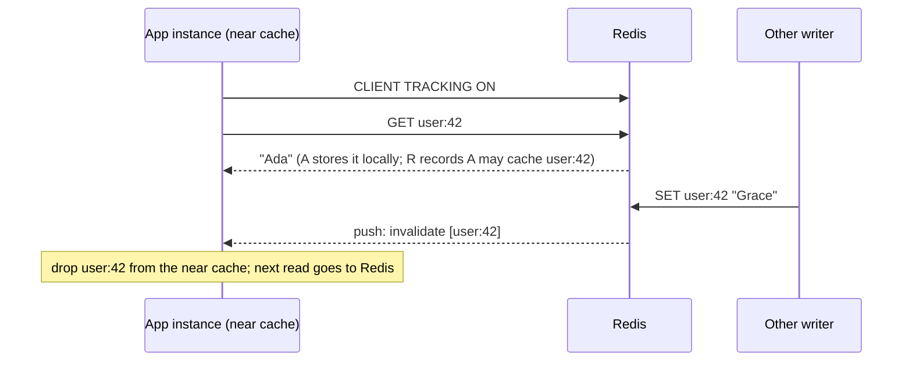

# Module 04 — Caching Patterns with Redis

Caching is the most common reason teams adopt Redis, and the most common source of subtle production bugs: stale data that never heals, stampedes that take the database down at the exact moment the cache is cold, and "cache penetration" by keys that do not exist. The _theory_ (topologies, hit-ratio math, the dual-write race, XFetch) is owned by [data-systems M09](../../../architecture/data-systems/modules/09-caching-theory-and-consistency.md). This module is the Redis realisation: which commands implement each pattern atomically, what Redis gives you that a plain key-value cache does not (server-assisted client-side caching, `GETEX`, `SET … NX PX`, eviction policies), and the failure modes specific to running caches on Redis.

**Executable proofs:** [`examples/ts/04-caching-patterns.test.ts`](../examples/ts/04-caching-patterns.test.ts) with [`src/cache.ts`](../examples/ts/src/cache.ts) (single flight, lock-based stampede protection, negative caching, XFetch, scripted dual-write interleavings), and [`examples/ts/integration/04-caching.test.ts`](../examples/ts/integration/04-caching.test.ts) (the same code on a real server, plus `CLIENT TRACKING` in RESP2 and RESP3).

---

## 1. Definitions and the Redis command for each pattern

- **Source of truth (SoT)**: the system whose data is authoritative (usually a relational database).
- **Cache entry**: a key whose value is a derived copy of SoT data, with a TTL that bounds staleness.
- **Staleness bound**: the maximum time a reader can observe a value that the SoT has already replaced. For pure TTL-based caching it is the TTL; invalidation shortens the typical case but, because of the races in § 4, **only the TTL bounds the worst case**.

| Pattern ([theory](../../../architecture/data-systems/modules/09-caching-theory-and-consistency.md#1-caching-topologies-and-access-patterns)) | Read path in Redis | Write path in Redis |
| --- | --- | --- |
| Cache-aside (lazy loading) | `GET k` → miss → load from SoT → `SET k v EX ttl` | Write SoT, then `DEL k` (or `UNLINK k`) |
| Read-through | A library or proxy does the cache-aside read for you | — |
| Write-through | `GET k` | Write SoT and `SET k v EX ttl` in the same code path |
| Write-behind (write-back) | `GET k` | `SET k v`, append to a stream (`XADD`), a worker writes the SoT later ([module 06](06-messaging-pubsub-streams-and-queues.md#2-streams)) |
| Refresh-ahead | `GET k`, and if the remaining TTL is short or XFetch fires, recompute in the background | — |

Redis-specific helpers:

| Need                                         | Command                               | Since     |
| -------------------------------------------- | ------------------------------------- | --------- |
| Read and slide a TTL atomically (sessions)   | `GETEX k EX 1800`                     | 6.2       |
| Overwrite without losing the TTL             | `SET k v KEEPTTL`                     | 6.0       |
| Set only if absent (lock, first-writer-wins) | `SET k v NX PX ms`                    | 2.6.12    |
| Set value and return the old one             | `SET k v GET`                         | 6.2       |
| Set many keys with one expiry                | `MSETEX`                              | 8.4       |
| Read many keys in one round trip             | `MGET k1 k2 …` (same slot in Cluster) | 1.0       |
| Compare-and-delete                           | `DELEX k IFEQ v`                      | 8.4       |
| Per-field TTL inside one hash                | `HSETEX`/`HGETEX`, `HEXPIRE`          | 8.0 / 7.4 |

---

## 2. Cache-aside done properly

```text
CACHE-ASIDE-GET(key):
  raw ← GET key
  if raw ≠ NIL then
     env ← DECODE(raw)
     if not XFETCH-SAYS-RECOMPUTE(env) then return env.value        ▷ includes cached "not found"
  return SINGLE-FLIGHT(key, REFRESH)                                 ▷ at most one load per process

REFRESH(key):
  t0 ← now; v ← LOAD-FROM-SOT(key); δ ← now − t0
  ttl ← (v = NIL) ? NEGATIVE-TTL : TTL·(1 ± jitter)
  SET key ENCODE(v, δ, now + ttl) PX ttl
  return v
```

Each step answers a specific failure:

1. **Envelope.** Store the value with metadata (`delta` = recompute time, `expiry`). It enables XFetch (§ 3.3) and makes "known to be absent" representable.
2. **Negative caching** stores "not found" for a short TTL. Without it, requests for non-existent IDs (bots, enumeration attacks, deleted records) always miss and hit the SoT: _cache penetration_. The hermetic tests show 50 lookups of a missing user cause 1 database query with negative caching and 50 without it.
3. **TTL jitter** (`ttl · (1 ± 10 %)`) spreads the expiry of keys written together (a warm-up job, a deploy) so they do not all expire in the same second ([data-systems M09 on stampedes](../../../architecture/data-systems/modules/09-caching-theory-and-consistency.md#4-cache-stampede-thundering-herd-and-the-xfetch-algorithm)).
4. **Serialization**: JSON is convenient; MessagePack or Protobuf halve the size; for objects read field by field, a hash (`HSET`/`HMGET`) avoids reading and rewriting the whole value. Version your encoding (`v2:` prefix or a field) so a rolling deploy can read both formats.
5. **Never block on the cache**: set client timeouts (tens of milliseconds), treat Redis errors as misses, and add a circuit breaker so a Redis outage degrades to "slower" rather than "down".

### 2.0 The reference implementation, line by line

The pseudocode above is implemented by `CacheAside` in [`src/cache.ts`](../examples/ts/src/cache.ts) on top of a four-method `KV` interface (`get`, `set … PX [NX]`, `del`, `pttl`). The same class runs against an in-memory fake with a manual clock in the hermetic tests and against a real server through this adapter in the integration tests:

```ts
function redisKV(c: Client): KV {
  return {
    get: async (key) => (await c.sendCommand(['GET', key])) as string | null,
    set: async (key, value, ttlMs, opts = {}) =>
      String(
        await c.sendCommand(['SET', key, value, 'PX', String(ttlMs), ...(opts.nx ? ['NX'] : [])]),
      ) === 'OK',
    del: async (key) => void (await c.sendCommand(['DEL', key])),
    pttl: async (key) => (await c.sendCommand(['PTTL', key])) as number,
  };
}
```

The core of the read path is eleven lines, and each guards one failure:

```ts
const raw = await this.kv.get(key);
if (raw !== null) {
  const env = JSON.parse(raw) as Envelope<T>; // {v, delta, expiry}: v === null is a cached "not found"
  if (!this.shouldRecomputeEarly(env)) return env.v; // XFetch: false when beta = 0
}
let p = this.inflight.get(key); // single flight: one load per process and key
if (!p) {
  p = this.refresh(key).finally(() => this.inflight.delete(key));
  this.inflight.set(key, p);
}
return p;
```

Invariants the tests rely on. (I1) `inflight` holds at most one promise per key, and an entry is removed in `finally`, so a rejected load does not poison later calls (the failed load is retried by the next caller). (I2) A value is written with `ttl > 0` only: a miss with `negativeTtlMs` unset is not cached, which is the default and the safe choice when "not found" can become "found" quickly after a create. (I3) The stored `expiry` is the logical expiry; the Redis TTL is the same number, so XFetch needs no extra `PTTL` round trip. (I4) The loader's duration `delta` is measured around the load only, so queueing delay inside the process does not inflate the early-recompute window. A `get(key, false)` call disables coalescing and exists for the test that counts the loads without it.

**Hit ratio arithmetic for sizing.** The source of truth sees $(1-h) \cdot R$ reads per second for a hit ratio $h$ and a read rate $R$. At $R = 50\,000$/s: $h = 0.90$ sends 5 000/s to the database, $h = 0.99$ sends 500/s, $h = 0.999$ sends 50/s. Each extra nine is a tenfold reduction, which is why a few hundred hot keys that become permanently resident (§ 3.5) matter more than a bigger `maxmemory`. Measure $h$ from `INFO stats`: $h = \text{keyspace-hits} / (\text{keyspace-hits} + \text{keyspace-misses})$ using the difference between two samples, because the counters are cumulative since the last `CONFIG RESETSTAT`; note that `GET` of an absent negative-cache entry counts as a hit.

### 2.1 Failing open: the circuit breaker as a state machine

"Treat Redis errors as misses" needs a bound, or every request pays the client timeout before falling through. A circuit breaker is a three-state machine: **closed** (calls go to Redis; consecutive failures are counted and any success resets the count), **open** (after $N$ consecutive failures, calls skip Redis for a cool-down of $T$ ms and go straight to the source of truth), and **half-open** (after $T$, exactly one probe call is admitted; success closes the breaker, failure re-opens it for another $T$, and all other callers keep failing fast). [`CircuitBreaker`](../examples/ts/src/cachepatterns.ts) implements the transitions and the tests pin the three subtle points: a success in the middle of failures resets the counter, the probe is single (`allow()` returns false to everyone else), and a threshold below 1 is rejected. The invariant that matters operationally is that **the breaker protects the source of truth, not Redis**: when it opens, the database receives the full read load, so it must be paired with load shedding or the stampede protection of § 3 on the fall-through path.

---

## 3. Stampede protection in Redis

A _stampede_ (thundering herd, dog-piling) happens when a hot key expires or is evicted and many concurrent requests miss at once, all recomputing the same value against the SoT. Three layers, from cheapest to strongest:

### 3.1 In-process request coalescing (single flight)

Keep a map `key → in-flight Promise`; concurrent callers in the same process await the same load. The hermetic test fires 100 concurrent `get`s on a cold key: 100 database loads without coalescing, 1 with it. This is free and should always be on, but it does nothing across processes: 200 pods still cause up to 200 loads.

### 3.2 Cross-process lock with `SET NX PX`

```text
GET-WITH-LOCK(key):
  loop
     v ← GET key; if v ≠ NIL then return v
     if SET lock:key <token> NX PX lockTtl = OK then
        try v ← LOAD(); SET key v PX ttl; return v
        finally RELEASE-IF-OWNER(lock:key, token)          ▷ DELEX … IFEQ token (8.4+) or a Lua script
     sleep(short, jittered); if waited too long then return LOAD()   ▷ availability fallback
```

Why each piece matters:

- **`NX` and `PX` in one command.** The negative test shows that a "lock" built from `GET` then `SET` across two round trips lets several workers win, because another worker's `GET` runs between them. `SET … NX PX` is a single atomic command. (`SETNX` followed by `EXPIRE` is the pre-2.6.12 form with a crash window between the two commands that leaves a lock without TTL forever.)
- **A unique token and owner-checked release.** If the holder outlives the lock TTL (GC pause, slow query), its unconditional `DEL` would delete the _next_ holder's lock. Release with `DELEX lock:key IFEQ token` on 8.4+, or the compare-and-delete script on older Redis and Valkey ([module 05](05-transactions-scripting-and-functions.md#3-lua-scripting-eval-and-evalsha)).
- **Bounded waiting.** If the holder crashes, waiters would otherwise spin until the lock TTL expires; the hermetic test shows the bounded-wait fallback loading after a few attempts. Here a stampede-protection lock is an _efficiency_ lock: a duplicate load is acceptable, a stall is not. Correctness locks are a different problem ([module 07](07-coordination-rate-limits-locks-and-idempotency.md#2-distributed-locks)).

The integration test runs 10 separate connections against a real server and observes exactly one load.

### 3.3 Probabilistic early recomputation (XFetch)

Recompute _before_ expiry with a probability that rises as expiry approaches, scaled by how long recomputation takes: recompute if $\text{now} - \delta \cdot \beta \cdot \ln(\text{rand}()) \ge \text{expiry}$ ([derivation](../../../architecture/data-systems/modules/09-caching-theory-and-consistency.md#the-xfetch-mathematical-formulation)). The hermetic test measures the trigger rate with $\delta = 100$ ms and $\beta = 1$: under 0.1 % a minute before expiry, over 30 % in the last 100 ms, 100 % at expiry. In Redis you need $\delta$ and the expiry in the stored value (the envelope), or `PTTL` in the same pipeline as the `GET`.

### 3.4 Serving stale while one caller refreshes (stale-while-revalidate)

Stampede protection that makes waiters wait still adds latency for them. If a slightly stale value is acceptable, split the lifetime in two: a **soft expiry** stored in the envelope (`softExpiry`) and a **hard TTL** on the Redis key that is several times longer. A read before the soft expiry returns immediately. A read between the two returns the stale value immediately and, if it wins `SET lock:k token NX PX …`, starts one refresh in the background. A read after the hard TTL has no value and must wait for a load (and takes the usual lock). [`src/swr.ts`](../examples/ts/src/swr.ts) models it: 50 concurrent readers after the soft expiry all receive the stale value and cause exactly one extra load (`stale-while-revalidate: 50 concurrent soft-expired readers cause one refresh …`); after the hard TTL the reader waits (`negative: past the hard TTL …`); a hard TTL not greater than the soft TTL is rejected. The Redis cost is memory (values live for the hard TTL) and a larger staleness bound: the effective worst case is `softTtl + refresh latency` for the refreshed key and the whole hard TTL if refreshes keep failing, so alert on refresh failures. The HTTP `Cache-Control: stale-while-revalidate` directive (RFC 5861) has the same shape.

### 3.5 Never letting hot keys expire

For a handful of very hot keys (feature flags, configuration, home-page aggregates), have a background job refresh them periodically and store them without TTL (or with a TTL far longer than the refresh interval). Readers never miss. Combine with client-side caching (§ 5) to remove most reads from Redis entirely.

---

## 4. Consistency with the database: the dual-write problem in Redis terms

Any pattern that writes the SoT and touches Redis separately has two non-atomic steps; there is no transaction spanning PostgreSQL and Redis. The two hermetic interleaving tests replay the classic races step by step:

1. **"Delete cache, then update DB"** (wrong order): a reader misses between the delete and the update, loads the old row, and writes it to the cache after the update. The stale value now lives for a full TTL.
2. **"Update DB, then delete cache"** (recommended order): still racy, with a narrower window. A reader that loaded the old row _before_ the update but writes it to the cache _after_ the delete re-installs the old value. It needs a slow read overlapping a write, which is rare but happens under load.

### 4.1 Model-checking the interleavings

The two scripted replays prove that a race exists; they do not say how likely it is relative to the alternatives. [`src/interleave.ts`](../examples/ts/src/interleave.ts) enumerates **every** interleaving that keeps each actor's program order and classifies the final state. The reader executes `R1: read DB` then `R2: SET cache <what it read>` (it started from a miss); the writer's steps depend on the strategy. With $m$ reader steps and $n$ writer steps there are $\binom{m+n}{m}$ schedules.

| Writer strategy | Schedules | Final state `cache = old` while `DB = new` | The bad schedules |
| --- | --- | --- | --- |
| `W1: write DB`, `W2: DEL cache` (recommended) | 6 | **1** | `R1 W1 W2 R2`: the reader read before the update and installs after the delete |
| `W1: DEL cache`, `W2: write DB` (wrong order) | 6 | **4** | every schedule where the reader reads the old row while the DB still holds it and installs after the delete: `R1 W1 R2 W2`, `R1 W1 W2 R2`, `W1 R1 R2 W2`, `W1 R1 W2 R2` |
| `write DB`, `DEL`, delayed second `DEL` (unconstrained) | 10 | 1 | `R1 W1 W2 W3 R2`: the reader is slower than the delay |
| the same, with the second `DEL` guaranteed after the reader finishes | 6 | **0** | none; the guarantee is the whole content of "the delay is longer than the slowest read", which no code can assert |

Reading the table: the recommended order is not "safe", it removes three of the four bad schedules, and the remaining one needs a reader that is paused between its DB read and its cache write for longer than the writer's whole critical section. That is a GC pause, a slow replica read, or a congested connection, so it is rare per request and certain over enough requests. The delayed double delete only moves the window to "reader slower than the delay", and the test `delayed double delete only helps if the second delete comes after the slow reader` shows the unconstrained schedule still failing. Versioned writes close the race for real when the writer _installs_ the new value (write-through): of the 6 schedules, 1 is stale unversioned (`R1 W1 W2' R2`: the slow reader's old value overwrites the new one) and 0 with a version check, because the cache refuses the downgrade (`write-through: 1 of 6 schedules is stale unversioned, 0 with versioned cache writes`). They do nothing for a delete-based writer, since a deleted key carries no version to compare against (`versioning does not help a delete-based writer`); they also need a version that increases with every write to the row. Every one of the stale outcomes has the same shape (`cache = old`, `DB = new`, nothing lost in the DB), which is why a TTL is a complete backstop: the anomaly is a stale _copy_, and a copy that expires heals itself.

Practical defences, in order of cost:

| Defence | How in Redis | Remaining risk |
| --- | --- | --- |
| Short TTL on every entry | `SET … EX` always, never persistent cache keys | Bounded staleness = TTL. |
| Delete after commit, not before | Run `DEL` in the DB transaction's after-commit hook | Race 2 above. |
| Delayed double delete | `DEL` now and again after ~1 s (a delayed job or a `ZADD` scheduler) | Reduces race 2 to readers slower than the delay. |
| Versioned writes | Store `{version, value}`; write with a script that refuses to overwrite a higher version (or `SET … IFDEQ` digest checks on 8.4+) | Needs a monotonic version from the SoT (row version, `xmin`, updated-at). |
| Change data capture | A CDC consumer (e.g. Debezium on the PostgreSQL WAL) deletes or updates cache keys in commit order | Lag, and one more system to operate ([data-systems M07](../../../architecture/data-systems/modules/07-replication-mechanics-and-consensus.md#4-physical-versus-logical-replication-and-change-data-capture-cdc)). |

The honest interview answer: with cache-aside you get _eventual_ consistency with a staleness bound equal to the TTL, and invalidation makes stale reads rare, not impossible. If a read must be fresh (balances, permissions), read the SoT.

---

## 5. Server-assisted client-side caching

A _near cache_ inside the application process removes the network round trip entirely (nanoseconds instead of ~0.2 ms), but it must be invalidated when the data changes. Redis 6.0 added **tracking**: the server remembers which keys a client has read and sends an invalidation message when any client modifies them.



### 5.1 Modes

| Mode | Server memory | Messages | Use when |
| --- | --- | --- | --- |
| **Default** (key tracking) | Invalidation table of keys → client IDs, capped by `tracking-table-max-keys` (default 1 000 000); when full, the server evicts entries and sends invalidations for them | Only for keys the client actually read | Most applications. |
| **`BCAST PREFIX p …`** (broadcasting) | No per-key memory; per-prefix table | Every change to any key with a matching prefix | Small key spaces with a few hot prefixes (config, flags). |
| **`OPTIN` / `OPTOUT`** | Like default | Only for reads preceded by `CLIENT CACHING yes` (opt-in) or not opted out | Caching a chosen subset of reads. |
| **`NOLOOP`** | — | Suppresses invalidations for the client's own writes | Writers that update their near cache themselves. |

### 5.2 Delivery

- **RESP3**: invalidations arrive as `>` push frames (`invalidate` with an array of keys) on the same connection. The integration test speaks raw RESP3, reads a key, has another client write it, and receives the push frame. A `null` key array means "flush everything" (sent after `FLUSHALL` or when the server could not keep track).
- **RESP2**: the data connection uses `CLIENT TRACKING ON REDIRECT <client-id>`, and a second connection subscribes to the `__redis__:invalidate` channel. The integration test sets this up and observes the invalidation message.
- `node-redis` 6 implements client-side caching for RESP3 connections only: its `createClient` options type documents `clientSideCache` with `RESP: 3` in both examples (`ttl`, `maxEntries`, `evictPolicy`, or a `BasicClientSideCache` instance). Its separate `emitInvalidate` option (raw `invalidate` events without a cache) is documented as mutually exclusive with `clientSideCache`. Check your client's support before rolling your own.

### 5.2.0 Using it from `node-redis` 6

```ts
import { createClient } from 'redis';

const near = createClient({
  url: 'redis://localhost:6379',
  RESP: 3, // required: invalidations are RESP3 push frames
  clientSideCache: { ttl: 0, maxEntries: 100, evictPolicy: 'LRU' }, // ttl 0 = rely on invalidations only
});
await near.connect();

await near.get('user:42'); // miss: sent to the server, which now tracks user:42 for this connection
await near.get('user:42'); // hit: answered from process memory, no command reaches Redis
// another client: SET user:42 ...  -> push invalidation -> the entry is dropped -> next get goes to the server
```

The integration test `node-redis clientSideCache (RESP3): the second GET is served locally and a remote write invalidates it` proves each comment: it compares `total_commands_processed` from `INFO stats` before and after five repeated reads (only the `INFO` call itself is counted, so no `GET` was sent), then writes from a second connection and polls until the near-cache client observes the new value. Set a non-zero `ttl` in production as the backstop recommended in § 5.3, and bound `maxEntries` because the near cache lives in the Node.js heap.

### 5.2.1 What the options do, as observed on a server

The following were checked with raw RESP3 sockets against a real server (integration file `04b-tracking.test.ts`, run on 7.0.15):

- **Default mode forgets the key after the first invalidation.** The server removes the key from the client's tracking entry when it sends the invalidation, so a client must read the key again to receive the next one. A near cache that re-reads on a miss does this naturally; one that refreshes values from write events does not, and silently stops hearing about the key.
- **`NOLOOP`** suppresses the invalidation for the client's own writes (`NOLOOP: a tracking client is not told about its own write …`) but not for other clients'. Without it, `SET` from a tracking client invalidates its own cached entry, which is correct if the client does not update the near cache on write and wasteful if it does.
- **`BCAST PREFIX p`** sends an invalidation for every key that starts with `p`, whether or not the client has read it, and needs no per-key server memory. A key outside the prefix produces nothing. Prefixes of one client must not overlap (`ERR Prefix 'a:' overlaps with another provided prefix 'a:b:'`), and `OPTIN`/`OPTOUT` are rejected with `BCAST` (`ERR OPTIN and OPTOUT are not compatible with BCAST`).
- **`OPTIN`**: only the command immediately after `CLIENT CACHING yes` is tracked. `CLIENT CACHING` outside OPTIN/OPTOUT tracking mode is an error.
- **`FLUSHALL`/`FLUSHDB`** send an invalidation with a `null` key list to every tracking client (the "flush your whole near cache" signal).
- `CLIENT TRACKINGINFO` reports `flags` (`on`, `optin`, `noloop`, …), the redirect target and the BCAST prefixes, which is the quickest way to debug "my client is not receiving invalidations".
- `tracking-table-max-keys` defaults to 1 000 000 (checked in `config.c`). When the table grows past it the server evicts the oldest tracked keys and sends invalidations for them, so a near cache sees spurious invalidations (extra misses), never a missed one. `INFO stats` reports `tracking_total_keys`, `tracking_total_items` and `tracking_total_prefixes` for sizing.

### 5.2.2 A protocol model and the pending rule

[`src/nearcache.ts`](../examples/ts/src/nearcache.ts) models the server's tracking table (`TrackingServer`, with the key limit and `NOLOOP`) and a client (`NearCache`) that follows the rule of § 5.3: register each read as pending before it is sent, mark pending reads of a key as invalidated when an invalidation for it arrives, and discard a reply whose read was invalidated. The property test generates random schedules of reads, writes by another client, delivery of replies, delivery of invalidations and disconnects, with the two message streams each in order but interleaved arbitrarily (RESP2 redirect mode really has two connections; a RESP3 client may dispatch a push frame before resuming the promise of an earlier reply). After draining the in-flight messages **every cached value equals the server's current value**. The control test is the interesting one: the same property run against a client that skips the pending rule fails, and fast-check finds a counterexample within 500 runs (`negative: without the pending rule the same property has a counterexample`). The invariant is: a near-cache entry is present only if no write to that key was applied by the server after the read that produced it, unless the entry is later invalidated. Connection loss is handled by treating it as a global invalidation, as § 5.3 says.

### 5.3 Correctness rules

1. **Connection loss means "flush everything"**: invalidations sent while the connection was down are lost. Clients must clear the near cache on reconnect (and on any `null` invalidation).
2. **Race between read and invalidation**: an invalidation can arrive while the reply to a `GET` is still in flight. Correct clients mark the key "pending" before sending the `GET` and discard the reply if an invalidation for the key arrived in between.
3. **Still set a TTL on near-cache entries** as a backstop for bugs and missed messages.
4. Tracking is per-node: in Cluster each node tracks its own keys; in a replica setup, track on the node you read from.

---

### 5.4 Write-behind and namespace versioning in numbers

**Write-behind** acknowledges a write when it is in Redis (or in a stream) and writes the source of truth later. [`WriteBehind`](../examples/ts/src/cachepatterns.ts) models the three properties that decide whether it is acceptable. _Coalescing_: 1 000 updates to 10 keys flush as 10 database writes, because only the latest value per key survives; this is the reason to use it for counters and "last seen" fields. _Loss window_: a crash loses every acknowledged write that was not flushed, and the test shows a client told that `a=2` and `b=1` were written while the database never saw them; with a stream and a consumer group the window shrinks to the consumer's lag and the persistence configuration of Redis itself ([module 09](09-persistence-rdb-aof-and-backup.md)), but it never reaches zero. _Backpressure_: a bounded buffer must refuse writes when full instead of growing without limit; the model throws, a real system returns an error or blocks. Use write-behind only for data whose loss is tolerable, and never for money or anything that must be read back from the database by another system.

**Namespace versioning** is the O(1) bulk invalidation hinted at in the checklist below: keys embed a generation number (`cache:product:v7:42`), and `INCR cache:ver:product` makes every older key unreachable at once, with no `SCAN` and no `DEL` storm. The price is that the orphaned keys stay in memory until their own TTLs expire, so they must have TTLs; the model's `orphaned()` count shows 100 of 100. There is a classic pitfall that the integration test `namespace versioning on a real server` demonstrates: if the key builder treats an absent counter as version 1 but `INCR` of an absent key returns 1, the first bump changes nothing. Initialise the counter (`SET cache:ver:product 1 NX`) or let the builder treat an absent counter as version 0. In Cluster, keep the counter and a hot path of keys on the same shard only if they share a hash tag; otherwise read the counter first, since it is one extra round trip per request (cache it in-process for a second).

### 5.5 Caches in Redis Cluster

A cache read of several entities (`MGET` of a page's twenty products) works on a single node but fails in Cluster with `-CROSSSLOT Keys in request don't hash to the same slot` when the keys live in different slots ([module 11](11-redis-cluster.md#2-hash-tags-and-multi-key-operations)). There are two designs, and they trade in opposite directions. **Group by slot on the client:** compute each key's slot, send one `MGET` per group in parallel, and merge. `groupBySlot` in the example does the grouping; for 100 untagged keys it yields more than 50 groups (about one round trip per key, which is what a pipelined `GET` would cost anyway), so this design costs no more than N pipelined `GET`s and keeps the load spread. **Co-locate with a hash tag** (`product:{catalog}:17`): a single `MGET` of any number of such keys is one round trip, but every tagged key lands in one slot and therefore on one node, so a hot catalogue becomes a hot shard. The test `hash-tagged cache keys concentrate load …` shows 1 000 keys in one slot. Tag only at a granularity that is both small enough to spread (per user, per order) and large enough to be read together. Client-side caching tracks per node (§ 5.3), so a near cache in Cluster registers tracking on each node it reads from, and a resharding that moves a slot sends the client back through `MOVED` with a cold near cache for those keys. Reading from replicas (`READONLY`) multiplies read capacity at the cost of replication lag on top of cache staleness; it suits caches, not locks.

## 6. Running caches on Redis: configuration checklist

| Setting | Cache instance | Why |
| --- | --- | --- |
| `maxmemory` | 60–80 % of RAM (less with persistence/replicas) | Room for fork COW and buffers ([module 03](03-keys-expiry-eviction-and-memory.md#44-fork-and-memory-headroom)). |
| `maxmemory-policy` | `allkeys-lfu` or `allkeys-lru` | Evict instead of failing ([module 03](03-keys-expiry-eviction-and-memory.md#32-policies)). |
| Persistence | Often off (`save ""`, `appendonly no`) for pure caches | A cold cache after restart is acceptable _if_ the SoT can absorb the warm-up; otherwise keep RDB for warm restarts. |
| `lazyfree-lazy-eviction`, `lazyfree-lazy-expire` | `yes` | Large evicted values freed off the main thread. |
| Replicas | Optional for availability; reads from replicas are stale by replication lag | [Module 10](10-replication-and-sentinel.md#2-replication-is-asynchronous-and-what-that-loses). |
| Key naming | `cache:<entity>:<id>:v<schema>` | Bulk invalidation by version bump instead of `SCAN`+`DEL`. |

**Do not share one instance between a cache and durable data**: the cache needs `allkeys-*` eviction, the durable data needs `noeviction`. Use two instances (or two Cluster deployments).

---

## 6.1 Then vs now: cache primitives

| Need | Then (Redis ≤ 7.4, Valkey) | Now (Redis 8.4+) |
| --- | --- | --- |
| Release a lock only if you own it | Lua `if redis.call('get',K)==ARGV[1] then return redis.call('del',K) end` | `DELEX k IFEQ token` |
| Write several keys with one TTL atomically | `MULTI` + `SET … EX` × N, or a script | `MSETEX` |
| Conditional overwrite by version | script comparing a stored version | `SET k v IFDEQ digest` with `DIGEST k` |
| Client-side caching | hand-written RESP3/redirect handling | built into `node-redis` 6 with `RESP: 3`; the protocol rules of § 5.3 still apply to custom clients |
| Per-field expiry in a cached object | key per field, or an expiry zset and a sweeper | `HSETEX`/`HGETEX` (8.0), `HEXPIRE` (7.4) |

Mixed fleets (some nodes on Valkey or Redis < 8.4) keep the Lua forms; select them at start-up from `INFO server`, not per call. Valkey spells the digest compare-and-delete `DELIFEQ` ([module 12](12-operations-security-observability-and-valkey.md#7-valkey-9x-delta)).

**What to watch on a cache instance** (all from `INFO`, so no extra tooling):

| Signal | Field | Interpretation |
| --- | --- | --- |
| Hit ratio | `keyspace_hits`, `keyspace_misses` (stats) | Falling hit ratio after a deploy: a key-format change or a new high-cardinality key |
| Memory pressure | `evicted_keys` (stats), `used_memory` vs `maxmemory` (memory) | Evictions at a steady rate are normal for a cache; a jump means the working set grew |
| Churn | `expired_keys` (stats) | Compare with `evicted_keys`: mostly expiry means TTLs, mostly eviction means capacity |
| Penetration | miss rate with a flat key count | Misses that never turn into hits are keys that do not exist: add negative caching |
| Client load | `connected_clients`, `instantaneous_ops_per_sec` | A sudden rise of connections is often a retry storm |
| Rejected work | `rejected_connections`, `total_error_replies` | `maxclients` reached, or `OOM` replies under `noeviction` |
| Tracking cost | `tracking_total_keys`, `tracking_total_items` | Server memory spent on client-side caching |

## 7. Production failure modes

1. **Cold-start stampede.** After a cache flush or failover to an empty replica, every request misses and the database falls over. Mitigations: coalescing + locks (§ 3), pre-warming hot keys before shifting traffic, keeping RDB persistence for warm restarts, and admission control on the SoT.
2. **Hot-key overload.** One key (a celebrity profile, a global config) gets 30 % of traffic and saturates one Redis core or one Cluster shard. Use client-side caching, replicas for reads, or key splitting (`hot:{1..N}` copies read at random) ([data-systems M08 on hot partitions](../../../architecture/data-systems/modules/08-partitioning-sharding-and-routing.md#1-celebrity--hot-key-partition-saturation)).
3. **Unbounded staleness.** A cache key written without TTL by one code path is never refreshed when invalidation is missed. Enforce TTLs in the cache wrapper; alert on `keys` vs `expires` in `INFO keyspace` for cache instances.
4. **Cache penetration** by non-existent keys (§ 2). Negative caching, or a Bloom filter of existing IDs in front of the SoT ([module 08](08-query-engine-json-vectors-and-probabilistic.md#6-probabilistic-structures-redis-realisation)).
5. **Serialization drift** during rolling deploys: new code writes a format old code cannot read. Version keys or values.
6. **Large values.** Caching 5 MB JSON blobs makes every hit a 5 MB transfer on the main thread and in the client. Cache smaller projections, compress, or split.
7. **Retry storms against a slow Redis.** Aggressive client timeouts plus retries multiply load exactly when Redis is struggling ([distributed-systems on retry amplification](../../../architecture/distributed-systems/modules/02-networks-rpc-and-failure-detection.md)). Use budgets and back-off, and fail open to the SoT with rate limits.

8. **Caching an error as "not found".** A loader that returns `null` on any exception turns a database timeout into a cached absence, and every caller for the negative TTL sees "does not exist". Distinguish absence (a definitive answer from the source of truth) from failure (an exception that must propagate). The test `a loader error is not cached: the next caller retries …` shows the exception passing through single flight without leaving a poisoned entry.
9. **Negative caching of keys that get created.** A miss is cached for `negativeTtl`; if the record is created a moment later (sign-up followed by an immediate read) the reader sees "not found" until that TTL ends (`negative: caching "not found" for a key that is created a moment later …`). Keep the negative TTL to seconds, and delete the negative entry in the create path.
10. **Unbounded key cardinality.** Cache keys that include every filter combination, user ID and timestamp bucket make a hit ratio near zero while memory and eviction churn stay high. Watch `evicted_keys` growing with a flat hit ratio, and cache the stable lower layer (the entity) instead of every composed response.
11. **Clock skew in the envelope.** XFetch and soft expiries compare the application's clock with an absolute time stored by another instance. Skew of a few seconds on a 10-second TTL changes the early-recompute window drastically. Use the Redis TTL (`PTTL`, fetched in the same pipeline as the `GET`) or the server `TIME`, or keep skew far below the TTL.
12. **Lock TTL shorter than the load.** If the loader takes longer than the stampede lock's `PX`, a second process acquires the lock and loads too. That is harmless for an efficiency lock (a duplicate load) but defeats the purpose under load; set the lock TTL to a high percentile of the load time and measure it.
13. **Fleet restart with empty near caches.** A deploy that restarts every pod empties every near cache at once, sending the whole read load to Redis; stagger rollouts and keep the near-cache hit path from being the only protection of Redis.

---

## Proof map for this module

| Claim | Hermetic | Integration |
| --- | --- | --- |
| Single flight turns N concurrent misses into 1 load | `stampede: 100 concurrent misses …` | `cache-aside against Redis …` |
| `SET NX PX` lock gives one loader across processes | `cross-process lock …` | `SET NX PX lock: ten concurrent connections …` |
| GET-then-SET locking is not atomic | `negative: GET-then-SET "locking" …` | — |
| A dead lock holder must not stall readers forever | `negative: a lock holder that dies …` | — |
| Negative caching stops penetration | `negative caching …`, `without negative caching …` | — |
| XFetch trigger probability | `XFetch: …` | — |
| Both invalidation orders have a race; TTL bounds staleness | two `dual-write race …` tests (scripted interleavings) | — |
| All interleavings of the dual-write race: 1 of 6 bad with the recommended order, 4 of 6 with the wrong one | `update DB then delete cache: exactly 1 of 6 …`, `delete cache then update DB: 4 of 6 …`, `delayed double delete …`, `write-through: 1 of 6 …` | — |
| The pending rule keeps a near cache consistent; its absence does not | `property: with the pending rule …`, `negative: without the pending rule …`, `near cache: without the pending rule an in-flight reply …` | — |
| `NOLOOP`, `BCAST`, `OPTIN`, `FLUSHALL` null invalidation, option conflicts, `tracking-table-max-keys` default | `NOLOOP: the writer is not told …`, `tracking table limit …` | `04b-tracking.test.ts`: eight tests (ran green on 7.0.15) |
| Stale-while-revalidate: one refresh for N readers | `stale-while-revalidate: 50 concurrent soft-expired readers …`, `negative: past the hard TTL …` | — |
| Circuit breaker transitions | `breaker: opens after N consecutive failures …`, `breaker: after the cool-down exactly one probe …` | — |
| Write-behind coalescing, loss window, backpressure; namespace versioning | `write-behind …` (3 tests), `namespace versioning: bump invalidates every key …` | `default tracking forgets a key …`, `namespace versioning on a real server …` |
| Tracking invalidations (RESP2 redirect, RESP3 push) | — | **integration-only**: `CLIENT TRACKING (RESP2, REDIRECT) …`, `CLIENT TRACKING (RESP3) …` (ran green on 7.0.15) |

---

## Interview Drill

<details><summary>1. Design caching for a product page backed by PostgreSQL, 50 k reads/s, prices change a few times a day.</summary>

Cache-aside with `SET product:{id} <json> EX 600` plus ±10 % jitter; invalidate with `DEL` in the after-commit hook of price updates (plus delayed second delete or versioned writes if a stale price for up to 10 minutes is unacceptable). Single-flight in each process and a `SET NX PX` lock for cross-process stampede protection; negative-cache unknown IDs for 30 s. Hot items via client-side caching with `CLIENT TRACKING`. `allkeys-lfu`, no persistence or RDB only, separate instance from durable data.
</details>

<details><summary>2. Why "update the DB, then delete the cache" and not the reverse? Is it race-free?</summary>

Deleting first lets a concurrent reader re-cache the old value between the delete and the update, which is likely. Updating first narrows the race to a reader whose DB read happened before the update but whose cache write lands after the delete; rarer, but possible. TTLs bound the damage; versioned writes or CDC-driven invalidation close it further.
</details>

<details><summary>3. How do you prevent a cache stampede when a hot key expires?</summary>

Coalesce in-process; use `SET lock:k token NX PX` so one process recomputes while others briefly wait and re-read (with a bounded wait); recompute early probabilistically (XFetch) or refresh hot keys in the background so they never expire; add TTL jitter so many keys do not expire together.
</details>

<details><summary>4. Why must the lock release check the token?</summary>

If the holder runs past the lock TTL, the lock expires and another worker acquires it. An unconditional `DEL` from the first worker would then delete the second worker's lock. Release with `DELEX key IFEQ token` (8.4+) or a compare-and-delete Lua script.
</details>

<details><summary>5. What is client-side caching in Redis 6+, and what can go wrong?</summary>

The server tracks keys a client read (or prefixes in BCAST mode) and pushes invalidations when they change; the client keeps a local near cache. Pitfalls: invalidations lost while disconnected (flush on reconnect), a race between an in-flight read and its invalidation, server memory for the tracking table, and per-node tracking in Cluster.
</details>

<details><summary>6. What is cache penetration and how does Redis help?</summary>

Requests for keys that do not exist in the SoT always miss and hit the database. Cache the negative result briefly, or keep a Bloom filter (`BF.ADD`/`BF.EXISTS`, built into Redis 8) of existing IDs and reject definite misses without touching the database.
</details>

<details><summary>7. A cache instance is at `maxmemory` with `noeviction`. Symptoms and fix?</summary>

Writes fail with `-OOM command not allowed`; if the application treats Redis errors as misses, every request now loads from the SoT, and the DB load spikes. Switch to `allkeys-lfu`/`allkeys-lru` (it is a cache), add memory, and alert at 80 % of `maxmemory`.
</details>
