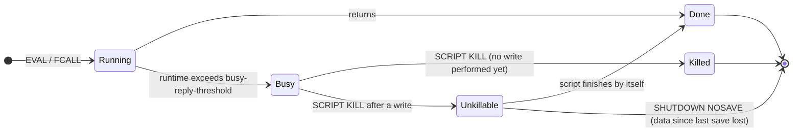

# Module 05 — Atomicity: Transactions, Lua Scripts and Functions

A single Redis command is atomic. Real operations rarely fit in one command: "decrement stock if positive and record the order", "release the lock if I still own it", "refill a token bucket and take a token". Redis offers three tools for grouping work: `MULTI/EXEC` transactions, optimistic concurrency with `WATCH`, and server-side code (Lua scripts with `EVAL`, and since 7.0 Functions). This module gives their exact semantics, which differ from SQL transactions in ways that cause real bugs, and the operational risks of running code on the single command thread.

> [!NOTE]
> Isolation levels and the anomaly taxonomy are owned by [data-systems M05](../../../architecture/data-systems/modules/05-transactions-acid-and-isolation-levels.md). In those terms, `MULTI/EXEC` and scripts are _serial_ executions on one node (trivially serializable), but provide **no atomicity in the "all or nothing" sense** on runtime errors and no durability beyond the persistence settings ([module 09](09-persistence-rdb-aof-and-backup.md#5-durability-guarantees-and-data-loss-windows)).

**Executable proofs:** [`examples/ts/05-transactions-and-scripting.test.ts`](../examples/ts/05-transactions-and-scripting.test.ts) runs a `MULTI/WATCH` model ([`src/multi.ts`](../examples/ts/src/multi.ts)) and the track's Lua files ([`examples/lua/`](../examples/lua/)) inside an embedded Lua interpreter ([`src/lua.ts`](../examples/ts/src/lua.ts)); [`examples/ts/integration/05-transactions-scripting.test.ts`](../examples/ts/integration/05-transactions-scripting.test.ts) runs the same scripts with `EVAL` on a real server.

---

## 1. `MULTI`/`EXEC`: isolation without rollback

### 1.1 Operational semantics

```text
state per connection: queue ← NIL, dirty ← false, watched ← {}

MULTI            → if queue ≠ NIL: error "MULTI calls can not be nested"; queue ← []; reply +OK
<cmd> while queue ≠ NIL:
                   if cmd unknown or wrong arity: dirty ← true; reply error     ▷ queue-time error
                   else queue.append(cmd); reply +QUEUED
EXEC             → if dirty: reply -EXECABORT; reset                            ▷ nothing runs
                   if any watched key changed since WATCH: reply nil (null array); reset
                   else run every queued command back to back, with no other client in between;
                        reply an array with one reply per command (errors included); reset
DISCARD          → drop the queue; reset
reset            → queue ← NIL; dirty ← false; watched ← {}                     ▷ EXEC/DISCARD always UNWATCH
```

Inside the Redis C codebase (`server.h`, `multi.c`), the command queue and transaction flags live directly on the client structure (`client *c`):

- **Command queue (`c->mstate`)**: A `multiState` struct holding a dynamically sized array `multiCmd *commands`, an integer `count`, and accumulated command flags.
- **Queueing vs Dispatch**: When `c->flags & CLIENT_MULTI` is set, incoming commands are not executed immediately. The server parses arguments and verifies command existence and arity against the global command table. If valid, Redis allocates a `multiCmd` slot, references the argument `robj` pointers, and responds with `+QUEUED`.
- **The dirty execution flag (`CLIENT_DIRTY_EXEC`)**: If command lookup fails (unknown command) or argument arity is invalid, Redis sets `c->flags |= CLIENT_DIRTY_EXEC` on the client and replies with an error immediately. When `EXEC` is subsequently called, Redis inspects this flag. If set, execution is aborted unconditionally with `-EXECABORT Transaction discarded because of previous errors.`, dropping all queued operations.
- **The dirty CAS flag (`CLIENT_DIRTY_CAS`)**: When any key watched by this client is modified by a concurrent write, expiry, or eviction, the server sets `c->flags |= CLIENT_DIRTY_CAS`. On `EXEC`, if this flag is present, the queue is cleared without executing any commands and returns a null reply (RESP2 `*-1\r\n`, RESP3 `_\r\n`).
- **Memory impact of large queues**: Queued commands hold live references to argument objects in RAM. An unconstrained pipeline generating millions of queued writes inside `MULTI` inflates both client query memory (`qbuf`) and output reply memory (`omem`), risking disconnection via `client-output-buffer-limit normal`.

### 1.2 What you get and what you do not

| Property | `MULTI/EXEC` | SQL transaction |
| --- | --- | --- |
| Isolation | **Serial**: no other command interleaves during `EXEC` | Depends on isolation level |
| Atomicity on runtime error | **No rollback**: `INCR` on a non-integer fails, the commands before _and after_ it are applied | Rolls back |
| Atomicity on queue-time error | Whole transaction discarded (`-EXECABORT`, since 2.6.5) | — |
| Reading inside the transaction | No: queued commands return `QUEUED`; you cannot branch on a value read in the same transaction | Yes |
| Durability | Whatever `appendfsync` gives; `EXEC` is written to the AOF as one `MULTI…EXEC` block, and a truncated block is discarded on load | WAL fsync at commit |

The hermetic test and the integration test both show `SET a; INCR <string>; SET b`: `a` and `b` are set, the middle command returns an error inside the `EXEC` reply. Client libraries differ in how they surface this: `node-redis`'s `multi().exec()` rejects on the first error reply, which _hides that the other commands were applied_. The integration test therefore reads the raw `EXEC` reply with the track's own RESP parser.

Redis's omission of transaction rollback is a deliberate architectural trade-off grounded in three principles:

1. **Memory overhead of undo logs**: Relational databases achieve rollback by recording undo logs (ARIES recovery protocol), retaining previous tuple versions (MVCC), and tracking inverse operations for every mutation (e.g., inverting bit operations, sorted set score deltas, hash field updates, HyperLogLog register merges). In an in-memory data-structure server, maintaining an in-memory undo log would nearly double allocation overhead and introduce significant cache-line bouncing on hot mutation paths.
2. **Absence of runtime concurrency deadlocks**: In SQL databases, transactions execute concurrently across multiple worker threads and must roll back when deadlocks or serializability conflicts are detected dynamically. In Redis, `EXEC` executes serially on the single command thread. Concurrency conflicts _never occur during EXEC_; all isolation conflicts are resolved before execution begins via `WATCH` and `CLIENT_DIRTY_CAS`.
3. **Bug classification**: Redis command failures at runtime (such as `WRONGTYPE Operation against a key holding the wrong kind of value` or incrementing a non-numeric string) are considered software programming errors that must be caught during development and unit testing, rather than recoverable operational conditions.

In practice: **validate before you write**, or move the logic into a script that validates first.

### 1.3 Pipelining a transaction

`MULTI` … `EXEC` costs one round trip per command unless pipelined. Clients send the whole block in one write and read all replies at once. In Cluster all keys in a transaction must hash to the same slot (`-CROSSSLOT` otherwise; [module 11](11-redis-cluster.md#2-hash-tags-and-multi-key-operations)).

---

## 2. `WATCH`: optimistic concurrency (check-and-set)

`WATCH k1 k2 …` marks keys on the connection. If any watched key is **modified** before `EXEC` (by another client, by this client outside the transaction, by expiry, by eviction, by `FLUSHDB`, or by `SWAPDB`), `EXEC` returns a null reply and runs nothing. The pattern is a retry loop:

```text
CAS-DECREMENT(key, amount):
  repeat
     WATCH key
     v ← GET key                                  ▷ normal command, executes immediately
     if v < amount: UNWATCH; return "insufficient"
     MULTI; SET key (v − amount); r ← EXEC
  until r ≠ NIL                                   ▷ NIL = someone changed key; retry
  return "ok"
```

- **Contention**: under heavy write contention on the same key the loop retries repeatedly (livelock-ish); add back-off, or use a script, which never retries.
- **Expiry counts as modification** (since 6.0.9 a key that expires between `WATCH` and `EXEC` aborts the transaction); a key that does not exist at `WATCH` and is created later also aborts.
- **`WATCH` must be on the same connection as `MULTI/EXEC`**. With a pooled client, check out a dedicated connection (for example `client.duplicate()` in `node-redis`).

The hermetic tests model the per-key modification counter that `WATCH` compares; the integration test shows `EXEC` returning nil after another connection's `INCRBY`.

### 2.1 Internal mechanics of `WATCH` and dirty-key tracking

The server implements optimistic concurrency using two cross-referenced C data structures:

- **Database watched registry (`db->watched_keys`)**: Each database (`redisDb`) maintains a hash table mapping watched `robj *key` pointers to a linked list of `client *` pointers monitoring that key.
- **Client watched list (`c->watched_keys`)**: Each client maintains a list of `watchedKey` structures pointing back to the database and keys it watches. This allows $O(K)$ cleanup when a client disconnects or runs `UNWATCH`, `EXEC`, or `DISCARD`.
- **The modification hook (`touchWatchedKey`)**: Whenever any command mutates a key, Redis calls `signalModifiedKey(db, key)`, which invokes `touchWatchedKey(db, key)`. This iterates over the registered clients and sets `c->flags |= CLIENT_DIRTY_CAS`.

Modification events that trigger `touchWatchedKey`:

1. **Direct writes and increments**: Any `SET`, `INCR`, `HSET`, `LPUSH`, or `ZADD` modifying the key.
2. **Key expiration**: Both active expiration (`serverCron` / fast cycle) and lazy passive expiration on access trigger `touchWatchedKey`. Since Redis 6.0.9, an expired key touched before `EXEC` reliably aborts the transaction.
3. **Memory eviction**: When memory reaches `maxmemory` and an eviction policy frees a watched key, `touchWatchedKey` is triggered.
4. **Administrative flush and renames**: `FLUSHDB`, `FLUSHALL`, and `SWAPDB` invalidate all watched keys. `RENAME src dst` touches both the source and destination keys.
5. **Non-existent keys**: If a client runs `WATCH missing_key` and a concurrent client subsequently creates `missing_key`, `touchWatchedKey` fires and aborts the waiting transaction.

---

## 3. Lua scripting: `EVAL` and `EVALSHA`

### 3.1 Semantics

`EVAL script numkeys key… arg…` runs a Lua 5.1 script atomically on the command thread. The script receives `KEYS` and `ARGV` arrays and calls commands with `redis.call(...)` or `redis.pcall(...)`.

- **Atomicity**: no other command runs while the script runs. The integration test runs 20 connections × 25 read-modify-write scripts concurrently (`GET`, add one, `SET`) and ends with exactly 500: no lost update, which the same logic done client-side would not guarantee.
- **No rollback** again: if a script writes and then raises an error, the earlier writes stay (`partial_write.lua`, tested hermetically and on the server). Structure scripts as _validate everything, then write_ (`transfer.lua`).
- **Declare every key in `KEYS`**. It is required for Cluster routing (all keys in one slot) and for ACL key checks, and it documents the script's footprint. Accessing undeclared keys works on a standalone server but breaks in Cluster.

#### `redis.call` vs `redis.pcall`

| Behavior | `redis.call(...)` | `redis.pcall(...)` |
| --- | --- | --- |
| On command success | Returns converted Lua representation | Returns converted Lua representation |
| On runtime command error (e.g. `WRONGTYPE`) | Raises Lua runtime error; unwinds call stack; halts script immediately | Traps error; returns Lua table `{err = "ERR ..."}`; script continues |
| On syntax error / wrong arity | Raises Lua runtime error; script terminates | Returns `{err = "ERR ..."}` table |
| On memory limit (`OOM`) | Raises Lua runtime error; script terminates | Returns `{err = "OOM ..."}` table |
| Effect on earlier writes | Writes executed before the call remain committed (**no rollback**) | Script can inspect error and execute compensating logic |

Use `redis.call` when an unexpected error should fail fast. Use `redis.pcall` when handling expected edge cases (e.g., testing if a key is a specific type or handling optional operations) where Lua logic must inspect the error message and proceed gracefully.

### 3.2 Type conversion

| Redis reply → Lua | Lua value → Redis reply |
| --- | --- |
| integer → number | number → integer (**truncated**: return `tostring(x)` for floats) |
| bulk string → string | string → bulk string |
| nil bulk / nil array → `false` | `false` / `nil` → nil |
| array → table | table with array part → array, **stopping at the first `nil`** |
| status → `{ok = "OK"}` | `{ok = "…"}` / `redis.status_reply("…")` → status |
| error → raises (`call`) or `{err = "…"}` (`pcall`) | `{err = "…"}` / `redis.error_reply("…")` → error |
| — | `true` → integer 1 |

The hermetic conversion test checks the four that cause bugs: `false` comes back as nil, `true` as 1, `3.99` as 3, and `{1, 2, nil, 4}` as `[1, 2]`. A missing key read with `redis.call('GET', k)` is `false`, not `nil`, so `if redis.call('GET', k) == nil` is never true.

### 3.3 `EVALSHA` and the script cache

`SCRIPT LOAD src` returns the SHA-1 of the source; `EVALSHA sha …` runs it without resending the body. The cache is **volatile**: it is emptied on restart and by `SCRIPT FLUSH`, and a replica promoted after failover or a newly added Cluster node may not have it. Clients must handle `-NOSCRIPT` by falling back to `EVAL` (or `SCRIPT LOAD` then retry). The integration test shows `NOSCRIPT` before loading and the SHA equal to `sha1(source)`. Most clients implement this fallback (`node-redis` `defineScript`, `ioredis` `defineCommand`).

### 3.4 Determinism, replication and the sandbox

**Then vs now: script replication.** Up to Redis 4, scripts were replicated _verbatim_: replicas and the AOF re-executed the script, so scripts had to be deterministic (no `TIME`, no `SRANDMEMBER` before writes, sorted output from set commands). Redis 3.2 introduced _effects replication_ (`redis.replicate_commands()`), 5.0 made it the default, and **7.0 removed verbatim replication**: the write commands a script performs are propagated wrapped in `MULTI/EXEC`. Consequence: scripts may call `TIME` and random commands freely today; but passing `now` as an argument (as `token_bucket.lua` does) still makes scripts testable and keeps a single clock authority.

The sandbox forbids global variables (creating one raises an error), exposes only safe libraries (`base`, `table`, `string`, `math`, `struct`, `cjson`, `cmsgpack`, `bit`), and freezes time for expiry checks during execution ([module 03](03-keys-expiry-eviction-and-memory.md#13-time-inside-scripts-and-transactions)).

#### Sandbox isolation and global variable protection

Redis initializes an isolated Lua 5.1 VM instance (`luaCreateInterpreter`). Dangerous standard libraries (`os`, `io`, `debug`, and dynamic loading via `package.loadlib`) are expunged from the environment. To prevent scripts from polluting the global state across invocations, Redis installs metatable guards on the global environment table `_G`:

```lua
setmetatable(_G, {
  __newindex = function(_, n)
    error("Script attempted to create global variable '" .. tostring(n) .. "'", 2)
  end,
  __index = function(_, n)
    error("Script attempted to access nonexistent global variable '" .. tostring(n) .. "'", 2)
  end
})
```

Every variable used within a script must be explicitly declared `local` (e.g. `local count = 0`). Attempting to assign `count = 0` triggers an immediate runtime error and halts execution.

#### PRNG determinism and random seeds

To prevent non-deterministic random state propagation during replication, Redis overrides Lua's native `math.random` and `math.randomseed`. The sandbox uses a distinct pseudo-random sequence seeded consistently. While modern command-effects replication has relaxed the need for deterministic script outputs, avoiding unseeded client-side random state ensures scripts produce predictable, auditable side effects.

### 3.5 Read-only scripts and script flags

- `EVAL_RO`/`EVALSHA_RO` (7.0+) run scripts that must not write; they can be routed to replicas and pass `@read`-only ACLs.
- A **shebang** first line declares flags: `#!lua flags=no-writes,allow-stale`. Flags tell the server whether the script may run on a replica, under `maxmemory` pressure (`allow-oom`), or across slots in Cluster (`allow-cross-slot-keys`, discouraged).

---

## 4. Functions (Redis 7.0+)

Functions turn scripts into named, versioned server-side libraries:

```lua
#!lua name=locks
redis.register_function('release_if_owner', function(keys, args)
  if redis.call('GET', keys[1]) == args[1] then return redis.call('DEL', keys[1]) end
  return 0
end)
redis.register_function{function_name = 'peek', callback = function(keys) return redis.call('GET', keys[1]) end,
                        flags = {'no-writes'}}
```

`FUNCTION LOAD [REPLACE] <code>` then `FCALL release_if_owner 1 lock:x token` (or `FCALL_RO` for `no-writes` functions).

|  | `EVAL` scripts | Functions |
| --- | --- | --- |
| Identity | SHA-1 of the source | Library name + function names |
| Persistence | Script cache: lost on restart | **Stored in RDB and AOF**, and replicated to replicas |
| Deployment | Every client ships the source; `NOSCRIPT` handling needed | Deployed once (`FUNCTION LOAD`), like a stored procedure; `FUNCTION DUMP`/`RESTORE` for migration |
| Code sharing | None | Functions in one library share local helpers |
| Cluster | Per node, on demand | Must be loaded on **every** primary (and is then replicated) |

**Migration from `EVAL` to Functions**: wrap each script's body in a `register_function` callback (`KEYS` → `keys`, `ARGV` → `args`), load the library in the deployment pipeline (idempotently with `REPLACE`), switch callers to `FCALL`, and keep the library under version control with a version in its name or a `version()` function. Pitfall: during a rolling deploy old clients still `EVALSHA` the old scripts; keep both paths until the rollout completes. Valkey supports Functions with the same commands (it forked after 7.0).

The integration test loads a one-function library and calls it (7.0+).

### 4.1 Function flags and execution constraints

When registering functions inside a library, developers declare configuration flags in `redis.register_function`:

- **`no-writes`**: Declares that the function performs only read operations. Enforced strictly at runtime: invoking any write command inside raises `-ERR Write commands not allowed from read-only scripts`. Functions declaring `no-writes` can be executed on read-only replicas using `FCALL_RO` and pass read-only ACL checks (`@read`).
- **`allow-oom`**: Authorizes the function to execute even when Redis exceeds its configured `maxmemory` limit under a `noeviction` policy. Essential for data cleanup, compaction, and key pruning routines that must reclaim memory without being rejected by out-of-memory guards.
- **`allow-stale`**: Permits function execution on replicas that are currently disconnected from their master or in an inconsistent synchronization state.
- **`no-cluster`**: Restricts the function to standalone deployments, preventing unintended invocation in Redis Cluster environments.

### 4.2 Lifecycle management commands

| Command | Purpose | Production Notes |
| --- | --- | --- |
| `FUNCTION LOAD [REPLACE] <code>` | Compiles and registers a new function library | Use `REPLACE` during deployment pipelines to update function definitions atomically. |
| `FUNCTION LIST [LIBRARYNAME name] [WITHCODE]` | Inspects loaded libraries and exported function names | Returns engine version, description, and source code. |
| `FUNCTION STATS` | Reports active running function, elapsed duration, and engine metrics | Used to detect running functions during incidents. |
| `FUNCTION DELETE <library-name>` | Unloads a library and removes all its registered functions | Replicated to all replicas and appended to AOF. |
| `FUNCTION DUMP` / `FUNCTION RESTORE` | Exports and imports binary serialized library definitions | Used for offline backups and cross-cluster migration. |

---

## 5. Blocking risk: busy scripts and `SCRIPT KILL`

A script or function runs on the command thread. While it runs, nothing else does. There is no time limit that stops it automatically; after `busy-reply-threshold` (called `lua-time-limit` before 7.0; default 5 000 ms) the server starts answering other clients with:

```text
-BUSY Redis is busy running a script. You can only call SCRIPT KILL or SHUTDOWN NOSAVE.
```



- `SCRIPT KILL` (or `FUNCTION KILL`) stops a script **only if it has not written yet**: killing a script after a write would leave a half-applied operation, breaking the atomicity guarantee. Once it has written, the reply is `-UNKILLABLE`, and the only way out is waiting or `SHUTDOWN NOSAVE` (losing everything since the last persistence point).
- The integration test lowers `busy-reply-threshold` to 100 ms on a dedicated server, shows other clients getting `BUSY`, kills a read-only loop, and shows `UNKILLABLE` for a loop that wrote first.
- Sentinel and Cluster health checks also see `BUSY`; a long script can trigger a failover ([module 10](10-replication-and-sentinel.md#5-sentinel-quorum-failover-and-configuration-epochs)).

### 5.1 The script timeout hook and cooperative polling

Redis enforces `busy-reply-threshold` (or `lua-time-limit`) by installing a Lua debug execution hook (`lua_sethook`). Every 100 000 Lua VM instructions, the hook evaluates elapsed execution time:

1. **Threshold detection**: When running time exceeds `busy-reply-threshold`, Redis sets `server.script_caller->flags |= CLIENT_BLOCKED`.
2. **Cooperative polling (`processEventsWhileBlocked`)**: Rather than halting the Lua interpreter directly, the hook calls `processEventsWhileBlocked()` to process incoming network traffic on the event loop.
3. **Rejection of regular commands**: All standard commands arriving from clients receive `-BUSY Redis is busy running a script. You can only call SCRIPT KILL or SHUTDOWN NOSAVE.`.
4. **The `CLIENT_SCRIPT_HAS_WRITTEN` barrier**:
   - If the script has not performed any write commands (`redis.call` with mutating operations), `SCRIPT KILL` or `FUNCTION KILL` calls `lua_error` to terminate the script, returns an error reply to the script's caller, and restores normal server processing.
   - If the script has executed even a single write mutation, Redis marks `server.script_caller->flags |= CLIENT_SCRIPT_HAS_WRITTEN`. Any invocation of `SCRIPT KILL` is rejected with:
     ```text
     -UNKILLABLE Sorry the script already executed write commands against the dataset. You can either wait the script to finish or use SHUTDOWN NOSAVE.
     ```
5. **Why rollback is impossible**: Because Redis does not maintain an undo log, killing a script after a write would leave the keyspace partially modified, corrupting application-level invariants. Furthermore, because write commands are propagated to replicas and the AOF only upon successful completion, killing the script would cause master and replica data to permanently diverge. The only remediation when a runaway write script hangs is issuing `SHUTDOWN NOSAVE`, discarding in-memory modifications and triggering a failover to a replica.

Rules: keep scripts $O(1)$ or $O(\log N)$ in the data they touch; never loop over `KEYS`/`SMEMBERS` of unbounded collections inside a script; pass bounded batches from the client instead.

---

## 6. Choosing the tool

| Need | Use |
| --- | --- |
| One atomic operation that a single command already does | The command (`SET … NX PX`, `INCREX`, `LMOVE`, `ZADD … GT`, `DELEX … IFEQ`, `HSETEX … FNX`) |
| Several writes that must not interleave, no reads needed | Pipelined `MULTI … EXEC` |
| Read, decide, write, with low contention | `WATCH` + `MULTI/EXEC` retry loop |
| Read, decide, write, with contention or complex logic | Lua script or Function |
| Logic shared across services, deployed centrally | Function library |
| Multi-key atomicity across Cluster slots | Not possible: co-locate keys with hash tags, or redesign ([module 11](11-redis-cluster.md#2-hash-tags-and-multi-key-operations)) |

**Then vs now: single-command replacements.** Many classic scripts became commands: compare-and-delete → `DELEX key IFEQ v` (8.4); bounded increment with TTL → `INCREX` (8.8); `GET` + `EXPIRE` → `GETEX` (6.2); set-if-greater on a zset → `ZADD … GT` (6.2); conditional hash writes with TTL → `HSETEX` (8.0). Prefer commands where available (no script cache, visible in `SLOWLOG` and `COMMANDSTATS` by name), but keep script fallbacks if you also run Valkey or older Redis.

### 6.1 Worked production atomic patterns

Here are four canonical patterns demonstrating correct atomic logic, edge-case validation, and error handling:

#### Pattern 1: Distributed lock release (Compare-and-Delete)

```lua
-- KEYS[1]: lock key
-- ARGV[1]: expected token (ownership proof)
local current = redis.call('GET', KEYS[1])
if current == ARGV[1] then
  return redis.call('DEL', KEYS[1])
else
  return 0
end
```

#### Pattern 2: Atomic Token Bucket rate limiting

```lua
-- KEYS[1]: bucket key (Hash storing 'tokens' and 'ts')
-- ARGV[1]: capacity (max tokens)
-- ARGV[2]: refill rate (tokens per second)
-- ARGV[3]: current timestamp (seconds, with float millisecond precision)
-- ARGV[4]: requested tokens
local capacity = tonumber(ARGV[1])
local rate = tonumber(ARGV[2])
local now = tonumber(ARGV[3])
local requested = tonumber(ARGV[4])

local data = redis.call('HMGET', KEYS[1], 'tokens', 'ts')
local tokens = tonumber(data[1])
local last_ts = tonumber(data[2])

if not tokens then
  tokens = capacity
  last_ts = now
else
  local delta = math.max(0, now - last_ts)
  tokens = math.min(capacity, tokens + delta * rate)
  last_ts = now
end

if tokens >= requested then
  tokens = tokens - requested
  redis.call('HMSET', KEYS[1], 'tokens', tokens, 'ts', last_ts)
  redis.call('EXPIRE', KEYS[1], math.ceil(capacity / rate))
  return {1, tostring(tokens)}
else
  redis.call('HMSET', KEYS[1], 'tokens', tokens, 'ts', last_ts)
  return {0, tostring(tokens)}
end
```

#### Pattern 3: Atomic balance transfer with negative balance protection

```lua
-- KEYS[1]: source account key
-- KEYS[2]: destination account key
-- ARGV[1]: transfer amount
local amount = tonumber(ARGV[1])
if amount <= 0 then
  return redis.error_reply("Transfer amount must be positive")
end

local from_balance = tonumber(redis.call('GET', KEYS[1]) or "0")
if from_balance < amount then
  return redis.error_reply("Insufficient funds")
end

redis.call('DECRBY', KEYS[1], amount)
redis.call('INCRBY', KEYS[2], amount)
return {from_balance - amount, amount}
```

#### Pattern 4: Atomic read-modify-write conditional JSON update

```lua
-- KEYS[1]: document key
-- ARGV[1]: expected status
-- ARGV[2]: new status
-- ARGV[3]: update timestamp
local doc_status = redis.call('JSON.GET', KEYS[1], '$.status')
if not doc_status or doc_status == '[]' then
  return redis.error_reply("Document not found")
end

-- JSON.GET returns an array of matched paths: e.g. '["PENDING"]'
local current_status = cjson.decode(doc_status)[1]
if current_status == ARGV[1] then
  redis.call('JSON.SET', KEYS[1], '$.status', cjson.encode(ARGV[2]))
  redis.call('JSON.SET', KEYS[1], '$.updated_at', cjson.encode(tonumber(ARGV[3])))
  return 1
else
  return 0
end
```

---

## 7. Production failure modes

1. **Silent partial transactions.** A client library that throws on the first error inside `EXEC` makes developers believe the transaction rolled back. It did not.
2. **Hidden `NOSCRIPT` outages.** After a failover, every `EVALSHA` fails until clients reload scripts; a client without fallback turns a 2-second failover into an outage.
3. **`BUSY` cascade.** An unbounded loop in a script (iterating a collection that grew) blocks the server; health checks fail; Sentinel fails over; the new primary receives the same script from retries.
4. **Undeclared keys in Cluster.** A script building key names from `ARGV` works in development (standalone) and fails with `CROSSSLOT` or, worse, touches keys on the wrong node in production.
5. **Float truncation.** A script returning a computed rate `0.75` returns `0`. Return strings.
6. **`WATCH` on a pooled connection.** `WATCH` on one connection and `MULTI` on another: the watch has no effect; the transaction always commits.

---

## Proof map for this module

| Claim | Hermetic | Integration |
| --- | --- | --- |
| Runtime errors in `EXEC` do not roll back | `MULTI/EXEC: a runtime error …` (model) | `MULTI/EXEC on a real server …` (raw RESP) |
| Queue-time errors abort with `EXECABORT` | `negative: an error at queue time …` | `negative: unknown command inside MULTI …` |
| `WATCH` aborts on concurrent modification; `EXEC` unwatches | `WATCH: …` (two tests) | `WATCH: a concurrent write …` |
| Compare-and-delete, transfer, token bucket logic | Lua files in an embedded interpreter | Same files via `EVAL` |
| Scripts are atomic (no lost updates) | — | `scripts are atomic …` (**integration-only**) |
| Scripts do not roll back | `negative: a script that writes and then fails …` | `negative: a script that fails after a write …` |
| Lua ↔ RESP conversions | `Lua -> Redis conversions …`, `redis.call raises …` | — |
| `NOSCRIPT`, SHA-1 identity | — | `EVALSHA: …` (**integration-only**) |
| Functions load/call | — | `Functions (7.0+) …` (**integration-only**) |
| `BUSY`, `SCRIPT KILL`, `UNKILLABLE` | — | `long scripts block everyone …` (**integration-only, dedicated server**) |

The embedded interpreter is Lua 5.3 (fengari) while Redis embeds Lua 5.1; the track's scripts avoid the syntax where they differ, and every script is also executed by the real server in the integration suite.

---

## 8. Interview Drill

<details><summary>1. Does Redis `MULTI/EXEC` roll back if a command fails?</summary>

No. Queue-time errors (unknown command, wrong arity) abort the whole transaction with `EXECABORT`. Runtime errors (wrong type, not an integer) are returned in the `EXEC` reply for that command, and all other commands, before and after it, are applied. It provides isolation (no interleaving), not all-or-nothing atomicity.
</details>

<details><summary>2. How do you implement "decrement stock only if it is positive"?</summary>

Simplest: a Lua script (`if tonumber(redis.call('GET', k)) > 0 then return redis.call('DECR', k) end return -1`). Alternatively `WATCH` + `GET` + `MULTI DECR EXEC` with a retry loop. Not `DECR` then "check and `INCR` back", which exposes negative values to other readers.
</details>

<details><summary>3. What is the difference between `EVAL` scripts and Functions?</summary>

Scripts are anonymous, cached by SHA-1, lost on restart, and shipped by every client (`NOSCRIPT` fallback needed). Functions (7.0+) are named libraries loaded once with `FUNCTION LOAD`, persisted in RDB/AOF and replicated, called with `FCALL`, and can share code; in Cluster they must be loaded on every primary.
</details>

<details><summary>4. A script has been running for 10 seconds and every client gets `BUSY`. What can you do?</summary>

`SCRIPT KILL` if the script has not written anything yet. If it has, the reply is `UNKILLABLE`: wait for it to finish, or `SHUTDOWN NOSAVE` and lose data since the last save, then fail over. Prevent it by bounding the work scripts do.
</details>

<details><summary>5. Why must all keys be passed in `KEYS`?</summary>

The server and Cluster clients use `KEYS` to route the script to the node that owns the keys and to check they share a slot; ACL key permissions are checked against them. Scripts that compute key names internally break in Cluster.
</details>

<details><summary>6. Can a Lua script call `TIME` or `SRANDMEMBER` and then write?</summary>

Yes on modern Redis: since 7.0 only effects replication exists, so replicas receive the resulting writes, not the script. Before 5.0 (verbatim replication by default) it was forbidden because replicas would compute different results.
</details>

<details><summary>7. When is `WATCH` a bad choice?</summary>

Under high contention on the watched key (constant retries), when the transaction must read many keys (each must be watched), or when you use a connection pool and cannot pin `WATCH` and `EXEC` to one connection. A script avoids all three.
</details>
