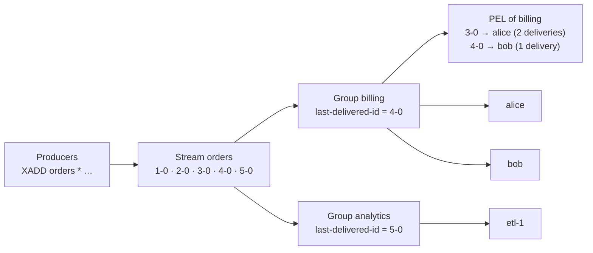
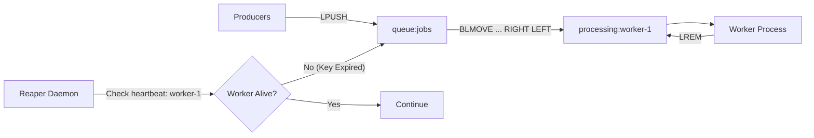

# Module 06 — Messaging: Pub/Sub, Streams and List Queues

Redis offers three messaging primitives with very different guarantees: **Pub/Sub** (at-most-once broadcast, nothing stored), **lists** used as queues (simple, at-most-once unless you add a processing list), and **Streams** (an append-only log with consumer groups, acknowledgements and replay: at-least-once). Choosing wrong is a classic production mistake: notifications lost during a deploy because Pub/Sub was used as a queue, or a stream that grew until the instance ran out of memory because nobody trimmed it. This module defines each primitive's delivery semantics, its internals, and its failure modes, and compares them with Kafka.

> [!NOTE]
> Delivery semantics (at-most/at-least/effectively-once), logs, consumer groups and rebalancing in general are owned by [distributed-systems M10](../../../architecture/distributed-systems/modules/10-messaging-logs-and-delivery-semantics.md) and [data-systems M11](../../../architecture/data-systems/modules/11-stream-processing-and-event-logs.md). This module covers Redis's realisation.

**Executable proofs:** [`examples/ts/06-messaging.test.ts`](../examples/ts/06-messaging.test.ts) with the models in [`src/streams.ts`](../examples/ts/src/streams.ts), and [`examples/ts/integration/06-messaging.test.ts`](../examples/ts/integration/06-messaging.test.ts).

---

## 1. Pub/Sub

### 1.1 Semantics

`PUBLISH channel message` delivers `message` to every client _currently_ subscribed to `channel` (`SUBSCRIBE`) or to a matching pattern (`PSUBSCRIBE news.*`), and returns the number of receivers. Nothing is stored.

- **At-most-once, no persistence.** A subscriber that is disconnected, restarting, or not yet subscribed never sees the message. `PUBLISH` returning 0 means it went nowhere (integration test `pub/sub is fire-and-forget`).
- **Ordering**: messages from one publisher connection on one channel arrive in order at each subscriber; there is no global order across publishers.
- **Fan-out cost**: `PUBLISH` is $O(N + M)$ for $N$ subscribers of the channel and $M$ patterns; every subscriber gets its own copy in its output buffer.
- **Subscribed state**: in RESP2 a subscribed connection can only run (P|S)SUBSCRIBE, (P|S)UNSUBSCRIBE, PING, RESET and QUIT; in RESP3 it can also run normal commands, because messages arrive as push frames ([module 01](01-model-architecture-and-protocol.md#42-resp2-vs-resp3-in-practice)).
- **Replication**: published messages propagate to replicas, so subscribers can connect to a replica.

#### Pub/Sub wire frames and server registries

The server maintains three distinct internal registries for Pub/Sub subscriptions in `server.h`:

- **Channel subscriptions (`server.pubsub_channels`)**: A dictionary mapping channel names (`robj *`) to linked lists of subscribing client pointers (`client *`). Lookup during `PUBLISH` is $O(1)$ to find the subscriber list.
- **Pattern subscriptions (`server.pubsub_patterns`)**: A linked list of `pubsubPattern` structs, each containing a pattern string and client pointer. Every `PUBLISH` must linearly scan this entire list ($O(M)$), evaluating pattern matches with glob matching. Heavy use of pattern subscriptions degrades `PUBLISH` throughput.
- **Sharded subscriptions (`server.pubsubshard_channels`)**: A dictionary per database mapping slot-hashed shard channel names to subscribing client lists.

RESP wire framing for Pub/Sub notifications:

```text
// Confirmation reply upon subscribing:
*3\r\n$9\r\nsubscribe\r\n$4\r\nnews\r\n:1\r\n

// Standard channel message delivery:
*3\r\n$7\r\nmessage\r\n$4\r\nnews\r\n$5\r\nhello\r\n

// Pattern message delivery:
*4\r\n$8\r\npmessage\r\n$6\r\nnews.*\r\n$8\r\nnews.tech\r\n$5\r\nhello\r\n

// Sharded channel message delivery (Redis 7.0+):
*3\r\n$8\r\nsmessage\r\n$6\r\norders\r\n$8\r\npending1\r\n
```

### 1.2 Pub/Sub in Cluster: sharded Pub/Sub (7.0+)

Classic `PUBLISH` in Cluster is broadcast to **every node** over the cluster bus, so cluster-wide Pub/Sub throughput does not scale with nodes (it gets worse). Redis 7.0 added **sharded Pub/Sub**: `SPUBLISH`/`SSUBSCRIBE` hash the channel name to a slot like a key, and messages stay within that shard (primary and replicas). Use sharded Pub/Sub for any new Cluster design; it also survives resharding by moving the channel with its slot (subscribers get an `sunsubscribe` and must resubscribe). The October 2026 security releases (8.10.3 and back-ports) fixed a heap overflow when propagating `PUBLISH`/`SPUBLISH` messages over 4 GB on the cluster bus, a reminder that Pub/Sub payloads should stay small.

### 1.3 Use cases

Good: cache-invalidation broadcasts (where a missed message is healed by TTL), live notifications to connected WebSocket servers, configuration-change hints, chat presence. Bad: anything that must not be lost (orders, emails, payments, job dispatch).

### 1.4 Slow subscribers and output-buffer limits

Messages for a subscriber accumulate in its output buffer when it reads slower than publishers write. Unbounded, that buffer would exhaust the server's memory. `client-output-buffer-limit pubsub 32mb 8mb 60` (default) disconnects a subscriber whose buffer exceeds **32 MB at any moment (hard)** or stays above **8 MB for 60 seconds (soft)**. The disconnected subscriber loses everything that was buffered. The hermetic `disconnectTime` model encodes hard and soft limits (dipping under the soft limit resets its timer); the integration test sets a 64 kB limit, pauses a raw subscriber socket, publishes 32 MB, and observes the subscriber disappear from `CLIENT LIST`.

#### Mathematical model of client output-buffer eviction

Let $R_{\text{in}}$ be the aggregate byte rate of messages published to channels the client subscribes to (bytes/sec), and $R_{\text{out}}$ be the subscriber's effective network reading throughput (bytes/sec). When $R_{\text{in}} > R_{\text{out}}$, the client's output buffer memory $B(t)$ accumulates continuously:

$$\frac{dB(t)}{dt} = R_{\text{in}} - R_{\text{out}} = \Delta R$$

Assuming an initially empty buffer $B(0) = 0$:

$$B(t) = \Delta R \cdot t$$

The server enforces two boundary conditions:

1. **Hard limit eviction ($L\_{\text{hard}}$)**: The server terminates the client socket immediately when $B(t) \ge L_{\text{hard}}$: $$t_{\text{hard}} = \frac{L_{\text{hard}}}{\Delta R}$$

2. **Soft limit eviction ($L\_{\text{soft}}, T\_{\text{soft}}$)**: The buffer crosses $L_{\text{soft}}$ at: $$t_{\text{soft\_cross}} = \frac{L_{\text{soft}}}{\Delta R}$$ The server starts a countdown timer of $T_{\text{soft}}$ seconds (default 60 s). Eviction occurs at: $$t_{\text{soft\_kill}} = t_{\text{soft\_cross}} + T_{\text{soft}} = \frac{L_{\text{soft}}}{\Delta R} + T_{\text{soft}}$$ provided $B(t) \ge L_{\text{soft}}$ holds uninterrupted. If at any moment $B(t)$ drops below $L_{\text{soft}}$, the soft countdown timer resets to zero.

**Worked production scenarios (default limits: $L\_{\text{hard}} = 32\text{ MB}$, $L\_{\text{soft}} = 8\text{ MB}$, $T\_{\text{soft}} = 60\text{ s}$):**

- **Scenario A (Rapid publisher surge)**: $R_{\text{in}} = 2.0\text{ MB/s}$, $R_{\text{out}} = 1.0\text{ MB/s} \implies \Delta R = 1.0\text{ MB/s}$. $$t_{\text{soft\_cross}} = \frac{8\text{ MB}}{1.0\text{ MB/s}} = 8\text{ s}$$ $$t_{\text{hard}} = \frac{32\text{ MB}}{1.0\text{ MB/s}} = 32\text{ s}$$ $$t_{\text{soft\_kill}} = 8 + 60 = 68\text{ s}$$ Because $t_{\text{hard}} = 32\text{ s} < t_{\text{soft\_kill}} = 68\text{ s}$, the **hard limit** triggers first: the subscriber is killed at exactly 32 seconds with 32 MB of buffered messages discarded.

- **Scenario B (Slow creeping reader)**: $R_{\text{in}} = 600\text{ KB/s}$, $R_{\text{out}} = 400\text{ KB/s} \implies \Delta R = 200\text{ KB/s} = 0.2\text{ MB/s}$. $$t_{\text{soft\_cross}} = \frac{8\text{ MB}}{0.2\text{ MB/s}} = 40\text{ s}$$ $$t_{\text{hard}} = \frac{32\text{ MB}}{0.2\text{ MB/s}} = 160\text{ s}$$ $$t_{\text{soft\_kill}} = 40 + 60 = 100\text{ s}$$ Because $t_{\text{soft\_kill}} = 100\text{ s} < t_{\text{hard}} = 160\text{ s}$, the **soft limit** triggers first: the subscriber is evicted at 100 seconds when buffer size reaches only $B(100) = 20\text{ MB}$, well below the hard ceiling.

Mitigations: keep messages small (IDs, not payloads), subscribe from dedicated, fast consumers that hand work off to an in-process queue, and alert on `omem` of pubsub clients.

---

## 2. Streams

### 2.1 Model

A stream is an append-only sequence of entries. Each entry has an ID `<ms>-<seq>` and a body of field/value pairs. Streams arrived in Redis 5.0 and are Redis's log abstraction, closer to a Kafka partition than to Pub/Sub.

- **IDs**: `XADD key * f v` generates `<server unix ms>-<seq>`. IDs are **strictly increasing**: if the clock moves backwards, the server keeps the last `ms` and increments `seq` (property-tested in `auto IDs are …`). Explicit IDs must be greater than the last one (`-ERR The ID specified in XADD is equal or smaller …`; tested in both suites). IDs double as timestamps, so `XRANGE key 1730000000000 +` reads from a point in time.
- **Reading without groups**: `XRANGE`/`XREVRANGE` for history, `XREAD [BLOCK ms] STREAMS key $` to tail (every reader sees every entry, like Pub/Sub but with replay).
- **Internals**: a radix tree keyed by ID whose nodes are listpacks of up to `stream-node-max-entries 100` / `stream-node-max-bytes 4096`; fields that repeat the node's master entry are stored as flags, so uniform event shapes are compact ([module 02](02-core-data-types-encodings-and-complexity.md#36-quicklist-streams-and-the-rest)).

#### Streams internal representation: radix trees and listpack macro-nodes

A Redis Stream is not a linked list of messages; it is an ordered hierarchy designed to minimize memory fragmentation:

1. **The Radix Tree (`rax`)**:
   - The top-level container is a radix tree (`rax *rax` in `server.h`).
   - Keys in the radix tree are big-endian 64-bit integer timestamps representing the millisecond component of the Stream ID (`streamID.ms`).
   - The radix tree enables $O(\log N)$ seeks for arbitrary time ranges (`XRANGE 1730000000000 +`) without scanning the entire log.

2. **Listpack Macro-nodes (`streamNode`)**:
   - Each leaf of the radix tree is not an individual entry, but a **listpack macro-node**.
   - A macro-node bundles up to `stream-node-max-entries` (default 100 entries) or `stream-node-max-bytes` (default 4 096 bytes).
   - Bundling multiple entries into a single contiguous byte array eliminates pointer overhead (8 bytes per entry) and allocation overhead.

3. **Master Entry and Delta Encoding**:
   - The first entry inserted into a listpack macro-node is designated the **master entry**. It serializes the full schema: field count and field names (e.g. `["user_id", "action", "ip"]`).
   - Subsequent entries in the macro-node utilize **delta encoding**:
     - **ID compression**: Instead of storing full 128-bit IDs, subsequent entries record `ms_delta` and `seq_delta` relative to the master entry using variable-length integer encoding. For events arriving in the same millisecond or second, the delta fits in 1 to 2 bytes instead of 16.
     - **Field compression (`SAME_FIELDS`)**: If subsequent entries share the identical field schema as the master entry, Redis sets the `STREAM_ITEM_FLAG_SAMEFIELDS` bit flag. The field names are completely omitted from the payload, serializing only the field values!
4. **Tombstones on Deletion**:
   - When an entry is deleted via `XDEL`, Redis does not shift memory or compact the listpack (which would cost $O(M)$ CPU).
   - Instead, Redis decrements the macro-node's active entry count and marks the entry with a deleted flag (tombstone).
   - Only when all entries inside a macro-node are tombstoned does Redis prune and free the entire rax leaf node.

#### 128-bit Stream IDs and generation edge cases

Every entry appended to a stream is identified by a 128-bit unsigned coordinate defined in C:

```c
typedef struct streamID {
    uint64_t ms;  /* Unix millisecond timestamp */
    uint64_t seq; /* Sequence counter within the millisecond */
} streamID;
```

Key invariant rules governing ID generation and assignment:

- **Monotonic clock invariance**: When generating auto-IDs (`XADD *`), Redis samples the system clock. If NTP adjustments cause the local clock to move backwards or stay identical to the previous entry ($t_{\text{now}} \le \text{last\_id.ms}$), Redis preserves $\text{id.ms} = \text{last\_id.ms}$ and increments $\text{id.seq} = \text{last\_id.seq} + 1$. Stream IDs are strictly monotonically increasing, guaranteeing an immutable temporal order.
- **Sequence limit**: The 64-bit sequence counter accommodates up to $2^{64} - 1 \approx 1.84 \times 10^{19}$ entries per millisecond.
- **Explicit ID constraints**: Explicit IDs passed to `XADD key <ms>-<seq>` must be strictly greater than the stream's highest existing ID. If smaller or equal, Redis rejects the write with `-ERR The ID specified in XADD is equal or smaller than the target stream top item`.
- **Sentinel IDs**: The minimum possible stream ID is `0-1`. The identifier `0-0` is reserved as a sentinel representing the beginning of the stream and cannot be inserted.

#### Stream command algorithmic complexity

| Command | Time Complexity | Space / Buffer Cost | Operational Notes |
| --- | --- | --- | --- |
| `XADD` | $O(1)$ amortized | $O(1)$ | Inserts into current listpack macro-node; allocates new radix node only when macro-node exceeds configured limits. |
| `XRANGE` / `XREVRANGE` | $O(\log N + M)$ | $O(M)$ output memory | Seeks start ID via radix tree in $O(\log N)$, then sequentially scans $M$ entries across contiguous listpacks. |
| `XREAD [BLOCK]` | $O(\log N + M)$ | $O(M)$ output memory | Reads entries across one or more streams; registers client in blocking hash table if awaiting new entries. |
| `XREADGROUP` | $O(\log N + M)$ | $O(M)$ PEL entries | In addition to reading, allocates and inserts $M$ entries into both group-level and consumer-level radix trees. |
| `XACK` | $O(K \log N)$ | Frees PEL memory | Removes $K$ entries from dual-rax PEL structures, decrementing pending counts. |
| `XAUTOCLAIM` | $O(\log N + K)$ | $O(K)$ output memory | Scans group PEL starting at cursor, reassigns idle entries to caller, and auto-deletes tombstoned IDs. |
| `XTRIM` (approximate `~`) | $O(\log N)$ | Frees radix tree nodes | Evicts whole listpack macro-nodes from the head of the stream without rewriting partially filled blocks. |
| `XTRIM` (exact `=`) | $O(\log N + M)$ | Frees trimmed entries | Iteratively deletes individual entries and compacts listpacks to match exact requested length. |
| `XDEL` | $O(\log N + K)$ | Sets tombstones | Flags entries as deleted; deallocates macro-node only when all enclosed entries are tombstoned. |

### 2.2 Consumer groups and the PEL

A **consumer group** is a named cursor plus bookkeeping:



- `XGROUP CREATE key group $|0 [MKSTREAM]` creates the group at the end (`$`, only new entries) or the start (`0`).
- `XREADGROUP GROUP g consumer COUNT n [BLOCK ms] STREAMS key >` delivers entries **never delivered to this group**, each to exactly one consumer, and records them in the group's **Pending Entries List (PEL)** with the consumer name, delivery time and delivery count.
- `XACK key g id…` removes entries from the PEL. Until then they are "in flight".
- Each group is independent: two groups each receive every entry (fan-out), consumers inside a group share the work (load balancing). Tested in both suites.
- `XREADGROUP … STREAMS key 0` (any ID instead of `>`) returns **this consumer's own pending entries**: what a restarted consumer must process first.
- `XPENDING key g [IDLE ms] - + count [consumer]` inspects the PEL; `XINFO GROUPS key` shows `lag` (entries not yet delivered to the group) and `pel-count`.
- Error replies: creating a group that already exists returns `-BUSYGROUP Consumer Group name already exists`; reading with `XREADGROUP` against a non-existent group or key returns `-NOGROUP No such key 'key' or consumer group 'g' in XREADGROUP with GROUP option`.

Delivery semantics: **at-least-once**. A consumer that processes an entry and crashes before `XACK` will see it again (or another consumer will claim it). Make processing idempotent ([module 07](07-coordination-rate-limits-locks-and-idempotency.md#5-idempotency-keys)).

#### Dual-rax architecture of the Pending Entries List (PEL)

The Pending Entries List (PEL) is the core mechanism enabling at-least-once delivery guarantees without message loss. Under the hood, Redis manages the PEL using a **dual-rax data structure** (`rax`):

```text
streamCG (Consumer Group)
  ├── last_id: 1730000000000-0
  └── pel: rax (group-level) ───────┐
                                     │
streamConsumer ("worker-1")          ▼
  └── pel: rax (consumer-level) ──> streamNACK
                                     ├── delivery_time: 1730000005000
                                     ├── delivery_count: 2
                                     └── consumer: *streamConsumer
```

- **Group-level PEL (`streamCG->pel`)**: A radix tree mapping every unacknowledged 128-bit `streamID` across the entire group to a pointer to a `streamNACK` (Negative Acknowledgement) structure.
- **Consumer-level PEL (`streamConsumer->pel`)**: Each consumer within the group also owns its own radix tree mapping in-flight `streamID`s to the **exact same** shared `streamNACK` pointer in RAM.
- **The `streamNACK` structure**: Records state for each unacknowledged entry:
  - `delivery_time`: Millisecond timestamp of the most recent delivery attempt.
  - `delivery_count`: Counter incremented whenever the message is delivered via `XREADGROUP`, claimed via `XCLAIM`, or transferred via `XAUTOCLAIM`.
  - `consumer`: Pointer back to the current owning `streamConsumer`.
- **Why dual-rax**:
  - Calling `XPENDING stream group - + 10 worker-1` queries `consumer->pel` directly in $O(K)$ time, returning that specific worker's backlog without scanning other workers' entries.
  - Calling `XPENDING stream group - + 10` or running `XAUTOCLAIM` scans `group->pel` in $O(\log N + K)$ time, iterating through global unacknowledged entries in strict chronological order.
  - Calling `XACK` looks up the `streamID`, unlinks it from both `group->pel` and `consumer->pel`, and frees the shared `streamNACK` node in $O(\log N)$ time.

### 2.3 Recovering stuck entries: `XCLAIM` and `XAUTOCLAIM`

If a consumer dies for good, its PEL entries stay pending forever unless someone claims them:

```text
RECOVERY-LOOP(group, me):
  loop every few seconds:
     (cursor, entries, deleted) ← XAUTOCLAIM stream group me MIN-IDLE start COUNT 100
     for e in entries:
        if e.deliveries > MAX-DELIVERIES then XADD dlq * … ; XACK stream group e.id   ▷ poison message
        else PROCESS(e); XACK stream group e.id
     start ← cursor
```

`XAUTOCLAIM` (6.2+) scans the PEL from `start`, transfers entries idle for at least `min-idle-time` to the caller, and increments their delivery count. Since 7.0 it also returns the IDs of PEL entries whose stream entry was **trimmed away** and deletes them from the PEL. Both behaviours are modelled and tested hermetically; the integration test claims a dead consumer's entry and checks the delivery count is 2.

The delivery counter is the poison-message detector: an entry that crashes every consumer would otherwise circulate forever. Redis 8.2 added `XACKDEL` (acknowledge and delete in one step), 8.4 added `XREADGROUP … CLAIM min-idle-time` (consume idle pending entries and new ones in one call), and 8.8 added `XNACK` (a consumer explicitly releases pending entries instead of waiting for them to go idle).

#### Poison-message detection and dead-letter queues (DLQ)

A **poison message** is an entry that repeatedly crashes consumer workers due to unhandled exceptions, deserialization bugs, schema incompatibilities, or unrecoverable downstream database failures. Without isolation, the entry returns to the PEL, is reclaimed on timeout by another worker, and crashes it too, creating an infinite crash loop.

The `delivery_count` on `streamNACK` serves as the authoritative poison detector. The production recovery loop enforces a strict dead-letter threshold:

```text
PROCESS-WITH-DLQ(stream, group, consumer, max_retries):
  entries ← XREADGROUP GROUP group consumer COUNT 10 BLOCK 2000 STREAMS stream >
  for (id, fields) in entries:
    try:
      DISPATCH_BUSINESS_LOGIC(fields)
      XACK stream group id
    catch Exception as err:
      nack ← XPENDING stream group id
      if nack.delivery_count >= max_retries:
        // Divert to dead-letter stream with error diagnostic context
        XADD stream:dlq * "original_stream" stream "original_id" id \
                          "payload" fields "error" err.message "deliveries" nack.delivery_count
        XACK stream group id // or XACKDEL on Redis 8.2+
        ALERT_ONCALL("Poison message dead-lettered", stream, id, err)
      else:
        LOG_WARNING("Transient failure, allowing message to remain pending", id)
```

In Redis 8.2+, `XACKDEL stream group id` combines acknowledging from the PEL and deleting from the underlying stream into one atomic command, preventing orphaned dead-letter items from lingering in stream storage.

### 2.4 Trimming and memory

Streams never shrink on their own. Acknowledging entries does **not** delete them. Without trimming, a stream is a memory leak with a deadline.

- `XADD key MAXLEN ~ 1000000 * …` or `MINID ~ <id>` trims on every append. The `~` makes trimming **approximate**: Redis removes only whole radix-tree nodes, which is much cheaper; the integration test shows `MAXLEN ~ 100` leaving somewhat more than 100 entries, and `XTRIM … MAXLEN = 100` leaving exactly 100.
- Trimming removes entries **regardless of whether consumer groups have processed them**. If a consumer group lags behind the trim point, it silently loses entries (they become "deleted" PEL entries). Size `MAXLEN` with lag in mind and alert on group `lag`.
- Redis 8.2 extended `XADD`/`XTRIM` and added `XDELEX` with options controlling how deletion interacts with consumer-group references (keep, delete, or only acknowledged).

### 2.5 Idempotent production (8.6)

A producer that times out on `XADD` does not know whether the entry was appended; retrying may duplicate it. Redis 8.6 added stream idempotency: `XADD` with the new `IDMP` (caller-supplied identifiers) or `IDMPAUTO` (server-derived) arguments makes the server remember recent producer/message identifiers and return the original entry instead of appending a duplicate, bounded by `stream-idmp-duration` (default 100 s) and `stream-idmp-maxsize` (default 100 entries) per the `redis.conf` comments. The hermetic `IdempotentProducerTable` models the guarantee and its limit: a retry outside the window _is_ duplicated, so consumers still need idempotency. Exact argument syntax: see the `XADD` command page; this track does not run it in integration (no 8.6 server was available while authoring), so treat the details as **unverified by execution**. Known limitation at 8.6 GA: avoid `IDMP` with `appendonly yes` + `aof-use-rdb-preamble no`.

---

## 3. Lists as queues and the reliable-queue pattern

The simplest queue is a list: producers `LPUSH`, consumers `BRPOP` (blocking pop). It is at-most-once: once `BRPOP` returns, the item exists only in the consumer's memory; a crash loses it. The **reliable queue** pattern moves the item atomically into a per-worker processing list:

```text
WORKER(w):
  loop
     job ← BLMOVE queue processing:w RIGHT LEFT timeout     ▷ atomic: never in neither list
     PROCESS(job)
     LREM processing:w 1 job                                ▷ acknowledge

REAPER():                                                    ▷ for workers whose heartbeat expired
  while LMOVE processing:dead queue RIGHT LEFT ≠ NIL: continue
```

- `BLMOVE` (6.2+) replaces the deprecated `BRPOPLPUSH`. The hermetic test shows `RPOP` losing a job across a crash while `LMOVE` keeps it recoverable; the integration test does the same with real commands.
- Heartbeats: each worker refreshes `SET worker:w alive EX 30`; the reaper requeues jobs of workers whose key expired.
- Lists give FIFO and blocking but no delivery counts, no per-message acknowledgement IDs and no replay. For more than a simple job queue, use a Stream with a consumer group.
- Delayed jobs: a sorted set scored by due time, polled with `ZRANGE … BYSCORE -inf now LIMIT 0 100` and moved atomically to the work queue by a script (or `ZPOPMIN` + check).

### 3.1 Reliable queue recovery and heartbeat pattern

In production distributed systems, worker nodes processing list queues can crash or experience network partitions midway through job execution. Plain `BRPOP` causes irreversible job loss. The `BLMOVE` pattern prevents loss by maintaining a dedicated in-progress list per worker:



```text
WORKER-PROCESS(worker_id):
  while running:
    SET "heartbeat:" + worker_id "alive" EX 30   ▷ Refresh liveness lease
    job ← BLMOVE "queue:jobs" ("processing:" + worker_id) RIGHT LEFT 5
    if job ≠ NIL:
      EXECUTE_JOB(job)
      LREM ("processing:" + worker_id) 1 job      ▷ Acknowledge completion

REAPER-DAEMON():
  for worker_key in SMEMBERS "workers:active":
    if EXISTS ("heartbeat:" + worker_key) == 0:
      // Worker crashed or partition occurred: recover in-flight jobs
      while LMOVE ("processing:" + worker_key) "queue:jobs" RIGHT LEFT ≠ NIL:
        LOG_WARN("Requeued orphaned job from dead worker", worker_key)
      SREM "workers:active" worker_key
```

---

## 4. Keyspace notifications

`notify-keyspace-events` (default empty: disabled) makes Redis publish Pub/Sub messages about key changes: `__keyspace@<db>__:<key>` (the event is the message) and `__keyevent@<db>__:<event>` (the key is the message). Flags select classes: `K` keyspace, `E` keyevent, `g` generic, `$` string, `l` list, `h` hash, `z` zset, `x` expired, `e` evicted, `n` new key, `A` alias for most classes. 8.2 added `OVERWRITTEN` and `TYPE_CHANGED` events, and 8.8 hash-field-level notifications.

They inherit Pub/Sub's semantics: **at-most-once**, lost when the subscriber is disconnected, and `expired` fires when the key is deleted (possibly long after its TTL; [module 03](03-keys-expiry-eviction-and-memory.md#23-expiry-and-replication-persistence-notifications)). In Cluster, each node publishes only its own keys' events, so a listener must subscribe on every node. Use them as hints (invalidate a local cache, wake a poller), never as the system of record. The integration test enables `E$x` and receives `set` and `expired` events.

---

## 5. Choosing: Pub/Sub vs Streams vs lists vs Kafka

|  | Pub/Sub | List + `BLMOVE` | Stream + consumer group | Kafka |
| --- | --- | --- | --- | --- |
| Stored | No | Until popped | Until trimmed | Until retention |
| Delivery | At-most-once | At-least-once with processing list | At-least-once (PEL, `XACK`) | At-least-once; exactly-once within Kafka transactions |
| Fan-out to independent consumers | Yes (all subscribers) | No (one consumer per item) | Yes (one group per application) | Yes (consumer groups) |
| Replay / rewind | No | No | Yes (`XRANGE`, group `SETID`) | Yes (offsets) |
| Ordering | Per publisher per channel | FIFO | By ID within a stream | Per partition |
| Scale-out | Sharded Pub/Sub per slot | One list per shard | One stream per key: shard by key (`orders:{n}`), no automatic partitioning or rebalancing | Partitions with consumer rebalancing |
| Durability | None | Redis persistence (RDB/AOF) and async replication | Same as lists | Replicated log, `acks=all`, fsync policies |
| Retained data size | — | RAM | RAM | Disk (TB) |

Rules of thumb: Pub/Sub for ephemeral notifications; Streams for job processing and event logs of bounded size where Redis is already in the stack; Kafka (or a database queue such as PostgreSQL `FOR UPDATE SKIP LOCKED`) when you need disk-sized retention, replay over weeks, strong durability, or many partitions with managed rebalancing. Kafka's internals are covered in [distributed-systems M10](../../../architecture/distributed-systems/modules/10-messaging-logs-and-delivery-semantics.md#2-apache-kafka-architecture-partitions-isr-and-high-watermark).

### 5.1 Then vs now: messaging primitives and command evolution

Messaging in Redis has evolved from raw list manipulations to sophisticated, horizontally scalable event streams and sharded pub/sub channels:

| Capability | **Then** (Classic Redis) | **Now** (Modern Redis / Valkey) | Operational Impact |
| --- | --- | --- | --- |
| Reliable queue transfer | `BRPOPLPUSH source dest timeout` (deprecated) | `BLMOVE source dest LEFT\|RIGHT LEFT\|RIGHT timeout` (6.2+) | Directional flexibility: allows true LIFO, FIFO, or priority dequeuing atomically without Lua scripts. |
| Pub/Sub in Cluster | Global `PUBLISH` / `SUBSCRIBE` broadcast over cluster bus | Sharded Pub/Sub `SPUBLISH` / `SSUBSCRIBE` (7.0+) | Scales linearly with cluster shards; eliminates $O(N_{\text{nodes}})$ gossip broadcast overhead across cluster bus. |
| In-flight PEL recovery | Multi-step `XPENDING` scan followed by `XCLAIM` | Single-command streaming `XAUTOCLAIM` (6.2+; auto-prunes trimmed entries in 7.0+) | Eliminates multi-round-trip script overhead and prevents memory leaks from trimmed entries lingering in the PEL. |
| Stream ack and deletion | Separate `XACK key group id` followed by `XDEL key id` | Atomic `XACKDEL key group id` (8.2+) | Prevents race windows between acknowledgement and deletion; halves command overhead for ephemeral work queues. |
| Granular stream pruning | Coarse `XTRIM key MAXLEN ~ N` | `XDELEX key ...` with acknowledged filter options (8.2+) | Prevents consumer starvation by allowing trimming only of entries already acknowledged by active consumer groups. |
| Read and claim batching | Separate `XAUTOCLAIM` and `XREADGROUP` loops | `XREADGROUP ... CLAIM min-idle-time` (8.4+) | Combines claiming abandoned work and fetching new messages into a single network round-trip. |
| Explicit release | Idle timeout expiration in PEL | `XNACK key group id` (8.8+) | Immediately releases an entry back to other consumers upon transient worker failure without waiting for idle timeout. |

**Migration and compatibility notes:**

1. **`BRPOPLPUSH` to `BLMOVE`**: `BLMOVE source dest RIGHT LEFT timeout` is a drop-in replacement for `BRPOPLPUSH source dest timeout`. All modern client libraries (`node-redis`, `ioredis`) support `BLMOVE`.
2. **Global to Sharded Pub/Sub**: In Redis Cluster, replace `PUBLISH channel msg` with `SPUBLISH channel msg` and `SUBSCRIBE channel` with `SSUBSCRIBE channel`. Sharded channels hash to a specific slot (computed via CRC16), confining channel traffic to the slot owner and its replicas. During cluster slot resharding, the channel moves with the slot, emitting an `sunsubscribe` event to connected clients.
3. **Consumer group recovery**: Legacy loops using `XPENDING` to list candidate IDs and iterating `XCLAIM` one by one suffer from $O(K)$ network round trips and can re-claim entries that were pruned by `MAXLEN`. Migrate to `XAUTOCLAIM stream group consumer min-idle-time start COUNT 100`, which streams claimed entries and automatically unlinks tombstoned IDs from the PEL.

---

## 6. Production failure modes

1. **Pub/Sub used as a job queue.** Deploys and network blips drop messages silently. Symptom: "sometimes the email is never sent".
2. **Unbounded stream.** No `MAXLEN`/`MINID`: memory grows until `maxmemory` and the instance starts refusing writes (or evicting other data).
3. **Stuck PEL.** A consumer was renamed or scaled down; its pending entries are never claimed. `XINFO GROUPS` shows `pel-count` growing. Run an `XAUTOCLAIM` recovery loop.
4. **Poison message loop.** An entry that crashes the consumer is reclaimed and crashes the next one. Dead-letter after N deliveries.
5. **Trim faster than consumption.** A lagging group loses entries to `MAXLEN` without errors. Alert on lag relative to `MAXLEN`.
6. **Slow subscriber disconnects.** Large Pub/Sub messages plus a slow consumer hit the 32 MB hard limit; the consumer reconnects and misses everything in between.
7. **Hot stream key.** One stream is one key on one shard: all producers and consumers hit one core. Shard streams by key (`events:{tenant}`) and fan in on the consumer side.
8. **Blocking reads on shared connections.** `XREADGROUP BLOCK 5000` on a multiplexed client connection stalls all other commands on it; use dedicated connections for blocking reads.

---

## Proof map for this module

| Claim | Hermetic | Integration |
| --- | --- | --- |
| IDs strictly increase even with clock skew; explicit IDs must grow | property test, `negative: explicit IDs …` | `negative: XADD with an ID …` |
| One delivery per group, fan-out across groups, PEL until `XACK` | `consumer group: …` | `consumer group: deliver once per group …` |
| Restarted consumer re-reads own pending with ID 0 | `crash recovery …` | — |
| `XAUTOCLAIM` transfers idle entries, counts deliveries, drops trimmed | `XAUTOCLAIM moves idle entries …`, `trimming removes entries …` | `XAUTOCLAIM transfers …` |
| `MAXLEN ~` is approximate, `=` exact | — | `MAXLEN ~ trims approximately …` (**integration-only**) |
| Idempotent production window | `idempotent production …` (model only; **8.6 `IDMP` syntax not executed**) | — |
| Pub/Sub stores nothing | — | `pub/sub is fire-and-forget …` (**integration-only**) |
| Slow subscribers are disconnected | `pub/sub output buffer …` | `a slow subscriber is disconnected …` (dedicated server) |
| `BLMOVE` reliable queue | `reliable queue …` | `BLMOVE reliable queue …` |
| Keyspace notifications | — | `keyspace notifications …` (**integration-only**, dedicated server) |

---

## Interview Drill

<details><summary>1. Pub/Sub vs Streams: when would you use each?</summary>

Pub/Sub for ephemeral broadcast where loss is acceptable (live UI updates, cache-invalidation hints): nothing is stored, delivery is at-most-once. Streams when messages must survive consumer downtime: entries are stored, consumer groups load-balance with acknowledgements and a PEL, and you can replay. Streams need trimming and a recovery loop for stuck entries.
</details>

<details><summary>2. A consumer crashed after reading but before `XACK`. What happens to the message?</summary>

It stays in the group's PEL, owned by the dead consumer. If that consumer restarts with the same name it reads its pending entries with `XREADGROUP … 0`. Otherwise another consumer claims it with `XAUTOCLAIM` after a minimum idle time; the delivery counter increments, which also detects poison messages.
</details>

<details><summary>3. How do you build a reliable work queue with lists?</summary>

`BLMOVE queue processing:<worker> RIGHT LEFT timeout` atomically moves the job into a per-worker processing list; after success `LREM` it. A reaper moves jobs from processing lists of dead workers (expired heartbeat keys) back to the queue. Plain `BRPOP` loses jobs on crashes.
</details>

<details><summary>4. Why might a stream consumer group silently lose messages?</summary>

Trimming (`MAXLEN`/`MINID`) deletes entries whether or not groups have consumed or acknowledged them. A lagging group then finds entries gone; `XAUTOCLAIM` reports their IDs as deleted. Size trimming against worst-case lag and alert on group lag.
</details>

<details><summary>5. How does Pub/Sub behave in Redis Cluster, and what changed in 7.0?</summary>

Classic `PUBLISH` is broadcast to every node over the cluster bus, so it does not scale with cluster size. Sharded Pub/Sub (`SPUBLISH`/`SSUBSCRIBE`, 7.0+) maps a channel to a slot and keeps traffic within that shard.
</details>

<details><summary>6. Redis Streams or Kafka for an order-event pipeline?</summary>

Kafka if you need weeks of retention on disk, replay by many independent consumers, strong replicated durability (`acks=all`), and partitioned scale with rebalancing. Redis Streams if volumes and retention fit in RAM, you already run Redis, and you accept asynchronous replication (acknowledged writes can be lost on failover) and manual sharding by key.
</details>

<details><summary>7. A producer's `XADD` timed out. Should it retry?</summary>

A retry may create a duplicate, because the first `XADD` may have been applied. Either make consumers idempotent (deduplicate by a business ID in the body), or on 8.6+ use the `IDMP` arguments of `XADD` so the server deduplicates retries within its window; consumers should still be idempotent because the window is bounded.
</details>
