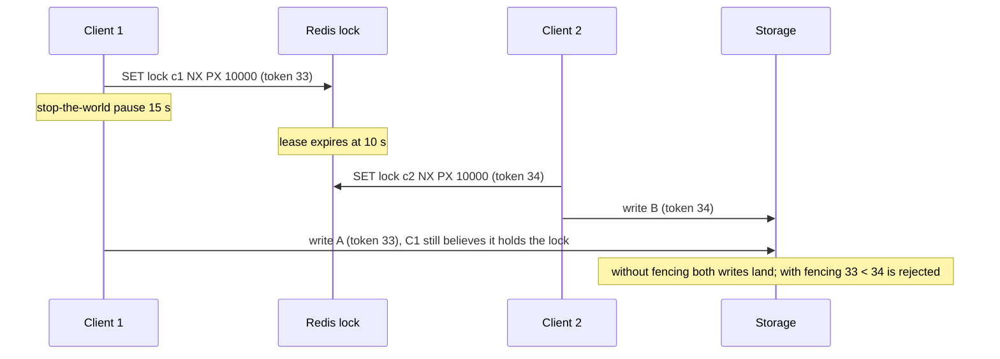
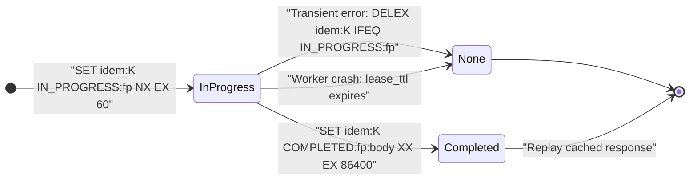

# Module 07 — Coordination Patterns: Rate Limits, Locks, Idempotency, Leaderboards and Sessions

Beyond caching, Redis is the default "coordination store" of many backends: rate limiters at the API gateway, locks around jobs, idempotency keys for payment APIs, leaderboards and sessions. Each pattern relies on one property from earlier modules (single-command atomicity, scripts, TTLs), and each has a well-known way to get it subtly wrong. This module treats rate limiters formally, takes the distributed-lock debate seriously (including Redlock and fencing tokens), and shows how to build idempotency keys that actually prevent double charges.

> [!NOTE]
> Leases, fencing and the general distributed-lock problem, including the Kleppmann–Sanfilippo debate, are owned by [distributed-systems M08](../../../architecture/distributed-systems/modules/08-distributed-coordination-and-locks.md#3-the-redlock-critique-kleppmann-vs-redis). Idempotency theory is owned by [distributed-systems M10](../../../architecture/distributed-systems/modules/10-messaging-logs-and-delivery-semantics.md#3-delivery-semantics-and-exactly-once-processing). Rate limiters as system-design components belong to `architecture/system-design`. This module covers the Redis realisation and its delta.

**Executable proofs:** [`examples/ts/07-coordination.test.ts`](../examples/ts/07-coordination.test.ts) with [`src/coordination.ts`](../examples/ts/src/coordination.ts) and the Lua files [`sliding_window.lua`](../examples/lua/sliding_window.lua) and [`token_bucket.lua`](../examples/lua/token_bucket.lua); [`examples/ts/integration/07-coordination.test.ts`](../examples/ts/integration/07-coordination.test.ts).

---

## 1. Rate limiters

### 1.1 Definitions

A rate limiter admits a request at time $t$ for identity $u$ if the number of admitted requests of $u$ in some window satisfies a bound. The variants differ in _which_ window:

- **Fixed window**: count in $[\lfloor t/W \rfloor W, (\lfloor t/W \rfloor + 1) W)$; bound $L$.
- **Sliding log**: count of admitted timestamps in $(t - W, t]$; bound $L$. Exact.
- **Sliding-window counter**: estimate $= c_{\text{cur}} + c_{\text{prev}} \cdot (1 - \frac{t \bmod W}{W})$; bound $L$. An approximation that assumes the previous window's requests were uniformly spread.
- **Token bucket**: a bucket of capacity $B$ refills at $r$ tokens/s; a request takes one token. Allows bursts of $B$ and a sustained rate $r$.
- **GCRA** (generic cell rate algorithm): token bucket expressed as one stored number, the _theoretical arrival time_ (TAT): admit iff $\text{TAT} - t \le \tau$ (burst tolerance), then $\text{TAT} \leftarrow \max(\text{TAT}, t) + 1/r$.

### 1.2 Redis implementations and their costs

| Algorithm | Redis realisation | Memory per identity | Accuracy |
| --- | --- | --- | --- |
| Fixed window | `INCR rl:{u}:<window>` + `EXPIRE … NX` in `MULTI`, or `INCREX … UBOUND L EX W ENX` (8.8+) | 1 small key | Admits up to $2L$ across a boundary |
| Sliding log | Sorted set: `ZREMRANGEBYSCORE k -inf t-W`, `ZCARD`, `ZADD k t <uid>`, `PEXPIRE`, in a script | $O(L)$ members | Exact |
| Sliding-window counter | Two counters and a script ([`sliding_window.lua`](../examples/lua/sliding_window.lua)) | 2 small keys | Approximate, smooth |
| Token bucket | Hash `{tokens, ts}` and a script ([`token_bucket.lua`](../examples/lua/token_bucket.lua)) | 1 hash | Exact for its model |
| GCRA | One string (TAT) and a script, or a module such as redis-cell | 1 small key | Exact for its model |

The hermetic tests prove the defining properties: a fixed window admits **20** requests within 200 ms around a boundary for a "10 per minute" limit; the sliding log admits 10; the sliding-window counter admits 10 at the boundary and 5 more half-way through the next window (as its weighting predicts); GCRA admits a burst of 5 and then exactly one request per interval. The token-bucket script refuses to mint tokens when the caller's clock goes backwards (the `math.max(0, now - ts)` guard).

#### Closed-form derivation of the Generic Cell Rate Algorithm (GCRA)

The Generic Cell Rate Algorithm (ITU-T Recommendation I.371) formulates a leaky token bucket as a discrete scheduling recurrence without requiring separate token tracking:

- **Parameters**:
  - Emission interval $T = 1/r$: The theoretical time interval separating two consecutive requests at steady-state rate $r$.
  - Burst tolerance limit $\tau = B \times T$: The maximum allowable time debt corresponding to capacity $B$.
- **State variable**: A single 64-bit integer timestamp $\text{TAT}$ (Theoretical Arrival Time), representing when the next request is expected to arrive.
- **State transition derivation**: When a request arrives at wall-clock time $t$: The earliest permissible arrival time under burst allowance $\tau$ is $\text{TAT} - \tau$.

  1. **Rejection criterion**: $$\text{If } t < \text{TAT} - \tau$$ The request arrives before the allowable burst boundary. The request is **rejected**. The required wait time before a retry can succeed is: $$\Delta_{\text{wait}} = (\text{TAT} - \tau) - t$$ The state $\text{TAT}$ remains unmodified.

  2. **Admission criterion**: $$\text{If } t \ge \text{TAT} - \tau$$ The request is **admitted**. The updated Theoretical Arrival Time becomes: $$\text{TAT}_{\text{new}} = \max(t, \text{TAT}) + T$$

Why GCRA is superior in Redis: Standard token buckets require an $O(1)$ Hash storing both `tokens` and `last_updated`, requiring two floating-point conversions per check. GCRA requires only **one key holding a single integer string** ($\text{TAT}$ in milliseconds). Key expiration is simply `PEXPIREAT key TAT`.

#### Trace of GCRA execution ($T = 100\text{ ms}, \tau = 300\text{ ms} \implies B = 3$ burst)

| Step | Arrival Time $t$ | Prior $\text{TAT}$ | Earliest Permitted ($\text{TAT} - \tau$) | Condition ($t \ge \text{TAT} - \tau$) | Result | New $\text{TAT}$ |
| --- | --- | --- | --- | --- | --- | --- |
| 1 | 0 ms | 0 ms (init) | −300 ms | $0 \ge -300$ (True) | **Admitted** | $\max(0, 0) + 100 = 100\text{ ms}$ |
| 2 | 0 ms | 100 ms | −200 ms | $0 \ge -200$ (True) | **Admitted** | $\max(0, 100) + 100 = 200\text{ ms}$ |
| 3 | 0 ms | 200 ms | −100 ms | $0 \ge -100$ (True) | **Admitted** | $\max(0, 200) + 100 = 300\text{ ms}$ |
| 4 | 0 ms | 300 ms | 0 ms | $0 \ge 0$ (True) | **Admitted** | $\max(0, 300) + 100 = 400\text{ ms}$ |
| 5 | 0 ms | 400 ms | 100 ms | $0 \ge 100$ (False) | **Rejected** | Unchanged ($400\text{ ms}$; retry in $100\text{ ms}$) |
| 6 | 150 ms | 400 ms | 100 ms | $150 \ge 100$ (True) | **Admitted** | $\max(150, 400) + 100 = 500\text{ ms}$ |

#### Production GCRA Lua script

```lua
-- KEYS[1]: rate limit key holding TAT in milliseconds
-- ARGV[1]: rate (requests per second)
-- ARGV[2]: burst capacity (maximum cell burst debt)
-- ARGV[3]: now (current Unix time in milliseconds)
local rate = tonumber(ARGV[1])
local burst = tonumber(ARGV[2])
local now = tonumber(ARGV[3])

local emission_interval = 1000.0 / rate
local burst_tolerance = burst * emission_interval

local tat = tonumber(redis.call('GET', KEYS[1]))
if not tat then
  tat = now
end

local earliest_permitted = tat - burst_tolerance
if now < earliest_permitted then
  local wait_ms = math.ceil(earliest_permitted - now)
  return {0, wait_ms} -- Rejected, retry-after wait_ms
else
  local new_tat = math.max(now, tat) + emission_interval
  local ttl_ms = math.ceil(new_tat - now)
  redis.call('SET', KEYS[1], tostring(math.ceil(new_tat)), 'PX', ttl_ms)
  return {1, 0} -- Admitted
end
```

#### Production Sliding-Window Counter script

```lua
-- KEYS[1]: current window counter (e.g. rl:{user}:17300000)
-- KEYS[2]: previous window counter (e.g. rl:{user}:17299940)
-- ARGV[1]: limit
-- ARGV[2]: window duration in seconds
-- ARGV[3]: current timestamp in seconds
local limit = tonumber(ARGV[1])
local window = tonumber(ARGV[2])
local now = tonumber(ARGV[3])

local current_count = tonumber(redis.call('GET', KEYS[1]) or "0")
local prev_count = tonumber(redis.call('GET', KEYS[2]) or "0")

local time_in_window = now % window
local weight = (window - time_in_window) / window
local estimated_requests = current_count + math.floor(prev_count * weight)

if estimated_requests < limit then
  redis.call('INCR', KEYS[1])
  if current_count == 0 then
    redis.call('EXPIRE', KEYS[1], window * 2)
  end
  return {1, limit - estimated_requests - 1}
else
  return {0, 0}
end
```

### 1.3 `INCREX` (Redis 8.8)

`INCREX key [BYINT n | BYFLOAT f] [LBOUND lo] [UBOUND hi] [SATURATE] [EX s | PX ms | EXAT … | PXAT … | PERSIST] [ENX]` increments with bounds and expiry in one $O(1)$ command and returns `[new value, applied increment]`:

- Out of bounds → by default the operation is **skipped** (`[current, 0]`, key and TTL untouched); with `SATURATE` the value is clamped and the applied increment is the clamped delta.
- `ENX` sets the expiry only if the key has none, so the window is anchored at the first request; without an expiry option the TTL is preserved.
- The fixed-window limiter becomes one command: `INCREX rl:{u} BYINT 1 UBOUND 100 EX 60 ENX`; rejected iff the applied increment is 0.

The hermetic model follows the command reference (skip vs saturate, `ENX` anchoring, option validation); the integration test is **gated to Redis ≥ 8.8** and was not executed while authoring. Notes from the reference: `INCREX` is not available on Redis Cloud at the time of writing, and in Active-Active deployments each replica enforces bounds locally, so merged values can exceed `UBOUND`. Valkey 9.2 release candidates list an `INCREX` too; do not assume identical semantics until it is GA.

### 1.4 Operating rate limiters

- **Key design**: `rl:{<identity>}:<rule>`; the hash tag keeps an identity's keys in one Cluster slot so scripts may touch them all.
- **Clock**: pass `now` from one authority, or use `redis.call('TIME')` inside the script (allowed since effects replication; [module 05](05-transactions-scripting-and-functions.md#34-determinism-replication-and-the-sandbox)). Mixing client clocks across hosts with skew lets fast clocks drain buckets.
- **Fail open or closed?** If Redis is unreachable, most APIs fail open (admit) with a local in-memory limiter as a backstop; security-sensitive limits (login attempts) fail closed.
- **Hot identities** (one tenant generating most traffic) make one key hot: shard the counter (`rl:{u}:<n>` for $n \in 0..k-1$, each with limit $L/k$) at the cost of accuracy.

---

## 2. Distributed locks

### 2.1 Single-instance lock

```text
ACQUIRE(resource, ttl):
  token ← random 128-bit value
  if SET lock:resource token NX PX ttl = OK then return token     ▷ atomic test-and-set with lease
  return FAIL

RELEASE(resource, token):
  DELEX lock:resource IFEQ token                                  ▷ 8.4+; else compare_and_delete.lua
```

Each element is load-bearing ([module 04](04-caching-patterns.md#32-cross-process-lock-with-set-nx-px) covers the efficiency-lock variant):

- `NX` + `PX` in one command: no window in which the lock exists without a TTL.
- A random token per acquisition: so `RELEASE` deletes only _our_ lock.
- Owner-checked release: atomically, via `DELEX … IFEQ` (8.4+) or a script. A `GET` then `DEL` from the client is not atomic. Tested hermetically (Lua) and on the server (script, and `DELEX` gated to 8.4+).
- Extending a lease: a script that checks the token and then `PEXPIRE`s.

### 2.2 Why a lease is not mutual exclusion: the pause problem

A lock with a TTL is a **lease**. The holder cannot know that its lease is still valid when it acts: a GC pause, a page fault, VM migration or a slow network can stall it past the expiry while another client acquires the lock. The hermetic `gcPauseScenario` replays Kleppmann's timeline:



Without fencing, both writes are accepted and client 1 clobbers client 2. **No lock service can prevent this on its own**; only the resource being protected can, by checking a **fencing token**: a number that increases with every acquisition, carried with every write, and rejected if lower than one already seen. In Redis, generate it atomically with the acquisition (`SET … NX PX` then `INCR lock:fence` in one script; integration test `lock with fencing token`). The storage must enforce it (a conditional `UPDATE … WHERE fence < $token` in SQL, a compare-and-set in the object store). Theory: [distributed-systems M08 on fencing tokens](../../../architecture/distributed-systems/modules/08-distributed-coordination-and-locks.md#4-fencing-tokens-storage-level-mutual-exclusion).

#### Atomic fencing token acquisition and storage validation

To make lease-based locks safe against process pauses and VM migration stalls, the lock acquisition must atomically yield a monotonically increasing fencing token:

```lua
-- KEYS[1]: lock:resource
-- KEYS[2]: lock:resource:fence
-- ARGV[1]: client_identifier_token
-- ARGV[2]: lease_duration_ms
if redis.call('SET', KEYS[1], ARGV[1], 'NX', 'PX', ARGV[2]) then
  local fence = redis.call('INCR', KEYS[2])
  return {1, fence}
else
  return {0, 0}
end
```

The protected storage subsystem must reject any incoming write whose fencing token is less than or equal to the maximum token it has previously committed:

```sql
-- Storage-level mutual exclusion using monotonic fencing tokens
UPDATE bank_accounts
SET balance = balance - :amount,
    last_fencing_token = :fencing_token
WHERE account_id = :account_id
  AND last_fencing_token < :fencing_token;
```

If Client 1 pauses for 15 seconds, its lease expires, and Client 2 acquires the lock with fencing token 34 and commits to storage. When Client 1 resumes and attempts to commit using stale token 33, the database condition `last_fencing_token < 33` evaluates to false (`34 < 33` is false), safely rejecting the write and preventing silent data corruption.

### 2.3 Redlock and the debate

**Redlock** (described on redis.io as the algorithm for locks over $N$ independent Redis primaries, typically 5) works as follows:

1. Get the current time $t_0$.
2. Try `SET lock token NX PX ttl` on all $N$ instances, with a per-instance timeout much smaller than `ttl`.
3. The lock is acquired iff at least $\lfloor N/2 \rfloor + 1$ instances accepted it **and** the validity $V = \text{ttl} - (t_1 - t_0) - \text{drift}$ is positive, where drift $= \text{ttl} \cdot 0.01 + 2$ ms.
4. Otherwise release on all instances.

The hermetic tests check the quorum (3 of 5, 3 of 4), the validity formula, and that acquisition fails when the elapsed time consumes the TTL.

**The critique** (Kleppmann, 2016): Redlock's safety depends on timing assumptions (bounded pauses, bounded network delay, bounded clock drift between instances). A process pause or a clock jump on one Redis instance (e.g. NTP stepping the clock, which shortens TTLs) can give two clients the lock. It also provides no fencing token. Hence: for _efficiency_ (avoid doing work twice) a single Redis instance is enough and Redlock is unnecessary; for _correctness_ (never two holders) Redlock is not sufficient, and you need fencing plus a consensus-backed store (etcd, ZooKeeper) or a database constraint. Sanfilippo's reply argued that the timing assumptions are reasonable in practice and that clock steps can be avoided operationally; the disagreement is about how much to trust the environment. The interview answer: state both sides, then choose by the cost of two holders.

#### Formal breakdown: Martin Kleppmann's critique vs Salvatore Sanfilippo's reply

In February 2016, distributed systems researcher Martin Kleppmann published a formal analysis of Redlock ("How to do distributed locking"), prompting an extensive rebuttal by Redis creator Salvatore Sanfilippo (Antirez). The disagreement highlights differing assumptions about asynchronous environments:

1. **System model and timing dependencies (Kleppmann)**:
   - Redlock operates in an asynchronous network model where communication delays, process execution speeds, and memory paging stalls are unbounded.
   - **Physical clock vulnerability**: Redlock relies on physical clocks across independent nodes. If an NTP daemon steps the system clock on an instance forward by a few seconds (or if leap seconds skew time), a key's TTL expires prematurely. Client 1 acquires instances {A, B, C}. Instance C's clock steps forward, expiring the lock. Client 2 then acquires {C, D, E}, leading to simultaneous lock holders in violation of mutual exclusion.
   - **The Pause Hazard**: Even with synchronized clocks, a garbage-collection pause or VM hypervisor descheduling occurring _after_ acquiring Redlock but _before_ writing to storage invalidates the lease. Because Redlock returns an opaque random token without monotonic ordering, storage cannot differentiate stale writers from fresh ones.

2. **Operational defenses and monotonicity (Sanfilippo)**:
   - **Monotonic physical clocks**: Linux kernels provide `clock_gettime(CLOCK_MONOTONIC)`, which is unaffected by NTP time steps. Redis uses monotonic time for all internal expiration timers.
   - **Clock slewing configuration**: Production NTP daemons should be configured with `slewing` (`adjtime`) rather than stepping (`settimeofday`), preventing sudden clock discontinuities.
   - **Validity window conservatism**: The Redlock validity formula explicitly discounts a 1 % drift factor plus a 2 ms margin: $$V = \text{TTL} - (t_1 - t_0) - (\text{TTL} \times 0.01 + 2\text{ms})$$
   - **Fencing consensus**: Antirez acknowledged that if a client pauses between lease verification and storage mutation, external storage-level verification is strictly required regardless of whether the lock originated from Redis, ZooKeeper, or etcd.

3. **Engineering synthesis**:
   - **Locks for efficiency**: When two workers executing the same task is merely wasteful (e.g. rendering an avatar or pre-calculating a recommendation cache), a single Redis instance with `SET NX PX` and owner-checked release provides excellent performance and operational simplicity.
   - **Locks for correctness**: When dual execution causes irrevocable corruption (charging a credit card, updating financial balances, writing unversioned files), distributed locks without fencing tokens are mathematically insufficient. Monotonic fencing tokens checked at the storage layer are mandatory.

### 2.4 Failover makes single-instance locks unsafe too

With a primary/replica pair, a lock written to the primary and not yet replicated is lost if the replica is promoted ([module 10](10-replication-and-sentinel.md#2-replication-is-asynchronous-and-what-that-loses)): a second client can then acquire it. `WAIT 1 100` after acquiring narrows the window but does not close it (the replica may still lose it if it restarts without persistence). This is another reason to treat Redis locks as efficiency locks.

### 2.5 Then vs now: coordination and concurrency primitives

Distributed coordination primitives in Redis have evolved from multi-step scripting workarounds to native atomic commands:

| Operation | **Then** (Classic Pattern) | **Now** (Modern Redis / Valkey) | Failure Mode Eliminated |
| --- | --- | --- | --- |
| Mutex lease acquisition | `SETNX key token` followed by `EXPIRE key ttl` (two commands) | `SET key token NX PX ttl` (2.6.12+) or `SET ... NX PX ... GET` (7.0+) | Process crash between `SETNX` and `EXPIRE` created immortal un-expirable locks. |
| Owner-checked lock release | Lua script: `if redis.call('GET', k) == v then return redis.call('DEL', k) else return 0 end` | Native `DELEX key IFEQ token` (Redis 8.4+) or `DELIFEQ key token` (Valkey 8.0+) | Client-side `GET` + `DEL` had a race window allowing deletion of a successor client's newly acquired lock. |
| Bounded counter rate limiting | `MULTI` + `INCR` + `EXPIRE NX` or custom Lua scripts | Native `INCREX key BYINT 1 UBOUND L EX W ENX` (Redis 8.8+) | Eliminates script cache dependency (`NOSCRIPT`) and script execution overhead on hot gateway paths. |
| Per-field lease management | Separate top-level string keys per field (`user:1:lock`, `user:2:lock`) | Hash-field expiration: `HEXPIRE key ttl FIELDS n f1...` and `HSETEX` (Redis 7.4+) | Drastically reduces keyspace overhead and memory fragmentation for multi-tenant coordination leases. |

---

## 3. Leaderboards

Sorted sets give $O(\log N)$ updates and rank queries ([module 02](02-core-data-types-encodings-and-complexity.md#35-sorted-sets-skiplist--dict-and-spans)):

- `ZINCRBY lb:{season} delta player`; top-$k$: `ZRANGE lb:{season} 0 k-1 REV WITHSCORES`; my rank: `ZREVRANK lb:{season} player` (add `WITHSCORE`, 7.2+, to get the score in the same call).
- "Around me": rank $r$, then `ZRANGE … REV` from $r-5$ to $r+5$.
- Ties: equal scores order by member bytes. For "first to reach wins", encode a time component into the score within $2^{53}$.
- Time-bucketed boards: daily keys with TTL, `ZUNIONSTORE lb:week 7 lb:d1 … lb:d7 AGGREGATE SUM` for weekly views (expensive; precompute off-peak).
- `ZADD … GT` only raises scores (personal bests), atomically.

### 3.1 Leaderboard query patterns and sub-millisecond tie-breaking

Sorted sets implement high-throughput leaderboards using a concurrent-safe skiplist paired with a hash table (`server.h`, `t_zset.c`). The skiplist maintains forward pointers with an explicit `span` integer at each level, enabling $O(\log N)$ rank lookups (`ZREVRANK`, `ZRANK`) without traversing all preceding members.

#### Sub-millisecond tie-breaking formula

When two players earn identical scores $S$, Redis sorts equal scores lexicographically by raw member byte strings. In competitive systems where "first player to achieve score $S$ ranks higher", the completion timestamp $t$ (Unix seconds or milliseconds) must be embedded directly into the double-precision float score without exceeding IEEE-754 53-bit integer precision ($2^{53} - 1 \approx 9.007 \times 10^{15}$):

$$\text{Composite Score} = S + \left(1 - \frac{t - t_0}{10^{12}}\right)$$

where $t_0$ is the competition epoch baseline. Because $t - t_0$ is strictly increasing, earlier timestamps yield a fractional value closer to $1.0$, awarding the higher rank to the earlier achiever while preserving integer score magnitude $S$.

| Leaderboard Access Pattern | Redis Command | Algorithmic Complexity |
| --- | --- | --- |
| Record or increment score | `ZINCRBY lb:{season} delta player` | $O(\log N)$ |
| Fetch Top-$K$ global leaders | `ZRANGE lb:{season} 0 K-1 REV WITHSCORES` | $O(\log N + K)$ |
| Fetch player rank and score | `ZREVRANK lb:{season} player WITHSCORE` (7.2+) | $O(\log N)$ |
| Fetch contextual "around me" window | `ZRANGE lb:{season} rank-5 rank+5 REV WITHSCORES` | $O(\log N + M)$ |
| Enforce personal-best ceiling | `ZADD lb:{season} GT score player` (6.2+) | $O(\log N)$ |
| Multi-period roll-up (daily to weekly) | `ZUNIONSTORE lb:week 7 lb:d1...lb:d7 AGGREGATE SUM` | $O(N \log N)$ (precompute off-peak) |

## 4. Sessions

- A hash per session `sess:<id>` with fields (user, roles, CSRF token), `EXPIRE` for absolute lifetime, `GETEX`-style sliding refresh (or `HGETEX … EX` on 8.0+ for a single field).
- Index sessions per user (`SADD user:42:sessions <id>`) to support "log out everywhere"; clean the index lazily, because the set does not expire with the sessions.
- Never store sessions in an instance with an `allkeys-*` eviction policy: eviction logs users out at random ([module 03](03-keys-expiry-eviction-and-memory.md#35-choosing-a-policy)).
- Session IDs are bearer secrets: 128+ bits from a CSPRNG, and never log them.

### 4.1 Session storage architecture and sliding refresh

Web sessions require secure token generation, fast validation, and clean eviction semantics:

- **Token generation**: Session identifiers must be generated from a Cryptographically Secure Pseudo-Random Number Generator (CSPRNG) with at least 128 bits of entropy (e.g. 32-character hexadecimal or 22-character base64url strings).
- **Storage layout**: Store session state in a dedicated Hash key `sess:<token>` storing fields `user_id`, `role`, `created_at`, `csrf_token`.
- **Sliding expiration**: Update TTL upon access without rewriting unmodified session payload. In Redis 6.2+, use `GETEX sess:<token> EX 1800`; in Redis 8.0+, use `HGETEX sess:<token> EX 1800 FIELDS 1 user_id` to read the authenticated subject and extend the lease in a single round-trip.
- **Global logout ("Revoke all devices")**: Maintain a secondary set per user `user:<user_id>:sessions` holding active session tokens. On password reset, iterate `SMEMBERS`, invoke `UNLINK`, and delete the set.

## 5. Idempotency keys

An **idempotency key** lets a client retry a non-idempotent request (create payment) safely: the server executes it once and replays the stored response for retries.

```text
HANDLE(request with header Idempotency-Key: K, body B):
  fp ← SHA-256(B)
  if SET idem:K "processing|fp" NX EX 86400 = OK then          ▷ we own K
     try r ← EXECUTE(request); SET idem:K "done|fp|r" XX KEEPTTL; return r
     catch: DELEX idem:K IFEQ "processing|fp"; raise          ▷ allow a retry to proceed
  v ← GET idem:K
  if v.fp ≠ fp then return 422 "key reused with a different request"
  if v.status = processing then return 409 "in progress, retry later"
  return v.r                                                   ▷ replay
```

Design points, each covered by a hermetic test:

- **Claim before executing** with `SET … NX`, so concurrent duplicates see "in progress" instead of executing twice.
- **Store a fingerprint** of the request: a reused key with a different body is a client bug and must be rejected, not replayed.
- **Release on failure** so the client's retry can proceed; keep the claim if the outcome is unknown (timeout towards a payment provider) and reconcile instead.
- **TTL** bounds storage (Stripe-style APIs keep keys for about 24 hours).
- **The side effect and the key are not atomic**: if the process dies after charging but before storing `done`, a retry after the claim's TTL would charge again. For money, record the idempotency key in the same database transaction as the side effect (a unique constraint), and use Redis only as the fast path.

### 5.1 Idempotency state machine and transitions

A production-grade idempotency layer transitions through explicit states to guarantee that a non-idempotent operation (such as a financial charge) executes exactly once:



| Current State | Incoming Event | Transition / Action | Next State | HTTP Status Code |
| --- | --- | --- | --- | --- |
| **`NONE`** (Key absent) | Initial request with key $K$ and payload fingerprint $fp$ | Acquire lease: `SET idem:K IN_PROGRESS:fp NX EX 60` | **`IN_PROGRESS`** | Proceed to execute business logic |
| **`IN_PROGRESS`** | Concurrent duplicate request with identical $fp$ | Detect concurrent execution; do not duplicate work | **`IN_PROGRESS`** | `409 Conflict` or `503 Retry-After: 5` |
| **`IN_PROGRESS`** | Request arrives with mismatched fingerprint $fp' \ne fp$ | Client reused idempotency key with different payload | **`IN_PROGRESS`** | `422 Unprocessable Entity` |
| **`IN_PROGRESS`** | Execution completes successfully with response payload $R$ | Store terminal result: `SET idem:K COMPLETED:fp:200:R XX EX 86400` | **`COMPLETED`** | Return response to client |
| **`IN_PROGRESS`** | Worker encounters transient failure (network timeout) | Release lease immediately: `DELEX idem:K IFEQ IN_PROGRESS:fp` | **`NONE`** | `502 Bad Gateway` / `500 Error` |
| **`IN_PROGRESS`** | Worker crashes or VM terminates unexpectedly | Key expires passively after lease TTL (e.g. 60 s) | **`NONE`** | Retry succeeds after lease expiry |
| **`COMPLETED`** | Duplicate retry arrives with matching fingerprint $fp$ | Read cached response and headers; replay immediately | **`COMPLETED`** | Replayed original response (e.g. `200 OK`) |
| **`COMPLETED`** | Duplicate retry arrives with differing fingerprint $fp'$ | Payload mismatch against previously completed transaction | **`COMPLETED`** | `422 Unprocessable Entity` |

#### Production idempotency middleware workflow

```text
HANDLE-IDEMPOTENT-REQUEST(req):
  key ← req.headers["Idempotency-Key"]
  if not key:
    return DISPATCH(req)

  fp ← SHA256(req.method + ":" + req.path + ":" + req.body)
  claimed ← redis.set("idem:" + key, "IN_PROGRESS:" + fp, "NX", "EX", 60)

  if claimed == "OK":
    try:
      res ← DISPATCH(req)
      payload ← SERIALIZE(res.status, res.headers, res.body)
      redis.set("idem:" + key, "COMPLETED:" + fp + ":" + payload, "XX", "EX", 86400)
      return res
    catch NetworkException as e:
      // Transient error: release claim so caller can immediately retry
      redis.eval(RELEASE_LUA, 1, "idem:" + key, "IN_PROGRESS:" + fp)
      throw e
    catch BusinessException as e:
      // Permanent business rejection: persist rejection so replay returns same error
      payload ← SERIALIZE(e.status, {}, e.message)
      redis.set("idem:" + key, "COMPLETED:" + fp + ":" + payload, "XX", "EX", 86400)
      throw e

  // Duplicate request detected: inspect existing record
  val ← redis.get("idem:" + key)
  if not val:
    throw ConcurrencyException("Claim lost, retry request")

  record ← PARSE_IDEM_RECORD(val)
  if record.fingerprint ≠ fp:
    return HttpResponse(422, "Idempotency key reused with mismatched request parameters")

  if record.status == "IN_PROGRESS":
    return HttpResponse(409, "Operation in progress", {"Retry-After": "5"})

  return HttpResponse(record.cached_status, record.cached_body, record.cached_headers)
```

---

## 6. Production failure modes

1. **Fixed-window bursts** let 2× the limit through at boundaries, which matters for brute-force protection. Use a sliding window or token bucket.
2. **`SETNX` + `EXPIRE` locks** from old tutorials: a crash between them leaves a lock without TTL forever.
3. **Unconditional `DEL` on release** deletes someone else's lock after a long pause.
4. **Locks without fencing** guarding non-idempotent side effects: duplicated or interleaved writes after GC pauses or failovers.
5. **Rate limiter as a single hot key** for a global limit: one shard takes all traffic. Use per-node local limiters plus a coarse global one.
6. **Session store evicted** under memory pressure because it shared an instance with a cache.
7. **Idempotency keys only in Redis** for payments, lost on failover with asynchronous replication: duplicates after a Redis failover. Back them with the database.

---

## Proof map for this module

| Claim | Hermetic | Integration |
| --- | --- | --- |
| Fixed window admits 2× at a boundary; sliding log is exact | `negative: a fixed window …`, `sliding log is exact …` | `fixed window with INCR + EXPIRE NX …` |
| Sliding-window counter weighting | `sliding-window counter (Lua) …` | `sliding-window counter script on a real server` |
| GCRA burst and rate | `GCRA allows a burst …` | — |
| `INCREX` semantics | three `INCREX …` tests (model from the command reference) | `INCREX (8.8+) …` (**integration-only on 8.8+, not executed while authoring**) |
| Owner-checked release | Lua test in module 05 | `lock: SET NX PX …`; `DELEX IFEQ (8.4+) …` (**8.4+ only**) |
| Leases without fencing allow two writers; fencing rejects the stale one | `negative: without fencing …`, `fencing tokens …` | `lock with fencing token …` |
| Redlock quorum and validity | `Redlock arithmetic …` | — (multi-instance Redlock is not run; it needs five independent servers) |
| Idempotency keys | three `idempotency …` tests | `idempotency key: …` |

---

## 7. Interview Drill

<details><summary>1. Design a rate limiter of 100 requests per minute per API key on Redis.</summary>

Token bucket or sliding-window counter in a Lua script keyed by `rl:{apiKey}` (one hash or two counters with a hash tag), returning allow/deny and retry-after; or on 8.8+ `INCREX rl:{k} BYINT 1 UBOUND 100 EX 60 ENX` for a fixed window if boundary bursts are acceptable. Pass `now` from one clock or use `TIME` in the script. Fail open with a local limiter if Redis is down, except for security limits.
</details>

<details><summary>2. Why is `SET key value NX PX 30000` better than `SETNX` followed by `EXPIRE`?</summary>

It is one atomic command. With two commands, a crash or connection loss after `SETNX` leaves a lock with no TTL that never expires.
</details>

<details><summary>3. Is a Redis lock safe for mutual exclusion?</summary>

It is a lease. A paused holder can outlive it while another client acquires it, and asynchronous replication can lose it on failover. It is fine for efficiency (avoid duplicate work). For correctness, the protected resource must check a fencing token, and the lock should come from a consensus system or the database itself.
</details>

<details><summary>4. Explain Redlock and the main criticism.</summary>

Acquire the same key with a random token on a majority of N independent primaries within a time budget; validity = TTL − elapsed − drift. Criticism: correctness depends on bounded pauses, network delays and clock behaviour, and it provides no fencing token, so a paused client or a clock jump can produce two holders. Use it neither for efficiency (one instance suffices) nor alone for correctness.
</details>

<details><summary>5. How would you implement idempotent payment creation with Redis?</summary>

Claim the idempotency key with `SET idem:K processing|fingerprint NX EX 86400`; on success execute and store the response; duplicates see "in progress" or get the stored response replayed; a different body under the same key is rejected. Because Redis can lose the key on failover, also enforce uniqueness of the key in the payments table within the same transaction as the charge.
</details>

<details><summary>6. Fixed window vs sliding window: what's the practical difference?</summary>

A fixed window resets at boundaries, so a client can send L requests at the end of one window and L at the start of the next: 2L in a short span. A sliding log is exact but costs memory per request; a sliding-window counter approximates with two counters and smooths the boundary.
</details>

<details><summary>7. How does GCRA eliminate the memory and conversion overhead of token buckets?</summary>

A token bucket stores two fields (tokens and last_refill_timestamp), requiring an $O(1)$ Hash and multiple string-to-float conversions in Lua. GCRA maps the leaky-bucket model to a single 64-bit integer timestamp: the Theoretical Arrival Time (TAT). A request at time $t$ is admitted iff $t \ge \text{TAT} - \tau$ (where $\tau = B \times T$ is burst tolerance), setting $\text{TAT}_{\text{new}} = \max(t, \text{TAT}) + T$. It needs only a single string key per client.
</details>

<details><summary>8. How do you implement global logout across all active sessions in Redis?</summary>

Store each session as a hash `sess:<session_id>` with a TTL, and record its ID in a user-indexed set `user:<user_id>:sessions`. To log out everywhere, read all session IDs from the user's set with `SMEMBERS`, asynchronously unlink them with `UNLINK`, and delete the set. Handle lazy cleanup of expired sessions when reading the set.
</details>
