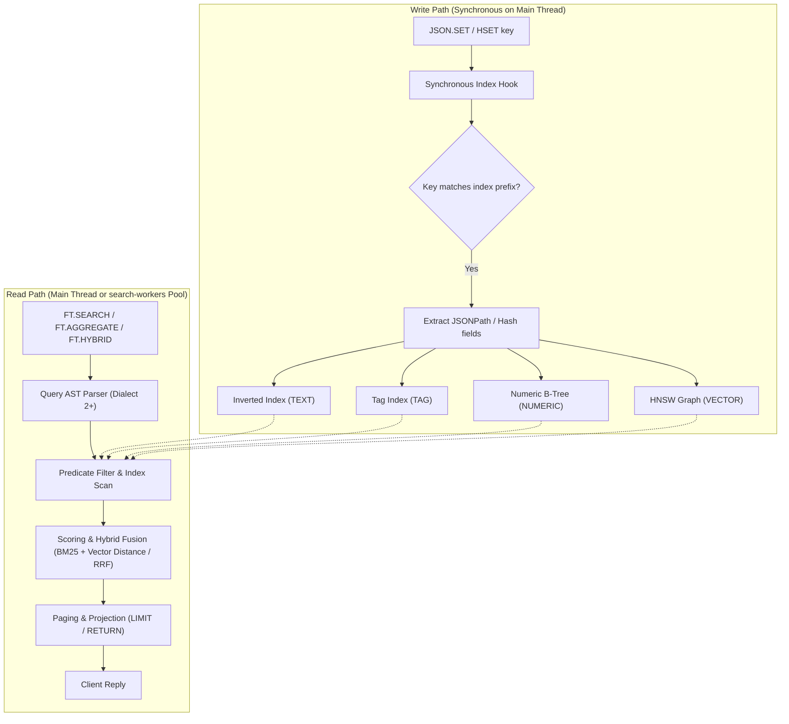
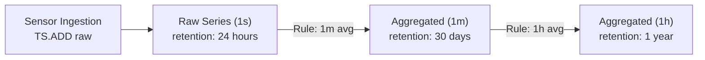

# Module 08 — Redis Query Engine, JSON, Vectors, Time Series and Probabilistic Types

Redis 8 is no longer "just" a key-value data-structure server. The former Redis Stack modules (RediSearch, RedisJSON, RedisTimeSeries, RedisBloom) are part of Redis Open Source, and 8.0 added Vector Sets. Together they let Redis answer secondary-index queries ("products in city X under €20 matching 'bicycle'"), vector similarity queries for retrieval-augmented generation, time-series aggregations and approximate statistics. This module covers what each component does, the command surface you need, how indexing interacts with the single command thread, and how the Valkey ecosystem differs.

> [!NOTE]
> Indexing theory (inverted indexes, BM25, ANN algorithms such as HNSW and IVF, quantisation) is owned by [data-systems M03](../../../architecture/data-systems/modules/03-indexing-theory-and-vector-search.md). Bloom, Count-Min and HyperLogLog mathematics are owned by [dsa M13](../../../algorithms/dsa/modules/13-probabilistic-data-structures-and-randomized-algorithms.md). This module is the Redis realisation.

**Executable proofs:** [`examples/ts/08-query-engine-and-probabilistic.test.ts`](../examples/ts/08-query-engine-and-probabilistic.test.ts) with [`src/query.ts`](../examples/ts/src/query.ts) (query escaping, vector blobs, distances, exact k-NN, Bloom sizing); [`examples/ts/integration/08-query-engine.test.ts`](../examples/ts/integration/08-query-engine.test.ts) (HLL on any version; JSON, `FT.*`, `BF.*`, `VADD`/`VSIM` on Redis 8.0+).

---

## 1. What Redis 8 bundled, and why it matters

| Component | Commands | Former module | Status in Redis 8 |
| --- | --- | --- | --- |
| JSON | `JSON.*` | RedisJSON | Built in, versioned with the server |
| Redis Query Engine (search & query) | `FT.*` | RediSearch | Built in; scales horizontally and vertically (worker threads) since 8.0 |
| Time series | `TS.*` | RedisTimeSeries | Built in |
| Probabilistic | `BF.*`, `CF.*`, `CMS.*`, `TOPK.*`, `TDIGEST.*` | RedisBloom | Built in |
| Vector Sets | `VADD`, `VSIM`, `VREM`, `VCARD`, `VEMB`, `VSETATTR` … | — (new, by Salvatore Sanfilippo) | New data type in 8.0 (initially labelled preview) |

**Then vs now.** Up to 7.x you ran the `redis/redis-stack-server` image or loaded `.so` modules with `loadmodule`, and the modules had their own versions and RSAL/SSPL licences. In 8.x the commands exist in the server, under the same tri-licence as the core ([module 01](01-model-architecture-and-protocol.md#62-then-vs-now-the-licence-and-module-bundling-change)), and `redis-full.conf` documents their configuration parameters. Migration: swap images, keep commands, re-audit ACLs (8.0 put module commands into `@read`/`@write` and added `@search`, `@json`, `@timeseries`, `@bloom`, `@cuckoo`, `@cms`, `@topk`, `@tdigest`), and re-create indexes if their definitions relied on removed options.

---

## 2. JSON

A JSON value is a tree stored natively (not as a string), addressable by **JSONPath**: `$` is the root, `$.a.b`, `$.items[0]`, `$..price` (recursive descent), `$.items[?(@.price < 10)]` (filters). Commands with a `$` path return an **array of matches** (a path may match several nodes); the legacy dot-path syntax (`.a.b`) returns a single value and is kept for compatibility.

| Operation | Command | Notes |
| --- | --- | --- |
| Write a document or subtree | `JSON.SET key $ '{…}'` / `JSON.SET key $.a 42 [NX\|XX]` | Partial updates without read-modify-write |
| Read | `JSON.GET key $.a $.b` / `JSON.MGET k1 k2 $.a` | Returns JSON text |
| Atomic numeric update | `JSON.NUMINCRBY key $.stats.logins 1` | No client-side race |
| Arrays | `JSON.ARRAPPEND`, `JSON.ARRINSERT`, `JSON.ARRPOP`, `JSON.ARRTRIM` |  |
| Types and sizes | `JSON.TYPE`, `JSON.OBJLEN`, `JSON.STRLEN`, `JSON.DEBUG MEMORY` |  |
| Merge patch | `JSON.MERGE key $ '{…}'` (RFC 7396) |  |

The integration test sets a document, increments a nested counter and appends to an array without ever reading the whole document into the client.

**JSON vs hash.** A hash stores one flat level of string fields with $O(1)$ field access and listpack compactness; JSON stores nested, typed values with path access. Use hashes for flat records (cheaper, and every client supports them), JSON for nested documents or when you index arrays and nested fields. 8.4 reduced memory for homogeneous numeric arrays substantially, and 8.8 added a `FPHA` argument to `JSON.SET` controlling the floating-point type of such arrays.

### 2.1 JSONPath AST evaluation and atomic partial updates

Redis represents JSON documents internally as native hierarchical tree structures (using a memory-optimized C++ DOM based on `jsonCons`). Commands operating on documents do not serialize or parse raw JSON strings on each mutation; instead, the server compiles the incoming JSONPath expression into an Abstract Syntax Tree (AST) and evaluates it directly against the in-memory node hierarchy:

- **Root token (`$`)**: Represents the document root.
- **Child operators**: Dot notation (`$.user.name`), bracket notation (`$['user']['name']`), and wildcard matches (`$.items.*`).
- **Array selectors**: Explicit index (`$[0]`), slice ranges (`$[0:10:2]`), and negative indices from tail (`$[-1]`).
- **Recursive descent (`$..field`)**: Traverses all descendant nodes in the hierarchy, collecting all matching keys into an array.
- **Filter expressions (`$[?(expression)]`)**: Evaluates logical predicates dynamically across array members (e.g. `$.orders[?(@.total > 100 && @.status == 'complete')]`).

#### Atomic partial updates vs read-modify-write anti-patterns

In traditional key-value architectures, updating a nested field inside a serialized JSON string requires a client-side read-modify-write cycle: `GET` the entire string (e.g. 50 KB), parse JSON in client memory, modify the field, serialize back to string, and write with `SET` (risking lost updates without optimistic concurrency). Redis JSON eliminates this entirely with in-place pointer mutations:

| Mutation Type | JSONPath Syntax | Redis Command | Algorithmic Complexity | In-Memory Mutation Mechanics |
| --- | --- | --- | --- | --- |
| Root document swap | `$` | `JSON.SET key $ '{...}'` | $O(M)$ | Deallocates existing document tree and mounts new tree root. |
| Nested scalar replacement | `$.profile.email` | `JSON.SET key $.profile.email '"user@corp.com"' [NX\|XX]` | $O(D + P)$ | Navigates depth $D$ in AST, deallocates target scalar node, and inserts new leaf in-place. |
| Atomic numeric delta | `$.metrics.login_count` | `JSON.NUMINCRBY key $.metrics.login_count 1` | $O(D)$ | Direct in-place arithmetic mutation on IEEE float/int64 node; zero memory allocations. |
| In-place array push | `$.audit.events` | `JSON.ARRAPPEND key $.audit.events '{"ts": 1730000000}'` | $O(D + A)$ | Appends element pointers directly to internal dynamic array buffer; avoids sibling reallocation. |
| RFC 7396 merge patch | `$` | `JSON.MERGE key $ '{"settings": {"theme": "dark"}}'` | $O(P)$ | Recursively merges keys into existing dictionary nodes; removes null fields. |

---

## 3. The Redis Query Engine (`FT.*`)

The Redis Query Engine integrates secondary indexing directly into the server lifecycle:



### 3.1 Indexes follow keys

An index is declared over a **key prefix** and a **schema**. Every write to a matching hash or JSON key updates the index synchronously, in the same command; existing keys are indexed in the background after `FT.CREATE` (watch `percent_indexed` in `FT.INFO`, as the integration test does before querying).

```text
FT.CREATE idx:product ON JSON PREFIX 1 product: SCHEMA
  $.title AS title TEXT WEIGHT 2
  $.city  AS city  TAG
  $.price AS price NUMERIC SORTABLE
  $.loc   AS loc   GEO
  $.emb   AS emb   VECTOR HNSW 6 TYPE FLOAT32 DIM 768 DISTANCE_METRIC COSINE
```

| Field type | Index structure | Query syntax |
| --- | --- | --- |
| `TEXT` | Inverted index with stemming, stop words, BM25 scoring (`BM25STD` default scorer since 8.4) | `@title:bicycle`, `@title:"red bicycle"`, `@title:bicy*`, `%bicyle%` (fuzzy) |
| `TAG` | Exact-match inverted index on separator-split values | `@city:{new\-york \| boston}` |
| `NUMERIC` | Numeric range tree | `@price:[10 (20]`, `-inf`/`+inf` |
| `GEO` / `GEOSHAPE` | Geo index / shapes (WKT) | `@loc:[lon lat radius km]` |
| `VECTOR` | `FLAT` (exact), `HNSW` (graph ANN), `SVS-VAMANA` (8.2+, graph ANN with compression) | `*=>[KNN 10 @emb $vec AS dist]` with `PARAMS 2 vec <blob>` |

Writes pay for indexing: each indexed field adds work to every `HSET`/`JSON.SET` on the main thread, and memory for the index. Index only what you query.

### 3.2 Query syntax pitfalls and injection

- **TAG values must be escaped**: punctuation and spaces are operators or separators. `@city:{new-york}` is parsed as something else than the tag `new-york`; write `@city:{new\-york}`. The hermetic tests cover `escapeTag`, and show that interpolating raw user input (`x} | @role:{admin`) injects a second clause: the search-engine equivalent of SQL injection. Escape every user-provided value, and validate field names against an allow-list.
- **Dialects**: query syntax has versions (`DIALECT 1..4`); vector queries and several operators need `DIALECT 2` or later. Pass it explicitly (`DIALECT 2`) or set `search-default-dialect`; the integration test passes it on every query.
- **Results are paged**: `LIMIT offset num` defaults to 10; deep paging is expensive; use `FT.AGGREGATE … WITHCURSOR` for large exports.

#### Query dialects and feature capabilities

The Redis Query Engine supports multiple parser dialects, set via `DIALECT <version>` on each query or globally via `search-default-dialect`:

| Dialect | Server Version | Parser and Syntax Capabilities |
| --- | --- | --- |
| `DIALECT 1` | RediSearch 1.x / 2.0 | Legacy parser. Tag values with punctuation caused silent syntax failures or premature clause termination. Vector queries unsupported. |
| `DIALECT 2` | RediSearch 2.2 / Redis 7.0 | Added vector similarity search (`*=>[KNN k @vec $blob]`). Enforces strict tag expressions and arithmetic expressions. |
| `DIALECT 3` | RediSearch 2.4 / Redis 7.2 | Enhanced BM25 score parameters and multi-field scoring weights. |
| `DIALECT 4` | Redis 8.0+ | Optimized vector pre-filtering, hybrid search fusion (`FT.HYBRID`), and mathematical sorting expressions. |

#### TAG field escaping rules and injection hazards

The query engine parser reserves all ASCII punctuation marks as query operators or delimiters:

```text
,  <  >  {  }  [  ]  "  '  :  ;  !  @  #  $  %  ^  &  *  (  )  -  +  =  ~  |  /  \  ?  \s
```

In `TAG` fields, values are split by comma (or a custom separator like `;`) by default. If a tag contains whitespace, dashes, slashes, or curly braces, every such character must be escaped with a literal backslash (`\`):

- **Target tag value**: `department:research & development / EU-north`
- **Correct escaped query**: `@dept:{department\:research\ \&\ development\ \/\ EU\-north}`

If user input is interpolated without escaping, an attacker can break out of tag boundaries:

```text
// Intended logic: search tenant items
"@tenant:{" + user_input + "}"

// Attacker sends: "tenant1} | @role:{admin"
// Interpolated query:
"@tenant:{tenant1} | @role:{admin}"
```

The resulting query tree transforms from a scoped tenant lookup into an `OR` condition that exposes administrative records across all tenants. Always sanitize user input using dedicated escaping utilities (e.g. `escapeTag` in [`src/query.ts`](../examples/ts/src/query.ts)) or pass parameters using `PARAMS` where supported.

### 3.3 Aggregation and hybrid search

`FT.AGGREGATE idx query LOAD … GROUPBY 1 @city REDUCE COUNT 0 AS n REDUCE AVG 1 @price AS avg SORTBY 2 @n DESC APPLY … FILTER …` is a pipeline over matching documents (Redis 8.10 added a `COLLECT` reducer, 8.8 in-group sorting). `FT.HYBRID` (8.4+) combines a text query and a vector query and fuses scores with RRF or a linear combination.

#### Multi-stage aggregation pipelines and reducers

`FT.AGGREGATE` executes a sequential data-processing pipeline over matching search results. Unlike `FT.SEARCH` which returns raw document records, `FT.AGGREGATE` groups, transforms, and projects computed statistics:

```text
FT.AGGREGATE idx:product "@city:{paris}"
  LOAD 1 @category
  GROUPBY 1 @category
    REDUCE COUNT 0 AS total_items
    REDUCE AVG 1 @price AS avg_price
    REDUCE MIN 1 @price AS min_price
    REDUCE MAX 1 @price AS max_price
  APPLY "round(@avg_price, 2)" AS formatted_avg
  FILTER "@total_items >= 5"
  SORTBY 2 @total_items DESC
  LIMIT 0 10
```

| Pipeline Clause | Functionality | Production Operational Notes |
| --- | --- | --- |
| `LOAD n @field...` | Pre-loads document attributes from storage before aggregation | Pre-load only required fields; loading unneeded large blobs inflates memory. |
| `GROUPBY n @field...` | Partitions document stream into grouped buckets | Memory scales with distinct key cardinality; group on bounded attributes. |
| `REDUCE <func> nargs args... AS alias` | Applies reduction aggregators across grouped records | Standard functions: `COUNT`, `SUM`, `MIN`, `MAX`, `AVG`, `STDDEV`, `QUANTILE`, `TOLIST`. |
| `APPLY "<expr>" AS alias` | Computes arithmetic or string transformations on records | Uses parsed math expressions (`round`, `sqrt`, string concatenations). |
| `FILTER "<expr>"` | Discards post-aggregation records not satisfying predicate | Evaluates after grouping to filter aggregate values (similar to SQL `HAVING`). |
| `SORTBY n @field [ASC\|DESC]` | Sorts final grouped records | Keep limits small (`LIMIT 0 100`) to avoid sorting massive in-memory result sets. |

#### Hybrid search with Reciprocal Rank Fusion (RRF)

`FT.HYBRID` (Redis 8.4+) merges sparse keyword matching (BM25) and dense semantic vector search (KNN) into a unified ranking using Reciprocal Rank Fusion (RRF):

$$\text{RRF\_Score}(d) = \sum_{m \in \{\text{text}, \text{vector}\}} \frac{1}{k + r_m(d)}$$

where $r_m(d)$ is the document's rank within search method $m$, and $k$ is a smoothing constant (typically $k = 60$). RRF eliminates score scale mismatch between unbounded BM25 scores and normalized vector cosine distances, producing robust rankings across diverse user queries.

### 3.4 Vector search in Redis

- **Encoding**: vectors are stored in hashes as **little-endian FLOAT32 (or FLOAT16/BFLOAT16/FLOAT64) blobs**, and in JSON as arrays of numbers; query vectors are always passed as blobs in `PARAMS`. The hermetic test shows the round trip and the precision lost when a float64 becomes float32.
- **Distances**: `L2`, `IP`, `COSINE`. The reported `COSINE` value is a _distance_, $1 - \cos\theta$, so 0 is identical direction and 2 is opposite (tested).
- **FLAT vs HNSW vs SVS-VAMANA**: FLAT is exact and linear in the number of vectors; HNSW (`M`, `EF_CONSTRUCTION`, `EF_RUNTIME`) is approximate with logarithmic-ish search and high memory; SVS-VAMANA adds compression (LVQ/LeanVec variants were removed from the open-source build in 8.2.1, leaving the generic quantisation options). Theory and recall trade-offs: [data-systems M03](../../../architecture/data-systems/modules/03-indexing-theory-and-vector-search.md#4-vector-search-and-approximate-nearest-neighbors-ann).
- **Filters**: `@city:{paris} @price:[0 50]=>[KNN 10 @emb $vec]` pre-filters; very selective filters on HNSW can collapse recall or fall back to brute force ([data-systems on filtered recall](../../../architecture/data-systems/modules/03-indexing-theory-and-vector-search.md#1-vector-search-recall-collapse-under-selective-relational-filters)).
- **Measure recall** against an exact baseline: the hermetic `knn` is what a FLAT index computes, and the integration test checks that a FLAT index's `KNN 5` equals brute force exactly.

### 3.5 Threads and Cluster

By default queries run on the main thread like any command; long `FT.SEARCH`/`FT.AGGREGATE` calls therefore block other clients. With `search-workers N` (Redis 8), queries execute on worker threads while writes still update the index on the main thread; 8.10 enforces `TIMEOUT` more strictly and adds `search-on-timeout RETURN_STRICT`. In Redis Cluster (open source) 8.0 added support for distributing the Query Engine across shards; each shard indexes its own keys and a coordinator merges results, so queries fan out to every shard (scatter-gather; [data-systems M08](../../../architecture/data-systems/modules/08-partitioning-sharding-and-routing.md#2-tail-latency-meltdown-via-unbounded-scatter-gather-fanout)). During atomic slot migration (8.4+) search results can be partial or contain duplicates.

---

## 4. Vector Sets (8.0+)

A **Vector Set** is a data type, like a sorted set whose "score" is a vector: each element has a vector and optional JSON attributes, indexed by an HNSW graph inside the key.

- `VADD key [REDUCE dim] (FP32 blob | VALUES n v1 … vn) element [Q8 | BIN | NOQUANT] [EF n] [SETATTR json] [M n]` adds or updates; vectors are quantised to 8 bits by default.
- `VSIM key (ELE element | FP32 blob | VALUES n …) [WITHSCORES] [COUNT k] [EF n] [FILTER expr]` returns the most similar elements; `FILTER '.year > 2020 and .genre == "jazz"'` filters on attributes. 8.2 added an `IN` operator and an `EPSILON` maximum distance.
- `VREM`, `VCARD`, `VDIM`, `VEMB` (get an element's vector), `VGETATTR`/`VSETATTR`, `VINFO`, `VLINKS`, `VRANDMEMBER`.

**Vector Set vs Query Engine vectors**: Vector Sets are one key per collection, simple, with attribute filters and no schema; Query Engine vector fields live inside hash/JSON documents and combine with text, tag and numeric predicates in one query. Use Vector Sets for "nearest items among N" features; use the Query Engine for document search with vector ranking. The integration test adds three 3-dimensional vectors and checks the nearest is returned first.

#### Architectural comparison: Vector Sets vs Query Engine Vectors

| Architectural Axis | Vector Sets (`VADD` / `VSIM`) | Query Engine Vectors (`FT.CREATE ... VECTOR`) |
| --- | --- | --- |
| Storage model | Dedicated first-class data type (single Redis key) | Field attribute within Hash or JSON document keys |
| Schema constraints | Schemaless: attributes stored as ad-hoc JSON | Rigid schema defined up front via `FT.CREATE` |
| Default quantization | 8-bit scalar quantization enabled by default (`Q8`); also `BIN`, `NOQUANT` | Explicitly configured (`FLOAT32`, `FLOAT16`, `BFLOAT16`, `SVS`) |
| Attribute filtering | Filter expression in query: `FILTER '.year > 2020'` | Combined with Inverted, Numeric, Tag, and Geo indexes |
| Scoring & ranking | Cosine similarity or distance metric | Hybrid fusion (`FT.HYBRID` with BM25 text score + KNN) |
| Sharding in Cluster | Sharded by key (single slot) | Distributed scatter-gather across all cluster primary nodes |
| Typical application | Recommendation, fast nearest-neighbor lookups | Full-featured document search, RAG, multi-modal search |

#### HNSW graph parameters and 8-bit quantization mechanics

Both Vector Sets and Query Engine HNSW indexes rely on the Hierarchical Navigable Small World (HNSW) graph algorithm:

- **`M` parameter (default 16)**: Controls the maximum number of bidirectional connections per graph node. Higher values of $M$ increase graph connectivity and recall at the cost of higher RAM usage ($2M$ connections at ground layer 0).
- **`EF_CONSTRUCTION` (default 200)**: Defines the priority queue exploration depth during index construction (`VADD` or `HSET`). Higher values build higher-quality graphs with higher recall but increase write latency.
- **`EF_RUNTIME` (default 10)**: Controls the exploration beam width during query execution (`VSIM` or `FT.SEARCH`). Setting `EF_RUNTIME` higher dynamically improves nearest-neighbor recall at the cost of higher query latency.

#### 8-bit scalar quantization (Q8) mechanics

Vector Sets enable 8-bit scalar quantization (`Q8`) by default, reducing RAM consumption by 75 % compared to raw 32-bit floats ($4\text{ bytes} \to 1\text{ byte}$ per dimension):

1. **Quantization formula**: For each vector dimension $x_i$, the scalar value is mapped into an unsigned 8-bit integer $q_i \in [0, 255]$: $$q_i = \left\lfloor 255 \times \frac{x_i - \min_x}{\max_x - \min_x} + 0.5 \right\rfloor$$
2. **Asymmetric distance computation**: During similarity search (`VSIM`), the incoming query vector is kept in high-precision `FLOAT32`, while stored database vectors are read directly in 8-bit integer format, achieving sub-millisecond evaluation with less than 1 % recall loss on typical 768-dimensional embedding models.

---

## 5. Time series

`TS.CREATE key RETENTION ms DUPLICATE_POLICY LAST|FIRST|MIN|MAX|SUM|BLOCK LABELS k v …`, `TS.ADD key <ts|*> value`, `TS.RANGE key from to AGGREGATION avg 60000`, `TS.MRANGE … FILTER label=value GROUPBY …`, `TS.CREATERULE src dst AGGREGATION avg 3600000` (downsampling into another series). Samples are stored in compressed chunks (delta-of-delta timestamps, XOR-compressed values in the Gorilla style). 8.6 added NaN support and `COUNTNAN`/`COUNTALL` aggregators; 8.8 multiple aggregators per range call; 8.10 `TS.NRANGE`/`TS.NREVRANGE` (multi-series grouped by timestamp), blocking `TS.READ`, and `TS.QUERYLABELS`.

Use it for metrics close to the application (per-tenant usage counters, IoT readings with short retention). For long-retention observability, a dedicated TSDB (Prometheus, VictoriaMetrics) is usually cheaper than RAM.

#### Multi-tier downsampling and retention pipelines

In high-throughput metrics ingestion (such as IoT telemetry or application performance monitoring), retaining raw per-second samples over long time horizons quickly exhausts memory. RedisTimeSeries supports automated in-database downsampling rules:



```text
// 1. Create base raw time series (retains 1 day of raw per-second samples)
TS.CREATE sensor:1:raw RETENTION 86400000 DUPLICATE_POLICY LAST LABELS sensor_id 1 type raw

// 2. Create 1-minute aggregated series (retains 30 days of 1-minute averages)
TS.CREATE sensor:1:1m RETENTION 2592000000 LABELS sensor_id 1 type 1m

// 3. Create 1-hour aggregated series (retains 365 days of 1-hour averages)
TS.CREATE sensor:1:1h RETENTION 31536000000 LABELS sensor_id 1 type 1h

// 4. Attach automated compaction rules
TS.CREATERULE sensor:1:raw sensor:1:1m AGGREGATION avg 60000
TS.CREATERULE sensor:1:1m sensor:1:1h AGGREGATION avg 3600000
```

#### Gorilla compression internals

RedisTimeSeries compresses time-series chunks in RAM using techniques derived from Facebook's Gorilla TSDB paper:

- **Timestamp delta-of-delta encoding**: Timestamps are stored as differences of differences ($\Delta_i = (t_i - t_{i-1}) - (t_{i-1} - t_{i-2})$). If samples arrive on regular intervals (e.g. exactly every 1 000 ms), $\Delta_i = 0$, which encodes in a single zero bit (`0`), shrinking timestamp overhead to near zero.
- **Floating-point XOR compression**: Values (IEEE 754 64-bit floats) are XORed against the previous value ($V_i \oplus V_{i-1}$). When successive metric values are identical or vary smoothly, the XOR result contains many leading and trailing zero bits. Only the significant bits are packed into memory, achieving up to 90 % compression ratios compared to uncompressed numeric arrays.

---

## 6. Probabilistic structures: Redis realisation

| Structure | Commands | Answers | Errors | Memory |
| --- | --- | --- | --- | --- |
| HyperLogLog (core, since 2.8.9) | `PFADD`, `PFCOUNT`, `PFMERGE` | Distinct count | ±0.81 % standard error | ≤ 12 KB per key |
| Bloom filter | `BF.RESERVE k err cap [EXPANSION e] [NONSCALING]`, `BF.ADD`/`BF.MADD`, `BF.EXISTS`/`BF.MEXISTS` | "Possibly in set" / "definitely not" | False positives ≤ configured rate; no false negatives | ≈ 9.6 bits/element at 1 % |
| Cuckoo filter | `CF.RESERVE`, `CF.ADD`, `CF.DEL`, `CF.EXISTS` | Membership **with deletion** | False positives; deleting an item never added corrupts it | Comparable to Bloom at low error rates |
| Count-Min sketch | `CMS.INITBYPROB err prob`, `CMS.INCRBY`, `CMS.QUERY` | Approximate frequency (overestimates only) | $\varepsilon N$ with probability $1-\delta$ | width × depth counters |
| Top-K | `TOPK.RESERVE k`, `TOPK.ADD`, `TOPK.LIST` | Heavy hitters | Approximate (HeavyKeeper) | Fixed |
| t-digest | `TDIGEST.CREATE`, `TDIGEST.ADD`, `TDIGEST.QUANTILE` | Percentiles (p50/p99) | Best at the tails | Compression parameter |

Sizing a Bloom filter is the classic interview calculation: $m/n = -\ln p / (\ln 2)^2$ bits per element and $k = \lceil -\log_2 p \rceil$ hash functions; 1 % → 9.59 bits and 7 hashes; 10 M elements at 0.1 % → about 17 MB (tested), versus hundreds of megabytes for a Redis set of the same IDs. RedisBloom filters are **scalable** by default: when one fills up, a new sub-filter with `EXPANSION`× capacity and a tighter error rate is added, so the compound false-positive rate stays below twice the target while lookups probe every sub-filter (tested as a property). `NONSCALING` makes `BF.ADD` fail when full instead; reserve the right capacity up front to avoid chains of sub-filters.

The integration test inserts 5 000 items into a 1 % filter, checks there are no false negatives, and measures the false-positive rate on 2 000 absent items; it also checks a 100 000-item HLL is within 3σ (this one runs on any Redis version).

#### Closed-form mathematical derivations and sizing formulas

Probabilistic data structures provide bounded trade-offs between memory footprint, query speed, and error rates:

##### 1. Bloom Filter (`BF.RESERVE`)

- **False-positive probability ($p$)**: Given $m$ bits of memory, $k$ hash functions, and $n$ inserted elements: $$p \approx \left(1 - e^{-kn/m}\right)^k$$
- **Optimal number of hash functions ($k^\*$)**: Minimizes false positives for a given bit-per-element ratio $m/n$: $$k^* = \frac{m}{n} \ln 2 \approx 0.693 \times \frac{m}{n}$$
- **Optimal bits per element ($m/n$)**: Required bits to guarantee false-positive rate $p$: $$\frac{m}{n} = -\frac{\ln p}{(\ln 2)^2} \approx -1.4427 \log_2 p \approx -2.081 \ln p$$

| Target False Positive $p$ | Bits per Element ($m/n$) | Optimal Hashes $k$ | RAM for 10M Items | RAM for 100M Items |
| --- | --- | --- | --- | --- |
| 10 % ($0.10$) | 4.79 bits | 3 | 5.71 MB | 57.1 MB |
| 1 % ($0.01$) | 9.59 bits | 7 | 11.43 MB | 114.3 MB |
| 0.1 % ($0.001$) | 14.38 bits | 10 | 17.14 MB | 171.4 MB |
| 0.01 % ($0.0001$) | 19.17 bits | 14 | 22.85 MB | 228.5 MB |

##### 2. Cuckoo Filter (`CF.RESERVE`)

Unlike Bloom filters, Cuckoo filters support true deletions (`CF.DEL`):

- **Buckets and fingerprints**: Stores $f$-bit fingerprints in candidate buckets of capacity $b = 4$. Candidate bucket positions $i_1, i_2$ use partial-key cuckoo hashing: $$i_1 = \text{hash}(x), \quad i_2 = i_1 \oplus \text{hash}(\text{fingerprint}(x))$$
- **False-positive probability ($p$)**: Upper-bounded by: $$p \le 2b \cdot 2^{-f} = \frac{8}{2^f}$$
- **Required fingerprint size ($f$)**: $$f \ge \left\lceil \log_2 \frac{2b}{p} \right\rceil = \left\lceil \log_2 \frac{8}{p} \right\rceil$$ For $p = 0.01$ (1 %), $f = \lceil \log_2 800 \rceil = 10\text{ bits}$.
- **Deletion hazard**: Deleting an item never previously inserted can accidentally match and remove a colliding fingerprint belonging to a valid item, causing irreversible false negatives.

##### 3. Count-Min Sketch (`CMS.INITBYPROB`)

Approximates frequency of stream items using a 2D array of counters with depth $d$ and width $w$:

- **Error guarantee**: For total stream volume $N$, frequency estimate $\hat{f}_x$ satisfies: $$f_x \le \hat{f}_x \le f_x + \varepsilon N$$ with probability at least $1 - \delta$.
- **Dimension formulas**: $$w = \left\lceil \frac{e}{\varepsilon} \right\rceil \approx \left\lceil \frac{2.718}{\varepsilon} \right\rceil, \quad d = \left\lceil \ln \frac{1}{\delta} \right\rceil$$ `CMS.INITBYPROB key err prob` computes these parameters directly: `err` $= \varepsilon$, `prob` $= 1 - \delta$.

##### 4. Top-K HeavyKeeper (`TOPK.RESERVE`)

Tracks the $K$ highest-frequency items in fixed memory using min-heap buckets and decay counters:

- **Exponential decay**: When an incoming item hashes to a counter holding a different item's fingerprint, the counter decrements with probability: $$P_{\text{decay}} = b^{-c}$$ where $c$ is the current counter value and $b = 1.08$. High-frequency elephant items resist decay and remain in the heap, while low-frequency mouse items decay rapidly to zero and are replaced.

---

## 7. Valkey equivalents

Valkey does not include these modules in the server. The **`valkey/valkey-bundle`** image (verified on Docker Hub, tags for 8.1, 9.0, 9.1 and 9.2 release candidates) packages Valkey with **valkey-json**, **valkey-bloom**, **valkey-search** and **valkey-ldap**, loaded as modules (`INFO modules` lists `json`, `bf`, `search`, `ldap`).

- **valkey-json** and **valkey-bloom** aim for command compatibility with `JSON.*` and `BF.*` (not with `CF.*`, `CMS.*`, `TOPK.*`, `TDIGEST.*`, which have no Valkey equivalent in the bundle as far as verified).
- **valkey-search** started as a vector-search module with tag and numeric filters; check its documentation for the current coverage of full-text `TEXT` fields and `FT.AGGREGATE` before porting a Redis Query Engine workload (unverified at the time of writing).
- **No Vector Sets** and no Time series in Valkey.
- Valkey 9.0 has polygon geo search; Valkey 9.2 release candidates add a "Path Hash" type and large sorted sets backed by a B+tree.

Porting rule: an application using only `JSON.*`, `BF.*` and vector KNN queries may run on valkey-bundle after testing; one using `FT.AGGREGATE`, `FT.HYBRID`, time series, Vector Sets or Cuckoo/CMS/Top-K should stay on Redis 8 or replace those parts.

---

## 8. Production failure modes

1. **Unescaped user input in queries** returns other tenants' data or errors (§ 3.2).
2. **Index bloat**: indexing every field of large JSON documents doubles memory and slows every write. Index only queried fields; use `NOINDEX` for sortable-only fields.
3. **Background indexing surprise**: `FT.CREATE` on a prefix with 50 M existing keys starts a long background scan; queries return partial results until `percent_indexed` is 1.
4. **Long aggregations on the main thread** without `search-workers`: `FT.AGGREGATE` over millions of documents blocks every client. Configure workers and timeouts.
5. **Vector memory**: HNSW with 1 M × 768-dim FLOAT32 vectors is ~3 GB for raw vectors plus graph overhead; quantise (Vector Sets default to 8-bit) or use SVS compression.
6. **Bloom filter over capacity**: a filter reserved for 1 M items receiving 100 M grows a long chain of sub-filters; lookups slow down and memory grows. Size it for the real cardinality.
7. **Cuckoo deletion of a never-added item** removes another item's fingerprint, creating a false negative.
8. **Module commands in ACLs** after upgrading to 8.0: `+@read +@write` users suddenly can run `FT.SEARCH` and `JSON.SET`.

---

## Proof map for this module

| Claim | Hermetic | Integration |
| --- | --- | --- |
| TAG escaping and injection | `TAG values …`, `negative: unescaped user input …` | `Query Engine: …` (escaped `new-york`) (**8.0+, not executed while authoring**) |
| NUMERIC range syntax | `NUMERIC ranges …` | same |
| FLOAT32 blobs, cosine distance | `vectors travel …`, `COSINE distance …` | `Query Engine: …` KNN equals brute force (**8.0+**) |
| Exact k-NN as recall baseline | `exact k-NN (FLAT) …` | same |
| JSON path updates | — | `JSON: set, read and update by path` (**8.0+**) |
| Bloom sizing and scalable error bound | `Bloom sizing …`, `scalable Bloom …` | `Bloom filter: no false negatives …` (**8.0+**) |
| HLL error 0.81 %, 12 KB, type string | `HyperLogLog in Redis …` | `PFCOUNT of 100 000 …` (ran on 7.0.15) |
| Vector Sets | — | `Vector Set: VADD and VSIM …` (**8.0+**) |

---

## Interview Drill

<details><summary>1. How would you implement product search with filters on Redis 8?</summary>

Store products as JSON or hashes under `product:`; `FT.CREATE … ON JSON PREFIX 1 product: SCHEMA` with `TEXT` for title, `TAG` for category/city, `NUMERIC SORTABLE` for price; query with `FT.SEARCH idx "@title:bike @city:{paris} @price:[0 500]" SORTBY price LIMIT 0 20 DIALECT 2`. Escape user input in tags, index only queried fields, enable `search-workers` for heavy queries, and remember indexes are per shard with scatter-gather in Cluster.
</details>

<details><summary>2. Vector Set or a `VECTOR` field in the Query Engine?</summary>

Vector Set: a simple per-key HNSW collection with attribute filters, quantised by default; good for "similar items" features. Query Engine vector field: vectors inside documents, combined with text/tag/numeric predicates and hybrid scoring in one query; good for RAG over documents with metadata filters.
</details>

<details><summary>3. Size a Bloom filter for 50 M user IDs at a 0.1 % false-positive rate.</summary>

$-\ln(0.001)/(\ln 2)^2 \approx 14.4$ bits per element → 50 M × 14.4 / 8 ≈ 90 MB, with $\lceil \log_2 1000 \rceil = 10$ hash functions. `BF.RESERVE users 0.001 50000000`.
</details>

<details><summary>4. What changed for Redis Stack users with Redis 8?</summary>

The modules are built into Redis Open Source under the same licence choice as the core, versioned with the server; the `redis` image replaces `redis-stack-server`; ACL categories changed so `@read`/`@write` include module commands. Commands stay the same.
</details>

<details><summary>5. Why is `FT.SEARCH` with a user-provided tag value a security concern?</summary>

The query language treats punctuation and whitespace as syntax. Unescaped input can close the tag clause and add predicates (for example another tenant's tag), or cause errors. Escape values and allow-list field names.
</details>

<details><summary>6. HyperLogLog vs a set for unique counts?</summary>

A set is exact and enumerable but costs memory proportional to the number of members (tens of bytes each). An HLL is fixed at ≤ 12 KB per key with 0.81 % standard error, merges with `PFMERGE`, but cannot list or remove members.
</details>

<details><summary>7. Why does adding selective relational filters to an HNSW vector query risk collapsing search recall?</summary>

HNSW graph navigation searches for nearest neighbors by traversing connected nodes that are close in vector space. When a highly selective relational filter (e.g. `@city:{paris}`) matches only 0.1 % of documents, the entry points and greedy routing hops encounter nodes that are disqualified by the filter, creating dead ends in graph traversal. Modern Redis Query Engine addresses this via iterative relational pre-filtering and hybrid query planners that fall back to brute-force FLAT scans when filter selectivity is high.
</details>
