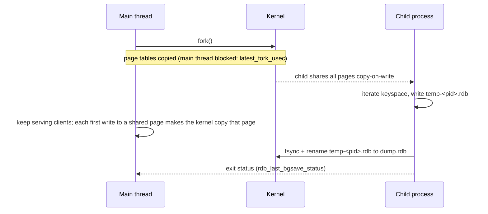
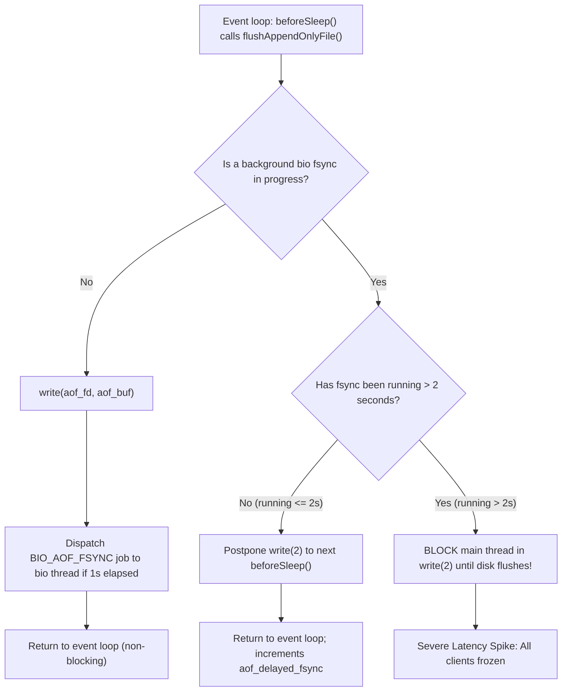

# Module 09 — Persistence: RDB, AOF, Hybrid Files and Backups

Redis serves from memory, but it can persist to disk in two ways: **RDB** point-in-time snapshots and the **AOF** (append-only file) command log, usually combined. The choice decides how much acknowledged data you lose in a crash, how long restarts take, how much extra memory you need, and whether the disk can stall the server. This module explains both mechanisms down to `fork()` and `fsync()`, the multi-part AOF introduced in 7.0, backups and restores, and the durability guarantees you can honestly promise.

> [!NOTE]
> Write-ahead logging, fsync policies and crash recovery in general (ARIES, group commit, torn pages) are owned by [data-systems M06](../../../architecture/data-systems/modules/06-durability-wal-and-crash-recovery.md). Redis's AOF is a _redo log of commands_ applied after the fact, not a WAL in the ARIES sense: the command is executed in memory first and logged afterwards.

**Executable proofs:** [`examples/ts/09-persistence.test.ts`](../examples/ts/09-persistence.test.ts) with [`src/persistence.ts`](../examples/ts/src/persistence.ts) (AOF replay with torn tails and unfinished transactions, manifest parsing, loss windows, copy-on-write cost) and [`examples/ts/integration/09-persistence.test.ts`](../examples/ts/integration/09-persistence.test.ts) (BGSAVE, multi-part AOF on disk, `kill -9` recovery).

---

## 1. Definitions

- **Snapshot (RDB)**: a compact binary serialisation of the whole dataset at one instant, written by a forked child to a temporary file and atomically renamed to `dump.rdb`.
- **Append-only file (AOF)**: the sequence of write commands that changed the dataset, in RESP format, replayed at start-up to rebuild state.
- **Multi-Part AOF (MP-AOF)**: the Redis 7.0+ on-disk architecture dividing append logs into a directory (`appendonlydir/`) containing a single base file, zero or more incremental files, and a manifest controlling state transitions.
- **Loss window**: the maximum span of _acknowledged_ writes that can be missing after a crash and restart. It depends on the failure (process crash vs machine crash) and the policy (§ 5).
- **Rewrite / compaction**: replacing a long AOF with a minimal one that produces the same dataset (`BGREWRITEAOF`).
- **fsync stall**: a latency pathology where the main event loop halts because a background `fsync()` thread is blocked on saturated disk I/O for more than two seconds.
- **Torn tail**: a partially written RESP command at the end of an AOF file caused by an abrupt system crash during a write syscall.

---

## 2. RDB snapshots, fork and copy-on-write

### 2.1 Mechanics



`BGSAVE` (and automatic `save <seconds> <changes>` rules; Redis 8.10.3's commented default is `save 3600 1 300 100 60 10000`) forks. The child sees a frozen copy of memory and writes it out; the parent continues. `SAVE` writes synchronously on the main thread and blocks every client for the whole dump: use it only on shutdown or in tests. On shutdown with snapshots configured, Redis saves before exiting (unless `SHUTDOWN NOSAVE`).

`BGSAVE SCHEDULE` queues a snapshot if an AOF rewrite is currently executing, executing the snapshot as soon as the rewrite child finishes. Redis prevents simultaneous execution of an RDB child and an AOF rewrite child to protect disk bandwidth and prevent copy-on-write page exhaustion.

### 2.2 The two costs of `fork()`

1. **Fork latency.** `fork()` copies the parent's page tables: about 2 MB of page tables per GB of RSS with 4 KB pages, so tens to hundreds of milliseconds for large instances, during which the main thread is stopped. Watch `latest_fork_usec` in `INFO stats` (the integration test reads it after a `BGSAVE`). On some virtualised platforms fork is much slower.
2. **Copy-on-write memory.** Every page the parent modifies while the child runs is duplicated. With uniformly random writes, the expected number of distinct pages touched by $W$ writes over $P$ pages is $P(1 - (1 - 1/P)^W)$. The hermetic test applies that to a 20 GB dataset receiving 50 000 writes during a snapshot: about **190 MB** copied with 4 KB pages but about **20 GB** with 2 MB transparent huge pages, roughly 100× more, which is why **THP must be disabled** (`echo never > /sys/kernel/mm/transparent_hugepage/enabled`; Redis logs a warning at start-up when it is on). With enough writes the worst case is a full second copy of the dataset.

Hence the operational rules: keep instances moderately sized (tens of GB, not hundreds), keep `maxmemory` well below RAM on instances that persist or have replicas, set `vm.overcommit_memory = 1` so `fork()` does not fail with `Cannot allocate memory` when the kernel's heuristic thinks the child could need a full copy, and schedule snapshots on replicas rather than primaries where possible.

### 2.3 Format properties

RDB files are compact (integers and small collections are stored in their compact encodings, LZF compression for strings with `rdbcompression yes`), have a CRC64 checksum at the end (`rdbchecksum yes`), and load fast because there is nothing to replay. The format is versioned; newer servers load older files, not the reverse. Redis 7.4 raised the version for hash-field expiration, so Redis ≥ 7.4 files cannot be loaded by 7.2, and Valkey cannot be assumed to load them ([module 01](01-model-architecture-and-protocol.md#62-then-vs-now-the-licence-and-module-bundling-change)). Inspect with `redis-check-rdb`.

The table below lists historical RDB version numbers and their defining architectural milestones:

| RDB version | Redis release   | Defining feature introducing format incompatibility              |
| ----------- | --------------- | ---------------------------------------------------------------- |
| `0006`      | Redis 2.8       | String LZF compression, auxiliary fields                         |
| `0007`      | Redis 3.2       | Quicklist encoding for lists, 64-bit integer lengths             |
| `0008`      | Redis 4.0       | Module data serialisation types, LFU frequency counters          |
| `0009`      | Redis 5.0       | Stream radix tree (`rax`) data type persistence                  |
| `0010`      | Redis 7.0       | Listpack encodings replacing ziplists for hashes and sorted sets |
| `0011`      | Redis 7.2       | Listpack sets, function library metadata payloads                |
| `0012`      | Redis 7.4 / 8.x | Hash field-level expiration timestamps (`HEXPIRE`, `HPEXPIRE`)   |

### 2.4 Binary wire format of RDB files

An RDB file consists of a 9-byte magic header, followed by optional metadata auxiliary fields, database records containing key-value pairs and their expiration timestamps, an end-of-file marker, and a 64-bit CRC checksum:

```text
+-------------------+----------------+----------------+----------------+----------------+
| "REDIS" + Version | AUX fields     | DB 0 Selector  | Key-Value Data | DB n Selector  |
| (9 bytes ASCII)   | (Opcode 0xFA)  | (Opcode 0xFE)  | (Types & TTLs) | (Opcode 0xFE)  |
+-------------------+----------------+----------------+----------------+----------------+
| ... Data ...      | EOF Marker     | CRC64 Checksum |
|                   | (Opcode 0xFF)  | (8 bytes LE)   |
+-------------------+----------------+----------------+
```

Every database block and entry in the stream begins with a control opcode byte:

| Opcode | Hex value | Name | Wire encoding semantics |
| --- | --- | --- | --- |
| `RDB_OPCODE_MODULE_AUX` | `0xF7` | Module Aux | Auxiliary metadata produced by loaded C modules |
| `RDB_OPCODE_IDLE` | `0xF8` | Idle time | Lru idle time in seconds encoded as a variable-length integer |
| `RDB_OPCODE_FREQ` | `0xF9` | LFU frequency | 1-byte logarithmic access counter ($0..255$) |
| `RDB_OPCODE_AUX` | `0xFA` | Auxiliary field | Key-value string pair of metadata (`redis-ver`, `used-mem`, `ctime`) |
| `RDB_OPCODE_RESIZEDB` | `0xFB` | Resize DB | Two length-encoded integers: database dict size and expires dict size |
| `RDB_OPCODE_EXPIRETIME_MS` | `0xFC` | Expire ms | 8-byte unsigned integer in little-endian representing millisecond epoch |
| `RDB_OPCODE_EXPIRETIME` | `0xFD` | Expire s | 4-byte unsigned integer in little-endian representing second epoch |
| `RDB_OPCODE_SELECTDB` | `0xFE` | Select DB | Length-encoded integer identifying the target database index ($0..15$) |
| `RDB_OPCODE_EOF` | `0xFF` | End of file | Terminal byte marking payload completion; followed by 8-byte CRC64 |

Length encoding in RDB utilizes the two most significant bits of the first byte to compress integer magnitudes and denote special inline formats:

```text
Bit pattern 00xxxxxx: Length fits in remaining 6 bits (length 0 to 63).
Bit pattern 01xxxxxx: Length fits in 14 bits (6 bits from first byte + 8 bits from next byte).
Bit pattern 10000000: Discard remaining 6 bits; length is read from the following 4 bytes (big-endian).
Bit pattern 10000001: Discard remaining 6 bits; length is read from the following 8 bytes (big-endian).
Bit pattern 11xxxxxx: Special encoding; remaining 6 bits identify inline scalar type:
  - 11000000 (0xC0): 8-bit signed integer follows.
  - 11000001 (0xC1): 16-bit signed integer follows (little-endian).
  - 11000010 (0xC2): 32-bit signed integer follows (little-endian).
  - 11000011 (0xC3): String compressed using LZF algorithm follows.
```

When LZF compression is triggered (`0xC3`), the wire payload encodes:

1. Compressed length (length-encoded integer).
2. Uncompressed length (length-encoded integer).
3. Raw byte stream produced by the LZF sliding-dictionary compression algorithm.

Value types are encoded with dedicated type opcodes before each key:

- `0x00`: Raw string (or inline integer).
- `0x01`: List (linked list or quicklist).
- `0x02`: Set (hash table).
- `0x03`: Sorted set.
- `0x04`: Hash map.
- `0x09`: Zipmap (legacy).
- `0x0A`: Ziplist (legacy).
- `0x0B`: Intset (compact integer array).
- `0x0C`: Sorted set encoded in ziplist.
- `0x0D`: Hashmap encoded in ziplist.
- `0x0E`: Quicklist (linked list of ziplists).
- `0x0F`: Stream (`rax` tree with stream packets).
- `0x10`: Listpack (replacing ziplists in 7.0+).
- `0x11`: Quicklist 2 (quicklist containing listpacks).
- `0x12`: Hashmap encoded in listpack with field-level TTLs (7.4+).

### 2.5 Linux page-table mechanics and Transparent Huge Pages

During `fork()`, the Linux kernel does not copy physical RAM; it duplicates the process page tables. On x86-64 architecture with 4-level paging (PML4 $\to$ PDPT $\to$ PD $\to$ PT), each 4 KB virtual page requires an 8-byte Page Table Entry (PTE). For an instance with 64 GB RSS:

$$\text{PTE count} = \frac{64 \times 1024^3 \text{ bytes}}{4096 \text{ bytes}} = 16\,777\,216 \text{ entries}$$

$$\text{Page table memory} = 16\,777\,216 \times 8 \text{ bytes} \approx 134.2 \text{ MB}$$

Duplicating 134 MB of page table structures in kernel space halts the parent process execution loop for 20 ms to 150 ms depending on CPU clock and memory bus contention. This pause is directly reported by Redis in `INFO stats` as `latest_fork_usec`.

Transparent Huge Pages (THP) introduces severe latency degradation during copy-on-write. Under standard operation with 4 KB pages, the first write to a shared memory page triggers a minor page fault; the kernel allocates one 4 KB frame, copies 4 096 bytes, updates the parent's PTE to read-write, and resumes execution.

With THP enabled (`/sys/kernel/mm/transparent_hugepage/enabled = always` or `madvise`), the kernel maps memory using 2 MB contiguous pages (Page Middle Directory entries directly referencing 2 MB blocks). When Redis modifies a single 8-byte pointer inside a listpack:

1. The kernel traps the write fault across the entire 2 MB huge page.
2. The kernel must allocate a contiguous 2 MB physical frame. If memory is fragmented, the main thread blocks while `khugepaged` triggers direct memory reclamation or memory compaction.
3. The kernel copies all 2 097 152 bytes from the shared page to the newly allocated frame.
4. The write operation that should have taken 2 microseconds takes 2 to 12 milliseconds, causing sudden application-level timeout spikes.

```mermaid
flowchart TD
    subgraph StandardPages["Standard 4 KB Pages (THP Disabled)"]
        A1["Parent writes 8 bytes"] --> B1["Minor Page Fault: 4 KB"]
        B1 --> C1["Kernel copies 4 096 bytes"]
        C1 --> D1["Latency: ~1.5 µs"]
    end
    subgraph HugePages["Transparent Huge Pages (2 MB)"]
        A2["Parent writes 8 bytes"] --> B2["Huge Page Fault: 2 MB"]
        B2 --> C2["Kernel allocates 2 MB contiguous block"]
        C2 --> D2["Kernel copies 2 097 152 bytes (512x amplification)"]
        D2 --> E2["Latency: 2 000 µs - 15 000 µs (latency spike)"]
    end
```



To guarantee sub-millisecond p99 execution, disable THP permanently on the host OS:

```bash
# Verify current kernel setting
cat /sys/kernel/mm/transparent_hugepage/enabled
# Temporary runtime disable
echo never > /sys/kernel/mm/transparent_hugepage/enabled
echo never > /sys/kernel/mm/transparent_hugepage/defrag
```

---

## 3. AOF: the command log

### 3.1 Write path and `appendfsync`

After executing a write command, Redis appends its _effect_ (for example `SET`, or `PEXPIREAT` with an **absolute** time instead of a relative `EXPIRE`, so replaying later does not extend TTLs) to an in-memory AOF buffer. Before returning to `epoll_wait`, `beforeSleep` `write()`s the buffer to the file. Durability is then decided by `appendfsync`:

| `appendfsync` | When `fsync()` happens | Loss window on machine crash | Cost |
| --- | --- | --- | --- |
| `always` | After every write batch, before replies are sent | ~0 (group-commits the batch of commands from one event-loop iteration) | Every write waits for the disk; throughput limited by fsync latency |
| `everysec` (default) | Once a second, in the `bio` background thread | ~1 s; up to ~2 s if the disk is slow | If an fsync takes longer than 2 s, the main thread **delays writes** (`aof_delayed_fsync` counts this) to bound the window |
| `no` | When the kernel flushes dirty pages (typically within ~30 s) | Up to the kernel's flush interval | Cheapest |

A **process crash** (`kill -9`, segfault) with the OS still running loses nothing that was already `write()`ten, even with `everysec` or `no`, because the data is in the kernel page cache. The integration test kills a server with `appendfsync always` after 100 `INCR`s and finds all 100 after restart; the companion test kills an RDB-only server and shows that writes after the last `SAVE` are gone.

`no-appendfsync-on-rewrite yes` skips fsyncs while a rewrite or snapshot child is running (to avoid disk contention) at the price of a loss window as large as the rewrite.

### 3.2 Replay semantics

At start-up Redis replays the AOF through a fake client. The hermetic `loadAof` model mirrors the rules:

- **Torn tail**: a crash in the middle of an append leaves an incomplete last command. With `aof-load-truncated yes` (default) Redis logs a warning, truncates the file to the last complete command and starts; with `no` it refuses to start until you run `redis-check-aof --fix`.
- **Unfinished transaction**: a `MULTI` block with no `EXEC` before the end of the file is not applied, preserving the all-or-nothing replay of `EXEC` blocks.
- **Corruption in the middle** of the file is always fatal; `redis-check-aof` can truncate the file at the corruption point, which loses everything after it.

### 3.3 Rewrite and multi-part AOF (7.0+)

The AOF grows forever (a counter incremented a million times logs a million commands). `BGREWRITEAOF` (or automatic `auto-aof-rewrite-percentage 100` / `auto-aof-rewrite-min-size 64mb`) forks a child that writes a fresh **base** file from the current dataset; with `aof-use-rdb-preamble yes` (default) the base is in RDB format, so loading is fast.

**Then vs now.**

|  | ≤ 6.2: single AOF file | ≥ 7.0: multi-part AOF |
| --- | --- | --- |
| Layout | One `appendonly.aof` | Directory `appenddirname` (default `appendonlydir/`) with a base file, incremental files and a manifest |
| During a rewrite | The parent buffered new writes in memory (the _rewrite buffer_) and piped them to the child, then appended them at the end: extra memory and CPU, and a final blocking step | The parent opens a new **incremental** file and writes there; when the child finishes, the manifest is switched atomically to `base(new) + incr(new)`; old files become history and are deleted |
| Restoring from a backup | Copy one file | Copy the **whole directory**; the manifest names the files |

```text
appendonlydir/
  appendonly.aof.3.base.rdb          ▷ type b: RDB-format base from the last rewrite
  appendonly.aof.5.incr.aof          ▷ type i: commands since then
  appendonly.aof.manifest            ▷ "file appendonly.aof.3.base.rdb seq 3 type b" …
```

Load order: exactly one base, then incrementals in increasing sequence; history entries are ignored. The hermetic tests parse manifests and reject one without a base file; the integration test enables AOF at runtime on a spawned server and checks the manifest on disk. Migration step from 6.x: on first start with 7.x and `appendonly yes`, Redis converts the old single file into the directory layout automatically; backup scripts that copied `appendonly.aof` must be updated to copy the directory.

`aof-timestamp-enabled` (7.0, default `no`) adds timestamp annotations that allow truncating an AOF to a point in time with `redis-check-aof --truncate-to-timestamp`; enabling it changes the format for third-party parsers.

### 3.4 Deep dive: bio background fsync stall mechanics

The `appendfsync everysec` policy is designed to insulate the main command-processing thread from disk write latency. It relies on a background thread pool (`bio`, background I/O):



The detailed state machine in `aof.c` executes as follows:

1. When `appendfsync everysec` is active, the main thread writes `aof_buf` to the kernel buffer cache using `write(2)` during `beforeSleep()`.
2. If one second has passed since the last sync, a job of type `BIO_AOF_FSYNC` is pushed onto the `bio` queue, where a worker thread invokes `fsync(aof_fd)`.
3. If an `fsync()` job is already pending in the `bio` thread, the main thread refuses to invoke `write(2)` immediately, because on Linux, calling `write(2)` on a file descriptor actively undergoing `fsync(2)` on the same underlying inode blocks the caller until the ongoing flush finishes.
4. If the ongoing background `fsync()` completes within 2 seconds, the main thread skips `write(2)` during that iteration and retries on the next event loop tick. Redis logs this event by incrementing `aof_delayed_fsync` in `INFO persistence`.
5. If the disk queue remains saturated and the background `fsync()` takes longer than 2 full seconds, Redis can no longer guarantee the bounded 2-second data-loss window without writing. The main thread forcibly calls `write(2)`.
6. Because the kernel page cache for that inode is currently flushing dirty blocks to disk, this `write(2)` call blocks the main Redis thread synchronously. Every connected client experiences multi-second latency spikes.

### 3.5 Multi-Part AOF manifest grammar and atomic rotation

In Redis 7.0+, the manifest file `appendonly.aof.manifest` coordinates atomic file rotation without blocking command ingestion. The file syntax conforms to a strict grammar:

```text
file <filename> seq <sequence_number> type <file_type>
```

Where:

- `seq`: an unsigned 64-bit integer monotonically tracking generation order.
- `type`: a 1-character identifier:
  - `b`: Base file (e.g., `appendonly.aof.1.base.rdb` or `.base.aof`). At most one active base file exists in a valid manifest.
  - `i`: Incremental file (e.g., `appendonly.aof.1.incr.aof`). Captures writes emitted while or after the base file was generated.
  - `h`: Historical file (e.g., `appendonly.aof.1.history.aof`). Old base or incremental files retained temporarily during rotation.

The atomic rotation lifecycle during `BGREWRITEAOF` executes in five phases:

```text
Phase 1: Operator or auto-rewrite triggers BGREWRITEAOF.
         Main thread opens a new incremental file: appendonly.aof.(N+1).incr.aof.
         Main thread updates in-memory manifest state.
Phase 2: Redis forks the rewrite child process.
         Child reads memory snapshot and writes new base: temp-rewriteaof-bg-<pid>.aof.
Phase 3: Parent routes all subsequent incoming write commands to incr file (N+1).
Phase 4: Child completes base write and exits with 0.
         Parent creates new manifest file on disk: appendonly.aof.manifest.tmp.
         Old base file and incr files 1..N are marked type 'h' (history).
         New base file is declared type 'b'.
         Parent calls fsync() on manifest.tmp and atomically executes rename(manifest.tmp, manifest).
Phase 5: Background bio thread unlinks and frees all files marked type 'h'.
```

If the server crashes at any moment prior to the atomic `rename()` in Phase 4, the original manifest remains intact on disk. Upon recovery, Redis parses the unchanged manifest, replays the original base and incrementals, and ignores the orphaned temporary base file left behind by the child.

---

## 4. Choosing a configuration

| Goal | Configuration | Trade-off |
| --- | --- | --- |
| Pure cache, cold restart acceptable | `save ""`, `appendonly no` | Fastest; restart is empty |
| Cache with warm restarts | RDB only (`save 3600 1 300 100`) | Lose up to the last interval; fork costs |
| General-purpose durable store | `appendonly yes`, `appendfsync everysec`, RDB preamble, plus periodic RDB for backups | ~1–2 s loss window on machine crash |
| Minimal loss on a single node | `appendfsync always` | Throughput bounded by fsync latency (fast NVMe helps) |
| Loss bounded by replicas instead of disks | Replicas + `WAIT`/`WAITAOF`, persistence on replicas | [Module 10](10-replication-and-sentinel.md#4-wait-and-waitaof) |

**Dangerous combination**: a primary with persistence **disabled** and automatic restart (systemd, Kubernetes) behind replicas. If the primary crashes and restarts empty before failover, its replicas resynchronise _from the empty primary_ and erase their copies. Either enable persistence on the primary or disable automatic restart and let Sentinel promote a replica.

---

## 5. Durability guarantees and data-loss windows

What can be lost, by failure:

| Failure | RDB only | AOF `everysec` | AOF `always` | + async replica, failover |
| --- | --- | --- | --- | --- |
| Process crash, OS alive | Since last snapshot | ~0 (data in page cache) | 0 | Writes not yet replicated |
| Machine crash / power loss | Since last snapshot | ~1–2 s | ~0 (if the disk honours fsync) | Writes not yet replicated |
| Disk lost | Everything not in a backup | Same | Same | Replica has a copy up to its lag |

The hermetic `worstCaseLossSeconds` encodes the single-node part. **Replication does not make Redis synchronous**: a write acknowledged by the primary may not have reached any replica; if the primary dies and a replica is promoted, the write is lost regardless of the primary's AOF ([module 10](10-replication-and-sentinel.md#2-replication-is-asynchronous-and-what-that-loses)). `WAITAOF numlocal numreplicas timeout` (7.2+) blocks until the write is fsynced locally and/or on replicas; it is the strongest per-write durability Redis offers, and it still does not make failover consistent.

### 5.1 Synchronous durability barriers: `WAIT` vs `WAITAOF`

Standard Redis writes return immediately after modifying in-memory state. To enforce cross-boundary durability before acknowledging a client, Redis provides two barrier primitives:

```text
WAIT numreplicas timeout
WAITAOF numlocal numreplicas timeout
```

The table below contrasts their synchronous verification guarantees:

| Characteristic | `WAIT` (Redis 3.0+) | `WAITAOF` (Redis 7.2+) |
| --- | --- | --- |
| Primary memory acknowledgment | Immediate | Immediate |
| Primary disk durability | None (asynchronous via `appendfsync`) | Verified: blocks until local AOF `fsync()` completes (if `numlocal >= 1`) |
| Replica memory replication | Blocks until `numreplicas` acknowledge stream offset | Blocks until `numreplicas` acknowledge stream offset |
| Replica disk durability | None (replicas store write in memory buffer) | Verified: blocks until `numreplicas` confirm AOF `fsync()` to disk |
| Return value | Integer count of replicas acknowledging offset | Two-element array: `[numlocal_fsynced, numreplicas_fsynced]` |
| Behavior on timeout | Returns count reached; does NOT rollback write | Returns count reached; does NOT rollback write |
| Failover protection | High probability against node crash; zero against power loss | High probability against node crash AND simultaneous power loss |

Step-by-step wire exchange for `WAITAOF 1 1 5000`:

1. Client issues `SET order:999 paid` followed immediately by `WAITAOF 1 1 5000`.
2. Main thread writes `SET` to keyspace, appends RESP payload to `aof_buf`, and copies write to replication backlog buffer.
3. Main thread triggers local AOF write and dispatches `BIO_AOF_FSYNC`.
4. Main thread sends `REPLCONF GETACK *` down replica TCP sockets.
5. Replica receives payload, appends to its own AOF, executes `fsync()`, and replies with `REPLCONF ACK <offset>`.
6. Once the local bio thread reports fsync completion (`numlocal == 1`) AND at least one replica reports fsync completion at or beyond `<offset>` (`numreplicas == 1`), `WAITAOF` unblocks and returns `[1, 1]`.

---

## 6. Backups and restores

- **RDB as the backup artefact**: `BGSAVE`, wait for `LASTSAVE` to change (and `rdb_bgsave_in_progress:0`), copy `dump.rdb` off the host. Snapshot files are complete and safe to copy once renamed. Take them on a replica to keep fork costs off the primary.
- **AOF directory**: copy the whole `appendonlydir/` while no rewrite is in progress (check `aof_rewrite_in_progress:0`, or temporarily `CONFIG SET auto-aof-rewrite-percentage 0`).
- **Restore**: stop the server, place `dump.rdb` (and remove or replace `appendonlydir/`, because with `appendonly yes` Redis loads the AOF and ignores the RDB), start. Verify with `DBSIZE` and spot checks.
- **Redis 8.10 incremental backup**: a node-side `BACKUP` command built on multi-part AOF provides backup and restore driven by the server. It is new in 8.10; follow its command page for syntax and treat it as **not verified by execution** in this track.
- **Logical export** for migrations between incompatible versions (Redis ≥ 7.4 to Valkey, for example): `SCAN` + `DUMP`/`RESTORE` (same RDB version family only), or a tool that reads keys and writes commands.
- Test restores regularly; a backup you have never restored is a hope.

### 6.1 Disaster-recovery runbooks and point-in-time recovery

#### Runbook A: Point-in-time recovery (PITR) after an accidental `FLUSHALL`

When an errant administrative command or script issues `FLUSHALL` or `FLUSHDB`, an instance configured with `aof-timestamp-enabled yes` can be recovered to the exact second preceding the incident.

```bash
# Step 1: Immediately isolate the node to stop incoming commands and prevent rewrite
redis-cli -p 6379 CONFIG SET auto-aof-rewrite-percentage 0
redis-cli -p 6379 SHUTDOWN NOSAVE

# Step 2: Identify the timestamp of the catastrophic command in UTC
# Find the epoch timestamp (e.g. 1773052800) corresponding to 1 second before the FLUSHALL
INCIDENT_TIMESTAMP=1773052799

# Step 3: Run the AOF point-in-time truncation tool on the append directory
cd /var/lib/redis/appendonlydir
redis-check-aof --truncate-to-timestamp $INCIDENT_TIMESTAMP appendonly.aof.manifest

# Step 4: Verify the truncated files
cat appendonly.aof.manifest
# Confirm that the last entry in the latest incremental file is before the FLUSHALL

# Step 5: Start Redis and verify restored keyspace size
systemctl start redis-server
redis-cli DBSIZE
```

#### Runbook B: Repairing corrupted AOF logs after hardware fault

When power fails during an unbuffered write or the host crashes abruptly, Redis may report: `Bad file format reading the append only file: make a backup of your AOF file, then use ./redis-check-aof --fix <filename>`

```bash
# Step 1: Stop the crashed or restarting Redis service
systemctl stop redis-server

# Step 2: Create a complete cold copy of the entire append directory
cp -a /var/lib/redis/appendonlydir /var/lib/redis/appendonlydir.corrupt.$(date +%s)

# Step 3: Run redis-check-aof in fix mode across the manifest
cd /var/lib/redis/appendonlydir
redis-check-aof --fix appendonly.aof.manifest

# Step 4: Inspect diffs between corrupt backup and repaired manifest
diff -u /var/lib/redis/appendonlydir.corrupt.*/appendonly.aof.manifest ./appendonly.aof.manifest

# Step 5: Restart the daemon and monitor recovery progress in logs
systemctl start redis-server
tail -f /var/log/redis/redis-server.log | grep -E "DB loaded from append only file|ready to accept connections"
```

---

## 7. Production failure modes

1. **OOM kill during BGSAVE**: copy-on-write doubled memory under heavy writes; the kernel's OOM killer kills Redis. Lower `maxmemory`, disable THP, add RAM, snapshot on replicas.
2. **`fork: Cannot allocate memory`**: `vm.overcommit_memory = 0`; `BGSAVE` fails, `rdb_last_bgsave_status:err`, and with `stop-writes-on-bgsave-error yes` (default) **the server refuses writes** (`-MISCONF`). Fix overcommit; never silence `MISCONF` by turning the option off without fixing persistence.
3. **Latency spikes every few minutes**: fork latency of large instances, or `appendfsync everysec` with a slow disk causing delayed writes (`aof_delayed_fsync` increasing). Faster disks, separate volumes, `no-appendfsync-on-rewrite yes`.
4. **Disk full**: AOF writes fail; Redis returns errors to writes. Monitor `aof_last_write_status`.
5. **Empty primary wipes replicas** after an automatic restart without persistence (§ 4).
6. **Restore ignored**: placing `dump.rdb` while `appendonly yes` and an AOF directory exists; Redis loads the AOF and the restore silently does nothing.
7. **Backup copies a half-rewritten AOF**: copy only when no rewrite is in progress, and copy the manifest with its files.
8. **fsync starvation on EBS/cloud volumes**: burst I/O credits expire on cloud block volumes, causing `BIO_AOF_FSYNC` to take $> 2$ seconds. The main thread blocks in `write(2)` and health checks fail. Provision dedicated IOPS or move AOF to high-performance local NVMe storage.

---

## Proof map for this module

| Claim | Hermetic | Integration |
| --- | --- | --- |
| AOF = RESP commands; TTLs logged as absolute times | `an AOF is just RESP commands …`, `TTLs are logged as absolute …` | — |
| Torn tails are truncated (or fatal with `aof-load-truncated no`) | `a truncated last command …`, `negative: with aof-load-truncated no …` | — |
| Unfinished `MULTI` blocks are not applied; mid-file corruption is fatal | `a MULTI block without EXEC …`, `negative: corruption …` | — |
| Multi-part AOF manifest and load order | manifest tests | `enabling AOF at runtime writes a multi-part AOF directory …` (spawned server) |
| Loss windows per policy | `data-loss windows …` | `kill -9 with appendfsync always …`, `negative: kill -9 with RDB only …` (**need `REDIS_SERVER_BIN`**) |
| COW cost and THP amplification | `copy-on-write …` | `BGSAVE forks a child …` (fork time only; COW at scale is **not provable locally**) |
| `WAITAOF` | — | `WAITAOF (7.2+) …` (**7.2+, not executed while authoring**) |

---

## Interview Drill

<details><summary>1. RDB vs AOF: trade-offs?</summary>

RDB: compact, fast restarts, good for backups, but loses everything since the last snapshot and needs `fork()` (latency, copy-on-write memory). AOF: logs every write, loss window set by `appendfsync` (~1 s with `everysec`), larger files and slower replay (mitigated by the RDB preamble and rewrites). Most durable setups use AOF with RDB preamble plus periodic RDB backups.
</details>

<details><summary>2. With `appendfsync everysec`, what exactly can you lose?</summary>

On a process crash with the OS alive: essentially nothing already written to the kernel. On a machine crash: about the last second, up to about 2 seconds if the disk is slow, because Redis only delays writes once an fsync has been pending for 2 s. Plus anything not yet replicated if a replica is promoted.
</details>

<details><summary>3. Why does Redis need extra memory during BGSAVE, and how much?</summary>

`fork()` shares pages copy-on-write; every page modified by the parent while the child writes is duplicated. It ranges from almost nothing (read-heavy) to a full second copy (write-heavy). Transparent huge pages make each copy 2 MB instead of 4 KB. Budget headroom, disable THP, set `vm.overcommit_memory = 1`.
</details>

<details><summary>4. What changed in AOF with Redis 7.0?</summary>

Multi-part AOF: a directory with a base file (RDB format by default), incremental AOF files and a manifest. During a rewrite new writes go to a new incremental file instead of an in-memory rewrite buffer, and the manifest switches atomically. Backups must copy the whole directory.
</details>

<details><summary>5. A primary without persistence restarts automatically. What can happen?</summary>

It comes back empty, its replicas resynchronise from it, and the whole dataset is erased across the replication group. Enable persistence on the primary or disable automatic restarts so Sentinel fails over to a replica instead.
</details>

<details><summary>6. Your Redis returns `-MISCONF`. What does it mean?</summary>

The last background save failed (disk full, permissions, fork failure) and `stop-writes-on-bgsave-error yes` makes the server refuse writes to avoid silently running without persistence. Check `rdb_last_bgsave_status` and the log, fix the cause, then `BGSAVE` again.
</details>

<details><summary>7. Explain the bio thread fsync stall: how can appendfsync everysec block the main thread?</summary>

When `appendfsync everysec` is used, the main thread writes to the page cache in `beforeSleep()` and dispatches `fsync()` to a background `bio` thread. If a previous background `fsync()` is still executing, the main thread delays `write(2)`. However, if the background `fsync()` has been running for longer than 2 seconds, Redis forces the main thread to call `write(2)` directly. Because Linux locks inode metadata during active `fsync(2)`, this `write(2)` blocks synchronously on the main thread, freezing all clients.
</details>
