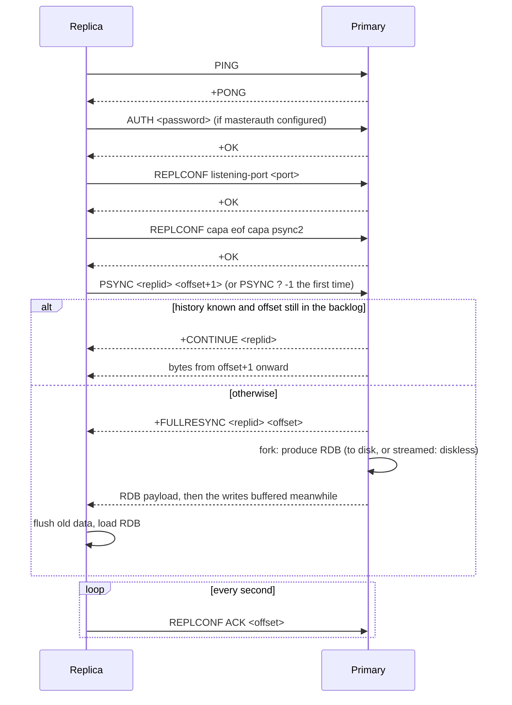
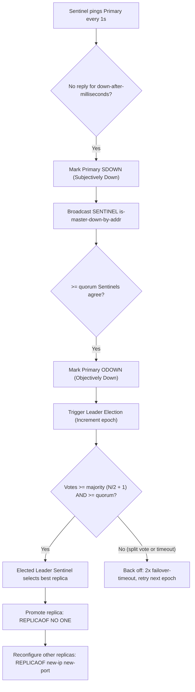
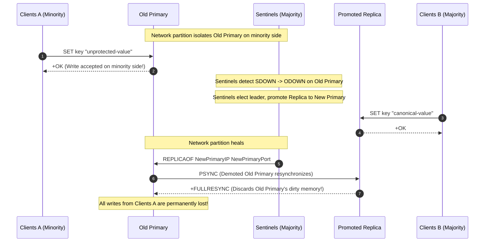

# Module 10 — Replication and Sentinel

A single Redis process is a single point of failure. Replication copies a primary's dataset to replicas, which serve reads and stand ready to take over; **Sentinel** watches primaries, decides when one is dead, promotes a replica, and tells clients where the new primary is. Both are asynchronous by design, so the questions that matter are precise ones: which acknowledged writes can a failover lose, when does a reconnecting replica need a full copy, and what stops two primaries from accepting writes at once.

> [!NOTE]
> Leader/follower replication, replication-lag anomalies and split brain in general are owned by [data-systems M07](../../../architecture/data-systems/modules/07-replication-mechanics-and-consensus.md); failure detection and consensus by [distributed-systems M02](../../../architecture/distributed-systems/modules/02-networks-rpc-and-failure-detection.md) and [M07](../../../architecture/distributed-systems/modules/07-raft-consensus-deep-dive.md). This module is Redis's realisation.

**Executable proofs:** [`examples/ts/10-replication-and-sentinel.test.ts`](../examples/ts/10-replication-and-sentinel.test.ts) with [`src/replication.ts`](../examples/ts/src/replication.ts) (PSYNC decisions, promotion with `replid2`, backlog sizing, `min-replicas-to-write`, Sentinel quorum and majority, replica selection); [`examples/ts/integration/10-replication-sentinel.test.ts`](../examples/ts/integration/10-replication-sentinel.test.ts) (spawns a primary, a replica and three Sentinels; ran green against a local 7.0.15 binary).

---

## 1. Replication mechanics

### 1.1 Definitions

- **Replication ID (`replid`)**: a 40-character pseudo-random hexadecimal string naming one unbroken execution history of the dataset. A primary mints a new `replid` on cold startup without persistence or whenever it is promoted from replica to primary.
- **Secondary Replication ID (`replid2`)**: the `replid` of the previous primary from which a newly promoted primary was replicating before failover occurred.
- **Second Replication Offset (`second_repl_offset`)**: the master replication offset up to which `replid2` is valid. Any replica requesting synchronization for `replid2` at an offset $\le$ `second_repl_offset` is considered part of the shared history.
- **Replication offset (`master_repl_offset`)**: an unsigned 64-bit monotonically increasing byte counter indicating the cumulative volume of replication stream bytes produced by the primary. Replicas maintain a matching `slave_repl_offset`.
- **Replication backlog**: a fixed-size circular ring buffer allocated in memory on the primary (`repl-backlog-size`, default 1 MB) storing recent stream bytes so disconnected replicas can resume with a partial resynchronisation.
- **Dual-stream replication**: the architectural enhancement introduced in Redis 8.0 that decouples bulk snapshot streaming from ongoing command streaming over separate channels to prevent output buffer exhaustion.
- **Replication backlog window**: the interval $[\text{repl-backlog-first-byte-offset}, \text{master-repl-offset}]$ currently held in the primary's ring buffer.

### 1.2 The handshake



The handshake proceeds through a deterministic sequence of wire commands:

1. Replica establishes a TCP connection to the primary and issues `PING`, expecting `+PONG`.
2. If `masterauth` is configured, replica sends `AUTH <password>`, receiving `+OK`.
3. Replica communicates its listening port and capabilities via `REPLCONF`:
   - `REPLCONF listening-port <port>`: Informs primary of replica port for cluster/Sentinel topology discovery.
   - `REPLCONF ip-address <ip>`: Optional announcement when NAT or container port-forwarding obscures source IP.
   - `REPLCONF capa eof`: Announces support for EOF-delimited socket streaming.
   - `REPLCONF capa psync2`: Announces support for chained PSYNC2 failover semantics.
4. Replica sends `PSYNC <replid> <offset+1>`. On cold startup without prior state, it sends `PSYNC ? -1`.

The decision matrix executed on the primary evaluates the requested tuple against its memory buffers:

| Primary condition | Replication ID match | Requested offset evaluation | Action taken | Primary wire response |
| --- | --- | --- | --- | --- |
| Normal reconnection | `requested_replid == master_replid` | `offset >= repl_backlog_first_byte_offset` AND `offset <= master_repl_offset` | Partial Resync | `+CONTINUE <master_replid>` followed by missing bytes |
| Sibling failover | `requested_replid == master_replid2` | `offset <= second_repl_offset` AND `offset >= repl_backlog_first_byte_offset` | Partial Resync | `+CONTINUE <master_replid>` followed by missing bytes |
| Cold replica | `requested_replid == "?"` | `offset == -1` | Full Resync | `+FULLRESYNC <master_replid> <master_repl_offset>` |
| Backlog overflow | Any matching ID | `offset < repl_backlog_first_byte_offset` (overwritten in circular buffer) | Full Resync | `+FULLRESYNC <master_replid> <master_repl_offset>` |
| Divergent history | Unrecognized ID | Any offset | Full Resync | `+FULLRESYNC <master_replid> <master_repl_offset>` |

### 1.3 Full resync costs and diskless replication

A full resync forks the primary (copy-on-write, [module 09](09-persistence-rdb-aof-and-backup.md#2-rdb-snapshots-fork-and-copy-on-write)), transfers the whole dataset, and makes the replica discard and reload. With `repl-diskless-sync yes` (default in recent versions) the child streams the RDB straight to the replica sockets instead of writing a file; `repl-diskless-sync-delay 5` (seconds) waits for more replicas to join the same transfer. The integration tests set it to 0 so a replica attaches immediately. On the replica, `repl-diskless-load` (`disabled` default, `swapdb`, `flushdb` added in 8.6, `on-empty-db`) controls whether it loads straight from the socket.

The table below contrasts disk-based synchronization with diskless socket streaming:

| Parameter | Disk-based replication (`repl-diskless-sync no`) | Diskless replication (`repl-diskless-sync yes`) |
| --- | --- | --- |
| Disk I/O overhead on primary | Writes full RDB snapshot to storage volume | Zero disk writes; streams directly to TCP socket buffer |
| Multi-replica attachment | Multiple replicas share single written RDB file | Waits `repl-diskless-sync-delay` seconds to batch replicas |
| Transfer latency | Bounded by disk write speed + disk read speed | Bounded only by NIC throughput and network bandwidth |
| Disk space requirement | Requires free storage $\ge$ current dataset size | Zero additional storage capacity required on primary |
| Wire framing mode | Fixed byte-length prefix (`$<length>\r\n`) | Magic EOF delimiter mode (`$EOF:<40-hex-chars>\r\n`) |

When streaming without disk (`repl-diskless-sync yes`), Redis frames the payload using EOF transfer mode rather than a fixed length prefix:

```text
$EOF:40_HEX_BYTE_RANDOM_DELIMITER\r\n
<raw binary RDB payload stream...>
40_HEX_BYTE_RANDOM_DELIMITER
```

Replica load modes configured via `repl-diskless-load` define memory safety vs availability trade-offs:

- `disabled`: Replica buffers the incoming socket stream into a temporary RDB file on local disk, flushes existing RAM datasets, and loads from disk.
- `on-empty-db`: Direct socket deserialisation is permitted only if the replica has zero keys in memory; otherwise falls back to disk buffering.
- `swapdb`: Replica keeps serving existing data to clients while streaming the new RDB into separate temporary memory databases. Once transfer completes and parses successfully, Redis executes an atomic dictionary pointer swap and frees the old databases in the background (`bio` lazy-free thread). If parsing aborts or connection drops, the original dataset remains intact.
- `flushdb` (Redis 8.6+): Discards existing keys in RAM immediately upon socket connection and loads the stream directly into memory.

Writes that arrive during the transfer accumulate in the replica's output buffer on the primary. If that buffer exceeds `client-output-buffer-limit replica 256mb 64mb 60`, the primary drops the replica, which starts another full resync: the classic **full-resync loop** on large, write-heavy instances. Redis 8.0 shipped a reworked replication mechanism (Redis describes it as more performant and robust; it streams the snapshot and the buffered stream over separate channels, so the primary does not need to buffer the backlog in the replica's output buffer), which reduces this risk; size the limit generously anyway.

### 1.4 Partial resync and `PSYNC2`

- A replica that loses its link briefly reconnects and asks for `offset+1`. If the bytes are still in the backlog, the primary sends only the missing tail. The integration test kills the replica link with `CLIENT KILL TYPE replica`, writes 100 more keys, and checks that `sync_partial_ok` increased while `sync_full` did not.
- **Backlog sizing**: to survive a disconnect of $T$ seconds at $w$ bytes/s of writes, `repl-backlog-size` ≥ $w \cdot T$. At 5 MB/s and 60 s that is 300 MB, far above the 1 MB default (hermetic test).
- **`PSYNC2` (4.0+)**: on promotion, a replica keeps the old ID as `replid2` valid up to its offset and mints a new `replid`. Sibling replicas of the old primary can then _partially_ resync from the newly promoted one instead of each paying a full resync (hermetic test `after failover, other replicas can continue …`). A replica restarted from its RDB/AOF also remembers its `replid` and offset, so it can partially resync after a restart.

#### Replication backlog ring-buffer sizing derivation

The replication backlog is maintained as a contiguous ring buffer in memory. The primary exposes its state via `INFO replication`:

- `repl_backlog_active`: 1 if active, 0 if no replicas connected and backlog timer expired (`repl-backlog-ttl`, default 3600 seconds).
- `repl_backlog_size`: Configured maximum buffer capacity in bytes.
- `repl_backlog_first_byte_offset`: The lowest replication stream offset still stored in the buffer. Any request for an offset below this threshold triggers `+FULLRESYNC`.
- `repl_backlog_histlen`: Current accumulated byte count stored in the ring buffer ($\le \text{repl-backlog-size}$).

To guarantee that network partitions, Sentinel failovers, or rolling upgrades never degrade into full resynchronisations, calculate minimum backlog capacity using the following formula:

$$\text{Backlog Size} = R_{\text{write}} \times (T_{\text{reconnect}} + T_{\text{failover}} + T_{\text{catchup}}) \times M_{\text{safety}}$$

Where:

- $R_{\text{write}}$: Peak write volume in bytes per second (measured via `instantaneous_output_kbps` on primary).
- $T_{\text{reconnect}}$: Maximum expected transient network partition duration (e.g. 60 seconds).
- $T_{\text{failover}}$: Worst-case Sentinel consensus and promotion duration (e.g. 15 seconds).
- $T_{\text{catchup}}$: Time required for replica to drain network backlog over available link bandwidth.
- $M_{\text{safety}}$: Empirical headroom coefficient (recommended $1.5$).

For example, in a cluster ingesting $12 \text{ MB/s}$ peak writes with a target survival threshold of 120 seconds:

$$\text{Backlog Size} = 12\,\text{MB/s} \times 120\,\text{s} \times 1.5 = 2\,160\,\text{MB} \approx 2.16\,\text{GB}$$

```text
Configuring the backlog in redis.conf:
repl-backlog-size 2160mb
repl-backlog-ttl 7200
```

#### Sibling failover execution trace under PSYNC2

Consider a primary $P$ with `replid = A` replicating to replicas $R_1$ and $R_2$. At offset 100 000, $P$ crashes:

```text
Step 1: P crashes at offset 100 000.
        R1 has processed up to offset 100 000.
        R2 has processed up to offset 98 000 (2 000 bytes lag).
Step 2: Sentinel promotes R1.
        R1 mints master_replid = B.
        R1 records master_replid2 = A and second_repl_offset = 100 000.
Step 3: R2 connects to R1 and issues: PSYNC A 98001.
Step 4: R1 checks condition:
        Does requested replid A match replid2? Yes.
        Is requested offset 98 001 <= second_repl_offset (100 000)? Yes.
        Is 98 001 >= repl_backlog_first_byte_offset? Yes.
Step 5: R1 replies: +CONTINUE B.
        R1 streams bytes 98 001 to 100 000, and R2 smoothly aligns with history B.
        Zero full resyncs; zero fork operations; zero disk I/O.
```

### 1.5 Replica behaviour

- **Read-only** by default (`replica-read-only yes`): writes return `-READONLY` (integration test).
- **Expiry**: replicas do not expire keys themselves; they hide logically expired keys and wait for the primary's `DEL` ([module 03](03-keys-expiry-eviction-and-memory.md#23-expiry-and-replication-persistence-notifications)).
- **Eviction**: replicas ignore `maxmemory` by default and apply the primary's evictions; give them at least as much memory.
- **Stale reads**: `replica-serve-stale-data yes` lets a replica answer while disconnected or syncing, with old data.
- **Chained replication**: a replica can replicate from another replica (`REPLICAOF replica-host port`); the sub-replica receives exactly the primary's stream, reducing the primary's fan-out.

---

## 2. Replication is asynchronous, and what that loses

The primary replies to the client **before** replicas acknowledge. Therefore:

1. **Acknowledged writes can be lost on failover.** If the primary dies after replying but before the write reached the promoted replica, the write is gone, regardless of the primary's AOF (the old primary's history is discarded when it rejoins as a replica).
2. **Reads from replicas can be stale** by the replication lag (usually sub-millisecond, unbounded under load or partitions). Read-your-writes requires reading from the primary or using `WAIT` before the read ([data-systems on lag anomalies](../../../architecture/data-systems/modules/07-replication-mechanics-and-consensus.md#3-replication-lag-anomalies)).
3. **Split brain** (§ 6): a partitioned old primary keeps accepting writes from clients on its side, all of which are discarded after the partition heals.

The integration-only part of this claim (actual write loss on failover) needs a network partition, which a local run cannot simulate faithfully; it is the reason the Docker setup in `docker-compose.yml` exists. The hermetic models prove the decision rules that bound it.

---

## 3. Diagnosing replication

`INFO replication` on the primary shows `role:master`, `connected_slaves`, one line per replica (`slave0:ip=…,port=…,state=online,offset=…,lag=…`), `master_replid`, `master_replid2`, `master_repl_offset`, `second_repl_offset`, `repl_backlog_active/size/first_byte_offset/histlen`. On a replica: `master_link_status:up|down`, `master_last_io_seconds_ago`, `master_sync_in_progress`, `slave_repl_offset`, and (8.2+) `master_current_sync_attempts`, `master_total_sync_attempts`, `master_link_up_since_seconds`, `total_disconnect_time_sec`. Lag in bytes = `master_repl_offset − slave_repl_offset`. `INFO stats` counts `sync_full`, `sync_partial_ok`, `sync_partial_err`: a growing `sync_full` means the backlog is too small or replicas are being dropped.

The table below catalogs primary and replica metrics exposed in `INFO replication`:

| Metric key | Node context | Interpretation | Target production threshold |
| --- | --- | --- | --- |
| `role` | Both | `master` or `slave` | Expected node state |
| `connected_slaves` | Primary | Count of replicas with active TCP connections | Equals expected replica count |
| `master_repl_offset` | Primary | Cumulative bytes generated in replication stream | Monotonically increasing |
| `slave_repl_offset` | Replica | Cumulative bytes acknowledged and processed | `master_repl_offset - slave_repl_offset < 1MB` |
| `master_link_status` | Replica | Health of link to primary (`up` vs `down`) | Strictly `up` |
| `master_last_io_seconds_ago` | Replica | Seconds elapsed since last TCP packet from primary | `< 10` seconds |
| `repl_backlog_histlen` | Primary | Active byte count stored in circular buffer | `< repl_backlog_size` |
| `second_repl_offset` | Primary | Offset up to which previous `replid2` is valid | Valid during PSYNC2 failover |

Key metrics to scrape and calculate:

```text
Replication lag (bytes):   master_repl_offset - slave_repl_offset
Replication lag (seconds): Reported directly by primary in slaveX: ... lag=N
Backlog fill ratio:        repl_backlog_histlen / repl_backlog_size
Partial resync success %:  sync_partial_ok / (sync_partial_ok + sync_partial_err)
```

---

## 4. `WAIT` and `WAITAOF`

- `WAIT numreplicas timeout` blocks the client until at least `numreplicas` replicas acknowledged all previous writes of this connection, or the timeout passes; it returns the number that did (integration test: `WAIT 1 2000` returns 1).
- `WAITAOF numlocal numreplicas timeout` (7.2+) additionally waits for the writes to be **fsynced** to the AOF locally and/or on replicas.

Neither turns Redis into a strongly consistent system. `WAIT` does not roll back the write if it times out (the write stays on the primary and may or may not replicate), and Sentinel/Cluster failover does not pick "the replica that acknowledged", it picks by priority and offset. What `WAIT` buys is a smaller probability of loss for chosen writes (for example after taking a lock or recording a payment), and the knowledge that $N$ copies existed.

---

## 5. Sentinel: quorum, failover and configuration epochs

### 5.1 Roles

Sentinel is a separate mode of the same binary (`redis-sentinel` or `redis-server sentinel.conf --sentinel`). A deployment runs **at least three** Sentinels on independent failure domains, each configured with `sentinel monitor <name> <ip> <port> <quorum>`. Sentinels discover replicas from the primary's `INFO`, and each other through the `__sentinel__:hello` Pub/Sub channel on monitored instances.

### 5.2 From "down" to a new primary



The failure detection and failover protocol executes in six rigorous stages:

1. **SDOWN** (subjectively down): one Sentinel has had no valid reply from the primary for `down-after-milliseconds`.
2. **ODOWN** (objectively down): at least `quorum` Sentinels report SDOWN.
3. **Leader election**: a Sentinel that sees ODOWN asks the others to vote for it in a new **epoch**; it needs votes from a **majority of all Sentinels** (and at least `quorum`). Each Sentinel votes once per epoch. A Sentinel that fails to win waits `2 × failover-timeout` before trying again (visible in the log as `Next failover delay`).
4. **Replica selection**: exclude replicas with `replica-priority 0` and those disconnected for too long; then lowest priority value, then highest replication offset (most data), then lexicographically smallest run ID (hermetic test `replica selection …`).
5. **Promotion**: `REPLICAOF NO ONE` on the chosen replica; other replicas are reconfigured to follow it (`parallel-syncs` at a time); the new configuration is broadcast with the epoch, so the configuration with the highest epoch wins everywhere.
6. **Old primary returns**: Sentinels reconfigure it as a replica of the new primary.

The integration test runs three real Sentinels with quorum 2 and `down-after-milliseconds 1000`, `SIGKILL`s the primary, and waits until `SENTINEL GET-MASTER-ADDR-BY-NAME` returns the replica's port and the replica reports `role:master` and accepts writes; on a laptop this takes about 4–5 seconds.

**Quorum vs majority** (hermetic tests): quorum only decides _detection_. With 5 Sentinels and quorum 2, a minority partition of 2 Sentinels can declare ODOWN but can never elect a leader, so it cannot fail over. Conversely a quorum of 4 with only 3 reachable Sentinels blocks failover even though a majority exists. Choose quorum = majority for most deployments.

#### Leader election wire protocol and voting rules

When Sentinel $S_i$ promotes an `SDOWN` condition to `ODOWN`, it triggers the Raft-like leader election protocol by sending:

```text
SENTINEL is-master-down-by-addr <master-ip> <master-port> <current-epoch> <runid>
```

Each receiving Sentinel evaluates the voting request under strict invariant constraints:

1. If `<current-epoch>` is less than the receiver's local epoch, the vote request is rejected.
2. If the receiver has already cast a vote for `<current-epoch>`, it returns the Run ID of the candidate it previously voted for.
3. If the receiver has not yet voted in `<current-epoch>`, it grants its vote to candidate `<runid>`, increments its local epoch to match, and locks its vote for that epoch.
4. Candidate $S_i$ collects votes. If it obtains $\ge \text{majority}$ ($\lfloor N/2 \rfloor + 1$) AND $\ge \text{quorum}$, it is elected leader.
5. If no candidate reaches the threshold within `failover-timeout`, the election aborts. Candidates back off for a randomized delay ($2 \times \text{failover-timeout} + \text{rand}(0..1000)\text{ ms}$) before attempting election in epoch $E + 1$.

#### Monotonic `config-epoch` and collision resolution

Sentinel maintains consensus state via monotonic 64-bit unsigned integers termed `config-epoch`:

- Every failover attempt increments the global `current-epoch`.
- When a leader Sentinel promotes a replica, it assigns the promoted primary a `config-epoch` equal to the election epoch.
- All configuration messages broadcast via Pub/Sub or gossip include the `config-epoch`.
- Rule: If a Sentinel receives a master advertisement with a `config-epoch` strictly higher than its local record, it updates its master mapping unconditionally.
- If two Sentinels ever advertise conflicting primaries with identical `config-epoch` (epoch collision), the Sentinel with the lexicographically smaller Run ID yields and increments the epoch counter to break the tie deterministically.

### 5.3 Clients and Sentinel

Clients connect to Sentinels first (`SENTINEL GET-MASTER-ADDR-BY-NAME mymaster`), then to the primary, and subscribe to `+switch-master` to reconnect after failover. Use the client's Sentinel support (`createSentinel` in node-redis 5+/6, `sentinels` option in ioredis) rather than hard-coding the primary address, and verify the role after connecting (`ROLE`), because a demoted primary may still accept connections for a while.

---

## 6. Split brain and `min-replicas-to-write`



When the partition heals, the old primary becomes a replica of the new one and **discards every write clients A made**. The mitigation is to make an isolated primary stop accepting writes:

```text
min-replicas-to-write 1
min-replicas-max-lag 10
```

The primary refuses writes with `-NOREPLICAS` unless at least one replica acknowledged within the last 10 seconds (integration test with a lone primary). In a partition, the old primary loses its replicas' acks and stops accepting writes after about `max-lag` seconds, bounding the lost-write window to roughly 11 seconds instead of "until the partition heals" (hermetic test `split brain …`). The price is availability: if all replicas are down, the primary refuses writes too. Redis Cluster has the analogous rule built in: a primary on the minority side stops accepting writes after `cluster-node-timeout` ([module 11](11-redis-cluster.md#5-failover-and-the-consistency-it-does-not-give)).

#### Staleness window derivation formula

The exact upper bound on write loss $\Delta t_{\text{loss}}$ under an unacknowledged partition is governed by the replica ping frequency:

$$\Delta t_{\text{loss}} = \text{min-replicas-max-lag} + T_{\text{ack-interval}}$$

Because replicas issue `REPLCONF ACK` during each `serverCron` cycle (1 second interval):

$$\Delta t_{\text{loss}} = 10\text{ s} + 1\text{ s} = 11\text{ seconds}$$

Any client write submitted after second 11 receives the error `-NOREPLICAS Not enough good replicas to write.` rather than a false acknowledgment.

---

## 7. Then vs now

| Version | Change | Practical effect |
| --- | --- | --- |
| 2.8 | `PSYNC` partial resynchronisation with a backlog | Brief disconnects stop causing full resyncs |
| 4.0 | `PSYNC2`: `replid`/`replid2`, partial resync after failover and after replica restart | Failovers stop triggering full resyncs of every sibling |
| 5.0 | Terminology `slave` → `replica` (`REPLICAOF`, `replica-*` configs); old names kept as aliases (`SLAVEOF`, `INFO` still prints `slave0:` lines) | Rename configs; parsers of `INFO` must accept both |
| 6.0 | Diskless load options on replicas, `repl-diskless-sync` improvements | Faster full syncs without disk |
| 7.0 | Effects-only script replication; `repl-diskless-sync yes` by default | Replicas never re-run scripts |
| 7.2 | `WAITAOF` | Per-write fsync confirmation |
| 8.0 | Reworked replication mechanism (snapshot and stream in parallel) | Fewer full-resync loops under heavy writes |
| 8.2 / 8.6 | New replica `INFO` fields; `repl-diskless-load flushdb` | Better observability; another loading mode |

Migration pitfalls: tooling that greps `INFO` for `slave` keeps working, tooling that greps for `replica` in the per-replica lines does not; Sentinel and replication configs written with `slaveof` still load but should be renamed.

---

## 8. Production failure modes

1. **Full-resync loop**: a large dataset plus heavy writes overflow the replica output buffer during the snapshot; the replica is dropped and starts over forever. Raise `client-output-buffer-limit replica`, `repl-backlog-size`; upgrade to 8.x.
2. **Backlog too small**: every network blip causes a full resync (`sync_full` climbing).
3. **Lost writes after failover**: asynchronous replication; protect critical writes with `WAIT`/`WAITAOF` or keep them in a database.
4. **Split brain** without `min-replicas-to-write`: minutes of writes discarded after a partition.
5. **Two Sentinels**: with two, a single failure leaves no majority, so no failover ever happens. Run three or more, on separate hosts/zones.
6. **Sentinels co-located with the primary**: the host dies, taking the primary and a majority of Sentinels with it.
7. **Clients pinned to an IP**: after failover they keep writing to the demoted primary (now read-only replica: `-READONLY` errors) until restarted. Use Sentinel-aware clients.
8. **Primary without persistence and auto-restart** wipes replicas ([module 09](09-persistence-rdb-aof-and-backup.md#4-choosing-a-configuration)).
9. **Long script or `DEBUG SLEEP`** makes Sentinel see the primary as down and fail over while it is merely busy ([module 05](05-transactions-scripting-and-functions.md#5-blocking-risk-busy-scripts-and-script-kill)).
10. **Asymmetric network partitions**: Sentinel A and B reach the primary, but replica C loses connectivity; Sentinel fails to trigger failover while clients reading from replica C receive stale or aborted reads.
11. **DNS caching in Sentinel-unaware clients**: Client libraries resolve the primary hostname once at boot and cache the IP address; upon Sentinel failover, the client remains pointed at the demoted primary indefinitely.
12. **Sentinel flapping under CPU starvation**: When Redis Sentinel processes share CPU cores with heavily loaded workloads, timer events lag, leading to spurious `SDOWN` declarations and repeated unnecessary failover elections.

---

## Proof map for this module

| Claim | Hermetic | Integration (needs `REDIS_SERVER_BIN` or the compose file) |
| --- | --- | --- |
| PSYNC continue/full rules, `replid2` after promotion | four PSYNC tests | `a restarted replica resumes with a partial resync …` |
| Backlog sizing | `backlog sizing …` | — |
| Replicas are read-only; `WAIT` counts acks | — | `replication: WAIT reports …` |
| `min-replicas-to-write` refuses writes; bounds split brain | `min-replicas-to-write …`, `split brain …` | `negative: min-replicas-to-write …` |
| Quorum for ODOWN, majority for failover; selection order | `Sentinel: quorum …`, `negative: a quorum larger …`, `replica selection …` | `Sentinel: killing the primary promotes the replica …` |
| Acknowledged writes lost on failover, split-brain write loss | model only | **needs a real network partition** (Docker network disconnect or toxiproxy); not executed |

---

## Interview Drill

<details><summary>1. Can Redis lose a write that it acknowledged?</summary>

Yes. Replication is asynchronous: the primary replies before replicas receive the write. If it fails and a replica that had not received the write is promoted, the write is lost. Locally, the loss window also depends on `appendfsync`. `WAIT`/`WAITAOF` reduce the probability for chosen writes but give no strong consistency.
</details>

<details><summary>2. What is the difference between a full and a partial resync?</summary>

Partial: the replica asks for `replid` + offset; if the primary knows the history and the offset is still in its backlog, it streams just the missing bytes. Full: the primary forks, sends a complete RDB snapshot, and the replica reloads from scratch. Size `repl-backlog-size` to write rate × the disconnects you want to survive.
</details>

<details><summary>3. Explain quorum in Sentinel.</summary>

Quorum is how many Sentinels must agree the primary is down (ODOWN). Performing the failover additionally requires a leader elected by a majority of all Sentinels in a new epoch. So a minority can detect but not act, which prevents a partitioned minority from promoting a second primary.
</details>

<details><summary>4. How do you limit split brain in a Sentinel deployment?</summary>

`min-replicas-to-write 1` and `min-replicas-max-lag 10` on the primary: an isolated primary stops accepting writes once no replica has acknowledged for 10 s, bounding the writes that will be discarded. Combine with at least three Sentinels on separate failure domains and Sentinel-aware clients.
</details>

<details><summary>5. Sentinel or Cluster?</summary>

Sentinel provides high availability for one primary's dataset (no sharding): simple, works with all commands and multi-key operations. Cluster shards data across primaries with built-in failover; needed when data or write throughput exceed one node, at the cost of single-slot multi-key operations and cluster-aware clients.
</details>

<details><summary>6. After a failover, all replicas did full resyncs. Why might that be, and how does PSYNC2 help?</summary>

Before 4.0 a new primary had a new replication ID, so siblings could not continue. PSYNC2 keeps the old ID as `replid2` valid up to the promotion offset, so siblings partially resync. Full resyncs after failover today suggest replicas were behind the promotion point beyond the backlog, or a pre-4.0 version.
</details>

<details><summary>7. What is the purpose of second_repl_offset in PSYNC2?</summary>

When a replica is promoted to primary, it records its current replication offset as `second_repl_offset` and copies its old `master_replid` into `master_replid2`. When other sibling replicas reconnect, they request partial resync using the old primary's `replid`. The new primary verifies that the requested offset does not exceed `second_repl_offset`. This guarantees that the sibling only receives bytes from the valid, common branch of historical execution before switching to the new primary's stream.
</details>
