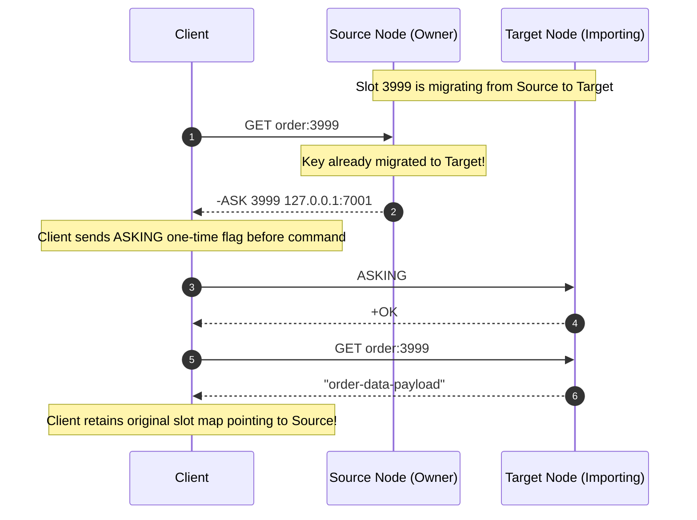
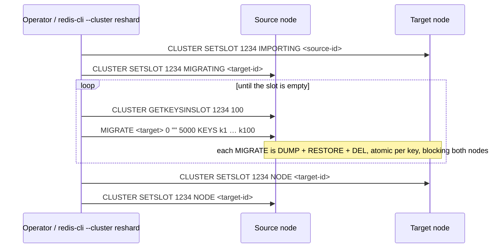

# Module 11 — Redis Cluster

Redis Cluster shards one keyspace across several primaries, each with replicas, without a proxy and without an external coordinator. Clients talk directly to the node that owns a key; nodes gossip over a cluster bus, detect failures, and promote replicas. The design is deliberately simple: a fixed set of 16 384 hash slots, asynchronous replication, "last failover wins". This module explains the slot space and hash tags, the `MOVED`/`ASK` redirection protocol and how clients use it, resharding (including atomic slot migration in Redis 8.4+ and Valkey 9.0), failover, and the consistency the design deliberately does not give.

> [!NOTE]
> Partitioning theory (hash vs range, consistent hashing, rebalancing, request routing) is owned by [data-systems M08](../../../architecture/data-systems/modules/08-partitioning-sharding-and-routing.md); consistent-hashing algorithms by [dsa M13](../../../algorithms/dsa/modules/13-probabilistic-data-structures-and-randomized-algorithms.md#5-consistent-hashing-algorithms). Redis Cluster uses neither consistent hashing nor a ring: it uses a fixed slot table, a form of the "fixed number of partitions" strategy.

**Executable proofs:** [`examples/ts/11-cluster.test.ts`](../examples/ts/11-cluster.test.ts) with [`src/cluster.ts`](../examples/ts/src/cluster.ts) (CRC16, hash tags, a simulated cluster with migration and a redirect-following client); [`examples/ts/integration/11-cluster.test.ts`](../examples/ts/integration/11-cluster.test.ts) (builds a real 3-node cluster from spawned processes; ran green on 7.0.15). [`docker-compose.yml`](../docker-compose.yml) has a 6-node profile for the owner's machine.

---

## 1. The slot space

**Definition.** $\text{slot}(k) = \text{CRC16}(h(k)) \bmod 16384$, where CRC16 is the XMODEM variant (polynomial `0x1021`, initial value 0, no reflection; check value `CRC16("123456789") = 0x31C3`) and $h(k)$ is the key's hash tag if it has one, else the whole key (§ 2). Each slot is owned by exactly one primary at a time; the cluster is healthy (`cluster_state:ok`) when all 16 384 slots are covered.

Because 16 384 is exactly $2^{14}$, the modulo operation is implemented at hardware level as a fast 14-bit bitwise AND mask:

$$\text{slot}(k) = \text{CRC16}(h(k)) \ \& \ \text{0x3FFF}$$

The CRC16 polynomial representation in `crc16.c` implements the CCITT standard generator polynomial:

$$G(x) = x^{16} + x^{12} + x^5 + 1 \quad (\text{hex: } \text{0x1021})$$

The bitwise calculation shifts input bytes through a 16-bit register without input reflection or output inversion:

```c
uint16_t crc16(const char *buf, int len) {
    uint16_t crc = 0;
    for (int i = 0; i < len; i++) {
        crc = (crc << 8) ^ crc16tab[((crc >> 8) ^ buf[i]) & 0xFF];
    }
    return crc;
}
```

The table below catalogs standard test vectors verified across Redis implementations:

| Test string input | CRC16 checksum (hex) | CRC16 decimal value | Hash slot (`value & 0x3FFF`) |
| --- | --- | --- | --- |
| `""` (empty string) | `0x0000` | 0 | 0 |
| `"123456789"` (standard check) | `0x31C3` | 12739 | 12739 |
| `"redis"` | `0xA39E` | 41886 | 9118 |
| `"foobar"` | `0xBD73` | 48499 | 15731 |
| `"user:1000"` | `0x7E15` | 32277 | 15893 |

The table below contrasts the 16 384 fixed-slot partition strategy with traditional consistent-hashing rings:

| Architectural dimension | Fixed Slot Partitioning (Redis Cluster) | Consistent Hashing Ring (Ketama / Dynamo) |
| --- | --- | --- |
| Node ownership | Explicit table mapping slot $0..16383 \to \text{NodeID}$ | Virtual tokens distributed around a $2^{32}-1$ circle |
| Map storage overhead | Exactly 16 384 integers (~64 KB uncompressed, 2 KB bitmap) | Hundreds of virtual tokens per physical node |
| Heartbeat payload | Fixed 2 048-byte bitmap (1 bit per slot) | Token lists or versioned vector clocks |
| Resharding granularity | Move exact slot ranges with zero reassignment of other slots | Adding a node reclaims fractions from all predecessor arcs |
| Client routing complexity | $O(1)$ direct array index lookup: `slots[hash & 0x3FFF]` | $O(\log T)$ binary search over token ring |

- **Why 16 384?** The node-to-node heartbeat carries a bitmap of the slots the sender owns: 16 384 bits = 2 048 bytes per message. 65 536 slots would make it 8 192 bytes (8 KB). The spec also argues clusters are not expected to exceed ~1 000 primaries, for which 16 384 slots still give good granularity (an average of 16 slots per primary in a 1 000-node cluster).
- **Why not consistent hashing?** A fixed slot table makes ownership explicit and movable slot by slot; rebalancing is "move these slots", and every node and client can hold the full map (16 384 entries).
- **Distribution**: CRC16 spreads typical keys evenly. The hermetic test hashes 160 000 keys into 16 buckets of 1 024 slots and finds every bucket within ±10 % of the mean.

The integration test asks a real node `CLUSTER KEYSLOT` for a set of keys (including the spec's tricky hash-tag examples and a non-ASCII key) and checks the answer equals the track's own implementation.

**Then vs now.** The specification has been stable since 3.0; what changed are operations: 7.0 added `CLUSTER ADDSLOTSRANGE`/`DELSLOTSRANGE`, `CLUSTER SHARDS` (replacing the deprecated `CLUSTER SLOTS`), hostnames in redirects (`cluster-announce-hostname`, `cluster-preferred-endpoint-type`) and sharded Pub/Sub; 8.2 added `CLUSTER SLOT-STATS` (per-slot key count, CPU, network); 8.4 atomic slot migration (`CLUSTER MIGRATION`); 8.10 made `redis-cli --cluster reshard`/`rebalance` use it.

---

## 2. Hash tags and multi-key operations

If a key contains `{`, and a `}` follows with at least one byte between them, only the bytes between the **first** `{` and the first `}` after it are hashed. Spec examples, all asserted hermetically:

| Key | Hashed part | Parsing rule and edge case |
| --- | --- | --- |
| `{user1000}.following` / `{user1000}.followers` | `user1000` | Standard tag; co-locates followers and following in the same slot |
| `foo{}{bar}` | the whole key | The first `{` is immediately closed by `}`; rule aborts and hashes full string |
| `foo{{bar}}zap` | `{bar` | Hashes from the first `{` to the very next `}`; tag includes inner `{` |
| `foo{bar}{zap}` | `bar` | Only the first matched `{...}` pair is evaluated; later pairs are ignored |
| `{}user` | the whole key | Empty braces at the beginning; hashes the full key |
| `user{}` | the whole key | Empty braces at the end; hashes the full key |
| `user{open` | the whole key | Missing closing brace `}`; hashes the full key |
| `user}close{` | the whole key | Closing brace precedes opening brace; hashes the full key |
| `cart:{42}:items` | `42` | Clean semantic tag isolating numeric identifier |

**Multi-key rule.** Any command, transaction or script touching several keys must have them all in **one slot**, otherwise `-CROSSSLOT Keys in request don't hash to the same slot` (hermetic and integration tests). That applies to `MGET`/`MSET`, `SINTER`, `RENAME`, `SMOVE`, `ZUNIONSTORE`, `LMOVE`, `MULTI/EXEC` blocks and `EVAL` keys. Design keys that are used together with a shared tag: `cart:{42}`, `cart:{42}:items`, `rl:{apiKey}:…`.

**The opposite failure**: tagging _too_ much. `{tenant}:order:1 … {tenant}:order:10000` all land in one slot, so one node holds and serves a whole tenant (hermetic test: 10 000 keys, one slot). Tag by the smallest unit that needs atomicity (one cart, one user), never by a large entity.

Multi-key reads across slots are still possible client-side: cluster clients split `MGET` by slot and fan out (not atomic). Unlike Redis, Valkey 9.0 also allows numbered databases in cluster mode; in Redis Cluster, `SELECT` is refused (integration test) and only database 0 exists.

---

## 3. Redirection: `MOVED` and `ASK`

### 3.1 The protocol

A node receiving a command for a key it does not own replies with a redirection instead of proxying:

- `-MOVED <slot> <endpoint>:<port>`: the slot is **permanently** served elsewhere. The client must retry there and **update its slot map** (usually by refreshing the whole map with `CLUSTER SHARDS`, since one `MOVED` often means many slots moved).
- `-ASK <slot> <endpoint>:<port>`: the slot is being migrated and this key is already (or will be created) on the target. The client sends **only this request** to the target, preceded by `ASKING`, and **does not update its map**. Without `ASKING`, the importing node answers `MOVED` back to the official owner.



If the client omitted `ASKING` in step 3, Node T would observe that it is not yet the authoritative owner of slot 3999 and would reply `-MOVED 3999 127.0.0.1:7000`, creating an infinite redirection loop.

### 3.2 Client algorithm

The client tracks an internal routing table `SLOT-MAP[0..16383] \to \text{Node}` and executes queries through an adaptive retry loop:

```text
CLUSTER-EXECUTE(cmd, key):
  slot ← CRC16(h(key)) & 0x3FFF
  node ← SLOT-MAP[slot] or any known active seed node
  asking ← false
  attempts ← 0
  repeat:
     if attempts > 5: throw ClusterMaxRedirectionsException()
     attempts ← attempts + 1
     if asking:
         send ASKING to node
         read reply (expect +OK)
         asking ← false
     r ← send cmd to node
     if r is -MOVED s new_node:
         SLOT-MAP[s] ← new_node (or asynchronously trigger CLUSTER SHARDS refresh)
         node ← new_node
         continue
     if r is -ASK s new_node:
         node ← new_node
         asking ← true              ▷ Set flag for target node only; DO NOT update SLOT-MAP
         continue
     if r is -TRYAGAIN:
         sleep(10ms * attempts)     ▷ Multi-key operation split across migrating boundaries
         continue
     if r is -CLUSTERDOWN:
         sleep(50ms)
         refresh SLOT-MAP via seed nodes
         continue
     return r
```

The table below contrasts the redirection responses and expected client actions:

| Error response | Originating context | Client map action | Immediate retry action |
| --- | --- | --- | --- |
| `-MOVED <slot> <ip>:<port>` | Slot permanently assigned to another node | Update `SLOT-MAP[slot] = target` (or refresh all) | Resend command to `<ip>:<port>` |
| `-ASK <slot> <ip>:<port>` | Key migrated during active slot resharding | **Do NOT update** `SLOT-MAP` | Send `ASKING` then command to `<ip>:<port>` |
| `-TRYAGAIN` | Multi-key command with keys partially moved | Keep existing `SLOT-MAP` | Back off briefly and retry on source node |
| `-CLUSTERDOWN` | At least one slot is uncovered, or partition isolated | Refresh full topology via `CLUSTER SHARDS` | Back off and retry |

The hermetic `ClusterClient` implements exactly this against a simulated cluster, and the test walks through a live migration: the first `GET` after the key moved follows one `ASK` and leaves the cache unchanged; the importing node refuses the key without `ASKING`; after `CLUSTER SETSLOT … NODE`, one `MOVED` updates the cache and later requests go straight to the new owner. The integration test reproduces the same sequence on real nodes with `CLUSTER SETSLOT IMPORTING/MIGRATING`, `MIGRATE`, `ASKING`, and checks that `node-redis`'s `createCluster` routes 50 keys transparently.

### 3.3 Client topology handling in practice

- Clients load the map at start (`CLUSTER SHARDS`) and refresh it on `MOVED`, on connection errors, and periodically.
- **`CLUSTER SHARDS` vs deprecated `CLUSTER SLOTS`**: `CLUSTER SHARDS` (7.0+) represents nodes as nested structures with distinct endpoints (hostnames, IPs, TLS ports), avoiding the flat IP-port array ambiguities of `CLUSTER SLOTS`.
- **Read from replicas** with `READONLY` on a replica connection; reads may be stale.
- **Pipelines** in cluster clients are split per node; a pipeline is not atomic and partial failures (one node down) must be handled per command.
- **Blocking commands** (`BLPOP`) and **Pub/Sub** subscriptions must be re-established when slots move; sharded Pub/Sub sends an `sunsubscribe` to signal it ([module 06](06-messaging-pubsub-streams-and-queues.md#12-pubsub-in-cluster-sharded-pubsub-70)).
- **Docker/Kubernetes NAT**: nodes advertise their own IPs in redirects; behind NAT these are unreachable from clients. Use `cluster-announce-ip`/`-port`/`-bus-port` or hostnames.

---

## 4. Resharding and slot migration

### 4.1 Classic key-by-key migration



During the migration, the source serves keys it still has and answers `ASK` for missing ones; multi-key commands whose keys are split between the nodes get `-TRYAGAIN`. Costs: `MIGRATE` of a big key blocks both nodes for the whole serialisation and transfer (a 1 GB hash is a multi-second stall), and the process is driven externally, so a crashed operator tool leaves slots in `MIGRATING`/`IMPORTING` state (`redis-cli --cluster fix`).

Detailed state progression during key-by-key migration:

1. Target is set to `IMPORTING`: It accepts commands for keys in slot 1234 **only if** preceded by `ASKING`.
2. Source is set to `MIGRATING`: If a requested key in slot 1234 exists locally, it executes normally; if missing, it replies `-ASK 1234 <target>`.
3. Keys are extracted in batches using `CLUSTER GETKEYSINSLOT 1234 100`.
4. `MIGRATE` executes: Source serializes value via `DUMP`, transmits payload over socket, Target runs `RESTORE`, Target ACKs, Source runs `DEL`. Both event loops block during the exchange.
5. Final cutover: `CLUSTER SETSLOT 1234 NODE <target-id>` is broadcast, incrementing the target's `configEpoch`.

### 4.2 Atomic slot migration (Redis 8.4+, Valkey 9.0)

Redis 8.4 added `CLUSTER MIGRATION` and Valkey 9.0 independently added atomic slot migration. Instead of moving keys one by one with redirections, the source streams the whole slot (Valkey describes it as using the AOF format and sending large collections item by item rather than as one blob) while keeping ownership; ownership flips once, when the target has everything. Clients see no `ASK` redirections, big keys no longer block, and an interrupted migration does not leave half-moved slots. Redis 8.10 made `redis-cli --cluster reshard` and `rebalance` use the server-side mechanism. Caveat from the 8.4 notes: Query Engine and multi-series time-series queries (`FT.SEARCH`, `FT.AGGREGATE`, `TS.MRANGE` …) may return partial results or duplicates while a migration runs. The exact command syntax differs between Redis and Valkey; this track does not execute either (the local server is 7.0.15), so treat them as **unverified by execution**.

---

## 5. Failover and the consistency it does not give

### 5.1 Failure detection and election

Nodes monitor one another over the cluster bus (default: data port + 10 000, e.g. 16379, or configured via `cluster-port`). Nodes communicate using a binary framing protocol rather than RESP.

The packet layout on the cluster bus begins with a fixed 436-byte header:

```text
+-------------------+--------------------+--------------------+--------------------+
| Magic: "RCmb"     | Total Length (u32) | Message Type (u16) | Port (u16)         |
| (4 bytes ASCII)   | (Big Endian)       | (PING/PONG/MEET)   | (TCP data port)    |
+-------------------+--------------------+--------------------+--------------------+
| Sender Node ID    | Sender configEpoch | Sender currentEpoch| Sender Flags       |
| (40 bytes hex)    | (u64 Big Endian)   | (u64 Big Endian)   | (u16 bitmask)      |
+-------------------+--------------------+--------------------+--------------------+
| Slot Bitmap       | Cluster Bus Port   | Gossip Payload     | Optional Signature |
| (2 048 bytes)     | (u16 Big Endian)   | (Array of entries) | (TLS / Auth)       |
+-------------------+--------------------+--------------------+--------------------+
```

The table below catalogs primary packet types exchanged over the cluster bus:

| Message type constant | Numeric ID | Protocol role |
| --- | --- | --- |
| `CLUSTERMSG_TYPE_PING` | 0 | Periodic heartbeat ping carrying sender slots and gossip section |
| `CLUSTERMSG_TYPE_PONG` | 1 | Direct acknowledgment to PING; also used for broadcast slot updates |
| `CLUSTERMSG_TYPE_MEET` | 2 | Handshake joining a new node to the cluster mesh |
| `CLUSTERMSG_TYPE_FAIL` | 3 | Broadcast notification that a node is confirmed dead by a majority |
| `CLUSTERMSG_TYPE_PUBLISH` | 4 | Legacy cluster-wide Pub/Sub message propagation |
| `CLUSTERMSG_TYPE_FAILOVER_AUTH_REQUEST` | 5 | Replica requesting master votes for failover promotion |
| `CLUSTERMSG_TYPE_FAILOVER_AUTH_ACK` | 6 | Master granting vote to requesting replica |
| `CLUSTERMSG_TYPE_UPDATE` | 7 | Broadcast forcing a node to adopt a higher configEpoch |
| `CLUSTERMSG_TYPE_MFSTART` | 8 | Coordinated manual failover initiation |

Each gossip section entry is 104 bytes and contains the observed state of a peer:

- Peer Node ID (40 bytes).
- Current IP and Port (16 bytes).
- PFAIL / FAIL flags (2 bytes).
- Ping and Pong timestamps (16 bytes).

Failure detection and promotion proceed through precise algorithmic steps:

- **`PFAIL` (Possible Failure)**: A node flags a peer `PFAIL` if a ping goes unacknowledged for `cluster-node-timeout` (commented default 15 000 ms).
- **`FAIL` (Confirmed Failure)**: When a node accumulates gossip `PFAIL` reports from a **majority of master nodes** within $2 \times \text{cluster-node-timeout}$, it promotes the flag to `FAIL` and broadcasts a `FAIL` packet immediately to all bus connections.
- **Replica election delay**: Replicas of the failed primary do not start elections simultaneously. Each replica calculates an intentional election delay:

$$\text{Election Delay} = 500\text{ ms} + \text{random}(0..500\text{ ms}) + \text{replica\_rank} \times 1000\text{ ms}$$

Where `replica_rank` is determined by comparing `slave_repl_offset` among sibling replicas. The replica with the highest offset (most up to date) has rank 0 and fires its election request after $500..1000\text{ ms}$. Replicas that lag behind wait additional seconds, preventing split votes and election churn.

- **Requesting votes**: The replica increments `currentEpoch` and broadcasts a `CLUSTERMSG_TYPE_FAILOVER_AUTH_REQUEST` packet to all primaries.
- **Granting votes**: A primary grants authorization (`CLUSTERMSG_TYPE_FAILOVER_AUTH_ACK`) only if:
  1. The requester is a registered replica of a primary marked `FAIL`.
  2. The requester's `currentEpoch` is strictly greater than any epoch the primary previously voted for.
  3. The primary has not already cast a vote in this epoch.
- **Promotion and cutover**: Once the replica gathers votes from $\ge \lfloor N/2 \rfloor + 1$ primaries (a strict majority of masters), it promotes itself:
  1. Sets its role to `master` and mints `configEpoch = currentEpoch`.
  2. Claims all hash slots previously owned by its failed primary.
  3. Broadcasts a `PONG` packet carrying its updated 2 048-byte slot bitmap to all cluster members.

#### Epoch collision resolution

In asynchronous networks, two nodes might independently mint the same `configEpoch` during simultaneous reconfigurations or manual failovers. Cluster enforces deterministic epoch collision resolution:

```text
Rule: If Node A and Node B both advertise slot ownership with identical configEpoch:
  1. The node with the lexicographically smaller Node ID increments its currentEpoch:
     currentEpoch ← currentEpoch + 1
  2. The smaller node assigns configEpoch ← currentEpoch
  3. The node broadcasts the new configEpoch over the bus.
Result: The higher configEpoch wins across all cluster routing tables.
```

### 5.2 What can be lost

Redis Cluster uses asynchronous replication, so the spec is explicit that it **does not guarantee strong consistency**:

1. **Acknowledged writes lost on failover**: a primary replies, dies, and the replica that is promoted had not received the write.
2. **Writes on the minority side of a partition**: a primary isolated with some clients accepts writes until `cluster-node-timeout` elapses without contact with the majority of primaries; then it stops accepting writes. If the partition lasts longer than the timeout and a replica on the majority side is promoted, those writes are lost. This is Cluster's built-in counterpart of `min-replicas-to-write` ([module 10](10-replication-and-sentinel.md#6-split-brain-and-min-replicas-to-write)).
3. **Availability**: by default (`cluster-require-full-coverage yes`) the cluster stops serving _all_ queries when any slot is uncovered (a primary and all its replicas down). With `no`, the healthy part keeps serving. `cluster-allow-reads-when-down yes` lets nodes serve reads during a cluster-down state.

`WAIT` works per node and narrows window 1; nothing closes it.

---

## 6. Operating a cluster

- **Create**: `redis-cli --cluster create h1:p … h6:p --cluster-replicas 1` (3 primaries + 3 replicas). The integration test builds a 3-primary cluster by hand (`CLUSTER ADDSLOTSRANGE`, `CLUSTER MEET`) to show what the tool does.
- **Inspect**: `CLUSTER INFO` (`cluster_state`, `cluster_slots_ok`, `cluster_known_nodes`, `cluster_current_epoch`), `CLUSTER SHARDS`, `CLUSTER NODES`, `redis-cli --cluster check`.
- **Rebalance**: `redis-cli --cluster rebalance` (weights per node) or `reshard`; atomic on 8.10+.
- **Add a node**: `--cluster add-node new existing`, then reshard slots to it, or `--cluster-slave` to add it as a replica.
- **Replica migration**: `cluster-migration-barrier` lets surplus replicas move to orphaned primaries automatically.
- **Hot slots**: `CLUSTER SLOT-STATS` (8.2+) shows per-slot CPU and traffic; move hot slots to a less loaded node, or fix the key design.
- **Per-node features**: keyspace notifications, client tracking, script cache, Functions (must be loaded on every primary), `KEYS`/`SCAN` (per node) and `FLUSHALL` are per node; tools must iterate all primaries.
- **Security**: the cluster bus has no authentication unless `tls-cluster` is enabled. The September 2026 security releases (8.10.2 and back-ports) added `cluster-bus-port-protected-mode` (default `no`) to require TLS authentication on the bus; keep the bus port on a private network either way ([module 12](12-operations-security-observability-and-valkey.md#3-tls)).

CLI administrative runbook reference:

```bash
# Check cluster health, slot coverage, and key distribution
redis-cli --cluster check 127.0.0.1:7000

# Fix open slots stuck in MIGRATING/IMPORTING after an interrupted migration
redis-cli --cluster fix 127.0.0.1:7000

# Add a new primary to an existing cluster
redis-cli --cluster add-node 127.0.0.1:7006 127.0.0.1:7000

# Reshard 1 000 slots from node A to node B
redis-cli --cluster reshard 127.0.0.1:7000 --cluster-from <node-a-id> --cluster-to <node-b-id> --cluster-slots 1000 --cluster-yes
```

---

## 7. Sentinel vs Cluster vs a proxy

| Architectural property | Sentinel + replicas | Redis Cluster | Proxy (Envoy, twemproxy, AWS MemoryDB proxy) |
| --- | --- | --- | --- |
| Sharding support | None (single primary keyspace) | Built in (16 384 fixed hash slots) | Yes (consistent hashing or range sharding) |
| Multi-key atomicity | Unrestricted across entire keyspace | Restricted strictly to single hash slot (`-CROSSSLOT`) | Usually single backend shard only |
| Client requirements | Sentinel-aware client (`+switch-master`) | Cluster-aware client (`MOVED`/`ASK`/topology map) | Standard standalone Redis client |
| Failover coordinator | External quorum of Sentinel daemons | Internal majority election via cluster bus | Managed by external orchestrator or proxy |
| Network latency penalty | Zero additional network hops | Zero additional hops on cache hit; 1 hop on `MOVED` | +1 network hop on every request |
| Numbered databases | 16 databases (`SELECT 0..15`) | Database 0 only (Valkey 9 supports numbered DBs) | Usually database 0 only |
| Pub/Sub scaling | Broadcast across all nodes | Sharded Pub/Sub (`SPUBLISH`, `SSUBSCRIBE`) in 7.0+ | Broadcast across all proxy backends |

Pick Sentinel while the dataset and write load fit one primary; Cluster beyond that; a proxy when clients cannot be cluster-aware.

---

## 8. Valkey 9: atomic slot migration and numbered databases in cluster mode

Valkey 9.0 (announced October 2025) shipped two cluster features Redis does not have in the same form: **atomic slot migration** (§ 4.2) and **numbered databases in cluster mode** (so `SELECT` works and applications that used multiple DBs can move to a cluster without rewriting keys). Valkey's announcement also claims clusters of up to 2 000 nodes and over 1 billion requests per second; treat vendor scale numbers as marketing until reproduced. Valkey 9.2 release candidates add prioritisation of cluster and replication traffic and optional replication throttling. The integration test that asserts `SELECT` is refused skips itself on Valkey for this reason.

---

## 9. Production failure modes

1. **`CROSSSLOT` in production** after migrating from a single instance: multi-key code paths never designed for slots. Audit `MGET`, transactions and scripts before migrating.
2. **Hot slot from an over-broad hash tag** (§ 2).
3. **Big keys block migration**: `MIGRATE` of a multi-GB key stalls two nodes; split big keys first, or use atomic slot migration.
4. **Clients behind NAT** receive unreachable addresses in `MOVED`; configure announce addresses or hostnames.
5. **Full-coverage outage**: one shard with no healthy replica takes the whole cluster down under `cluster-require-full-coverage yes`.
6. **Stale slot maps** in clients that do not refresh on `MOVED`: every request pays a redirection.
7. **Lost writes after partitions** longer than `cluster-node-timeout`.
8. **Unprotected cluster bus**: any host reaching the bus port can join the cluster unless TLS cluster authentication is enforced.
9. **Cluster bus broadcast storm**: On large clusters (> 500 nodes), aggressive ping rates or frequent link flapping cause gossip bus CPU and network bandwidth saturation.
10. **Split-brain election failure during symmetric network cuts**: Replicas cannot gather votes from a majority of primaries, leaving slots uncovered and triggering `CLUSTERDOWN`.
11. **Redirection storm after mass failover**: Multiple nodes failing simultaneously cause thousands of concurrent client reconnections and `CLUSTER SHARDS` floods, exhausting server CPU.
12. **Half-migrated slots left orphaned**: A resharding script terminated with `SIGKILL` leaves the source node in `MIGRATING` and target in `IMPORTING`, rejecting multi-key queries with `-TRYAGAIN` until repaired via `redis-cli --cluster fix`.

---

## Proof map for this module

| Claim | Hermetic | Integration (`REDIS_SERVER_BIN`; compose for 6 nodes) |
| --- | --- | --- |
| CRC16/XMODEM and the 16 384-slot mapping | `CRC16/XMODEM check value …`, distribution test | `CLUSTER KEYSLOT agrees …` |
| Hash-tag rules (spec examples) | `hash tags follow the spec …`, property test | same (`CLUSTER KEYSLOT`) |
| `CROSSSLOT`; tags co-locate; over-tagging creates a hot slot | two negative tests | `negative: CROSSSLOT …` |
| `MOVED` updates the map, `ASK` does not; `ASKING` required | `MOVED updates …`, `ASK during migration …` | `negative: … MOVED …`, `ASK during a manual slot migration …` |
| `SELECT` refused in Redis Cluster | — | `negative: SELECT is refused …` (**integration-only**) |
| Cluster clients route transparently | simulated client | `a cluster client follows redirections …` |
| Election delay, last failover wins | two tests | — (automatic failover and write loss under partition: **compose cluster profile + network partition, not executed**) |
| Atomic slot migration (8.4+/Valkey 9) | — | **not executed** (needs 8.4+) |

---

## Interview Drill

<details><summary>1. How does Redis Cluster decide which node stores a key?</summary>

`CRC16(key) mod 16384` (XMODEM CRC16), hashing only the hash tag between the first `{` and the following `}` if present and non-empty. Each of the 16 384 slots is owned by one primary; clients cache the slot map and send commands directly to the owner.
</details>

<details><summary>2. Why 16 384 slots and not consistent hashing?</summary>

The heartbeat carries a bitmap of owned slots: 16 384 bits is 2 KB per message, while 65 536 would be 8 KB; 16 384 is ample granularity for up to ~1 000 primaries. A fixed slot table makes ownership explicit and rebalancing a matter of moving whole slots.
</details>

<details><summary>3. MOVED vs ASK?</summary>

`MOVED`: the slot permanently lives elsewhere; retry there and update the slot map. `ASK`: the slot is mid-migration and this key is on the target; send this one request there preceded by `ASKING`, and do not update the map.
</details>

<details><summary>4. How do you do an atomic transfer between two accounts in Redis Cluster?</summary>

Put both keys in one slot with a hash tag (`acct:{user42}:a`, `acct:{user42}:b`) and use a script or `MULTI`. If the accounts belong to different users and cannot share a tag, Cluster cannot do it atomically: use a database transaction, or a saga with idempotent steps.
</details>

<details><summary>5. Can Redis Cluster lose acknowledged writes?</summary>

Yes: asynchronous replication means a promoted replica may miss recent writes, and a primary on the minority side of a partition accepts writes until `cluster-node-timeout`, which are discarded if its slots fail over. `WAIT` narrows but does not close the window.
</details>

<details><summary>6. What changed with atomic slot migration?</summary>

Redis 8.4 (`CLUSTER MIGRATION`) and Valkey 9.0 move a whole slot as a stream while the source keeps serving it, then flip ownership once: no `ASK` redirections, no per-key `MIGRATE` stalls on big keys, no half-migrated slots after an operator crash. Search and multi-series queries may see partial results during the move on Redis 8.4.
</details>

<details><summary>7. Your cluster is `CLUSTER DOWN` although only one shard failed. Why?</summary>

`cluster-require-full-coverage yes` (default) stops all queries when any slot is uncovered (a primary with no replica able to take over). Set it to `no` to keep serving the covered slots, add replicas, and spread them across failure domains.
</details>
