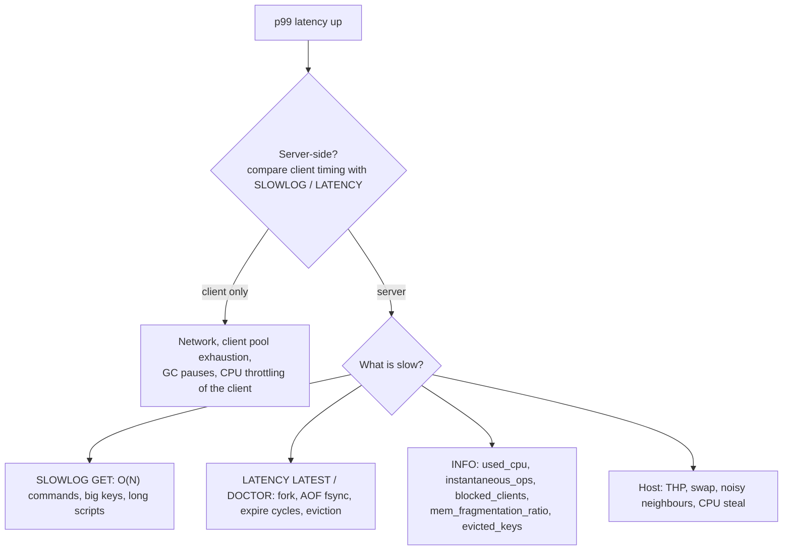

# Module 12 — Operations, Security, Observability, and the Valkey 9.x Delta

The previous modules explain how Redis works; this one is about running it without incidents. It covers network exposure and the attacks that compromised thousands of open Redis servers, ACLs and TLS, the latency-diagnosis toolkit (`SLOWLOG`, `LATENCY`, `INFO`, hot and big keys), the kernel settings Redis needs, the metrics worth alerting on, and finally a structured delta between Redis 8.x and Valkey 9.x plus the version history of both.

**Executable proofs:** [`examples/ts/12-operations-and-security.test.ts`](../examples/ts/12-operations-and-security.test.ts) with [`src/ops.ts`](../examples/ts/src/ops.ts) (INFO parsing, a production lint, a subset of the ACL rule language); [`examples/ts/integration/12-operations.test.ts`](../examples/ts/integration/12-operations.test.ts) (real ACL users and `ACL DRYRUN`, `SLOWLOG`, `LATENCY`, `INFO commandstats`, `HOTKEYS` on 8.6+).

---

## 1. Network exposure and `protected-mode`

Redis was designed for trusted networks. An instance reachable from the internet without authentication gives an attacker arbitrary reads and writes, and historically more: `CONFIG SET dir /root/.ssh` + `CONFIG SET dbfilename authorized_keys` + `SAVE` wrote an attacker's SSH key to disk; `SLAVEOF attacker-host` loaded a malicious module ("rogue primary" attacks); Lua sandbox escapes appeared in CVEs (several Lua use-after-free fixes shipped in 2025–2026 releases).

Defences, in order:

1. **`bind 127.0.0.1 -::1`** (the shipped `redis.conf` default) or a private interface; never `0.0.0.0` on a public network.
2. **`protected-mode yes`** (default): when the default user has no password and no explicit `bind` is configured, only loopback clients are accepted, others get an explanatory error.
3. **Authentication**: ACL users with strong passwords ([§ 2](#2-acls)); disable or restrict the `default` user.
4. **Firewall / security groups** to the application subnet only; the Cluster bus port (data port + 10 000) to cluster members only.
5. **Disable dangerous commands for applications with ACLs** (`-@dangerous`, `-CONFIG`, `-DEBUG`, `-MODULE`). `rename-command` is **deprecated** in `redis.conf` (it breaks AOF/replication replay and tooling); use ACLs. `enable-debug-command no` and `enable-module-command no` (both defaults since 7.0) block `DEBUG` and `MODULE LOAD` unless set to `yes` or `local`.
6. **Patch**: the October 2026 releases (8.10.3, 8.8.4, 8.6.8, 8.4.8, 8.2.11, 7.4.12, 7.2.17) fixed a cluster-bus heap overflow; the September releases fixed ACL checks for queued transactions and added `cluster-bus-port-protected-mode`. Track the security advisories of whichever product you run.
7. **Systemd sandboxing**: run Redis under dedicated system privileges with OS hardening primitives:
   - `ProtectSystem=strict` and `ReadWritePaths=/var/lib/redis /var/log/redis` (prevents arbitrary file overwrite attacks).
   - `ProtectHome=yes` (blocks access to `/root` and user home directories).
   - `NoNewPrivileges=yes` and `PrivateTmp=yes`.

The hermetic `lint` flags "all interfaces + no password + protected-mode off" as critical.

---

## 2. ACLs

### 2.1 Model

Since 6.0, Redis has users. Each user has: enabled/disabled (`on`/`off`), passwords (`>pw`, stored as SHA-256; `nopass`), **command permissions** (`+cmd`, `-cmd`, `+@category`, `-@category`, `+cmd|subcmd`), **key permissions** (`~pattern` read/write, `%R~pattern` read-only, `%W~pattern` write-only, `allkeys`), **Pub/Sub channel permissions** (`&pattern`, `allchannels`; new users default to no channels since 7.0), and since 7.0 **selectors** (`(…)`) adding alternative permission sets.

**Rules apply left to right**: `+@all -@dangerous +keys` allows `KEYS`, `+keys -@dangerous` does not (hermetic test). `ACL CAT` lists categories; `ACL CAT dangerous` the commands in one.

The table below catalogs primary command categories exposed by `ACL CAT`:

| Category name | Description | Representative member commands |
| --- | --- | --- |
| `@admin` | Administrative and configuration commands | `CONFIG`, `SHUTDOWN`, `MODULE`, `REPLICAOF`, `ACL` |
| `@dangerous` | Potentially destructive, blocking, or leaking commands | `FLUSHALL`, `FLUSHDB`, `KEYS`, `DEBUG`, `RESTORE`, `MIGRATE`, `SAVE` |
| `@read` | Commands reading keyspace data without mutation | `GET`, `MGET`, `HGETALL`, `ZRANGE`, `LRANGE`, `SCAN` |
| `@write` | Commands modifying or creating keyspace data | `SET`, `HSET`, `LPUSH`, `ZADD`, `DEL`, `UNLINK` |
| `@fast` | Commands with $O(1)$ asymptotic time complexity | `GET`, `SET`, `HSET`, `LPUSH`, `INCR`, `SADD` |
| `@slow` | Commands with $O(N)$ or higher complexity | `KEYS`, `HGETALL`, `SORT`, `SMEMBERS`, `FLUSHALL` |
| `@pubsub` | Pub/Sub pub, sub, and inspection commands | `PUBLISH`, `SUBSCRIBE`, `PSUBSCRIBE`, `SPUBLISH` |
| `@scripting` | Lua scripting and function invocation | `EVAL`, `EVALSHA`, `FCALL`, `SCRIPT` |
| `@connection` | Connection state and authentication commands | `AUTH`, `PING`, `ECHO`, `QUIT`, `HELLO`, `RESET` |

The table below details all rule modifiers supported by `ACL SETUSER`:

| Rule token | Classification | Functional semantics |
| --- | --- | --- |
| `on` / `off` | State | Activates or disables the user account |
| `>password` | Authentication | Adds cleartext password (hashed internally via SHA-256) |
| `#<sha256>` | Authentication | Adds precomputed 64-hex SHA-256 password hash |
| `nopass` | Authentication | Allows login without password; clears all assigned passwords |
| `resetpass` | Authentication | Revokes all assigned passwords |
| `+cmd` / `-cmd` | Command | Grants or revokes permission to execute specific command |
| `+cmd\|subcmd` | Command | Grants permission to execute specific sub-command (e.g. `+CLIENT\|LIST`) |
| `+@category` / `-@category` | Category | Grants or revokes entire category of commands |
| `~pattern` | Key access | Grants read/write access to keys matching glob pattern |
| `%R~pattern` | Key access | Grants read-only access to keys matching glob pattern |
| `%W~pattern` | Key access | Grants write-only access to keys matching glob pattern |
| `%RW~pattern` | Key access | Grants read/write access to keys matching glob pattern |
| `allkeys` / `resetkeys` | Key access | Grants access to all keys / revokes all key patterns |
| `&pattern` | Pub/Sub access | Grants access to Pub/Sub channels matching glob pattern |
| `allchannels` / `resetchannels` | Pub/Sub access | Grants access to all channels / revokes all channel patterns |
| `(...)` | Selector | Appends an independent evaluation permission selector set |

#### Three-tier production ACL architecture

A robust deployment segregates administrative operations, application workloads, and monitoring tools into dedicated ACL users:

```text
# 1. Tier 1: Dedicated Administrator (replaces default user)
ACL SETUSER cluster-admin on >K8sAdminP@ss99! \
    +@all ~* &*

# 2. Tier 2: Microservice Application Worker
ACL SETUSER orders-service on >OrderMicroSvcSecret321! \
    resetkeys resetchannels \
    +@connection +@read +@write +@fast \
    -@dangerous -@admin -@slow \
    ~orders:* ~idempotency:* \
    &events:orders

# 3. Tier 3: Read-only Prometheus / Monitoring Exporter
ACL SETUSER prometheus-agent on >PromMetricsSecret123! \
    resetkeys resetchannels \
    +ping +info +slowlog +client|list +cluster|info \
    -@all

# 4. Disable insecure default user
ACL SETUSER default off
```

#### Redis 7.0+ Permission Selectors (`(...)`)

Selectors allow creating complex authorization rules that cannot be expressed with flat left-to-right rules. While the root user definition enforces a single permission profile, secondary selectors enclosed in parentheses define independent matching passes.

```text
ACL SETUSER payment-processor on >SecurePass789! \
    resetkeys resetchannels \
    +@connection +@read %R~config:* \
    (+@write ~payments:* &events:payments) \
    (+@write %W~audit:* &events:audit)
```

Evaluation semantics for selectors:

1. Redis first evaluates the root user permission set. If the root set permits the command and its keys and channels, the command executes.
2. If the root set denies the command, Redis iterates through configured selectors `(...)` in declaration order.
3. If **any selector** completely satisfies all permissions for the command (command allowed, all referenced keys allowed by selector key patterns, all channels allowed), execution is granted.
4. If no selector matches, execution is blocked with `-NOPERM`.

`ACL DRYRUN user command args…` (7.0+) explains whether a command would be allowed: the integration test creates a least-privilege user, checks `DRYRUN` answers for an allowed key, a forbidden key and `FLUSHALL`, then connects as that user and observes `NOPERM` errors. `ACL LOG` shows recent denials; `ACL SAVE`/`aclfile` persist users; `ACL WHOAMI` and `CLIENT INFO` show who a connection is.

### 2.2 Then vs now

|  | ≤ 5.0 | 6.0 – 7.x | 8.0+ |
| --- | --- | --- | --- |
| Authentication | One `requirepass` shared by everyone | ACL users; `requirepass` sets the `default` user's password | Same, plus TLS-certificate-to-user mapping (8.6, `tls-auth-clients-user`) |
| Least privilege | `rename-command` | ACL categories, key patterns; 7.0 selectors, `%R~`/`%W~`, `ACL DRYRUN` | Module commands now inside `@read`/`@write`/`@dangerous`…: **re-audit rules** |
| Pub/Sub | Unrestricted | 7.0: new users get no channels by default (`acl-pubsub-default resetchannels`) | — |

Migration: create named users per service, move the shared password to an admin user, set `default` to `off` or restrict it, and run `ACL DRYRUN` for every command your services issue (or watch `ACL LOG` in a staging environment) before switching.

---

## 3. TLS

Redis supports TLS natively since 6.0 when built with `BUILD_TLS=yes` (official images are): `tls-port 6380`, `port 0` to disable plaintext, `tls-cert-file`/`tls-key-file`/`tls-ca-cert-file`, `tls-auth-clients yes|optional|no` for mutual TLS, `tls-replication yes`, `tls-cluster yes`. Costs: TLS handshakes are main-thread work (connection storms hurt more), and encryption costs CPU on the I/O path (I/O threads help). 8.6 added certificate-based authentication: a client certificate field maps to an ACL user, so services authenticate with mTLS alone. Cluster bus: without `tls-cluster`, any host reaching the bus port can join; since 8.10.2 `cluster-bus-port-protected-mode yes` refuses unauthenticated bus peers.

Production TLS configuration parameters in `redis.conf`:

| Configuration directive | Example value | Operational explanation |
| --- | --- | --- |
| `tls-port` | `6380` | Dedicated TCP port accepting encrypted TLS connections |
| `port` | `0` | Disables unencrypted plaintext TCP listener entirely |
| `tls-cert-file` | `/etc/redis/tls/redis.crt` | Path to server X.509 certificate file |
| `tls-key-file` | `/etc/redis/tls/redis.key` | Path to private key matching server certificate |
| `tls-ca-cert-file` | `/etc/redis/tls/ca.crt` | Path to trusted CA bundle verifying client certificates |
| `tls-auth-clients` | `yes` | Enforces mandatory mutual TLS (mTLS); rejects connections without valid client cert |
| `tls-replication` | `yes` | Encrypts replication stream between primary and replicas |
| `tls-cluster` | `yes` | Encrypts cluster bus gossip traffic on port 16379 |
| `tls-protocols` | `"TLSv1.2 TLSv1.3"` | Restricts negotiation to modern, secure TLS cipher standards |

Generating test PKI certificates for mTLS verification:

```bash
# 1. Generate root CA key and self-signed certificate
openssl genrsa -out ca.key 4096
openssl req -x509 -new -nodes -key ca.key -sha256 -days 365 -out ca.crt -subj "/CN=Redis-Root-CA"

# 2. Generate Redis server key and CSR, sign with CA
openssl genrsa -out redis.key 2048
openssl req -new -key redis.key -out redis.csr -subj "/CN=redis.internal"
openssl x509 -req -in redis.csr -CA ca.crt -CAkey ca.key -CAcreateserial -out redis.crt -days 365 -sha256

# 3. Generate client key and certificate for ACL mapping
openssl genrsa -out client.key 2048
openssl req -new -key client.key -out client.csr -subj "/CN=orders-service"
openssl x509 -req -in client.csr -CA ca.crt -CAkey ca.key -CAcreateserial -out client.crt -days 365 -sha256
```

In Redis 8.6+, certificate-to-user mapping (`tls-auth-clients-user`) enables passwordless client authentication. When configured with `tls-auth-clients-user subject:CN`:

1. Client establishes an mTLS handshake, presenting its X.509 client certificate.
2. Redis extracts the Common Name (`CN`) field from the certificate Subject.
3. Redis maps the connection directly to the ACL user matching that `CN`.
4. The client is pre-authenticated without issuing an explicit `AUTH` command over the wire.

---

## 4. Diagnosing latency



- **`SLOWLOG`** records commands whose _execution time_ exceeded `slowlog-log-slower-than` (default 10 000 µs), keeping `slowlog-max-len` (128) entries with time, duration, arguments (8.8 added `slowlog-entry-max-argc`/`-max-string-len` to bound what is stored), client address and name. It excludes network and queueing time, so a stalled server with only fast commands shows nothing; that is what `LATENCY` is for. The integration test sets the threshold to 0 and finds its `SET`.
- **`LATENCY`**: with `latency-monitor-threshold` > 0 (default 0 = off), Redis samples events such as `command`, `fast-command`, `fork`, `aof-fsync-always`, `aof-write`, `expire-cycle`, `eviction-cycle`, `rdb-unlink-temp-file`. `LATENCY LATEST`, `LATENCY HISTORY event`, `LATENCY DOCTOR` (human-readable analysis) and `LATENCY HISTOGRAM` (7.0, per-command percentiles). The integration test runs `DEBUG SLEEP 0.2` with a 50 ms threshold and finds a `command` event ≥ 150 ms.
- **`LATENCY DOCTOR` output analysis**: Synthesizes sampled latency events and prints actionable human advice:
  - If `fork` events exceed threshold: warns about large page tables and advises disabling THP or adding RAM.
  - If `aof-fsync-always` or `aof-write` spike: identifies disk saturation and suggests `appendfsync everysec` or dedicated NVMe volumes.
  - If `expire-cycle` spikes: advises spreading TTLs using random jitter to avoid mass expiration waves.
- **`MEMORY DOCTOR`**: Analyzes dataset memory layout, allocator efficiency, fragmentation ratio, and peak memory metrics, generating human-readable diagnostic recommendations for fragmentation, swap, or excessive eviction.
- **Intrinsic latency**: `redis-cli --intrinsic-latency 100` on the host measures how long the OS/hypervisor stalls a process; nothing on that host can be faster.
- **`INFO commandstats`** (`calls`, `usec`, `usec_per_call`, `rejected_calls`, `failed_calls`) and **`INFO latencystats`** (7.0+, per-command percentiles using HDR histograms) find the expensive commands by aggregate cost. The integration test parses `commandstats` with the hermetic `parseInfo`.
- **`MONITOR`** streams every command: invaluable for debugging, but it roughly halves throughput; never leave it running in production.

---

## 5. Hot keys and big keys

| Tool | Finds | Cost |
| --- | --- | --- |
| `redis-cli --bigkeys` | Largest key per type by element count (uses `SCAN`) | Full keyspace scan; run on a replica |
| `redis-cli --memkeys` | Largest keys by `MEMORY USAGE` | Same, plus per-key cost |
| `redis-cli --hotkeys` | Most frequently accessed keys | Requires an LFU `maxmemory-policy` (reads `OBJECT FREQ`) |
| `HOTKEYS START METRICS n CPU NET … / GET / STOP / RESET` (8.6+) | Top keys by CPU time and network bytes, server-side, probabilistic | One tracking session at a time; not supported by some cluster clients, connect to a node directly |
| `CLUSTER SLOT-STATS` (8.2+) | Per-slot key count, CPU and network in Cluster | Cheap |
| `key-memory-histograms` / `INFO keysizes` (8.x) | Size distributions per type | Cheap |

The `HOTKEYS` command introduced in Redis 8.6 provides server-side probabilistic tracking without requiring an LFU eviction policy:

```text
HOTKEYS START METRICS 10 CPU NET
# ... run application workload ...
HOTKEYS GET
HOTKEYS STOP
HOTKEYS RESET
```

The `HOTKEYS` integration test is gated to 8.6+ and was not executed while authoring. Valkey 9.2 release candidates add their own server-side hot-key detection.

---

## 6. Host and kernel settings

| Setting | Value | Why |
| --- | --- | --- |
| Transparent huge pages | `never` (or `madvise`) | THP turns copy-on-write of 4 KB into 2 MB copies and adds fork and allocation latency ([module 09](09-persistence-rdb-aof-and-backup.md#22-the-two-costs-of-fork)) |
| `vm.overcommit_memory` | `1` | Otherwise `fork()` for `BGSAVE` can fail with ENOMEM and writes stop with `MISCONF` |
| Swap | Disabled or `vm.swappiness` low; alert on `used_memory_rss < used_memory` | Swapped pages turn microseconds into milliseconds |
| `net.core.somaxconn`, `tcp-backlog` | ≥ 511 (Redis default backlog) | Connection storms |
| File descriptors | ≥ `maxclients` + 32 | Redis lowers `maxclients` at start-up if the limit is too low |
| CPU | Pin or at least avoid CPU-throttled containers; `io-threads` ≤ cores − 1 | The main thread must not be throttled |
| Containers | Set memory limits above `maxmemory` + fork headroom | Kubernetes OOM kills during BGSAVE |

#### Memory overcommit and socket queue mechanics

Linux provides three memory overcommit modes configured via `/proc/sys/vm/overcommit_memory`:

- Mode 0 (Heuristic overcommit, kernel default): The kernel estimates whether sufficient RAM is available to satisfy the virtual memory requested during `fork()`. Because `fork()` duplicates the parent's virtual address space, an instance with 30 GB RSS requests a virtual allocation of 30 GB. If available free RAM plus swap is less than 30 GB, the kernel rejects `fork()` with `ENOMEM`, even if zero pages would actually be modified during the snapshot!
- Mode 1 (Always overcommit, **mandatory for Redis**): The kernel permits `fork()` unconditionally, allowing copy-on-write to function as designed.
- Mode 2 (Strict no overcommit): Restricts total allocations to $\text{CommitLimit} = \text{Swap} + \text{RAM} \times \text{overcommit\_ratio}$.

Socket listen queues require `/proc/sys/net/core/somaxconn` to match or exceed `tcp-backlog` (511 default; recommend 65535 in production). When connection bursts arrive, if the kernel socket backlog is smaller than the burst, the kernel silently drops TCP SYN packets, forcing client-side TCP connection retry timeouts (typically 1–3 seconds).

Production host configuration template (`/etc/sysctl.d/99-redis.conf`):

```text
vm.overcommit_memory = 1
net.core.somaxconn = 65535
vm.swappiness = 1
net.ipv4.tcp_max_syn_backlog = 65535
fs.file-max = 2097152
```

The hermetic `lint` checks THP, overcommit, `maxmemory` headroom, eviction policy vs role, and persistence vs role; a well-configured cache produces no findings (tested).

### 6.1 What to alert on

The table below catalogs production alert conditions and thresholds:

| Metric key | Source section | Alert condition | Operational failure detected |
| --- | --- | --- | --- |
| `used_memory / maxmemory` | `INFO memory` | $> 0.85$ | Unbounded keyspace growth; risk of eviction or OOM |
| `mem_fragmentation_ratio` | `INFO memory` | $< 0.95$ or $> 1.50$ | Swapping out of memory ($< 0.95$) or memory fragmentation ($> 1.50$) |
| `rdb_last_bgsave_status` | `INFO persistence` | `!= ok` | Snapshot failure; server stops accepting writes (`-MISCONF`) |
| `aof_last_write_status` | `INFO persistence` | `!= ok` | Disk full or I/O failure on AOF append |
| `aof_delayed_fsync` rate | `INFO persistence` | $> 0$ increases | Background `fsync()` takes $> 2$ seconds; main thread stalling |
| `master_link_status` | `INFO replication` | `== down` | Broken replication link between primary and replica |
| `sync_full` rate | `INFO stats` | $> 0$ increases | Replication backlog too small; replicas falling into full syncs |
| `latest_fork_usec` | `INFO stats` | $> 80\,000$ (80 ms) | Excessive fork latency stalling the event loop |
| `blocked_clients` | `INFO clients` | Trending upward | Unprocessed blocking lists or stream consumers |
| `rejected_connections` | `INFO stats` | $> 0$ | File descriptor ceiling or `maxclients` limit reached |

---

## 7. Valkey 9.x delta

Valkey is a Linux Foundation fork of Redis 7.2.4, BSD-3-licensed. Its `INFO server` keeps reporting a Redis-compatible `redis_version` for clients that gate on it, and adds `server_name:valkey` and `valkey_version` (the integration harness uses `valkey_version` to tell them apart).

### 7.1 Feature matrix (Redis 8.10.3 vs Valkey 9.1.3, verified 2026-11-04)

| Area | Redis 8.10 | Valkey 9.1 | Portability note |
| --- | --- | --- | --- |
| Licence | RSALv2 / SSPLv1 / AGPLv3 (choice) | BSD-3-Clause | The usual reason organisations pick Valkey |
| Core commands and RESP2/RESP3 | Yes | Yes (7.2 base plus own additions) | Clients work against both for core commands |
| Hash field expiration | 7.4+, `HGETEX`/`HSETEX`/`HGETDEL` 8.0+ | 9.0+ (`HEXPIRE` family, `HGETEX`, `HSETEX`) | Similar names; check option differences |
| Compare-and-delete | `DELEX key IFEQ v` (8.4) | `DELIFEQ key v` (9.0) | **Different commands**: keep a Lua fallback |
| Bounded increment | `INCREX` (8.8) | `INCREX` in 9.2 release candidates | Do not assume identical semantics before GA |
| JSON, Search, Bloom | Built in (`JSON.*`, `FT.*`, `BF.*`, `CF.*`, `CMS.*`, `TOPK.*`, `TDIGEST.*`) | Modules in `valkey-bundle`: valkey-json, valkey-search, valkey-bloom (+ valkey-ldap) | Partial overlap ([module 08](08-query-engine-json-vectors-and-probabilistic.md#7-valkey-equivalents)) |
| Time series, Vector Sets, Array type | Yes | No | Redis-only |
| Cluster numbered databases | No (DB 0 only) | Yes (9.0) | `SELECT` in cluster is Valkey-only |
| Atomic slot migration | 8.4+ (`CLUSTER MIGRATION`), used by `redis-cli --cluster` 8.10 | 9.0+ | Different commands and tooling |
| Geo by polygon | No | Yes (9.0) | Valkey-only |
| I/O threading | New implementation in 8.0, lookahead prefetch in 8.4 | Async I/O threads since 8.0 | Benchmarks not comparable across vendors |
| RDB compatibility | Writes RDB versions newer than 7.2 | Loads Redis ≤ 7.2 RDB; Redis ≥ 7.4 files not assumed loadable | Migrate Redis 8 → Valkey with logical export |
| Hot-key detection | `HOTKEYS` (8.6) | Server-side hot keys in 9.2 release candidates | Different interfaces |
| Upcoming (Valkey 9.2 RCs) | — | Forkless RDB snapshots, Path Hash type, ACL roles, `XACKDEL`/`XDELEX`, LZ4 RDB compression, B+tree large sorted sets | Release candidates: not taught as current |

### 7.2 Then vs now: choosing between them

|  | 2023 | 2024 | 2026 |
| --- | --- | --- | --- |
| Choice | "Redis" | Redis 7.4 (source-available) vs Valkey 7.2/8.0 (BSD) | Redis 8 (AGPL option, bundled modules) vs Valkey 9 (BSD, cluster features) |
| Managed offerings | Redis-based | Cloud providers start offering Valkey | Both widely offered; check the engine and version behind "Redis-compatible" |

**Migration Redis → Valkey**: inventory commands (`INFO commandstats` on production) and modules; replace Redis-only commands (`DELEX`, `INCREX`, `FT.AGGREGATE`/`TS.*`/Vector Sets) or keep them on Redis; for Redis ≤ 7.2 replicate or copy RDB; for newer Redis, export logically (keys using only 7.2-era features via `DUMP`/`RESTORE`, or a key-by-key copy tool); run the integration suite against both images (`REDIS_IMAGE=valkey/valkey:9.1.3 npm run test:integration`), where version-gated tests skip with a reason. **Valkey → Redis**: Valkey-only features (cluster `SELECT`, `DELIFEQ`, polygon search) need rewrites.

---

## 8. Version history for practitioners

| Release | Date | What practitioners noticed |
| --- | --- | --- |
| Redis 5.0 | 2018 | Streams; `slave` → `replica` naming |
| Redis 6.0 | 2020 | ACLs, TLS, RESP3, client-side caching, I/O threads |
| Redis 6.2 | 2021 | `GETEX`, `LMOVE`, unified `ZRANGE`, `XAUTOCLAIM` |
| Redis 7.0 | 2022 | Functions, multi-part AOF, listpack everywhere, sharded Pub/Sub, ACL selectors, effects-only script replication |
| Redis 7.2 | 2023 | Listpack sets/lists, `WAITAOF`, `CLIENT SETINFO`; **last BSD release** |
| Redis 7.4 | 2024 | Hash field expiration; **RSALv2/SSPLv1** licence |
| Valkey 7.2.4 / 8.0 | 2024 | Fork of Redis 7.2.4 (BSD); 8.0 async I/O threading |
| Redis 8.0 | May 2025 | AGPLv3 option; Query Engine, JSON, TimeSeries, probabilistic built in; Vector Sets; `HGETEX`/`HSETEX`/`HGETDEL`; new I/O threading |
| Redis 8.2 | Aug 2025 | `XDELEX`/`XACKDEL`, new `BITOP` ops, SVS-VAMANA, `CLUSTER SLOT-STATS` |
| Valkey 9.0 | Oct 2025 | Atomic slot migration, cluster numbered databases, hash field expiration, `DELIFEQ` |
| Redis 8.4 | Nov 2025 | `DELEX`/`DIGEST`/`MSETEX`, `CLUSTER MIGRATION`, `XREADGROUP CLAIM`, `FT.HYBRID` |
| Redis 8.6 | Q1 2026 | Stream idempotency (`IDMP`), LRM eviction, `HOTKEYS`, TLS cert auth |
| Redis 8.8 | Q2 2026 | Array type, `INCREX`, `XNACK` |
| Valkey 9.1 | Jul 2026 | Current Valkey line (9.1.3, 2026-10-26) |
| Redis 8.10 | Q3 2026 | Compact hashes, `BACKUP`, `LMOVEM`/`BLMOVEM`, `SUNIONCARD`/`SDIFFCARD`; latest 8.10.3 (2026-10-26) |

Dates before 2024 are given by year only; Redis 8.x quarters are from the "What's new" pages.

---

## 9. Production failure modes

1. **Internet-exposed instance** compromised within hours (cryptominers, data wiped with a ransom note key).
2. **Shared `default` user** across services: one compromised service can `FLUSHALL` everything.
3. **ACL drift after upgrading to 8.0**: category rules suddenly include module commands.
4. **`MONITOR` left running** halves throughput.
5. **Slow-log blind spot**: latency caused by forks or fsyncs never appears in `SLOWLOG`; enable the latency monitor.
6. **Kernel defaults** (THP on, overcommit 0) causing fork failures and `MISCONF` write stops.
7. **"Redis-compatible" managed service** that is actually Valkey or an older Redis: a command your code needs is missing in production but present in development.
8. **TLS-only port with an old client** that silently falls back to plaintext attempts and times out; test connectivity in deploy checks.
9. **File descriptor exhaustion**: Connection bursts cause `rejected_connections` when `maxclients` exceeds `ulimit -n`.
10. **Memory fragmentation under high write churn**: Dynamic memory allocations fragment jemalloc arena bins; `mem_fragmentation_ratio` climbs above 1.5, requiring active defragmentation (`activedefrag yes`).
11. **Swap stall catastrophe**: Memory pressure forces pages to disk; a simple `GET` turns into a synchronous disk read, stalling the event loop for 10–50 ms.
12. **Insecure cluster bus exposure**: Private bus port (16379) exposed to unauthenticated networks, allowing rogue nodes to inject falsified `FAIL` packets or epoch updates.
13. **TCP connection drops from undersized socket backlog**: Traffic spikes overflow `/proc/sys/net/core/somaxconn`, causing silent SYN drops and client connection timeouts.
14. **mTLS certificate expiry**: Automated certificate rotation failure causes all cluster and application connections to fail with TLS handshake verification errors simultaneously.

---

## Proof map for this module

| Claim | Hermetic | Integration |
| --- | --- | --- |
| ACL left-to-right rules, key patterns, `%R~` | four ACL tests (subset model) | `ACL: a least-privilege user …` (`ACL DRYRUN`, `NOPERM`) |
| `WRONGPASS` | — | `negative: wrong password …` (**integration-only**) |
| `SLOWLOG` records execution time and arguments | — | `SLOWLOG records …` (**integration-only**, dedicated server) |
| `LATENCY` captures blocking events | — | `LATENCY monitor captures …` (**integration-only**) |
| `INFO` parsing, `commandstats` | `INFO parsing …` | `INFO commandstats …` |
| Production lint rules | four `lint` tests | — |
| `HOTKEYS` | — | `HOTKEYS (8.6+) …` (**8.6+, not executed while authoring**) |
| Valkey behaviour | — | run the whole suite with `REDIS_IMAGE=valkey/valkey:9.1.3` (**not executed: no Docker here**) |

---

## 10. Interview Drill

<details><summary>1. How do you secure a Redis instance?</summary>

Private network and `bind` to a private interface; `protected-mode yes`; ACL users per service with least privilege (`~prefix:*`, `-@dangerous`), `default` user disabled; TLS (and mTLS or 8.6 certificate auth) when crossing untrusted networks; firewall the cluster bus; `enable-debug-command no`, no `MODULE LOAD`; keep patched.
</details>

<details><summary>2. Latency spikes every 15 minutes. How do you investigate?</summary>

Correlate with `LATENCY HISTORY` (fork? aof-fsync? expire-cycle?), `INFO persistence` (`latest_fork_usec`, `rdb_bgsave_in_progress` timing vs `save` rules), `SLOWLOG` for periodic jobs running $O(N)$ commands (`KEYS`, big `HGETALL`), and host metrics (THP, swap, CPU steal). Typical causes: snapshot forks on a large instance with THP, a cron job, or mass expirations.
</details>

<details><summary>3. Why might SLOWLOG be empty while clients see 200 ms latency?</summary>

`SLOWLOG` only measures command execution. Time spent queued behind other commands, in fork, in fsync, in the network, or in the client is invisible there. Use the latency monitor, `--intrinsic-latency`, and client-side timing.
</details>

<details><summary>4. How do you find hot keys and big keys?</summary>

Big keys: `redis-cli --bigkeys`/`--memkeys` on a replica, `MEMORY USAGE`, size histograms. Hot keys: `HOTKEYS` on 8.6+, `redis-cli --hotkeys` with an LFU policy, `CLUSTER SLOT-STATS` per slot, or client-side metrics. Fix by splitting keys, caching hot reads client-side, or spreading load.
</details>

<details><summary>5. Your company wants to move from Redis to Valkey. What do you check?</summary>

Licence motivation and support model; command inventory (`INFO commandstats`) against Valkey's command set (Redis-only: `DELEX`, `INCREX` (until Valkey GA), Vector Sets, time series, `FT.AGGREGATE`/`FT.HYBRID`); module usage vs valkey-bundle; RDB compatibility (Redis ≥ 7.4 files are not assumed loadable, so plan a logical migration); client libraries; run the full test suite against both before switching.
</details>

<details><summary>6. Which kernel settings matter for Redis and why?</summary>

THP off (fork latency and 2 MB copy-on-write), `vm.overcommit_memory=1` (fork succeeds), no swap (latency), enough file descriptors and `somaxconn` (connections), and memory limits with fork headroom in containers.
</details>

<details><summary>7. How do ACL selectors in Redis 7.0+ differ from root user rules?</summary>

Root user rules apply a single left-to-right evaluation across commands, keys, and channels. If the root rules deny an operation, Redis evaluates secondary selectors enclosed in parentheses `(...)` in declaration order. If any individual selector allows the command, all target keys, and all targeted channels, the command is granted execution. This allows expressing composite permissions such as "read-only on cache:* but read-write on orders:*".
</details>

<details><summary>8. Why does vm.overcommit_memory = 0 cause fork to fail even with plenty of free RAM?</summary>

In mode 0 (heuristic overcommit), the Linux kernel estimates whether sufficient RAM is available to satisfy the virtual address space requested by `fork()`. Because `fork()` duplicates the parent's page tables, an instance with 30 GB RSS requests a virtual allocation of another 30 GB. If unallocated RAM and swap totals less than 30 GB, the kernel returns `ENOMEM`, even though copy-on-write ensures only a fraction of pages will actually be copied. Setting `vm.overcommit_memory = 1` disables the heuristic and permits `fork()` unconditionally.
</details>

<details><summary>9. What is the operational difference between DELEX in Redis 8.4 and DELIFEQ in Valkey 9.0?</summary>

Both commands implement atomic compare-and-delete (deleting a key only if its current value matches a specified string). However, their command syntax and wire names differ completely: Redis 8.4 introduced `DELEX key IFEQ value`, whereas Valkey 9.0 implemented `DELIFEQ key value`. Applications migrating between the two engines must either maintain a Lua script abstraction or translate command invocations dynamically.
</details>

<details><summary>10. How does Redis 8.6+ certificate-based authentication (tls-auth-clients-user) function?</summary>

When `tls-auth-clients-user` is configured (for example with `subject:CN`), Redis inspects the client's X.509 certificate during the mTLS handshake, extracts the Common Name from the Subject field, and automatically maps the connection to the corresponding ACL username. The client is authenticated immediately upon TLS negotiation without needing to issue an `AUTH` command with a plaintext or hashed password.
</details>
