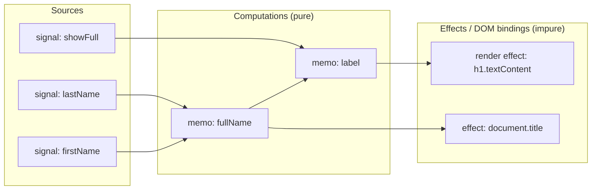
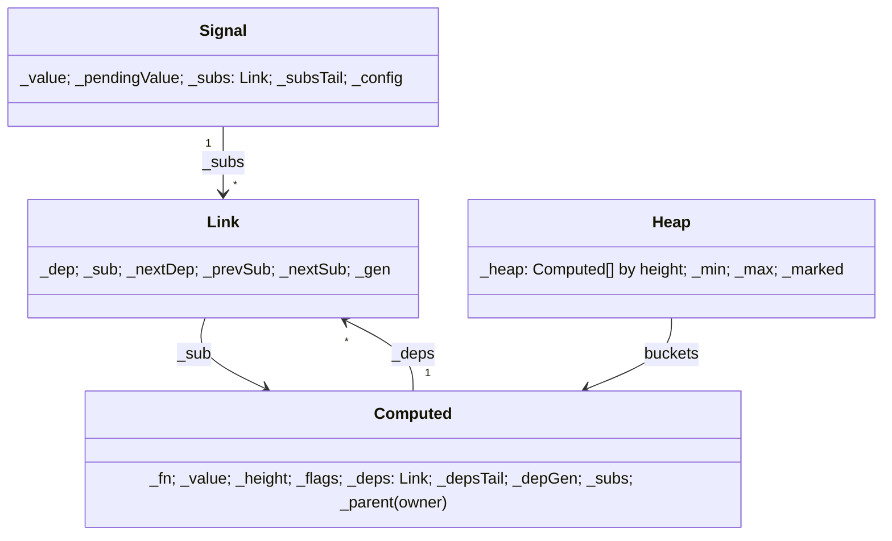
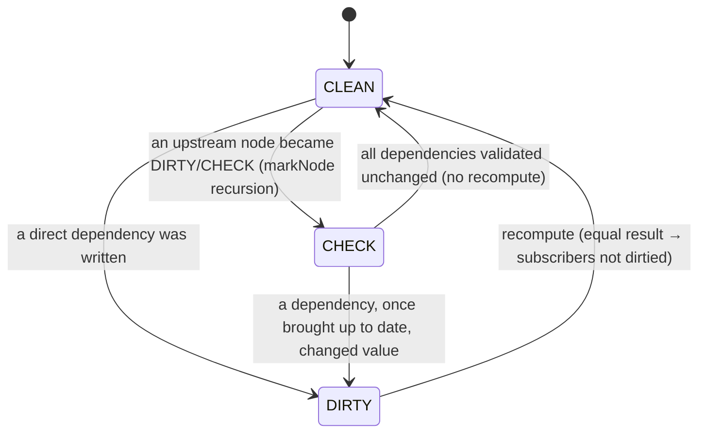
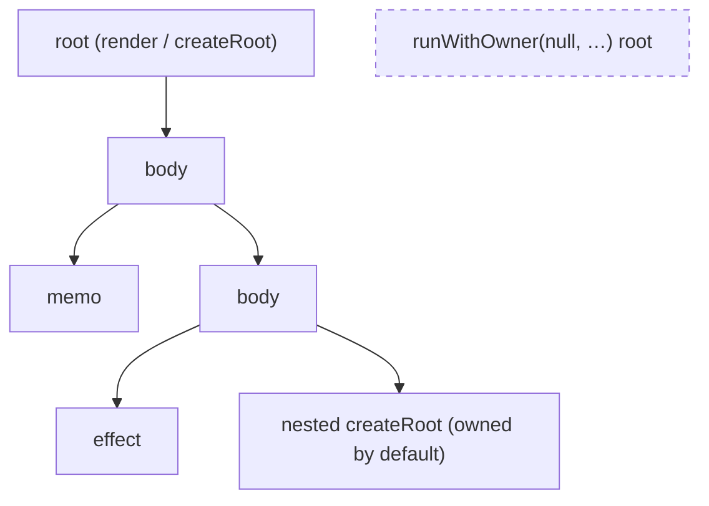

# Module 01 — Reactive Core: Signals, Memos, Batching and Ownership

> **Release-candidate track.** Everything here targets `solid-js@2.0.0-rc.19` / `@solidjs/signals@2.0.0-rc.19` (published 2026-10-27). Solid 2.0 has no GA date yet; the official docs at <https://v2.solidjs.com> say "APIs may change before the stable release". Pin exact RC versions (never `^2.0.0-rc`).
>
> **Executable proof:** [`examples/typescript/01-reactive-core.test.ts`](../examples/typescript/01-reactive-core.test.ts) (`npm test -- 01-reactive-core`).

Solid is a *fine-grained reactive* UI library: the unit of update is not a component but a single reactive binding. A component function runs **once** to build a graph of signals, derived computations and DOM bindings; afterwards, a write to one signal reaches exactly the bindings that read it, without re-running the component and without diffing a virtual DOM. This module defines that graph precisely, shows how the 2.0 scheduler keeps it consistent (push-pull evaluation, glitch freedom, microtask batching), and covers the ownership tree that decides when reactive nodes die.

Prerequisites, owned elsewhere and only referenced here:
- closures, `this` and scope; the HTML event loop and the microtask queue (`languages/javascript`, not yet published);
- typing `Accessor<T>` / `Setter<T>` and the writable-memo overloads ([TypeScript module 12/13](../../../languages/typescript/modules/13-solidjs-2-with-typescript.md)).

---

## 1. The model in one picture



Edges point from a producer to the node that **read** it. Nobody declared these edges: they were recorded while the computations ran. That is the defining property of *automatic dependency tracking* and the reason Solid has no dependency arrays.

## 2. Formal definitions

Let the reactive graph be a directed graph $G = (V, E)$ with $V = S \cup C \cup F$:

| Set | Name | Solid API | Has a value? | May have side effects? |
|---|---|---|---|---|
| $S$ | **sources** (signals) | `createSignal(value)`, store properties | yes, written imperatively | no |
| $C$ | **computations** (memos / derived) | `createMemo`, `createSignal(fn)`, `createProjection` | yes, $v_c = f_c(\text{values of } \mathrm{deps}(c))$ | no (must be pure) |
| $F$ | **sinks** (effects) | `createEffect`, `createRenderEffect`, JSX bindings | no (only a cleanup) | yes |

An edge $(u, v) \in E$ means "*$v$ read $u$ during its last evaluation*". So $\mathrm{deps}(v)$ is **dynamic**: it is whatever the last run of $v$ actually read. Edges are rebuilt on every run, which is why `useA() ? a() : b()` depends on `b` only while `useA()` is false (proved in the test "dependencies are dynamic").

**Acyclicity.** A computation may not (transitively) write to its own inputs. Solid enforces the strongest practical form: *no writes at all inside an owned scope* (§7), so $G$ restricted to $C \cup F$ is a DAG by construction.

**Height.** Define $h(s) = 0$ for $s \in S$ and $h(v) = 1 + \max_{u \in \mathrm{deps}(v)} h(u)$. Evaluating nodes in non-decreasing height is a topological order of $G$.

**Commit (epoch).** Writes are not applied when the setter is called. They are *staged* and applied together at a **commit point** (a flush). Let $\sigma_k$ be the committed source state after the $k$-th flush. All reads between flushes observe $\sigma_k$.

**Consistency (glitch freedom).** A run of node $v$ is *consistent* if every value it reads was computed from the same $\sigma_k$. A reactive system is **glitch-free** if every run of every computation and sink is consistent. Equivalently: no node ever observes a mix of "already updated" and "not yet updated" inputs. The diamond test in the example suite records every `[b, c]` pair the sink ever saw and asserts it only ever saw `[2, 10]` and `[3, 20]`, never the torn pairs `[3, 10]` or `[2, 20]`.

**Equality cut-off.** Each node has a comparator `equals` (default `===`, exported as `isEqual`). If a recomputed value is equal to the previous one, the node's subscribers are not marked dirty. This prunes propagation (test "a memo whose value did not change stops propagation").

### 2.1 Operational semantics (simplified)

```text
write(s, x):                         -- setter call
  stage s := x                        -- reads still return the committed value
  mark every transitive subscriber of s as CHECK, direct ones as DIRTY  (push)
  schedule a flush on the microtask queue (if not already scheduled)

flush():                              -- microtask, or an explicit flush()
  commit all staged writes            -- σ_k → σ_{k+1}
  for v in dirty nodes ordered by height:          (pull, topological)
     if v is CHECK: re-validate its deps first; if none changed, mark v clean, skip
     if v is DIRTY: re-run f_v, rebuild deps(v)
        if equals(old, new): do not dirty subscribers   -- cut-off
  run render-effect apply halves, then user-effect apply halves
  run onSettled callbacks whose work has settled
```

Loop invariant of the pull loop: *when node $v$ is popped, every node of smaller height that $v$ might read is already clean in $\sigma_{k+1}$*. Because heights strictly increase along edges, that invariant is what makes each run consistent. This is the classic three-colour (clean / check / dirty) push-pull algorithm popularised by Reactively and alien-signals; the RC's internals literally use `REACTIVE_CHECK` / `REACTIVE_DIRTY` flags and a height-ordered heap (`@solidjs/signals/dist/types/core/heap.d.ts`). Those internals are not public API and change between RCs; the observable contract is the one the tests assert.

### 2.2 The rc.19 implementation, annotated

The operational semantics above is the contract. This section reads the actual engine (`@solidjs/signals/dist/dev-shared.js`, rc.19) so you can explain *how* the contract is met. Function names are real; internal fields start with `_` and are not API.

#### Data structures



- **`Link`** is one dependency edge, stored once and threaded into two doubly-linked lists: the subscriber's `_deps` list and the source's `_subs` list. The `link(dep, sub)` function carries a comment pointing at `alien-signals` v2.0.3 (`system.ts`), the algorithm it derives from. During a re-run, `link` walks the previous dependency list *in order*: if the next read is the same dependency as last time, the existing link is reused and stamped with the current generation (`_gen = _depGen`); otherwise a new link is spliced in. After the run, links not stamped this generation are trimmed (`trimStaleDeps`). This makes dependency re-recording $O(\text{reads})$ with no allocation in the common case where a computation reads the same things in the same order.
- **The dirty heap** is not a binary heap: it is an **array of buckets indexed by height**, each bucket a circular doubly-linked list (`_prevHeap`/`_nextHeap`). `insertIntoHeap` appends in $O(1)$; `runHeap` scans buckets from `_min` to `_max`.
- **Flags** per computed: `REACTIVE_CHECK` (some upstream may have changed), `REACTIVE_DIRTY` (a direct dependency changed), `REACTIVE_IN_HEAP`, `REACTIVE_RECOMPUTING_DEPS` (currently running), `REACTIVE_DISPOSED`, plus RC-era flags for holds and lanes.

#### The three-colour marking



`markNode(el, state)` sets `el`'s state if it is "stronger" than the current one and recurses into every subscriber with `CHECK`. The recursion stops at nodes already marked at least that strongly, so each node is visited at most twice per write burst (once for CHECK, once for DIRTY): marking is $O(|V_{reach}| + |E_{reach}|)$.

#### One flush, step by step

`schedule()` sets a `scheduled` flag and calls `queueMicrotask(flush)` unless a flush is already running or a `flush(fn)` is in progress (`syncDepth`). `GlobalQueue.flush()` then runs, in this order (verbatim structure, comments ours):

```js
sweepDormant();                       // 1. unlink unobserved memos read untracked last tick
runHeap(dirtyQueue, GlobalQueue._update); // 2. recompute dirty nodes bucket by bucket (height order)
this.settle();                        // 3. commit staged values, resolve holds
clock++;                              // 4. advance the global epoch
this.run(EFFECT_RENDER);              // 5. apply halves of render effects (DOM bindings)
this.run(EFFECT_USER);                // 6. apply halves of user effects (createEffect)
```

Writes made in step 5 or 6 (an effect apply that sets a signal) set `scheduled` again and the loop continues in the same flush ("the same flush's continuation"). A dev guard counts iterations: past roughly 100 000 the runtime throws **"Potential Infinite Loop Detected"** (proved: an apply half that increments its own source got to about 99 998 before the throw).

```text
RUN-HEAP(H)
  H.marked ← false
  for h ← 0 to H.max:                          ▷ invariant: all buckets < h are empty
      while H.bucket[h] ≠ ∅:
          v ← head(H.bucket[h])
          if v.flags ∋ IN_HEAP: RECOMPUTE(v)     ▷ removes v; may insert subscribers at heights > h
          else: ADJUST-HEIGHT(v)                 ▷ v moved here only to fix its height
  H.max ← 0
```

**Loop invariant.** When bucket $h$ is processed, every bucket $h' < h$ is empty, so every dependency of a node at height $h$ is either a source or a node that has already been recomputed (or validated) in this flush.

**Dynamic heights.** Heights are not fixed: if a re-run makes $v$ read a node $u$ with $h(u) \ge h(v)$, `adjustHeight` raises $h(v)$ to $h(u)+1$ and re-inserts $v$'s subscribers so they move up too. A child computation is also placed above its owner (`parentHeight + 1`), so an owner always re-runs (and possibly disposes its children) before the children would run. The suite's "dynamic dependencies raise height" test switches a sink from a height-1 source to a height-3 memo and asserts the sink runs after it in the same pass.

#### Pull on read

Between flushes, a read of a node in CHECK state calls `updateIfNecessary`: it walks the node's dependencies in order, recursively updating computed ones, and stops at the first one that turned the node DIRTY; then it recomputes. This is the "pull" half: a value read mid-tick (for example inside `latest()` or a nested `flush(fn)`) is brought up to date on demand without waiting for the heap.

#### Dormancy and autodisposal

A memo with **no owner and no subscribers** that is read untracked is queued as *dormant*; the next flush's `sweepDormant()` unlinks it from its sources *before* the heap runs, so it costs nothing until read again, and the next read recomputes it from scratch. Proved: after an untracked read, a write + flush does not recompute it; the following read does. This is how unowned memos avoid the classic leak "a source keeps a dead memo alive forever" (the source comment notes that upstream alien-signals has exactly that retention). Lazy memos opt into the same lifecycle explicitly.

### 2.3 Proof sketch: glitch freedom

**Claim.** In a flush, every computation $v$ that runs reads only values computed from $\sigma_{k+1}$.

1. *Commit before compute.* Writes are staged into `_pendingValue`; the heap runs over nodes marked by those writes; reads of a source during the flush return the staged value for the transaction being flushed (`settle` then makes it the committed value). No write from *outside* the flush can interleave, because JavaScript is single-threaded and the flush runs synchronously.
2. *Topological order.* By the loop invariant, when $v$ at height $h$ runs, all its computed dependencies have height $< h$ and their buckets are empty: each is either clean, or was recomputed in this flush from $\sigma_{k+1}$ (induction on height, base case: sources).
3. *Dynamic edges.* If $v$'s run reads a node it did not read before, that node is brought up to date by `updateIfNecessary` (pull), or, if its height is not lower, `adjustHeight` moves $v$ above it and $v$ is re-run after it. Either way the read value derives from $\sigma_{k+1}$.
4. *Effects.* Apply halves run only after the heap is empty (steps 5–6), so every apply sees the fully recomputed state.

Hence no run observes a mix of old and new inputs. (Async holds extend this: a node whose value is pending is not committed to the screen frame until its transaction settles; [Module 06](./06-colorless-async.md).)

**Complexity.** For a write burst affecting the reachable set $R$, marking is $O(|R| + |E_R|)$, recomputation is $O(\sum_{v \in R'} \text{cost}(f_v))$ where $R' \subseteq R$ are the nodes whose inputs actually changed (CHECK nodes whose dependencies were equal are skipped), and heap operations are $O(1)$ each plus an $O(H)$ bucket scan, $H$ the maximum height.

## 3. Signals

```ts
import { createSignal, flush } from "solid-js";

const [count, setCount] = createSignal(0);
count();                  // read: call the accessor
setCount(1);              // write a value
setCount((c) => c + 1);   // updater: receives the latest staged value
```

The setter **queues**. Until the commit point, `count()` still returns the previous committed value:

```ts
setCount(1);
count(); // 0  — still the committed value
flush();
count(); // 1
```

Two properties follow from the definition of the updater form: consecutive updaters compose (`setN(v => v + 1)` twice gives `+2`, test "updater form composes"), and a write that is `equals` to the staged value does not propagate (test "writing an equal value").

Options (all verified in `SignalOptions`, `@solidjs/signals` rc.19):

| Option | Meaning |
|---|---|
| `equals: (a, b) => boolean` | custom equality; `true` means "unchanged, notify nobody" |
| `equals: false` | always notify, even for `===` values (useful for "tick" signals) |
| `unobserved: () => void` | called when the last subscriber unsubscribes |
| `ownedWrite: true` | allow writes from inside an owned scope (§7) |
| `name` | debug name used by diagnostics and DevTools tracks |

To store a **function** as a value, wrap it in an updater: `setHandler(() => myHandler)`. Passing `myHandler` directly would call it as an updater.

### 3.1 Why reads lag writes

Solid 1.x applied a write synchronously (outside `batch`), so `setX(1); x()` returned `1` immediately. 2.0 makes every write a *proposal* that becomes visible at the next commit. The RFC gives three reasons:

1. **One consistent snapshot per commit.** All compute halves run against $\sigma_{k+1}$ before any side effect runs (split effects, [Module 02](./02-effects-and-lifecycle.md)).
2. **Async participation.** A write that triggers async work can be *held* (not shown) until that work resolves ([Module 06](./06-colorless-async.md), [Module 07](./07-actions-and-optimistic-state.md)). A write that was visible synchronously could not be held.
3. **Determinism.** Batching is no longer opt-in (`batch()`), so it cannot be forgotten.

The flush is scheduled with `queueMicrotask` semantics: it runs after the current synchronous JavaScript finishes and before the browser renders the next frame. The test "an un-flushed write commits on the next microtask" awaits one resolved promise and observes the new value. (Microtask checkpoint semantics are owned by `languages/javascript`.)

### 3.2 `flush()` and `flush(fn)`

`flush()` drains the queue synchronously. Use it at **imperative boundaries** that must see the result now: focusing an element that a write just rendered, measuring layout, and in tests.

```ts
function handleSubmit() {
  setSubmitted(true);
  flush();          // apply now
  inputRef.focus(); // the DOM reflects `submitted`
}
```

`flush(fn)` runs `fn`, drains every write it made before returning, and returns `fn`'s return value. Nested `flush(fn)` calls drain at each level.

**Do not sprinkle `flush()` in application code.** Every early flush also runs every pending effect early, which can make effects run twice per user action and defeats batching. Inside an effect callback it is a no-op, and the dev build reports `FLUSH_IN_EFFECT_CALLBACK` (a warning in rc.19, verified in the Module 02 suite), because the flush is already running.

## 4. Memos: derived values

```ts
const fullName = createMemo(() => `${first()} ${last()}`);
```

A memo is a cached pure function of its dependencies. Semantics proved in the tests:

- **Eager by default.** The function runs once at creation (`runs === 1` before any read).
- **Once per commit.** Three writes before a flush cause one recompute.
- **Glitch-free.** In a diamond, the sink sees only consistent pairs.
- **Cut-off.** A memo returning an equal value does not wake its subscribers.

The compute receives its previous value: `createMemo((prev) => …)`. The 1.x `initialValue` argument is gone; the second argument is now `options`. Use a default parameter for a seed: `createMemo((prev = 0) => prev + delta())`.

### 4.1 Lazy memos and autodisposal

```ts
const expensive = createMemo(() => heavy(source()), { lazy: true });
```

`lazy: true` changes two things:

1. The first compute is deferred until the first read (test: `runs === 0` until `lazy()` is called).
2. The memo opts into **autodisposal**: when it loses its last subscriber it is torn down, and the next read recomputes it from scratch.

A non-lazy, owned memo lives for its owner's lifetime and keeps its cached value even while momentarily unsubscribed (for example across a transition swap). Unowned memos (created outside any root) also autodispose, so they do not leak.

### 4.2 `unobserved`

`unobserved` fires when the last subscriber goes away. Combined with `lazy`, it gives demand-driven resources: connect on first read, disconnect when nobody listens. The test drives this with a dynamic dependency: once the memo stops reading `source`, `unobserved` fires exactly once.

### 4.3 Memos versus plain functions

A "derived signal" can also be a plain function: `const double = () => count() * 2`. It is tracked by whoever calls it, recomputes on every call and has no cache and no cut-off. Use a memo when the computation is expensive, when many readers share it, or when you want the equality cut-off to stop downstream work. Use a plain function for cheap expressions read once.

## 5. Writable derived values: `createSignal(fn)`

```ts
const [value, setValue] = createSignal(() => props.initial * 10);
```

This "writable memo" derives like a memo and can be overwritten like a signal. Semantics (RFC 02, proved in the tests):

- a write lands immediately (at the next commit) and **never re-runs** `fn` on its own;
- when a source of `fn` changes, `fn` re-runs and receives the written value as `prev`;
- `fn` decides what to keep. If it ignores `prev`, the source wins again.

To keep a local value across source changes, store a flag in the data and let `fn` honour it:

```ts
const [card, setCard] = createSignal<Card>((prev) => {
  const next = server();                 // read unconditionally: keep the dependency alive
  return prev?.pinned ? prev : next;
});
```

The unconditional read matters: if `fn` returned early without reading `server()`, the dependency would be dropped (dependencies are dynamic) and the card could never be un-pinned by a server change.

### Then vs now: `createComputed`

| | Solid 1.x (≤ 1.9) | Solid 2.0 |
|---|---|---|
| "derived but writable" | `createComputed(() => setLocal(props.x))`: a computation that writes back | `createSignal(() => props.x)` |
| why it changed | write-back computations break the no-writes-in-scope rule, run in the wrong phase for async, and hide data flow | the derivation and the override are one node with explicit `prev` semantics |
| migration | replace each write-back `createComputed` by `createSignal(fn)` / `createStore(fn)`; replace "react and do side effects" by a split `createEffect`; replace pure derivations by `createMemo` | |

## 6. Ownership: who disposes what

Every computation, effect and root is created under an **owner**. Owners form a tree that mirrors the component tree. Disposing an owner disposes its subtree and runs its cleanups.



Rules proved by the tests:

1. **`createRoot` is owned by its parent by default** (new in 2.0). Disposing the parent disposes the nested root.
2. **Detaching is explicit**: `runWithOwner(null, () => createRoot(...))` creates a root with no parent. Use it only for true module singletons and external integrations, and keep its `dispose`.
3. **Unwind order**: children are disposed before their owner's own cleanups, and within one owner later `onCleanup` registrations run first (LIFO). The test registers `parent-1`, then a child root, then `parent-2`, and observes `child, parent-2, parent-1`.
4. **Owners do not survive `await`.** After an `await`, `getOwner()` is `null`. Capture the owner before the await and re-enter it with `runWithOwner(owner, fn)`.

Production nuance from RFC 02: in the production build a component body shares its enclosing owner instead of getting its own, so a parent that registers `onCleanup` *after* creating children runs before them in production and after them in dev. Register cleanup before creating children when the order matters.

### 6.1 Disposal, step by step

Disposing an owner (`dispose()` from `createRoot`, a `<Show>` branch turning false, a `<For>` row leaving) runs:

```text
DISPOSE(o)
  for each child c of o:                          ▷ children before the parent's own cleanups
      DISPOSE(c)
  for each cleanup k registered on o, last first: ▷ LIFO
      k()
  unlink o's dependency edges from every source  ▷ sources no longer hold o
  mark o DISPOSED                                 ▷ a later read serves its last value; never recomputes
```

Three consequences show up in production:

- **Unlinking is what frees memory.** A computation is retained by the sources it reads (through their `_subs` lists). Until it is disposed, a long-lived signal (module scope, a global store, a WebSocket-fed signal) keeps every computation that ever read it alive. An effect created with no owner is never disposed: proved by the negative test, where an unowned effect keeps running on every write and dev warns `NO_OWNER_EFFECT`.
- **A disposed node is inert, not deleted.** References you still hold return the last value. Holding a memo from a disposed component is a stale-data bug, not a crash.
- **`runWithOwner` with a disposed owner** creates children that are never disposed (`RUN_WITH_DISPOSED_OWNER` warns). This happens when an async continuation re-enters an owner that was disposed while it awaited. Check `isDisposed(owner)` before re-entering in library code.

### Then vs now: roots

| | Solid 1.x | Solid 2.0 |
|---|---|---|
| nested `createRoot` | detached ("unowned") unless you used `runWithOwner` | owned by the parent |
| global lifetime | the accidental default; a common leak in library code | explicit: `runWithOwner(null, …)` |
| migration | where a root must outlive its creator, wrap it in `runWithOwner(null, …)`; everywhere else delete manual disposal that the parent now does | |

`createRoot` in application code is rare: `render()` creates the root for you. Reach for it in tests, library setup and non-render entry points.

### 6.1 `untrack`

`untrack(fn)` runs `fn` without recording dependencies and returns its value. It is how you read a value "for context" inside a computation without subscribing to it. It does **not** change the owner, so it does not make writes legal (next section).

## 7. Invariant: no writes inside an owned scope

> Writing to a signal or store inside a component body, a memo, an effect's compute half, or a root body **throws** in development: `REACTIVE_WRITE_IN_OWNED_SCOPE`.

Writes belong in event handlers, effect *apply* halves, `onSettled` callbacks and actions. The guard looks at the ambient **owner**, not at tracking, so `untrack(() => setX(1))` still throws (proved in the tests). The narrow, explicit opt-in is `createSignal(v, { ownedWrite: true })` for internal state such as a ref signal.

Consequences you will hit immediately:

- **Tests.** You cannot write inside the `createRoot` callback. Build the graph inside the root, return the setters, and write outside it:

  ```ts
  const { setCount, doubled, dispose } = createRoot((dispose) => {
    const [count, setCount] = createSignal(0);
    const doubled = createMemo(() => count() * 2);
    return { setCount, doubled, dispose };
  });
  setCount(2);
  flush();
  expect(doubled()).toBe(4);
  dispose();
  ```

- **A memo that writes** does not throw at creation in rc.19: the error is captured as the memo's error state and re-thrown when the memo is read (test "a memo that writes surfaces the error when it is read"). Treat it as a bug either way.
- **Misusing `ownedWrite`** to silence the error for application state recreates the feedback loops the rule exists to prevent. Derive (memo) instead of writing back.

Why the rule exists: a write inside a computation creates a hidden edge from that computation back to a source. That can introduce a cycle, makes the result depend on evaluation order, and lets a computation observe its own unsettled write. Forbidding it keeps $G$ acyclic and every run consistent.

## 8. Production failure modes

| Symptom | Root cause | Fix |
|---|---|---|
| Test asserts the old value after `setX` | reads lag writes until the commit | `flush()` before asserting |
| Value correct in the console, stale in the DOM after an `await` | owner lost across `await`, primitive created unowned and never re-run | capture `getOwner()` before the await; `runWithOwner` after |
| Memory grows with every route change | detached roots (`runWithOwner(null)`) never disposed; unowned subscriptions | keep roots owned; call the returned `dispose` |
| "Works in dev, cleanup order differs in prod" | component bodies share their owner in prod | register `onCleanup` before creating children |
| Effect runs twice per click | `flush()` called inside a handler before more writes | write first, let the microtask flush once |
| `REACTIVE_WRITE_IN_OWNED_SCOPE` thrown from a component | setter called during render | move it to an event handler / `onSettled`, or derive |
| Custom `equals` hides a real change | comparator only compares ids | compare everything the UI shows, or use separate signals |

### 8.1 Failure modes proved by negative tests

| Failure | Test in `01-reactive-core.test.ts` | What it shows |
|---|---|---|
| Leak from an unowned computation | "an effect created without an owner keeps running forever" | `NO_OWNER_EFFECT`; the effect fires on every write with no way to dispose it |
| Reading outside a tracking scope | "a read outside any tracking scope is a snapshot" | a plain read never updates; a memo over the same read does |
| Feedback loop through an effect | "an effect that writes its own source loops" | "Potential Infinite Loop Detected" after ~100k iterations; the system needs `resetErrorHalt` |
| Write inside an owned scope | "throws REACTIVE_WRITE_IN_OWNED_SCOPE…" (3 tests) | root body, `untrack`, memo |
| Stale cache of an unowned memo | "dormancy…" | unobserved memos are swept and recomputed on demand |

## 9. Then vs now summary

| Topic | Solid 1.x (1.0–1.9) | Solid 2.0 RC | Migration |
|---|---|---|---|
| Batching | synchronous writes, opt-in `batch(fn)` | automatic microtask batching; `flush()` / `flush(fn)` | delete `batch`; add `flush()` only where you read DOM/state immediately |
| Read after write | new value immediately | previous committed value until flush | audit code (and tests) that read right after writing |
| Memo signature | `createMemo(fn, initialValue, options)` | `createMemo(fn, options)` | move seeds to default parameters |
| Derived writable | `createComputed` + setter | `createSignal(fn)` / `createStore(fn)` | see §5 |
| Nested roots | detached | owned by parent | wrap intentional singletons in `runWithOwner(null, …)` |
| Writes in scope | allowed (and a common bug source) | dev error | move writes to handlers / `onSettled` |
| Core package | `solid-js` | `@solidjs/signals`, re-exported by `solid-js` | import from `solid-js` |

### 9.1 Then vs now: the scheduler

| | Solid 1.x (≤ 1.9) | Solid 2.0 RC |
|---|---|---|
| When computations run | synchronously inside the setter (outside `batch`); `batch` deferred them to the end of the callback | always in a flush: microtask, or `flush()` |
| Ordering | queue of "pure" computations then effects, with `STALE`/`PENDING` states per node | height-bucketed heap, CLEAN/CHECK/DIRTY, dynamic height adjustment |
| Dependency bookkeeping | arrays of sources/observers with slot indices | doubly-linked `Link` lists with generation stamps (alien-signals lineage) |
| Unowned memos | leaked while their sources lived | swept as dormant, recomputed on read |
| Effects | ran after pure computations, but a single function tracked and acted at once | compute in the heap, apply after the heap (render queue then user queue) |
| Infinite-loop guard | dev "Potential Infinite Loop" | same message, iteration cap on the flush loop |

Proved side by side in [Module 10](./10-migration-and-react-comparison.md): in 1.9 a write outside `batch` re-runs a computation immediately; in 2.0 it waits for the flush.

**Pitfall when mixing:** 1.x code that relies on synchronous reads after a write (for example `setOpen(true); measure(panel)`) compiles fine against 2.0 and silently measures the old state. Grep for setter calls followed by reads in the same function during migration.

## 10. Background: signals beyond Solid

The TC39 Signals proposal (<https://github.com/tc39/proposal-signals>) is at **Stage 1** (README verified 2026-10-28; its status section still calls it "effectively Stage 0" in places). It standardises a source/computed core with a "watcher" hook and deliberately leaves effects and scheduling to frameworks. Solid's 2.0 core follows the same split: `@solidjs/signals` is the graph, `solid-js` and `@solidjs/web` add scheduling, ownership, async and rendering. Treat the proposal as background, not as an API you can use.

---

## Interview Drill

<details><summary>1. Why does a Solid component run only once, and what replaces "re-rendering"?</summary>

The component body is a setup function: it creates signals, memos and DOM nodes and wires bindings between them. Afterwards updates travel along graph edges from a written signal to the exact computations and DOM bindings that read it. Nothing re-executes the component, so there is no virtual DOM diff. The cost of an update is proportional to the number of affected bindings, not to the size of the component tree.
</details>

<details><summary>2. Define glitch freedom and explain how Solid 2.0 achieves it.</summary>

A run is consistent if every input it reads comes from the same committed state; a system is glitch-free if every run is consistent. Solid stages writes, then at the commit evaluates dirty nodes in non-decreasing height (a topological order) using a three-state clean/check/dirty marking: a node marked CHECK first validates its dependencies and only recomputes if one actually changed. When a node runs, everything below it is already up to date, so a diamond sink sees `(b_new, c_new)` once and never a torn pair.
</details>

<details><summary>3. `setCount(1); console.log(count())` prints the old value. Bug or feature? What do you do in a test?</summary>

Feature: in 2.0 writes are staged and committed at the next microtask (or an explicit `flush()`). In a test call `flush()` before asserting, or `await` a microtask. In app code use `flush()` only at an imperative boundary such as focusing or measuring right after a write.
</details>

<details><summary>4. What is the difference between `lazy: true` and the default memo?</summary>

Default memos compute eagerly at creation and live as long as their owner, keeping their cache even while momentarily unsubscribed. Lazy memos compute on first read and autodispose when their last subscriber leaves; the next read recomputes from scratch. Lazy suits expensive, possibly-unused derivations and demand-driven resources (with `unobserved`).
</details>

<details><summary>5. Why can't you write a signal inside a memo, and why doesn't `untrack` help?</summary>

A write inside a computation adds a hidden back-edge: it can create cycles, make results order-dependent and let a node see its own unsettled write. 2.0 forbids writes in any owned scope (component body, memo, effect compute) and throws `REACTIVE_WRITE_IN_OWNED_SCOPE` in dev. The guard checks the owner; `untrack` only disables dependency tracking and leaves the owner in place, so it does not exempt the write. The opt-in is `ownedWrite: true`, meant for internal state only.
</details>

<details><summary>6. Explain `createSignal(fn)`. When would you use it instead of `createMemo`?</summary>

It is a writable derived value. It derives like a memo, but its setter can override the value. A write never re-runs `fn`; when a source changes, `fn` re-runs and receives the written value as `prev` and decides what to keep. Use it for "follows the prop until the user edits it" state such as draft inputs, or pinned cards. Use `createMemo` when the value is read-only.
</details>

<details><summary>7. What changed about `createRoot` ownership in 2.0 and why?</summary>

A root created inside an owned scope is now owned by that scope and disposed with it. In 1.x nested roots were detached, which made "lives forever" the accidental default and leaked in library code. Detaching is now explicit with `runWithOwner(null, …)`.
</details>

<details><summary>8. A value is correct after `await fetch(...)` but nothing it created is ever cleaned up. Diagnose.</summary>

Owners are tracked synchronously; after an `await` the continuation runs with no owner (`getOwner() === null`), so primitives created there are unowned and never disposed with the component. Capture `const owner = getOwner()` before the await and create primitives inside `runWithOwner(owner, …)`. Better, make the async part of the graph (an async memo, Module 06) so ownership is handled for you.
</details>

<details><summary>9. When is a plain function better than a memo?</summary>

For cheap expressions with one reader: `() => count() * 2` has no cache, no node and no equality check, so it costs less to create than a memo. A memo pays off when the computation is expensive, shared by several readers, or when its equality cut-off prevents downstream work.
</details>

<details><summary>10. How does Solid's model relate to the TC39 Signals proposal?</summary>

The proposal (Stage 1) standardises sources and computed values with automatic tracking and a watcher hook, and leaves effects and scheduling to frameworks. Solid's `@solidjs/signals` plays the role of that core; `solid-js` adds scheduling, ownership, async and rendering on top. A standard would make signals interoperable across libraries, but it would not replace Solid's scheduler semantics such as microtask commits and holds.
</details>
