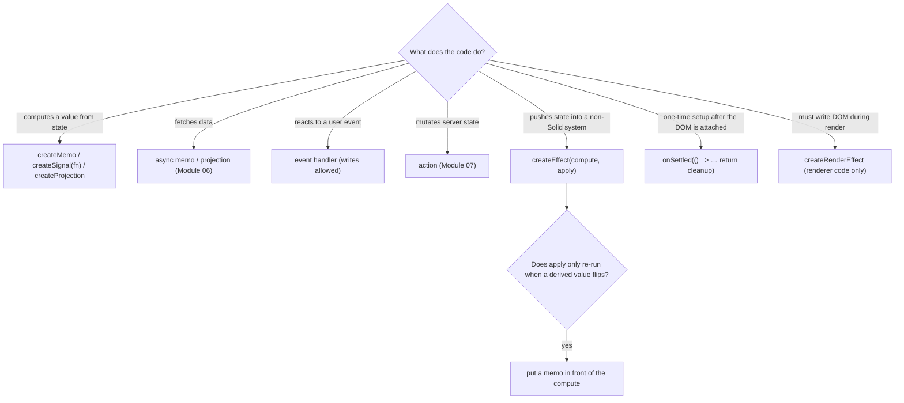

# Module 02 — Effects, Lifecycle and the Invariants That Keep the Graph Honest

> **Executable proof:** [`examples/typescript/02-effects-and-lifecycle.test.tsx`](../examples/typescript/02-effects-and-lifecycle.test.tsx). Every claim marked "proved" below is an assertion in that suite, run against `solid-js@2.0.0-rc.19` (development build, so diagnostics are live).

[Module 01](./01-reactive-core.md) built the pure part of the graph: sources and computations. This module covers the *impure* edge of the graph, where reactive values leave the system as DOM writes, network calls, timers and logs. Solid 2.0 redesigned this edge more than anything else: effects are split into two halves, lifecycle hooks were renamed and narrowed, and a set of dev-mode diagnostics now enforce the rules that 1.x left to discipline.

---

## 1. Why split an effect?

A 1.x effect was one function: `createEffect(() => { el.title = count(); })`. Every read anywhere in the body became a dependency, and the side effect ran in the same breath as the tracking. That shape has three problems the 2.0 RFC 01 names explicitly:

1. **No dependency picture before side effects.** Effects ran interleaved, so effect A could perform a side effect based on a value that effect B's tracking was about to change.
2. **Async cannot be held.** If a dependency is still loading, the runtime must be able to *not run* the side effect yet. With one function, it cannot know the dependencies without running the side effect.
3. **Accidental tracking.** A signal read inside a helper called from the effect silently became a dependency.

2.0 splits every effect into a **compute** half and an **apply** half:

```ts
createEffect(
  () => count(),                // compute: tracked, pure, runs during the flush's compute pass
  (value, prev) => {            // apply: untracked, imperative, runs after ALL compute halves
    el.title = String(value);
    return () => { /* cleanup before the next apply and on disposal */ };
  },
);
```

### 1.1 Formal contract

For an effect $e$ with compute $c_e$ and apply $a_e$:

- $c_e$ is a computation in the sense of Module 01: tracked, must be pure, may not write (`REACTIVE_WRITE_IN_OWNED_SCOPE`).
- $a_e$ is called with $(v, v_{prev})$ where $v = c_e(\ldots)$. It is **untracked**: reads inside it do not subscribe (proved: a write to a signal read only in apply does not re-run the effect).
- In one flush, *all* compute halves run (in topological order) before *any* apply half runs. So every apply sees the same committed state $\sigma_{k+1}$.
- If $a_e$ returned a function $k$ last time, $k$ runs before the next $a_e$ and when the owner is disposed. Returning anything other than a function or `undefined` throws ("invalid cleanup value").
- **Effects never compare.** Whenever $c_e$ re-runs, $a_e$ (and the previous cleanup) runs, *even if* $c_e$ returned a value equal to the last one.

The last rule surprises everyone who knows memos. Proved in the suite: with compute `() => status() !== "off"`, changing `status` from `"active"` to `"busy"` returns `true` twice, and the log shows `start true, stop, start true`: a timer started in apply would be torn down and restarted. The fix is to put a memo in front and read it in compute; the memo's equality cut-off stops the re-run (proved: log stays `["start true"]`).

```ts
const active = createMemo(() => status() !== "off");
createEffect(() => active(), (isActive) => { /* runs only when `active` flips */ });
```

### 1.2 Timeline of one flush

```mermaid
sequenceDiagram
  participant H as Event handler
  participant Q as Scheduler (microtask)
  participant C as Compute halves (memos, effect computes)
  participant R as Render effects (DOM bindings)
  participant U as User effects (apply halves)
  participant S as onSettled callbacks
  H->>Q: setA(1); setB(2)  (staged, flush scheduled)
  Note over H: a(), b() still return committed values
  Q->>C: commit, recompute dirty nodes by height
  C-->>Q: values + dependency sets for this commit
  Q->>R: apply render-effect halves (DOM updated)
  Q->>U: cleanup(prev) then apply(next, prev)
  Q->>S: run callbacks whose async work has settled
```

`createRenderEffect` uses the same split, but its apply runs during the render phase and **synchronously at creation** (proved: `render a` is logged before any flush, `user a` only after). That is what the JSX compiler uses for DOM bindings, so DOM nodes are correct before user effects run. App code should use `createEffect`; reach for `createRenderEffect` only when writing renderer-level bindings (custom directives that must write the DOM during render).

> **Terminology note.** Earlier drafts of this track called these the "render lane" and "user lane". That is not Solid's vocabulary: in the 2.0 runtime a *lane* is an optimistic transaction overlay ([Module 07](./07-actions-and-optimistic-state.md)). The correct terms are **render effects** and **user effects** (two effect queues), which is what the RFCs and type docs use.

### 1.2.1 Inside the scheduler

An effect is a computed node with a type tag: `EFFECT_RENDER = 1` or `EFFECT_USER = 2` (constants in `@solidjs/signals`). Its compute half lives in the dirty heap like any memo ([Module 01 §2.2](./01-reactive-core.md#22-the-rc19-implementation-annotated)); when the compute finishes, the apply half is not called directly but **enqueued** on the queue for its type. After the heap drains and staged values commit, `GlobalQueue.flush()` runs `this.run(EFFECT_RENDER)` and then `this.run(EFFECT_USER)`. Two consequences proved in the suite:

- **Queue order beats creation order.** An effect created *before* a render effect still applies *after* it (`["render 1", "user 1"]`).
- **Apply waits for readiness.** If the compute half read a pending async value, the node is not ready and its apply is not enqueued; it runs once the value lands (proved: no `apply` until the deferred resolves, then `apply 7`). Effects therefore never act on half-loaded data; this is what lets async holds work ([Module 06](./06-colorless-async.md)).

Render effects are different at **creation**: they run their compute *and* apply immediately so the DOM node is correct before it is inserted. `render()` creates its root insert with `schedule: true`, which instead enqueues the initial run so a root that reads async data can wait inside a transition.

```mermaid
stateDiagram-v2
  [*] --> Computing: created (compute runs; render effects also apply now)
  Computing --> Queued: compute returned a value
  Computing --> Waiting: compute read a pending async value
  Waiting --> Computing: the value lands (re-run)
  Queued --> Applied: flush step 5/6 — previous cleanup, then apply(next, prev)
  Applied --> Computing: a dependency changed
  Applied --> Disposed: owner disposed → last cleanup
  Computing --> Errored: compute threw
  Errored --> Applied: error arm ran (EffectBundle)
  Errored --> Computing: dependency changed (retry)
```



### 1.3 Options

| Option | Effect | Proved |
|---|---|---|
| `defer: true` | skip the initial apply; run on the first change | yes |
| `name` | label in diagnostics, DevTools tracks and owner paths | — |
| `schedule: true` | enqueue the initial run instead of running at creation, so the first apply can wait on async (used by `render()`'s root insert) | — |
| `sync: true` | promise that compute never returns a Promise/AsyncIterable; returning one is `SYNC_NODE_RECEIVED_ASYNC` | — |
| `transparent: true` | hydration-id-invisible effect for client-only effects created during hydration ([Module 08](./08-ssr-and-start-mode.md)) | — |

The compute half receives its previous value. The 1.x `initialValue` argument is gone; use a default parameter: `createEffect((prev = 0) => …, apply)` (proved: first `prev` is the default `100`, second is `1`).

### 1.4 Error handling: the `EffectBundle`

Errors from the compute half (including rejected async sources upstream) have no stack frame you control, so 2.0 gives effects an **error arm**:

```ts
createEffect(() => fetchData(id()), {
  effect: (data) => render(data),
  error: (err, cleanup) => report(err),
});
```

Semantics from the `createEffect` JSDoc and RFC 01:

- `error` runs on the same schedule and in the same writable, untracked scope as `effect`, and only for *settled* errors: a transient error that recovers before the effect phase never reaches it.
- Without an `error` handler, a compute-phase error is logged and that run is skipped. A failing non-render effect does not crash the app.
- Rethrowing from `error` escalates to the nearest `<Errored>` boundary ([Module 06](./06-colorless-async.md)), or halts the system if there is none.
- **Apply-phase throws are different.** They are your imperative code; use `try/catch` there. An uncaught apply throw goes to the nearest `<Errored>`, and with no boundary the whole reactive system halts (`REACTIVITY_HALTED`): no further updates are processed. The suite calls `resetErrorHalt()` after each test for exactly this reason; in an app, a halt means "crash", so put an `<Errored>` boundary near the root.

### 1.5 Writes from the apply half

The apply half is an *unowned* scope, so writes are legal there (proved: an effect mirroring `source * 2` into another signal). They are queued into the same flush's continuation: dependants update before the flush returns, but the apply half's own reads keep returning settled values. This is legal, not wise. An effect that copies one signal into another is a **relay**, and the attribution engine reports it (`EFFECT_RELAY_TEAR`: the reader runs twice for one root change, once with the stale relay value). Derive with a memo instead.

### 1.6 Effect patterns catalogue

Most effects in real apps fall into a handful of shapes. Each one below is written the 2.0 way; the comments name the bug the shape avoids.

**Synchronise an external system with state** (DOM outside Solid, a chart library, `document.title`):

```ts
createEffect(
  () => ({ title: props.title, count: unread() }),        // read everything in compute
  ({ title, count }) => { document.title = count ? `(${count}) ${title}` : title; },
);
```

**Own a resource per value** (join a room, open a subscription): return the teardown; it runs before the next apply and on disposal. Proved by "pattern: an apply half that owns an external resource": rooms `a` then `b` are opened and both are closed, in order.

```ts
createEffect(() => room(), (r) => { socket.join(r); return () => socket.leave(r); });
```

**Persist state**: subscribe to everything with `deep` in compute, write in apply.

```ts
createEffect(() => deep(settings), (plain) => localStorage.setItem("settings", JSON.stringify(plain)));
```

**Imperative widget with an element**: create the widget once in `onSettled` (element attached), feed it changes from an effect.

```ts
let el!: HTMLDivElement, chart: Chart | undefined;
onSettled(() => { chart = new Chart(el); return () => chart!.destroy(); });
createEffect(() => snapshot(series), (data) => chart?.update(data));
```

**Fetching is not an effect.** `createEffect(() => id(), async (id) => setUser(await api(id)))` is the 1.x/React reflex. It loses cancellation, error routing, `<Loading>` integration and SSR serialization, and writes from a stale response can overwrite a newer one. Use an async memo ([Module 06](./06-colorless-async.md)).

**Derived state is not an effect.** `createEffect(() => a() + b(), (sum) => setTotal(sum))` is a relay: readers of `total` run twice per change, the second time torn. Use `createMemo`. The attribution engine reports it as `EFFECT_RELAY_TEAR` ([Module 09](./09-testing-debugging-performance.md)).

**Never create primitives in apply.** The apply half is unowned, so a memo or effect created there could never be disposed; rc.19 throws `PRIMITIVE_IN_EFFECT_CALLBACK` (proved). Create primitives in the component body, or create a nested root in the body and drive it from the effect.

### 1.7 Choosing where code goes



Rule of thumb from the RFCs: **effects are for leaving the reactive system**. If the result of the code goes back into a signal or store, it is not an effect.

## 2. Specialised effects

| Primitive | Shape | Use it for | Status |
|---|---|---|---|
| `createEffect(compute, apply)` | split | everything in app code | canonical |
| `createRenderEffect(compute, apply)` | split, render phase, sync at creation | renderer plumbing, custom DOM bindings | advanced |
| `createReaction(effectFn)` | returns `track(fn)`; fires **once** per arm | "notify me the next time X changes", custom primitives | advanced |
| `createTrackedEffect(fn)` | single callback, tracks inside it | 1.x migration only | **`@deprecated` in rc.19** |

`createReaction` is one-shot: after it fires, it does nothing until you call `track(...)` again (proved: second change logs nothing; after re-arming, the next change logs). Re-arming inside the callback gives a continuous listener with explicit control over what is tracked each time.

`createTrackedEffect` is marked `@deprecated` in the rc.19 type declarations ("Do not use in new code"). It runs beside user effects after values commit, never holds a transition, cannot observe a write staged earlier in the same flush by a signal it has not read yet, and may run several times for one change or tear. It survives only to ease 1.x migration. Inside it you cannot create primitives (`PRIMITIVE_IN_FORBIDDEN_SCOPE`), call `onCleanup` (`CLEANUP_IN_FORBIDDEN_SCOPE`) or call `flush()`.

## 3. Lifecycle

### 3.1 `onSettled` — the canonical lifecycle primitive

`onSettled(fn)` schedules `fn` once, **after the reactive graph has settled**: every pending async read inside the current owner has resolved and the queue has flushed. If `fn` returns a function, it runs when the owner is disposed (proved: `body → settled → teardown`).

```tsx
function useViewportWidth() {
  const [width, setWidth] = createSignal(window.innerWidth);
  onSettled(() => {
    const onResize = () => setWidth(window.innerWidth);
    window.addEventListener("resize", onResize);
    return () => window.removeEventListener("resize", onResize);
  });
  return width;
}
```

Three usages:

1. **Setup and teardown in a component** (most common): replaces 1.x `onMount` + `onCleanup` with one block.
2. **"Ready" hook**: analytics, focus, scroll-into-view, layout measurement after the first stable render. Unlike a ref callback, `onSettled` runs after the element is attached, so `getBoundingClientRect()` returns real numbers (refs run *before* attachment; see [Module 03](./03-components-props-and-dom.md)).
3. **Inside an event handler**: run work after the transition the event started has settled, for example `save(); onSettled(() => toast("Saved"))`.

Rules (proved where noted):

- Reads inside `fn` are untracked. It fires once; register again to react to later settles.
- Writes are legal (proved: `setReady(true)` inside `onSettled`) and land in the same flush's continuation.
- `onCleanup` inside it throws `CLEANUP_IN_FORBIDDEN_SCOPE` (proved). Return the cleanup instead.
- Creating primitives inside it throws `PRIMITIVE_IN_FORBIDDEN_SCOPE` (proved). Create them in the component body and use them inside.
- A cleanup return is honoured only in an **owned** scope. Returning one from an out-of-band `onSettled` (event handler, nested `onSettled`) is `SETTLED_CLEANUP_UNOWNED`.
- Reading a pending async value inside it throws (`PENDING_ASYNC_FORBIDDEN_SCOPE` warns ahead of time), because it cannot suspend to a `<Loading>` boundary.

#### How `onSettled` decides "settled"

`onSettled(fn)` registers `fn` on the current owner (or, with no owner, on the current interaction). The scheduler fires it at the end of a flush in which **no pending async work remains under that owner and no hold involving it is open**. In an event handler there is no owner, so the callback is tied to whatever the handler's writes started: proved, `onSettled` registered right after `save()` runs only after the action's generator finished (`["action done", "settled"]`). Its returned cleanup needs an owner to bind to; from an event handler that is `SETTLED_CLEANUP_UNOWNED` (proved). One-shot work (a toast, a focus) needs no cleanup and is fine there.

### 3.2 `onCleanup` — reactive cleanup, not lifecycle

`onCleanup(fn)` registers `fn` on the current owner; it runs before that owner re-runs and when it is disposed. In 2.0 it is a **library/primitive tool**: per-run teardown inside a computation (an `AbortController` for an async memo, [Module 06](./06-colorless-async.md)), or wiring disposal into a captured owner. For component lifecycle, use `onSettled` with a returned cleanup. Outside any owner it is a no-op and warns `NO_OWNER_CLEANUP` (proved).

### 3.3 `onFlush` — keep a write out of someone else's hold

Writes made in the same synchronous frame commit together. If one of them starts async work (a navigation), the others are **held** with it ([Module 07](./07-actions-and-optimistic-state.md)). A menu that calls `setOpen(false)` and then `props.onSelect(id)` stays open while the consumer's navigation loads. `onFlush(fn)` runs `fn` once right after the pending flush, in the same microtask checkpoint, so its writes are their own update:

```tsx
const select = (id: string) => {
  onFlush(() => setOpen(false)); // closes now, whatever onSelect does
  props.onSelect?.(id);
};
```

Proved in the suite: the callback has not run synchronously, runs after the scheduled microtask flush, sees the frame's inline write (`n=1`), and its own write lands. In rc.19 an explicit `flush()` does not run pending `onFlush` callbacks; they run with the scheduled flush (observed while writing the suite, not a documented guarantee). Call it from event handlers and effect callbacks. In an owned scope it still runs but warns `ON_FLUSH_IN_OWNED_SCOPE` (proved). `queueMicrotask` is not a substitute: queued before the frame's first write, it runs *before* that flush and its write joins the hold.

## 4. Invariants enforced in development

The 2.0 dev build turns the rules of Modules 01–02 into coded diagnostics. Each has a severity: **error** (throws), **warn** (`console.warn`), or **info** (structured channel only). Each prints `[CODE] message`, an `in <App> › <Child> › effect` owner path and, when the compiler recorded locations, an `at src/File.tsx:18:3` line. The first report of a code links to `https://v2.solidjs.com/reference/solid-js/diagnostics/<code>` and to the `reactivity-diagnostics` skill shipped in `node_modules/solid-js/skills/`.

| Code | Severity | Fires when | Fix | Proved |
|---|---|---|---|---|
| `REACTIVE_WRITE_IN_OWNED_SCOPE` | error | a signal/store write or `refresh()` inside a component body, memo, effect compute or root body | write from a handler, apply half, `onSettled` or action; derive instead of writing back | M01 suite |
| `STRICT_READ_UNTRACKED` | warn | a reactive read at the top of a component body, in a flow-control callback body, or a store-proxy read in an apply half | read in JSX / a memo / compute; `untrack` for an intentional one-time read | yes (3 tests) |
| `MISSING_EFFECT_FN` | error | `createEffect(fn)` with one argument | add the apply half, or use `createMemo` | yes |
| `CLEANUP_IN_FORBIDDEN_SCOPE` | error | `onCleanup` inside `onSettled` / `createTrackedEffect` | return a cleanup | yes |
| `PRIMITIVE_IN_FORBIDDEN_SCOPE` | error | a primitive created inside `onSettled` / `createTrackedEffect` | create it in the body | yes |
| `SETTLED_CLEANUP_UNOWNED` | error | an out-of-band `onSettled` returned a cleanup | call setup from an owned scope | — |
| `ON_FLUSH_IN_OWNED_SCOPE` | warn | `onFlush` in a body/computation | `onSettled` | yes |
| `FLUSH_IN_EFFECT_CALLBACK` | warn | `flush()` inside an apply half (no-op) | `queueMicrotask(() => flush())` if you really must | yes |
| `NO_OWNER_EFFECT` / `NO_OWNER_CLEANUP` / `NO_OWNER_BOUNDARY` | warn | primitive created with no owner | create under a root/component | yes (2) |
| `RUN_WITH_DISPOSED_OWNER` | warn | `runWithOwner` with a disposed owner | check lifetimes | — |
| `REACTIVITY_HALTED` | error | an error escaped every boundary; scheduling stops for good | add `<Errored>`; treat as a crash | — |

Two notes on `STRICT_READ_UNTRACKED`:

- It fires for **component bodies**, not for `createRoot` bodies; a root body is library/test code where one-time reads are normal.
- It is the runtime twin of the most common Solid bug: destructuring props. `function Title({ title })` reads `props.title` once at setup; the warning tells you the binding will never update ([Module 03](./03-components-props-and-dom.md)).

All diagnostics are stripped from production builds. They are also available programmatically: `OBSERVE.diagnostics.capture()` / `.subscribe()` (exported by `solid-js`; `OBSERVE` is `undefined` in production). The suite's [`support/diagnostics.ts`](../examples/typescript/support/diagnostics.ts) is a ten-line wrapper over `capture()`. The `@solidjs/diagnostics` package builds Vitest matchers and an agent bridge on the same channel ([Module 09](./09-testing-debugging-performance.md)).

### 4.1 How the diagnostics pipeline works

```mermaid
flowchart LR
  Site["guard site in the runtime (dev/observe build)"] -->|emitDiagnostic(event)| Chan["OBSERVE.diagnostics channel"]
  Chan --> Cap["capture() / subscribe() consumers (tests, @solidjs/diagnostics, devtools)"]
  Chan --> Con["console report: [CODE] message + owner path + at file:line + footer"]
  Site -->|severity error| Throw["throw Error('[CODE] …')"]
  Comp["@solidjs/compiler sourceNames"] -. names, locations .-> Site
```

- Every guard builds a structured event: `code`, `kind`, `severity`, `message`, `ownerId`/`ownerName`/`nodeName`, `ownerPath` (root-first chain like `["<App>", "<TodoRow>", "effect"]`) and `loc` (`src/File.tsx:18:3`).
- **Names come from the compiler.** In dev builds `@solidjs/compiler`'s `sourceNames` option (on by default in dev, and in `observe` builds through the Vite plugin) emits the component tag as `createComponent(Home, props, "Home", "src/App.tsx:12:5")` and labels binding effects (`span.textContent`). Without it, owner paths fall back to function names that minifiers destroy.
- **Errors still throw.** The event is recorded first and then the site throws, so a test can assert both the thrown message and the captured code.
- **Tiers.** Development: guards + console + channel. Observe: channel only (no dev guards; the attribution findings can be enabled). Production: nothing; the guard code is compiled out (proved in Module 09 by spawning Node with each condition set).

### 4.2 Failure modes proved by negative tests

| Failure | Test (`02-effects-and-lifecycle.test.tsx`) |
|---|---|
| single-argument effect | "single-argument createEffect is MISSING_EFFECT_FN" |
| apply returns a non-function | "returning a non-function from an apply half…" → system halts (`REACTIVITY_HALTED`) |
| cleanup with no owner | "onCleanup with no owner warns NO_OWNER_CLEANUP" |
| unowned `onSettled` cleanup | "…SETTLED_CLEANUP_UNOWNED" |
| `onCleanup` / primitives inside `onSettled` | `CLEANUP_IN_FORBIDDEN_SCOPE`, `PRIMITIVE_IN_FORBIDDEN_SCOPE` |
| `flush()` inside an apply | `FLUSH_IN_EFFECT_CALLBACK` (no-op) |
| top-level prop read / store proxy read in apply | `STRICT_READ_UNTRACKED` (3 tests) |
| `onFlush` in a body | `ON_FLUSH_IN_OWNED_SCOPE` |

## 5. Then vs now

| 1.x (≤ 1.9) | 2.0 RC | Why it changed | Migration |
|---|---|---|---|
| `createEffect(() => { el.title = t(); })` | `createEffect(() => t(), (v) => { el.title = v; })` | dependency picture before side effects; async holds | move every read into compute; return plain values, not store proxies |
| `createEffect(on(dep, fn, { defer: true }))` | `createEffect(() => dep(), fn, { defer: true })` | split effects make explicit deps the default | delete `on` |
| `onMount(fn)` + `onCleanup(c)` | `onSettled(() => { fn(); return c; })` | async-aware ("after settle"), one block for setup/teardown | replace; remember refs run before attach |
| `createEffect` with `initialValue` | default parameter on compute | `prev` is just the previous return | `(prev = x) => …` |
| `onError` / `catchError` | effect `error` arm, `<Errored>` | errors flow through the graph | see Module 06 |
| writes anywhere | no writes in owned scope (dev error) | prevents feedback loops and order dependence | move writes to handlers / `onSettled` |
| `createComputed` | removed | see Module 01 | `createMemo` / `createSignal(fn)` / split effect |

### 5.1 Then vs now: lifecycle timing

| | 1.x | 2.0 RC |
|---|---|---|
| `onMount` / `onSettled` timing | after the component's first render was inserted (synchronously after mount, before async data) | after the owner's work has **settled**, including pending async reads under it |
| Effect timing vs DOM | effects queued after render; `createRenderEffect` ran during render | same split, but effects never apply over not-ready data (they wait) |
| Effect created during an effect | allowed (nested effects owned by the effect) | apply halves are unowned: creating a memo/effect/root there throws `PRIMITIVE_IN_EFFECT_CALLBACK` |
| Error in effect | `onError`/`catchError` around it | `error` arm or `<Errored>`; uncaught apply errors halt the system |

Migration consequence: code that used `onMount` to read a resource's value that "was usually there" now runs only when it is actually there, which can delay analytics or focus calls on slow networks. That is the intended behaviour; if you need "as soon as the DOM exists", use a ref callback (DOM present, not attached) or `onSettled` on a sub-tree that does not read the slow data.

**Pitfall when mixing:** a mechanical rewrite `createEffect(() => { doX(a()); })` → `createEffect(() => {}, () => doX(a()))` compiles, but tracks nothing: `a()` now sits in the untracked apply half and the effect never re-runs. The read must move to compute.

## 6. Production failure modes

| Symptom | Cause | Fix |
|---|---|---|
| Interval/subscription restarts on unrelated updates | effects never compare; compute returned an equal value | memo in front of the compute |
| Effect never re-runs after migration | reads left in the apply half | move reads to compute |
| Analytics fire with stale values | store proxy passed from compute and read in apply (`STRICT_READ_UNTRACKED`) | extract plain values in compute, or `deep(store)` |
| Whole UI frozen after one error | uncaught apply throw → `REACTIVITY_HALTED` | `<Errored>` near the root; `try/catch` in apply |
| Layout measurement returns zeros | measured in a ref callback (element not yet attached) | measure in `onSettled` |
| Menu stays open during a navigation | its close write was held with the navigation | `onFlush(() => setOpen(false))` |
| Effect runs twice per click | `flush()` called mid-handler | remove it; let the microtask flush |
| Listener leaks in tests | effect created at module scope (`NO_OWNER_EFFECT`) | create under `createRoot`, dispose in teardown |

---

## Interview Drill

<details><summary>1. Why does Solid 2.0 split effects into compute and apply halves?</summary>

So the runtime knows every effect's dependencies before running any side effect. All compute halves of a flush run first against one committed snapshot, then all apply halves run. That rules out effects acting on half-updated state, lets async dependencies hold an effect (the compute can say "not ready" before any side effect happens), and stops accidental tracking because the apply half is untracked.
</details>

<details><summary>2. "Effects never compare." What does that mean and how do you avoid needless re-runs?</summary>

When the compute half re-runs, the apply half and the previous cleanup run even if compute returned an equal value. Memos compare (`equals`, default `===`), effects do not. Put a `createMemo` in front of the effect and read the memo in compute; the memo's cut-off stops the effect from being scheduled at all.
</details>

<details><summary>3. What's the difference between `createEffect` and `createRenderEffect`?</summary>

Same split shape. `createRenderEffect` runs its apply during the render phase, synchronously at creation and before user effects, and it is what compiled JSX bindings use. `createEffect` runs its apply after all compute halves, in the user-effect queue. App code uses `createEffect`; render effects are for renderer plumbing.
</details>

<details><summary>4. Where can you write to a signal, and where can't you?</summary>

Can: event handlers, effect apply halves (including `error`), `onSettled`, `onFlush` callbacks, actions, and any code outside an owner. Cannot: component bodies, memos, effect compute halves, root bodies (`REACTIVE_WRITE_IN_OWNED_SCOPE`). `untrack` does not help; `ownedWrite: true` is the explicit opt-in for internal state.
</details>

<details><summary>5. Replace `onMount` + `onCleanup` in 2.0 and explain the timing difference.</summary>

`onSettled(() => { setup(); return teardown; })`. `onSettled` waits until the graph has settled (pending async under the owner resolved, queue flushed), so it is "after first stable render", not just "after insertion". The returned function runs on owner disposal. `onCleanup` inside it is an error.
</details>

<details><summary>6. A compute half throws. What happens with and without an `error` arm? What about an apply-half throw?</summary>

With an `EffectBundle` `{ effect, error }`, settled compute errors go to `error`, which can write state or rethrow to escalate. Without one, the error is logged and the run skipped. An apply-half throw is application code: it goes to the nearest `<Errored>` boundary, and with none the reactive system halts permanently (`REACTIVITY_HALTED`).
</details>

<details><summary>7. When would you use `createReaction`?</summary>

When you need "tell me once when this changes" with explicit control over what is tracked: custom primitives, imperative integrations, or a listener that re-arms itself with a different tracking function each time. It fires once per arm.
</details>

<details><summary>8. What problem does `onFlush` solve that `queueMicrotask` doesn't?</summary>

Writes in one synchronous frame commit together, and if one starts async work, the others are held with it. `onFlush` runs its callback after the pending flush, so a write there (closing a menu) is its own update and is not held by the consumer's navigation. A `queueMicrotask` queued before the frame's first write runs before that flush, so its write joins the hold.
</details>

<details><summary>9. Why is `createTrackedEffect` deprecated?</summary>

It tracks inside the same callback that performs side effects, so it cannot know its dependencies before acting, cannot hold a transition, may run several times for one change, and can tear. It exists only to ease 1.x migration. `createEffect` (react to state) and `onSettled` (one-time post-render DOM work) cover its uses.
</details>

<details><summary>11. Why can't an effect's apply half create a memo?</summary>

The apply half runs unowned (it is imperative code, like an event handler). A primitive created there would have no owner to dispose it, so rc.19 throws `PRIMITIVE_IN_EFFECT_CALLBACK`. Create primitives in the component body and only use them in apply.
</details>

<details><summary>12. In one flush, in what order do render effects and user effects apply, and why?</summary>

All render-effect applies (DOM bindings) run, then all user-effect applies, regardless of creation order. User code should observe a DOM that already reflects the committed state.
</details>

<details><summary>10. How would you assert in a unit test that a component does not read props at the top level?</summary>

Render it in the dev build and capture diagnostics with `OBSERVE.diagnostics.capture()`: a top-level read emits `STRICT_READ_UNTRACKED`. The suite does exactly this; `@solidjs/diagnostics` offers matchers for the same channel.
</details>
