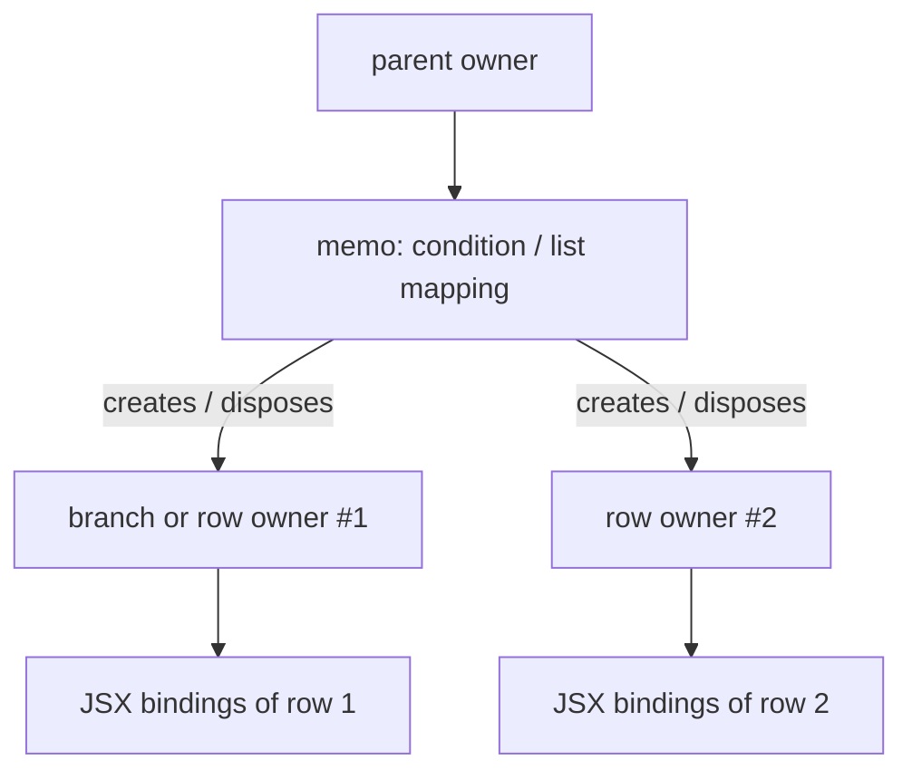
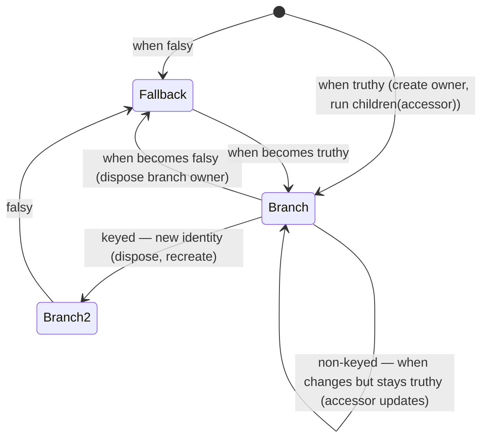
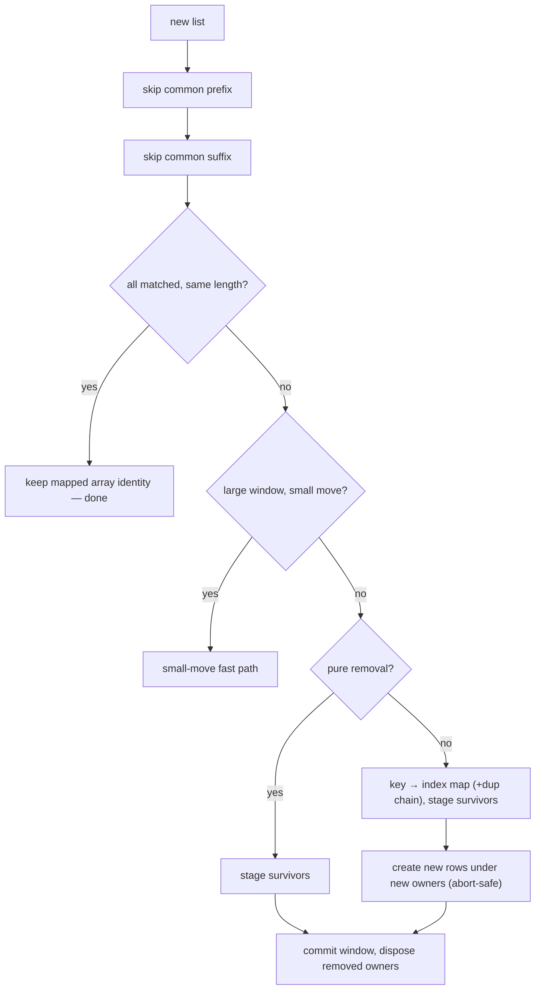

# Module 04 — Control Flow and Composition

> **Executable proof:** [`examples/typescript/04-control-flow-and-composition.test.tsx`](../examples/typescript/04-control-flow-and-composition.test.tsx) (18 tests, jsdom, real `solid-js@2.0.0-rc.19`).
>
> Async boundaries (`<Loading>`, `<Errored>`, `<Reveal>`) are control flow too, but they only make sense with async data, so they live in [Module 06](./06-colorless-async.md).

Because a component body runs once ([Module 03](./03-components-props-and-dom.md)), `if` and `array.map` in a body cannot react to later changes. Conditional and repeated structure is expressed with **control-flow components**: `<Show>`, `<Switch>/<Match>`, `<For>`, `<Repeat>`, plus composition tools (`dynamic`, `children`, `Portal`, context). They are not magic syntax. Each is an ordinary component built from memos and owners, and understanding that construction explains every rule in this module.

---

## 1. The anatomy of a control-flow component

A control-flow component is a memo over its condition (or list) plus a set of **owned sub-trees** (branches or rows):



Three consequences:

1. **Branches and rows have lifetimes.** When a row leaves the list or a `<Show>` turns falsy, its owner is disposed: its effects stop, its cleanups run, its DOM is removed.
2. **The callback you pass runs once per branch/row creation.** Its body is the setup function of a small component.
3. **The callback body is an owner, not a tracking scope.** Reads at the top of the callback are untracked, exactly like a component body. Only reads inside JSX, memos or effect computes track.

Rule 3 is the most common control-flow bug in 2.0. Proved in the suite: with `const frozen = item()` at the top of a non-keyed `<For>` callback, after the list changes the row renders `a|b`, the frozen half stuck on the initial value, and the dev build emits `STRICT_READ_UNTRACKED`. The same holds for `<Show>` and `<Match>` function children.

### 1.1 What `<Show>` actually is

`<Show when fallback keyed>` is a memo over `when` with an equality chosen by the mode:

- **non-keyed**: the memo compares **truthiness** (`!!when`). While it stays truthy, the branch owner lives and the child receives an accessor that tracks the current `when` value. Falsy → the branch owner is disposed and the fallback is created.
- **keyed**: the memo compares **identity**. Any new value disposes the branch and creates a new one with the raw value.



`<Switch>` is one memo over the ordered list of `<Match>` conditions that yields the index of the first truthy one; the selected `<Match>` behaves like a `<Show>` branch.

## 2. `<For>`: one list primitive, three keying modes

2.0 merges 1.x `<For>` and `<Index>` into one `<For>` with a `keyed` prop. The callback's *shape* depends on the mode, and each argument is an accessor exactly when it can change for a preserved row:

| Mode | When to use | `item` | `index` | A row is preserved when… | Proved |
|---|---|---|---|---|---|
| default / `keyed={true}` | lists of objects with stable identity | **raw value** | **accessor** `i()` | the same object (===) is still in the list; it may move | rows move with their item; DOM node identity preserved; a new object with equal data re-creates the row |
| `keyed={false}` | primitives, or data replaced wholesale where slot reuse is cheaper | **accessor** `item()` | **number** `i` | the slot index exists | slots reused, item accessors updated |
| `keyed={(t) => t.id}` | data re-fetched as new objects with stable ids | **accessor** | **accessor** | the extracted key is still present | new object with the same key keeps the row |

```tsx
<For each={todos()}>{(todo, i) => <Row todo={todo} index={i()} />}</For>
<For each={names()} keyed={false}>{(name, i) => <Row name={name()} index={i} />}</For>
<For each={todos()} keyed={(t) => t.id} fallback={<Empty />}>{(todo) => <Row todo={todo()} />}</For>
```

Avoid a *dynamic* boolean `keyed` (`keyed={mode()}`): the callback shape is mode-specific. Use a literal or a key function.

### 2.1 How keyed mapping works

`<For>` is a thin wrapper over `mapArray(list, mapFn, { keyed, fallback })`, exported for custom list components (proved: `mapArray` maps `[1,2] → [10,20]` and re-maps after a change). A keyed mapping is a classic *list reconciliation* problem. The model below is a simplified version of the algorithm family Solid uses (prefix/suffix trimming plus a key→index map); it is not a transcription of the rc.19 source.

```text
KEYED-MAP(old, new, rows)                 -- old/new: arrays of keys, rows: key → row owner
  start := 0
  while start < |old| and start < |new| and old[start] = new[start]:   -- common prefix
      start := start + 1
  endO := |old| - 1; endN := |new| - 1
  while endO ≥ start and endN ≥ start and old[endO] = new[endN]:       -- common suffix
      endO := endO - 1; endN := endN - 1
  index := map from key to position for new[start..endN]
  for j := start to endO:                                               -- leaving rows
      if old[j] ∉ index: DISPOSE(rows[old[j]])
  for i := start to endN:                                               -- entering / moving rows
      if new[i] ∉ rows: rows[new[i]] := CREATE-ROW(new[i])              -- runs your callback
      else: UPDATE-INDEX(rows[new[i]], i)                               -- index accessor changes
  return rows ordered as new
```

Loop invariant (middle loop): every key in `new[start..i-1]` has exactly one live row whose index accessor equals its position. Prefix/suffix trimming makes the common cases (append, remove one, swap two) O(n) with few DOM moves; the DOM side then reorders existing nodes (`reconcileArrays` in `@solidjs/web`) instead of re-creating them. That is why the test can assert the *same* `<li>` node moved.

#### The real rc.19 `updateKeyedMap`, annotated

The model above is the textbook version. The shipped implementation (`@solidjs/signals`, `updateKeyedMap`) adds several production details worth knowing in an interview:

1. **Prefix skip** — walk from the start while old and new items are `===` (or equal by key). In custom-key mode the matched row's item accessor is updated (`write(rows[start], newItems[start])`).
2. **Suffix skip** — walk from the end the same way; matched rows are only *counted* and land at commit, to avoid copying twice.
3. **No structural change** — if every position matched at equal length (the usual result after `reconcile`), the mapped array **keeps its identity**, so downstream consumers do not re-run at all.
4. **Small-move fast path** — for large changed windows (> 64 items) that shrank or kept length, it probes whether the middle item moved by at most ±32 positions; if so, a specialised routine handles "drag one row" moves without building a key map. (The source notes it is a separate function so it does not deoptimise the general path; "measured 2x on reverse".)
5. **Pure removal** — a shrinking update is first tried as a removal-only pass (no key map).
6. **General path** — build `key → first new index` with a `next` chain for duplicate keys (scanned backwards so duplicates match in order: proved, two references to the same object get two rows and a shrink keeps the first), stage surviving rows at their new positions, queue the rest for disposal.
7. **Create, with strong abort** — each new row runs your callback under a fresh owner (`createOwner()` + `runWithOwner`). If any callback throws, only the rows created *in this pass* are disposed and the error propagates; nothing live was touched yet.
8. **Commit** — prefix and suffix copied, the window written in place, a fresh mapped array assigned (its new identity is the change signal), then removed rows' owners are **disposed** (proved: removing `"b"` runs `b`'s cleanup; disposing the list disposes the rest).



**Identity is the key.** In the default mode a fresh object with identical data is a different key, so the row is torn down and rebuilt (proved: `created` goes from 2 to 3). Re-fetched JSON arrives as fresh objects: use `keyed={(t) => t.id}` or reconcile the data into a store ([Module 05](./05-stores-and-projections.md)) so identities survive. The attribution engine flags the problem in dev as `UNSTABLE_LIST_IDENTITY`.

## 3. `<Repeat>`: ranges without diffing

`<Repeat count from fallback>` renders a callback `count` times. The child receives a **plain number**, because a slot's index never changes. There is no list to diff; changing `count` adds or removes slots at the end, and `from` shifts a window (proved: `012` → `567` → fallback `none`).

```tsx
<Repeat count={10}>{(i) => <Skeleton />}</Repeat>
<Repeat count={visible()} from={start()}>{(i) => <Row data={store.rows[i]} />}</Repeat>
```

Its intended partner is a **store**: the index is a stable lookup key and reactivity comes from fine-grained store reads (`store.items[i].name`), not from the index. That makes `<Repeat>` the natural primitive for skeletons and virtualised windows.

### 3.1 `repeat()` and windowing

`<Repeat>` is a thin wrapper over `repeat(count, map, { from, fallback })` from `solid-js`. When only `count` changes, existing entries are reused and only the tail is created or disposed; when `from` changes, the window shifts (proved: `012 → 567`). Because the index is a plain number, a row never needs to be told "your index changed"; the row's *data* changes through store reads.

A virtualised list is therefore three pieces:

```tsx
const [scrollTop, setScrollTop] = createSignal(0);
const first = createMemo(() => Math.floor(scrollTop() / ROW_HEIGHT));
const visible = createMemo(() => Math.ceil(viewportHeight() / ROW_HEIGHT) + 1);

<div style={{ height: `${store.rows.length * ROW_HEIGHT}px`, position: "relative" }}
     onScroll={(e) => setScrollTop(e.currentTarget.scrollTop)}>
  <Repeat count={Math.min(visible(), store.rows.length - first())} from={first()}>
    {(i) => <Row style={{ top: `${i * ROW_HEIGHT}px` }} name={store.rows[i].name} />}
  </Repeat>
</div>
```

Scrolling changes `from`; rows whose index leaves the window are disposed and new ones are created at the other end. With `<For>` over a sliced array, every scroll step would run the keyed diff over the slice.

## 4. Conditionals: `<Show>` and `<Switch>/<Match>`

`<Show when fallback keyed?>` renders its children while `when` is truthy.

- **Non-keyed function child** receives a **narrowed accessor**. The branch is kept while `when` stays truthy, even if the value changes (proved: `Ada → Grace` updates text with `mounts === 1`).
- **Keyed** (`keyed`) function child receives the **raw value**, and a change of identity remounts the branch (proved: `mounts === 2`). Use it when the branch must be rebuilt per entity (resetting local state), for example remounting an uncontrolled form.

`<Switch fallback>` renders the first `<Match when>` that is truthy (proved: a later `Match` whose condition is also true is never reached). `<Match>` children follow the same keyed/non-keyed rules as `<Show>`.

Early returns do not work in Solid: `if (!user()) return <Login />` runs once at setup. Use `<Show>`.

## 5. Dynamic components: the `dynamic()` factory

```tsx
import { dynamic } from "@solidjs/web";

function Field() {
  const Active = dynamic(() => (editing() ? Editor : Viewer));   // hoisted once per instance
  return <Active value={value()} />;
}
```

`dynamic(source)` returns a **stable `Component`** whose rendered implementation follows a reactive source. The source may return a component or a tag name (proved: `input` ↔ `textarea`). Props, children and refs flow through the normal JSX path.

Why a factory: the returned component's identity is stable, so it composes with `lazy()`, routers and polymorphic components, and the lifetime of the internal memo is explicit (where you call `dynamic` is where it lives). The source evaluation is shared by every mounted instance of the returned component.

**Then vs now.** 1.x had `<Dynamic component={…}>` and `createDynamic`. In 2.0 `createDynamic` is removed, and RFC 03 marks `<Dynamic component>` as **deprecated** (still exported, no runtime warning; the package cheatsheet calls it the "convenience form"). It works (proved), but every instance merges `component` into props, omits it again and builds a fresh factory. New code should hoist a `dynamic()`.

**Async sources** (a promise of a component) flow through `<Loading>` like any async read, with an SSR caveat: a client component function cannot be serialized for hydration (`DYNAMIC_ASYNC_COMPONENT`). Resolve the async data upstream and keep the source synchronous, or use `lazy()` when what you await is code ([Module 08](./08-ssr-and-start-mode.md)).

`dynamicComponent(source)` (exported by `solid-js`) is the same primitive for sources that only ever return components; it avoids retaining the element runtime that tag names need.

### 5.1 How `dynamic()` works

`dynamic(source)` creates a memo over `source` and returns a component. Each instance renders the current answer: a component is called under a fresh owner, a tag name goes through the element runtime (`spread`, namespace tables). When the answer's identity changes, the previous instance's owner is disposed and the new one created; props flow through unchanged.

Options from the rc.19 type docs:

| Option | Effect |
|---|---|
| `{ static: true }` | the source is called once, untracked, at `dynamic()` time; instances render it with no computation and no owner (hydration keys stay aligned). Use for constants |
| `isStatic(props, "as")` | true when the caller wrote a literal (`as="button"`, a data property) and false for an expression (a getter). Feed it to `static` so a polymorphic component pays nothing for the literal case (proved: `[true, false]` and both render correctly) |
| `{ deferStream: true }` | under SSR, hold the shell until an async source settles |

A tag that exists in both HTML and SVG (`a`, `title`, `style`, `script`) is created as HTML unless the instance passes `xmlns`.

### 5.2 Hydration-safe ids

`createUniqueId()` returns an id that is unique per instance and identical between the server render and the hydrating client, which is what `<label for>` / `aria-labelledby` need under SSR (proved: two instances, two ids, label wired). Do not use `Math.random()` or a module counter: the server and client would disagree and the hydrated DOM would point at the wrong element.

## 6. Composition helpers

### 6.1 `children()`

`props.children` is a getter: every read evaluates the children expression again, creating DOM again. `children(() => props.children)` resolves once into a memo and returns an accessor with `toArray()`. Proved: rendering `resolved()` twice still created each child once, and `toArray().length` drove an attribute. Use it whenever a component inspects, counts, wraps or re-orders its children.

### 6.2 `lazy()`

`lazy(() => import("./Heavy"))` returns a component that loads its code on first render and participates in `<Loading>` while the chunk loads. Pass `{ export: "Name" }` for a named export. Under SSR a `lazy()` load always holds the shell until the code has run ([Module 08](./08-ssr-and-start-mode.md)).

`lazyModule(() => import("./admin/routes"))` is the module-level sibling: a cached loader with `.preload()` (start the request on hover/intent) and `.peek()` (synchronous read of an already-loaded module, also during hydration). Preloading on intent is the cheapest latency win for code-split routes.

### 6.3 `Portal`

`<Portal mount={el}>` renders its children into another DOM node (default `document.body`) while keeping them in the *owner* tree of the place they were written: context, cleanup and event delegation follow the owner, not the DOM position (proved: a click inside a portal mounted outside the root still reaches its handler, because the portal registers its mount point as a listener container for its render root). `Portal` throws during SSR.

## 7. Context

Context passes values down the **owner tree**, not the DOM tree.

```tsx
const TodosContext = createContext<TodosCtx>();          // default-less: canonical
<TodosContext value={createTodos()}><TodoList /></TodosContext>   // the context IS the provider
const [todos, actions] = useContext(TodosContext);        // typed TodosCtx (no | undefined)
```

Semantics (proved):

- The context object is its own provider component (`<Ctx value>`); `Ctx.Provider` is gone.
- **Default-less form**: `useContext` outside a provider throws `ContextNotFoundError` (exported by `@solidjs/signals`). The type of `useContext` is `T`, so the 1.x `useX()` wrapper that throws on `undefined` is boilerplate now.
- **`undefined` means "not provided"** on both sides. `createContext<T | undefined>(undefined)` is still default-less, and `<Ctx value={undefined}>` counts as no provider; both throw. (Proved; note that under a provider the throw surfaces wrapped, with the `ContextNotFoundError` as its `cause`.) For an optional context use `null`: `createContext<T | null>(null)`.
- **Default form** `createContext("light")` returns the default outside any provider. Reserve it for primitive fallbacks: theme, locale, frozen config.

### 7.0 How lookup works

A provider stores its value on its **owner** (`setContext` on the owner record); `useContext` walks up the owner chain from the current owner and returns the first value it finds, or the default, or throws `ContextNotFoundError`. Consequences, all proved:

- Lookup follows the **owner tree, not the DOM tree**: a component rendered through a `Portal` into `document.body` still sees the provider it was written under.
- Nested providers **shadow** outer ones for their subtree only (`cs de cs`).
- Lookup cost is $O(\text{owner depth})$ per `useContext` call; call it once in the component body, not inside a hot binding.
- Context is captured by **owner**, so code that creates primitives after an `await` (no owner) cannot read context: capture the value (or the owner) before awaiting.

### 7.1 Context, not module scope, for state

RFC 02 and the package cheatsheet are explicit: *module scope is shared by every request in the same process*. A store created at module scope becomes shared server state the day SSR is turned on, leaking one user's data into another's render. Create state inside a provider component (one instance per request on the server) and pass it through context. Module scope is for constants and the `createContext` call itself. [Module 08](./08-ssr-and-start-mode.md) proves the leak with a server-side test.

## 7.2 Worked example: a headless Tabs component

Composition in Solid combines the pieces above: context for shared state (created per instance, so SSR-safe), `children()` to inspect slots, `<For>` keyed by id, and `dynamic()` for a polymorphic element.

```tsx
type TabsCtx = { active: () => string; select: (id: string) => void };
const Tabs = createContext<TabsCtx>();               // default-less: <Tab> outside <TabList> throws

export function TabList(props: { initial: string; as?: ValidComponent; children: Element }) {
  const [active, setActive] = createSignal(untrack(() => props.initial));
  const Root = dynamic(() => props.as ?? "div", { static: isStatic(props, "as") });
  return (
    <Tabs value={{ active, select: setActive }}>       {/* state lives in the instance, not module scope */}
      <Root role="tablist">{props.children}</Root>
    </Tabs>
  );
}

export function Tab(props: { id: string; children: Element }) {
  const tabs = useContext(Tabs);                       // read once in the body: O(depth) lookup
  return (
    <button
      role="tab"
      aria-selected={tabs.active() === props.id}      // binding: tracked
      class={{ active: tabs.active() === props.id }}
      onClick={() => tabs.select(props.id)}           // stable handler; decision inside
    >
      {props.children}
    </button>
  );
}
```

Imports: `createContext`, `useContext`, `createSignal`, `untrack`, `isStatic` and the `Element` type from `solid-js`; `dynamic` and the `ValidComponent` type from `@solidjs/web`.

Review checklist for the example: no destructured props; `props.initial` read with `untrack` (intentional one-time read, no `STRICT_READ_UNTRACKED`); the handler is stable; the selected state is per-`TabList` instance; `aria-selected` is a boolean attribute (presence/absence). With 10 000 tabs the `active() === id` comparison would be the O(n) selection problem from [Module 05 §4.1](./05-stores-and-projections.md#41-o1-selection); swap in a selection projection.

### 7.3 Failure modes proved by negative tests

| Failure | Test (`04-control-flow-and-composition.test.tsx`) |
|---|---|
| reading an accessor at the top of a row callback | "the callback body is an owner, not a tracking scope" (`STRICT_READ_UNTRACKED`) |
| new identities rebuild rows | "default (keyed by identity)…" (`created` 2 → 3) |
| missing provider | `ContextNotFoundError` (default-less form) |
| `undefined` as a provider value | "undefined means 'not provided'…" |
| resources left behind by removed rows | "a removed row's owner is disposed: its cleanups run" (shows the mechanism you must hook into) |

## 8. Then vs now

| 1.x (≤ 1.9) | 2.0 RC | Migration notes |
|---|---|---|
| `<For>` (keyed by reference) + `<Index>` (by index) | `<For>` with `keyed`; `<Index>` removed | `<Index>` → `<For keyed={false}>`; callback args swap accessor-ness |
| `indexArray` | `mapArray(…, { keyed: false })` | |
| — | `<Repeat count from>` | replaces `Array.from({length})` + `<Index>` |
| `<Show keyed>` gave raw value | same; non-keyed gives an accessor | call `u()` in non-keyed children |
| callback body reads "usually worked" | callback body is an owner: dev warns `STRICT_READ_UNTRACKED` | move reads into JSX / memos |
| `<Dynamic component>` / `createDynamic` | `dynamic()` factory; `<Dynamic>` deprecated, `createDynamic` removed | hoist `dynamic()` per component |
| `Ctx.Provider` | `<Ctx value>` | |
| `useContext` typed `T \| undefined` | `T`; throws `ContextNotFoundError` | delete throwing wrapper hooks |
| `<Suspense>`, `<SuspenseList>`, `<ErrorBoundary>` | `<Loading>`, `<Reveal>`, `<Errored>` | Module 06 |
| `clientOnly` in SolidStart | `clientOnly` in `@solidjs/web` | Module 08 |

### 8.1 Then vs now: list rendering internals

| | 1.x `<For>` / `<Index>` | 2.0 `<For>` |
|---|---|---|
| Mapping helpers | `mapArray` (keyed), `indexArray` (by index) | one `mapArray` with `keyed: true \| false \| fn` |
| Row callback args | `<For>`: raw item + index accessor; `<Index>`: item accessor + number | same shapes, now selected by `keyed`; custom key gives two accessors |
| Unchanged-list result | new mapped array each update | identity kept when nothing moved (downstream does not re-run) |
| Large moves | general key-map path | small-move fast path for ±32 shifts in large windows |
| Error in a row callback | could leave partially created rows | strong abort: only this pass's new rows are disposed |
| Counting/range lists | `<Index each={Array(n)}>` workarounds | `<Repeat count from>`, no diffing |

## 9. Production failure modes

| Symptom | Cause | Fix |
|---|---|---|
| Subscriptions from removed rows keep firing | resources opened in a row without `onCleanup`/returned cleanup; or rows rendered outside `<For>` with manual `.map` in a memo | register cleanup in the row; use `<For>`/`mapArray` so rows own their lifetime |
| `useContext` fails after an `await` in a helper | no owner after the await | read context before awaiting |
| Rows flash / lose focus on every refetch | default keyed `<For>` over fresh objects | `keyed={(t) => t.id}` or reconcile into a store |
| Row text frozen | read at the top of the callback | read inside JSX |
| Wrong row updated after sorting a non-keyed list | `keyed={false}` reuses slots by index; row-local state stays in the slot | keyed mode for stateful rows |
| Form keeps previous entity's local state | non-keyed `<Show>` keeps the branch | `keyed` on `<Show>` (remount) |
| Children rendered twice / effects duplicated | `props.children` read twice | `children()` helper |
| `ContextNotFoundError` in tests | component rendered without its provider | wrap in the provider; or use `null`-default context |
| One user's cart appears in another's SSR page | module-scope store | create state in a provider |

---

## Interview Drill

<details><summary>1. Why do control-flow components exist at all in Solid?</summary>

Components run once, so an `if` or `.map` in the body is evaluated once and never again. Control-flow components are memos over a condition or list that create and dispose owned sub-trees as the data changes, so structure can react while everything else stays fine-grained.
</details>

<details><summary>2. Explain the three `<For>` keying modes and their callback shapes.</summary>

Default: rows keyed by object identity; the item is a raw value (it can't change for a preserved row) and the index is an accessor (rows move). `keyed={false}`: slots keyed by index; the item is an accessor and the index a plain number. `keyed={fn}`: rows keyed by an extracted key; both are accessors because the object and position can both change for a preserved row.
</details>

<details><summary>3. Your list re-creates every row on each poll even though the data is identical. Why, and what are two fixes?</summary>

The default mode keys by identity and each poll returns new objects. Fix with `keyed={(t) => t.id}`, or reconcile the response into a store (`reconcile(data, "id")`) so existing objects keep their identity.
</details>

<details><summary>4. What does "the callback body is an owner, not a tracking scope" mean in practice?</summary>

Code at the top of a `<For>`/`<Show>`/`<Match>` callback runs once when the row/branch is created, untracked. `const x = item().name` freezes `x`. Read inside JSX, a memo or an effect compute. Dev warns `STRICT_READ_UNTRACKED`.
</details>

<details><summary>5. When is `<Repeat>` the right tool?</summary>

When rendering is driven by a count, not by list identity: skeletons, ranges, virtualised windows (`from`), or store-backed rows where the index is a stable lookup and store reads provide fine-grained updates. No diffing is performed.
</details>

<details><summary>6. Keyed vs non-keyed `<Show>`?</summary>

Non-keyed keeps the branch while `when` stays truthy and passes an accessor, so changes update in place. Keyed treats identity as the switch: a new value remounts the branch and passes the raw value, useful for resetting per-entity local state.
</details>

<details><summary>7. Why is `dynamic()` preferred over `<Dynamic component>`?</summary>

The factory returns a stable component created once per instance (or module), making the memo's lifetime explicit, sharing source evaluation across instances, and composing with `lazy`, routers and polymorphic APIs. `<Dynamic>` rebuilds a factory per render site and has to merge and omit `component` through props; RFC 03 deprecates it.
</details>

<details><summary>8. How does 2.0 context behave without a provider, and how do you model an optional context?</summary>

Default-less contexts throw `ContextNotFoundError` from `useContext`, and the type is `T`. `undefined` counts as "not provided", even as an explicit provider value. For optional contexts, use `null` as the default and as the empty provider value.
</details>

<details><summary>9. Why should application state live in a context provider rather than a module-level store?</summary>

On the server, module scope is shared by every request in the process, so a module-level store leaks data between users. A provider creates the state once per render (per request) and disposes it with the owner.
</details>

<details><summary>10. How does `useContext` find a value, and why does it work through a Portal?</summary>

The provider stores the value on its owner; `useContext` walks up the owner chain. A portal moves DOM, not ownership, so its children still sit under the provider's owner.
</details>

<details><summary>11. What does the keyed list algorithm do when nothing structurally changed?</summary>

After prefix/suffix matching covers every position at the same length, it keeps the mapped array's identity, so downstream computations (and the DOM reconciliation) don't run at all. That is why `reconcile` into a store plus `<For>` is so cheap on polls.
</details>

<details><summary>12. What problem does `children()` solve?</summary>

`props.children` is a getter, so each read re-evaluates the children expression and can create DOM twice. `children()` resolves once into a memo with `toArray()`, so a component can inspect, count or place its children safely.
</details>
