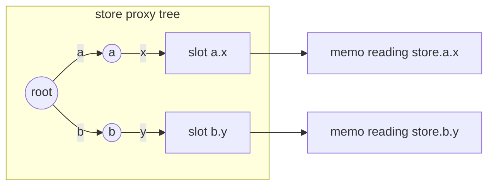
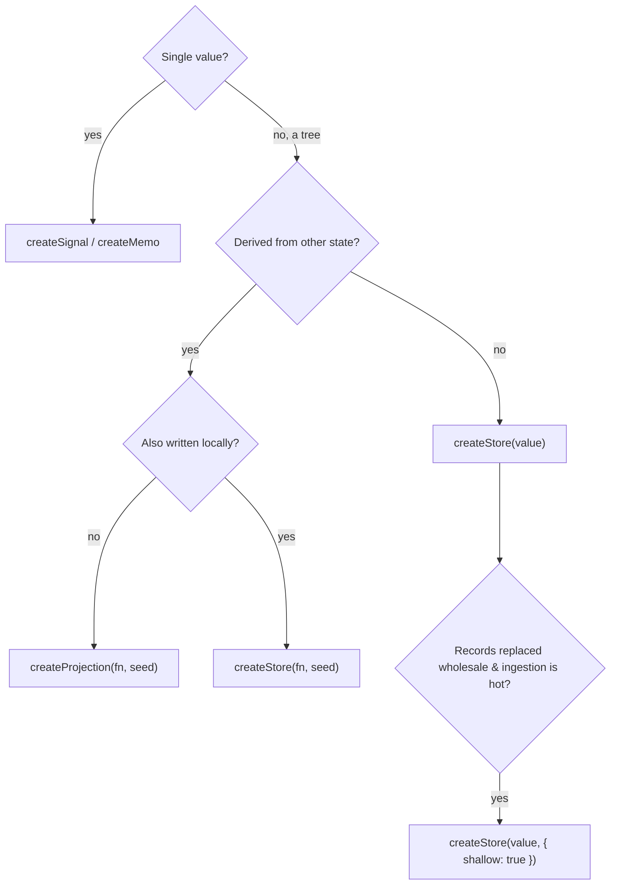

# Module 05 — Stores and Projections

> **Executable proof:** [`examples/typescript/05-stores-and-projections.test.ts`](../examples/typescript/05-stores-and-projections.test.ts) (16 tests, real `solid-js@2.0.0-rc.19`).
>
> Proxy and Reflect semantics (traps, invariants, identity) are owned by `languages/javascript` and are not re-explained here.

A signal holds one value. Application state is a tree: a user with an address, a list of todos each with fields. Wrapping each leaf in its own signal by hand is tedious; replacing the whole tree on every change throws away fine-grained updates. A **store** is a tree whose every property read is a subscription and whose writes notify only the readers of the changed paths. In 2.0, stores moved into core (`solid-js`), setters became draft-first, and a new primitive, the **projection**, generalises derived stores.

---

## 1. Model

**Definition.** A store over a plain object/array tree $T$ is a proxy $\pi(T)$ such that:

- every property read `π.p` inside a tracking scope subscribes that scope to the *slot* $(\text{node}, p)$;
- writes go only through the setter, which opens a **draft**, applies the mutations, and commits them as one transaction;
- after a commit, exactly the subscribers of changed slots are notified (plus subscribers of `length`, key membership or iteration when those changed).

So a store is a lazily materialised family of signals, one per slot that someone actually read. Reading `store.a.x` creates (or reuses) a node for `a` on the root record and a node for `x` on the `a` record. Untouched branches cost nothing.



Proved: writing `s.a.x = 2` re-runs the memo that read `a.x` and not the one that read `b.y` (`runs = { a: 2, b: 1 }`).

Reads lag writes exactly like signals: the setter stages, the commit applies ([Module 01](./01-reactive-core.md)). Writes are subject to the same owned-scope rule: no store writes in a component body, memo or effect compute.

## 2. Draft-first setters

```ts
const [store, setStore] = createStore({ user: { name: "A" }, list: [] as string[] });

setStore((s) => {          // s is a mutable draft
  s.user.name = "B";
  s.list.push("x");
});
```

The callback **is** the transaction: all mutations inside it commit together. There is no path syntax and no `produce` wrapper.

### 2.1 Returning a value: shallow replacement

If the callback **returns** a value, that value replaces the draft's target with a *shallow* diff:

- arrays are replaced **by index and length**;
- objects are diffed **at the top level**; untouched branches keep their identity (proved: `store.keep` is the same proxy after replacing `list`).

```ts
setStore((s) => s.list.filter((x) => x !== "b"));        // remove: easier as a return
setStore((s) => ({ ...s, list: [] }));
```

The return form does **no keyed reconciliation**. For keyed diffs use `reconcile` (§3) or a projection (§4).

### 2.2 Translating 1.x path setters

| 1.x | 2.0 draft |
|---|---|
| `setStore("user", "address", "city", "Paris")` | `setStore((s) => { s.user.address.city = "Paris"; })` |
| `setStore("items", { from: 1, to: 4, by: 2 }, 99)` | `for (let i = 1; i <= 4; i += 2) s.items[i] = 99;` |
| `setStore("todos", (t) => t.done, "archived", true)` | `for (const t of s.todos) if (t.done) t.archived = true;` |
| `setStore("nickname", undefined)` (delete) | `delete s.nickname` (proved) |
| `setStore(produce((s) => …))` | `setStore((s) => …)` |

`storePath(...path, value)` produces a draft function from the 1.x path syntax (ranges, filter functions, `storePath.DELETE`) and can be mixed freely with draft writes (proved: marking all undone todos done). **Verified detail:** in rc.19 `storePath` is exported by `@solidjs/signals` but **not re-exported by `solid-js`**; import it from `@solidjs/signals` (which `solid-js` already depends on), or prefer plain draft code.

### 2.3 Transactions are synchronous

A setter callback that returns a Promise throws `ASYNC_STORE_SETTER` in dev (proved). The draft closes when the callback returns, so writes after an `await` would land on a closed draft and vanish. Async mutations belong in an `action` that calls the setter before and after each `yield` ([Module 07](./07-actions-and-optimistic-state.md)).

Writing through the store proxy outside the setter (`store.n = 2`) is **ignored** and warns `STORE_WRITE_OUTSIDE_SETTER` (proved: `store.n` stays 1). Stores are read-only views; the setter is the only write path.

## 3. `reconcile`: diffing new data into a store

Server responses arrive as fresh objects. Assigning them wholesale gives every row a new identity, which makes a keyed `<For>` rebuild every row ([Module 04](./04-control-flow-and-composition.md)). `reconcile(value, key)` diffs `value` into an existing part of the store, reusing records whose key survives:

```ts
setStore((s) => {
  reconcile(serverTodos, "id")(s.todos);   // call it on the draft sub-tree
});
```

- `key` defaults to `"id"`; it may be a property name or a function.
- `key = null` merges **positionally**: index *n* of the new array into index *n* of the old (proved: slot 0 keeps its identity, `v` becomes 9). This replaces 1.x `reconcile(v, { key: null, merge: true })`; merge semantics are always on in 2.0.
- Only changed leaves notify (proved: the memo reading the row whose `done` flipped re-ran).

**Identity subtlety (observed in rc.19).** A row that something is observing (a `<For>` row, a memo) keeps its identity across `reconcile`, including across reorders (proved with a memo that holds row 1). A proxy you grabbed *outside* any tracking scope and that nobody observes may not be the same object afterwards: the store releases unobserved slot nodes. Compare rows through the reactive graph, not through stale references held in plain variables.

**Do not keep mutating an object you handed to a store.** The store stores that object as its record. Mutating it afterwards bypasses the setter, so nobody is notified; assigning the *same* reference again is not a change either (proved: the subscriber still sees `"a"`). Pass a fresh object (`{ ...next }`). This bites test fixtures and caches that reuse one response object.

## 4. Projections: derived stores

2.0 mirrors the signal/memo split for stores:

| Signals | Stores |
|---|---|
| `createMemo(fn)` — read-only derived value | `createProjection(fn, seed, options?)` — read-only derived store |
| `createSignal(fn)` — writable derived value | `createStore(fn, seed, options?)` — writable derived store |

The derive function receives a **draft** of the previous state and either mutates it or returns new data. Returned data is **reconciled** into the projection by `options.key` (default `"id"`), so identity is preserved for unchanged rows (proved: `list[0]` is the same object after the source re-emits it with a changed field).

### 4.1 O(1) selection

The classic case is "which row is selected?". A memo `selectedId() === row.id` in every row makes a selection change re-run **every** row: O(n). A projection that keeps a map of selected ids touches two keys:

```ts
const selected = createProjection<Record<number, boolean>>((draft) => {
  const id = selectedId();
  for (const k of Object.keys(draft)) if (Number(k) !== id) delete draft[Number(k)];
  draft[id] = true;
}, {});

// each row:
<li class={{ active: selected[row.id] === true }}>…</li>
```

**Proof sketch.** Each row $r$ subscribes only to the slot `selected[r]`. A selection change from $i$ to $j$ modifies exactly the slots $i$ (deleted) and $j$ (set), so exactly the subscribers of those two slots are notified: $O(1)$ rows re-run regardless of $n$. The suite runs 1000 row memos and asserts that a selection change re-runs exactly **2**. This pattern replaces 1.x `createSelector`.

(Formally the derive itself is $O(|\text{draft}|)$ in this naive version because of the `Object.keys` sweep; with one remembered previous id it is $O(1)$ too. The notification cost, which is what dominates in UI, is $O(1)$ in both.)

### 4.2 Async and subscriptions in projections

The derive may be `async` or return an `AsyncIterable`; the projection then participates in `<Loading>` like an async memo ([Module 06](./06-colorless-async.md)).

```ts
const users = createProjection(async () => api.listUsers(), [], { key: "id" });
```

The draft a run receives stays writable until the next run starts or the owner is disposed, so external subscriptions are a plain derive:

```ts
const feed = createProjection((draft) => {
  draft.length = 0;
  const unsubscribe = subscribe(props.id, (item) => draft.push(item));
  onCleanup(unsubscribe);
}, []);
```

Late writes through a superseded draft are dropped silently, but stopping the subscription is still your job (`onCleanup`).

**Never swallow `NotReadyError` inside a derive.** Reading a not-yet-settled async source throws; that throw is how the projection knows to wait and retry. On the server build (no subscription graph) it is the *only* re-derive channel, so a broad `try/catch` freezes the projection at its first partial result in SSR. Probe readiness with `isPending()` instead.

### 4.3 `createStore(fn, seed)`: writable derived store

Same derive semantics plus a setter for local writes (proved: a local `override` flag survives a source-driven re-derive because the derive only assigns `value`). Use it for "server data plus local annotations". As with `createSignal(fn)`, local writes that the derive does not overwrite survive; writes it overwrites are replaced on the next source change.

## 5. Plain copies: `snapshot` and `deep`

| | Subscribes? | Returns | Use |
|---|---|---|---|
| `snapshot(store)` | no | plain object (new where changed, shared where unchanged) | serialization, `localStorage`, third-party libraries, test assertions |
| `deep(store)` | **yes, to every reachable property** | plain object | an effect that must react to *any* nested change |

`deep` belongs in an effect's compute half: it does all reads where they are tracked and hands the apply half a plain object, which avoids `STRICT_READ_UNTRACKED` (proved: the effect saw `{c:1}` then `{c:2}` after a nested write). Use it sparingly; it subscribes to everything, which is the opposite of what stores are for.

`snapshot` replaces 1.x `unwrap`. Because 2.0 store internals are immutable-ish (structural sharing), "unwrapping" a proxy is not enough to get a distinct object graph.

## 6. Shallow stores

`createStore(value, { shallow: true })` creates a **single-layer** store: root keys are fully reactive, but values under them are plain records, replaced by reference and never proxied (proved: `snapshot(rec) === rec`). Contract: **records are replaced, never edited**; in-place mutation notifies nothing. Reconcile at the boundary is positional (`reconcile(fresh, null)`), and list rendering should key by id (`keyed={(r) => r.id}`) because there is no proxy identity to key on.

Use it only when profiling shows ingestion cost for data whose records change wholesale (polling dashboards, streamed feeds). For forms and field-by-field edits, the default deep store is optimal.

## 7. Choosing the right primitive



## 8. Then vs now

| 1.x (≤ 1.9) | 2.0 RC | Why | Migration |
|---|---|---|---|
| `import { createStore } from "solid-js/store"` | `from "solid-js"` | stores are core | rewrite imports |
| path setters `setStore("a", "b", v)` | draft setter | one ergonomic form, still fine-grained | §2.2 table, or `storePath` |
| `produce` | default behaviour | | delete the wrapper |
| `createMutable` / `modifyMutable` | `createStore` + draft setter | one write path, transactions | |
| `setStore("todos", reconcile(data))` | `setStore(s => { reconcile(data, "id")(s.todos); })` | draft-first | call reconcile on the draft sub-tree |
| `reconcile(v, { key: null, merge: true })` | `reconcile(v, null)` | merge always on | |
| `createSelector` | `createProjection` / `createStore(fn)` | more general | §4.1 |
| `unwrap` | `snapshot` | distinct graph needed | |
| `mergeProps` skipped `undefined` | `merge` treats `undefined` as a value | consistency | audit defaults |

**Pitfall when mixing:** a 1.x path setter `setStore("user", "name", "x")` compiles under loose typing and fails at runtime in 2.0 (the setter takes no path). A codemod should turn every path call into a draft write or `storePath`.

## 9. Production failure modes

| Symptom | Cause | Fix |
|---|---|---|
| Whole list re-renders on every poll | fresh objects assigned wholesale | `reconcile(data, "id")` or a keyed projection |
| Update "doesn't show" | object mutated after being handed to the store, or written through the proxy (`STORE_WRITE_OUTSIDE_SETTER`) | write through the setter with fresh objects |
| Half of an async update lost | `await` inside a setter callback (`ASYNC_STORE_SETTER`) | move async into an action |
| Selection change janks with 10k rows | per-row `selectedId() === id` memos (O(n)) | selection projection (O(1)) |
| SSR projection frozen at a partial result | derive catches `NotReadyError` | never catch it; use `isPending` |
| Persisted state misses nested changes | effect reads the store in apply | `deep(store)` in compute, or extract fields |
| One user's data in another's SSR page | module-scope store | create stores inside a provider (Module 08) |

---

## Interview Drill

<details><summary>1. How does a store achieve fine-grained updates over a nested object?</summary>

It is a proxy tree that lazily creates a reactive node per slot (object + property) on first tracked read. Writes go through a draft transaction; at commit only subscribers of changed slots (and of `length`/membership/iteration when those change) are notified. Untouched branches have no nodes and cost nothing.
</details>

<details><summary>2. What does returning a value from a setter do, and when should you prefer it?</summary>

It replaces the draft target shallowly: arrays by index and length, objects by a top-level diff that keeps untouched branches' identity. Prefer it for filters and removals that are awkward as mutations. It does no keyed reconciliation.
</details>

<details><summary>3. Why does `reconcile` matter for lists, and how do you call it in 2.0?</summary>

Fresh server objects have new identities, so a keyed `<For>` would rebuild every row. `reconcile(data, "id")` diffs into the existing tree, reusing records whose key survives and notifying only changed leaves. In 2.0 call it on the draft sub-tree: `setStore(s => { reconcile(data, "id")(s.todos); })`; `null` key means positional merge.
</details>

<details><summary>4. Explain why a selection projection is O(1) while per-row comparisons are O(n).</summary>

Per-row memos `selectedId() === id` all depend on `selectedId`, so every row re-runs on each change. A projection maps ids to `true`; each row subscribes to its own slot. A change from i to j modifies two slots, so exactly two rows are notified, independent of n.
</details>

<details><summary>5. `createProjection` vs `createStore(fn, seed)`?</summary>

Both derive a store from reactive inputs with a draft and keyed reconciliation of returned data. `createProjection` is read-only (like `createMemo`); `createStore(fn, seed)` also returns a setter for local writes (like `createSignal(fn)`).
</details>

<details><summary>6. `snapshot` vs `deep`?</summary>

Both return plain objects. `snapshot` does not subscribe: use it for serialization and interop. `deep` subscribes to every reachable property: use it in an effect compute that must react to any nested change.
</details>

<details><summary>7. Why is an `async` store setter an error?</summary>

A setter callback is a synchronous transaction; the draft closes when the callback returns, so writes after an `await` would be lost. Dev throws `ASYNC_STORE_SETTER`. Put the async flow in an action and call the setter around each `yield`.
</details>

<details><summary>8. When would you choose `shallow: true`?</summary>

When records are replaced wholesale and ingestion cost shows up in profiles (polling dashboards, feeds). Root keys stay reactive; records are plain and must be replaced, not edited; key lists by id. Not for forms or field-level editing.
</details>

<details><summary>9. Why must a projection derive never catch `NotReadyError`?</summary>

The throw is how the runtime learns the derive depends on unsettled async; it holds the projection pending and retries on settle. On the server build it is the only re-derive channel, so catching it freezes the projection at a partial result. Use `isPending()` to branch on readiness.
</details>
