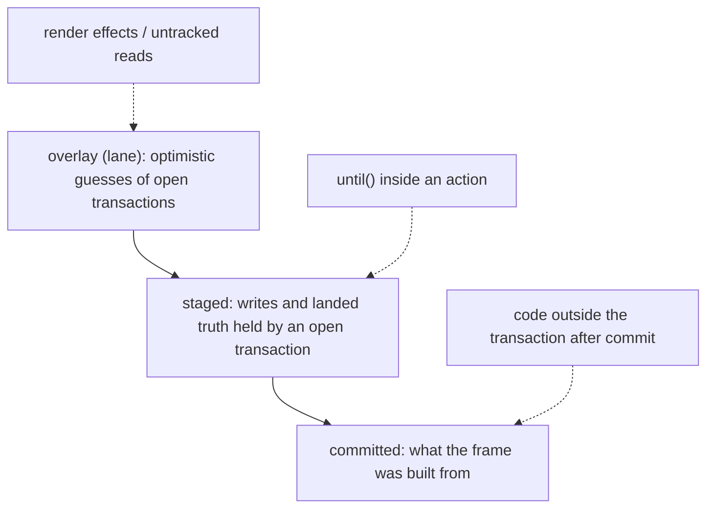
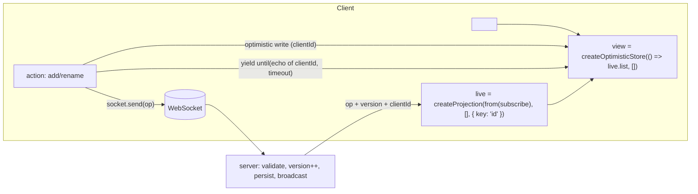
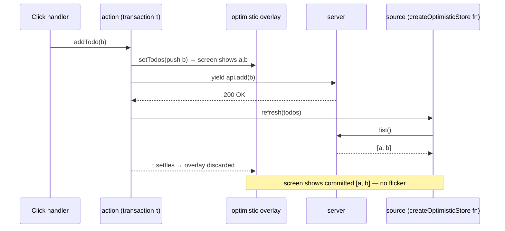
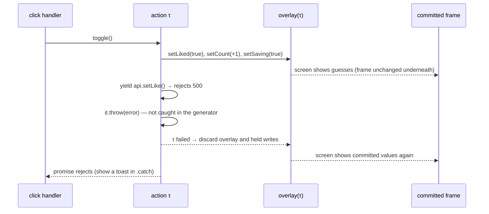

# Module 07 — Actions, Transactions and Optimistic State

> **Executable proof:** [`examples/typescript/07-actions-and-optimistic-state.test.tsx`](../examples/typescript/07-actions-and-optimistic-state.test.tsx) (10 tests against an in-memory server whose requests the test completes by hand, including out of order).
>
> Generator and iterator protocol semantics are owned by `languages/javascript`.

[Module 06](./06-colorless-async.md) modelled *reads* as computations. *Writes* to a server are different: they have side effects, they take time, the UI should show the expected result immediately, and they can fail or race. Solid 2.0 handles them with three pieces that reuse the signal/store model instead of adding a mutation library:

1. **`action(function* …)`**: a transaction that interleaves local writes, async work and refreshes;
2. **optimistic primitives** (`createOptimistic`, `createOptimisticStore`): values that show a guess for the lifetime of a transaction and revert when it ends;
3. **acknowledgement tools**: `refresh` (re-ask the source), `affects` (declare pending), `until` (wait for a live source to confirm).

---

## 1. Transactions and holds, formally

A **transaction** $\tau$ is a set of staged writes plus the async work they started. While $\tau$ has unsettled work, its writes are **held**: they are not committed to the screen frame. When all of $\tau$'s work settles, its writes commit atomically.

An **optimistic write** $w$ made inside $\tau$ lives in an **overlay** (the runtime calls it a *lane*) above the committed state:

$$\text{display}(x) = \begin{cases} \text{overlay}_\tau(x) & \text{if } \tau \text{ is open and wrote } x \\ \text{committed}(x) & \text{otherwise} \end{cases}$$

When $\tau$ settles (success or failure), $\text{overlay}_\tau$ is discarded. On success the committed state by then contains the server's truth (because the action refreshed it), so the user sees no flicker. On failure the committed state never changed, so discarding the overlay *is* the rollback.

This is why optimistic state needs no manual rollback code, and why an optimistic write *outside* any transaction does nothing (proved: `setName("Bob")` with nothing held leaves `name() === "Alice"`).

## 2. `action`

```ts
const addTodo = action(function* (todo: Todo) {
  setTodos((s) => { s.push(todo); });   // optimistic write, shows at once
  yield api.addTodo(todo);               // async work; the transaction stays open
  refresh(todos);                        // re-ask the source of truth (quiet)
});

<button onClick={() => addTodo(newTodo)}>Add</button>
```

- `action(gen)` returns an async function; calling it starts the transaction and returns a Promise of the generator's return value. A throw (or a rejected `yield`) rejects it (proved: `rejected 500`).
- **Why a generator?** After an `await`, JavaScript loses the synchronous context in which the runtime knows "we are inside transaction $\tau$" (there is no portable AsyncContext yet). `yield promise` hands the promise to the runtime, which resumes the generator *inside* $\tau$. Writes after a `yield` therefore still belong to the transaction. Writes after an `await` inside an async helper do not.
- The async-generator form `action(async function* () { await x; yield; … })` is also supported; a bare `yield` re-enters the transaction after native `await`s.
- Call actions from event handlers, effect apply halves or other actions. Calling one during render or in a computation throws `ACTION_CALLED_IN_OWNED_SCOPE` (proved).
- Inside an action, call `refresh(x)` from the generator itself, not from an async helper you `yield`: code after an `await` in a helper runs outside the transaction, and awaiting a refresh there can deadlock (the waiter waits for the commit, the commit waits for the helper).

### 2.1 When you need an action (and when you don't)

The rc.19 `action` docs draw the line precisely: **navigation-shaped updates do not need an action.** A plain setter (`setId(2)`) already holds the write while the async it causes loads; readers keep their previous values and `isPending`/`latest` expose the in-flight state ([Module 06](./06-colorless-async.md)). Reach for `action` when **writes happen after async work** (optimistic write → server round trip → reconciling write) and the intermediate state must not leak or must revert on failure. Router form actions and server-function submissions are specialisations of this same primitive.

### 2.2 How an action runs

```text
ACTION(gen)(args)
  τ ← new transaction; push τ as the ambient transaction
  it ← gen(args)
  loop:
      step ← it.next(resumeValue)            ▷ runs synchronously inside τ
      ▷ every setter call here stages into τ (held: not committed to the frame)
      if step.done: break
      v ← step.value                          ▷ a promise (or nothing for a bare `yield`)
      pop τ; resumeValue ← await v            ▷ outside τ while waiting
      push τ                                  ▷ re-enter before resuming the generator
      on rejection: it.throw(error)           ▷ catchable at the yield; else fail τ
  τ.done ← true
  when every action in τ's entanglement group is done and τ's async settled:
      commit τ's held writes atomically; discard τ's optimistic overlay
  resolve(step.value)  |  on failure: discard held writes + overlay, reject(error)
```

Properties proved in the suite:

- **Plain writes are held.** `setPage("b")` inside an open action leaves `page()` at `"a"` (and `isPending(() => page())` true) until the action settles; then `"b"` commits.
- **Atomicity across yields.** An effect watching `n` sees `0` then `2`; the `1` written before the `yield` was never shown.
- **No early drains.** `flush()` inside an action throws `FLUSH_IN_ACTION`: it could not reveal held writes, and draining would detach the writes after it from the transaction.
- **Generators only.** A plain async function fails at call time.

```mermaid
stateDiagram-v2
  [*] --> Running: action called (τ opened)
  Running --> Waiting: yield promise (writes so far held)
  Waiting --> Running: promise settles (re-enter τ)
  Waiting --> Failing: promise rejects and is not caught
  Running --> Done: generator returns
  Done --> Committed: τ and its entangled transactions settled → held writes commit, overlays drop
  Failing --> Reverted: held writes and overlays discarded; promise rejects
  Committed --> [*]
  Reverted --> [*]
```



## 3. Optimistic primitives

| Primitive | Shape | Typical use |
|---|---|---|
| `createOptimistic(value)` | like `createSignal`; writes are guesses for the current transaction | a "saving…" flag, a like count |
| `createOptimistic(fn)` | writable derived; its own recompute is the truth | an optimistic view of a derived value |
| `createOptimisticStore(fn, seed)` | like `createStore(fn, seed)`; draft writes are guesses | lists and documents fetched from a server |

Semantics proved in the suite:

- **Shows immediately.** After `addTodo(b)` the list renders `ab` before the server answered.
- **Reconciles on success.** After the request completes and the action refreshes, the list still renders `ab`, now from the server (the projection is keyed by `id`, so the guessed row is replaced by the real one rather than duplicated).
- **Reverts on failure.** A rejected request rejects the action's promise and the list returns to `a`.
- **Process flags revert by themselves.** `setSaving(true)` inside the action shows "saving…" and returns to "idle" when the action settles, with no `finally { setSaving(false) }`.

The division of labour (from the package cheatsheet and RFC 06): optimistic writes **show** the expected value and never read as pending themselves; `affects` **pends** data you know is changing but cannot show yet; process affordances are **co-written optimistic flags**, not `isPending`.

### 3.0 Three layers of state

At any moment during a mutation a node can have up to three values, and every reader sees exactly one of them:



- **Committed** changes only at a flush that commits a settled transaction.
- **Staged** holds a transaction's plain writes and any truth that lands while it is open (for example the result of the `refresh` it issued). It becomes committed when the transaction settles, or is discarded if it fails.
- **Overlay** holds optimistic guesses; it is always discarded when its transaction ends, success or failure. On success the staged truth underneath has replaced what the guess stood for, so the screen does not change at that moment.

`createOptimisticStore(fn, seed)` is a derived store (like `createStore(fn, seed)`) whose setter writes into the overlay. Because the derive's result is **reconciled by key**, a refresh that brings back the confirmed row with the same `id` as the guess lands on the same record: the user sees no duplicate and no remount. If the guess used a temporary id the server replaces, the confirmed row arrives as a *new* key and the guess only disappears when the overlay drops, so depending on timing both rows can be visible for a moment (not covered by this track's tests). Use client-generated ids the server keeps.

### 3.1 Lanes: how the overlay is implemented

Internally each transaction that writes optimistic values gets a **lane** (`core/lanes` in `@solidjs/signals`). A lane carries the guessed values for the nodes it wrote and the derivations that read them. The runtime distinguishes several "views" of a node, and which one a read gets depends on who is reading:

| Reader | Sees | Why |
|---|---|---|
| render effect showing the guess | the lane's value | optimistic UI must display immediately |
| `until(predicate)` inside an action | the **authoritative** value (staged truth or committed), never the overlay | your guess must not confirm itself (proved in the `until` test) |
| an untracked direct read | the lane's latest value | "direct read shows optimistic" |
| a derivation of a guess | lane work: computed from the guess, revealed with the lane | no frame shows a guess beside a half-derived view of it |

`isPending` and `latest` are implemented as **verdicts**: system-supplied optimistic values ("pending until this lands", "the proposal is the value") that follow the same lane rules. Two lanes whose derivations meet are linked and reveal together (entanglement), while each guess still reverts with its own action. The memo form `createOptimistic(fn)` shows the guess during the transaction and the recomputed truth at commit (proved: `99` during, `50` after the source changed to 5).

These rules are internal and still moving between RCs (the source carries dated rulings); the observable contract is the table in §3 and the tests.

## 4. Re-asking and acknowledging

### 4.1 `refresh(x)`

`refresh(x)` invalidates a derived source (async memo, projection, `createStore(fn)`, optimistic store) so it re-runs even though no input changed. It returns a Promise of the target's **next quiescent state**: `const fresh = yield refresh(inventory)` gives the settled value (or the store) inside an action. It is quiet: a bare refresh does not make `isPending` true. Refresh granularity is the derive function's: pass the root store, not a nested row. `refresh` is a write-like operation, so it is forbidden in owned scopes (`REACTIVE_WRITE_IN_OWNED_SCOPE`), and passing something that is not a refreshable source is `INVALID_REFRESH_TARGET`.

### 4.2 `affects(target, key?)`

`affects` declares that the surrounding work will change the target. From the declaration until the transaction settles, the target and everything derived from it read as pending (proved: `(pending)` appears during `affects(user); refresh(user)` and disappears when the action settles with `v2`). Targets: `affects(accessor)`, `affects(storeRecord)` (the record and everything reachable), `affects(record, "key")` (one slot). One key per call; keys are not paths (`INVALID_AFFECTS_TARGET`). Scope it narrowly during long holds, or every pending-driven affordance on the page reads busy.

### 4.3 `until(predicate, { timeout, signal })`

When a mutation is confirmed on a **live channel** (WebSocket, subscription, live query) rather than by its own response, the action must stay open until the data arrives, or the overlay reverts and the real row flickers in a beat later. `until` returns a Promise that resolves the first time the predicate settles **truthy** (proved), and rejects with `TimeoutError` after `timeout` ms (proved) or with `signal.reason` on abort.

```ts
const send = action(async function* (text: string) {
  const clientId = crypto.randomUUID();
  setMessages((m) => { m.push({ clientId, text, pending: true }); });
  await socket.send({ clientId, text });                       // transport ack only
  yield until(() => messages.some((m) => m.clientId === clientId), { timeout: 10_000 });
});
```

Two properties make this sound:

- **Authoritative-view reads.** Inside an action the predicate does not see the action's own optimistic overrides, so your guess cannot satisfy your own acknowledgement. Proved: after the transport ack the action is still open even though the optimistic view already contains `"hi"`; it settles only when the live-fed truth contains it.
- **Level-triggered.** It is a condition over state, not a message listener: if the echo arrived before you started waiting, the predicate is already true. No subscribe/deliver race.

Always set `timeout` for transports that can drop; a dead socket would otherwise hold the transaction forever.

`resolve(fn)` answers "what is this value?", `until(fn)` answers "when does the world confirm this condition?", and `yield refresh(x)` answers "when has the re-ask I issued settled?". Most mutate-then-refetch flows want `yield refresh(...)`.

### 4.4 Choosing the acknowledgement

| Question you are asking | Primitive | Reads overrides? | Resolves when |
|---|---|---|---|
| "what is this value once settled?" | `resolve(() => x())` | yes (your own transaction's view) | first settled value |
| "has the refetch I issued landed?" | `yield refresh(x)` | never delivers your override | the re-ask (or what superseded it) settled |
| "has the world confirmed my change?" | `yield until(pred, { timeout })` | **no** (authoritative view) | predicate first settles truthy |
| "show that this slot is changing" | `affects(record, key)` | — | pending until the transaction settles (proved: only `updatedAt` pends, `text` does not) |

## 5. Concurrency and races

Several transactions may be in flight. Each has its own overlay; overlays that touch the same data are **entangled** and reveal together. Proved in the suite: two `addTodo` actions overlap, the second request completes first, the first guess stays on screen while its request is in flight, and after both complete the list contains exactly the two server rows, no duplicates and no lost update.

The classic races this prevents:

| Race | 1.x / naive code | 2.0 |
|---|---|---|
| Out-of-order responses overwrite newer state | `mutate(prev => …)` then `refetch()` per request | overlays per transaction; truth comes from `refresh` of the source |
| Rollback clobbers a concurrent success | manual `catch { setList(previous) }` | discarding the failed overlay only removes that transaction's guesses |
| "Saving…" flag stuck after an exception | manual `finally` | optimistic flag reverts with the transaction |
| Spinner flicker between ack and live echo | timer-based pending rows | `yield until(...)` |

## 5.1 System design: a real-time collaborative list

Requirements: many clients edit a shared todo list; edits must appear instantly for the author, converge for everyone, survive failures, and never flicker.



Decisions and why:

1. **Truth arrives on one channel** (the live subscription, a `from()`-fed projection keyed by `id`). The mutation's own response is only a transport acknowledgement.
2. **Client-generated ids** (`crypto.randomUUID()`) are used as the optimistic row's key *and* echoed by the server, so the confirmed row replaces the guess in place (no duplicate, no remount: keyed `<For>`).
3. **`yield until(() => live.some((t) => t.clientId === id), { timeout: 10_000 })`** keeps the transaction open until the echo, so the overlay is dropped onto data that already contains the real row. The timeout turns a dead socket into a failure that reverts the guess and can be retried.
4. **Conflicts** are resolved on the server (version numbers, last-writer-wins or merge); the client never needs special code because whatever the broadcast contains is the truth the overlay falls back to. If the server rejects an edit, the action's `until` times out or the server sends an explicit rejection that the action turns into a throw: the guess reverts.
5. **Pending UI**: `affects(row, "title")` for the edited field only, so the rest of the list does not read as busy during long confirmations.
6. **Reconnect**: `from()` closes and reopens the subscription when its inputs change; after a reconnect the projection reconciles the full snapshot by `id`, so rows keep identity and local UI state.

What would go wrong without the primitives: timers to clear "pending" rows (flicker on slow servers, stuck rows on fast ones), manual rollback code (clobbering concurrent successes), and duplicates when the echo and the local row coexist.

## 6. Sequence



### 6.1 Execution trace of a failed mutation



## 7. Then vs now

| 1.x (≤ 1.9) | 2.0 RC | Migration |
|---|---|---|
| `createResource` + `mutate(v)` + `refetch()` | `createOptimisticStore(fn, seed)` + `action` + `refresh` | move each mutation into an action |
| `startTransition(() => …)`, `useTransition()` | built-in transitions; actions | delete wrappers |
| manual loading/rollback flags | optimistic flags; automatic revert | delete `finally` resets |
| SolidStart / router `action()` + `useSubmission` | core `action()` (router 2.0-next builds on it) | check router docs for submission APIs |
| polling to detect server echo | `until(predicate, { timeout })` | |

### 7.1 Then vs now: mutation APIs in the 1.x ecosystem

| 1.x stack | What it did | 2.0 replacement |
|---|---|---|
| `createResource` + `mutate` + `refetch` | replace the resource value wholesale, then refetch | `createOptimisticStore` + `action` + `refresh` (granular, reconciled, reverts on failure) |
| `@solidjs/router` 0.x/1.x `action()` + `useSubmission` / `useSubmissions` | form-bound actions with submission state (pending, result, error) and optimistic UI built from submission input | core `action()` for the transaction; optimistic primitives for the UI; router 2.0-next layers form binding on top (its API is still moving) |
| `startTransition(() => setX(…))` | keep old UI while resources for the new state load | default holds; actions for multi-step writes |
| manual `setSaving(true)` / `finally setSaving(false)` | process affordance | `createOptimistic(false)` set inside the action |

**Pitfall when mixing:** wrapping a 1.x-style `async` handler as `action(async () => …)` does not compile into a transaction at all: `action()` drives a generator, and calling the wrapped plain async function fails with `TypeError: it.next is not a function` (proved). The subtler trap is the **async generator** form: inside `action(async function* () { … })`, code between a native `await` and the next `yield` runs *outside* the transaction (writes commit immediately and are not reverted on failure). Put a bare `yield;` after every `await` that is followed by a write or by creating a reader.

## 7.1 Worked example: a like button that survives double clicks and failures

```tsx
function LikeButton(props: { postId: string; liked: boolean; count: number }) {
  const [liked, setLiked] = createOptimistic(() => props.liked);    // truth follows props
  const [count, setCount] = createOptimistic(() => props.count);
  const [saving, setSaving] = createOptimistic(false);               // process flag
  const toggle = action(function* () {
    const next = !liked();
    setLiked(next);
    setCount((c) => c + (next ? 1 : -1));
    setSaving(true);
    yield api.setLike(props.postId, next);                           // throws → all three revert
    refresh(postQuery);                                              // truth arrives through props
  });
  return (
    <button aria-pressed={liked()} disabled={saving()} onClick={() => toggle()}>
      ♥ {count()}
    </button>
  );
}
```

Design notes: the optimistic values are writable derived values over props, so when the refreshed post arrives the truth replaces the guess without extra code; `disabled={saving()}` prevents a second toggle racing the first (an alternative is to let both run: each action has its own overlay and the final truth comes from the refresh, as the concurrency test proves); a failed request reverts the heart, the count and the flag together, because all three guesses belong to the same transaction.

## 7.2 Failure modes proved by negative tests

| Failure | Test (`07-actions-and-optimistic-state.test.tsx`) |
|---|---|
| optimistic write outside an action | "outside an action … as if it never happened" |
| failed request | "a failed action reverts the optimistic write and rejects" |
| `flush()` in an action | `FLUSH_IN_ACTION` |
| plain async function as an action | `TypeError: it.next is not a function` |
| action during render | `ACTION_CALLED_IN_OWNED_SCOPE` |
| live ack never arrives | `until(…, { timeout })` → `TimeoutError` |

## 8. Production failure modes

| Symptom | Cause | Fix |
|---|---|---|
| Optimistic row flashes out and back in | action settled at the transport ack before the live echo | `yield until(...)` with a timeout |
| Duplicate row after success | guess and server row have different keys | give the guess the id the server will echo (client-generated id) |
| Failed save leaves the row on screen | write made outside the transaction (after an `await` in a helper) | write inside the generator, after a `yield` |
| Whole page shows "pending" during a save | `affects(store)` on the root | `affects(record, "key")` |
| Action hangs forever | `await refresh(x)` inside a yielded helper; or no `timeout` on `until` | refresh from the generator; always set `timeout` |
| `ACTION_CALLED_IN_OWNED_SCOPE` | action invoked during render | call from handlers / `onSettled` |

---

## Interview Drill

<details><summary>1. Why does Solid use generator functions for actions?</summary>

JavaScript loses synchronous context across `await`, and there is no portable AsyncContext yet. With `yield promise`, the runtime awaits for you and resumes the generator inside the same transaction, so writes after the yield still belong to it and can be held, committed or reverted together.
</details>

<details><summary>2. How does optimistic UI roll back without rollback code?</summary>

Optimistic writes live in an overlay scoped to the transaction. When the transaction settles the overlay is discarded. On success the committed state already holds the refreshed truth; on failure it never changed, so discarding the overlay is the rollback.
</details>

<details><summary>3. Optimistic writes, `affects`, `isPending`, and a "saving" flag — who does what?</summary>

Optimistic writes show the expected value. `affects` marks data that will change but can't be shown yet, so it reads as pending. `isPending` reports in-flight value changes for reads. A "saving…" affordance is a co-written optimistic boolean that reverts when the action settles.
</details>

<details><summary>4. When do you need `until` instead of `yield refresh(x)`?</summary>

When the mutation's confirmation arrives on a live channel the mutation didn't ask (socket echo, subscription). `refresh` confirms by re-asking; `until` waits for a truthy predicate over state, ignores your own optimistic overrides, and should have a timeout.
</details>

<details><summary>5. Two saves race and the responses arrive out of order. What happens?</summary>

Each action has its own overlay; both guesses show. When one completes, its overlay is discarded only when its transaction settles, and truth comes from refreshing the source, so the final state is the server's, regardless of response order, without duplicates or lost updates.
</details>

<details><summary>6. What's wrong with `action(async (x) => { setX(x); await save(x); setY(1); })`?</summary>

`action()` drives a generator; a plain async function fails when the action is called (`it.next is not a function`). Use `function*` with `yield save(x)`. With the `async function*` form, remember that code between an `await` and the next `yield` runs outside the transaction: add a bare `yield;` before writing again.
</details>

<details><summary>7. Why is an optimistic write outside an action a no-op?</summary>

An optimistic value is a guess over a transaction's held writes. With no transaction there is nothing to guess over, so it reverts immediately ("as if it never happened").
</details>

<details><summary>8. Do you need an action to change a route parameter that triggers data loading?</summary>

No. A plain setter is held automatically while the async it causes loads, and `isPending`/`latest` expose the state. Actions are for writes that happen *after* async work and must revert on failure.
</details>

<details><summary>9. Why does `flush()` throw inside an action?</summary>

The action's writes are held in its transaction until it settles; a flush cannot reveal them, and draining mid-action would detach later writes from the transaction. rc.19 throws `FLUSH_IN_ACTION`.
</details>

<details><summary>10. How would you design optimistic edits confirmed over a WebSocket?</summary>

Client-generated ids used as keys and echoed by the server; an optimistic store derived from a keyed live projection; the action sends the op and `yield until(echo, { timeout })`; `affects(row, key)` for the edited field; server-side conflict resolution. Truth only ever comes from the live channel.
</details>

<details><summary>11. What are the three layers of state during a mutation, and who reads which?</summary>

Committed (what the frame was built from), staged (held writes and truth that landed inside the open transaction), and the overlay (optimistic guesses). Render effects and untracked reads show the overlay; `until` inside an action reads the authoritative staged/committed value; everything commits or is discarded when the transaction settles.
</details>

<details><summary>12. A rename shows the whole list as "pending" for seconds. What do you change?</summary>

The action probably calls `affects(store)` on the list root, which pends everything reachable. Use `affects(todo, "title")` (one slot per call) so only the edited field reads as pending; keep the process affordance as an optimistic flag on the row.
</details>
