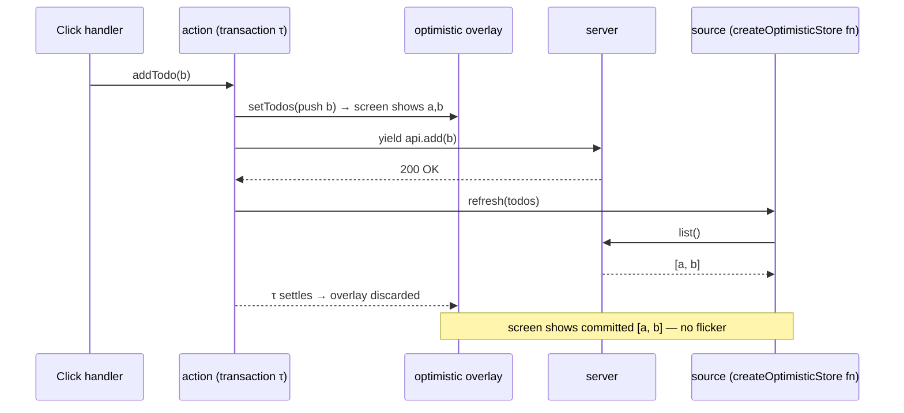

# Module 07 — Actions, Transactions and Optimistic State

> **Executable proof:** [`examples/typescript/07-actions-and-optimistic-state.test.tsx`](../examples/typescript/07-actions-and-optimistic-state.test.tsx) (10 tests against an in-memory server whose requests the test completes by hand, including out of order).
>
> Generator and iterator protocol semantics are owned by `languages/javascript`.

[Module 06](./06-colorless-async.md) modelled *reads* as computations. *Writes* to a server are different: they have side effects, they take time, the UI should show the expected result immediately, and they can fail or race. Solid 2.0 handles them with three pieces that reuse the signal/store model instead of adding a mutation library:

1. **`action(function* …)`**: a transaction that interleaves local writes, async work and refreshes;
2. **optimistic primitives** (`createOptimistic`, `createOptimisticStore`): values that show a guess for the lifetime of a transaction and revert when it ends;
3. **acknowledgement tools**: `refresh` (re-ask the source), `affects` (declare pending), `until` (wait for a live source to confirm).

---

## 1. Transactions and holds, formally

A **transaction** $\tau$ is a set of staged writes plus the async work they started. While $\tau$ has unsettled work, its writes are **held**: they are not committed to the screen frame. When all of $\tau$'s work settles, its writes commit atomically.

An **optimistic write** $w$ made inside $\tau$ lives in an **overlay** (the runtime calls it a *lane*) above the committed state:

$$\text{display}(x) = \begin{cases} \text{overlay}_\tau(x) & \text{if } \tau \text{ is open and wrote } x \\ \text{committed}(x) & \text{otherwise} \end{cases}$$

When $\tau$ settles (success or failure), $\text{overlay}_\tau$ is discarded. On success the committed state by then contains the server's truth (because the action refreshed it), so the user sees no flicker. On failure the committed state never changed, so discarding the overlay *is* the rollback.

This is why optimistic state needs no manual rollback code, and why an optimistic write *outside* any transaction does nothing (proved: `setName("Bob")` with nothing held leaves `name() === "Alice"`).

## 2. `action`

```ts
const addTodo = action(function* (todo: Todo) {
  setTodos((s) => { s.push(todo); });   // optimistic write, shows at once
  yield api.addTodo(todo);               // async work; the transaction stays open
  refresh(todos);                        // re-ask the source of truth (quiet)
});

<button onClick={() => addTodo(newTodo)}>Add</button>
```

- `action(gen)` returns an async function; calling it starts the transaction and returns a Promise of the generator's return value. A throw (or a rejected `yield`) rejects it (proved: `rejected 500`).
- **Why a generator?** After an `await`, JavaScript loses the synchronous context in which the runtime knows "we are inside transaction $\tau$" (there is no portable AsyncContext yet). `yield promise` hands the promise to the runtime, which resumes the generator *inside* $\tau$. Writes after a `yield` therefore still belong to the transaction. Writes after an `await` inside an async helper do not.
- The async-generator form `action(async function* () { await x; yield; … })` is also supported; a bare `yield` re-enters the transaction after native `await`s.
- Call actions from event handlers, effect apply halves or other actions. Calling one during render or in a computation throws `ACTION_CALLED_IN_OWNED_SCOPE` (proved).
- Inside an action, call `refresh(x)` from the generator itself, not from an async helper you `yield`: code after an `await` in a helper runs outside the transaction, and awaiting a refresh there can deadlock (the waiter waits for the commit, the commit waits for the helper).

## 3. Optimistic primitives

| Primitive | Shape | Typical use |
|---|---|---|
| `createOptimistic(value)` | like `createSignal`; writes are guesses for the current transaction | a "saving…" flag, a like count |
| `createOptimistic(fn)` | writable derived; its own recompute is the truth | an optimistic view of a derived value |
| `createOptimisticStore(fn, seed)` | like `createStore(fn, seed)`; draft writes are guesses | lists and documents fetched from a server |

Semantics proved in the suite:

- **Shows immediately.** After `addTodo(b)` the list renders `ab` before the server answered.
- **Reconciles on success.** After the request completes and the action refreshes, the list still renders `ab`, now from the server (the projection is keyed by `id`, so the guessed row is replaced by the real one rather than duplicated).
- **Reverts on failure.** A rejected request rejects the action's promise and the list returns to `a`.
- **Process flags revert by themselves.** `setSaving(true)` inside the action shows "saving…" and returns to "idle" when the action settles, with no `finally { setSaving(false) }`.

The division of labour (from the package cheatsheet and RFC 06): optimistic writes **show** the expected value and never read as pending themselves; `affects` **pends** data you know is changing but cannot show yet; process affordances are **co-written optimistic flags**, not `isPending`.

## 4. Re-asking and acknowledging

### 4.1 `refresh(x)`

`refresh(x)` invalidates a derived source (async memo, projection, `createStore(fn)`, optimistic store) so it re-runs even though no input changed. It returns a Promise of the target's **next quiescent state**: `const fresh = yield refresh(inventory)` gives the settled value (or the store) inside an action. It is quiet: a bare refresh does not make `isPending` true. Refresh granularity is the derive function's: pass the root store, not a nested row. `refresh` is a write-like operation, so it is forbidden in owned scopes (`REACTIVE_WRITE_IN_OWNED_SCOPE`), and passing something that is not a refreshable source is `INVALID_REFRESH_TARGET`.

### 4.2 `affects(target, key?)`

`affects` declares that the surrounding work will change the target. From the declaration until the transaction settles, the target and everything derived from it read as pending (proved: `(pending)` appears during `affects(user); refresh(user)` and disappears when the action settles with `v2`). Targets: `affects(accessor)`, `affects(storeRecord)` (the record and everything reachable), `affects(record, "key")` (one slot). One key per call; keys are not paths (`INVALID_AFFECTS_TARGET`). Scope it narrowly during long holds, or every pending-driven affordance on the page reads busy.

### 4.3 `until(predicate, { timeout, signal })`

When a mutation is confirmed on a **live channel** (WebSocket, subscription, live query) rather than by its own response, the action must stay open until the data arrives, or the overlay reverts and the real row flickers in a beat later. `until` returns a Promise that resolves the first time the predicate settles **truthy** (proved), and rejects with `TimeoutError` after `timeout` ms (proved) or with `signal.reason` on abort.

```ts
const send = action(async function* (text: string) {
  const clientId = crypto.randomUUID();
  setMessages((m) => { m.push({ clientId, text, pending: true }); });
  await socket.send({ clientId, text });                       // transport ack only
  yield until(() => messages.some((m) => m.clientId === clientId), { timeout: 10_000 });
});
```

Two properties make this sound:

- **Authoritative-view reads.** Inside an action the predicate does not see the action's own optimistic overrides, so your guess cannot satisfy your own acknowledgement. Proved: after the transport ack the action is still open even though the optimistic view already contains `"hi"`; it settles only when the live-fed truth contains it.
- **Level-triggered.** It is a condition over state, not a message listener: if the echo arrived before you started waiting, the predicate is already true. No subscribe/deliver race.

Always set `timeout` for transports that can drop; a dead socket would otherwise hold the transaction forever.

`resolve(fn)` answers "what is this value?", `until(fn)` answers "when does the world confirm this condition?", and `yield refresh(x)` answers "when has the re-ask I issued settled?". Most mutate-then-refetch flows want `yield refresh(...)`.

## 5. Concurrency and races

Several transactions may be in flight. Each has its own overlay; overlays that touch the same data are **entangled** and reveal together. Proved in the suite: two `addTodo` actions overlap, the second request completes first, the first guess stays on screen while its request is in flight, and after both complete the list contains exactly the two server rows, no duplicates and no lost update.

The classic races this prevents:

| Race | 1.x / naive code | 2.0 |
|---|---|---|
| Out-of-order responses overwrite newer state | `mutate(prev => …)` then `refetch()` per request | overlays per transaction; truth comes from `refresh` of the source |
| Rollback clobbers a concurrent success | manual `catch { setList(previous) }` | discarding the failed overlay only removes that transaction's guesses |
| "Saving…" flag stuck after an exception | manual `finally` | optimistic flag reverts with the transaction |
| Spinner flicker between ack and live echo | timer-based pending rows | `yield until(...)` |

## 6. Sequence



## 7. Then vs now

| 1.x (≤ 1.9) | 2.0 RC | Migration |
|---|---|---|
| `createResource` + `mutate(v)` + `refetch()` | `createOptimisticStore(fn, seed)` + `action` + `refresh` | move each mutation into an action |
| `startTransition(() => …)`, `useTransition()` | built-in transitions; actions | delete wrappers |
| manual loading/rollback flags | optimistic flags; automatic revert | delete `finally` resets |
| SolidStart / router `action()` + `useSubmission` | core `action()` (router 2.0-next builds on it) | check router docs for submission APIs |
| polling to detect server echo | `until(predicate, { timeout })` | |

**Pitfall when mixing:** wrapping 1.x-style `async` handlers in `action(async () => …)` (a plain async function, not a generator) loses the transaction after the first `await`: writes made there are not part of it and are not reverted. Use `function*` + `yield`, or `async function*` + bare `yield` after awaits.

## 8. Production failure modes

| Symptom | Cause | Fix |
|---|---|---|
| Optimistic row flashes out and back in | action settled at the transport ack before the live echo | `yield until(...)` with a timeout |
| Duplicate row after success | guess and server row have different keys | give the guess the id the server will echo (client-generated id) |
| Failed save leaves the row on screen | write made outside the transaction (after an `await` in a helper) | write inside the generator, after a `yield` |
| Whole page shows "pending" during a save | `affects(store)` on the root | `affects(record, "key")` |
| Action hangs forever | `await refresh(x)` inside a yielded helper; or no `timeout` on `until` | refresh from the generator; always set `timeout` |
| `ACTION_CALLED_IN_OWNED_SCOPE` | action invoked during render | call from handlers / `onSettled` |

---

## Interview Drill

<details><summary>1. Why does Solid use generator functions for actions?</summary>

JavaScript loses synchronous context across `await`, and there is no portable AsyncContext yet. With `yield promise`, the runtime awaits for you and resumes the generator inside the same transaction, so writes after the yield still belong to it and can be held, committed or reverted together.
</details>

<details><summary>2. How does optimistic UI roll back without rollback code?</summary>

Optimistic writes live in an overlay scoped to the transaction. When the transaction settles the overlay is discarded. On success the committed state already holds the refreshed truth; on failure it never changed, so discarding the overlay is the rollback.
</details>

<details><summary>3. Optimistic writes, `affects`, `isPending`, and a "saving" flag — who does what?</summary>

Optimistic writes show the expected value. `affects` marks data that will change but can't be shown yet, so it reads as pending. `isPending` reports in-flight value changes for reads. A "saving…" affordance is a co-written optimistic boolean that reverts when the action settles.
</details>

<details><summary>4. When do you need `until` instead of `yield refresh(x)`?</summary>

When the mutation's confirmation arrives on a live channel the mutation didn't ask (socket echo, subscription). `refresh` confirms by re-asking; `until` waits for a truthy predicate over state, ignores your own optimistic overrides, and should have a timeout.
</details>

<details><summary>5. Two saves race and the responses arrive out of order. What happens?</summary>

Each action has its own overlay; both guesses show. When one completes, its overlay is discarded only when its transaction settles, and truth comes from refreshing the source, so the final state is the server's, regardless of response order, without duplicates or lost updates.
</details>

<details><summary>6. What's wrong with `action(async (x) => { setX(x); await save(x); setY(1); })`?</summary>

It is a plain async function, not a generator: after the `await` the runtime can't know the code belongs to the transaction, so `setY` is outside it. Use `function*` with `yield save(x)`, or `async function*` with a bare `yield` after awaits.
</details>

<details><summary>7. Why is an optimistic write outside an action a no-op?</summary>

An optimistic value is a guess over a transaction's held writes. With no transaction there is nothing to guess over, so it reverts immediately ("as if it never happened").
</details>
