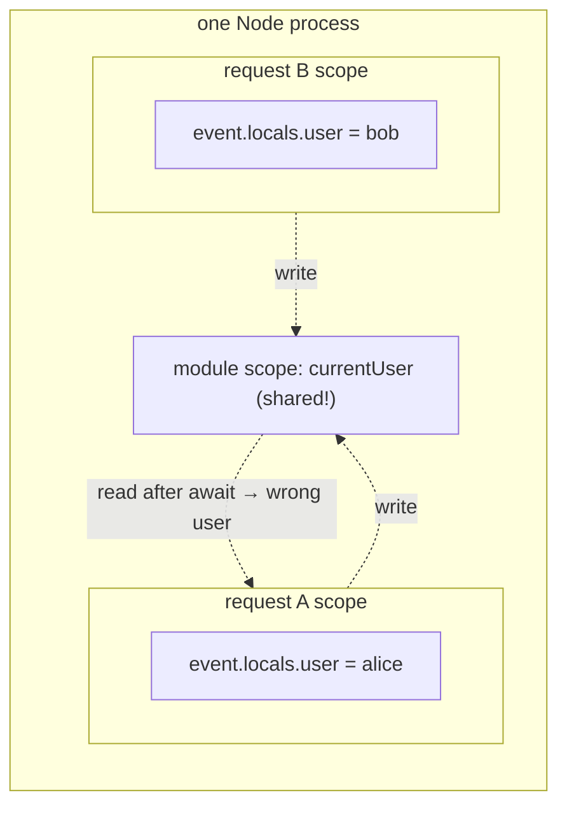

# Module 08 — Full Stack: SSR, Start Mode, Request Isolation and Server Functions

> **Executable proof:** [`examples/typescript/08-ssr-and-server-functions.server.test.tsx`](../examples/typescript/08-ssr-and-server-functions.server.test.tsx) runs in the Vitest **server** project (`environment: "node"`), which `@solidjs/vite-plugin` resolves with server export conditions and SSR codegen, so `isServer === true` and the real `@solidjs/web` server build renders. Server functions are called through the **real client transport** wired straight into the **real `handleServerFunctionRequest`**.
>
> HTTP semantics, caching (RFC 9111), streaming transport and CDNs are owned by `architecture/networking`; `structuredClone`/serialisation limits by `languages/javascript`; Standard Schema typing by the TypeScript track (M11).

---

## 1. The 2.0 full-stack layout

In Solid 1.x, server rendering beyond the basics lived in **SolidStart** (`@solidjs/start`), a metaframework on Vinxi/Nitro. In 2.0 the HTTP exchange moved into core, and the serving layer moved into the Vite plugin:

| Concern | Solid 2.0 home |
|---|---|
| render entry points (`render`, `hydrate`, `renderToString`, `renderToStream`) | `@solidjs/web` |
| request event, response head, `httpStatus`/`httpHeader`, cookies | `@solidjs/web` (+ `@solidjs/web/storage` for request scope) |
| server functions runtime and HTTP handler | `@solidjs/web/server-functions` |
| `"use server"` compilation, dev server, build, production handler | `@solidjs/vite-plugin` (`serverFunctions`, `start`) |
| routing | `@solidjs/router@2.0.0-next.*` |
| server components (experimental) | `@solidjs/web/frames` + `serverFunctions: { components: true }` |

> **Warning — do not install `@solidjs/start` for a Solid 2 app.** As of 2026-10-28, `@solidjs/start@2.1.0` (npm `latest`) has peer dependency `solid-js ^1.9.15` and `@solidjs/router >=0.16.0 <2.0.0-0`, and depends on `vite-plugin-solid` 2.x. It is the **Solid 1.9** metaframework. Installing it next to `solid-js@2.0.0-rc.19` puts two copies of Solid in the graph ("Multiple Solid instances", dead reactivity). For Solid 2, use **start mode of `@solidjs/vite-plugin`**, which its README describes as "the serving layer that replaces SolidStart".

Versions verified on npm 2026-10-28: `@solidjs/vite-plugin@3.0.0-next.52` (peers: `vite ^8 || ^9`, `solid-js ^2.0.0-rc.19`, `@solidjs/web ^2.0.0-rc.19`; Node ≥ 22.12), `@solidjs/router@2.0.0-next.43` (peers `solid-js ^2.0.0-rc.19`); `@solidjs/router@1.0.0` is the Solid 1 router. `@solidjs/vite-plugin` is the renamed `vite-plugin-solid` (migrate by swapping the dependency and the import).

## 2. Start mode

```ts
// vite.config.ts
import { defineConfig } from "vite";
import solid from "@solidjs/vite-plugin";

export default defineConfig({
  plugins: [solid({ start: true, ssr: true })],   // SSR start mode
});
```

```tsx
// src/App.tsx — the whole app
export default function App() {
  return <h1>Hello SSR</h1>;
}
```

The plugin owns entries, dev serving and the build: no entry files, no `index.html`, no dev-server script. `ssr` picks the rendering mode for the same conventions: `ssr: true` streams SSR; omitted, the app is client-rendered onto a prerendered static shell. Flipping a project between SPA and SSR is that one boolean.

| Phase | What start mode does (from the plugin README) |
|---|---|
| `vite` (dev) | middleware streams the app for HTML GET requests through the SSR environment, injects the Vite client; SSR errors show Vite's overlay; Chrome Performance panel tracks enabled |
| `vite build` | client assets + manifest to `dist/client`, server bundle to `dist/server/server.js` (client built first, because the server reads the manifest) |
| production | `dist/server/server.js` exports `handleRequest(request) → Response` and a default `{ fetch(request) }` (Workers, Deno, Bun, Netlify, Nitro); `start: { node: true }` also emits `dist/server/node.js` (`node dist/server/node.js`, `PORT`/`HOST`) |
| `vite preview` | runs the production artifact |

Options worth knowing: `middleware` (a module default-exporting `(event, next) => Response`, run for pages *and* server functions, inside the request scope; set `event.nonce` for CSP and `event.renderMode` (`"stream"` / `"async"`) before `next()`), `setup` (per-request app setup, e.g. creating a router bound to the request), `app`, `document`, `clientSetup`, `productionErrorBoundary`, `externalServer`. The `server-only` / `client-only` marker imports turn "server code shipped to the browser" into a build error at the import edge.

## 3. Server rendering

### 3.1 Entry points

| Function | Where | Behaviour |
|---|---|---|
| `renderToString(fn)` | server | synchronous; async boundaries render their fallbacks (proved: escaped, attribute-correct HTML) |
| `renderToStream(fn, opts)` | server | shell first, then each `<Loading>` streams its resolved fragment plus a swap script; `.pipe()`, `.pipeTo()`, `.readable`; **awaiting it yields the fully settled HTML** (replaces the removed `renderToStringAsync`) |
| `hydrate(fn, el)` | client | claims server DOM once at t = 0; needs `generateHydrationScript()` / `<HydrationScript />` before the app markup |
| `render(fn, el)` | client | mounts fresh, returns `dispose` |

Proved: the first streamed chunk contains the `<Loading>` fallback, later chunks contain the resolved content; `await renderToStream(...)` contains `<b>settled</b>`. Text is escaped (`` becomes `&lt;img …>`).

The compiler emits different code per target. For the same component, `generate: "ssr"` produces string templates with `escape()` holes and hydration keys instead of DOM templates (see [Module 03](./03-components-props-and-dom.md) for the DOM output):

```js
var _tmpl$ = ["<p", ' class="x"><!--$-->', "<!--/--> and <!--$-->", "<!--/--></p>"];
export const C = (p) => _$ssr(_tmpl$, _$ssrHydrationKey(), _$scope(() => _$escape(p.a)), _$scope(() => _$escape(p.b)));
```

### 3.2 Hydration policy per computation

Async values computed on the server are **serialized** (with seroval) into the HTML and adopted by the client, so the client does not refetch on load. The policy is per primitive ([Module 06](./06-colorless-async.md)):

- `ssrSource: "server"` (default): the serialized value is authoritative; the client runs the compute once only to record dependencies (a "tracking run" with fake `fetch`/`Promise` so nothing is sent).
- `ssrSource: "hybrid"`: like server, but an AsyncIterable continues streaming on the client.
- `ssrSource: "client"`: never runs on the server; renders the `<Loading>` fallback or a declared `loadingValue`.
- `deferStream: true`: hold the shell flush until this source resolves, for data that decides status codes, headers or `<head>` tags.
- `transparent: true`: for client-only nodes created during hydration, so hydration ids stay aligned.

Two traps from RFC 05's "tracking run" section: a non-fake `await` before the request in a hydrated compute sends a **duplicate request** after hydration; and a cache that stores promises created during the tracking run stores **never-settling** promises. Start requests synchronously, and do not populate caches while `isHydrating()`.

`clientOnly(() => import("./Chart"))` (from `@solidjs/web`, formerly SolidStart) renders `props.fallback` on the server, never imports the module there, hydrates the fallback mismatch-free and swaps after settle. Use it for browser-only libraries.

### 3.3 Status and headers from the tree

```tsx
function NotFound() {
  httpStatus(404);
  httpHeader("cache-control", "no-store");
  return <h1>Not found</h1>;
}
```

`httpStatus` / `httpHeader` are **scope-tied declarations**: they write the response head while the calling scope is alive and are retracted when it is disposed (an error boundary that recovers retracts its 500). They are **shell-time APIs**: once the shell has flushed, the head is on the wire and later writes are no-ops (dev: `LATE_HEADER_WRITE`). If streamed content decides the status, mark its source `deferStream: true`. On the client both are no-ops.

### 3.4 Error sanitization

The production server build replaces plain thrown errors with a generic `Error("Internal Server Error")` on every wire (SSR-serialized boundary errors, streamed rejections, server-function responses), so database messages and connection strings never reach the client. The **development** build keeps full fidelity. `markSafeError(err)` brands an error whose message is meant for the user; it passes intact everywhere (proved through the server-function wire). The dev/prod line is the *build variant* (export condition), not `NODE_ENV`.

## 4. Request isolation: the leak you only see in production

> **Module scope is shared by every request in the process.**

On the client, a module-level store is "global state". On the server it is **shared between users**. Proved in the suite: two concurrent renders write a module-level `currentUser`, then await data; the slower render (Alice's) is served **"hello bob"**. Nothing crashes; one user sees another's data.

The fix is to keep per-request state in the request scope:

- create stores and signals **inside components/providers**, not at module scope (a provider runs once per request on the server);
- read per-request inputs from the **request event** (`getRequestEvent()`), established by `provideRequestEvent(event, fn)` from `@solidjs/web/storage` (AsyncLocalStorage-backed). Start mode does this for every request; the suite does it by hand and proves Alice gets "hello alice";
- read the request event **before** the first `await` in an async computation (same rule as tracking, [Module 06](./06-colorless-async.md)).



Signal/store setters that run during a server render are inert and warn `SERVER_WRITE` (they will throw in a future release): server rendering is a one-shot projection of state, not an interactive graph.

## 5. Server functions

### 5.1 Compilation

```ts
export async function addTodo(title: string) {
  "use server";
  await db.insert(title);
}
```

With `serverFunctions` (or start mode) enabled, the compiler extracts the body to the server build, registers it, and replaces it on the client with a fetch-backed reference. Everything referenced only inside the body (database handles, schemas) is dead-code-eliminated from the client: **the directive boundary is the privacy mechanism**. Function-level directives register the raw function (wrappers around them like `GET(...)` affect only the client transport); module-level `"use server"` registers each export's *evaluated value*, so server-side wrappers (auth, validation) apply to every call path.

### 5.2 The runtime and the wire

```ts
import { handleServerFunctionRequest } from "@solidjs/web/server-functions/server";
if (url.pathname.startsWith("/_server")) return handleServerFunctionRequest(request);
```

Start mode mounts this for you. Properties proved in the suite (calls go through the real client transport, with `configureServerFunctionsClient({ fetch })` routing them into the real handler):

| Property | Evidence |
|---|---|
| default endpoint `/_server`, call data address `/_server/data/<id>` | the request event's pathname starts with `/_server` |
| calls run inside a request-event scope (`provideEvent`) | `getRequestEvent()` works in the function |
| **results** are encoded with seroval: `Date`, `Map`, … survive | yes |
| **arguments** are plain JSON by default; rich arguments need `enableRichArguments()` from `@solidjs/web/server-functions/rich-args` | a `Date` argument is refused with that message |
| POST dispatches; GET/HEAD only for functions declared with `GET(fn)` | GET to an undeclared function → 405 |
| same-origin by default (`Sec-Fetch-Site`/`Origin`/`Referer`); cross-origin only via `csrf.origin` allowlist | cross-site call → 403 and the body never ran |
| thrown `redirect()`/`reload()`/`respond()` are control flow forwarded as metadata | `/login` appears in the response headers |
| plain thrown errors sanitized in prod; `markSafeError` passes | the safe message reached the client |
| every response `Cache-Control: no-store` unless the function sets a policy | observed headers |

`GET(fn)` makes a read cacheable over HTTP GET with codec-encoded query arguments; `withMeta(fn, meta)` writes the metadata channel `prepareRequest` reads. `live(fn)` / `broadcast(fn)` stream standing answers. Single-flight lets a mutation response carry the refreshed data its route needs, saving a round trip.

### 5.3 Validation at the boundary

Arguments arrive from the network: they are **untrusted** whatever their TypeScript type says. Validate in the function. Core deliberately ships no validator: RFC 10's decision record specifies the intended shape (a non-throwing `validate(schema, value)` over **Standard Schema**, the `~standard` interface implemented by Zod, Valibot and ArkType, returning plain serializable `{ ok, value | error }`), but leaves the helper to a standalone package. The suite uses a minimal hand-written Standard Schema object and returns issues as data. Choose per call site whether to return the failure (form state) or throw `respond(error, { status: 400 })`.

### 5.4 Server components (experimental)

A server component is *a function returned from a server function*; there is no `"use client"`. Enable with `serverFunctions: { components: true }`; the client consumes it through `dynamicComponent`/`dynamic`. Content travels as HTML, values as data records, nothing as both ("single-copy"). Treat it as an RC-era experiment; it is out of scope for exercises here.

## 6. Routing

`@solidjs/router@2.0.0-next.43` is the Solid 2 router (peers on `solid-js ^2.0.0-rc.19`), with file-system routing via `@solidjs/router/fs` and a `setup`-hook integration in start mode. Its API is still moving between `next` releases and is not covered by this track's tests; check its README for the pinned version before teaching it (listed under remaining work).

## 7. Then vs now

| 1.x / SolidStart 1 | 2.0 RC | Migration |
|---|---|---|
| `@solidjs/start` (Vinxi/Nitro), `app.config.ts` | `@solidjs/vite-plugin` `start: true` | do **not** upgrade `@solidjs/start` to 2.x for Solid 2; switch to start mode |
| `vite-plugin-solid` | `@solidjs/vite-plugin` (renamed) | swap dependency and import |
| `renderToStringAsync` | `await renderToStream(...)` | |
| `"use server"` via SolidStart / Vinxi | core runtime + plugin compilation | `handleServerFunctionRequest` for custom servers |
| `getRequestEvent` from `solid-js/web` | `@solidjs/web`; scope via `@solidjs/web/storage` | |
| `<HttpStatusCode>`, `<HttpHeader>` components (Start) | `httpStatus()` / `httpHeader()` functions | shell-time only |
| `createResource({ ssrLoadFrom, deferStream })` | `ssrSource`, `deferStream` on any computation | |
| `clientOnly` from `@solidjs/start` | `clientOnly` from `@solidjs/web` | |
| `@solidjs/router` 0.x/1.x `cache`, `createAsync` | router 2.0-next on core async | follow router migration notes |

## 8. Production failure modes

| Symptom | Cause | Fix |
|---|---|---|
| Users see each other's data | module-scope state on the server | providers / request event |
| "Multiple Solid instances", nothing updates | `@solidjs/start@2` (Solid 1.9) installed beside Solid 2 | remove it; use start mode; dedupe `solid-js` |
| Duplicate API calls after hydration | non-fake `await` before the request in a hydrated compute | start the request synchronously |
| A cache hangs forever after navigation | promise created during the hydration tracking run stored | don't populate caches while `isHydrating()` |
| 404 page returns 200 | `httpStatus` called after the shell flushed | `deferStream` on the deciding source |
| DB error text in the browser in dev only | expected: dev keeps fidelity | prod sanitizes; use `markSafeError` for user messages |
| Server function 403 from another site | CSRF default | `csrf.origin` allowlist (never `csrf: false` unless another layer protects it) |
| `Date` argument rejected | arguments are JSON by default | `enableRichArguments()` once at startup |

---

## Interview Drill

<details><summary>1. Where did SolidStart go in Solid 2.0?</summary>

The exchange (render entry points, request event, response head, server-function runtime) moved into `@solidjs/web`, and serving/building moved into `@solidjs/vite-plugin`'s start mode (`solid({ start: true, ssr: true })`). `@solidjs/start@2.x` on npm still targets Solid 1.9 and must not be mixed with Solid 2.
</details>

<details><summary>2. Why is module-scope state dangerous with SSR, and what's the fix?</summary>

The server process handles many requests concurrently and module scope is shared, so writes from one request are visible to another; after an `await`, a render can read another user's value. Create state inside providers (once per request) and read request-specific inputs from `getRequestEvent()`, which `provideRequestEvent` scopes per request.
</details>

<details><summary>3. `renderToString` vs `renderToStream`?</summary>

`renderToString` is synchronous and renders fallbacks for pending boundaries. `renderToStream` flushes the shell immediately and streams each boundary's resolved HTML with a swap script; awaiting it yields the settled HTML. `deferStream` on a source holds the shell until it resolves.
</details>

<details><summary>4. Why must status codes be decided in the shell?</summary>

Once the shell flushes, the HTTP head is on the wire. `httpStatus`/`httpHeader` after that are no-ops (`LATE_HEADER_WRITE` in dev). Content below a `<Loading>` that resolves later cannot change them; use `deferStream` on the deciding source.
</details>

<details><summary>5. How does `"use server"` keep secrets off the client?</summary>

The compiler extracts the body to the server build and replaces it with a reference; dead-code elimination then removes imports only the body used. The directive boundary is the privacy boundary. Module-level directives register the export's evaluated value, so server-side wrappers apply to all call paths.
</details>

<details><summary>6. What does the server-function handler protect against by default?</summary>

Cross-site requests (same-origin check via `Sec-Fetch-Site`/`Origin`/`Referer`, 403 otherwise, allowlist via `csrf.origin`), non-POST methods for non-GET functions (405), leaking error details (prod sanitization; `markSafeError` to opt in), accidental caching (`no-store` unless set), and non-JSON arguments unless rich arguments are enabled.
</details>

<details><summary>7. How do you validate server-function input?</summary>

Treat arguments as `unknown` and validate with a Standard Schema validator (Zod, Valibot, ArkType) inside the function; return issues as data for forms, or throw `respond(error, { status: 400 })`. Core intentionally ships no validator.
</details>

<details><summary>8. What problem does `ssrSource: "client"` solve, and what does the server render?</summary>

For client-only computations (localStorage, measurements) where a serialized server value is meaningless. The server never runs it; it renders the nearest `<Loading>` fallback (and the client renders after hydration), or a declared `loadingValue`.
</details>
