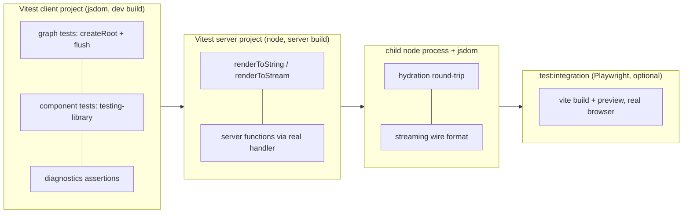
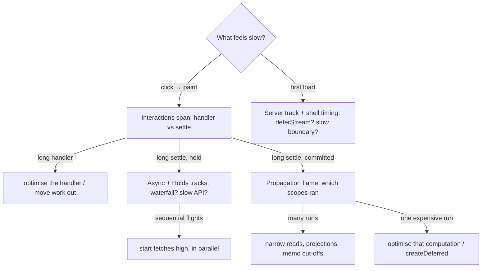

# Module 09 — Testing, Debugging and Performance

> **Executable proof:** [`examples/typescript/09-testing-debugging-performance.test.tsx`](../examples/typescript/09-testing-debugging-performance.test.tsx) and [`support/build-variant-probe.mjs`](../examples/typescript/support/build-variant-probe.mjs). The suite spawns real Node processes with different `--conditions` to prove which `solid-js` build each resolves and how it behaves.
>
> The whole track is itself the worked example: every module's suite follows the patterns below. Rendering-pipeline internals (style, layout, paint) are owned by `languages/css`.

---

## 1. The test harness

### 1.1 Two postures

`@solidjs/vite-plugin` configures Vitest for you. Its README states the rules this track's [`vitest.config.ts`](../vitest.config.ts) follows:

| Project | `environment` | Posture the plugin applies | Use for |
|---|---|---|---|
| `client` | `jsdom` (or `happy-dom`) | browser export conditions, DOM codegen, non-hydratable, **development build** | reactive core, components, control flow, async UI |
| `server` | `node` (or `edge-runtime`) | server export conditions, SSR codegen, `isServer === true`, request-event storage | `renderToString/Stream`, server functions, sessions |

The plugin inlines `solid-js`, `@solidjs/web` and their consumers (such as `@solidjs/testing-library`) so the whole graph resolves to one instance. With `test.projects`, it sets `sharedViteServer: false` so each project resolves its own posture (a Vitest 5 detail). It also adds `@testing-library/jest-dom` to `setupFiles` if installed.

**Without the plugin**, plain Node resolves `solid-js` to `dist/server.js` (proved: `probe([])`). A Jest or bare `node --test` setup that forgets the browser condition silently tests the server build: no reactivity, and setters warn `SERVER_WRITE`. This was the reason the old version of this track needed a custom `node --conditions=browser` command line, and why it was replaced.

### 1.2 Unit-testing the graph

Three rules, used in every suite of this track:

1. **Give primitives an owner.** Create them inside `createRoot`, return what the test needs, and dispose at the end. Unowned effects warn `NO_OWNER_EFFECT` and leak across tests.
2. **Write outside the root.** The root body is an owned scope; a write there throws `REACTIVE_WRITE_IN_OWNED_SCOPE` (Module 01). Return setters and call them from the test body.
3. **`flush()` before asserting**, or `await` a microtask. Writes are committed at the flush.

```ts
const { setCount, doubled, dispose } = createRoot((dispose) => {
  const [count, setCount] = createSignal(0);
  return { setCount, doubled: createMemo(() => count() * 2), dispose };
});
setCount(2);
flush();
expect(doubled()).toBe(4);
dispose();
```

### 1.3 Async without timers

Make every async dependency a **deferred** you settle by hand ([`support/diagnostics.ts`](../examples/typescript/support/diagnostics.ts) has `deferred()`, `tick()`, `settle()`). Then: trigger, `await settle()`, `flush()`, assert. For "wait until it settles" use `await resolve(() => value())` ([Module 06](./06-colorless-async.md)); for conditions, `until`. Never `setTimeout(…, 100)` in a test: it is slow and flaky.

### 1.4 Component tests

`@solidjs/testing-library@1.0.0-rc.2` (peer `solid-js >=2.0.0-0`) wraps `@testing-library/dom`:

```tsx
render(() => <Counter start={1} />);          // a FUNCTION returning JSX, not the element
fireEvent.click(screen.getByRole("button"));
flush();                                     // or: await screen.findByText(...)
expect(screen.getByRole("button").textContent).toBe("clicked 2");
```

Proved: right after `fireEvent.click` the DOM still shows the old text; after `flush()` it shows the new one. `findBy*` queries poll across microtasks, so they also see committed updates. Call `cleanup()` (or rely on auto-cleanup) between tests. `@solidjs/testing-library@0.8.x` is the Solid 1 version: check the major you install.

### 1.5 Asserting on diagnostics

Dev diagnostics are first-class test oracles. `OBSERVE.diagnostics.capture()` collects structured events (`code`, `severity`, `message`, `ownerPath`, `loc`) while code runs; every negative test in this track asserts a code that way (for example `STRICT_READ_UNTRACKED` for destructured props). The `@solidjs/diagnostics` package (`2.0.0-rc.19` on the `next` tag) builds Vitest matchers, budgets and an agent bridge on the same channel; with it installed, the Vite plugin serves `POST /__solid/diagnostics` on the dev server.

Effect-phase throws halt the reactive system (`REACTIVITY_HALTED`) globally. Call `resetErrorHalt()` in `afterEach` in suites that test error paths.

### 1.6 Testing patterns catalogue

| What to test | Pattern | Example in this track |
|---|---|---|
| a memo / derivation | `createRoot` → return setter → write outside → `flush()` → assert | M01 suite |
| an effect's side effect | spy in apply; assert after `flush()`; assert cleanup after `dispose()` | M02 "pattern: an apply half that owns an external resource" |
| a component's DOM | `render(() => <C/>)`, query by role/text, `fireEvent`, `flush()` or `findBy*` | M03, M09 |
| async UI | fake API returning hand-settled deferreds; `await settle(); flush()` | M06 `fakeApi` |
| races | settle deferreds out of order | M06 out-of-order test |
| optimistic flows | fake server with a pending-call queue completed by index | M07 `fakeServer` |
| server functions | `configureServerFunctionsClient({ fetch })` routed into the real `handleServerFunctionRequest` | M08 server suite |
| SSR output | Vitest `server` project (node environment) + `renderToString` / `renderToStream` | M08 server suite |
| hydration | child `node` renders hydratable SSR; jsdom hydrates hydratable DOM code | M08 round-trip suite |
| anti-patterns | `OBSERVE.diagnostics.capture()` + assert codes (negative) and `[]` (positive gate) | every suite; M09 "clean component" |
| performance regressions | `attribution.enable({ log: false })` + `costs()` / run counts | M09 profiling test |
| leaks | behavioural: after unmount, a write must not run anything from the component | M09 leak tests |

Two habits make these tests trustworthy. **Prefer behavioural assertions over internals**: count runs and observe DOM, do not inspect private fields that change between RCs. **Assert the negative too**: for every anti-pattern a module warns about, there is a test that triggers it and asserts the diagnostic, so an RC that silently drops the guard is noticed.

### 1.7 Worked example: testing a component with async data and an optimistic action

The component: a todo list loaded from an API, with an "add" button that shows the new row optimistically.

```tsx
// TodoList.tsx
export function TodoList(props: { api: Api }) {
  const [todos, setTodos] = createOptimisticStore(() => props.api.list(), [] as Todo[]);
  const add = action(function* (title: string) {
    const todo = { id: crypto.randomUUID(), title };
    setTodos((d) => { d.push(todo); });
    yield props.api.add(todo);
    refresh(todos);
  });
  return (
    <Errored fallback={(e) => <p role="alert">{e().message}</p>}>
      <Loading fallback={<p>loading…</p>}>
        <ul>
          <For each={todos} keyed={(t) => t.id}>{(t) => <li>{t().title}</li>}</For>
        </ul>
        <button onClick={() => add("new")}>add</button>
      </Loading>
    </Errored>
  );
}
```

The test, following §1.6 (a fake API with hand-settled calls, no timers, no network; `fakeServer` here is an illustrative variant of the M07 helper with a `failAdds` option, not a file in this track):

```tsx
it("shows the new todo at once and keeps it after the server confirms", async () => {
  const api = fakeServer([{ id: "1", title: "first" }]);       // M07's helper shape
  render(() => <TodoList api={api} />);
  expect(screen.getByText("loading…")).toBeTruthy();           // first load: the boundary owns it
  await settle(); flush();
  expect(screen.getAllByRole("listitem").map((li) => li.textContent)).toEqual(["first"]);

  fireEvent.click(screen.getByRole("button", { name: "add" }));
  flush();
  expect(screen.getAllByRole("listitem")).toHaveLength(2);     // optimistic

  await api.complete();                                        // server answers; refresh lands
  expect(screen.getAllByRole("listitem")).toHaveLength(2);     // confirmed, not duplicated
});

it("reverts and reports when the server rejects", async () => {
  const api = fakeServer([], { failAdds: true });
  render(() => <TodoList api={api} />);
  await settle(); flush();
  fireEvent.click(screen.getByRole("button", { name: "add" }));
  flush();
  expect(screen.getAllByRole("listitem")).toHaveLength(1);
  await api.complete();
  expect(screen.queryAllByRole("listitem")).toHaveLength(0);   // overlay discarded
});
```

The executable versions of both flows are the M07 tests "shows the optimistic row at once, then reconciles with the server truth" and "a failed action reverts the optimistic write and rejects its promise"; the snippet shows how they look when written against a component's public DOM rather than its internals.



## 2. Build variants are export conditions

`solid-js` and `@solidjs/web` publish several builds selected by **package export conditions** (ESM `exports` resolution is owned by `languages/javascript`):

| Conditions | Resolved build (proved) | `DEV` | `OBSERVE` | Owned-write guard |
|---|---|---|---|---|
| `browser` + `development` | `dist/solid.dev.js` | yes | yes | **throws** |
| `browser` + `observe` | `dist/solid.observe.js` | no | **yes** | compiled out |
| `browser` | `dist/solid.js` | no | no | compiled out |
| *(plain Node)* | `dist/server.js` | no | no | n/a (server) |
| `node` + `development` / `observe` | `dist/server.dev.js` / `server.observe.js` | | | |

Consequences:

- **Dev diagnostics do not exist in production.** An app that "works" in prod but throws `REACTIVE_WRITE_IN_OWNED_SCOPE` in dev has a real bug that prod merely hides (proved: the same probe throws in dev and is "allowed" in prod).
- **`observe` is the production-speed build with the diagnostics/attribution channels kept**, for error monitoring and performance tracing in production. Enable it with `solid({ observe: true })`; it also keeps compiler source names so owner paths read `<Home>` after minification.
- **Vite chooses for you**: `vite dev` and Vitest use the development build; `vite build` uses production unless `dev: true` or `observe: true`.
- **Dev/prod is the build variant, not `NODE_ENV`.** Server-function error sanitization ([Module 08](./08-ssr-and-start-mode.md)) follows the same rule.

### 2.1 Multiple Solid instances

Two copies of `solid-js` in one bundle (two versions, or one bundled into a library) create two independent reactive graphs: signals from one are invisible to effects from the other, and context lookups fail. The dev build detects and reports "Multiple Solid instances". The most common 2026 cause is installing `@solidjs/start@2.x` (which depends on `solid-js ^1.9`) next to Solid 2. Fix: `npm ls solid-js`, remove the extra copy, dedupe (`resolve.dedupe` in Vite), and make libraries declare `solid-js` as a **peer** dependency.

## 3. Debugging: "why did this run?"

The attribution engine is an opt-in module (`solid-js/attribution`, re-exporting `@solidjs/signals/attribution`); a build that never imports it never ships it, and in production it is an inert stub with the same surface.

```ts
import { attribution, why, subscriptions } from "solid-js/attribution";
const release = attribution.enable({ log: true });
// [why-run] effect "docTitle" ran (run 4)
//   ← memo "userLabel" changed (#6)
//     ← signal "notifications" write (#5) 2 → 3
subscriptions(sum);   // ["a", "b"]  — current dependency names
why(sum);             // re-run records with cause chains
release();
```

While enabled it also runs **cost checks** that emit diagnostics. Proved: an effect that copies `a` into `b` (a relay) is reported as `EFFECT_RELAY_TEAR` (the reader of both runs twice per change, once with a torn value), and `subscriptions(sum)` returns `["a", "b"]`. Codes worth knowing:

| Code | Finding | Typical fix |
|---|---|---|
| `EFFECT_RELAY_TEAR`, `EFFECT_WRITES_OWN_SOURCE` | effects used to sync derived state | `createMemo` / writable derived |
| `WASTED_RECOMPUTE`, `UNSTABLE_MEMO_OUTPUT` | memo inputs change but result doesn't / result is new-but-equal every run | `equals`, return stable references |
| `HOT_SCOPE_RERUNS`, `HOT_SCOPE_TIME`, `HOT_SCOPE_FANOUT` | per-frame signal leaking into many scopes | narrow reads, `createDeferred`, throttle at the source |
| `HUGE_FAN_IN`, `HUGE_FAN_OUT`, `WIDE_SCOPE_DEPS` | one computation reads thousands of sources / one source has thousands of readers | projections (O(1) selection), split stores |
| `UNSTABLE_LIST_IDENTITY`, `IMMUTABLE_UPDATE_IN_STORE` | rows recreated for equal data; store containers replaced by copies | keyed `<For>`, `reconcile`, draft writes |
| `ASYNC_WATERFALL`, `ABANDONED_FLIGHTS` | sequential fetches that could be parallel; request per keystroke | hoist fetches ("fetch high"), cancel, defer |
| `SILENT_HOLD`, `LONG_HOLD`, `STACKED_HOLDS`, `FALLBACK_FLASH` | responsiveness: a held write with no on-screen acknowledgement, a sub-150 ms spinner flash | `isPending` indicator, optimistic value, remove the boundary |

### 3.1 Profiling in code: `costs()` and `why()`

With the engine enabled, `costs()` returns two ranked tables: **scopes** (each memo/effect with `runs`, `selfMs`, `wastedMs` = time in runs whose value did not change, `overlayMs` = optimistic/held work) and **writes** (each source with the downstream re-run time it caused). `why(node)` returns re-run records whose `causes` chain back to the originating write. Verbatim shape from the suite (timings vary per machine):

```json
scopes: [{ "name": "heavy", "kind": "memo", "runs": 3, "selfMs": 35.9, "wastedMs": 0 }, { "name": "reader", … }]
writes: [{ "name": "a", "runs": 6, "downstreamMs": 36.2 }]
why(heavy).at(-1): { "nodeName": "heavy", "causes": [{ "kind": "write", "name": "a", "prev": "3", "value": "4" }],
                     "depsAdded": [], "depsRemoved": [], "selfMs": 14.9, "changed": true }
```

Proved: the expensive memo tops `scopes`, its source tops `writes`, and the last `why` record names the write. Use this in a performance regression test (assert run counts, not milliseconds, which are noisy in CI), or in the browser console during an investigation. Name your primitives (`{ name: "heavy" }`) or let the compiler's `sourceNames` pass do it, otherwise tables read `memo#12`.

### 3.2 Finding leaks

A leak in Solid is almost always **an owner-less computation kept alive by a long-lived source** (Module 01 §6.1). The two reliable detectors:

1. **Behavioural test** (proved): mount, unmount, then write to the shared source; nothing from the unmounted component may run. The negative test creates an effect after an `await` (owner lost) and observes it still running after unmount; the fixed version captures `getOwner()` before the await and re-enters it with `runWithOwner`, and runs nothing after unmount.
2. **Graph growth** in the browser: with attribution enabled, `graphSize()` reports roots, owners, computations, signals and edges reachable from registered roots, and the engine emits `GRAPH_GROWTH` when the live graph climbs across repeated visits to a route. (In this track's jsdom tests `graphSize()` reported zeros, so the behavioural test is the portable check; treat `graphSize` as a browser/devtools tool.)

Typical sources: subscriptions opened in a ref or event handler without cleanup; `createRoot` under `runWithOwner(null)` never disposed; module-scope stores that accumulate per-page entries; `from()` sources whose subscribe function does not return an unsubscribe.

## 4. Performance in Chrome DevTools

`@solidjs/web/performance-tracks` paints the attribution records as custom tracks in the Chrome Performance panel, in a `Solid` group: Interactions, Propagation (one span per scheduler drain, labelled by the writes that started it), Effects, Memos, Async, Holds, Navigations and Server (from `Server-Timing`). Diagnostics become markers on the Timings track. Under `vite dev`, `@solidjs/vite-plugin` enables the tracks automatically (`performanceTracks` option, default on in dev, off in build/preview/Vitest). In an observe production build, call `enablePerformanceTracks()` yourself.

### 4.1 Where Solid's costs actually are

| Cost | Driver | Lever |
|---|---|---|
| initial render | template cloning + one binding per dynamic hole; component bodies run once | static markup is nearly free; avoid needless wrapper components only when profiling says so |
| update | number of bindings whose sources changed | fine-grained reads (`store.a.x` not `deep(store)`), projections, memo cut-offs |
| list update | keyed reconciliation + DOM moves | stable identities, `reconcile`, `<Repeat>` for windows |
| hydration | adopting serialized values + claiming DOM; the "tracking run" re-executes computes synchronously | keep hydrated computes cheap; `ssrSource: "client"` for client-only work; `clientOnly` for heavy browser libraries |
| bundle | `@solidjs/web` element runtime, `dynamic()` tag support, attribution only if imported | `dynamicComponent` for component-only sources; never import attribution in prod unless using observe |

Benchmarks (the js-framework-benchmark keyed suite) consistently place Solid near vanilla JS; treat any specific number as version-dependent and re-measure for your own workload.

## 4.2 Reading the Solid tracks

A practical recipe for the Chrome Performance panel with `@solidjs/web/performance-tracks` (auto-enabled under `vite dev`):

1. Record the interaction (click, type, navigate). Find the **Interactions** track span: it shows input delay, handler time, and the settle (`committed` or `held`). A *silent hold* is drawn as a warning: the user saw nothing change while async work held the write.
2. Open the **Propagation** span below it. Its label names the writes that started the drain and how many runs they reached (`count 0 → 1 — click on button#next · 5 runs, 1 unchanged`). Underneath, each run is labelled by what made it run (`<TodoRow> › effect ← doubled`): the write's path through the graph as a flame chart.
3. Check **Effects** and **Memos** for wide spans (expensive scopes) and many thin repeated spans (hot scopes). "unchanged" runs are wasted compute: add an `equals` or a memo cut-off.
4. **Async** shows flights; staggered sequential flights are waterfalls. **Holds** shows how long writes waited on async.
5. Markers on the **Timings** track are diagnostics (`SILENT_HOLD — <Search>`); at `warn` or worse they appear in the Insights sidebar with a link to the repair guide.
6. On SSR pages, the **Server** track shows `Server-Timing` metrics (`solid-shell`, `solid-boundary`, `solid-invocation`) for the shell, each boundary the shell waited on, and server-function calls.



## 4.3 Production monitoring

| Need | Tool |
|---|---|
| errors caught by `<Errored>` boundaries | `configureClientErrors({ onError(error, { ownerPath, boundaryPath }) })` or `render(..., { onError })`; reported once per error object (proved) |
| uncaught errors (system halted) | `window.onerror` / `reportError` — `REACTIVITY_HALTED` hands the cause to the platform |
| server render and server-function errors | `configureServerErrors({ onError })` from `@solidjs/web`; start mode reports contained request failures through it |
| owner names and finding codes in production | the **observe** build (`solid({ observe: true })`), subscribe to `OBSERVE.diagnostics` and forward to your APM |
| real-user performance | observe build + `enablePerformanceTracks()` (Chrome) or the attribution `feedback()` tables (fallback flashes, holds, interactions) shipped to analytics |

The fallback UI rendered by a boundary is a handled failure: without the client error hook, nothing outside the app sees it in production.

## 4.4 CI setup for an RC dependency

- **Pin exact versions** and assert them in a test (this track's "RC churn guard").
- Run the suite in both Vitest projects (client and server) on every push; run `tsc` (TypeScript 7) separately.
- A **canary job** installs `solid-js@next @solidjs/web@next @solidjs/signals@next` and runs the suite with `continue-on-error`, so an RC that changes behaviour is noticed before you bump.
- Lint with `eslint-plugin-solid` (`0.18.x`) using its `configs/v2` or `configs/v2-strict` export, which encode the 2.0 rules (no destructured props, split effects, `class` over `classList`).
- Keep end-to-end tests (Playwright against `vite build && vite preview`) in a separate `test:integration` job; they catch hydration and streaming issues that jsdom cannot (real parser, real network chunking).

## 4.5 "Nothing updates": a debugging checklist

| Check | How | Typical fix |
|---|---|---|
| Did the write happen? | log in the handler; `why(node)` shows no write | the handler isn't bound (lowercase `onclick`, handler expression evaluated once) |
| Did you read before the flush? | the value is right a tick later | `flush()` at an imperative boundary, or read in JSX/effects |
| Is the read tracked? | `subscriptions(memo)` lacks the source; `STRICT_READ_UNTRACKED` | read inside JSX/memo/compute, not in a body, callback top, or apply half |
| Was the read after an `await`? | `UNTRACKED_READ_AFTER_AWAIT` | read before the first `await` |
| Is the value equal? | default `===` cut-off; custom `equals` too coarse | new object, or fix `equals` |
| Was a prop passed as a function or destructured? | child receives a function / frozen value | `value={x()}`, `props.value` |
| Is a store mutated outside its setter? | `STORE_WRITE_OUTSIDE_SETTER`; object mutated after hand-over | write through the setter with fresh objects |
| Is the write held? | `isPending(() => x())` is true; Holds track shows it | async under the write is still loading: show `isPending`, or check the slow source |
| Are there two Solid copies? | "Multiple Solid instances"; `npm ls solid-js` | dedupe |
| Has the system halted? | `REACTIVITY_HALTED` in the console | an error escaped every boundary; add `<Errored>` and fix the throw |

## 4.6 Benchmarking honestly

Micro-benchmarks of signals in isolation (millions of writes per second) say little about an app; what matters is the work a realistic interaction causes. Measure that first with `costs()`, then optimise the top scope.


- Use the **production** build (or observe if that is what ships); dev builds carry guards and diagnostics and are several times slower.
- Measure **interactions end to end** (input → next paint) in a real browser; jsdom timings are meaningless for rendering.
- Separate **create**, **update**, **swap/reorder**, **remove** and **memory** costs; Solid's profile differs per operation (cheap updates, comparatively more work at creation for bindings and owners).
- Warm up, repeat, report medians and spread; pin CPU throttling for comparisons.
- When comparing frameworks, use the js-framework-benchmark keyed suite as the shared methodology and cite the exact version and date; results move between releases (and 2.0 RCs).

## 5. Then vs now

| 1.x | 2.0 RC |
|---|---|
| `vite-plugin-solid` + `solid-jest` / manual conditions | `@solidjs/vite-plugin` configures Vitest postures (client/server projects) |
| `@solidjs/testing-library` 0.8 | 1.0.0-rc.2 for Solid 2 |
| tests could assert right after a write | `flush()` (or await) before asserting |
| dev warnings as free-form console text | coded diagnostics with a structured channel (`OBSERVE.diagnostics`) |
| Solid DevTools extension (community) | built-in attribution engine + Chrome performance tracks |
| dev vs prod build only | dev, **observe**, prod tiers |

## 5.1 Failure modes proved by negative tests

| Failure | Test (`09-testing-debugging-performance.test.tsx`) |
|---|---|
| testing the server build by accident | "plain Node resolves the server build" |
| relying on dev-only guards in prod | "production: … the owned-write guard is compiled out" |
| relay effects | "…EFFECT_RELAY_TEAR" |
| owner lost across `await` → leak | "an effect created after an await (no owner) outlives its component" |
| RC drift | "installed RC versions match the exact pins" |

## 6. Production failure modes

| Symptom | Cause | Fix |
|---|---|---|
| Tests pass, app broken (or vice versa) | tests resolved the server build | use the plugin's Vitest integration or set browser + development conditions |
| Flaky async tests | real timers / network | deferreds + `settle()` + `flush()`; `resolve()` |
| Tests leak into each other | unowned effects, no `dispose`, halted system | `createRoot` + dispose, `cleanup()`, `resetErrorHalt()` |
| Dead reactivity in one library's components | duplicate `solid-js` | dedupe; peer dependencies |
| Dev throws, prod "fine" | dev-only guard caught a real bug | fix the cause; never ship with dev guards silenced |
| No owner names in prod error reports | production build strips names | observe build with source names |

---

## Interview Drill

<details><summary>1. How do you unit-test a memo in Solid 2.0?</summary>

Create it under `createRoot`, return its setter and accessor, write outside the root (writes inside the root body throw), call `flush()`, assert, then dispose. For async memos, use hand-settled deferreds and `await resolve(() => memo())`.
</details>

<details><summary>2. Why did many Solid test setups silently test the wrong code?</summary>

`solid-js` publishes server and browser builds via export conditions; plain Node picks the server build, which isn't reactive. Test runners must resolve the browser (and development) conditions; `@solidjs/vite-plugin` does it for Vitest, and a separate `environment: "node"` project gets the server posture deliberately.
</details>

<details><summary>3. What is the observe build for?</summary>

Production-speed code that keeps the diagnostics and attribution channels (and compiler source names), so error monitoring and performance tracing work in production. Dev adds guards and warnings; prod strips everything.
</details>

<details><summary>4. A dashboard is slow. How do you find out why with Solid's own tools?</summary>

Run in dev or observe, enable `solid-js/attribution` (or record a Chrome Performance trace with the Solid tracks), and read which writes triggered which re-runs. Look for cost diagnostics: `HOT_SCOPE_RERUNS`, `HUGE_FAN_OUT`, `EFFECT_RELAY_TEAR`, `UNSTABLE_LIST_IDENTITY`, `ASYNC_WATERFALL`. Fix with narrower reads, projections, memos instead of relays, keyed lists and parallel fetches.
</details>

<details><summary>5. What causes "Multiple Solid instances" and how do you fix it?</summary>

Two copies of `solid-js` in the graph, each with its own reactive runtime: signals created by one are invisible to the other. Causes include mismatched versions (e.g. `@solidjs/start@2` pulling Solid 1.9 next to Solid 2) and libraries bundling Solid. Fix by deduping, pinning one version and making libraries use a peer dependency.
</details>

<details><summary>7. How do you detect a memory leak in a Solid component?</summary>

Behaviourally: mount, unmount, write to a source the component read; nothing it created may run. In the browser, watch `graphSize()` across repeated route visits (`GRAPH_GROWTH`). The usual cause is a computation created without an owner (after an `await`, in an event handler) kept alive by a long-lived source; capture `getOwner()` before awaiting and use `runWithOwner`.
</details>

<details><summary>8. How would you find which state change made an interaction slow?</summary>

Enable attribution (or record a trace with the Solid tracks): `costs().writes` ranks sources by the downstream time they caused, `costs().scopes` ranks computations by self time, and `why(node)` shows the cause chain to the originating write. Then narrow reads, add cut-offs or move work off the hot path.
</details>

<details><summary>9. How do you report errors that an `<Errored>` boundary handled?</summary>

`configureClientErrors({ onError })` (or `render`'s `onError` option): it fires once per error object with the owner path where it was thrown and the boundary path where it was caught. Uncaught errors go to `reportError`/`window.onerror`.
</details>

<details><summary>6. Why use diagnostics in tests?</summary>

They turn rule violations (destructured props, owned writes, overwritten input) into assertable codes, so negative tests prove an anti-pattern is detected, and positive tests prove the fix emits nothing.
</details>

<details><summary>10. How do you turn "this component has no reactivity anti-patterns" into a CI check?</summary>

Render and exercise it inside `OBSERVE.diagnostics.capture()` in the dev build and assert the captured codes are `[]`, alongside negative tests that prove each guard still fires.
</details>
