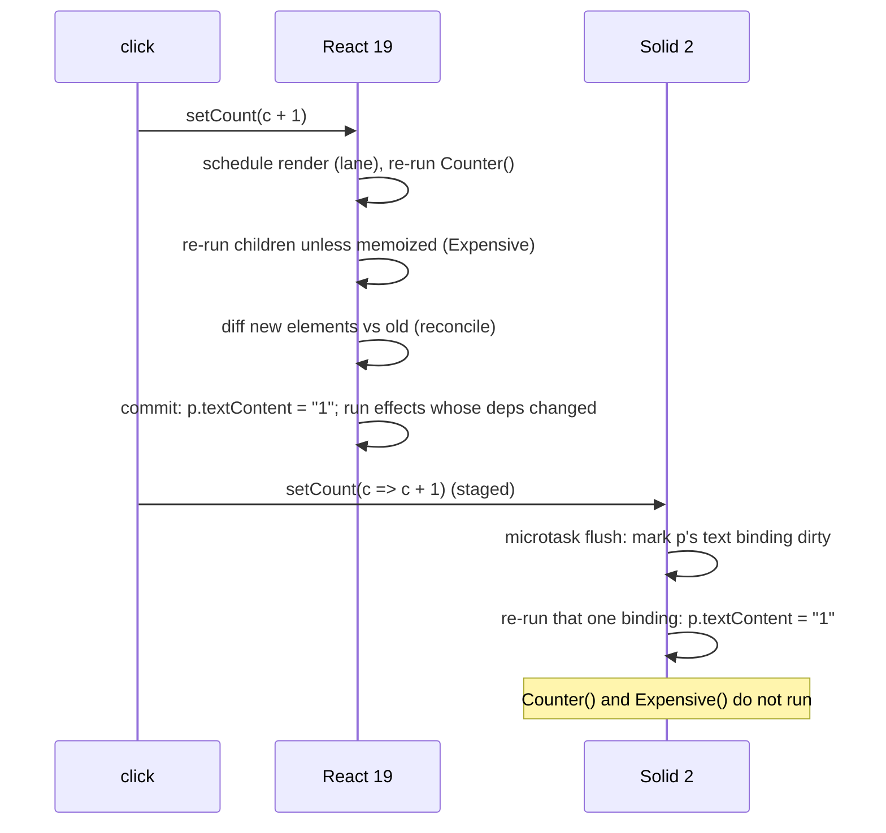

# Module 10 — Migration 1.x → 2.0, Version History, and React vs Solid

> **Executable proof:** [`examples/typescript/10-solid1-vs-solid2.test.ts`](../examples/typescript/10-solid1-vs-solid2.test.ts) installs `solid-js@1.9.17` under the npm alias `solid-js-1` **only for this comparison** and runs the same scenarios on both runtimes. (Two runtimes in one *app* is the "Multiple Solid instances" bug of [Module 09](./09-testing-debugging-performance.md); in a test that imports them as separate namespaces it is a controlled experiment.)
>
> This module is the single home of the **React vs Solid mental-model comparison** for the whole repository. The React track ([technologies/react](../../react/README.md)) links here and owns React internals (Fiber, lanes, RSC/Flight, the React Compiler).

---

## 1. Version history

| Release | Date (npm) | What changed for practitioners |
|---|---|---|
| 1.0 | 2021-06-28 | stable fine-grained reactivity, JSX compiled to DOM templates, stores, `createResource`, `<Suspense>` |
| 1.1 – 1.7 | 2021-08 → 2023-03 | incremental minors (release dates from npm; per-minor feature notes not re-verified for this track) |
| 1.8 | 2023-10-09 | the line SolidStart 1.0 shipped on (unverified: see the SolidStart changelog) |
| 1.9 | 2024-09-24 | last 1.x minor; `1.9.17` (2026-10-07) is npm `latest` |
| 2.0.0-experimental.* | 2025-02 → 2025 | `@solidjs/signals` rewrite previewed |
| 2.0.0-beta.0 → beta.33 | 2026-03-03 → 2026-08-11 | API converges: split effects, draft stores, `Loading`/`Errored`/`Reveal`, actions |
| 2.0.0-rc.0 | 2026-08-12 | release candidate line; `rc.19` on 2026-10-27, roughly every 2–5 days |
| 2.0 GA | not announced | the official docs say the RC APIs "may change before the stable release" |

Companion packages for the 2.0 line (verified 2026-10-28): `@solidjs/web`, `@solidjs/signals`, `@solidjs/compiler`, `@solidjs/babel-plugin` at `2.0.0-rc.19` (`next` tag); `@solidjs/vite-plugin@3.0.0-next.52`; `@solidjs/router@2.0.0-next.43`; `@solidjs/testing-library@1.0.0-rc.2`; `@solidjs/meta@1.0.0-next.2`; `eslint-plugin-solid@0.18.1` ships `configs/v2` and `configs/v2-strict`.

**RC discipline.** APIs have changed between RCs (for example the 2026-10-06 note deferring `<Loading on>` re-arm semantics). Pin exact versions (`"solid-js": "2.0.0-rc.19"`, never `^2.0.0-rc`), bump deliberately, and re-run the suite. This track's Module 09 suite asserts the pins.

## 2. Ecosystem compatibility (as of 2026-10-28)

Peer ranges read from npm. "2.0-ready" means a published version peers on `solid-js` 2.0 RCs.

| Package | Solid 1.x line | Solid 2.0 line | Notes |
|---|---|---|---|
| `@solidjs/start` | `2.1.0` (`latest`) — peers `solid-js ^1.9.15` | **none**; use `@solidjs/vite-plugin` start mode | the 2.x *Start* major is a Solid **1.9** package |
| `@solidjs/router` | `1.0.0` | `2.0.0-next.43` | |
| `vite-plugin-solid` → `@solidjs/vite-plugin` | `vite-plugin-solid@2.11.x` | `@solidjs/vite-plugin@3.0.0-next.52` | renamed |
| `@solidjs/testing-library` | `0.8.10` | `1.0.0-rc.2` | |
| `@solidjs/meta` | `0.29.4` | `1.0.0-next.2` | head tags; `useHead` also in `@solidjs/web` |
| `@tanstack/solid-query` | `5.105.0` | `6.0.0-rc.5` (peers `>=2.0.0-rc.13`) | |
| `@tanstack/solid-router` | `1.170.x` | `2.0.0-rc.9` (peers `>=2.0.0-rc.16`) | |
| `@kobalte/core` | `0.13.14` | `2.0.0-alpha.4` (pins `2.0.0-rc.16` exactly) | will conflict with rc.19 until it bumps |
| `@solid-primitives/*` | `latest` | `next` tags (e.g. `storage@5.0.0-next.7`) | per package |
| `@ark-ui/solid` | `5.39.x` | `6.0.0-next.0` still peers `solid-js >=1.6.0` | unverified 2.0 support |
| Panda CSS | `jsxFramework: "solid"` | | owned by the `panda-css` track |

Before adopting Solid 2 in production, check every dependency's peer range; an exact-pinned peer (Kobalte's alpha) forces you onto its RC or into an override.

## 3. Migration map

Each row links to the module with the full treatment and is proved either there or in this module's suite.

| Area | 1.x (≤ 1.9) | 2.0 RC | Module |
|---|---|---|---|
| Imports | `solid-js/web`, `solid-js/store`, `solid-js/h`, `solid-js/html` | `@solidjs/web`, `solid-js`, `@solidjs/h`, `@solidjs/html` | 03 |
| JSX types | `jsxImportSource: "solid-js"` | `"@solidjs/web"` | 03 |
| Batching | sync writes, `batch()` | microtask commits, `flush()`; `batch` removed (proved) | 01 |
| Read after write | new value (proved) | committed value until flush (proved) | 01 |
| Write-back | `createComputed` (proved working in 1.9) | removed; `createSignal(fn)`, `createStore(fn)`, memo | 01 |
| Writes in scope | allowed | `REACTIVE_WRITE_IN_OWNED_SCOPE` (proved) | 01 |
| Nested roots | detached (proved) | owned by parent (proved) | 01 |
| Effects | one function, body tracked (proved) | `createEffect(compute, apply)`; one-arg form is `MISSING_EFFECT_FN` (proved) | 02 |
| `on()` helper | explicit deps | removed; compute half is the dependency list | 02 |
| Lifecycle | `onMount` + `onCleanup` | `onSettled(() => { …; return cleanup })` | 02 |
| Errors | `onError`, `catchError`, `<ErrorBoundary>`, `resetErrorBoundaries` | effect `error` arm, `<Errored>` (self-healing) | 02, 06 |
| Props helpers | `mergeProps`, `splitProps` | `merge` (`undefined` overrides), `omit` | 03 |
| Classes/directives | `classList`, `use:`, `on:`, `attr:`, `bool:` | `class` object/array, `ref={dir()}`, `onClick`, attributes; old forms are compile errors | 03 |
| Lists | `<For>` + `<Index>`, `indexArray` | `<For keyed>` three modes, `<Repeat>`, `mapArray` | 04 |
| Dynamic | `<Dynamic>`, `createDynamic` | `dynamic()` factory (`<Dynamic>` deprecated) | 04 |
| Context | `<Ctx.Provider>`, `T \| undefined` | `<Ctx value>`, `ContextNotFoundError`, typed `T` | 04 |
| Stores | path setters, `produce`, `createMutable`, `unwrap`, `createSelector` | draft setters, `storePath` helper, `snapshot`, `createProjection` | 05 |
| Async | `createResource`, `.loading`, `.error`, `refetch`, `mutate` | async memos/projections, `isPending`, `<Errored>`, `refresh`, optimistic + `action` | 06, 07 |
| Boundaries | `<Suspense>`, `<SuspenseList>` | `<Loading>` (+ `on`), `<Reveal>` | 06 |
| Transitions | `startTransition`, `useTransition` | built in; holds | 06, 07 |
| Full stack | `@solidjs/start` 1.x (Vinxi) | `@solidjs/vite-plugin` start mode; `@solidjs/web` server APIs | 08 |
| Tooling | `vite-plugin-solid`, `babel-preset-solid` | `@solidjs/vite-plugin`, `@solidjs/compiler` (Oxc) or `@solidjs/babel-plugin` | 03, 09 |

### 3.1 Migration procedure

1. **Inventory.** `npm ls solid-js`; list every Solid-ecosystem dependency and its 2.0 status (§2). Blockers (a UI kit with no 2.0 line) decide the timeline.
2. **Toolchain first.** Replace `vite-plugin-solid` with `@solidjs/vite-plugin`, set `jsxImportSource: "@solidjs/web"`, Node ≥ 22.12, Vite 8/9. Add `eslint-plugin-solid` `configs/v2`.
3. **Mechanical renames.** Imports, `Suspense→Loading`, `ErrorBoundary→Errored`, `SuspenseList→Reveal`, `Index→For keyed={false}`, `mergeProps→merge`, `splitProps→omit`, `unwrap→snapshot`, `onMount→onSettled`, `Ctx.Provider→Ctx`, `classList→class`, `use:x={v}→ref={x(v)}`. The compiler errors on removed namespaces and tells you the replacement.
4. **Semantic rewrites** (where bugs hide): split every effect (move reads to compute); replace `createResource` with async memos under `<Loading>`; replace `.loading` checks (first load is the boundary's job, `isPending` only for changes); move every write out of owned scopes; convert path setters; replace `createComputed`.
5. **Timing audit.** Grep for setter calls followed by reads in the same function (`setX(…); … x()`), and for tests that assert right after a write. Add `flush()` only at real imperative boundaries.
6. **SSR audit.** Remove module-scope state; move to providers and the request event (Module 08).
7. **Run the dev build and fix every diagnostic.** Never silence a code; each one names a real bug.
8. **Pin exact RC versions** and keep a CI job against `solid-js@next` that is allowed to fail.

**Pitfalls of a half-migrated codebase:** two Solid versions in the bundle (dead reactivity); 1.x libraries that call `createEffect(fn)` (throws `MISSING_EFFECT_FN`); libraries that rely on synchronous reads after writes; `@solidjs/start@2` pulled in by habit.

## 4. React 19 vs Solid 2: the mental models

React (19.3.1 on npm, 2026-10-28) and Solid share JSX, components, context, Suspense-like boundaries and actions, so code *looks* alike. The execution models are opposites.

### 4.1 Unit of re-execution

| | React 19 | Solid 2 |
|---|---|---|
| What re-runs on state change | the **component function** (and, by default, its children) | only the **bindings, memos and effects** that read the changed signal |
| Component body | a render function, called many times | a setup function, called **once** |
| Reconciliation | diff a new element tree against the previous one (Fiber) | none for updates; fine-grained bindings write the DOM directly; lists use keyed mapping |
| Dependencies | declared (`useEffect(fn, [a, b])`, `useMemo`) or inferred by the React Compiler | recorded automatically when read |
| Memoisation | needed to stop re-render cascades (`memo`, `useMemo`, `useCallback`, or the React Compiler) | rarely needed; memos are for expensive or shared derivations |
| Stale closures | a classic bug (closures capture one render's values) | not a thing: accessors always read the current value |
| Hooks rules | call order must be stable; no hooks in conditions | primitives can be created anywhere under an owner |
| Props | plain values, destructuring is idiomatic | getters; destructuring breaks reactivity |
| Conditionals/lists | `cond && <X/>`, `array.map` | `<Show>`, `<For>` (body runs once) |

### 4.2 Execution trace of one click

The same counter, `count` → `
{count}
` plus a sibling `<Expensive />`:

Cost model: React's update cost grows with the size of the re-rendered subtree (bounded by memoisation); Solid's grows with the number of affected bindings. Solid pays more up front per binding (graph nodes) and less per update.

### 4.3 Async, transitions and actions

| | React 19 | Solid 2 |
|---|---|---|
| Async read | `use(promise)` inside a component, with `<Suspense>`; promise identity must be stable across renders (cache it) | async memo; the accessor is the API; identity handled by the graph |
| Loading UI | `<Suspense fallback>`; a transition keeps old UI, otherwise the fallback re-appears | `<Loading>` covers first load only; revalidation keeps content; `on` re-arms deliberately |
| Pending UI | `useTransition` → `isPending`, `useDeferredValue` | `isPending(() => x())`, `latest`, `createDeferred` |
| Transitions | opt-in (`startTransition`) | every write that leads to async is held (built in) |
| Mutations | Actions (`<form action>`, `useActionState`), `useOptimistic` | `action(function*)`, `createOptimistic`/`createOptimisticStore`, `refresh`, `affects`, `until` |
| Errors | error boundaries (class components or framework wrappers) | `<Errored>` with `reset`; self-healing |
| Server | RSC + Flight protocol, `"use client"` boundaries, Server Functions | server functions (`"use server"`), streaming SSR + hydration; experimental server components without `"use client"` |

### 4.4 When each wins

- **Solid** shines when updates are frequent and localized (dashboards, editors, real-time data), when bundle and runtime overhead matter, and when the team accepts its rules (no destructuring, control-flow components, read-lag semantics).
- **React** wins on ecosystem breadth, hiring, mature RSC tooling (Next.js), React Native, and when the React Compiler removes most manual memoisation.

### 4.5 Translation table for React developers

| React habit | Solid 2 equivalent | Trap |
|---|---|---|
| `const [x, setX] = useState(0)` | `const [x, setX] = createSignal(0)` | read with `x()`; reads lag writes |
| `useMemo(() => f(a), [a])` | `createMemo(() => f(a()))` | no dependency array |
| `useEffect(() => { sub(); return unsub }, [a])` | `createEffect(() => a(), (v) => { sub(v); return unsub })` | reads in compute, effects never compare |
| `useEffect(() => {...}, [])` | `onSettled(() => { …; return cleanup })` | |
| `useRef` | `let el; 
` or a ref callback | refs run before attach |
| `{cond && <X/>}` / early return | `<Show when={cond()}>` | early returns run once |
| `items.map(i => <Row key={i.id} />)` | `<For each={items()} keyed={(i) => i.id}>` | callback body runs once per row |
| `function C({ title })` | `function C(props)` + `props.title` | destructuring freezes |
| `<Ctx.Provider value>` | `<Ctx value>` | default-less context throws |
| `use(promise)` + `<Suspense>` | async memo + `<Loading>` | |
| `useOptimistic` | `createOptimistic` inside an `action` | |

---

## Interview Drill

1. Name the three Solid 2.0 changes most likely to break a working 1.x app silently.

(1) Reads lag writes: code that reads right after a write sees the old value. (2) `undefined` in `merge` overrides defaults instead of being skipped. (3) Split effects: a mechanical port that leaves reads in the apply half tracks nothing. Loud breaks (removed APIs, owned writes, one-arg effects) surface as errors.

2. Why did Solid 2.0 adopt microtask batching?

So each commit presents one consistent snapshot to all compute halves before side effects run, so writes that start async work can be held as transitions, and so batching is never forgotten. The cost is that reads lag writes until the flush.

3. Should a team migrate a production app to Solid 2 now?

It is an RC with no GA date and frequent releases, and key ecosystem packages (SolidStart, some UI kits) lack 2.0-compatible versions. Prototype and migrate incrementally behind exact pins with the dev build's diagnostics clean; production adoption depends on the dependency audit and tolerance for RC churn.

4. Explain why a React component re-renders and a Solid component doesn't.

React models UI as a function of state and re-executes the component to get a new element tree, then diffs it. Solid runs the component once to build a graph; updates flow along graph edges directly to the DOM bindings that read the changed signal, so there is nothing to re-execute or diff.

5. Why are stale closures a React problem but not a Solid problem?

React closures capture the values of one render; a callback created in render N sees render N's state. Solid closures capture accessors, which always read the current value, and the component body never re-runs to create new closures.

6. Compare `use(promise)` + Suspense with Solid's async memo + Loading.

React suspends the component on a promise that must be cached for stable identity across re-renders; a non-transition update can show the fallback again. Solid puts async in the graph: the memo owns the promise, readers see "not ready", `<Loading>` covers only first load, revalidation keeps content, and `isPending` reports changes.

7. What does `@solidjs/start@2.1.0` support?

Solid 1.9: it peers on `solid-js ^1.9.15` and router `<2`. Solid 2's full-stack story is `@solidjs/vite-plugin` start mode.

