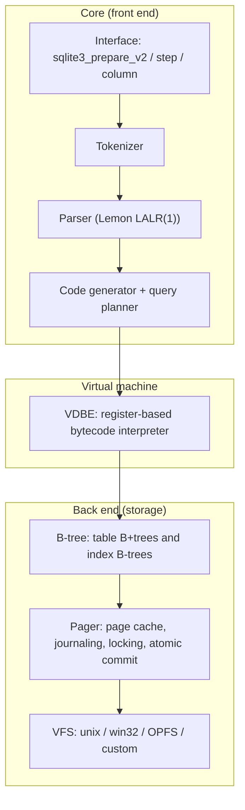

# Module 01: What SQLite Is, Its Architecture, Bindings and the CLI

SQLite is the most widely deployed database engine in the world, and the one engineers most often misjudge. Some treat it as a toy for tests. Others treat it as a drop-in for PostgreSQL. Neither view holds up. This module defines precisely what SQLite is, shows the layered architecture that the rest of the track takes apart, and shows why "which SQLite?" is a real question in every codebase. Every binding ships its own copy of the engine, with its own version and its own compile-time defaults.

> **Owned elsewhere.** Data models and relational algebra are taught in [architecture/data-systems Module 01](../../../architecture/data-systems/modules/01-data-models-and-query-languages.md). This module covers only the SQLite realisation.

---

## 1. Formal definition

**SQLite** is an _in-process_, _serverless_, _zero-configuration_, _transactional_ SQL database engine. It stores one complete database (schema, tables, indexes) in **one ordinary file** with a documented, cross-platform format. Transient side files (`-journal`, or `-wal` and `-shm`) exist while it runs.

Each adjective has an operational meaning:

| Property | Operational meaning | Consequence |
| --- | --- | --- |
| In-process | The engine is a C library linked into your program. A query is a function call, not a network round trip. | Latency per statement is microseconds, so the "N+1 query problem" is far milder than with a client/server DBMS. |
| Serverless | No daemon owns the file. Every process that opens it runs its own copy of the engine and coordinates through OS file locks and, in WAL mode, a shared-memory index. | Coordination is only as good as the filesystem's locking. Network filesystems break this assumption ([Module 09](./09-application-concurrency.md)). |
| Zero-configuration | There is nothing to install, start, or grant. `sqlite3_open_v2()` on a path is the whole setup. | Defaults matter enormously, and they are decided at **compile time** by whoever built your binding (§ 4). |
| Transactional | Every statement runs inside a transaction. ACID holds even across power loss, provided the OS and disk honour `fsync()`. | You get serializable isolation by default, because there is only one writer at a time ([Module 05](./05-transactions-locking-and-rollback-journal.md)). |
| Single file | The database is a byte-addressable file of fixed-size pages ([Module 04](./04-file-format-and-b-trees.md)). | Backup by copying a file is _possible but dangerous_ while connections are live ([Module 10](./10-durability-backup-and-operations.md)). |

The source is in the **public domain**, not merely open source. The project does **not accept outside code contributions**, so that every line has a clean provenance. That policy is why forks such as libSQL exist ([Module 12](./12-libsql-and-turso.md)). The developers have committed to supporting the file format and API through the year 2050. The US Library of Congress lists SQLite as a recommended storage format for datasets.

### 1.1 "SQLite competes with `fopen()`"

The official guidance ([Appropriate Uses For SQLite](https://www.sqlite.org/whentouse.html)) frames the choice precisely: _"SQLite does not compete with client/server databases. SQLite competes with fopen()."_ The decision checklist from that page, restated as a procedure:

```text
CHOOSE-ENGINE(workload)
  1  if the data is separated from the application by a network
  2      return CLIENT/SERVER            ▹ locking over network filesystems is unreliable
  3  if many concurrent writers cannot take turns
  4      return CLIENT/SERVER            ▹ SQLite admits exactly one writer at a time
  5  if the dataset approaches terabytes or exceeds one filesystem
  6      return CLIENT/SERVER            ▹ 281 TB hard ceiling; real filesystems cap lower
  7  return SQLITE                        ▹ "almost always a better solution"
```

Where SQLite fits well, per the same page: embedded devices and IoT, the **application file format** (replacing File → Save), websites under roughly 100K hits per day (a conservative figure), data analysis, a cache of enterprise data, a server-side database _behind one application server_, a data-transfer format, an archive container, a replacement for ad-hoc files, internal or temporary databases, and stand-ins for an enterprise DBMS in demos and tests.

The interview-grade nuance is that line 3 says _cannot take turns_. A web app with 500 requests per second, of which 20 write and each write commits in 200 µs, uses 0.4 % of the writer's capacity. That is turn-taking, and SQLite handles it. A queue consumer with 64 workers that each hold a write transaction open across a network call cannot take turns. That workload needs a different design or a different engine.

### 1.2 SQLite as an application file format

The use case people most often overlook is the [application file format](https://www.sqlite.org/appfileformat.html): the document a desktop or mobile app saves _is_ a SQLite database. Compared with a ZIP of XML or a custom binary format, it gives:

- **Atomic saves.** A crash mid-save leaves the previous version intact, because commits are atomic ([Module 05](./05-transactions-locking-and-rollback-journal.md)).
- **Incremental updates.** Changing one record rewrites a few pages, not the whole document.
- **Queryable content.** Tools and scripts can read the file with SQL, without your application.
- **Self-identification.** Two header fields are reserved for the application:

```sql
PRAGMA application_id = 0x5A544F31;   -- 4 bytes at header offset 68; `file(1)` can recognise it
PRAGMA user_version   = 7;            -- 4 bytes at offset 60; the schema version your app manages
```

`user_version` is the conventional migration counter ([Module 10](./10-durability-backup-and-operations.md)). Both are read and written atomically with the rest of the header, so a migration that bumps `user_version` in the same transaction as its DDL either happens completely or not at all.

---

## 2. The architecture: from SQL text to disk pages

SQLite's [architecture](https://www.sqlite.org/arch.html) is a strict stack. Knowing the layers lets you place every later topic: affinity lives in the code generator, locking in the pager, page layout in the B-tree layer.



| Layer | Responsibility | Taught in |
| --- | --- | --- |
| Tokenizer / parser | SQL text → parse tree. The parser is generated by **Lemon**, SQLite's own LALR(1) parser generator, which is re-entrant and thread-safe. | [Module 03](./03-sql-dialect-and-features.md) |
| Code generator / planner | Parse tree → bytecode program. It chooses indexes and join order (the NGQP) and applies type affinity. | [Module 02](./02-type-system-and-schema.md), [Module 07](./07-query-planner-and-vdbe.md) |
| VDBE | Executes the bytecode one opcode at a time. `EXPLAIN` prints the program. | [Module 07](./07-query-planner-and-vdbe.md) |
| B-tree | Maps a root page number to an ordered key/value store on pages. Tables are B+trees keyed by `rowid`; indexes are B-trees keyed by the index columns plus `rowid`. | [Module 04](./04-file-format-and-b-trees.md) |
| Pager | Caches pages, keeps the rollback journal or WAL, takes file locks, and implements atomic commit. | [Modules 05](./05-transactions-locking-and-rollback-journal.md) and [06](./06-wal-mode.md) |
| VFS | Portability layer for open, read, write, sync, lock, and shared memory. Browser builds swap in an OPFS VFS. | [Modules 10](./10-durability-backup-and-operations.md) and [11](./11-edge-and-distributed-sqlite.md) |

### 2.1 The object model every binding wraps

The C API has two core objects. A **connection** (`sqlite3*`) is one open handle to one or more database files, with its own schema cache, page cache and transaction state. A **prepared statement** (`sqlite3_stmt*`) is one compiled bytecode program.

```text
RUN-QUERY(conn, sql, params)
  1  stmt ← sqlite3_prepare_v2(conn, sql)        ▹ tokenize, parse, plan, emit bytecode
  2  for each (i, v) in params
  3      sqlite3_bind_*(stmt, i, v)               ▹ values never pass through the SQL text
  4  rows ← []
  5  loop                                         ▹ invariant: rows holds every row stepped so far
  6      rc ← sqlite3_step(stmt)                  ▹ run the VDBE until the next ResultRow or Halt
  7      if rc = SQLITE_ROW
  8          rows.append(sqlite3_column_*(stmt, 0..n-1))
  9      else if rc = SQLITE_DONE
 10          break
 11      else
 12          raise error(rc)                      ▹ e.g. SQLITE_BUSY, SQLITE_CONSTRAINT
 13  sqlite3_reset(stmt)                          ▹ reusable; or sqlite3_finalize to free it
 14  return rows
```

Three practical facts follow from this loop.

- **Prepare once, step many.** Planning costs far more than one step for short queries. better-sqlite3 and `node:sqlite` both expose `prepare()` so that you can cache statements. `node:sqlite`'s `createTagStore()` is an LRU of prepared statements keyed by template literal.
- **Binding is the injection defence.** Parameters go into VDBE registers, not into the SQL text. String concatenation reintroduces injection. The mechanics of SQL injection are owned by [technologies/postgres Module 10](../../postgres/modules/10-server-programming-and-security.md).
- **A statement that has not been reset holds its read transaction.** In WAL mode an un-reset `SELECT` pins a snapshot and blocks checkpoints from completing ([Module 06](./06-wal-mode.md)). An abandoned iterator is a production bug.

### 2.2 Threading modes

SQLite is compiled in one of three threading modes. The mode decides whether _you_ or _SQLite_ serialises access to a connection.

| `SQLITE_THREADSAFE` | Mode | Rule |
| --- | --- | --- |
| 0 | Single-thread | No mutexes at all. Unsafe with more than one thread. |
| 2 | Multi-thread | Many threads may use SQLite, but **one connection must never be used by two threads at the same time**. This is better-sqlite3's build. |
| 1 | Serialized (the default) | A connection may be shared between threads; SQLite serialises calls with a mutex. This is `node:sqlite`'s build. |

Sharing a connection between threads, even in serialized mode, gives no parallelism: the mutex makes the calls take turns. The scalable pattern is **one connection per thread** ([Module 09](./09-application-concurrency.md)).

---

## 3. Bindings and the version you actually run

Every binding compiles the SQLite _amalgamation_ (one `sqlite3.c` file) into itself. Your application therefore runs the version the binding's maintainers chose, with the compile-time options they chose. The test suite of this track proves this in [`examples/ts/01-what-sqlite-is.test.ts`](../examples/ts/01-what-sqlite-is.test.ts).

| Binding (pinned) | API style | Bundled `sqlite_version()` | Notes |
| --- | --- | --- | --- |
| upstream SQLite | C API, CLI | **3.54.1** (2026-10-16) | 3.54.1 fixes a heap overflow in 3.54.0 on some 32-bit builds. |
| `node:sqlite` in Node 26.12.1 | synchronous, built in | **3.54.0** | Stability 1.2, _release candidate_ since Node 25.7.0. No install step. |
| `better-sqlite3` 13.0.3 | synchronous, native add-on | **3.53.4** | 13.0.0 moved to Node-API, so one prebuilt binary works across Node versions. |
| Python 3.15.2 `sqlite3` | DB-API 2.0 | **3.53.1** | Interpreter build decides; distro Pythons link the system library instead. |
| `@libsql/client` 0.18.0 | async, libSQL fork | **3.45.1** | Nine minor versions behind upstream ([Module 12](./12-libsql-and-turso.md)). |
| `@tursodatabase/database` 0.8.3 | async, Rust rewrite | reports **3.50.4** | A compatibility target, not the C code base. |

The lesson is mechanical: **assert the version in a test.** Every suite in this track starts by checking `sqlite_version()`. Feature availability, bug fixes (for example the WAL-reset bug, § 11) and planner behaviour all depend on it.

### 3.1 Four ways to ask "which SQLite is this?"

```sql
SELECT sqlite_version();        -- '3.53.4'
SELECT sqlite_source_id();      -- '2026-07-.. hh:mm:ss <64-hex SHA3-256 of the check-in>'
PRAGMA compile_options;         -- one row per option: DQS=0, ENABLE_FTS5, THREADSAFE=2, ...
```

The fourth answer lives in the file itself. Bytes 96–99 of the [database header](https://www.sqlite.org/fileformat2.html#the_database_header) hold `SQLITE_VERSION_NUMBER` (major × 1,000,000 + minor × 1,000 + patch) of the library that most recently modified the file. Writing to the same file from `node:sqlite` changes the stamp from `3053004` to `3054000`, and the test proves it. This is how a support engineer tells which library last touched a customer's corrupted file.

### 3.2 A startup version gate

Asserting the version in tests catches drift in CI. A production service should also refuse to start on an engine that is too old or known-bad. The gate below lives in [`examples/ts/version-gate.ts`](../examples/ts/version-gate.ts) and is exercised by the module's tests, including the negative cases.

```ts
export function versionNumber(v: string): number {
  const m = /^(\d+)\.(\d+)\.(\d+)/.exec(v);
  if (!m) throw new TypeError(`not a SQLite version: ${v}`);
  return Number(m[1]) * 1_000_000 + Number(m[2]) * 1_000 + Number(m[3]);
}

export const DENYLIST = [
  { from: '3.52.0', to: '3.52.0', reason: 'withdrawn release (backward-incompatibility)' },
  {
    from: '3.7.0',
    to: '3.51.2',
    reason: 'WAL-reset race can corrupt WAL databases (fixed 3.51.3 / 3.53.0)',
  },
];

export function requireSqlite(db: Database.Database, minimum: string): string {
  const actual = db.prepare('SELECT sqlite_version()').pluck().get() as string;
  const n = versionNumber(actual);
  if (n < versionNumber(minimum))
    throw new Error(`SQLite ${actual} is older than required ${minimum}`);
  for (const d of DENYLIST) {
    if (actual === '3.44.6' || actual === '3.50.7') continue; // backports carry the WAL-reset fix
    if (n >= versionNumber(d.from) && n <= versionNumber(d.to))
      throw new Error(`SQLite ${actual} is denied: ${d.reason}`);
  }
  return actual;
}
```

Two design points matter here. Comparing integers avoids the string-compare bug in which `'3.9.0' > '3.10.0'`. The denylist is separate from the floor because a floor alone cannot express "everything from 3.7.0 to 3.51.2, except two backport releases".

---

## 4. Compile-time defaults: the hidden configuration

"Zero-configuration" means the configuration happened at build time. The table below compares the two Node bindings against an unmodified upstream build. The values come from `PRAGMA compile_options` and are asserted in the module's tests.

| Behaviour | Upstream default build | better-sqlite3 13.0.3 | node:sqlite (Node 26.12.1) | Python 3.15.2 |
| --- | --- | --- | --- | --- |
| `PRAGMA foreign_keys` at open | 0 (off) | **1** (`DEFAULT_FOREIGN_KEYS`) | **1** (constructor option `enableForeignKeyConstraints`, default `true`) | 0 |
| Double-quoted string literals (DQS) | accepted | rejected (`DQS=0`) | rejected | accepted |
| `synchronous` in WAL mode | FULL (2) | **NORMAL (1)** (`DEFAULT_WAL_SYNCHRONOUS=1`) | FULL (2) | FULL (2) |
| Page cache (`cache_size`) | −2000 (≈ 2 MiB) | −16000 (≈ 16 MiB) | −2000 | build-dependent |
| Threading | serialized | multi-thread (`THREADSAFE=2`) | serialized | serialized |
| FTS5, R*Tree, JSON, math functions, `dbstat` | JSON always; others optional | all enabled | all enabled, plus the session extension | build-dependent |
| `generate_series`, `diskused()` | CLI build only | absent | absent | absent |

Three of these rows cause real incidents.

1. **Foreign keys.** The SQLite library default is _off_, for backward compatibility with schemas written before 2009 (3.6.19). A team that develops on better-sqlite3 (FKs on) and runs migration scripts in Python (FKs off) gets different integrity guarantees from the same schema. Always set `PRAGMA foreign_keys = ON` explicitly at connection open, even if your binding already does.
2. **DQS.** In a stock build, `SELECT "user_nmae" FROM users` returns the _string_ `'user_nmae'` for every row, because an unknown double-quoted identifier silently degrades to a string literal. The SQLite authors call this a [misfeature](https://www.sqlite.org/quirks.html#dblquote). The tests show Turso still accepts it while better-sqlite3 and `node:sqlite` reject it.
3. **`synchronous=NORMAL` in WAL.** better-sqlite3 trades the durability of the last few commits on power loss for speed ([Module 06](./06-wal-mode.md#5-durability-synchronousnormal-versus-full)). That is usually a sound choice, but it should be _your_ choice.

---

## 5. Then vs now: bindings and runtimes

| Topic | Then | Now | Why it changed / migration |
| --- | --- | --- | --- |
| Node built-in driver | Before Node 22.5 there was no built-in driver; `sqlite3` (async, callback-based) or better-sqlite3 was required. In Node 22.5–22.12 `node:sqlite` needed `--experimental-sqlite`. | `node:sqlite` loads without a flag (22.13 / 23.4) and is a **release candidate** (Stability 1.2) since 25.7.0. | Remove the flag from scripts. Node 26.12.1 still prints an `ExperimentalWarning` on first use (observed while building this track), so filter it in CLI tools rather than treating it as an error. API names have shifted: `StatementSync` is now a deprecated alias of `Statement` (DEP0211). |
| better-sqlite3 build | Up to 12.x it used V8/NAN APIs, so prebuilt binaries were per Node ABI and broke on every Node major upgrade. | 13.0.0 (2026-07-21) uses **Node-API**; prebuilt binaries ship inside the package. | Upgrading Node no longer forces a rebuild. 13.0 adds `db.explain()` and `statement.toString()`. |
| Python transactions | `isolation_level=""` (default) silently issued `BEGIN` before DML, and never before DDL. | Python 3.12 added `autocommit=` (`True`, `False`, or `LEGACY_TRANSACTION_CONTROL`, which is still the default). | New code should pass `autocommit=True` and issue `BEGIN IMMEDIATE` itself, or `autocommit=False` for PEP 249 semantics. Proven in [`test_python_sqlite3.py`](../examples/python/test_python_sqlite3.py). |
| `sqlite3_analyzer` | Separate binary for per-table space reports. | 3.54.0 deprecates it in favour of the CLI's `.diskused` command (built on the new `diskused()` extension). 3.54 is the last release that ships the analyzer. | Use `.diskused` interactively, or the `dbstat` virtual table from code ([Module 04](./04-file-format-and-b-trees.md)). |
| Release 3.52.0 | Shipped 2026-03-06. | **Withdrawn**: some new features were not fully backward-compatible (expression indexes and indexes on VIRTUAL generated columns over floating-point values derived from text or JSONB). 3.53.0 (2026-04-09) re-released its features with fixes. | Never pin 3.52.0. Prefer 3.53.0 or later, or 3.51.3 on the 3.51 line. |

---

## 6. CLI fluency

The `sqlite3` command-line shell is the fastest way to inspect a database in production. It is a separate program built from `shell.c`, so it often includes extensions (`generate_series`, `diskused()`, `.recover`) that library builds lack.

```text
$ sqlite3 app.db
sqlite> .mode box            -- also: list, csv, json, line, markdown, table, qbox
sqlite> .headers on
sqlite> .timer on            -- wall/user/sys time per statement
sqlite> .eqp on              -- print EXPLAIN QUERY PLAN before each query
sqlite> .schema orders       -- CREATE statements for one table and its indexes
sqlite> .indexes orders
sqlite> .dbinfo              -- decoded header: page size, encoding, schema format
sqlite> .diskused            -- 3.54: per-table/index space report (replaces sqlite3_analyzer)
sqlite> .expert              -- suggest indexes for the next query
sqlite> .backup main snap.db -- online backup API from the shell
sqlite> .recover             -- salvage rows from a corrupted file as SQL text
sqlite> .dump                -- logical dump as SQL text
sqlite> .import --csv data.csv t
```

What changed in the 3.54 CLI, per the [3.54.0 release notes](https://www.sqlite.org/releaselog/3_54_0.html):

- Prompts accept escape sequences that show state (for example the open transaction), and the default prompt uses them. `SQLITE_PS1` and `SQLITE_PS2` seed the prompts, and `NO_COLOR` is honoured.
- Columnar modes print the header **even when the query returns no rows** (`--titles always` is the new default; `-titles on` restores the old behaviour).
- `.mode` gained `--rowcount on`, `--ifmt` and `--fpfmt` (printf-style integer and float rendering).
- A line containing only `go` or `/` no longer ends a statement, unless the shell is built with `-DSQLITE_SHELL_LEGACY_COMMAND_TERMINATOR`. Scripts ported from SQL Server or Oracle habits break here.
- On Unix, zero bytes inside unformatted BLOB output are preserved.

**When no `sqlite3` binary is installed**, Python 3.12+ ships a minimal shell: `python -m sqlite3 app.db`. It runs SQL against the interpreter's bundled library but has no dot-commands beyond `.help` and `.quit`. This track pins Python through mise, so the shell is always available. The [README](../README.md#run-the-proofs) explains why the native CLI is not pinned.

### 6.1 URI filenames

Every binding accepts `file:` URIs when URI handling is enabled (better-sqlite3 is compiled with `USE_URI`). The parameters are part of the [documented interface](https://www.sqlite.org/uri.html):

| Parameter | Effect |
| --- | --- |
| `mode=ro` / `rw` / `rwc` / `memory` | Read-only, read-write, read-write-create, or a pure in-memory database. |
| `immutable=1` | Promise that nobody changes the file: no locking at all. Lying corrupts query results. |
| `cache=shared` | Legacy shared-cache mode. Discouraged, and omitted from better-sqlite3 (`OMIT_SHARED_CACHE`). |
| `vfs=name` | Choose a VFS, for example `unix-excl` or a browser OPFS VFS. |
| `file:memdb1?vfs=memdb` | A named in-memory database shared by connections in one process. |

A plain `:memory:` database is private to its connection. Opening `:memory:` twice gives two unrelated databases, and the test demonstrates it. Tests that open a "second connection" to `:memory:` and expect to see the first one's tables are a classic bug.

---

## 7. Limits worth memorising

From [Limits In SQLite](https://www.sqlite.org/limits.html); the build-specific values are confirmed by `PRAGMA compile_options` in the tests.

| Limit | Default | Note |
| --- | --- | --- |
| `SQLITE_MAX_LENGTH` (string or BLOB) | 1,000,000,000 bytes | Hard implementation cap 2³¹ − 3. |
| `SQLITE_MAX_SQL_LENGTH` | 1,000,000,000 bytes | The whole statement text. |
| `SQLITE_MAX_COLUMN` | 2000 | Compile-time up to 32767. |
| `SQLITE_MAX_VARIABLE_NUMBER` | **32766** since 3.32.0 (2020-05-22); 999 before | Old tutorials that batch inserts in chunks of 999 date from before 3.32. |
| `SQLITE_MAX_ATTACHED` | 10 | Never more than 125. |
| `SQLITE_MAX_PAGE_COUNT` | 4,294,967,294 | The default since 3.45.0. |
| Maximum database size | ≈ 281 TB | 4,294,967,294 pages × 65,536 bytes; untested at that size. |
| `SQLITE_LIMIT_SCHEMA` | 10,000,000 objects | **New in 3.54.0** (with `SQLITE_LIMIT_TRIGGER_STEPS`). The whole schema is parsed at open, so schema size is a startup cost. |

Runtime limits can only be _lowered_ with `sqlite3_limit()`. That is a defence for applications that run untrusted SQL.

---

## 8. Result codes: the error vocabulary

Every API call returns a [result code](https://www.sqlite.org/rescode.html). The low 8 bits are the **primary** code; extended codes add detail in the upper bits (`extended = primary | (n << 8)`). better-sqlite3 surfaces the extended name as `err.code` (for example `'SQLITE_BUSY_SNAPSHOT'`), `node:sqlite` exposes `errcode` (the number) and `errstr`, Python raises `sqlite3.OperationalError` or `IntegrityError` with `sqlite_errorcode` and `sqlite_errorname` attributes, and libSQL maps them to `LibsqlError.code`.

| Primary code | Meaning | Extended codes you will meet | Typical cause in this track |
| --- | --- | --- | --- |
| `SQLITE_BUSY` (5) | Another **connection** holds a conflicting file lock. | `BUSY_SNAPSHOT`, `BUSY_RECOVERY`, `BUSY_TIMEOUT` | Two writers; a deferred transaction upgrading on a stale WAL snapshot ([Module 05](./05-transactions-locking-and-rollback-journal.md), [Module 06](./06-wal-mode.md)). |
| `SQLITE_LOCKED` (6) | A conflict **inside the same connection** (or shared cache). | `LOCKED_SHAREDCACHE` | Dropping a table while a statement on it is still active. |
| `SQLITE_CONSTRAINT` (19) | A constraint failed. | `CONSTRAINT_UNIQUE`, `_PRIMARYKEY`, `_FOREIGNKEY`, `_NOTNULL`, `_CHECK`, `_DATATYPE` (STRICT) | [Module 02](./02-type-system-and-schema.md). |
| `SQLITE_READONLY` (8) | Write attempted on a read-only handle or file. | `READONLY_DBMOVED`, `READONLY_ROLLBACK` | Opening with `readonly: true`; a moved or deleted database file. |
| `SQLITE_CORRUPT` (11) | The file violates the format. | `CORRUPT_INDEX`, `CORRUPT_SEQUENCE` | [Module 10](./10-durability-backup-and-operations.md). |
| `SQLITE_FULL` (13) | Disk or page-count limit reached. | none | `max_page_count`, or a full disk during `VACUUM`. |
| `SQLITE_IOERR` (10) | The OS returned an I/O error. | about 30, e.g. `IOERR_FSYNC`, `IOERR_SHMMAP` | Failing disks, network filesystems. |

`SQLITE_BUSY` and `SQLITE_LOCKED` are the pair interviewers probe. _Busy_ is between connections and can sometimes be waited out with a busy timeout. _Locked_ is a conflict with yourself, and waiting never helps.

---

## 9. Choosing a binding for a Node or Python service

| Criterion | `node:sqlite` | better-sqlite3 | `@libsql/client` | `@tursodatabase/database` | Python `sqlite3` |
| --- | --- | --- | --- | --- | --- |
| Install cost | none (built in) | native add-on (prebuilt) | native add-on + JS client | native add-on | none |
| API | synchronous | synchronous | Promise-based | Promise-based | synchronous DB-API |
| Engine | upstream C, newest | upstream C | libSQL fork (3.45.1 base) | Rust rewrite (0.x) | upstream C, interpreter-dependent |
| Extras | sessions/changesets, backup, tag store, defensive mode on by default | `db.explain()`, user functions, aggregates, virtual tables, backup | remote URLs, embedded replicas, vectors | MVCC `BEGIN CONCURRENT`, CDC, vectors | `backup()`, `iterdump()`, `blobopen()` |
| Maturity signal | Stability 1.2 (release candidate) | 13.x, very widely used | maintained as "legacy, battle-tested" | 0.x; API changes between minors | stdlib |

Why are the two most popular Node drivers _synchronous_? A typical SQLite statement finishes in microseconds, and the cost of crossing to a thread pool and back is comparable to the query itself. Synchronous calls also make transactions trivially correct, because no other JavaScript runs in the middle of one. The price is that a slow query blocks the event loop. [Module 09](./09-application-concurrency.md) measures that cost and shows the worker-thread pattern.

---

## 10. Testing culture: why people trust it

The [testing page](https://www.sqlite.org/testing.html) (figures as of 3.42.0) reports 155.8 KSLOC of library code against **92,053 KSLOC** of test code, about 590 times as much. Four harnesses run against every release:

- **TCL tests**: the original developer suite, 51,445 distinct cases, parameterised into millions.
- **TH3**: a proprietary C harness that reaches **100 % branch coverage and 100 % MC/DC** (modified condition/decision coverage, the avionics standard DO-178C) of the core in its as-deployed configuration.
- **SQL Logic Test**: about 7.2 million queries cross-checked against PostgreSQL, MySQL, SQL Server and Oracle.
- **dbsqlfuzz**: a libFuzzer-based fuzzer that mutates SQL and database files together.

The 2026 releases add a new chapter: 3.53.x and 3.54.0 contain "countless fixes for AI-discovered bugs" (the project's own wording in its news page). Interviewers like to ask how a project with 100 % MC/DC coverage still has bugs. Coverage proves every branch was _executed_ with each condition independently affecting the outcome. It does not prove the _specification_ was right, nor that every interleaving of concurrent processes was tried. The 15-year-old WAL-reset race (§ 11) is the textbook example.

---

## 11. Production failure modes

1. **Assuming a single SQLite version.** The tests in this module show `end of month` (new in 3.54.0) working in `node:sqlite` and returning `NULL` in better-sqlite3 (3.53.4). Date functions return `NULL` for unknown modifiers instead of raising an error, so the bug ships silently. Mitigation: assert `sqlite_version()` at startup and in CI.
2. **Divergent defaults between tools.** Foreign keys are enforced by the application but not by the Python migration script; DQS is accepted by one tool and rejected by another. Mitigation: set every behaviour-defining pragma explicitly on connection open (see the [CHEATSHEET](../CHEATSHEET.md#connection-open-checklist)).
3. **The WAL-reset bug.** A data race present from 3.7.0 (2010) through 3.51.2: two connections in different threads or processes writing or checkpointing at the same instant could skip a transaction and corrupt the database. Fixed in 3.51.3 and 3.53.0, with backports to 3.44.6 and 3.50.7. The project rates it as rarer than SSD failure and "not an emergency", but it is a reason to know your binding's version. Details are in [Module 06](./06-wal-mode.md#7-the-wal-reset-bug-20102026).
4. **Picking a withdrawn release.** 3.52.0 was withdrawn. Lock files or OS packages pinned to it should be moved.
5. **Treating the CLI as the library.** Queries that use `generate_series` work in the shell and fail in the application, because the extension exists only in the CLI build. The test proves `no such table: generate_series` in better-sqlite3.
6. **Using SQLite across a network share.** Covered in [Module 09](./09-application-concurrency.md#6-network-filesystems-and-containers). It is the single most common cause of corruption reports.

---

## 12. Interview Drill

<details><summary>1. Define SQLite in one sentence an architect would accept, and justify each adjective.</summary>

An in-process, serverless, zero-configuration, transactional SQL engine that stores a database in one cross-platform file. _In-process_: statements are function calls, not network round trips. _Serverless_: each process runs the engine and coordinates through file locks, so there is no daemon to fail or to secure. _Zero-config_: there is nothing to install; behaviour comes from compile-time defaults and pragmas. _Transactional_: ACID with serializable isolation, because only one writer exists at a time.
</details>

<details><summary>2. Your Node service uses better-sqlite3 and your data-science team opens the same file with Python. What can differ?</summary>

The engine version (3.53.4 vs whatever the interpreter bundles), and therefore which functions and planner fixes exist. Compile-time defaults differ too: better-sqlite3 enables foreign keys and rejects double-quoted strings; stock Python does neither. better-sqlite3 also defaults WAL databases to `synchronous=NORMAL`. Each side should set its pragmas explicitly and log `sqlite_version()`. The file format is the same and stable, so both can read and write it.
</details>

<details><summary>3. Walk through what happens between <code>db.prepare(sql)</code> and the first row.</summary>

The tokenizer and the Lemon-generated parser build a parse tree. The code generator resolves names against the schema, applies affinity, and lets the planner choose access paths and join order. It then emits a VDBE bytecode program. `step()` runs that program: `OpenRead` opens B-tree cursors, the pager takes a SHARED lock (or a WAL read snapshot), and pages come from the cache or the file. The program stops at the first `ResultRow` and returns control to the caller.
</details>

<details><summary>4. When would you <em>not</em> use SQLite for a server-side application?</summary>

When the data must be shared by several application servers over a network. When many writers each need long-held write transactions that cannot take turns. When the dataset approaches terabytes. And when you need features of a client/server DBMS such as per-user privileges, built-in replication or stored procedures. Moderate write rates are not a reason on their own: commits take microseconds to milliseconds, so one writer handles thousands of short transactions per second.
</details>

<details><summary>5. Why does a stock SQLite accept <code>SELECT "nmae" FROM users</code>, and how do you stop it?</summary>

For compatibility with old MySQL-style SQL, SQLite treats a double-quoted token that matches no column as a string literal (the DQS misfeature). Build with `-DSQLITE_DQS=0`, or turn it off per connection with `sqlite3_db_config(SQLITE_DBCONFIG_DQS_DML / DQS_DDL, 0)`. better-sqlite3 and `node:sqlite` already reject it; Turso and stock Python builds do not. Use single quotes for strings, always.
</details>

<details><summary>6. What does 100 % MC/DC coverage guarantee, and what does it not?</summary>

It guarantees every branch was taken both ways, and every condition in a decision was shown to independently change the outcome, under the as-deployed build. It does not guarantee that the specification is correct, that all thread or process interleavings were exercised, or that platform behaviour (fsync, locking) matches assumptions. The 2026 WAL-reset race and the wave of AI-found bugs in 3.53 show these limits.
</details>

<details><summary>7. How can you tell, from a corrupt customer file alone, which SQLite version last wrote it?</summary>

Read bytes 96–99 of the 100-byte header: `SQLITE_VERSION_NUMBER` of the last library that modified the file, valid together with the change counter at offset 24 (offset 92 holds the counter value it is valid for). The magic string at bytes 0–15 confirms it is a SQLite file at all.
</details>

<details><summary>8. Two tests each open <code>:memory:</code> and expect to share a table. Why do they fail, and what is the fix?</summary>

Each `:memory:` open creates a new private database owned by that connection. Use one connection, a temporary file, or a named shared in-memory database (`file:name?mode=memory&cache=shared`, or `file:/name?vfs=memdb`) when two connections in one process must see the same data.
</details>

<details><summary>9. Why do better-sqlite3 and <code>node:sqlite</code> expose synchronous APIs, and when is that wrong?</summary>

A typical statement runs in microseconds; hopping to a thread pool would cost as much as the work. Synchronous calls also make a transaction atomic with respect to other JavaScript, because nothing else runs on the event loop in the middle of it. It is wrong when individual queries are slow (large scans, `VACUUM`, big aggregations): they block every other request. Move those to a worker thread with its own connection, or bound them with `LIMIT` and pagination.
</details>

<details><summary>10. <code>SQLITE_BUSY</code> versus <code>SQLITE_LOCKED</code>: what is the difference and which can a busy timeout fix?</summary>

`SQLITE_BUSY` means a _different connection_ holds a conflicting file lock; a busy handler can wait for it, except in cases such as `SQLITE_BUSY_SNAPSHOT`, where waiting can never succeed. `SQLITE_LOCKED` means the conflict is _inside the same connection_ (or shared cache), for example dropping a table with an active statement on it. No amount of waiting helps; fix the code path.
</details>
