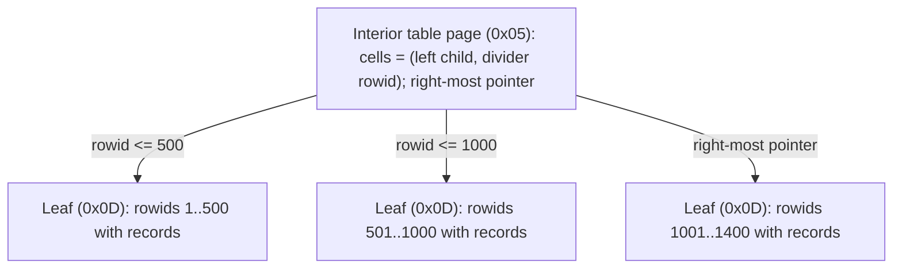

# Module 04: The File Format and B-Trees

The SQLite database file is a public, stable, documented format ([fileformat2](https://www.sqlite.org/fileformat2.html)). Every version since 3.0.0 (2004) can read it, and the developers have committed to keeping it readable through 2050. Because the format is so stable, it can be taught byte by byte, and every claim can be proven by decoding files that SQLite wrote. This module does exactly that: [`examples/ts/file-format.ts`](../examples/ts/file-format.ts) is a ~200-line reader that decodes the header, B-tree pages, cells, varints and records, and [`examples/ts/04-file-format-and-b-trees.test.ts`](../examples/ts/04-file-format-and-b-trees.test.ts) checks it against real databases.

> **Owned elsewhere.** The theory of slotted pages, B-trees versus B+trees, and the read/write/space amplification trade-off is taught in [data-systems Module 02 § 1](../../../architecture/data-systems/modules/02-storage-engines-b-trees-and-lsm.md#1-physical-page-organization-the-slotted-page-architecture) and [§ 2](../../../architecture/data-systems/modules/02-storage-engines-b-trees-and-lsm.md#2-in-place-update-engines-b-trees-btrees-and-b-link-trees). Buffer-pool theory is in [data-systems Module 04](../../../architecture/data-systems/modules/04-buffer-management-and-operating-system-io.md). This module is the SQLite realisation.

---

## 1. Formal model: a file is an array of pages

A database file is a sequence of equal-size **pages**, numbered from 1. The page size _P_ is a power of two between 512 and 65,536 bytes; the default has been **4096 since 3.12.0** (2016; it was 1024 before). The file size is always _P_ × page count, which the test checks against the header.

Every page has exactly one role at any moment:

| Role | What it holds |
| --- | --- |
| **B-tree page** | One node of a table or index B-tree: interior or leaf, table or index (four types). |
| **Overflow page** | The continuation of a cell payload too large for its B-tree page. |
| **Freelist trunk page** | A list of free leaf-page numbers, plus a pointer to the next trunk. |
| **Freelist leaf page** | An unused page, available for reuse. |
| **Pointer-map page** | Only with `auto_vacuum`: back-pointers from each page to its parent, so pages can be moved. |
| **Lock-byte page** | The page that contains file offset 1,073,741,824 (1 GiB). Never used for data, because Windows byte-range locks live there ([Module 05](./05-transactions-locking-and-rollback-journal.md)). Only exists in files larger than 1 GiB. |

Page 1 is special: its first 100 bytes are the **database header**, and the rest of the page is the root of the `sqlite_schema` table B-tree.

---

## 2. The 100-byte header

All multi-byte integers in the format are **big-endian**. The fields that matter in practice (complete list in [fileformat2 § 1.3](https://www.sqlite.org/fileformat2.html#the_database_header)):

| Offset | Size | Field | Notes, proven where marked |
| --- | --- | --- | --- |
| 0 | 16 | Magic `"SQLite format 3\0"` | Proven. |
| 16 | 2 | Page size | The value 1 means 65,536. Proven: 4096. |
| 18 / 19 | 1 / 1 | File-format write / read version | 1 = legacy rollback journal, 2 = WAL. Proven: switching to WAL sets both to 2. |
| 20 | 1 | Reserved bytes per page | Space at the end of every page for encryption or checksum VFSes. The _usable_ size U = P − reserved. |
| 24 | 4 | File change counter | Incremented on every commit in rollback mode (proven). In WAL mode it is not reliably incremented, because change detection uses the wal-index instead. |
| 28 | 4 | In-header database size (pages) | Trusted only if offset 92 equals offset 24. |
| 32 | 4 | First freelist trunk page |  |
| 36 | 4 | Total freelist pages | Equals `PRAGMA freelist_count` (proven). |
| 40 | 4 | **Schema cookie** | Incremented by every DDL (proven); connections compare it to know when to re-parse the schema. `PRAGMA schema_version` reads it. |
| 44 | 4 | Schema format number | 4 is current (proven); 1–3 are legacy. |
| 52 | 4 | Largest root page (auto-vacuum) | Non-zero only with `auto_vacuum`. |
| 56 | 4 | Text encoding | 1 UTF-8 (proven), 2 UTF-16le, 3 UTF-16be. Fixed when the first table is created. |
| 60 | 4 | `user_version` | Yours: the migration counter ([Module 10](./10-durability-backup-and-operations.md)). Proven. |
| 64 | 4 | Incremental-vacuum flag | Proven. |
| 68 | 4 | `application_id` | Yours: identifies the file type ([Module 01](./01-what-sqlite-is-bindings-and-cli.md#12-sqlite-as-an-application-file-format)). Proven. |
| 92 | 4 | Version-valid-for | The change-counter value at which offset 96 was written. |
| 96 | 4 | `SQLITE_VERSION_NUMBER` | Of the last library that wrote the file ([Module 01](./01-what-sqlite-is-bindings-and-cli.md#31-four-ways-to-ask-which-sqlite-is-this)). |

`PRAGMA user_version`, `application_id`, `schema_version`, `page_size`, `page_count` and `freelist_count` are all thin views over these bytes.

---

## 3. Anatomy of a B-tree page

A B-tree page is a **slotted page**: a header and an array of 2-byte cell pointers grow from the start, the cells themselves grow from the end, and unallocated space sits in the middle.


The page header ([§ 1.6](https://www.sqlite.org/fileformat2.html#b_tree_pages)), as decoded by `parseBtreePage()`:

| Offset | Size | Field |
| --- | --- | --- |
| 0 | 1 | Page type: `0x02` interior index, `0x05` interior table, `0x0A` leaf index, `0x0D` leaf table |
| 1 | 2 | First freeblock (0 if none) |
| 3 | 2 | Number of cells |
| 5 | 2 | Start of the cell content area (0 means 65,536) |
| 7 | 1 | Fragmented free bytes (holes of 1–3 bytes, too small for a freeblock) |
| 8 | 4 | Right-most child pointer (interior pages only) |

Three details matter for performance:

- **The cell pointer array is sorted by key**; the cells themselves can be anywhere in the content area. Inserting into the middle of a page moves 2-byte pointers, not cells. That is the point of the slotted design.
- **Free space inside a page** is tracked as a linked list of _freeblocks_ (≥ 4 bytes) plus a count of fragmented bytes. When fragmentation exceeds a threshold, SQLite defragments the page in place.
- **Page 1's header starts at byte 100**, after the file header. `parseBtreePage()` handles this special case, and forgetting it is the classic bug in hand-written readers.

### 3.1 From pages on disk to pages in memory

The B-tree layer never touches the file directly. It asks the **pager** for page _n_, and the pager returns it from its **page cache** or reads it through the VFS. The SQLite realisation of buffer-pool theory ([data-systems Module 04 § 2](../../../architecture/data-systems/modules/04-buffer-management-and-operating-system-io.md#2-buffer-pool-architecture-frames-hash-tables-and-page-latches)) has a few distinctive properties:

| Knob | Meaning | Default |
| --- | --- | --- |
| `PRAGMA cache_size = N` | Per **connection**, not per process. Positive N = pages; negative N = KiB. | −2000 (≈ 2 MiB); better-sqlite3 builds with −16000 |
| `PRAGMA mmap_size = bytes` | Read pages through a memory map instead of `read()`; writes still go through the pager. | 0 (off) in both Node builds |
| `PRAGMA temp_store` | Where temp tables, sorter spill and transient indexes live: `DEFAULT`, `FILE`, `MEMORY`. | build-dependent (`TEMP_STORE=1`: file unless overridden) |
| `PRAGMA cache_spill` | Whether a large transaction may write dirty pages to the file before commit (needs an exclusive lock early). | on |

Three consequences follow. First, each connection has a **private cache**, so ten connections in one process cache the same hot pages ten times, and they all rely on the OS page cache underneath. This double buffering is accepted by design, because SQLite is an embedded library that cannot assume it owns the machine's memory. Second, when another connection commits, a connection's cache may be stale. In rollback mode it detects this through the file change counter (offset 24), and in WAL mode through the wal-index. Third, `mmap_size` trades a copy per read for the risks analysed in [data-systems Module 04 § 4](../../../architecture/data-systems/modules/04-buffer-management-and-operating-system-io.md#4-the-mmap-anti-pattern-for-database-engines). An I/O error on a mapped page arrives as a signal (`SIGBUS`), not as an error code, so many deployments leave it off.

---

## 4. Table B+trees and index B-trees

SQLite has two kinds of B-tree, and the distinction explains much of its performance profile.

|  | Table B-tree (rowid tables) | Index B-tree (indexes and `WITHOUT ROWID` tables) |
| --- | --- | --- |
| Structure | **B+tree**: data lives only in leaves | **B-tree**: keys (whole records) live in interior pages too |
| Key | 64-bit signed integer `rowid` | An arbitrary record, compared column by column with collations |
| Leaf cell | payload-size varint, rowid varint, payload record, optional overflow pointer | payload-size varint, payload record (index columns + rowid, or the full row for `WITHOUT ROWID`), optional overflow pointer |
| Interior cell | 4-byte left-child page number, rowid varint (the divider key) | 4-byte left-child page number, payload-size varint, payload record, optional overflow pointer |
| Page types | `0x05` interior, `0x0D` leaf | `0x02` interior, `0x0A` leaf |
| Root page | `sqlite_schema.rootpage` | `sqlite_schema.rootpage` |



The proofs:

- A one-row table's root is a leaf table page (`0x0D`) with one cell whose **key is the rowid 42**. The `INTEGER PRIMARY KEY` column appears in the record as **NULL** (serial type 0), because its value lives in the cell key, not in the payload. This is the physical meaning of "rowid alias" from [Module 02](./02-type-system-and-schema.md#31-the-rowid).
- After 2,000 inserts the root becomes an interior page (`0x05`) with a right-most pointer, and `dbstat` reports at least two levels.
- An index on `email` is a leaf index page (`0x0A`) whose first cell is the record `('a@x', 2)`: the key **plus the rowid**. A lookup through a secondary index therefore does two searches, one in the index to find the rowid and one in the table to find the row, unless the index _covers_ the query ([Module 07](./07-query-planner-and-vdbe.md)).

### 4.1 Search

```text
TABLE-SEARCH(root, target_rowid)
  1  p ← root
  2  while page_type(p) = INTERIOR_TABLE       ▹ invariant: target, if present, is in the subtree of p
  3      i ← first cell in p with divider ≥ target_rowid   ▹ binary search over the cell pointer array
  4      if i exists: p ← left_child(cell i)
  5      else:        p ← right_most_pointer(p)
  6  i ← binary search for target_rowid among the leaf's cells
  7  return cell i's payload (following the overflow chain if needed), or NOT FOUND
```

Cost: one page read per level. Fan-out for a table interior page is high, because an interior cell is only a 4-byte pointer and a rowid varint: a 4096-byte page holds a few hundred children. A billion-row table is about four levels deep. Insert-heavy workloads with monotonically increasing rowids append to the right-most leaf, and SQLite has a special _balance-quick_ path for that case, which is why `INTEGER PRIMARY KEY` auto-assignment is the fastest insert pattern. Random keys (UUIDv4 as `TEXT PRIMARY KEY`) split pages all over the tree; the general cost is analysed in [data-systems Module 02 § 7](../../../architecture/data-systems/modules/02-storage-engines-b-trees-and-lsm.md#7-production-failure-modes-and-anti-patterns).

---

## 5. The record format and varints

### 5.1 Varints

SQLite stores integers in a **variable-length big-endian format** of 1 to 9 bytes ([§ 1.6](https://www.sqlite.org/fileformat2.html#varint)). The first eight bytes each contribute 7 bits, with the high bit meaning "another byte follows". A ninth byte, if reached, contributes all 8 bits, so 8 × 7 + 8 = 64 bits fit in nine bytes.

```text
DECODE-VARINT(buf, off)
  1  v ← 0
  2  for i ← 0 to 7                          ▹ invariant: v holds the 7·i payload bits read so far
  3      b ← buf[off + i]
  4      v ← (v << 7) | (b & 0x7F)
  5      if b & 0x80 = 0: return (v, i + 1)
  6  v ← (v << 8) | buf[off + 8]              ▹ the 9th byte contributes all 8 bits
  7  return (as_signed_64(v), 9)
```

| Value range                   | Bytes |
| ----------------------------- | ----- |
| 0 – 127                       | 1     |
| 128 – 16,383                  | 2     |
| … up to 2⁵⁶ − 1               | 8     |
| ≥ 2⁵⁶, or any negative number | 9     |

The test round-trips boundary values and 500 pseudo-random 64-bit integers through `encodeVarint` and `decodeVarint`, and checks that negative numbers always take nine bytes. That is one reason SQLite never assigns negative rowids on its own.

### 5.2 Records

A **record** is a header followed by a body. The header is a varint giving the header's own size, then one _serial-type_ varint per column. The body is the column values, concatenated with no separators:

| Serial type      | Meaning                                              | Body bytes       |
| ---------------- | ---------------------------------------------------- | ---------------- |
| 0                | NULL                                                 | 0                |
| 1, 2, 3, 4, 5, 6 | big-endian two's-complement integer                  | 1, 2, 3, 4, 6, 8 |
| 7                | IEEE-754 binary64                                    | 8                |
| 8, 9             | the integer constant 0, 1 (schema format 4)          | **0**            |
| 10, 11           | reserved                                             | –                |
| N ≥ 12, even     | BLOB of (N − 12) / 2 bytes                           | (N − 12) / 2     |
| N ≥ 13, odd      | TEXT of (N − 13) / 2 bytes, in the database encoding | (N − 13) / 2     |

The test row `(42, 300, 'ahoj', 2.5, x'cafe', NULL)` decodes to serial types `[0, 2, 21, 7, 16, 0]`. Reading it: the rowid alias stored as NULL, 300 as a 2-byte integer, 4-byte text (13 + 2·4 = 21), a double, a 2-byte blob (12 + 2·2 = 16), and NULL. A row `(0, 1, 2)` decodes to `[8, 9, 1]`, so the Booleans cost **zero body bytes**.

Consequences of this format:

- **The type is per value, in the record header.** This is the physical basis of manifest typing ([Module 02](./02-type-system-and-schema.md#1-values-storage-classes-and-dynamic-typing)).
- **Integers are stored in the smallest width that fits**, so `INTEGER` columns of small values are compact without any `SMALLINT` declaration.
- **Columns are located by walking the header.** Reading column _k_ requires decoding the first _k_ serial types. Wide tables pay for that on every access to their last columns.
- **Trailing NULL columns can be omitted** from the record entirely. That is how `ALTER TABLE ADD COLUMN` works without rewriting the table: old records are simply shorter, and missing columns read as their default.

---

## 6. Overflow pages

A cell's payload may be larger than fits on one page. With usable size U, a table-leaf cell keeps its whole payload locally only if the payload _P_ ≤ X = U − 35. Otherwise ([§ 1.6](https://www.sqlite.org/fileformat2.html#b_tree_pages)):

```text
LOCAL-PAYLOAD(P, U)                     ▹ table-leaf cells; index cells use a smaller X
  1  X ← U − 35
  2  if P ≤ X: return P
  3  M ← ⌊(U − 12) · 32 / 255⌋ − 23        ▹ minimum local, 489 when U = 4096
  4  K ← M + ((P − M) mod (U − 4))
  5  if K ≤ X: return K                    ▹ fill the last overflow page exactly
  6  return M
```

After the local bytes comes a 4-byte page number, the head of a singly linked **overflow chain**. Each overflow page holds a 4-byte next-page pointer and U − 4 bytes of payload. The test stores a 10,000-byte BLOB on 4096-byte pages and checks that the local prefix matches `LOCAL-PAYLOAD`, that the overflow pointer is one of the pages `dbstat` labels `overflow`, and that the chain length is ⌈(P − local) / (U − 4)⌉.

Design consequences:

- **Large values in the middle of a row slow down every column after them.** To read a later column, SQLite must walk the overflow chain to reach the bytes. Put large `TEXT` and `BLOB` columns **last**, or move them to a side table keyed by the same rowid.
- Reading a value that lives on overflow pages costs one random page read per page of the chain. better-sqlite3 is compiled with `SQLITE_DIRECT_OVERFLOW_READ`, which reads overflow content directly from the file and skips the page cache.
- For very large objects (several MB), the [35 % faster than the filesystem](https://www.sqlite.org/fasterthanfs.html) result holds for blobs of roughly 10 KB, not for multi-megabyte files. Keep large media as files and store paths, or use the incremental BLOB API (`sqlite3_blob_open`, Python's `blobopen()`).

---

## 7. Free space, VACUUM and auto_vacuum

### 7.1 The freelist

Deleting rows frees B-tree pages, which go on the **freelist**: a chain of trunk pages, each listing up to (U/4 − 2) free leaf pages. **The file does not shrink** (proven: same size after deleting every row, with `freelist_count` above 100). New pages are taken from the freelist before the file is extended. With `PRAGMA secure_delete = ON`, freed content is overwritten with zeros, at a write cost.

### 7.2 VACUUM

`VACUUM` rebuilds the whole database ([lang_vacuum](https://www.sqlite.org/lang_vacuum.html)):

1. It copies the content into a temporary database, in B-tree order, so tables and indexes become contiguous and pages full.
2. It then copies the result back over the original file, inside a transaction, so it is crash-safe.

The test shows the file shrinking to under a tenth of its size and `freelist_count` dropping to 0. The costs are what make it an operational event:

- It needs **up to twice the database size** in free disk space: the temp copy plus the journal or WAL for the copy-back.
- It holds an **exclusive write lock** for the whole run, so writers wait or get `SQLITE_BUSY`.
- It can **change rowids** of tables without an `INTEGER PRIMARY KEY`. Never store implicit rowids externally.
- It is the only way to change `page_size` (except in WAL mode, where the request is ignored; proven) and to switch `auto_vacuum` on or off after tables exist (proven).

`VACUUM INTO 'file'` (3.27.0) writes the compacted copy to a new file instead and leaves the original untouched. It is also a consistent online backup method ([Module 10](./10-durability-backup-and-operations.md)).

### 7.3 auto_vacuum

| Mode | Behaviour | Cost |
| --- | --- | --- |
| `NONE` (0, default) | Free pages stay in the file. | none |
| `FULL` (1) | At every commit, free pages are moved to the end of the file and the file is truncated. | Pointer-map pages, extra page moves on every commit, and **more fragmentation** (it moves pages but never defragments). |
| `INCREMENTAL` (2) | Free pages are tracked; `PRAGMA incremental_vacuum(N)` releases up to N of them on demand. | Pointer-map pages; you choose when to pay. |

The mode is stored in the header (offsets 52 and 64) and can only be chosen **before the first table is created**, or changed later with a full `VACUUM` (proven both ways). The test enables `INCREMENTAL` and shows `incremental_vacuum(10)` releasing exactly 10 pages. Neither mode is a substitute for `VACUUM`: they reclaim space but leave tables fragmented across the file.

---

## 8. Choosing a page size

| Page size | Favours | Penalises |
| --- | --- | --- |
| 1024 (pre-3.12 default) | Tiny rows, small caches | Tree depth, I/O count, overflow of medium values |
| **4096 (default)** | Matches OS pages and most SSD sectors | – |
| 8192–16384 | Large rows, scans, fewer overflow pages, better compression in VFS layers | Write amplification for small updates (a whole page is journaled for a 10-byte change) |
| 65536 | Analytical, read-mostly files | Random small writes |

Rule of thumb: keep 4096 unless measurements show otherwise. Changing it requires `PRAGMA page_size = N` followed by `VACUUM`, outside WAL mode.

---

## 9. Measuring space: dbstat and `.diskused`

The [`dbstat` virtual table](https://www.sqlite.org/dbstat.html) (compile option `SQLITE_ENABLE_DBSTAT_VTAB`; enabled in better-sqlite3 and `node:sqlite`) returns one row per page with its owning object, path in the tree, page type (`internal`, `leaf`, `overflow`), cell count, payload, unused bytes and more:

```sql
SELECT name, count(*) AS pages, sum(payload) AS payload, sum(unused) AS unused,
       round(100.0 * sum(unused) / (count(*) * 4096), 1) AS pct_unused
FROM dbstat GROUP BY name ORDER BY pages DESC;
```

The test proves that `count(*) FROM dbstat` equals `page_count − freelist_count`: every in-use page belongs to exactly one object.

In the 3.54 CLI, `.diskused` produces the per-object report that `sqlite3_analyzer` used to produce. The analyzer binary is deprecated, and 3.54 is the last release to ship it.

## 9a. Lab: decode a row by hand

The reader in [`examples/ts/file-format.ts`](../examples/ts/file-format.ts) is small enough to read in one sitting. The core of the record decoder:

```ts
export function parseRecord(
  buf: Uint8Array,
  offset: number,
): { serialTypes: number[]; values: SqlValue[] } {
  const { value: hdrSize, length } = decodeVarint(buf, offset);
  const serialTypes: number[] = [];
  let p = offset + length;
  while (p < offset + Number(hdrSize)) {
    // header: one serial type per column
    const st = decodeVarint(buf, p);
    serialTypes.push(Number(st.value));
    p += st.length;
  }
  // ...then walk the body, consuming serialTypeSize(t) bytes per column
}
```

And the end-to-end check from the test, which goes from SQL to raw bytes and back:

```ts
db.exec(`CREATE TABLE t(id INTEGER PRIMARY KEY, a INTEGER, b TEXT, c REAL, d BLOB, e);
  INSERT INTO t VALUES (42, 300, 'ahoj', 2.5, x'cafe', NULL);`);
const root = scalar<number>(db, "SELECT rootpage FROM sqlite_schema WHERE name = 't'");
const page = parseBtreePage(file, 4096, root); // type 0x0D, one cell
const cell = parseTableLeafCell(file, page.cellPointers[0]!, 4096);
assert.equal(cell.rowid, 42n);
assert.deepEqual(parseRecord(file, cell.payloadStart).serialTypes, [0, 2, 21, 7, 16, 0]);
```

Exercises that extend the reader (each is a few lines):

1. Follow an overflow chain and reassemble the full payload of the 10,000-byte BLOB.
2. Walk an interior table page recursively and count all rows; compare with `count(*)`.
3. Walk the freelist from header offset 32 and compare with `PRAGMA freelist_count`.
4. Decode `sqlite_schema` (page 1) to list every object's name and root page without SQL.

---

---

## 10. Then vs now

| Topic | Then | Now | Notes |
| --- | --- | --- | --- |
| Default page size | 1024 bytes (before 3.12.0) | 4096 bytes | Old files keep their page size until `VACUUM` with a new `page_size`. |
| Max page count default | 1,073,741,823 | 4,294,967,294 (3.45.0+) | Lifts the default size ceiling to the format maximum. |
| Space analysis | `sqlite3_analyzer` binary | `.diskused` (3.54.0+), or `dbstat` from code | The analyzer is deprecated in 3.54. |
| Schema table name | `sqlite_master` | `sqlite_schema` (3.33.0+) | Same B-tree at page 1. |
| Copy-compaction | Copy with `VACUUM` then `cp` | `VACUUM INTO` (3.27.0+) | One step, and a consistent snapshot. |

The file format itself has not changed incompatibly since 3.0.0. Newer features that older readers cannot handle are opt-in: WAL (3.7.0) via the version bytes, and STRICT tables and generated columns via schema text that old parsers reject.

---

## 11. Production failure modes

1. **"We deleted half the data and the disk is still full."** Freed pages stay in the file. Proven. Run `VACUUM` in a maintenance window, or plan for `auto_vacuum = INCREMENTAL` at creation.
2. **`VACUUM` fails with `SQLITE_FULL` at 2 a.m.** It needs up to 2× free space. Check before running, or use `VACUUM INTO` to a volume with room.
3. **Writers time out during `VACUUM`.** It holds the write lock for the whole rebuild.
4. **Implicit rowids change after `VACUUM`** for tables without `INTEGER PRIMARY KEY`, breaking external references.
5. **A wide row with a large BLOB in the middle** makes every query that reads a later column follow an overflow chain. Proven mechanism; reorder columns or split tables.
6. **Random UUID primary keys** cause page splits throughout the tree and poor locality. Prefer `INTEGER PRIMARY KEY` with a separate UUID column, or time-ordered UUIDv7.
7. **`page_size` change "doesn't work"** because the database is in WAL mode. Proven.
8. **Hand-editing `sqlite_schema` with `writable_schema`** corrupts the root-page mapping. Treat it as a last-resort recovery tool.

---

## 12. Interview Drill

<details><summary>1. Why is a rowid table a B+tree but an index a B-tree, and what does that cost?</summary>

Table B-trees store row data only in leaves; interior pages hold just child pointers and integer divider keys, so fan-out is very high and trees are shallow. Index B-trees store the full key record (index columns plus rowid) in interior cells as well. Keys there are arbitrary records, so fan-out is lower. A secondary-index lookup costs a search in the index to find the rowid, then a search in the table, unless the index covers all the needed columns.
</details>

<details><summary>2. Where is the value of an <code>INTEGER PRIMARY KEY</code> column stored?</summary>

In the table B-tree cell as the rowid key (a varint before the payload). In the record itself the column is stored as NULL (serial type 0) to avoid duplication. That is why the alias costs nothing and why lookups by it are a single tree search.
</details>

<details><summary>3. Explain the record format, and why <code>ALTER TABLE ADD COLUMN</code> is O(1).</summary>

A record is a header (a varint header size, then one serial-type varint per column) followed by the values with no separators. Serial types encode both type and length, including zero-byte constants for 0 and 1. Records may be shorter than the current column count: missing trailing columns read as their declared default. Adding a column therefore only edits the schema text; existing records are not rewritten.
</details>

<details><summary>4. A table stores 2 MB images in a <code>BLOB</code> column next to metadata. Queries on the metadata are slow. Why, and what do you change?</summary>

Each image overflows into a chain of about 500 pages. Columns stored after the blob in the record can only be reached by following that chain, and even scanning rows pulls overflow pages through the cache. Move the blob to the last column or to a side table keyed by the same id, or store large images as files with paths in the database.
</details>

<details><summary>5. What exactly does <code>VACUUM</code> do, and what are its operational risks?</summary>

It rebuilds the database into a temporary database in B-tree order and copies it back transactionally, removing free pages and fragmentation. Risks: it needs up to twice the database size in free space, holds the write lock for the whole run, can renumber implicit rowids, and rewrites every page, which also means a large WAL or journal. `VACUUM INTO` writes the compacted copy elsewhere without touching the original.
</details>

<details><summary>6. When would you choose <code>auto_vacuum = INCREMENTAL</code> over <code>FULL</code> or <code>NONE</code>?</summary>

When the file must give space back (mobile apps, embedded devices) but you want to control when that work happens. INCREMENTAL frees pages only when you call `PRAGMA incremental_vacuum(N)`, for example when the app is idle. FULL does it on every commit, adding latency and fragmentation. NONE is best for servers where the file will grow back anyway. It must be set before the first table is created, or applied later with a full `VACUUM`.
</details>

<details><summary>7. How do you find which table or index is using the most space?</summary>

Query the `dbstat` virtual table grouped by `name` for pages, payload and unused bytes, or run `.diskused` in the 3.54 CLI (which replaces `sqlite3_analyzer`). Compare `PRAGMA freelist_count` against `page_count` for reclaimable space.
</details>

<details><summary>8. What is the lock-byte page, and why does it exist?</summary>

The page that contains byte offset 2³⁰ (1 GiB). SQLite never stores data there because the locking protocol takes byte-range locks in that region, and Windows enforces mandatory locks that would block reads and writes of the bytes. Only files larger than 1 GiB have it.
</details>

<details><summary>9. Why are monotonically increasing <code>INTEGER PRIMARY KEY</code> inserts faster than random UUID keys?</summary>

New rows always go to the right-most leaf. SQLite's balance-quick path handles a full right-most leaf by starting a new page instead of splitting and redistributing, so pages stay full and writes stay local. Random keys land anywhere, splitting half-full pages throughout the tree, which costs more page writes, more journal or WAL traffic, and a lower cache hit rate.
</details>
