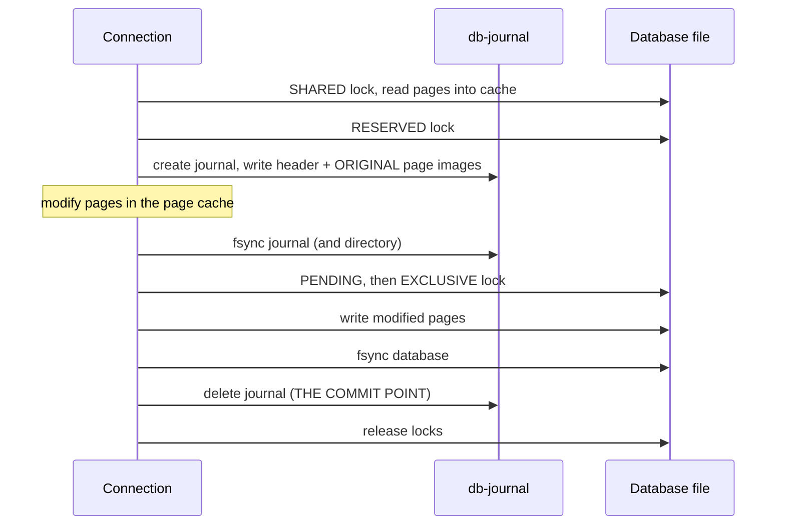

# Module 05: Transactions, Locking and the Rollback Journal

SQLite's concurrency model fits in one sentence: **any number of readers, or one writer, and in rollback-journal mode not both at the moment of commit**. The details of that sentence decide whether an application sees `SQLITE_BUSY` once a year or a hundred times a minute. This module covers the locking protocol of the original (and still default) rollback-journal mode, the atomic-commit algorithm that makes SQLite crash-safe, and the transaction modes and error semantics every application has to get right. [Module 06](./06-wal-mode.md) then shows what WAL mode changes.

> **Owned elsewhere.** ACID, the anomaly taxonomy (Berenson, Adya), two-phase locking and isolation levels are taught in [data-systems Module 05](../../../architecture/data-systems/modules/05-transactions-acid-and-isolation-levels.md). Undo/redo logging and the steal/force policies are in [data-systems Module 06 § 1](../../../architecture/data-systems/modules/06-durability-wal-and-crash-recovery.md#1-buffer-management-policies-steal-no-steal-force-and-no-force). This module is SQLite's realisation.

Proofs: [`examples/ts/05-transactions-and-locking.test.ts`](../examples/ts/05-transactions-and-locking.test.ts). Every test uses real files, several connections, and in two tests a separate `node` process that is killed with `SIGKILL` mid-transaction.

---

## 1. Transactions in SQLite

Every statement runs in a transaction. Without an explicit `BEGIN`, the connection is in **autocommit mode**: each statement is its own transaction, committed when the statement finishes (when `sqlite3_step()` returns `SQLITE_DONE`, or when the statement is reset). `BEGIN` switches autocommit off until `COMMIT` or `ROLLBACK`.

In the terms of [data-systems Module 05 § 4](../../../architecture/data-systems/modules/05-transactions-acid-and-isolation-levels.md#4-concurrency-control-mechanisms), rollback-journal SQLite is **database-granularity two-phase locking**. Locks cover the whole file, not tables or rows, and a writer holds its locks until commit. Because a writer cannot commit while any reader holds a lock, and readers never see uncommitted pages from another connection, every execution is equivalent to a serial one. The [isolation page](https://www.sqlite.org/isolation.html) states it plainly: transactions in SQLite are **SERIALIZABLE**. No anomaly from the Berenson hierarchy can occur _between connections_.

Within one connection the rules differ. A connection sees its own uncommitted changes (proven), and a statement that modifies a table it is also reading has unspecified results for rows changed during the scan.

### 1.1 How the bindings expose transactions

| Binding | Default | Explicit transaction API | Introspection |
| --- | --- | --- | --- |
| better-sqlite3 | SQLite autocommit | `db.transaction(fn)` (DEFERRED), with `.immediate`, `.exclusive`, `.deferred` variants; nested calls become savepoints | `db.inTransaction` |
| `node:sqlite` | SQLite autocommit | plain `exec('BEGIN IMMEDIATE')` / `exec('COMMIT')` | `db.isTransaction` |
| Python `sqlite3` | legacy: implicit `BEGIN` before DML ([Module 01](./01-what-sqlite-is-bindings-and-cli.md#5-then-vs-now-bindings-and-runtimes)) | `autocommit=True` plus explicit SQL, or `with con:` (commit/rollback, does not close) | `con.in_transaction` |
| `@libsql/client` | autocommit per `execute` | `client.transaction('write')` maps to `BEGIN IMMEDIATE`; `batch([...], 'write')` runs a list atomically | – |

The mode names in libSQL's API (`'write'`, `'read'`, `'deferred'`) map directly onto `BEGIN IMMEDIATE`, a read-only transaction, and `BEGIN DEFERRED`. Choose `'write'` for anything that may write, for the reason given in § 3.1.

---

## 2. The five lock states

The pager moves each connection through five states ([lockingv3](https://www.sqlite.org/lockingv3.html)):

| State | Holder may | Compatible with others holding | Acquired by |
| --- | --- | --- | --- |
| `UNLOCKED` | nothing | anything | initial state |
| `SHARED` | read | `SHARED`, `RESERVED`, and `PENDING` already held | first read in a transaction |
| `RESERVED` | read; plan to write (changes stay in its page cache) | `SHARED` only. **At most one connection** holds RESERVED. | first write, or `BEGIN IMMEDIATE` |
| `PENDING` | wait for readers to drain | existing `SHARED` holders only. **New SHARED requests are refused.** | a writer that needs `EXCLUSIVE` while readers are present |
| `EXCLUSIVE` | write to the database file | nothing | commit, cache spill, or `BEGIN EXCLUSIVE` |


The PENDING state exists to prevent **writer starvation**. Without it, a stream of overlapping readers could hold SHARED forever and the writer would never reach EXCLUSIVE. Once a writer holds PENDING, newcomers are turned away (proven: connection C gets `SQLITE_BUSY` on a plain `SELECT`), existing readers finish, and the writer proceeds.

What the tests prove, one claim each:

1. A reader holding SHARED does not stop a writer from taking RESERVED and preparing changes, but it does block that writer's `COMMIT`, which returns `SQLITE_BUSY`. The transaction **remains open** after the busy error, and retrying `COMMIT` after the reader finishes succeeds.
2. While the writer waits, it holds PENDING, and a third connection cannot start reading.
3. Only one connection can hold RESERVED: a second `BEGIN IMMEDIATE` fails at once.
4. `BEGIN EXCLUSIVE` blocks readers.
5. `BEGIN` (DEFERRED) takes no lock at all until the first statement touches the database.

### 2.0 Statements hold locks too

In autocommit mode, a read transaction lasts as long as **any statement is still being stepped**. A `SELECT` that has returned some rows but has not reached `SQLITE_DONE` or been reset keeps its SHARED lock (or, in WAL mode, its snapshot). In JavaScript, that is an iterator from `stmt.iterate()` that was abandoned after the first few rows. The test steps an iterator once, shows that another connection's `COMMIT` is then refused with `SQLITE_BUSY`, and shows that `iterator.return()` (which resets the statement) releases the lock. Always exhaust iterators, `break` out of `for...of` loops (which calls `return()`), or use `.all()` / `.get()`.

### 2.1 How the locks are implemented

The unix VFS implements the five states with **POSIX advisory byte-range locks** (`fcntl(F_SETLK)`) on bytes in the 1 GiB region ([Module 04](./04-file-format-and-b-trees.md#1-formal-model-a-file-is-an-array-of-pages)):

| Byte (offset) | Lock |
| --- | --- |
| `PENDING_BYTE` = 0x40000000 | write-locked for PENDING |
| `RESERVED_BYTE` = 0x40000001 | write-locked for RESERVED |
| `SHARED_FIRST` = 0x40000002, 510 bytes | read-locked for SHARED; write-locked over the whole range for EXCLUSIVE |

Two operating-system facts turn into SQLite failure modes:

- **POSIX locks belong to the process, not the file descriptor.** Closing _any_ descriptor that a process has open on the file silently releases _all_ of that process's locks on it. SQLite works around this internally with a per-inode table. But if your own code opens the database file directly (to hash it, copy it, or check its size) and closes it, SQLite's locks vanish and another process can write concurrently. [How To Corrupt](https://www.sqlite.org/howtocorrupt.html) § 2.2 lists this. Never open a live database file with anything except SQLite.
- **Advisory locks are only as good as the filesystem's implementation.** Network filesystems often implement them incorrectly or not at all ([Module 09](./09-application-concurrency.md#6-network-filesystems-and-containers)).

### 2.2 Exclusive locking mode and alternative lock VFSes

`PRAGMA locking_mode = EXCLUSIVE` makes a connection keep its locks after its first write (or read, for SHARED) instead of releasing them at the end of each transaction. The connection then avoids re-acquiring locks and re-validating its cache on every transaction, which helps single-process applications, and in WAL mode it lets SQLite skip the shared-memory wal-index entirely ([Module 06](./06-wal-mode.md)). The price is that no other connection can use the database until this one closes or switches back to `NORMAL` and touches the database again.

The unix VFS also ships variants for filesystems with broken locking, selected with the `vfs=` URI parameter ([Module 01](./01-what-sqlite-is-bindings-and-cli.md#61-uri-filenames)):

| VFS | Locking method | Use |
| --- | --- | --- |
| `unix` (default) | POSIX `fcntl()` byte-range locks | Local filesystems |
| `unix-excl` | Exclusive in-process locks; refuses other processes | One process owns the file |
| `unix-dotfile` | A `<db>.lock` directory as a lock | Filesystems without `fcntl()` locks; readers and writers fully serialised |
| `unix-flock` | BSD `flock()` | Some network filesystems; no SHARED/RESERVED distinction |
| `unix-none` | **no locking at all** | Read-only media, or a single connection that you guarantee yourself |

None of these makes a network filesystem safe. They only trade concurrency for whatever primitive happens to work there.

---

## 3. BEGIN DEFERRED, IMMEDIATE and EXCLUSIVE

| Statement | Locks at `BEGIN` | When to use |
| --- | --- | --- |
| `BEGIN` / `BEGIN DEFERRED` | none; SHARED at the first read, RESERVED at the first write | Read-only transactions |
| `BEGIN IMMEDIATE` | RESERVED immediately | **Every transaction that may write** |
| `BEGIN EXCLUSIVE` | EXCLUSIVE immediately (in WAL mode the same as IMMEDIATE) | Bulk loads that want to keep readers out |

### 3.1 The deferred-upgrade deadlock

Consider two connections that each run "read a balance, then write a new balance" in a deferred transaction:

```text
A: BEGIN; SELECT ...            → A holds SHARED
B: BEGIN; SELECT ...            → B holds SHARED
A: UPDATE ...                   → A takes RESERVED (allowed alongside B's SHARED)
B: UPDATE ...                   → B needs RESERVED, but A holds it                  ▹ B must wait for A
A: COMMIT                       → A needs EXCLUSIVE, but B holds SHARED             ▹ A must wait for B
```

That is a deadlock. SQLite detects it structurally: when B asks for RESERVED while A holds it and B itself holds SHARED, waiting cannot help, so SQLite **returns `SQLITE_BUSY` immediately without calling the busy handler**. The test sets a 2-second `busy_timeout` on both connections and shows that B's `UPDATE` fails in well under a second. B must then `ROLLBACK` to release its SHARED lock, so that A can commit. Retrying the `UPDATE` inside the same transaction is pointless.

The fix is to declare write intent up front:

```ts
const transfer = db.transaction((from: number, to: number, cents: number) => {
  /* reads, then writes */
});
transfer.immediate(1, 2, 500); // better-sqlite3: BEGIN IMMEDIATE
```

With `BEGIN IMMEDIATE`, the second writer waits _at `BEGIN`_, before it has read anything, so there is no lock to upgrade and the busy timeout works as intended. The test proves this across processes: the parent holds RESERVED for 400 ms, the child's `BEGIN IMMEDIATE` sleeps in its busy handler, and both increments are applied serially (`200 + 10 + 1 = 211`). The test also shows that better-sqlite3's `db.transaction(fn)` is **DEFERRED by default**, and that `fn.immediate()` fails _at `BEGIN`_ while another connection holds RESERVED, before doing any work.

---

## 4. Atomic commit with a rollback journal

The rollback journal is an **undo log**: before a page is overwritten in the database file, its original content is copied to the journal ([atomiccommit](https://www.sqlite.org/atomiccommit.html)). In the steal/force vocabulary it is _steal_ (uncommitted pages may reach the file, when the cache spills) and _force_ (all changed pages are written and synced at commit).



```text
COMMIT-ROLLBACK-JOURNAL(T)
  1  acquire RESERVED
  2  for each page p that T modifies, before its first modification
  3      append (pgno, original(p), checksum) to the journal
  4  fsync(journal); fsync(directory)               ▹ invariant: the journal can undo every page change
  5  update the journal header with the page count; fsync(journal)
  6  acquire PENDING, then EXCLUSIVE                 ▹ waits for readers to drain
  7  write every modified page to the database file
  8  fsync(database)                                 ▹ invariant: the database holds T's complete state
  9  delete (or truncate, or zero the header of) the journal   ▹ the commit point
 10  release locks
```

The **commit point is step 9**. Before it, a crash leaves a journal that restores the old state. After it, the database file already contains the complete new state. Each step is ordered by an `fsync()`, which is why the durability of SQLite rests entirely on the OS and disk honouring `fsync()` ([Module 10](./10-durability-backup-and-operations.md)).

#### Rollback journal header and sector byte layout

The rollback journal file begins with a fixed-format header padded out to a full disk sector boundary (`sectorSize`, typically 512 or 4096 bytes). Each subsequent journal segment consists of a sequence of page records followed by an optional trailing header if the journal wraps or spans multiple batches:

| Offset (bytes) | Size (bytes) | Field Name | Description and Semantic Invariants |
| --- | --- | --- | --- |
| 0 | 8 | Magic Header String | Constant 8-byte sequence: `0xd9 0xd5 0x05 0xf9 0x20 0xa1 0x63 0xd7`. Identifies the file as an active SQLite rollback journal. |
| 8 | 4 | Page Count | 32-bit big-endian integer. Number of page records following this header in the journal. Initialized to `0` or `-1` (`0xffffffff`) and updated during commit. |
| 12 | 4 | Random Nonce | 32-bit pseudo-random number. Serves as the initialization seed for the per-page checksum algorithm. |
| 16 | 4 | Initial DB Page Count | 32-bit big-endian integer. Database size in pages prior to transaction execution; used during recovery to truncate or restore the database file. |
| 20 | 4 | Sector Size | 32-bit big-endian integer. Hardware sector size reported by the OS VFS (`sectorSize`, usually 512 or 4096 bytes). |
| 24 | 4 | Page Size | 32-bit big-endian integer. Database page size in bytes (e.g., 4096). |
| 28 | `sectorSize - 28` | Sector Padding | Zero bytes padding the remainder of the header so that the first page record begins aligned to a fresh storage sector. |

Following the sector-aligned header, page records are written sequentially. Each page record contains:

- **Page Number** (4 bytes, big-endian): target page number in the database file (`pgno >= 1`).
- **Page Data Image** (`pageSize` bytes): the original, uncorrupted byte content of the page prior to modification.
- **Checksum** (4 bytes, big-endian): cumulative checksum of the page bytes, initialized using the header's random nonce. If a torn write occurs during power loss, the checksum mismatch causes recovery to reject the unfinalized record.

Details that make the journal robust:

- The journal header records the page count, a random **nonce**, and the **sector size**. Each page record carries a checksum seeded by the nonce, so pages that were not fully written before a crash are detected and not "restored".
- With `PRAGMA synchronous = FULL` (the default), every ordering point above is an `fsync()`. `synchronous = NORMAL` syncs less often; the [pragma documentation](https://www.sqlite.org/pragma.html#pragma_synchronous) warns that in rollback mode a power failure at the wrong moment can then corrupt the database on older filesystems. NORMAL is therefore a much safer choice in WAL mode than in rollback mode.
- A transaction larger than the page cache **spills**: dirty pages are written to the database file before commit. That requires EXCLUSIVE early, which blocks readers sooner than expected. `PRAGMA cache_spill = OFF` delays spilling.

### 4.0 Why every crash point is safe

The protocol is correct if, for a crash at _any_ point, recovery yields either the complete old state or the complete new state. Case analysis over `COMMIT-ROLLBACK-JOURNAL`:

| Crash happens | State on disk | Recovery result | Why |
| --- | --- | --- | --- |
| before line 4 completes | database untouched; journal partial or absent | **old state** | No database page was written yet (writes start at line 7). A partial journal is ignored or rolled back harmlessly, and the checksums reject torn records. |
| between lines 4 and 7 | database untouched; journal complete and hot | **old state** | Rolling back copies original pages over pages that never changed: idempotent. |
| during line 7 or 8 (or a cache spill earlier) | database partially overwritten; journal complete and hot | **old state** | Every page that could have changed has its original image in the synced journal (the invariant on line 4). |
| after line 9 | database complete and synced; no valid journal | **new state** | Line 8's invariant: the file already holds T's state. |
| during line 9 itself | deletion is a single filesystem operation | old or new | `unlink()` (or truncate, or one header write) is atomic with respect to crashes on a correct filesystem. |

Two assumptions carry the whole argument. **`fsync()` must not return before the data is durable**, and the filesystem must order the directory entry of a newly created journal correctly, which is why SQLite also syncs the directory. Disks or virtual machines that acknowledge flushes they have not performed break the proof, and [Module 10](./10-durability-backup-and-operations.md) lists the documented ways that happens. Recovery is also **idempotent**: if the machine crashes again _during_ recovery, the journal is still hot and the next attempt restores the same pages again.

### 4.1 Transactions across ATTACHed databases

`ATTACH DATABASE 'other.db' AS aux` makes several files visible to one connection, and a single transaction may write to all of them. In rollback mode, the commit is **atomic across the files**: SQLite writes a _super-journal_ (historically called the master journal) that names every per-file journal, and a crash is resolved consistently for all of them. The test rolls back and commits a transaction spanning `main` and `aux`, and both files move together. Two limits apply: in **WAL mode**, a multi-file transaction is atomic per file but not across files, and `:memory:` or temp databases do not take part in the super-journal. The default limit is 10 attached databases ([Module 01](./01-what-sqlite-is-bindings-and-cli.md#7-limits-worth-memorising)).

---

## 5. Hot journals and recovery

A **hot journal** is one that exists, is not empty, has a valid header, and whose writer no longer holds RESERVED (or PENDING) on the database. It means a writer crashed or lost power between steps 4 and 9. The next connection that wants to read:

1. sees the hot journal while acquiring SHARED;
2. upgrades to EXCLUSIVE (so nobody reads the half-written file);
3. copies every page image from the journal back into the database file and syncs it;
4. deletes the journal, and proceeds.

The test reproduces this. A child process updates 20,000 rows with `cache_size = 10`, so dirty pages spill into the database file before commit, and then kills itself with `SIGKILL`. The test checks that the database file bytes really changed and that the journal survived. The next `open()` sees zero updated rows, `PRAGMA integrity_check` returns `ok`, and the journal is gone.

The rules that follow:

- **Never delete a `-journal` file** to "fix" a locked database. If it is hot, deleting it leaves the half-written pages in place: a corrupt database ([howtocorrupt § 1.3](https://www.sqlite.org/howtocorrupt.html)).
- **Never rename or move the database without its journal.** A journal is matched to the database by file name.
- **Opening read-only does not prevent recovery from being needed.** A read-only connection that finds a hot journal and cannot write returns `SQLITE_READONLY_ROLLBACK` or a similar error.

---

## 6. Journal modes

`PRAGMA journal_mode` chooses how the undo log is kept:

| Mode | Journal lifetime | Commit point | Trade-off |
| --- | --- | --- | --- |
| `DELETE` (default) | created per transaction, deleted at commit | `unlink()` of the journal | Simple. Directory operations on every commit. Proven: the journal exists during the transaction and disappears at commit. |
| `TRUNCATE` | kept, truncated to 0 bytes | `ftruncate()` | Faster on many filesystems than unlink. Proven: zero-length file. |
| `PERSIST` | kept, header zeroed | header overwrite | Avoids metadata operations; the file keeps its largest size. Proven: non-empty file. |
| `MEMORY` | in RAM | – | **A crash mid-transaction corrupts the database**: the undo log dies with the process. |
| `WAL` | write-ahead log instead ([Module 06](./06-wal-mode.md)) | WAL frame with the commit flag | Readers and the writer stop blocking each other. Persistent across connections. |
| `OFF` | none | – | No atomicity at all; `ROLLBACK` behaviour is undefined. |

The negative tests show both dangerous modes:

- With `journal_mode = MEMORY`, killing a process mid-transaction leaves **some but not all** of 20,000 rows updated. Atomicity is lost, exactly as documented.
- better-sqlite3 13 opens connections in **defensive mode**, which refuses `journal_mode = OFF`. The pragma silently returns `'delete'`, not an error, so code that asks for `OFF` must check the returned value. `node:sqlite` also defaults to `defensive: true`, but its build accepted `OFF` in this track's experiments, so the effect of defensive mode on this pragma differs between the two bindings.

---

## 7. SQLITE_BUSY and the busy handler

`SQLITE_BUSY` means "another connection holds a conflicting lock right now". By default SQLite returns it immediately. A **busy handler** makes SQLite retry instead:

```sql
PRAGMA busy_timeout = 5000;      -- or sqlite3_busy_timeout(); better-sqlite3 option `timeout` (default 5000 ms)
```

The built-in handler sleeps with a back-off schedule (1, 2, 5, 10, 15, 20, 25, 25, 25, 50, 50, 100 ms …) until the lock is free or the timeout is spent. Its limits:

| Situation | Does the busy timeout help? |
| --- | --- |
| `BEGIN IMMEDIATE` while another connection holds RESERVED | **Yes**: it waits (proven across processes). |
| `COMMIT` while readers hold SHARED (rollback mode) | Yes, if the readers finish within the timeout. |
| Deferred transaction upgrading SHARED → RESERVED while another holds RESERVED | **No**: deadlock, BUSY returned at once (proven). |
| WAL mode: upgrading on a stale snapshot (`SQLITE_BUSY_SNAPSHOT`) | **No** ([Module 06](./06-wal-mode.md)). |
| A reader blocked by a writer's PENDING/EXCLUSIVE | Yes. |

What to do after `SQLITE_BUSY` depends on where it happened:

```text
HANDLE-BUSY(stmt_kind, in_explicit_txn)
  1  if stmt_kind = COMMIT
  2      retry COMMIT later                     ▹ the transaction is still open (proven)
  3  else if in_explicit_txn and the txn already read data
  4      ROLLBACK and re-run the whole transaction from BEGIN IMMEDIATE
  5  else
  6      retry the statement (or rely on busy_timeout)
```

This track's wrapper, [`examples/ts/retry.ts`](../examples/ts/retry.ts), encodes the procedure for the common case. It always starts with `BEGIN IMMEDIATE`, and on a retryable error it rolls back and **re-runs the whole function**, never resuming:

```ts
export function writeTx<T>(db: Database.Database, fn: () => T, opts: RetryOptions = {}): T {
  const attempts = opts.attempts ?? 5;
  const sleep = opts.sleep ?? sleepSync;
  for (let attempt = 1; ; attempt++) {
    try {
      db.exec('BEGIN IMMEDIATE');
      const result = fn();
      db.exec('COMMIT');
      return result;
    } catch (e) {
      if (db.inTransaction) db.exec('ROLLBACK');
      const code = (e as { code?: string }).code ?? '';
      if (!RETRYABLE.has(code) || attempt >= attempts) throw e;
      opts.onRetry?.(attempt, code);
      sleep(Math.min(100, 2 ** attempt) + Math.floor(Math.random() * 5)); // capped backoff + jitter
    }
  }
}
```

The tests prove four properties: a BUSY is retried and the work is applied exactly once; the wrapper gives up after the configured number of attempts and rethrows `SQLITE_BUSY`; a non-retryable error (a primary-key violation) is thrown on the first attempt; and no transaction is left open in either case. `fn` must not have side effects outside the database, such as sending an email, because it may run more than once.

Statement-level errors other than BUSY do not end the transaction either. A constraint violation aborts only the failing statement (the `ABORT` conflict algorithm), and the transaction stays open with its earlier changes intact (proven). Application code that assumes "any error rolled everything back" commits half a unit of work.

---

## 8. Savepoints and statement journals

`SAVEPOINT name` / `RELEASE name` / `ROLLBACK TO name` provide nested transactions ([lang_savepoint](https://www.sqlite.org/lang_savepoint.html)):

- `ROLLBACK TO s` undoes everything after `SAVEPOINT s` but **keeps the transaction open** and the savepoint on the stack (proven).
- `RELEASE s` merges the savepoint into its parent. Releasing the outermost savepoint commits, if it was opened outside any transaction.
- A `SAVEPOINT` outside a transaction behaves like `BEGIN DEFERRED`.

better-sqlite3 uses savepoints when a `transaction()` function is called from inside another, so nested transaction functions compose.

Internally, statement-level atomicity, savepoints and the `ABORT` algorithm use **statement journals**: temporary files (or memory, depending on `temp_store`) that record the pages a single statement or subtransaction changed, so it can be rolled back without invalidating the parent transaction:

- **Bit-vector modification tracking (`Bitvec`)**: When a savepoint or mutating statement begins, SQLite initializes an in-memory bit vector (`Bitvec`). Before any database page in the pager cache is modified, SQLite queries the bit vector. If the bit corresponding to `pgno` is clear, the current cached page image is appended to the statement journal and the bit is set. Subsequent mutations to that page within the same savepoint bypass duplicate logging.
- **Savepoint stack layout (`PagerSavepoint`)**: Nested savepoints form an in-memory stack where each entry tracks `iOffset` (the byte offset in the statement journal), `nOrig` (the database page count at savepoint creation), and a pointer to its subtransaction bit vector.
- **Rollback execution (`ROLLBACK TO`)**: Rolling back reads the statement journal in reverse order from the current write head down to `iOffset`. For each page entry encountered, the original page bytes are restored into the pager cache and marked dirty, the database size is truncated to `nOrig`, and statement-journal entries above `iOffset` are discarded. Crucially, the connection retains its lock state and the top-level rollback journal remains untouched.
- **Storage and spill policies**: Statement journals are created via the VFS temporary file API. Under `PRAGMA temp_store = MEMORY`, journaled pages reside strictly in heap memory; under `PRAGMA temp_store = FILE` (or `DEFAULT`), the pager spills journaled frames to an unlinked temporary file on disk once memory thresholds are exceeded.
- **Statement journal bypass**: If the query optimizer proves that a statement cannot fail midway with partial changes (for example, a single-row `UPDATE` with no triggers or foreign key cascades), SQLite elides statement journal creation completely to avoid unnecessary I/O allocation.

---

## 9. Then vs now

| Topic | Then | Now | Notes |
| --- | --- | --- | --- |
| Default journal mode | `DELETE` (rollback journal) | still `DELETE`; WAL is opt-in (3.7.0+, 2010) | Most server deployments should opt in to WAL ([Module 06](./06-wal-mode.md)). |
| Python transaction control | implicit `BEGIN` before DML via `isolation_level` | `autocommit=` attribute (3.12+) | See [Module 01](./01-what-sqlite-is-bindings-and-cli.md#5-then-vs-now-bindings-and-runtimes). |
| better-sqlite3 default timeout | 5000 ms busy timeout (unchanged) | same | `node:sqlite` defaults `timeout` to **0**, so it fails fast unless configured. |
| `journal_mode=OFF` | honoured | refused by defensive connections (better-sqlite3 13 proven) | Check the pragma's return value. |
| Windows support | Windows XP and CE supported | 3.54.0 requires Vista or later and uses Slim Reader/Writer locks for internal mutexes | Affects builds, not the file-locking protocol. |

---

## 10. Production failure modes

1. **`SQLITE_BUSY` storms under load** from read-then-write deferred transactions. Proven. Fix: `BEGIN IMMEDIATE` for every write transaction.
2. **Raising `busy_timeout` "doesn't help".** Deadlock detection bypasses the busy handler. Proven.
3. **Long-running readers starve writers in rollback mode**: a report holding SHARED for 30 seconds blocks every commit for 30 seconds. Use WAL mode.
4. **Assuming an error rolled back the transaction.** Constraint errors abort the statement only. Proven.
5. **Deleting a hot journal** to unlock a database, which corrupts it.
6. **`journal_mode = MEMORY` or `OFF` for speed**, losing atomicity on crash. Proven for MEMORY.
7. **Another library in the process opens and closes the database file**, dropping SQLite's POSIX locks.
8. **`node:sqlite` with the default `timeout: 0`** returns `SQLITE_BUSY` on the first contention. Set `timeout` explicitly.

---

## 11. Interview Drill

<details><summary>1. List SQLite's lock states and explain why PENDING exists.</summary>

UNLOCKED, SHARED (reading), RESERVED (one connection intends to write; readers still allowed), PENDING (the writer wants EXCLUSIVE and waits for current readers; new readers are refused), and EXCLUSIVE (writing the database file). PENDING prevents writer starvation: without it, overlapping readers could keep SHARED held forever.
</details>

<details><summary>2. Walk through a commit in rollback-journal mode. Where is the commit point?</summary>

Take RESERVED, write original page images to the journal, fsync the journal (and its directory), take PENDING then EXCLUSIVE, write the new pages to the database, fsync the database, then delete, truncate or invalidate the journal. Removing the journal is the commit point: before it a crash rolls back from the journal, after it the database is complete.
</details>

<details><summary>3. Two requests each run <code>BEGIN; SELECT; UPDATE; COMMIT</code> and one fails with SQLITE_BUSY immediately even with a 5 s busy timeout. Explain and fix.</summary>

Both took SHARED in their SELECT. The first UPDATE took RESERVED; the second needs RESERVED but already holds SHARED, which blocks the first one's commit. That is a deadlock, so SQLite returns BUSY without calling the busy handler. The loser must roll back. The fix is `BEGIN IMMEDIATE` for write transactions, so the second waits at BEGIN while holding nothing.
</details>

<details><summary>4. What is a hot journal, and what does the next connection do with it?</summary>

A rollback journal left behind by a writer that crashed before its commit point: it exists, has a valid header and is not protected by a RESERVED lock. The next connection that wants to read takes an EXCLUSIVE lock, restores the original pages from the journal, syncs the database, deletes the journal, and continues. Deleting a hot journal by hand corrupts the database.
</details>

<details><summary>5. A COMMIT returned SQLITE_BUSY. Is the transaction still open? What do you do?</summary>

Yes. In rollback mode the COMMIT failed to get EXCLUSIVE because readers held SHARED; the transaction and its changes are intact and the connection holds PENDING. Retry the COMMIT after a short wait (or let the busy timeout do it), or roll back if you give up.
</details>

<details><summary>6. What isolation level does SQLite provide, and why?</summary>

Serializable between connections. In rollback mode, locking is two-phase at database granularity: a writer cannot commit while readers hold SHARED, and readers never see another connection's uncommitted pages. In WAL mode, readers use snapshots and the single writer must be working from the latest snapshot, which also yields serializable histories. Within a connection you see your own uncommitted changes.
</details>

<details><summary>7. Why is closing an unrelated file descriptor on the database file dangerous on Unix?</summary>

POSIX advisory locks are per process and per file. Closing any descriptor for the file releases all the process's locks on it, including SQLite's. Another process can then write concurrently and corrupt the database. SQLite guards its own descriptors, but cannot protect against other code in the process opening and closing the file.
</details>

<details><summary>8. Compare the DELETE, TRUNCATE, PERSIST and MEMORY journal modes.</summary>

All four are rollback (undo) journals. DELETE unlinks the journal at commit; TRUNCATE truncates it to zero; PERSIST zeroes its header and leaves the content. They differ in the filesystem operation at the commit point, and therefore in speed. MEMORY keeps the journal in RAM, so a crash during a transaction leaves a partially updated database. That is not atomic, and the test proves it.
</details>

<details><summary>9. An API endpoint streams rows with <code>for (const row of stmt.iterate())</code> and returns early on the first match. Writers start timing out. Why?</summary>

If the loop exits by `return` from inside a callback or the iterator is otherwise abandoned without `return()` being called, the statement is never reset. Its read transaction stays open, holding SHARED in rollback mode, which blocks every writer's commit, or holding a WAL snapshot, which blocks checkpoints. A `break` or `return` directly inside `for...of` calls `iterator.return()` and is safe; a manually driven iterator must call it explicitly.
</details>

<details><summary>10. Is a transaction that writes to two ATTACHed databases atomic?</summary>

In rollback-journal mode, yes: SQLite writes a super-journal listing every per-file journal, so a crash is rolled back or committed consistently across all files. In WAL mode, no: each file commits atomically on its own, but a crash can leave one file committed and the other not.
</details>

<details><summary>11. Prove that a crash after the database file has been partly overwritten cannot leave a mix of old and new pages.</summary>

Database pages are written only after the journal holding the original image of every page the transaction can change has been fsynced (and the directory synced). A crash during the database writes therefore leaves a hot journal that contains the original of every page that might have changed. Recovery copies them all back, which is idempotent, so it restores exactly the old state even if it is interrupted and repeated. Only after the database is fsynced is the journal removed, which is the atomic commit point.
</details>

<details><summary>12. What does <code>PRAGMA locking_mode = EXCLUSIVE</code> buy, and what does it cost?</summary>

The connection keeps its file locks between transactions, so it skips lock acquisition and cache re-validation on each transaction. In WAL mode, set before the first access, it also avoids the shared-memory wal-index, which allows WAL on systems without shared memory. The cost is that no other connection or process can use the database while it is held.
</details>
