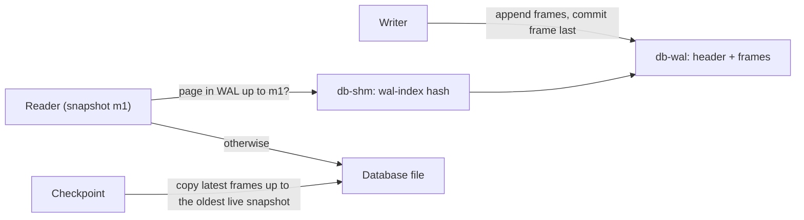

# Module 06: WAL Mode

Write-ahead logging (WAL), added in 3.7.0 (2010), is the single most important setting for an SQLite database that serves concurrent requests. It turns the rollback journal inside out. Instead of copying _old_ pages aside and overwriting the database, a writer **appends new pages to a log** and leaves the database file alone until a later **checkpoint**. Readers see a consistent snapshot without taking locks that block the writer, and the writer commits without waiting for readers. This module explains how that works, using SQLite's own data structures, and covers the operational problems it introduces: checkpoint starvation, stale-snapshot errors, the durability setting, and the WAL-reset bug of 2026.

> **Owned elsewhere.** The WAL protocol in general, redo logging, ARIES and checkpoint theory: [data-systems Module 06](../../../architecture/data-systems/modules/06-durability-wal-and-crash-recovery.md). Snapshot isolation and MVCC: [data-systems Module 05 § 4](../../../architecture/data-systems/modules/05-transactions-acid-and-isolation-levels.md#2-multi-version-concurrency-control-mvcc-and-snapshot-isolation). SQLite's WAL is a _physical redo log of whole pages_ with no undo, and that is the delta taught here.

Proofs: [`examples/ts/06-wal-mode.test.ts`](../examples/ts/06-wal-mode.test.ts). It covers snapshots, cross-process reads during a write, `SQLITE_BUSY_SNAPSHOT`, all checkpoint modes, measured starvation, `journal_size_limit`, the WAL file format decoded byte by byte, and exclusive-mode WAL without shared memory.

---

## 1. Formal model

Let the database be a map from page numbers to page images. In WAL mode the durable state is the pair (_D_, _L_): the database file _D_ and the log _L_, a sequence of **frames** _(pgno, image, commit-size)_. A frame whose commit-size is non-zero ends a transaction. The **logical database** at frame index _m_ is:

$$\text{DB}_m(p) = \begin{cases} \text{image of the last frame } f \le m \text{ with pgno}(f) = p, & \text{if one exists} \\ D(p) & \text{otherwise} \end{cases}$$

Every committed state is DB<sub>m</sub> for some commit frame _m_. Three operations act on (_D_, _L_):

- **Commit** appends frames for every page the transaction changed, the last one marked as a commit frame. _D_ is not touched.
- **Read** chooses _m_ = the last commit frame at the moment the read transaction starts (its **snapshot**), and evaluates DB<sub>m</sub>.
- **Checkpoint** copies, for each page, the image of its latest frame ≤ _m_<sub>safe</sub> into _D_, where _m_<sub>safe</sub> is the oldest snapshot still in use. When every frame has been copied and no reader still uses the log, the log may be **reset**: the next writer starts again at the beginning of the file.

Because frames are only appended and _D_ changes only at frames older than every live snapshot, a reader never observes a page from a transaction newer than its snapshot. This is multi-version concurrency control in which the versions are **whole pages**, not rows.



---

## 2. The three files

### 2.1 The `-wal` file

The [WAL format](https://www.sqlite.org/fileformat2.html#the_write_ahead_log) consists of a 32-byte header followed by consecutive frames of 24 + _P_ bytes (where _P_ is the database page size).

#### WAL 32-byte header layout

| Offset | Size (bytes) | Field Name | Meaning and Validation Rules |
| --- | --- | --- | --- |
| 0 | 4 | Magic Number | `0x377f0682` (native / big-endian checksum) or `0x377f0683` (byte-swapped / little-endian checksum). The least significant bit determines checksum byte order. |
| 4 | 4 | File Format Version | Currently `3007000` (SQLite 3.7.0). |
| 8 | 4 | Database Page Size | Big-endian integer specifying page size _P_ in bytes (e.g., `4096`). |
| 12 | 4 | Checkpoint Sequence Number | Big-endian integer incremented monotonically on each WAL restart/reset. |
| 16 | 4 | Salt-1 | Random 32-bit integer generated when the WAL file is initialized or reset. |
| 20 | 4 | Salt-2 | Random 32-bit integer changed whenever the checkpoint sequence number wraps or resets. |
| 24 | 4 | Checksum-1 (`s0`) | First 32-bit checksum accumulator computed over bytes 0..23 of this header. |
| 28 | 4 | Checksum-2 (`s1`) | Second 32-bit checksum accumulator computed over bytes 0..23 of this header. |

#### WAL 24-byte frame header layout

Each log frame begins with a 24-byte frame header immediately followed by the _P_-byte page image:

| Offset | Size (bytes) | Field Name | Meaning and Validation Rules |
| --- | --- | --- | --- |
| 0 | 4 | Page Number (`pgno`) | Big-endian integer `pgno >= 1` indicating the database page being updated. |
| 4 | 4 | Commit Database Size | Non-zero for commit frames (the total database size in pages after transaction commit); `0` for intermediate frames. |
| 8 | 4 | Salt-1 | Must match `Salt-1` in the WAL 32-byte file header. |
| 12 | 4 | Salt-2 | Must match `Salt-2` in the WAL 32-byte file header. |
| 16 | 4 | Checksum-1 (`s0`) | Cumulative 32-bit running checksum accumulator `s0`. |
| 20 | 4 | Checksum-2 (`s1`) | Cumulative 32-bit running checksum accumulator `s1`. |

#### Checksum calculation mechanics (`s0`, `s1`)

SQLite computes WAL integrity using a 64-bit checksum composed of two 32-bit unsigned accumulators `s0` and `s1`. For each 8-byte chunk read as two 32-bit big-endian words `v0` and `v1`:

```c
s0 += v0 + s1;
s1 += v1 + s0;
```

For the 32-byte WAL header, `s0` and `s1` start initialized to `0` and process the first 24 bytes (six 32-bit words). For each subsequent frame:

- The input accumulators `(s0, s1)` are seeded from the checksum of the **immediately preceding valid frame** (or from the WAL header checksum for frame 1).
- The algorithm digests the first 8 bytes of the frame header (`pgno` and commit size), followed immediately by all _P_ bytes of the page body.
- The resulting values must match `Checksum-1` and `Checksum-2` stored at frame offsets 16 and 20.
- If a crash occurs or disk write tears mid-frame, `(s0, s1)` mismatches. SQLite halts WAL scanning and treats all trailing bytes as invalid, ensuring atomic recovery.

### 2.2 The `-shm` file (wal-index)

Scanning the whole WAL to find the latest version of a page would make reads O(|L|). The **wal-index** is a hash table, from page number to latest frame index, stored in a memory-mapped file `<db>-shm` that every process maps. It also holds the **read marks**: a small fixed set of slots recording the frame index each active snapshot is pinned to. According to the [WAL documentation](https://www.sqlite.org/wal.html), the `-shm` file rarely exceeds 32 KiB, is never synced, and is deleted when the last connection closes (proven). It is a cache that can always be rebuilt from the WAL.

Two requirements follow from the design:

1. **Every process must share memory on the same host.** That is why WAL does not work over network filesystems ([Module 09](./09-application-concurrency.md#6-network-filesystems-and-containers)).
2. **The `-shm` file must be writable, or creatable**, even for readers, unless the database is opened with `immutable=1`. Since 3.22.0, a read-only WAL database can be read if the `-shm` and `-wal` files already exist and are readable, or the directory is writable.

With `PRAGMA locking_mode = EXCLUSIVE` set _before_ the first WAL access, SQLite keeps the wal-index in heap memory and never creates `-shm` (proven). Any other connection is then locked out entirely, which also is proven.

### 2.3 Inside the wal-index

The [wal-index format](https://www.sqlite.org/walformat.html) is an implementation detail rather than part of the stable file format, but knowing its shape explains its costs:

| Region | Content |
| --- | --- |
| Header (136 bytes) | Two copies of a 48-byte header (`mxFrame`, page count, salts, checksums), written in a fixed order so that a reader can detect a torn update by comparing them, plus checkpoint information: `nBackfill` (frames already copied into the database) and the **read marks**. |
| Hash blocks | Each 32 KiB block maps one range of WAL frames. It holds a page-number array (one entry per frame) and an 8192-slot hash table from page number to frame, probed linearly. |
| Lock bytes | Byte-range locks in the `-shm` file: the WAL write lock, the checkpoint lock, the recovery lock, and one lock per read-mark slot. |

#### Wal-index hash-slot lookup mechanics

To locate a page `pgno` within a reader snapshot bounded by `mxFrame`:

- **Hash blocks**: Each 32 KiB block maps up to 4096 frames (`HASHTBL_SZ = 4096`). The block contains an array `aPgno[4096]` (mapping frame offset `iFrame` within the block to page number) and an 8192-slot array `aHash[8192]` of 16-bit indices, giving a 50% load factor.
- **Hash function**: The initial slot index is computed as `h = (pgno * 383) & 0x1fff`.
- **Linear probing**: SQLite reads `idx = aHash[h]`.
  - If `idx == 0`: the slot is empty, proving `pgno` does not exist in this 4096-frame block.
  - If `idx > 0`: SQLite tests whether `aPgno[idx - 1] == pgno`. If it matches and `frame <= mxFrame`, the frame is an exact hit. If it does not match, SQLite probes `h = (h + 1) & 0x1fff` until finding a match or a zero slot.
- **Reverse block traversal**: If the WAL spans multiple blocks, searching proceeds from the newest block backwards to block 0. This guarantees that the most recent frame visible to the snapshot is discovered on the first hit. If all blocks yield misses, the page is read from the main database file.

The **read marks** are a small, fixed set of slots. Readers that share a snapshot share a slot, so the number of slots limits the number of _distinct_ concurrent snapshots, not the number of readers. A checkpointer looks at the read marks to compute the oldest live snapshot, _m_<sub>safe</sub>, from § 1.

### 2.4 Recovery: rebuilding the wal-index

After a crash, or whenever the `-shm` file is missing, stale, or inconsistent with the WAL, the first connection takes the recovery lock and **rebuilds the wal-index by scanning the WAL**:

```text
RECOVER-WAL-INDEX(wal)
  1  if the WAL header checksum is invalid: treat the WAL as empty
  2  c ← checksum seed from the header; mxFrame ← 0
  3  for i ← 1, 2, ... while frame i exists          ▹ invariant: frames 1..i-1 are valid and checksummed
  4      if salts(i) ≠ header salts or checksum(i, c) is wrong: break   ▹ torn or leftover frame
  5      c ← checksum(i, c); index page(i) → i
  6      if commit_size(i) ≠ 0: mxFrame ← i           ▹ only whole transactions become visible
  7  publish mxFrame in the wal-index header
```

Line 6 is why a crash in the middle of appending a transaction's frames leaves no trace: frames after the last commit frame are indexed but never visible, and the next writer overwrites them. This is the redo half of crash recovery. There is no undo half, because uncommitted data never reached the database file.

### 2.5 Persistence

`journal_mode = WAL` is written into the database header (read/write version bytes = 2, see [Module 04](./04-file-format-and-b-trees.md#2-the-100-byte-header)), so it **persists**: every later connection opens in WAL mode (proven). Leaving WAL needs `PRAGMA journal_mode = DELETE` while no other connection is open.

---

## 3. Reading: snapshots and read marks

```text
BEGIN-READ(conn)
  1  read the wal-index header → mxFrame (index of the last commit frame)
  2  find a read-mark slot whose value equals mxFrame, or claim a free slot and set it
  3  take a SHARED lock on that slot                    ▹ pins frames ≤ mxFrame against checkpoint-reset
  4  conn.snapshot ← mxFrame

READ-PAGE(conn, p)
  1  f ← wal-index lookup: latest frame for page p with f ≤ conn.snapshot
  2  if f exists: return image(f) from the -wal file
  3  return page p from the database file
```

The snapshot is taken at the **first read** of a deferred transaction (or by `BEGIN IMMEDIATE`), not at `BEGIN`. It lasts until the transaction ends. In autocommit mode, every statement gets a fresh snapshot.

The proofs:

- A reader inside a transaction keeps reading 100 after a writer commits 101, and sees 101 in its next transaction: **repeatable reads within a snapshot**.
- A writer with an open, uncommitted transaction does not block new readers, which see the last committed state.
- A separate **process** reads committed data while this process holds a write transaction.

---

## 4. Writing: one writer, latest snapshot only

WAL does not add concurrent writers. A writer takes the exclusive **WAL write lock** (a byte in the `-shm` lock region), so `BEGIN IMMEDIATE` from a second connection gets `SQLITE_BUSY` exactly as in rollback mode (proven).

There is one new rule. **A writer must be working from the latest snapshot.** If a deferred transaction reads (pinning snapshot _m_<sub>1</sub>), another connection commits (_m_<sub>2</sub> > _m_<sub>1</sub>), and the first transaction then tries to write, its reads might be stale. Letting it write would allow lost updates. SQLite refuses with **`SQLITE_BUSY_SNAPSHOT`**:

```text
A: BEGIN; SELECT v FROM t WHERE id = 1     ▹ snapshot m1
B: UPDATE t SET v = 0 WHERE id = 2         ▹ commits m2
A: UPDATE t SET v = 1 WHERE id = 1         ▹ SQLITE_BUSY_SNAPSHOT, immediately, forever
```

The test sets a 3-second `busy_timeout` and shows that the error returns at once, and returns _again_ on retry inside the same transaction: the snapshot cannot move forward while the transaction lives. The only recovery is `ROLLBACK` and re-running the transaction from the start. `BEGIN IMMEDIATE` avoids the problem completely, because it takes the write lock _before_ the first read, so the snapshot is guaranteed current (proven).

In the vocabulary of [data-systems Module 05](../../../architecture/data-systems/modules/05-transactions-acid-and-isolation-levels.md#3-the-isolation-level-spectrum-ansi-versus-reality): readers get snapshot isolation, and the single-writer-on-latest-snapshot rule removes write skew and lost updates, because no two write transactions ever overlap. The resulting histories are serializable, consistent with SQLite's [isolation page](https://www.sqlite.org/isolation.html).

### 4.1 The commit path

```text
COMMIT-WAL(T)
  1  hold the WAL write lock (taken at BEGIN IMMEDIATE or the first write)
  2  require T.snapshot = current mxFrame, else SQLITE_BUSY_SNAPSHOT
  3  if every frame is backfilled and no reader uses the WAL
  4      restart the WAL: new salts, checkpoint sequence + 1, write from frame 1   ▹ the "WAL reset"
  5  for each page p dirtied by T: append frame (p, image, 0)
  6  append the last frame with commit_size = database size in pages
  7  if synchronous = FULL: fsync(wal)                 ▹ NORMAL defers the sync to the next checkpoint
  8  update the wal-index hash and header (mxFrame)   ▹ the commit becomes visible to new snapshots
  9  if mxFrame ≥ wal_autocheckpoint: run a PASSIVE checkpoint
```

Compared with the rollback journal, a commit writes each changed page **once, sequentially, to one file**, with at most one `fsync()`. A rollback-mode commit writes each page twice (old image to the journal, new image to the database) with several syncs and a directory operation. That is the main reason WAL is faster for write-heavy workloads, not only for concurrency. Line 4 is the reset step whose race with concurrent checkpoints was the bug described in § 7.

---

## 5. Durability: synchronous=NORMAL versus FULL

| `synchronous` | Rollback mode | WAL mode |
| --- | --- | --- |
| `OFF` (0) | no syncs: an OS crash or power loss can corrupt the file | no syncs: an OS crash or power loss can corrupt the file |
| `NORMAL` (1) | fewer syncs; small corruption risk on old filesystems | **WAL synced only at checkpoint.** Never corrupts; the last commits **may roll back** after power loss or an OS crash. A process crash loses nothing. |
| `FULL` (2) | default; safe | WAL synced on **every commit**: durable |
| `EXTRA` (3) | also syncs the directory after deleting the journal | like FULL |

The WAL documentation states the NORMAL trade-off precisely: transactions "are no longer durable and might rollback following a power failure or hard reset." The database stays consistent because frames are only trusted up to the last valid checksum and commit frame. Durability is weaker, but atomicity and consistency are intact.

**Binding defaults differ** ([Module 01](./01-what-sqlite-is-bindings-and-cli.md#4-compile-time-defaults-the-hidden-configuration)): better-sqlite3 is compiled with `SQLITE_DEFAULT_WAL_SYNCHRONOUS=1`, so WAL databases open with `synchronous = NORMAL` (proven), while `node:sqlite` and Python default to FULL. For most web applications NORMAL in WAL mode is the right choice, because a power loss that drops the last few hundred milliseconds of commits is acceptable. For a ledger, a queue that has acknowledged messages to its producers, or anything that told a client "saved", use FULL.

Even FULL is only as good as `fsync()`. The cases where the OS or the hardware lies are covered in [Module 10](./10-durability-backup-and-operations.md).

---

## 6. Checkpoints

### 6.1 Modes

| Mode | Waits for writers? | Waits for readers? | After completion | How to invoke |
| --- | --- | --- | --- | --- |
| `PASSIVE` | no | no: copies only frames older than every reader | WAL reused from the start only if fully checkpointed and no readers | automatic checkpoints; `PRAGMA wal_checkpoint(PASSIVE)` |
| `FULL` | yes (busy handler) | waits for readers to move to the latest snapshot | all frames copied | `wal_checkpoint(FULL)` |
| `RESTART` | yes | also waits until no reader uses the WAL | the next writer restarts the WAL | `wal_checkpoint(RESTART)` |
| `TRUNCATE` | yes | like RESTART | the WAL file is **truncated to 0 bytes** | `wal_checkpoint(TRUNCATE)` |
| `NOOP` (3.51+) | – | – | nothing; just reports the WAL state | `wal_checkpoint(NOOP)` |

`PRAGMA wal_checkpoint(...)` returns three columns: `busy` (1 if it could not complete), `log` (frames in the WAL) and `checkpointed` (frames copied). The tests show:

- **PASSIVE with an old reader** copies only frames up to the reader's mark (`checkpointed < log`), and everything once the reader is gone.
- **TRUNCATE with an active reader** reports `busy = 1`; after the reader finishes it reports `busy = 0, log = 0` and the `-wal` file is 0 bytes.

### 6.2 Automatic checkpoints

By default, a commit that leaves the WAL at **1000 pages or more** (`wal_autocheckpoint`, default 1000, proven) runs a PASSIVE checkpoint in the committing connection, synchronously. With 4 KiB pages the WAL therefore hovers around 4 MB. After a successful checkpoint the WAL is **reused from the beginning but not truncated**, so the file keeps its largest size. `PRAGMA journal_size_limit = N` truncates it to N bytes when it is reset (proven: from several MB down to ≤ 64 KiB).

The latency of an automatic checkpoint lands on whichever request happens to commit the 1000th page. High-throughput applications often set `wal_autocheckpoint = 0` and run checkpoints from a dedicated thread or timer, which also lets `synchronous = NORMAL` keep all fsyncs off the request path.

### 6.3 Checkpoint starvation

A checkpoint can never copy frames newer than the oldest live snapshot, and the WAL can only be reset when no reader is using it. If **at least one read transaction is always open**, the WAL can never be reset and it **grows without bound**. The WAL documentation says so explicitly.

The test measures it. With `wal_autocheckpoint = 10` and 600 single-row commits, the WAL stays small because each checkpoint resets it. With one reader holding a snapshot open, 600 more commits make the WAL more than five times larger. After the reader ends, a `TRUNCATE` checkpoint returns it to 0 bytes.

Common causes in production:

- an abandoned iterator or un-reset statement ([Module 05](./05-transactions-locking-and-rollback-journal.md#20-statements-hold-locks-too));
- a long analytical query or a backup that reads for minutes;
- overlapping readers under constant load, so that there is never a moment with zero readers.

Consequences: disk usage grows, and **reads slow down** because the wal-index hash table grows and more pages are served from a long WAL. Mitigations: keep read transactions short; schedule `RESTART` or `TRUNCATE` checkpoints, which wait for a reader gap; monitor the `-wal` file size (an alert at 10× the expected size catches stuck readers); and for long-running analytics, read from a copy made with the backup API.

### 6.4 A checkpoint policy in application code

The helper in [`examples/ts/checkpointer.ts`](../examples/ts/checkpointer.ts) turns the checkpoint results into a health signal and an escalation policy:

```ts
export function walHealth(db: Database.Database) {
  const r = checkpoint(db, 'PASSIVE');
  let walBytes = 0;
  try {
    walBytes = statSync(`${db.name}-wal`).size;
  } catch {
    /* no WAL file yet */
  }
  return {
    pending: r.log - r.checkpointed,
    walBytes,
    starved: r.log > 0 && r.checkpointed < r.log,
  };
}

export function tick(db: Database.Database, maxBytes: number): 'ok' | 'truncated' | 'starved' {
  const h = walHealth(db);
  if (h.walBytes <= maxBytes) return 'ok';
  return checkpoint(db, 'TRUNCATE').busy === 0 ? 'truncated' : 'starved';
}
```

Run `tick()` from a timer or a dedicated worker with its **own connection** and a busy timeout, set `wal_autocheckpoint = 0` on the request connections, and export `pending`, `walBytes` and the `starved` outcome as metrics. The test reproduces the whole cycle: a reader pins a snapshot, 2000 inserts push the WAL past 64 KiB, `walHealth` reports `starved`, `tick` returns `'starved'` because TRUNCATE cannot complete, and after the reader commits `tick` returns `'truncated'` with an empty WAL. A persistent `'starved'` result is an alert: some code path is holding a read transaction open.

---

## 7. The WAL-reset bug (2010–2026)

On 2026-03-03 the SQLite developers found a data race in WAL mode that had existed since 3.7.0 (2010-07-21) through 3.51.2 (2026-01-09) ([wal.html § walresetbug](https://www.sqlite.org/wal.html#walresetbug)):

- **Conditions:** two or more connections to the same WAL database, in different threads or processes, writing or checkpointing at almost the same instant. One checkpoint completes, a second starts immediately, and meanwhile another connection's commit resets the WAL.
- **Effect:** a transaction can be skipped and **the database corrupted**.
- **Likelihood:** the developers needed a test-only hook to reproduce it, and estimate its rate as at or below that of SSD malfunctions or cosmic-ray bit flips. An independent reproducer without the hook was published in August 2026.
- **Fix:** 3.51.3 (2026-03-13) and every release from 3.53.0, with backports to 3.44.6 and 3.50.7. (3.52.0 also contained the fix, but was withdrawn for unrelated reasons.)

What it means for the bindings in this track: better-sqlite3 13.0.3 (3.53.4), `node:sqlite` in Node 26 (3.54.0) and Python 3.15.2 (3.53.1) are fixed. **libSQL's 3.45.1 base predates the fix** and is not one of the backport versions; whether libSQL backported the patch could not be verified ([Module 12](./12-libsql-and-turso.md)). The startup gate in [Module 01](./01-what-sqlite-is-bindings-and-cli.md#32-a-startup-version-gate) refuses the affected range.

The lesson for interviews is about verification limits. A 15-year-old race survived 100 % MC/DC coverage, because coverage measures branches and conditions, not interleavings of processes.

---

## 8. Limits and caveats of WAL mode

| Caveat | Detail |
| --- | --- |
| Same host only | Shared memory is required; network filesystems are unsupported. |
| Large transactions | All frames of a transaction live in the WAL until checkpointed. Since 3.11.0 the WAL grows only in proportion to the transaction, but a 10 GB bulk load still needs a ~10 GB WAL. Batch it into smaller transactions, or switch to `journal_mode = DELETE` for the load. |
| `ATTACH` atomicity | A transaction across several WAL databases is atomic per file, not across files ([Module 05](./05-transactions-locking-and-rollback-journal.md#41-transactions-across-attached-databases)). |
| `page_size` | Cannot be changed while in WAL mode ([Module 04](./04-file-format-and-b-trees.md#7-free-space-vacuum-and-auto_vacuum)). |
| Backups | Copying only the `.db` file misses every commit since the last checkpoint (proven: a table created after the last checkpoint is absent from the copy). Use the backup API or `VACUUM INTO` ([Module 10](./10-durability-backup-and-operations.md)). |
| Moving files | `-wal` and `-shm` must stay next to the database and keep their names. Deleting `-wal` discards committed transactions. |
| Read-mostly workloads with few writes | WAL reads can be marginally slower than rollback-mode reads (an extra wal-index lookup per page), usually negligible. |

### 8.1 Rollback journal or WAL?

| Criterion | Rollback journal (`DELETE`) | WAL |
| --- | --- | --- |
| Readers vs writer | A commit waits for every reader; PENDING blocks new readers | Never block each other |
| Writer vs writer | One at a time | One at a time |
| Writes per changed page | 2 (journal + database), at random offsets | 1 (append) until checkpoint, then 1 more |
| fsyncs per commit (`FULL`) | several, plus a directory operation | 1 |
| Files | `db` (+ `-journal` during writes) | `db`, `-wal`, `-shm` permanently while open |
| Network filesystem | unsafe, but no shared memory needed | unsupported |
| Read-only media | fine | needs `-shm` or `immutable=1` |
| Multi-file atomic commit | yes (super-journal) | per file only |
| Very large single transactions | journal holds old pages; fine | WAL holds every new page; needs space until checkpointed |
| Typical choice | read-only distribution files, single-connection tools, NFS fallbacks | **servers, desktop and mobile apps, anything concurrent** |

### 8.2 Pinning a snapshot explicitly

The C API has experimental functions, `sqlite3_snapshot_get()`, `sqlite3_snapshot_open()` and `sqlite3_snapshot_recover()` (compile option `SQLITE_ENABLE_SNAPSHOT`), that capture a WAL snapshot and start a later read transaction on exactly the same snapshot, possibly from another connection. They allow consistent reads across several connections, for example to parallelise a consistent export. Neither Node binding in this track exposes them. The portable alternative is one read transaction that does all the work, or a `VACUUM INTO` copy.

---

## 9. Beyond one writer: wal2, BEGIN CONCURRENT and Turso MVCC

The SQLite source tree has two experimental branches that are **not part of any release**, including 3.54.1:

- **`wal2`** alternates between two WAL files, so one can be checkpointed and reset while writers append to the other. That removes checkpoint starvation by design.
- **`begin-concurrent`** allows several `BEGIN CONCURRENT` write transactions to run at once with optimistic, page-level conflict detection at commit time. Commits are still serialised.

In 2023, a developer stated on the official forum that both exist only in non-trunk branches, with "no concrete plans for when/if" they will be merged. The 3.53 and 3.54 release logs contain no merge. Treat them as research branches: some downstream builds use them, but the bindings in this track do not.

The production-ready descendant of the idea is **Turso Database's MVCC mode**, which offers `BEGIN CONCURRENT` with row-level conflict detection in a Rust rewrite of SQLite. [Module 12](./12-libsql-and-turso.md) proves its behaviour with two connections.

---

## 10. Then vs now

| Topic | Then | Now | Migration |
| --- | --- | --- | --- |
| Journal mode | Rollback journal only (before 3.7.0, 2010) | WAL available; still opt-in | `PRAGMA journal_mode = WAL` once; it persists. |
| WAL growth for big transactions | could exceed the transaction size (before 3.11.0) | proportional to the transaction | – |
| Read-only WAL databases | required write access (before 3.22.0) | readable if `-shm`/`-wal` exist or can be created, or with `immutable=1` | – |
| Checkpoint inspection | run a PASSIVE checkpoint to see counts | `wal_checkpoint(NOOP)` (3.51.0+) reports without work | – |
| WAL-reset race | present 3.7.0 – 3.51.2 | fixed in 3.51.3, 3.53.0+, backports 3.44.6 and 3.50.7 | Upgrade the binding; add a startup version gate. |
| Concurrent writers | – | still one writer upstream; `BEGIN CONCURRENT` only in branches and in Turso | Use `BEGIN IMMEDIATE` and short transactions. |

---

## 11. Production failure modes

1. **The `-wal` file grows to gigabytes** because of checkpoint starvation. Proven. Find the long-lived reader.
2. **`SQLITE_BUSY_SNAPSHOT` errors that retries never fix**, because the transaction started as a reader. Proven. Use `BEGIN IMMEDIATE`, or roll back and re-run.
3. **Lost "saved" data after a power cut** with better-sqlite3's default `synchronous = NORMAL`. Choose FULL where durability is contractual.
4. **Backups missing recent data** because only the `.db` file was copied. Proven.
5. **Corruption on NFS or SMB**, because WAL's shared memory does not work across hosts.
6. **Random latency spikes every few seconds**: automatic checkpoints running in the request path. Move checkpoints to a background thread.
7. **A container restart with `-wal` on a different volume**, or a cleanup script that deletes `*-wal` files, discards committed transactions.
8. **Running an affected version** (3.7.0–3.51.2, excluding the backports) with several processes writing.

---

## 12. Interview Drill

<details><summary>1. Explain WAL mode in terms of undo and redo, and why readers stop blocking writers.</summary>

The rollback journal is an undo log: old page images go to the journal, and the database is overwritten in place, so a writer must wait until no reader is looking at the database. WAL is a redo log: new page images are appended to the WAL, and the database file is untouched until a checkpoint. Readers read the database file plus WAL frames up to their snapshot, using the wal-index. The writer only appends, so it never disturbs a reader's view and needs no reader to finish before committing.
</details>

<details><summary>2. What is in the <code>-shm</code> file, and why does WAL not work on NFS?</summary>

The wal-index: a hash table from page number to the latest WAL frame, the WAL header copy, read marks for active snapshots, and lock bytes. It is memory-mapped by every process. Network filesystems do not provide coherent shared memory between hosts (and often have unreliable locks), so processes on different machines would see different wal-indexes and corrupt the database.
</details>

<details><summary>3. A transaction gets SQLITE_BUSY_SNAPSHOT. What happened, and how do you fix the code?</summary>

It started as a reader (deferred transaction), pinned a snapshot, and another connection committed before it tried to write. A writer must work from the latest snapshot, so SQLite refuses the upgrade, immediately and on every retry. The fix is to roll back and re-run the transaction, and to start write transactions with `BEGIN IMMEDIATE` so the write lock is taken before the first read.
</details>

<details><summary>4. What is checkpoint starvation, how do you detect it, and how do you fix it?</summary>

A checkpoint cannot copy frames newer than the oldest live snapshot, and the WAL cannot be reset while any reader uses it. If some read transaction is always open, the WAL grows without bound and reads slow down. Detect it by monitoring the `-wal` size and `wal_checkpoint(NOOP)` or PASSIVE results (`checkpointed` much smaller than `log`). Fix the long-lived reader (abandoned iterators, long reports), and schedule RESTART or TRUNCATE checkpoints that wait for a reader gap.
</details>

<details><summary>5. <code>synchronous=NORMAL</code> in WAL mode: what can and cannot happen on power loss?</summary>

It can lose the most recent committed transactions, because the WAL is synced only at checkpoints. It cannot corrupt the database: frames are validated by salts and cumulative checksums, and recovery stops at the last valid commit frame. A process crash (not an OS crash or power loss) loses nothing, because the data is already in the OS page cache.
</details>

<details><summary>6. Compare PASSIVE, FULL, RESTART and TRUNCATE checkpoints.</summary>

PASSIVE copies as much as possible without waiting for anyone, and is what automatic checkpoints use. FULL waits (via the busy handler) for writers and for readers to reach the latest snapshot, then copies everything. RESTART additionally waits until no reader uses the WAL, so the next writer starts at its beginning. TRUNCATE does that and also truncates the WAL file to zero bytes.
</details>

<details><summary>7. Does WAL mode let two transactions write at the same time?</summary>

No. There is still one WAL write lock. WAL removes reader/writer blocking, not writer/writer serialisation. Concurrent writers exist only in the unmerged `begin-concurrent` branch and in Turso Database's MVCC mode.
</details>

<details><summary>8. Describe the WAL-reset bug and what it teaches about testing.</summary>

A race present from 3.7.0 to 3.51.2: when two connections in different threads or processes wrote or checkpointed at nearly the same moment, a WAL reset could interleave with a second checkpoint so that a transaction was skipped and the database corrupted. Fixed in 3.51.3 and 3.53.0+, with backports to 3.44.6 and 3.50.7. It survived 100 % MC/DC coverage because coverage criteria do not enumerate concurrent interleavings.
</details>

<details><summary>9. Your backup job copies <code>app.db</code> every hour with <code>cp</code>. What is wrong?</summary>

In WAL mode, recent commits live only in `app.db-wal` until a checkpoint, so the copy misses them. Copying both files is not atomic either, since a checkpoint or commit can happen in between, and copying while a checkpoint writes pages yields a torn file. Use `VACUUM INTO`, the online backup API, or a WAL-shipping tool such as Litestream.
</details>

<details><summary>10. Why is a WAL commit usually faster than a rollback-journal commit, even with one connection?</summary>

A WAL commit appends each changed page once, sequentially, to one file, and needs at most one fsync (none with `synchronous=NORMAL`). A rollback-journal commit copies each original page to the journal, syncs it, writes each new page into the database at random offsets, syncs again, and then deletes or truncates the journal, which is a metadata operation. The cost of WAL is moved to checkpoints, which can run in the background.
</details>

<details><summary>11. When would you deliberately stay with the rollback journal instead of WAL?</summary>

When the database is distributed read-only (on read-only media, or opened with no write access to the directory, unless `immutable=1` is acceptable); when the file must sit on a network filesystem used by one host at a time, where WAL is unsupported; when a transaction must be atomic across several attached files; or for a single-connection tool where the extra `-wal` and `-shm` files are a nuisance. For anything concurrent on a local disk, WAL is the better default.
</details>
