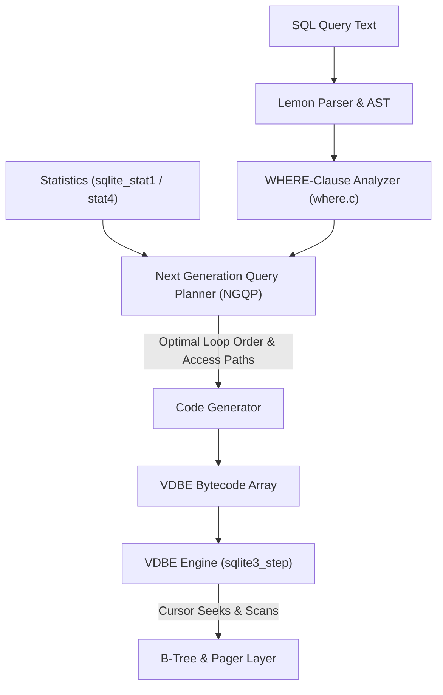

# Module 07: The Query Planner and the VDBE

Every SQL statement SQLite runs is first compiled into a **bytecode program** for the Virtual DataBase Engine (VDBE). The program is chosen by a cost-based **query planner**, the "Next-Generation Query Planner" (NGQP) since 3.8.0 (2013). Reading both outputs is a core skill: `EXPLAIN QUERY PLAN` says _which_ access paths were chosen, and `EXPLAIN` says _exactly what the engine will do_. This module teaches both, states the precise rules that decide whether an index can be used, and shows how statistics (`ANALYZE`, `sqlite_stat1`, `sqlite_stat4`, `PRAGMA optimize`) change the plan.

> **Owned elsewhere.** Index theory (clustered vs secondary, composite ordering, skip-scan in general) is in [data-systems Module 03 § 1](../../../architecture/data-systems/modules/03-indexing-theory-and-vector-search.md#1-classical-index-architecture-clustered-unclustered-and-composite). A full cost-model treatment for PostgreSQL is in [technologies/postgres Module 07](../../postgres/modules/07-query-planning-cost-model-and-tuning.md). Here: the SQLite realisation and its rules.

Proofs: [`examples/ts/07-query-planner-and-vdbe.test.ts`](../examples/ts/07-query-planner-and-vdbe.test.ts) (19 tests over a 5,000-row `orders` table).

---

## 1. From SQL to bytecode

The code generator walks the parse tree and emits VDBE instructions. For a `SELECT` with a `WHERE` clause, the critical step is **WHERE-clause analysis** (`where.c`):

1. Split the `WHERE` into AND-connected **terms**.
2. For each term, record which tables it constrains and whether it has an indexable form (`column op expression`).
3. For each table, enumerate candidate **access paths**: full scan, rowid lookup or range, each usable index (equality prefix plus at most one range), automatic indexes, OR-by-union.
4. Let the NGQP pick a **join order and an access path per table** that minimise estimated cost.
5. Emit nested loops, one per table, in that order, with the chosen cursor operations.



SQLite executes joins **only as nested loops**. There is no hash join and no merge join in the core. Fast joins therefore depend entirely on an index on the inner table's join column, or on an automatic index that SQLite builds for the duration of the statement (§ 5).

---

## 2. The VDBE

### 2.1 Model

The VDBE is a **register-based** virtual machine ([opcode.html](https://www.sqlite.org/opcode.html)). A program is an array of instructions, each with an opcode and up to five operands `P1`–`P5` (`P4` may be a string, a function pointer, a key description and so on). Registers hold SQL values. **Cursors** are open handles on B-trees: a table cursor iterates rowids, an index cursor iterates keys.

```sql
EXPLAIN SELECT a FROM t;
```

| addr | opcode | p1 | p2 | p3 | Meaning |
| --- | --- | --- | --- | --- | --- |
| 0 | `Init` | 0 | 7 | 0 | Jump to 7: the setup code is placed at the end |
| 1 | `OpenRead` | 0 | 2 | 0 | Cursor 0 on the B-tree rooted at page 2 (table `t`) |
| 2 | `Rewind` | 0 | 6 | 0 | Move to the first row; jump to 6 if the table is empty |
| 3 | `Column` | 0 | 0 | 1 | Register 1 ← column 0 of the current row |
| 4 | `ResultRow` | 1 | 1 | 0 | Return register 1 as a row: `sqlite3_step()` returns `SQLITE_ROW` here |
| 5 | `Next` | 0 | 3 | 0 | Advance; loop back to 3 while rows remain |
| 6 | `Halt` | 0 | 0 | 0 | End of program: `SQLITE_DONE` |
| 7 | `Transaction` | 0 | 0 | … | Start a read transaction (SHARED lock or WAL snapshot); check the schema cookie |
| 8 | `Goto` | 0 | 1 | 0 | Back to the loop |

(This listing is the exact output of better-sqlite3 13.0.3. Addresses and `p4` details vary between versions, so the test asserts the presence of the opcodes, not their addresses.)

Several design points are visible in this listing:

- **`Transaction` checks the schema cookie** ([Module 04](./04-file-format-and-b-trees.md#2-the-100-byte-header)). If another connection changed the schema since the statement was prepared, the step fails with `SQLITE_SCHEMA` internally and `sqlite3_prepare_v2` statements are **re-prepared automatically**. That is why a prepared statement can suddenly use a new index.
- **`ResultRow` suspends the program.** `sqlite3_step()` returns to the caller in the middle of the loop, so rows are produced lazily: this is the iterator in `stmt.iterate()`.
- **`Column` decodes the record lazily**, walking serial types as described in [Module 04 § 5.2](./04-file-format-and-b-trees.md#52-records). Selecting fewer columns does less decoding.

### 2.2 Access patterns in bytecode

| Pattern | Characteristic opcodes | Proven |
| --- | --- | --- |
| Full table scan | `OpenRead` table, `Rewind` / `Next` | yes |
| Rowid lookup | `SeekRowid` (no loop) | yes |
| Index search, then table | two `OpenRead` (index and table), `SeekGE`/`SeekLE`, `IdxGT`/`IdxLT`, `DeferredSeek` | yes: 2 cursors |
| Covering index | one `OpenRead` on the index only; `Column` reads from the index cursor | yes: 1 cursor |
| Sorting | `SorterOpen`, `SorterInsert`, `SorterSort`, `SorterData` | – |
| Automatic index | `OpenAutoindex`, `IdxInsert` before the loop | – |
| Bloom filter (3.38+) | `FilterAdd`, `Filter` | – |

better-sqlite3 13 adds `db.explain()` and `statement.toString()` helpers. With the `bytecode()` and `tables_used()` table-valued functions (compile option `SQLITE_ENABLE_BYTECODE_VTAB`), the program can be queried with SQL; neither Node binding enables that option.

---

## 3. Reading EXPLAIN QUERY PLAN

`EXPLAIN QUERY PLAN` ([eqp.html](https://www.sqlite.org/eqp.html)) returns a tree of `(id, parent, notused, detail)` rows. The `detail` vocabulary:

| Detail text | Meaning |
| --- | --- |
| `SCAN t` | Full scan of the table B-tree. |
| `SCAN t USING INDEX i` / `USING COVERING INDEX i` | Full scan in index order (for `ORDER BY`), possibly without touching the table. |
| `SEARCH t USING INDEX i (a=? AND b>?)` | Seek with an equality prefix and one range on the index. |
| `SEARCH t USING COVERING INDEX i (...)` | As above; the index contains every needed column, so the table is not read. |
| `SEARCH t USING INTEGER PRIMARY KEY (rowid=?)` | Direct B+tree lookup by rowid. |
| `SEARCH t USING INDEX i (ANY(a) AND b=?)` | **Skip-scan**: iterate the distinct values of `a`, seek `b` in each (§ 7.3). |
| `SEARCH t USING AUTOMATIC COVERING INDEX (c=?)` | An index built for this statement only (§ 5). |
| `USE TEMP B-TREE FOR ORDER BY` / `GROUP BY` / `DISTINCT` | An explicit sort; no index supplied the order. |
| `MULTI-INDEX OR` | Each OR branch uses its own index; the rowids are unioned. |
| `MATERIALIZE x` / `CO-ROUTINE x` | A subquery or CTE computed into a temp table, or run as a co-routine that yields rows on demand. |
| `CORRELATED SCALAR SUBQUERY` | A subquery re-evaluated per outer row. |
| `BLOOM FILTER ON t (c=?)` | A Bloom filter that skips inner-loop seeks that cannot match. |

The lines appear in **loop nesting order**: the first table listed is the outer loop. The CROSS JOIN test reads the join order straight from that list.

---

## 4. When can an index be used?

### 4.1 Indexable terms

A `WHERE` term can drive an index only if it has one of these forms, where _column_ is a column of the index (or the exact indexed expression), and _expr_ does not reference the same table ([optoverview § 2](https://www.sqlite.org/optoverview.html)):

```text
column = expr      column IS expr     column IN (list or subquery)
column > expr      column >= expr     column < expr     column <= expr
column BETWEEN expr AND expr          column IS NULL
column LIKE pattern / column GLOB pattern   (only under the § 6 conditions)
```

### 4.2 The prefix rule for composite indexes

For an index on `(c1, c2, …, cn)`, a single seek can use:

- **equality** (`=`, `IS`, `IN`) on a **leftmost prefix** `c1 … ck`, then
- **at most one range** (`<`, `>`, `BETWEEN`, prefix `LIKE`) on `ck+1`;

after the range, further columns cannot narrow the seek, although they can still be checked from the index without reading the table. The test shows `(customer, created)` used for `customer = ? AND created > ?`, used as a _covering_ index for `SELECT created … WHERE customer = ?`, and not used for `created > ?` alone, which is a scan. The only exception to the prefix rule is a skip-scan with statistics (§ 7.3).

### 4.3 Conditions that silently disable an index

| Cause | Example | Fix | Proven |
| --- | --- | --- | --- |
| A function or arithmetic on the column | `lower(email) = ?`, `total + 0 = ?` | An **expression index** on exactly that expression | yes |
| Unary `+` | `+customer = ?` | Intentional: it is SQLite's documented way to _disqualify_ an index | yes |
| Collation mismatch | `name = ? COLLATE NOCASE` vs a BINARY index | Index with the same collation | via LIKE tests |
| Affinity mismatch the planner cannot resolve | comparing an INTEGER column with a BLOB | Bind values of the column's type | – |
| `OR` across columns without an index on each | `a = ? OR b = ?` with only `a` indexed | Index both (`MULTI-INDEX OR`, proven), or rewrite as `UNION` | yes |
| Partial index predicate not implied | index `WHERE status = 'open'`, query without that term | Repeat the predicate in the query, literally | yes |
| `NOT INDEXED` | `FROM orders NOT INDEXED` | Intentional | yes |

The partial-index rule deserves precision. The planner proves that the query's `WHERE` **implies** the index's `WHERE` using simple syntactic rules: the term must appear in the query as written (`status = 'open'`), or as a narrower form of `IS NOT NULL` and a few similar shapes. It does not do general theorem proving, so do not rely on a bound parameter to satisfy the index predicate: write the constant into the query. In exchange, a partial index can be tiny: the test's index over 100 of 5,000 rows fits in at most two pages.

### 4.4 Covering indexes

When an index contains every column the query reads, the table B-tree is never opened (proven at the bytecode level: one cursor instead of two). SQLite has no `INCLUDE` clause; add the extra columns to the end of the index key instead. A rowid table's index always carries the rowid, so `SELECT id … WHERE indexed_col = ?` with `id INTEGER PRIMARY KEY` is always covering.

---

## 5. Joins, automatic indexes and Bloom filters

Because joins are nested loops, an inner table without a usable index would be scanned once per outer row, O(N·M). If the planner estimates that building a temporary index first is cheaper, it creates an **automatic index** on the join column for the duration of the statement, shown as `AUTOMATIC COVERING INDEX` or `AUTOMATIC PARTIAL COVERING INDEX` (proven). `PRAGMA automatic_index = OFF` disables them (proven). Seeing an automatic index in a frequent query is a strong hint that a permanent index is missing: you pay for the build on every execution.

Since 3.38.0 the planner may also build a **Bloom filter** on an inner table's join keys, so that the inner loop can skip seeks for outer rows that cannot match. It appears as `BLOOM FILTER ON` in the plan. It mostly helps star-schema queries with selective dimension filters.

**Join order.** The NGQP models join ordering as a shortest-path problem over a graph of partial plans and keeps only the best few partial paths at each step, a bounded search, rather than enumerating every permutation ([queryplanner-ng](https://www.sqlite.org/queryplanner-ng.html)). Two documented controls exist:

- `CROSS JOIN` is never reordered: the left table is always the outer loop (proven).
- `likelihood(expr, p)`, `unlikely(expr)` and `likely(expr)` tell the planner the selectivity of a term without changing its value.

---

## 6. The LIKE and GLOB optimisation

`name LIKE 'abc%'` can be rewritten into a range, `name >= 'abc' AND name < 'abd'`, and served by an index, but only when every one of these conditions holds ([optoverview § 5](https://www.sqlite.org/optoverview.html#the_like_optimization)):

1. The left-hand side is an indexed column with **TEXT affinity**.
2. The right-hand side is a string literal, or a parameter bound to a string, that **does not begin with a wildcard**. `'%abc'` always scans (proven).
3. The `ESCAPE` clause, if any, follows the documented restrictions.
4. **Collation matches the operator's case sensitivity**:
   - `LIKE` is case-insensitive by default, so the index must use `COLLATE NOCASE` (proven: `SEARCH q USING COVERING INDEX q_nocase (name>? AND name<?)`);
   - `GLOB` is case-sensitive, so it uses a `BINARY` index (proven);
   - with `PRAGMA case_sensitive_like = ON`, `LIKE` becomes case-sensitive and uses the `BINARY` index (proven), but that pragma is **deprecated** and changes semantics for the whole connection.
5. The `LIKE` operator has not been overridden by an application-defined `like()` function. ICU builds override it, which disables the optimisation.

The common bug: a `TEXT` column with the default BINARY index, queried with `LIKE 'prefix%'`, scans the whole table (proven: `SCAN p`). Either declare the column or the index `COLLATE NOCASE`, or query with `GLOB 'prefix*'` when case-sensitive matching is acceptable. For substring or word search, `LIKE '%term%'` cannot use any B-tree index; use FTS5 ([Module 08](./08-extensions-fts5-rtree-and-virtual-tables.md#2-fts5-full-text-search)).

---

## 7. Statistics

### 7.1 ANALYZE and `sqlite_stat1`

Without statistics, the NGQP uses built-in guesses (for example, that an equality on an indexed column matches about 10 rows). `ANALYZE` scans indexes and stores one row per index in `sqlite_stat1`:

```text
tbl     idx                      stat
orders  orders_status_customer   5000 2500 10
                                 │    │    └ average rows per distinct (status, customer)
                                 │    └ average rows per distinct status
                                 └ rows in the index
```

The test checks those exact numbers: 5,000 rows, 2,500 per status (2 statuses), and at most 10 per pair.

#### Selectivity math in `sqlite_stat1` and `sqlite_stat4`

The `stat` column in `sqlite_stat1` contains integers `nRow a0 a1 ... aN`:

- `nRow`: total rows in the index B-tree.
- `a0`: integer average `nRow / distinct(col0)`, the estimated rows matched by `WHERE col0 = ?`.
- `ai`: integer average rows matching a given prefix of `i + 1` columns.

When compiled with `SQLITE_ENABLE_STAT4` (enabled in better-sqlite3), `ANALYZE` samples up to ~24 representative keys across the index and stores histogram boundary records in `sqlite_stat4` with columns `(tbl, idx, nEq, nLt, nDLt, sample)`:

- `sample`: serialized binary image of the sampled index key.
- `nEq`: array of integers; `nEq[i]` is the exact row count matching the first `i + 1` columns of `sample`.
- `nLt`: array of integers; `nLt[i]` is the count of rows whose first `i + 1` columns are strictly less than `sample`.
- `nDLt`: array of integers; `nDLt[i]` is the count of distinct prefix values strictly less than `sample`.

When planning an equality predicate `WHERE col0 = ?` with literal value $V$:

1. Binary search identifies adjacent samples $S_k$ and $S_{k+1}$ such that $S_k \le V < S_{k+1}$.
2. If $V = S_k$, the estimated selectivity is exact: $\text{Est} = nEq_k[0]$.
3. If $S_k < V < S_{k+1}$, the planner assumes uniform distribution across the intervening distinct keys and interpolates:

$$\text{Est} = \frac{nLt_{k+1}[0] - (nLt_k[0] + nEq_k[0])}{nDLt_{k+1}[0] - nDLt_k[0] - 1}$$

This histogram math allows the planner to recognize non-uniform skew (for example, a status column where 99.9% of rows are `'completed'` and only 0.1% are `'failed'`), choosing index seeks for rare keys and full table scans for common keys.

### 7.2 PRAGMA optimize

`ANALYZE` on a large database is expensive and its results go stale. The [recommended pattern](https://www.sqlite.org/lang_analyze.html#autoanalyze) since 3.46 is:

```sql
PRAGMA optimize = 0x10002;   -- right after opening a long-lived connection (0x10000 = consider all tables)
PRAGMA optimize;             -- periodically (e.g. hourly) and/or just before closing a connection
PRAGMA analysis_limit = 400; -- optional: approximate ANALYZE by sampling about 400 rows per index
```

`PRAGMA optimize` runs `ANALYZE` only on tables whose statistics are missing or appear stale, based on what queries the connection has run and on row-count changes. The test shows it creating `sqlite_stat1` on a table that had none.

### 7.3 Skip-scan

With statistics showing that the leading column of an index has **few distinct values**, the planner can use the index even without a constraint on that column. It iterates each distinct leading value and seeks the second column within it. The test proves the switch: before `ANALYZE` the query `WHERE customer = 7` scans; after `ANALYZE` the plan is `ANY(status) AND customer=?` on `(status, customer)`. Skip-scan is never used without statistics, which is one more reason to run `PRAGMA optimize`.

### 7.4 Statistics as a liability

Statistics are data, so they can be wrong. The negative test hand-edits `sqlite_stat1` (and deletes the STAT4 samples, which would otherwise take precedence) so that `status` looks unique and `customer` looks unselective. After reloading with `ANALYZE sqlite_schema`, the planner switches to the `status` index, a plan that reads half the table. The same thing happens naturally when statistics were collected on an empty or very different dataset (for example, `ANALYZE` in a migration before the data load). Two defences exist:

- run `PRAGMA optimize` routinely, so statistics follow the data;
- for applications that need **plan stability**, the compile-time option `SQLITE_ENABLE_QPSG` (query planner stability guarantee) makes the plan depend only on the schema and statistics, not on bound parameter values, and you can ship a fixed `sqlite_stat1` with the application.

---

## 8. Subqueries, views and CTEs

The planner rewrites before it plans:

- **Flattening.** A subquery in `FROM` (or a view, or a CTE used once) is merged into the outer query when the documented flattening conditions hold, so indexes on the underlying tables become usable.
- **Co-routines.** When it cannot flatten, it may run the subquery as a co-routine that yields rows to the outer loop on demand (`CO-ROUTINE` in the plan), instead of materialising it.
- **Push-down.** `WHERE` terms of the outer query are pushed into a subquery that cannot be flattened, when that is valid.
- **`IN (subquery)`** becomes an ephemeral index probed per outer row. Since 3.54.0, a `DISTINCT` inside such a subquery is ignored as redundant.

`AS MATERIALIZED` and `AS NOT MATERIALIZED` override these decisions for CTEs ([Module 03](./03-sql-dialect-and-features.md#22-materialisation-hints)).

---

## 9. Then vs now

| Version | Change | Practical effect |
| --- | --- | --- |
| 3.8.0 (2013) | Next-Generation Query Planner | Better join orders; occasional plan changes on upgrade. |
| 3.8.1 | `sqlite_stat4` replaces `sqlite_stat3` | Per-value selectivity; needs `SQLITE_ENABLE_STAT4`. |
| 3.18.0 (2017) | `PRAGMA optimize` | Cheap, incremental statistics maintenance. |
| 3.32.0 | `analysis_limit` | Approximate `ANALYZE` on large tables. |
| 3.38.0 | Bloom filters in joins | Faster star joins. |
| 3.46.0 | `PRAGMA optimize` improvements: automatic analysis limit, bit `0x10000` to check all tables, re-analysis of tables without statistics | Recommended pattern becomes `optimize = 0x10002` at open. |
| 3.48.0 | Better `EXPLAIN QUERY PLAN` output for covering indexes | Plan text changed slightly; do not assert exact strings across versions. |
| 3.49.0 | Planner improvements for `WITHOUT ROWID` tables and star-schema joins | – |
| 3.54.0 | Expression indexes not updated when the indexed value is unchanged; `expr OR TRUE` / `OR FALSE` simplification; `DISTINCT` ignored in `IN (SELECT …)`; faster `UNION … LIMIT 1` | Cheaper `UPDATE`s on tables with expression indexes. |

Plan output is **not a stable interface**. Tests that pin exact `EXPLAIN QUERY PLAN` strings break on upgrades; assert on the stable parts (`SCAN` vs `SEARCH`, the index name), as this track's tests do with regular expressions.

---

## 10. A tuning procedure

```text
TUNE(query)
  1  run EXPLAIN QUERY PLAN; note every SCAN, TEMP B-TREE and AUTOMATIC INDEX
  2  for each SCAN of a large table: is there an indexable term (§ 4.1)? if not, why not (§ 4.3)?
  3  design an index: equality columns first, then the one range column, then ORDER BY columns,
     then the remaining selected columns if the index should cover the query
  4  for low-selectivity filters on a few values: consider a partial index
  5  run PRAGMA optimize (or ANALYZE) so the planner knows the new index's selectivity
  6  re-run EXPLAIN QUERY PLAN and measure (CLI: .timer on; code: wall time over many runs)
  7  check the write cost: every index adds a B-tree write per INSERT and per UPDATE of its columns
```

The CLI's `.expert` command automates steps 2–3 by proposing indexes for a query.

#### Worked query tuning walkthrough: unindexed scan vs index seek with deferred seek

Consider an events table in an audit logging service:

```sql
CREATE TABLE events (
  id INTEGER PRIMARY KEY,
  tenant_id INTEGER NOT NULL,
  status TEXT NOT NULL,
  created_at INTEGER NOT NULL,
  payload TEXT NOT NULL
);
```

We execute a query filtering by tenant and status, ordered by creation timestamp:

```sql
SELECT payload FROM events
WHERE tenant_id = 42 AND status = 'active'
ORDER BY created_at DESC
LIMIT 10;
```

##### Before optimization (unindexed full-table scan)

Without an index covering the filtered predicates, `EXPLAIN QUERY PLAN` reports:

```text
QUERY PLAN
|--SCAN events
`--USE TEMP B-TREE FOR ORDER BY
```

The corresponding VDBE bytecode program (`EXPLAIN`) executes a full table scan and intermediate memory sort:

- `OpenRead` opens a table cursor on `events`.
- `Rewind` repositions to the first record in the table B-tree.
- `Column` extracts `tenant_id` and `status` for every row, evaluating filter predicates via conditional jump instructions.
- `SorterOpen` allocates an in-memory temporary B-tree; `SorterInsert` pushes every passing row into the sorter.
- `SorterSort` sorts the accumulated rows by `created_at DESC` before emitting rows via `ResultRow`.

##### Index optimization

We create a composite descending index matching the equality columns followed by the sort order:

```sql
CREATE INDEX idx_events_search ON events (tenant_id, status, created_at DESC);
```

##### After optimization (index seek with DeferredSeek)

`EXPLAIN QUERY PLAN` verifies that the full scan and temporary sorter B-tree are eliminated:

```text
QUERY PLAN
`--SEARCH events USING INDEX idx_events_search (tenant_id=? AND status=?)
```

Inspecting the optimized VDBE bytecode via `EXPLAIN` reveals how cursors and seeks interact:

| addr | opcode | p1 | p2 | p3 | p4 | Meaning |
| --- | --- | --- | --- | --- | --- | --- |
| 1 | `OpenRead` | 0 | 2 | 0 | root=2 | Open table cursor 0 on `events` (B-tree root page 2) |
| 2 | `OpenRead` | 1 | 3 | 0 | k(4,...) | Open index cursor 1 on `idx_events_search` (B-tree root page 3) |
| 3 | `SeekGE` | 1 | 12 | 1 | 2 | Binary search index cursor 1 to the first key where `tenant_id = 42 AND status = 'active'` |
| 4 | `IdxGT` | 1 | 12 | 1 | 2 | Check if index cursor 1 has advanced beyond the equality prefix; if so, jump to addr 12 (break loop) |
| 5 | `DeferredSeek` | 1 | 0 | 0 | – | Record intent to seek table cursor 0 to the rowid of index cursor 1, postponing physical I/O |
| 6 | `Column` | 0 | 4 | 2 | – | Seek table cursor 0 only upon accessing column 4 (`payload`), reading it into register 2 |
| 7 | `ResultRow` | 2 | 1 | 0 | – | Yield row containing register 2 to caller via `sqlite3_step()` |
| 8 | `DecrJumpZero` | 3 | 12 | 0 | – | Decrement `LIMIT` counter (register 3); jump to addr 12 when 0 rows remain |
| 9 | `Next` | 1 | 4 | 0 | – | Advance index cursor 1 to the next descending entry; loop back to addr 4 |
| 12 | `Halt` | 0 | 0 | 0 | – | Execution finished (`SQLITE_DONE`) |

Mechanics of key opcodes in this pipeline:

- **`SeekGE` and `IdxGT`**: `SeekGE` executes a binary search to find the lower bound of the index range. In each iteration, `IdxGT` verifies that the index cursor has not stepped past the upper prefix boundary, terminating the scan without examining irrelevant records.
- **`DeferredSeek`**: Postpones seeking the main table B-tree until opcode `Column` accesses a field not present in the index. If all fields are satisfied by the index (a covering index), `DeferredSeek` and the table cursor `OpenRead` are eliminated entirely.
- **Sorter elimination**: Because `idx_events_search` stores records pre-sorted in the requested order (`created_at DESC`), the query engine skips `SorterOpen` and `SorterSort`, streaming rows directly to the caller with $O(1)$ memory.

---

## 11. Production failure modes

1. **`LIKE 'prefix%'` scans** because the index is BINARY. Proven.
2. **Function-wrapped columns** (`date(created)`, `lower(email)`) defeat indexes. Proven.
3. **Partial index ignored** because the query states the predicate differently or binds it as a parameter.
4. **Statistics collected before the data load**, or hand-edited, mislead the planner. Proven.
5. **No statistics at all**, so skip-scan and good join orders are never chosen. Proven for skip-scan.
6. **Automatic indexes on hot queries**, rebuilt on every execution.
7. **Unindexed foreign-key columns** make cascades and joins quadratic ([Module 02](./02-type-system-and-schema.md#61-index-the-child-column)).
8. **Over-indexing.** Each index slows every write and enlarges the WAL; an index nobody uses is pure cost.
9. **Asserting exact plan strings in tests**, which break on upgrades.

---

## 12. Interview Drill

<details><summary>1. What is the VDBE, and what does <code>EXPLAIN</code> show that <code>EXPLAIN QUERY PLAN</code> does not?</summary>

A register-based virtual machine that executes a compiled bytecode program per prepared statement, with cursors over B-trees. `EXPLAIN` lists every instruction (`OpenRead`, `SeekGE`, `Column`, `ResultRow`, `Next`…), so you see exactly how many cursors are opened, whether the table is touched for a covering index, where sorting happens, and where the transaction starts. `EXPLAIN QUERY PLAN` only summarises the chosen access path and join order per table.
</details>

<details><summary>2. Given an index on <code>(a, b, c)</code>, which of these use it to seek: <code>a=1 AND c=3</code>; <code>b=2</code>; <code>a=1 AND b>2 AND c=3</code>; <code>a IN (1,2) AND b=3</code>?</summary>

`a=1 AND c=3`: seeks on `a` only; `c` is checked from the index entries. `b=2`: no seek (scan), unless statistics show `a` has few distinct values, in which case a skip-scan is possible. `a=1 AND b>2 AND c=3`: seeks on `a` with a range on `b`; `c` is checked but cannot narrow the seek. `a IN (1,2) AND b=3`: seeks on both, once per IN value.
</details>

<details><summary>3. Why does <code>WHERE name LIKE 'ab%'</code> scan even though <code>name</code> is indexed? Give two fixes.</summary>

`LIKE` is case-insensitive by default, so the range rewrite is valid only on an index with NOCASE collation, and the default index is BINARY. Fix: create the index (or declare the column) `COLLATE NOCASE`, or use `GLOB 'ab*'` with the BINARY index if case-sensitive matching is acceptable. The deprecated `case_sensitive_like` pragma also works but changes semantics for the connection.
</details>

<details><summary>4. What does SQLite do for a join when the inner table has no index on the join column?</summary>

Joins are always nested loops. Without an index, the planner may build an automatic (transient) index on the inner table for the duration of the statement, and since 3.38 it may add a Bloom filter. Otherwise it scans the inner table once per outer row. A recurring automatic index in a hot query means a permanent index is missing.
</details>

<details><summary>5. What do the numbers in <code>sqlite_stat1.stat</code> mean, and why does STAT4 matter?</summary>

The first number is the number of rows in the index; each following number is the average number of rows that share the same values in the first 1, 2, … columns. STAT4 adds sampled key values with their distributions, so the planner can estimate selectivity for a specific literal (a rare status, for example) instead of using an average that hides skew.
</details>

<details><summary>6. How should a long-running service keep statistics current?</summary>

Run `PRAGMA optimize = 0x10002` right after opening each long-lived connection, run `PRAGMA optimize` periodically and before closing, and optionally set `analysis_limit` to bound the cost. `optimize` only analyses tables whose statistics are missing or appear stale, so it is cheap to call routinely.
</details>

<details><summary>7. When is a partial index chosen, and what is its advantage?</summary>

Only when the planner can prove from the query's `WHERE` clause, using simple syntactic rules, that every row the query needs satisfies the index's `WHERE` predicate. Usually that means the same term written literally in the query; do not rely on a bound parameter. The advantage is size and write cost: an index over 2 % of rows is tiny, fits in cache, and is only maintained when matching rows change.
</details>

<details><summary>8. How do you force or forbid a particular plan in SQLite?</summary>

`INDEXED BY idx` forces an index (and errors if it cannot be used), `NOT INDEXED` forbids indexes for a table, unary `+col` disqualifies a single term from index use, `CROSS JOIN` fixes the join order, and `likelihood()` / `unlikely()` adjust selectivity estimates. Shipping a fixed `sqlite_stat1`, with QPSG builds, stabilises plans further.
</details>

<details><summary>9. Why might a prepared statement's plan change in the middle of a process's life?</summary>

When the schema cookie changes (another connection created an index, ran `ANALYZE`, or changed a table), the statement's `Transaction` opcode detects it, and a statement prepared with `sqlite3_prepare_v2/v3` is automatically re-prepared, possibly with a different plan. With `SQLITE_ENABLE_STAT4`, bound parameter values can also trigger re-preparation, because a better plan may exist for the specific value.
</details>
